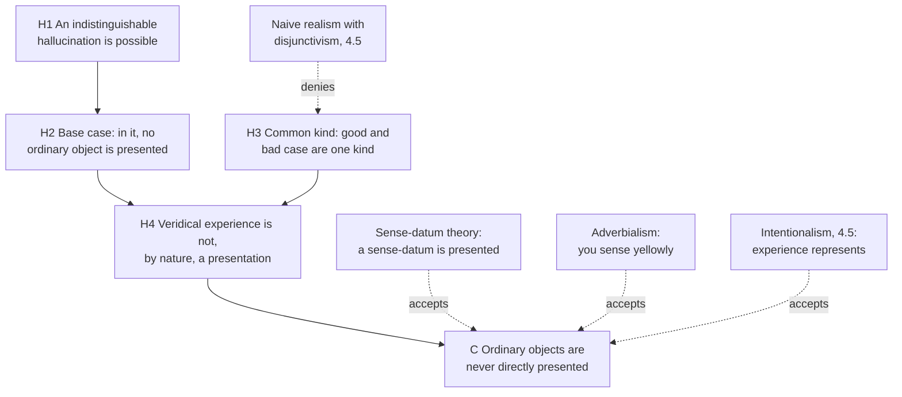
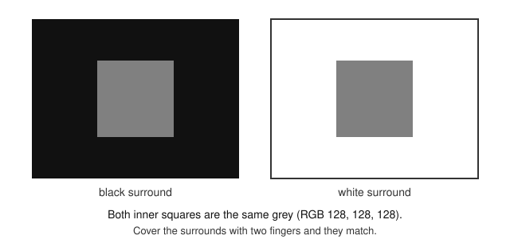

# Philosophy of Mind · Lesson 4.4: The problem of perception

> ⏱ ~15 min · Module 4: Intentionality and perception · Builds on: [4.1](04-01-intentionality-and-folk-psychology.md), [3.2](03-02-representationalism-and-higher-order-theories.md), [`modern-philosophy` 4.5](../../modern-philosophy/lessons/04-05-reid-common-sense-against-the-way-of-ideas.md) · Unlocks: [4.5](04-05-intentionalism-naive-realism-and-disjunctivism.md)

## Why this matters

Point out a star to a child tonight and you point along light that may have left it before either of you was born, from a star that may no longer exist. Yet seeing feels like the world laid open: the star, there, now. Illusion, hallucination and the speed of light each suggest that what you are aware of is something nearer than the world.

## The idea

[4.1](04-01-intentionality-and-folk-psychology.md) made [intentionality](../reference.md#intentionality) the mark of the mental: states of mind are about things, even things that do not exist. Perception is aboutness at its most intimate: a mug you see seems simply there, its blue and its shape given to you. Call this default [naive realism](../reference.md#naive-realism): in seeing, ordinary objects are themselves directly presented to you, and how they look is fixed partly by how they are.

Two kinds of error threaten it ([illusion and hallucination](../reference.md#illusion-and-hallucination)). In an **illusion** you perceive a real object that looks other than it is: a white wall looks yellow under a sodium lamp. In a **hallucination** nothing is perceived, yet it seems as if something were. The mannequin taken for a woman in [`phenomenology-and-personalism` 1.2](../../phenomenology-and-personalism/lessons/01-02-the-anatomy-of-an-experience.md) is an illusion: something was there, seen wrongly.

Each error drives an argument with two moves. A **base case** shows that in the bad case you are not presented with the ordinary object; a **spreading step** gives the good case the same account, since from the inside the two can be alike. Two theories accepted the conclusion. [Sense-datum theory](../reference.md#sense-datum-theory) says you are aware of a private item that really has the qualities things seem to have; [adverbialism](../reference.md#adverbialism) says seeing yellow is a way of experiencing, with no object. [4.5](04-05-intentionalism-naive-realism-and-disjunctivism.md) takes the theories that resist.

Thomas Reid, who attacked the "ideal system" of ideas as the mind's immediate objects, is a direct realist, not a naive realist ([`modern-philosophy` 4.5](../../modern-philosophy/lessons/04-05-reid-common-sense-against-the-way-of-ideas.md)). Whether experience *justifies* belief is [`epistemology`](../../epistemology/syllabus.md)'s question; this lesson asks what perceiving *is*.

## Source

Russell, *The Problems of Philosophy* (Home University Library, 1912), ch. I, "Appearance and Reality" (Project Gutenberg #5827):

> [...] there is no colour which pre-eminently appears to be *the* colour of the table, or even of any one particular part of the table—it appears to be of different colours from different points of view, and there is no reason for regarding some of these as more really its colour than others. [...] But the other colours which appear under other conditions have just as good a right to be considered real; and therefore, to avoid favouritism, we are compelled to deny that, in itself, the table has any one particular colour. [...] Thus it becomes evident that the real table, if there is one, is not the same as what we immediately experience by sight or touch or hearing. The real table, if there is one, is not *immediately* known to us at all, but must be an inference from what is immediately known.

Two steps. The first is about the table: a symmetry premise ("to avoid favouritism") takes many equally good appearances to a table with no one colour "in itself". Nobody is fooled, so this is perceptual variation, not illusion. The second, flagged by "Thus it becomes evident", is about the mind, and it needs an unstated premise: what you *immediately* experience has the colour it appears to have. Just before, Russell grants that the colour depends "upon the table and the spectator"; a naive realist keeps that relational colour on the table.

## The argument

**A. The [argument from illusion](../reference.md#argument-from-illusion)**, in Tim Crane and Craig French's form (SEP, "The Problem of Perception", rev. 2021, after Howard Robinson, *Perception*, 1994). For a subject S:

**P1.** In an illusion it seems to S that something has a sensible quality F that the perceived object lacks. *In words:* the wall looks yellow and is white.

**P2.** ([Phenomenal Principle](../reference.md#phenomenal-principle).) If it sensibly seems to S that something is F, then S is directly presented with something that is F. *In words:* if something looks yellow, there is a yellow thing you are aware of.

**P3.** So in an illusion S is not directly presented with the perceived object. *In words:* the yellow thing is not the white wall (Leibniz's law), so the wall is not what you directly see.

**P4.** The same account of experience applies to veridical and illusory experiences. *In words:* good and bad cases feel alike and shade into one another, so they are one kind.

**P5.** If S is not directly presented with ordinary objects in veridical experience, S never is. *In words:* no other route to them is left.

**∴ C.** We are never directly presented with ordinary objects. *In words:* what you directly see is never the wall.

French and Lee Walters (2018) note a gap: P1, P2 and Leibniz's law yield only a yellow thing *distinct from* the wall, so P3 also needs their Exclusion Assumption: seeing that thing excludes seeing the wall.

**B. The [argument from hallucination](../reference.md#argument-from-hallucination).**

**H1.** For any veridical experience of an F, a hallucination indistinguishable from it by introspection is possible. *In words:* the brain could produce the same seeming with nothing there.

**H2.** In such a hallucination, S is directly presented with no ordinary object. *In words:* that is what a hallucination is, so no Phenomenal Principle is needed.

**H3.** ([Common-kind assumption](../reference.md#common-kind-assumption).) A veridical experience and its indistinguishable hallucination are fundamentally the same kind of experience, differing only in their causes. *In words:* one kind of event occurs in you either way.

**H4.** So veridical experience is not, by its nature, the direct presentation of an ordinary object. With P5, **∴ C** again. *In words:* what is true of the kind is true of the hallucination, which presents nothing.

**C. Sense-datum theory** accepts C and adds that something is always presented: a non-ordinary item with the qualities on show, through which you perceive the wall indirectly. G. E. Moore introduced the term in 1909 ("The Subject-Matter of Psychology"), Russell's 1912 book made it standard, and neither made sense-data mental by definition. Today's defenders, Robinson and John Foster (*The Nature of Perception*, 2000), take them to be mind-dependent and accept the cost to naturalism. About 5 percent of the 2020 PhilPapers survey's respondents accept or lean towards it.

**D. Adverbialism about experience** (C. J. Ducasse, 1942; Roderick Chisholm, *Perceiving*, 1957) rejects P2: when the wall looks yellow nothing yellow is present; you *sense yellowly*. That blocks the argument from illusion but not the one from hallucination, which never used P2, so she too accepts C. Frank Jackson (then a sense-datum theorist; the Jackson of [1.3](01-03-the-knowledge-argument.md)) pressed the [many-property problem](../reference.md#many-property-problem) (1975; *Perception*, 1977, ch. 3). Seeing a brown square beside a green triangle is "sensing brownly, squarely, greenly and triangularly", which fits a green square beside a brown triangle just as well. What binds brown to square seems to be an object having both, or a field with places. Adverbialists (Michael Tye, 1984) try to supply it without objects.

**Where the argument is weakest.** P2. The strongest objection (W. H. F. Barnes, 1944–45; G. E. M. Anscombe, 1965) calls it a fallacy: "looks yellow" no more entails a yellow thing than "looking for a unicorn" (the lesson's gloss) entails a unicorn. The strongest reply: P2 is a claim about experience, not logic, backed by explanation. C. D. Broad (*Scientific Thought*, 1923) asked why a penny looks elliptical rather than any other shape if nothing elliptical is before the mind. The defender concedes that P2 is a substantive thesis, deniable without contradiction. The objector concedes that she owes another explanation of the specific look: representation, a way of sensing, or the object's own look from here. The pressure then moves to H3, [4.5](04-05-intentionalism-naive-realism-and-disjunctivism.md)'s subject.

## Argument map

Three theories deny no premise and differ over what experience is instead; since H2 needs no Phenomenal Principle, only denying H1 or the spreading step stops the argument.

## Worked examples

**Example 1 (clean case: simultaneous contrast).** Unlike the textbook stick in water (used in [`modern-philosophy` 4.5](../../modern-philosophy/lessons/04-05-reid-common-sense-against-the-way-of-ideas.md)), this case you can check on screen.

The squares are the same grey, and the one on white looks darker; why the retina does this is [`neuroscience` 3.2](../../neuroscience/lessons/03-02-vision.md). Run A.

- **P1.** Identical squares that look different cannot both look as they are; take one that looks a shade G it lacks.

- **P2–P3.** Something you are aware of is G and the square is not, so that G thing is not the square; add the Exclusion Assumption and you do not see the square.

- **P4.** Slide the surround smoothly from white to black: the look changes by degrees, with no point where one kind of experience gives way to another. A. J. Ayer (1940) cited such continuous series for P4.

The theories part at P2: a darker sense-datum; sensing darker-greyly; the square represented as darker; or, for the naive realist, the square itself, whose look in this surround is a real relational feature (Bill Brewer, *Perception and Its Objects*, 2011).

**Example 2 (hard case: the time-lag argument).** A star 2,000 light-years away is seen by light 2,000 years old, and may have died since; Broad raised the case (*The Mind and Its Place in Nature*, 1925, ch. IV). The [time-lag argument](../reference.md#time-lag-argument), pressed for sense-data by Robinson (1994, ch. 3):

- **T1.** What you see now depends on light that left the star long ago, and the star may be gone.

- **T2.** What is directly presented exists, as presented, when the experience occurs.

- **T3.** So the star is not what you are directly presented with.

- **T4.** Every perception takes time: about 8.3 minutes for sunlight, under 2 nanoseconds for a mug half a metre away, plus the brain's delay. **∴** Nothing you directly perceive is an ordinary object as it now is.

Russell (*Problems*, ch. III) said it of the sun: "if the physical sun had ceased to exist within the last eight minutes, that would make no difference to the sense-data which we call 'seeing the sun'."

**Where it strains.** The naive realist denies T2: seeing reaches into the past, as hearing thunder after the lightning does (Russell's own example). Then is seeing a dead star veridical, illusory or hallucinatory? The definitions are silent, since both assume the object exists when seen. The sense-datum theorist replies with Russell: an experience that would be the same whether or not the star survived cannot have the star in its nature (the thought behind 4.5's screening-off argument). The naive realist replies that the star's having sent that light makes it a seeing; the intentionalist, that the experience misrepresents when. One side gives up "what you see is there now"; the other grants that a lag proves nothing without that causal premise.

## Watch out

- **You might think** any perceptual error is a hallucination, **but actually** an object seen wrongly (the mannequin, the grey square) is an illusion; a hallucination has no perceived object.

- **You might think** a sense-datum is by definition a mental image, **but actually** Moore's term was neutral, and Russell said his colour arguments did not prove the colour mental (*Problems*, ch. IV; see [`modern-philosophy` 3.4](../../modern-philosophy/lessons/03-04-berkeley-immaterialism.md)). Nor is "sense data" a name for Locke's ideas ([`modern-philosophy` 3.2](../../modern-philosophy/lessons/03-02-locke-qualities-substance-and-essence.md)).

- **You might think** rejecting the Phenomenal Principle solves the problem, **but actually** it blocks only the illusion argument. Adverbialists and intentionalists still accept C, and keep direct *perception* only by adding a causal condition (H. P. Grice, 1961).

- **You might think** naive realism says things are always as they look, **but actually** it is a thesis about the structure of experience, with its own accounts of illusion.

## One-liner

> Illusion suggests that what you see is sometimes not the object and hallucination that it never is; sense-datum theory puts a private item in its place, adverbialism a manner of sensing.

## Problems

**P1 (🟢)** *(Reconstruct: Exegetical (a)–(b) · Evaluative (c).)* Suppose a neurologist of the future could stimulate your visual cortex so that you have an experience you cannot tell, by introspection, from seeing a blue mug on your desk, while in fact you sit in a dark room with nothing in front of you.

(a) Reconstruct the argument from hallucination on this case in numbered premises, ending "∴ C. You are never directly presented with an ordinary object." Label the base case and the spreading step.

(b) Does any premise need the Phenomenal Principle? One sentence.

(c) An objector says that people who hallucinate often know at the time that what they see is not there, so the argument rests on fiction. Which premise does this target, and does it damage it? Two sentences.

**P2 (🟡)** *(Exegetical.)* Classify each case as an illusion or a hallucination. One line each: name the object perceived and the quality it looks to have and lacks, or say why nothing is perceived.

(i) At a ventriloquist's show, the voice seems to come from the dummy's moving mouth.

(ii) On a hot road a shimmering pool seems to lie ahead. A camera pointed at the spot records it too: it is light from the sky, bent by the hot air above the asphalt.

(iii) During brain surgery, electrical stimulation of a patient's visual cortex makes her see a spot of light where there is no light.

(iv) Macbeth sees a dagger in the air before him, handle towards his hand; he reaches to clutch it, cannot, and still sees it.

**P3 (🔴)** *(Counterexample: Evaluative (a)–(b).)* At a concert, a single loudspeaker plays two notes at once: a loud high note and a soft low note.

(a) Give the adverbialist's description of your experience, then describe a different experience the same description fits. Say why the usual fix for Jackson's brown square, adverbs indexed to places in the visual field, does not separate these two. Three sentences.

(b) State the adverbialist's strongest reply to your counterexample and what it costs. Any verdict on whether it succeeds; 120 words or fewer.

Solutions

**P1** *(Exegetical (a)–(b) · Evaluative (c))*

**Must hit, strict (a):**

- A possibility premise: an experience indistinguishable by introspection from seeing the mug can occur with no mug there.

- The base case, labelled: in that experience you are directly presented with no ordinary object.

- The spreading step, labelled: the common-kind assumption (the veridical experience of the mug and the stimulated one are fundamentally the same kind, differing only in causes), with the inference that the veridical experience does not, by its nature, present the mug.

- The generalizing premise (if not even veridical experience presents ordinary objects, none does), then C.

**Must hit, strict (b):** no. The base case follows from what a hallucination is: there is no mug to be presented. Only the argument from illusion needs the principle, to get from "looks F" to "something F is present".

**Must hit, any verdict (c):**

- The target is the possibility premise, not the base case or the spreading step.

- Whether it damages it: the premise asks only that an indistinguishable hallucination be *possible*, so recognized clinical hallucinations do not refute it. The objector must argue that such a hallucination is impossible, as J. L. Austin (1962) and Farid Masrour (2020) have questioned; the defender must say what supports the possibility, such as the same brain state produced without the mug.

**Wrong turns:** deriving the base case from the Phenomenal Principle; labelling the common-kind premise as the base case; answering (c) by denying the common-kind assumption, which the objection does not touch.

**Model answer:** (a) 1. An experience introspectively indistinguishable from seeing the blue mug can be produced by stimulation in a dark room with no mug there. 2. (Base case) In that experience you are directly presented with no ordinary object. 3. (Spreading step) Your veridical experience of the mug and the stimulated one are fundamentally the same kind of experience, differing only in their causes. 4. So your veridical experience does not, by its nature, directly present the mug. 5. If even veridical experience does not directly present ordinary objects, no experience does. ∴ C. You are never directly presented with an ordinary object. (b) No: premise 2 follows from there being no mug. (c) It targets premise 1. It does no damage as stated, because premise 1 needs only possibility; the objector would have to show that no brain state could produce the same seeming without the mug.

---

**P2** *(Exegetical)*

**Must hit, strict:**

- (i) Illusion. The voice is heard; it sounds located at the dummy's mouth, a location it lacks.

- (ii) Illusion. Something real is seen, the sky's light, and it looks like a bright pool lying on the road, where it is not. The camera shows there is something there to be seen.

- (iii) Hallucination. No light is there and no outside object is seen; the experience is produced by stimulating the cortex.

- (iv) Hallucination. There is no dagger, and nothing is seen as one.

**Accept:** for (ii), naming the object as the light, the sky or the hot air, if it is a real thing seen in the wrong place or guise. For (iv), the remark that Macbeth's hallucination is not "perfect", since touch exposes it: that bears on the possibility premise of the hallucination argument, not on the classification.

**Wrong turns:** calling the mirage a hallucination because there is no water. The test is whether something is perceived, not whether what it looks like exists. Calling (i) a false belief rather than an illusion: the voice goes on sounding as if from the dummy when you know better.

**Model answer:** (i) Illusion: the voice is heard, located at the dummy, where it is not. (ii) Illusion: the sky's light is seen, looking like water on the road. (iii) Hallucination: no light and no outside object is seen. (iv) Hallucination: there is no dagger to see, and touch confirms it.

---

**P3** *(Evaluative (a)–(b))*

**Must hit, any verdict (a):**

- The description: hearing loudly, highly, softly and lowly.

- A rival experience it fits: a loud low note with a soft high note. The two differ to the hearer, so a theory that describes them alike has left something out.

- Why place-indexing fails: both notes come from one loudspeaker and share a location, so nothing spatial settles which loudness goes with which pitch.

**Must hit, any verdict (b):**

- A real reply, stated precisely: either compound modifiers, each one way of hearing ("hearing loud-highly and soft-lowly"), or a non-spatial dimension doing the field's job, loudness indexed to pitch ("hearing loudly at the high pitch").

- Its cost: compounds need an operation that bundles qualities just as predicating them of one thing does, so the critic asks what the bundle is if not an object (a note). Pitch-indexing makes one quality the place where others sit, a structured field, which is what the problem said the adverbialist lacked, and it owes a reason why pitch rather than loudness plays that role.

- A verdict on whether the reply keeps adverbialism's promise of experience without objects.

**Wrong turns:** answering with two sound-data, which concedes the problem instead of replying for the adverbialist; saying the notes differ in location; treating the problem as one about knowing which note is which rather than about what the experience is.

**Model answer (b), one of several:** The best reply lets pitch do what space does in vision: you hear loudly-at-the-high-pitch and softly-at-the-low-pitch. The rival experience now gets a different description, so the counterexample is met. The cost is the structure. A dimension at which other qualities are located is the field Jackson said the adverbialist needed and lacked, and nothing in adverbialism explains why pitch, not loudness, is the dimension. The critic then asks how a loudness at a place in pitch differs from a note with two features. The adverbialist can answer that an articulated manner of hearing is still a manner, not a thing. On that answer the reply succeeds, but only by granting experience an internal structure much like an object's.

## Flashback

**From Lesson [4.2](04-02-naturalizing-content.md) (Naturalizing content):** *(Exegetical.)* Invented, written for this problem. A dog is trained for six months to sit when it smells a buried black truffle, and in the training plots nothing but truffles ever makes it sit. Call the state that makes it sit S. In its first season in the woods, while its handler still rewards every find, it sits over a buried fungus of another kind whose smell is only similar.

(a) On Dretske's 1981 learning-period theory, what does S mean, and is the token in the woods false? One sentence.

(b) Give Fodor's two 1984 objections as they apply to this dog. One line each.

(c) The trainer meant S to signal truffles. Why can a naturalist not let that settle what S means? One sentence.

Solution

**Must hit, strict (a):** S means *truffle here*, what it indicated while the dog was learning to token it, so the token over the other fungus is false.

**Accept (a):** *truffle smell here*, if the answer notes that the other fungus smells different, so the token is false on that reading too.

**Must hit, strict (b):**

- *Counterfactual:* had the other fungus been buried in the plots, it would have made the dog sit then too, so even in training S indicated *truffle or that fungus*, and the token in the woods is true.

- *No principled end:* the handler's rewards are still training the dog, so nothing marks where the content-fixing period stopped; if the first season counts, the lookalike tokens are inside it.

**Must hit, strict (c):** content fixed by what the trainer meant is borrowed from a mind, and [naturalizing content](../reference.md#naturalizing-content) must do without meaning and intention. This is Fodor's charge that learning is determinate only if a teacher meant the symbol for its target.

**Wrong turns:** answering (a) with the disjunction, which is the verdict of information alone, not of the learning-period theory; reading the counterfactual objection as about what happened in the plots, where only truffles did; answering (c) with selection history, a later repair.

**Model answer:** (a) *Truffle here*: only truffles caused S while the dog was learning, so the token in the woods is false. (b) The other fungus would have caused S in training too, so S indicated *truffle or that fungus* and the token is true; and the handler's rewards keep training the dog, so nothing fixes when the period closed. (c) The trainer's intention is a mind's, and a naturalistic theory may use only causes, laws, probabilities and biology.

## Connections

- **Backward:** [4.1](04-01-intentionality-and-folk-psychology.md) gave aboutness, and the hallucination is its hard case for perception: an experience as of a mug with no mug. The possibility premise has an ancestor in [`ancient-medieval-philosophy` 4.3](../../ancient-medieval-philosophy/lessons/04-03-the-skeptics.md), the Academic claim that any true impression has an indistinguishable false twin, aimed there at the Stoics' knowledge rather than at presentation. Berkeley's first *Dialogue* (1713) ran arguments from perceptual relativity to the conclusion that sensible qualities are ideas, and Russell's act-object reply is in [`modern-philosophy` 3.4](../../modern-philosophy/lessons/03-04-berkeley-immaterialism.md). Reid's case against the ideal system, whose P3 already states the common-kind argument for a fever, is [`modern-philosophy` 4.5](../../modern-philosophy/lessons/04-05-reid-common-sense-against-the-way-of-ideas.md). The [transparency of experience](../reference.md#transparency-of-experience) in [3.2](03-02-representationalism-and-higher-order-theories.md) is the observation naive realists start from.

- **Forward:** [4.5](04-05-intentionalism-naive-realism-and-disjunctivism.md) takes intentionalism, naive realism and disjunctivism, the screening-off argument, and what each says of the hallucinating subject; Boss 4 reads Hume's table. In Module 5 the hylomorphist joins the direct realists: Aquinas rejected the view that sense knows only its own impression, holding that the likeness is that *by which* sight sees (ST I q.85 a.2, read in [`thomistic-synthesis` 4.1](../../thomistic-synthesis/lessons/04-01-how-a-human-intellect-knows.md)).

- **Sideways:** whether experience justifies belief is [`epistemology` 2.2](../../epistemology/lessons/02-02-foundationalism.md) (the Sellarsian dilemma) and [3.3](../../epistemology/lessons/03-03-moore-and-the-dogmatist.md) (dogmatism, with a white wall lit red). The retina's contrast coding behind Example 1 is [`neuroscience` 3.2](../../neuroscience/lessons/03-02-vision.md). Husserl's profiles in [`phenomenology-and-personalism` 1.2](../../phenomenology-and-personalism/lessons/01-02-the-anatomy-of-an-experience.md) describe perspectival variation with no image standing in for the thing. "Adverbialism" in [`metaphysics` 5.4](../../metaphysics/lessons/05-04-endurance-perdurance-and-stages.md) is a different view, about temporary intrinsics.
