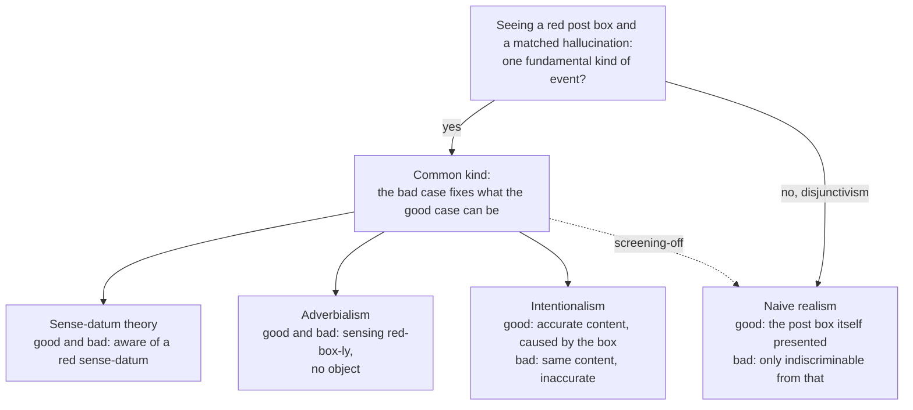

# Philosophy of Mind · Lesson 4.5: Intentionalism, naive realism, and disjunctivism

> ⏱ ~15 min · Module 4: Intentionality and perception · Builds on: [4.4](04-04-the-problem-of-perception.md), [3.2](03-02-representationalism-and-higher-order-theories.md), [`epistemology` 2.2](../../epistemology/lessons/02-02-foundationalism.md) · Unlocks: [5.1](05-01-the-soul-as-the-form-of-the-body.md), [6.3](06-03-do-language-models-understand.md)

## Why this matters

You are looking at a red post box. A good enough stimulator in your visual cortex could, in principle, give you an experience you could not tell from this one with no post box anywhere. Is what is going on in you now that same event, plus a post box at the far end? In the 2020 PhilPapers survey, 39 percent of respondents accepted or leaned towards representationalism about perceptual experience and 16 percent towards disjunctivism; this lesson is the premise between them.

## The idea

[4.4](04-04-the-problem-of-perception.md) left the [argument from hallucination](../reference.md#argument-from-hallucination). A hallucination presents no ordinary object. By the [common-kind assumption](../reference.md#common-kind-assumption), a perception you cannot tell from it is the same kind of event. So perception presents no ordinary object either. Sense-datum theory and adverbialism accepted the conclusion; the two modern answers deny different premises.

**Keep the common kind, drop the relation.** A radar screen shows a blip at bearing 040. The blip says there is an aircraft there, and it can say so falsely. What a true blip and a false one share is not an aircraft but a content: a way the world would have to be for the screen to be right. [Intentionalism](../reference.md#intentionalism) says experience is like that. It has [accuracy conditions](../reference.md#accuracy-conditions), and a hallucination is an experience whose conditions usually fail. [3.2](03-02-representationalism-and-higher-order-theories.md) used this idea to explain what experience is like ([first-order representationalism](../reference.md#first-order-representationalism)); here it is a theory of what perceiving is. "Content" means what [`epistemology` 2.2](../../epistemology/lessons/02-02-foundationalism.md) meant, what can be accurate or inaccurate, and whether it must be conceptual is left open in both courses.

**Keep the relation, drop the common kind.** A handshake needs two hands. The same movement of one arm into empty air is not a worse handshake but a different event. [Naive realism](../reference.md#naive-realism) says seeing is like that: the post box and its redness are constituents of your experience and make it what it is. Then the hallucination cannot be the same kind of event, and [disjunctivism](../reference.md#disjunctivism) says so. The most that is true of both cases is a disjunction: either I see a red post box, or it merely seems to me as if I do.

## The argument

**Intentionalism** (Gilbert Harman, 1990; Michael Tye, *Ten Problems of Consciousness*, 1995, and *Consciousness, Color, and Content*, 2000; Fred Dretske, *Naturalizing the Mind*, 1995; Alex Byrne, "Intentionalism Defended", 2001).

**I1.** Every perceptual experience represents the world as being some way, and it is accurate just if the world is that way. *In words:* experience says something, and can be wrong.

**I2.** A veridical experience, an illusion and a matching hallucination can share their content. *In words:* the common kind is a content, and hallucination is usually misrepresentation, which needs no object.

**I3 (strong intentionalism).** No two experiences differ in what they are like without differing in content (Byrne's form); Tye identifies the character with the properties represented. *In words:* fix what the experience says and you fix how it feels.

Intentionalists who also accept non-representational [qualia](../reference.md#qualia) (Christopher Peacocke, 1983; Ned Block) reject I3; the survey's "qualia theory", at 15 percent, is roughly theirs. The view rejects the Phenomenal Principle, so the [argument from illusion](../reference.md#argument-from-illusion) fails. It accepts the common kind, and with it the argument from hallucination's conclusion: experience never directly *presents* an object. It keeps direct realism in a causal sense: you see the post box directly when your experience represents it and is caused by it in the right way.

**Naive realism**, or the [relational view](../reference.md#relational-view) (M. G. F. Martin, "The Transparency of Experience", 2002, and later papers; John Campbell, *Reference and Consciousness*, 2002; Bill Brewer, *Perception and its Objects*, 2011). In veridical perception the objects and their features are constituents of the experience and fix its character. Campbell makes the relation three-place: subject, standpoint, object. Two arguments drive the view. Campbell's: experience is what lets you know which thing "that" refers to, and a representation cannot do this, since conceptual content presupposes the grasp it was meant to explain and non-conceptual content lacks the resources. Martin's is from introspection: experience seems to set the world itself before you, so naive realism lets the good cases be as they seem, while its rivals make every experience misleading about its own nature.

**Disjunctivism** (J. M. Hinton, "Visual Experiences", 1967, and *Experiences*, 1973; Paul Snowdon, "Perception, Vision and Causation", 1980–81; John McDowell, "Criteria, Defeasibility, and Knowledge", 1982; Martin). The naive realist grants that hallucinations present nothing and rejects the common-kind assumption. Disjunctivism is that negative thesis, held for different reasons. Martin's are phenomenological. McDowell's are epistemological ([epistemological disjunctivism](../reference.md#epistemological-disjunctivism)): an appearance is either a mere appearance or a fact making itself manifest, so a perceiver's grounds can be better than a hallucinator's. Whether experience justifies belief stays with `epistemology` (see Connections).

**From the bad case back to the good.** Howard Robinson's [causal argument](../reference.md#causal-argument-against-disjunctivism) (1985) says a [causally matching hallucination](../reference.md#causally-matching-hallucination), one with the same proximal brain state as a perception, is possible, and that the same proximal cause yields the same kind of immediate effect. Martin (2004) denies the principle for perception: the post box is a non-causal, constitutive condition of seeing it. He then states the stronger argument, the [screening-off argument](../reference.md#screening-off-argument) (2004, 2006):

**P1.** Let *h* be a causally matching hallucination of a red post box, and *H* the fundamental kind of event it is. *In words:* take the perfect laboratory hallucination.

**P2.** An event of kind *H* needs nothing beyond the brain state. *In words:* hallucinating needs no post box.

**P3.** The same proximal cause, in circumstances lacking no non-causal condition an effect of kind *K* needs, produces an effect of kind *K*. *In words:* the revised causal principle, which survives Martin's first reply.

**C1.** So the veridical perception is of kind *H* too. *In words:* whatever goes on when you hallucinate also goes on when you see.

**P4.** Being of kind *H* explains why *h* is, for its subject, like seeing a red post box. *In words:* the hallucination kind does real work.

**∴ C2.** That explanation is available in the veridical case as well, so the naive realist's relation to the post box explains nothing about what seeing is like: it is screened off.

**Where the argument is weakest.** P4, on Martin's reply. *H* has no positive nature of its own: the character of a causally matching hallucination consists only in its being impossible to tell apart, by introspection, from a veridical perception of a red post box ([the negative epistemic conception](../reference.md#negative-epistemic-conception)). That property gets whatever explanatory power it has from the perceptions it is indiscriminable from, so it cannot make them idle. The strongest objection is Susanna Siegel's ("Indiscriminability and the Phenomenal", 2004). A dog that cannot judge its own experiences cannot rule out seeing a tomato, so its state counts as indiscriminable from a tomato perception whatever it hallucinates; and a state with no phenomenal character could meet the condition too. Martin (2006) replies that indiscriminability is impersonal, fixed by what introspection as such could reveal from the subject's point of view, not by her judgements. The naive realist concedes that the matched hallucination has no character of its own. The critic concedes that screening-off needs a positive theory of hallucination to get started.

## Map of the theories

The common-kind theories differ over what the shared event is; disjunctivism gives the bad case no positive nature, and the dashed arrow argues that the bad-case kind is in the good case too.

## Worked examples

**Example 1 (clean case: the post box, seen and hallucinated).** Good case: you see the red post box. Bad case: a causally matching hallucination of it.

- *Sense-datum theory:* in both you are directly aware of a red, box-shaped sense-datum, which in the good case the post box causes. Same kind.

- *Adverbialism:* in both you sense red-box-ly, with no object of awareness. Same kind.

- *Intentionalism:* both represent a red, box-shaped thing at that spot. The good case is accurate and caused by the post box in the right way, so you perceive it; the bad case is inaccurate. Same content, so (on I3) same character and same kind.

- *Naive realist disjunctivism:* in the good case the post box and its redness are presented and fix the character. The bad case is a different kind of event. For Martin its character is exhausted by its indiscriminability from the good case; for McDowell it is a mere appearance.

What follows for the hallucinator? On the first three views she is in your very state, minus the world's co-operation; on the fourth she is not, though she cannot tell. McDowell concludes that her grounds are worse than yours; an internalist moved by the [new evil demon](../../epistemology/lessons/01-04-internalism-and-externalism.md) says they are equal.

**Example 2 (hard case: an illusion).** Two patches of the same grey, as in [4.4](04-04-the-problem-of-perception.md)'s Example 1: the one on a black ground looks lighter than its twin on white. A photograph of the display looks the same way; [`neuroscience` 3.2](../../neuroscience/lessons/03-02-vision.md) explains why (the retina sends differences, not luminance). You see a real patch, so this is illusion, not hallucination.

*Intentionalism* is untroubled. The experience represents the patch on black as lighter than it is, so its content is inaccurate.

*Disjunctivism* gives no verdict by itself, because rejecting the common kind was a claim about hallucination. Its defenders split:

- Snowdon's good disjunct is that something looks some way to the subject, so an illusion, where a real thing looks lighter, falls with perception.

- McDowell's "mere appearance" seems to group illusion with hallucination.

- Martin treats the illusory aspect as a partial hallucination: the patch is seen, and its lightness is merely indiscriminable from a perceived lightness.

- Brewer keeps it wholly perceptual. The patch itself is presented, and from here, on that ground, it has visually relevant similarities with paradigm lighter greys: it objectively looks lighter, as the photograph shows.

**Where it strains.** The intentionalist says Brewer's "looks lighter" is content under another name: something must say the patch is lighter, or nothing is wrong. Brewer says nothing is wrong in the experience; the error enters when you judge the patch to be as it looks. The case does not decide between them. What would is whether looking lighter from here can be a feature of the scene from a standpoint, as Campbell's three-place relation allows, rather than a way of being represented.

## Watch out

- **You might think** disjunctivism says the good and bad cases have nothing in common, **but actually** both are, trivially, indiscriminable from seeing; it denies that a shared kind explains their likeness (Hilary Putnam's 1999 gloss overstates it). Nor is it naive realism: Tye (2007) is a disjunctivist about content, the good case's content involving the object and the bad case's having a gap, while keeping a common character.

- **You might think** intentionalism makes experience a belief, **but actually** the Müller-Lyer lines look unequal while you believe them equal. D. M. Armstrong's belief theory (1968) retreated to "potential belief"; most intentionalists make experience its own kind of representation.

- **You might think** intentionalism is indirect realism, **but actually** it posits no inner object and rejects the Phenomenal Principle. What it gives up is direct *presentation*, not direct perception.

- **You might think** [cognitive penetration](../reference.md#cognitive-penetration) is only epistemology's problem (Siegel's Jill and Jack, [`epistemology` 2.2](../../epistemology/lessons/02-02-foundationalism.md)), **but actually** it also tests what experience is: if beliefs can change how things look, each theory must say where the change sits. Whether it happens is disputed: Zenon Pylyshyn (1999) argued that early vision is impenetrable, and Chaz Firestone and Brian Scholl (2016) that hundreds of reported top-down effects fall to a handful of pitfalls.

## One-liner

> Intentionalism keeps the common kind and makes experience a representation that can be wrong; naive realism keeps the world inside the good case and, as disjunctivism, denies that the matched hallucination is the same event, so the fight is over what that hallucination is.

## Problems

**P1 (🟢)** *(Exegetical.)* A subject sits in a dark room. Stimulation of her visual cortex, matching the brain state that seeing a red disc on a white wall would produce, gives her an experience as of exactly that. Unknown to her, she lives in a world where nothing has ever been red.

(a) For sense-datum theory, adverbialism, intentionalism and naive realist disjunctivism (Martin's form), say what, if anything, she is aware of, and whether the theory implies that something red exists in her world. One line each.

(b) Mark Johnston ("The Obscure Object of Hallucination", 2004) holds that a hallucination like hers could teach her what red looks like. Which of the four theories does that claim press hardest, and why? Two sentences.

**P2 (🟡)** *(Apply to a hard case: Exegetical (a) · Evaluative (b).)* T. Hansen and co-authors (*Nature Neuroscience*, 2006) asked observers to adjust the colour of images of familiar fruit until each looked grey. Observers judged an image grey only when its colour had been shifted away from true grey, in the direction opposite to the fruit's typical colour. Take the natural inference at face value: an image of a typically yellow fruit, set to true grey, looks faintly yellowish, because of what the observer knows about the fruit. Leave aside whether the experience justifies a belief, which is [`epistemology` 2.2](../../epistemology/lessons/02-02-foundationalism.md)'s question.

(a) Run strong intentionalism (I3) on the true-grey image. What does the experience represent, is it accurate, is the case an illusion or a hallucination, and what has the observer's knowledge done, in the theory's terms? Then say which reading I3 must reject: (1) the knowledge changed the experience's content; (2) the knowledge changed what the experience is like without changing its content. Four sentences or fewer.

(b) Does the case show cognitive penetration of experience? Say what intentionalism settles and what it leaves to experiment, and name one kind of evidence that would bear on the open question. Any verdict; 120 words or fewer.

**P3 (🔴)** *(Steelman and reply: Evaluative.)* Steelman Robinson's causal argument against disjunctivism, giving the best support for its principle, then reply as a naive realist disjunctivist and say what your reply costs. Stop before the screening-off stage: do not argue from what the hallucination is like. 150 words or fewer in all.

Solutions

**P1** *(Exegetical.)*

**Must hit, strict (a):**

- Sense-datum theory: she is directly aware of a red, disc-shaped sense-datum, so something red does exist in her world, a mind-dependent item.

- Adverbialism: she is aware of no object; she senses in a certain manner (red-disc-ly). Nothing red need exist.

- Intentionalism: she is aware of no object; her experience represents a red disc on a white wall, and the content is inaccurate. Redness figures as a represented property, and representing a property needs no instance, so nothing red need exist.

- Naive realist disjunctivism: she is presented with nothing. Her experience is not the kind of event seeing is, and since it is causally matching, its character on Martin's account consists only in its being introspectively indiscriminable from a veridical perception of a red disc. Nothing red need exist.

**Must hit, strict (b):** naive realist disjunctivism in Martin's form. Its hallucination has no positive character of its own, only indiscriminability from a perception of red, which nobody in her world has ever had, so nothing in her experience acquaints her with redness itself; the intentionalist can say she represents the property, and the sense-datum theorist that she meets an instance of it.

**Wrong turns:** saying the intentionalist makes her aware of a non-existent red disc as a kind of thing (the "object" of a hallucination is an intentional object, not an entity); saying the naive realist denies she has an experience, or denies that it is like anything for her; picking intentionalism in (b) on the ground that there is no red thing to represent.

**Model answer:** (a) Sense-datum: a red sense-datum, so yes, something red exists, in her mind. Adverbialism: nothing; she senses red-disc-ly; no. Intentionalism: no object; an inaccurate representation of a red disc; no. Martin: nothing presented; the experience's character is just its introspective indiscriminability from seeing a red disc; no. (b) Martin's view, because on it her experience's character is borrowed from perceptions of red that never occur in her world, so it seems to leave her nothing to learn red's look from. The intentionalist and the sense-datum theorist each give her something positive: a represented property or an instance.

---

**P2** *(Exegetical (a) · Evaluative (b).)*

**Must hit, strict (a):**

- The experience represents the image as faintly yellow (or yellowish), and since the image is grey it is inaccurate.

- It is an illusion, not a hallucination: a real object is seen and appears other than it is.

- In the theory's terms, the knowledge is a cause of the content. The experience misrepresents, and that is all intentionalism needs to say the look changed.

- I3 must reject reading (2): it allows no difference in what an experience is like without a difference in content. Reading (1) is the one it accepts.

**Must hit, any verdict (b):**

- Separate the questions. Did the experience change, or only the report or judgement? If the experience changed, was the cause cognitive (belief, knowledge) or a store of colour information inside the visual system itself, which Pylyshyn would not count as penetration?

- Say what intentionalism settles: only how to describe a change in experience if there is one, namely as a change in content. It is silent on where the cause sits.

- Name one kind of evidence aimed at the open question, and say which way each result would point.

**Accept (b):** any test that holds the response task fixed while varying whether the fruit is recognized, or that removes a judgement or response-bias explanation, of the kind Firestone and Scholl press.

**Wrong turns:** calling the case a hallucination; calling the experience accurate because the fruit is usually yellow (the content is about this grey image); treating the experience as a belief because knowledge caused it; answering (b) about justification; taking intentionalism to show that penetration occurred.

**Model answer (a):** The experience represents the grey image as faintly yellowish, so it is inaccurate. A real object appears other than it is, so it is an illusion. The observer's knowledge has caused a misrepresentation, a change in content. I3 must reject (2), since it allows no change in character without a change in content.

**Model answer (b), one of several:** Not yet. Intentionalism settles only the description: if the look changed, the content changed. Two questions stay open. The effect might lie in the observers' judgements rather than their experience. And even if it is perceptual, "what the observer knows" might be colour memory within vision, which Pylyshyn would call top-down but not cognitive. A useful test keeps the task fixed and changes recognition: show the same colour distribution on a shape no one takes for that fruit. If the shift vanishes, the effect depends on recognizing the object, and penetration gains; if it stays, a low-level account gains. Neither result settles experience against report.

---

**P3** *(Evaluative.)*

**Must hit, any verdict:**

- The argument stated at full strength: (i) a causally matching hallucination is possible; (ii) the same proximal cause yields the same kind of immediate effect; (iii) so the kind of event in the perception can occur in the hallucination, the common-kind assumption; so naive realism fails.

- Support for (ii) that its defenders would recognize: distal things make a difference to the brain only through proximal causes, so once the brain state is fixed nothing further can affect what it produces.

- The reply targets (ii) as applied to perception, not (i). The perception has a non-causal, constitutive condition, the object itself, so the proximal cause is not sufficient for that kind of event. Credit an analogy where the same proximal cause yields events of different kinds.

- A real cost, such as: what an experience is now depends on things outside the head, so the brain state does not fix it (externalism about experience, a cousin of [content externalism](../reference.md#content-externalism)); or the disjunctivist must still say what the brain state produces when there is no object, which the critic turns into the reverse argument.

**Wrong turns:** denying that causally matching hallucinations are possible (a different, minority reply, not the disjunctivist's characteristic one); replying that the perception has a different cause, the post box, when the argument is about the proximal cause and the reply must be constitutive, not causal; running screening-off; saying the disjunctivist denies the two cases are indistinguishable.

**Model answer, one of several:** *Steelman.* A surgeon can reproduce the brain state seeing produces, with no object present, and the subject cannot tell the difference. Effects are fixed by their proximal causes: the post box affects the brain only by way of light on the retina, so once the brain state is fixed nothing further can make a difference to what results. So whatever kind of event occurs in seeing can occur in hallucination, and seeing cannot essentially involve the object. *Reply.* The principle holds for events whose nature is internal, but not for relational ones. The same motor signals produce a handshake or an empty gesture depending on whether a hand is there. Seeing, for the naive realist, includes its object, so its brain cause is necessary but not sufficient. *Cost.* Experience is then not fixed by the brain, and I owe an account of what the brain state produces when no object is there.

## Flashback

**From Lesson [4.3](04-03-externalism-narrow-content-and-the-extended-mind.md) (Externalism, narrow content, and the extended mind):** *(Exegetical (a) · Evaluative (b).)* Invented, written for this problem. Wynn, an air-traffic controller, keeps one paper strip per flight in a rack, and moves and marks each strip as clearances change. Without the rack she loses track beyond a few flights; with it she handles twenty.

(a) Give the two reasons the [coupling-constitution objection](../reference.md#coupling-constitution-objection) offers for counting the rack out of Wynn's cognitive process. One line each.

(b) Steelman Clark and Chalmers's verdict that the rack is part of the process, reply for the objection, and say what each side concedes. Any verdict; 120 words or fewer.

Solution

**Must hit, strict (a):**

- Coupling is not constitution: being causally coupled to a cognitive process does not make a thing part of it, so the rack is embedded, not extended (Fred Adams and Ken Aizawa; Robert Rupert).

- The strips' marks have only [derived intentionality](../reference.md#original-and-derived-intentionality): they mean what they do because controllers write and read them that way.

**Must hit, any verdict (b):**

- A steelman from the [parity principle](../reference.md#parity-principle): holding and updating each flight's state would count as cognitive, a job for working memory, if done in the head.

- A reply that applies a reason from (a) to the rack and places the cognitive process in Wynn, reading and writing the strips.

- A concession from each side: the defender needs a line between constitution and mere coupling, or the mind bloats; the critic must say why derived content or location disqualifies a store that does memory's work.

**Wrong turns:** treating the dispute as content externalism, when only the vehicle is in question; counting the rack in because Wynn depends on it, which is coupling, the step in dispute; taking the derived-content point to show that the strips mean nothing.

**Model answer (b), one of several:** *Steelman.* The rack does working memory's job: it holds each flight's state and is updated as clearances change. Done in the head that would be cognitive, so by parity it is cognitive here; and it is active, since moving a strip changes her next clearance. *Reply.* That shows coupling, not constitution; the marks mean anything only because she writes and reads them, and the process that uses them is in her head. *Concessions.* The defender owes a line between constitution and coupling; the critic, a reason to exclude a store that does memory's job.

## Connections

- **Backward:** [4.4](04-04-the-problem-of-perception.md) supplied the argument from hallucination and the common-kind assumption, which intentionalism accepts and disjunctivism denies. [3.2](03-02-representationalism-and-higher-order-theories.md) gave representationalism as a theory of what experience is like, and [4.1](04-01-intentionality-and-folk-psychology.md)'s point that a state can be about what does not exist is what lets intentionalism give a hallucination content. Reid's reply to an argument from hallucination, read historically in [`modern-philosophy` 4.5](../../modern-philosophy/lessons/04-05-reid-common-sense-against-the-way-of-ideas.md), is now glossed as disjunctivist.

- **Forward:** Campbell's claim that conscious acquaintance with a thing is what lets you think about it returns in [6.3](06-03-do-language-models-understand.md) as the symbol-grounding problem: what, if anything, ties a model's symbols to things it has never perceived.

- **Sideways:** McDowell's disjunctivism is epistemology by other means: E = K in [`epistemology` 1.3](../../epistemology/lessons/01-03-why-knowledge.md), the new evil demon in [1.4](../../epistemology/lessons/01-04-internalism-and-externalism.md), dogmatism about experience in [3.3](../../epistemology/lessons/03-03-moore-and-the-dogmatist.md), and cognitive penetration in [2.2](../../epistemology/lessons/02-02-foundationalism.md). Husserl's thesis that we see the thing itself, one-sidedly, with fulfilment and disappointment as his terms for perception succeeding and failing, is in [`phenomenology-and-personalism` 1.2](../../phenomenology-and-personalism/lessons/01-02-the-anatomy-of-an-experience.md). The retinal arithmetic behind Example 2 is in [`neuroscience` 3.2](../../neuroscience/lessons/03-02-vision.md).
