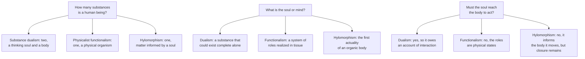

# Philosophy of Mind · Lesson 5.1: The soul as the form of the body

> ⏱ ~15 min · Module 5: Soul as form: the hylomorphic view · Builds on: [1.1](01-01-the-mind-body-problem.md), [1.2](01-02-substance-dualism-today.md), [2.2](02-02-functionalism.md), [`metaphysics` 2.3](../../metaphysics/lessons/02-03-hylomorphism-and-composition.md), [`ancient-medieval-philosophy` 3.5](../../ancient-medieval-philosophy/lessons/03-05-soul-and-intellect.md) · Unlocks: [5.2](05-02-is-the-intellect-a-bodily-power.md), [5.3](05-03-hylomorphism-tested.md)

## Why this matters

A cat on a windowsill is digesting its breakfast and watching a pigeon, and when the pigeon moves the whole cat moves. [1.1](01-01-the-mind-body-problem.md)'s map sorted views by what they say about the mental and the physical. The hylomorphist refuses the sort: what makes the cat digest and what makes it see are one principle, its soul, neither a second thing inside the cat nor a pattern its parts happen to make. Is that a third option, or [functionalism](../reference.md#functionalism) under an older name?

## The idea

Ask what a cat is made of and you get a list: water, proteins, cells, organs. Ask what makes that matter a cat, rather than the same chemicals in a bucket, and the hylomorphist answers: its **form**, the principle by which this matter is one living thing of a kind, with that kind's powers to feed, sense, want and move. In a living thing the form is the soul ([soul as form](../reference.md#soul-as-form)), the principle of life, so a fern has one. It is not one more item on the list, nor the list's arrangement, which a corpse keeps for a while.

A coin is a fair miniature. Nobody asks how the coin's shape grips the metal: the shape is not a second thing acting on the metal but the way this metal is a coin. Aristotle said the same of soul and body with wax and an imprint. If that holds, Descartes's question, how the soul reaches the body it moves, is malformed rather than hard.

So [hylomorphism](../reference.md#hylomorphism) sits badly on 1.1's map: with the dualist, the soul is real and no part of the body; with the physicalist, a human being is one substance. Siblings did the groundwork: [`ancient-medieval-philosophy` 3.5](../../ancient-medieval-philosophy/lessons/03-05-soul-and-intellect.md) read *De Anima* II.1, [`metaphysics` 2.3](../../metaphysics/lessons/02-03-hylomorphism-and-composition.md) gave form in general, and [`thomistic-synthesis` 5.3](../../thomistic-synthesis/lessons/05-03-the-human-soul-in-the-system.md) gave Aquinas's one substantial form. Here: what they say about minds.

## The argument

Aquinas is quoted from the *Summa Theologiae* (ST), tr. Fathers of the English Dominican Province, second and revised edition (1922), as printed by New Advent.

**The definition.** Soul is "the first actuality of a natural body furnished with organs" (*De Anima* II.1, 412b5–6, tr. R. D. Hicks, 1907). [First actuality](../reference.md#first-actuality) is the standing capacity, present in sleep; second actuality is its exercise.

**The powers.** Aquinas ranks the soul's [powers](../reference.md#powers-of-the-soul) by how their operations stand to the body (ST I q.78 a.1). A **vegetative** operation uses an organ and works by virtue of a bodily quality, as digestion works by heat. A **sensitive** operation uses an organ but not by virtue of a bodily quality: seeing is not a heating or a cooling. A **rational** operation is "not even performed by any corporeal organ". *In words:* each rank rises further above what bodies do anyway; plants have one, animals two, humans three.

**One soul, the form of the body** (ST I q.76 a.1, opening of the *respondeo*; a.3, first reason).

- **P1.** That by which a thing primarily acts is a form of it, since "nothing acts except so far as it is in act". *In words:* what you primarily act by is part of what you are, not a tool you hold.
- **P2.** The soul is that by which a living body primarily nourishes, senses, moves and understands. *In words:* one answer covers "what makes this body alive?" for every kind of living it does.
- **∴ C1.** The principle by which a human being understands is the form of the body. *In words:* it is not lodged in the body; it makes the body human.
- **P3.** A thing is one without qualification only by one form, since it has existence and unity from the same source. *In words:* two forms give two things, or one thing with an attribute added, as a white man is.
- **P4.** A human being is one thing without qualification.
- **∴ C2.** The vegetative, sensitive and rational principles in a human being are numerically one soul. *In words:* one form does all of it ([unity of substantial form](../reference.md#unity-of-substantial-form)).

Aquinas grants that Plato's three souls would be coherent if the soul were joined to the body "not as its form, but as its motor" (a.3): the dispute with the dualist sits there. Article 4's stronger thesis, no other substantial form at all, is [`thomistic-synthesis` 5.3](../../thomistic-synthesis/lessons/05-03-the-human-soul-in-the-system.md)'s.

**Who thinks.** Sensitive and vegetative powers have the composite as subject (q.77 a.5, as [`apologetics-foundations` 3.3](../../apologetics-foundations/lessons/03-03-consciousness.md) uses it). Intellect and will use no organ, so their subject is the soul itself (q.77 a.5), and they remain in the separated soul (a.8). Yet the act is the man's: "it is more correct to say that man understands through the soul" (q.75 a.2 ad 2), the datum *hic homo intelligit* of q.76 a.1, read against Averroes in [`ancient-medieval-philosophy` 7.1](../../ancient-medieval-philosophy/lessons/07-01-faith-reason-and-the-paris-crisis.md). [`metaphysics` 6.5](../../metaphysics/lessons/06-05-what-a-person-is.md)'s claim that forms do not think but composites do is the generic hylomorphist's line, not Aquinas's.

**No interaction problem.**

- **P5.** An interaction problem arises when two things, each complete in its kind, must be causally connected by some contact or relation. *In words:* Elisabeth's question to Descartes ([`modern-philosophy` 1.4](../../modern-philosophy/lessons/01-04-the-real-distinction-and-the-interaction-problem.md)) and Kim's [pairing problem](../reference.md#pairing-problem) ([1.2](01-02-substance-dualism-today.md)).
- **P6.** Soul and body are not two complete things: the matter is this body only as informed, and the form is this matter's actuality. *In words:* the wax and the imprint.
- **∴ C3.** There is no question how the soul grips the body. *In words:* the cat's wanting commands its legs without reaching across to them; wanting and stalking are acts of one animal (q.75 a.3 ad 3).

Edward Feser (*Philosophy of Mind: A Beginner's Guide*, 2006), as SEP "Dualism" §3.6 reports, makes mind-body interaction one case of the form-matter relation found throughout nature.

**The defenders.** **Hylomorphic dualists** keep Aquinas's immaterial intellect: David Oderberg ("Hylemorphic Dualism", 2005) accepts the word [dualism](../reference.md#hylomorphic-dualism), and Feser defends the Thomist package ([5.2](05-02-is-the-intellect-a-bodily-power.md) tests it). **Structural hylomorphists** need no immaterial power. William Jaworski (*Structure and the Metaphysics of Mind*, 2016) gives structure the role of form; as William Seager's review (*Notre Dame Philosophical Reviews*, 2016) reports, he grants that physical constitution necessitates the mental, yet calls his view anti-physicalist. William M. R. Simpson (*Hylomorphism*, 2023) argues that a substantial form so transforms its matter that the powers of the parts are grounded in the whole. Commentators split on whether even Aquinas is a [substance dualist](../reference.md#substance-dualism) (SEP, "Dualism", §3.6).

**Where the argument is weakest.** P5. It makes an interaction problem one of connecting two complete things, which fits Elisabeth and pairing but not closure. The strongest objection: [causal closure](../reference.md#causal-closure) needs no second thing. If every physical event that has a cause has a sufficient physical cause, a form that changes what the body does either competes with physics or does nothing, and "formal" changes only the name; the SEP entry presses this against the hylomorphist. The strongest reply: a formal cause is no rival for the same effect, since it says what the event is an event of, not what pushed it ([formal and efficient causation](../reference.md#formal-and-efficient-causation)). Aquinas adds that the soul also moves the body, by its motive power (q.76 a.4 ad 2; [5.3](05-03-hylomorphism-tested.md)). The hylomorphist concedes that dissolving the contact puzzle does not answer closure. The critic concedes that "how does the unextended push?" has no grip on a form and its matter.

## Map of positions

Hylomorphism counts substances as the functionalist does and answers the second question as neither rival does; Example 2's charge aims there.

## Worked examples

**Example 1 (clean case: the cat on the sill).** Run the analysis.

- **Matter.** Proximately, the organic body, a cat's only while it lives; remotely, cells and molecules, which outlast it.
- **Form.** One sensitive soul, which does the vegetative work too (q.76 a.3). No intellect.
- **Powers, by q.78 a.1's test.** Digesting: vegetative. Seeing the pigeon: sensitive, an exterior sense. Taking it for prey: sensitive, the estimative power, which grasps what no sense presents, as a sheep grasps the wolf as an enemy (q.78 a.4). Wanting and stalking: sensitive appetite and local movement.
- **Subject.** All have the composite as subject (q.77 a.5). Dozing, the cat has them as first actuality; stalking, as second.

A dualist must ask whether the cat's seeing, if conscious, belongs to a second thing that moves the legs; a functionalist redescribes each power as a role realized in tissue. The hylomorphist says one animal sees, wants and stalks.

**Example 2 (hard case: functionalism renamed).** The SEP entry "Functionalism" roots the doctrine in Aristotle's soul, and Nussbaum and Putnam ("Changing Aristotle's Mind", 1992) read Aristotle as near kin to it ([`ancient-medieval-philosophy` 3.5](../../ancient-medieval-philosophy/lessons/03-05-soul-and-intellect.md)). The [charge](../reference.md#functionalism-renamed-charge) against the living view:

- **F1.** Aquinas individuates powers by their acts and objects (q.77 a.3). *In words:* a power is what it does, to what.
- **F2.** A functional state is individuated by its causal role ([role and realizer](../reference.md#role-and-realizer)). *In words:* a state is what causes it and what it causes.
- **F3.** Every power in Example 1 can be written as such a role, realized in organs.
- **∴ C.** "Form" names functional organization, with nothing added but the word.

The reply has three moves.

- **R1, matter.** A role is realized by states whose nature is fixed apart from the role; a form makes its matter the matter it is. J. L. Ackrill (1972/73) objected that if a soulless body is a body only in name, the body is ensouled essentially ([Ackrill's problem](../reference.md#ackrills-problem)). The hylomorphist makes that a thesis: no realizer is specifiable apart from the form, and for Simpson the parts' powers are grounded in the whole.
- **R2, subject.** Hylomorphism begins with one substance whose powers these are. A nation running the roles, [2.2](02-02-functionalism.md)'s [China brain](../reference.md#china-brain), is not one substance, so it has no soul.
- **R3, intellect (Thomists only).** Understanding uses no organ (q.78 a.1; q.76 a.1 ad 1), so it has no realizer, and F3 fails for the power that matters most.

Run it on a human being. For the Thomist, R3 settles it if [5.2](05-02-is-the-intellect-a-bodily-power.md)'s argument works. Jaworski has no organless power and grants necessitation, so his difference must be R1: the base necessitates the structure without explaining it, and the structured individual, not the base, has the mental powers.

Here the account stops. Seager presses that a physicalist can identify the structured individual with its base, so the difference may be verbal. The hylomorphist answers that necessitation is not explanation. Nothing in the brain decides between "necessitated and explained" and "necessitated, not explained" until one says what explanation is.

## Watch out

- **You might think hylomorphism is substance dualism in Aristotelian dress, but actually** a form is not a thing beside its matter, and even Aquinas's subsistent soul is not the human being (q.75 a.4, [`thomistic-synthesis` 5.3](../../thomistic-synthesis/lessons/05-03-the-human-soul-in-the-system.md)): what survives is a part.
- **You might think the hylomorphist's body is the [embodied-cognition](../reference.md#embodied-cognition) theorist's body, but actually** embodied cognition says where cognitive processes run: the body and its dealings with the world constitute or contribute to cognition (SEP, "Embodied Cognition", 2021; [4.3](04-03-externalism-narrow-content-and-the-extended-mind.md)). The hylomorphist says what a body is, matter that is this body only as informed, and the Thomist adds a power with no organ.
- **You might think the soul's being the form of *this* body rules out [multiple realizability](../reference.md#multiple-realizability), but actually** powers are individuated by acts and objects (q.77 a.3), so a fly's sight and a cat's are one power with two kinds of eye. What the hylomorphist denies is that the role is the soul.

## One-liner

> The soul as form makes a living thing one substance with no gap for the soul to cross; whether that is a third view or functionalism renamed turns on whether a form grounds its matter's powers or merely organizes them.

## Problems

**P1 (🟢) *(Exegetical.)*** Using the test of ST I q.78 a.1, say whether the power exercised in each operation is vegetative, sensitive or rational, and name the feature that decides it. One line each.

(a) A cut on your finger closes over in a week.

(b) Walking home at night, you size up an approaching stranger as dangerous before you could say why.

(c) Looking at one chalk triangle, you see that the proof you just followed holds for every triangle.

(d) You dream that you are falling.

(e) Then, in one line: which of the four come from powers whose subject is the composite, and which from a power whose subject is the soul alone (q.77 a.5)?

**P2 (🟡) *(Find the crux. Exegetical (a) · Evaluative (b).)*** Take the cat of Example 1. A functionalist of the usual physicalist kind holds that the cat's soul is its functional organization: the roles its states play, from digesting to stalking, realized in feline tissue, so that "form" names a pattern in that tissue. A structural hylomorphist holds that a pattern in the tissue presupposes the tissue, and that the cat's form is what makes it this tissue, with these powers. Both accept every fact Example 1 states about the cat's organs, behaviour and neurons.

(a) Name the single premise about the cat's parts that the hylomorphist must deny and the functionalist must keep. Then say which of Example 2's three replies carries the weight here, and why the other two cannot. 100 words or fewer.

(b) Say what evidence or argument would move one side, and what each side would say it showed. Any verdict; 100 words or fewer.

**P3 (🔴) *(Close reading. Exegetical (a)–(b) · Evaluative (c).)*** ST I q.76 a.3, "Whether besides the intellectual soul there are in man other souls essentially different from one another?", from the *respondeo* (tr. Fathers of the English Dominican Province, second and revised edition, 1922; New Advent text):

> Thirdly, this is shown to be impossible by the fact that when one operation of the soul is intense it impedes another, which could never be the case unless the principle of action were essentially one.
>
> We must therefore conclude that in man the sensitive soul, the intellectual soul, and the nutritive soul are numerically one soul. [...] Thus the intellectual soul contains virtually whatever belongs to the sensitive soul of brute animals, and to the nutritive souls of plants. Therefore, as a surface which is of a pentagonal shape, is not tetragonal by one shape, and pentagonal by another—since a tetragonal shape would be superfluous as contained in the pentagonal—so neither is Socrates a man by one soul, and animal by another; but by one and the same soul he is both animal and man.

(a) The first paragraph is Aquinas's third reason. State the observation it starts from, the inference it draws, and what "essentially one" is set against in the article's question. Two sentences.

(b) What does "contains virtually" mean here, and which words rule out reading a man as an animal with a sensitive soul and an intellectual soul added on top? Two sentences.

(c) An objector replies to the third reason: two programs running on one processor slow each other down, yet they are two programs, so interference shows a shared resource, not one principle. Say what "principle of action" must mean for the third reason to survive this, and whether, so read, it still supports the conclusion. Any verdict; 100 words or fewer.

Solutions

**P1** *(Exegetical)*

**Must hit, strict:**

- (a) **Vegetative.** Repair and growth use organs and work by virtue of bodily qualities, as digestion does by heat (the nutritive and augmentative powers, q.78 a.2).
- (b) **Sensitive.** This is the cogitative power, the human form of the animal's estimative power, which grasps that something is harmful though no sense presents harm as a colour or shape (q.78 a.4). It has an organ (Aquinas reports physicians placing it in the middle of the head), so it is not rational.
- (c) **Rational.** Grasping what holds of every triangle is understanding a universal, an operation performed by no corporeal organ.
- (d) **Sensitive.** Imagination (phantasy), the interior sense that keeps and reworks forms received through the senses: it uses an organ, but not by virtue of a bodily quality.
- (e) (a), (b) and (d) are from powers whose subject is the composite. (c) is from intellect, whose subject is the soul alone, though the man understands through it.

**Wrong turns:** calling (b) rational because it is a kind of judging, or because Aquinas also calls the cogitative power "particular reason": it compares individual intentions, not universal ones, and it has an organ. Calling (d) rational because a dream can contain an argument. Putting (c) in the composite because "the man understands": that is how the act is attributed (q.75 a.2 ad 2), not the subject of the power.

**Model answer:** (a) Vegetative: an organ working by bodily qualities, like digestion. (b) Sensitive: the cogitative power grasps harmfulness in this individual, with an organ, so it is not intellect despite its name "particular reason". (c) Rational: a universal truth about every triangle, grasped by no organ. (d) Sensitive: imagination, an interior sense with an organ. (e) Composite: (a), (b), (d); soul alone: (c), though the man understands through his soul.

---

**P2** *(Exegetical (a) · Evaluative (b))*

**Must hit, strict (a):**

- The premise: the powers of the cat's parts (tissue, cells, molecules) are fixed by what those parts are in themselves, apart from the whole they compose, so the cat's organization is a pattern among independently constituted realizers. The functionalist keeps it; the hylomorphist denies it, holding that the form grounds the parts' powers.
- R1 carries the weight. R3 is unavailable, since a cat has no intellect. R2 is idle: the functionalist can grant that the system whose states play the roles is this one organism, and whether it is one by its form or by its organization is R1 again.

**Accept (a):** the premise stated from the matter's side: the cat's tissue is specifiable as the tissue it is apart from the cat's form (Ackrill's problem read as the hylomorphist's thesis).

**Must hit, any verdict (b):**

- A test or argument that bears on that premise. For example, C. D. Broad's question (*The Mind and Its Place in Nature*, 1925, ch. II): whether the behaviour of the parts inside the cat follows, at least in principle, from their behaviour taken separately or in other combinations, given their arrangement ([`philosophy-of-science` 4.5](../../philosophy-of-science/lessons/04-05-reduction-and-emergence.md)). Or an argument about whether being living tissue is intrinsic to the tissue.
- What each side says the outcome shows. If the derivation always succeeds, the functionalist takes the premise as confirmed, and the hylomorphist must say that necessitation is not grounding, at the price of the verbal-difference charge. If it fails, the functionalist must accept laws that hold only of the configuration, and the hylomorphist calls that form by another name.

**Wrong turns:** naming the immaterial intellect or consciousness as the crux, when the case is a cat and both sides grant that it sees. Naming multiple realizability: both can allow one power exercised through differently built organs (q.77 a.3). Naming "whether the cat has a soul": both use the word, and the dispute is what it names. Answering (b) with a verdict and no test.

**Model answer (a):** The premise is that the powers of the cat's tissue are fixed by what the tissue is in itself, so the cat's organization is a pattern among parts already constituted. The functionalist needs it, since a role is realized by states whose nature is settled apart from the role. The hylomorphist denies it: the form makes this tissue have these powers. That is R1. R3 is unavailable because a cat has no intellect, and R2 is idle because the functionalist can grant that one organism is the system, which leaves the question of what makes it one, which is R1.

**Model answer (b), one of several:** Broad's test would bear on it: do the cat's cells and molecules behave, inside the cat, as their behaviour in isolation or simpler systems, with the arrangement, would predict? If always yes, the functionalist's premise looks confirmed, and the hylomorphist can only say that necessitation is not grounding, which invites the charge that the difference is verbal. If not, the functionalist must posit configurational laws, and the hylomorphist says that is a form under a new name.

---

**P3** *(Exegetical (a)–(b) · Evaluative (c))*

**Must hit, strict (a):**

- The observation: when one operation of the soul is intense, it impedes another. The inference: that could happen only if the principle of both operations were essentially one.
- "Essentially one" is set against "other souls essentially different from one another", the pluralist's distinct nutritive, sensitive and intellectual souls.

**Must hit, strict (b):**

- "Contains virtually": the higher soul has the power to do whatever the lower souls do, without any lower soul being present as a distinct form, as a pentagonal surface has whatever a four-sided shape would give it.
- The deciding words: "not tetragonal by one shape, and pentagonal by another", "a tetragonal shape would be superfluous", and "neither is Socrates a man by one soul, and animal by another".

**Must hit, any verdict (c):**

- Say what the third reason needs: "principle of action" as the one subject whose acts both operations are, that by which the thing acts (q.76 a.1's sense), not something both operations consume.
- Say what the objection grants: there is one processor. The question is whether it is the principle of the operations or only a resource they share.
- A verdict, with what it costs.

**Wrong turns:** reading "essentially one" as "one organ", when the article rejects Plato's organ-by-organ souls and its claim is about form. Reading "contains virtually" as containing the lower soul as a nested part, which the "superfluous" clause rules out. In (c), declaring the objection decisive or irrelevant without saying which sense of "principle" is at stake.

**Model answer (a)–(b):** (a) Aquinas starts from the observation that one operation of the soul, when intense, impedes another, and infers that this could not happen unless both had one principle. "Essentially one" answers the article's question whether there are other souls "essentially different from one another" in man. (b) To contain virtually is to have the lower souls' powers without the lower souls being there as further forms, as a pentagon gives a surface whatever a four-sided shape would. "Not tetragonal by one shape, and pentagonal by another", with "superfluous", rules out the layered reading.

**Model answer (c), one of several:** The reason survives only if "principle of action" means the one subject whose operations both are, not a resource they draw on. Read that way, the programs case does not refute it: if the processor is what does the computing, interference shows one agent, as Aquinas says; if the programs are the agents and the processor a pool, it shows only a shared resource. So interference alone cannot tell one principle from a shared resource. The third reason is then a sign, not a proof, and the conclusion rests on the first reason, that a thing is one only by one form.

## Flashback

**From Lesson [4.4](04-04-the-problem-of-perception.md) (The problem of perception):** *(Exegetical.)* Invented, written for this problem. You look at a single candle flame and press gently on one eye through the lid. You see two flames: one where the candle stands, one a little to the side, where there is no candle. Press harder and they drift apart; let go and they merge.

(a) Run the [argument from illusion](../reference.md#argument-from-illusion) as far as Leibniz's law takes it: what is F, and what do the [Phenomenal Principle](../reference.md#phenomenal-principle) and Leibniz's law give? Two sentences.

(b) Why does this case show plainly that P3 does not yet follow, and what must be added? Two sentences.

(c) Grant P3. Which premise takes the argument to ordinary single-flame seeing, and what in the case supports it? One sentence.

Solution

**Must hit, strict (a):** F is a place: something looks to be a flame at a spot where the candle's flame is not (P1). By the Phenomenal Principle you are directly presented with a flame-like thing there (P2), and by Leibniz's law it is not the candle's flame.

**Accept (a):** F as "being two flames", so that at least one flame-like thing is not the candle's one flame.

**Must hit, strict (b):**

- (a) yields only that you are presented with *something other than* the candle's flame, not P3's claim that you are *not presented with* it; the other flame, exactly where the candle's flame is, may be that flame itself.

- French and Walters's Exclusion Assumption: if, in an illusion of an object as F, you are directly presented with an F thing that is not the object, you are not also directly presented with the object.

**Must hit, strict (c):** P4, the spreading step, backed by the continuous series Ayer (1940) cited: the flames part and merge by degrees, with no point where one kind of experience gives way to another.

**Wrong turns:** taking P3 to follow from Leibniz's law alone; calling the case a hallucination, when the candle's flame is seen; answering (c) from the argument from hallucination; rejecting P2 in (a), which asks you to run the argument, not assess it.

**Model answer:** (a) Something looks to be a flame where the candle's flame is not; by the Phenomenal Principle you are presented with a flame-like thing there, and by Leibniz's law it is not the candle's flame. (b) The flame where the candle stands may be the candle's own, so P3 needs the Exclusion Assumption. (c) P4, backed by the flames' parting and merging by degrees.

## Connections

- **Backward:** [1.1](01-01-the-mind-body-problem.md) put hylomorphism at the edge of its map; this lesson says why it fits badly. The interaction problems a form dissolves are Elisabeth's ([`modern-philosophy` 1.4](../../modern-philosophy/lessons/01-04-the-real-distinction-and-the-interaction-problem.md)) and the pairing problem of [1.2](01-02-substance-dualism-today.md); the charge of Example 2 uses [2.2](02-02-functionalism.md)'s roles and realizers. The definition is [`ancient-medieval-philosophy` 3.5](../../ancient-medieval-philosophy/lessons/03-05-soul-and-intellect.md)'s, form in general is [`metaphysics` 2.3](../../metaphysics/lessons/02-03-hylomorphism-and-composition.md)'s, and unicity and one act of existing are [`thomistic-synthesis` 5.3](../../thomistic-synthesis/lessons/05-03-the-human-soul-in-the-system.md)'s.
- **Forward:** [5.2](05-02-is-the-intellect-a-bodily-power.md) asks whether intellect really has no organ, which R3 needs. [5.3](05-03-hylomorphism-tested.md) takes the closure version of the interaction problem, formal against efficient causation, and the evidence that thought depends on the brain.
- **Sideways:** [`metaphysics` 6.5](../../metaphysics/lessons/06-05-what-a-person-is.md) sets the hylomorphic view of persons against animalism and dualism, and holds the corruptionist-survivalist dispute. [`creation-grace-last-things` 2.2](../../creation-grace-last-things/lessons/02-02-body-and-soul-one-substance.md) owns the soul as form as doctrine, with its level; no doctrinal weight is assigned here. [`phenomenology-and-personalism` 5.5](../../phenomenology-and-personalism/lessons/05-05-integration-participation-and-the-bridge.md) asks whether the integration of body and psyche needs a soul as form, and this lesson is the analytic answer's first half. Simpson's claim that the parts' powers are grounded in the whole is a strong-emergence claim in the sense of [`philosophy-of-science` 4.5](../../philosophy-of-science/lessons/04-05-reduction-and-emergence.md), and [`apologetics-foundations` 3.3](../../apologetics-foundations/lessons/03-03-consciousness.md) sets the Thomist beside the Russellian monist of [3.5](03-05-panpsychism-and-russellian-monism.md).
