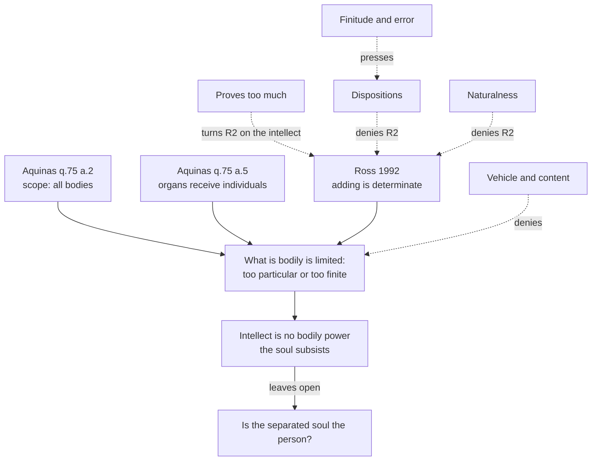

# Philosophy of Mind · Lesson 5.2: Is the intellect a bodily power?

> ⏱ ~15 min · Module 5: Soul as form: the hylomorphic view · Builds on: [5.1](05-01-the-soul-as-the-form-of-the-body.md), [`thomistic-synthesis` 4.1](../../thomistic-synthesis/lessons/04-01-how-a-human-intellect-knows.md), [`apologetics-foundations` 3.2](../../apologetics-foundations/lessons/03-02-reason.md) · Unlocks: [5.3](05-03-hylomorphism-tested.md)

## Why this matters

A pocket calculator and a ten-year-old with a pencil both answer 125 to 68 + 57. James Ross argued in 1992 that only one of them added, and that this shows thought is not wholly physical. Seven centuries earlier Aquinas argued that the power by which you understand any kind of body cannot itself be a body. These are the two strongest arguments that the intellect is not a bodily power, stated here with their strongest replies.

## The idea

Two puzzles about thinking, one about range and one about precision.

**Range.** You can understand what a stone is, or a star, or a neuron, and you grasp the nature every stone shares, not just this stone. A receiver that is itself some particular kind of body, Aquinas thinks, colours what it takes in and holds it only as this one, here. So the receiver of every bodily nature, in general, cannot be a body.

**Precision.** When you add, your act is of one function, not of a lookalike that agrees with addition on every sum you will ever do and parts company beyond. But everything physical, a circuit's wiring or a brain's history, is finite, and every finite record fits rival functions, as every green emerald examined so far is also grue ([`philosophy-of-science` 1.2](../../philosophy-of-science/lessons/01-02-the-new-riddle-of-induction.md)). So, Ross concludes, the precision is not in the physics.

The reply to both: a limited, particular vehicle can carry content of unlimited range and exact form, as the word "red" is not red.

Already taught: the [soul as form](../reference.md#soul-as-form) and its [powers](../reference.md#powers-of-the-soul) ([5.1](05-01-the-soul-as-the-form-of-the-body.md)); Aristotle's "unmixed" intellect ([`ancient-medieval-philosophy` 3.5](../../ancient-medieval-philosophy/lessons/03-05-soul-and-intellect.md)); [abstraction](../reference.md#abstraction) from phantasms ([`thomistic-synthesis` 4.1](../../thomistic-synthesis/lessons/04-01-how-a-human-intellect-knows.md)); Ross as a premise against naturalism ([`apologetics-foundations` 3.2](../../apologetics-foundations/lessons/03-02-reason.md)). Here: do the arguments work as philosophy of mind?

## Source

Aquinas, *Summa Theologiae* I q.75 a.5, *respondeo* (English Dominican Province, second and revised edition, 1922, p. 14):

> For it is clear that whatever is received into something is received according to the condition of the recipient. Now a thing is known in as far as its form is in the knower. But the intellectual soul knows a thing in its nature absolutely: for instance, it knows a stone absolutely as a stone; and therefore the form of a stone absolutely, as to its proper formal idea, is in the intellectual soul. Therefore the intellectual soul itself is an absolute form, and not something composed of matter and form. For if the intellectual soul were composed of matter and form, the forms of things would be received into it as individuals, and so it would only know the individual: just as it happens with the sensitive powers which receive forms in a corporeal organ; since matter is the principle by which forms are individualized.

The shape: a principle about receivers, a datum about knowing, a contrast with sense. Two words decide it. "Absolutely" means the stone-nature as such, without what makes it this stone. "Individualized" carries the load: the argument works only if reception in matter individualizes the *content* received, not merely the receiving state. The article concludes that the soul has no matter, but the same premise gives the [argument from universals](../reference.md#argument-from-universals) that intellect works through no organ, listed beside q.75 a.2 in SEP's "Thomas Aquinas" (2022).

## The argument

**The [scope argument](../reference.md#argument-from-the-scope-of-intellect)** (ST I q.75 a.2, *respondeo*), Aquinas's version of Aristotle's case for an unmixed intellect:

- **P1.** By the intellect a human can know the natures of all bodies. *In words:* no kind of body is closed to understanding.
- **P2.** Whatever can know things of a kind cannot have any of them in its own nature, since what it has naturally would impede its knowing the rest. *In words:* a receiver must not already be what it receives.
- **P3.** Every body has its own determinate nature. *In words:* to be a body is to be some particular kind of body.
- **∴ C1.** The intellectual principle is not a body.
- **P4.** The same holds of any bodily organ through which it might understand: the organ's determinate nature would impede likewise. *In words:* no bodily instrument can do the receiving either.
- **∴ C2.** The intellect has an operation *per se*, in which no body shares.
- **P5.** Only what subsists can operate *per se*, since nothing operates but what is actual. *In words:* to act on your own you must exist on your own.
- **∴ C3.** The human soul is incorporeal and [subsistent](../reference.md#subsistent-intellect).

**Ross's [determinacy argument](../reference.md#determinacy-argument)** ("Immaterial Aspects of Thought", *Journal of Philosophy* 89, 1992). He borrows Kripke's case ([plus and quus](../reference.md#plus-and-quus); Kripke, *Wittgenstein on Rules and Private Language*, 1982; the paradox is [`philosophy-of-language-and-logic`](../../philosophy-of-language-and-logic/syllabus.md) 4.3's). For natural numbers $x, y$, define quus, written $\oplus$:

$$x \oplus y = \begin{cases} x + y & \text{if } x, y < 57 \\ 5 & \text{otherwise.} \end{cases}$$

So $68 + 57 = 125$ but $68 \oplus 57 = 5$, and a record of smaller sums fits both.

- **R1.** Some thinking, such as adding, is determinate: a single act of adding has the form of addition and of no rival function. *In words:* when you add, it is a fact that you are adding.
- **R2.** No physical process, and no function among physical states, is determinate in that way: every physical record, counterfactuals included, fits incompossible functions. *In words:* physics never settles which function is computed.
- **∴ R3.** Such thinking is not wholly physical.

Addition is a [pure function](../reference.md#pure-function) for Ross, wholly present in the single case; the array of inputs and outputs is its "logical tail of the comet". He accepts the consequences: a machine adds only "the way puppets walk", and the brain cannot be the organ of thought as the eye is of sight, though brain states may be its media (n. 13); n. 3 traces this to Aristotle's *De Anima* III.4. To the charge that we do not really add either, §III answers that the price is all of logic and mathematics, and that defining a pure function is itself determinate thought.

**Replies.**

- **Vehicle and content.** The [functionalist](../reference.md#functionalism) says representing a nature needs no absence of it in the [vehicle](../reference.md#vehicle-and-content), and a finite state can encode a rule with infinitely many cases. The Thomist answers that knowing is receiving a form, so the question is whether a bodily receiver's own conditions limit what it receives.
- **[Proves too much](../reference.md#proves-too-much-objection).** Kripke's sceptic found no fact of any kind, mental included, that fixes plus, so the argument undoes an immaterial intellect too. Edward Feser, who develops Ross ("Kripke, Ross, and the Immaterial Aspects of Thought", 2013), answers in a 2017 restatement that words, behaviour and images are signs needing interpretation, while a thought is its content. But Kripke did consider a primitive state of meaning (1982: 51), calling it mysterious; the Thomist must answer that. [`apologetics-foundations` 3.2](../../apologetics-foundations/lessons/03-02-reason.md) sets this crux.
- **Dispositions.** A system adds because of what it would do. Kripke's [finitude and error problems](../reference.md#finitude-and-error-problems): nobody is disposed to answer for numbers too large to process, and dispositions include systematic mistakes.
- **[Naturalness](../reference.md#naturalness-reply).** David Lewis ("New Work for a Theory of Universals", 1983): quus is plus with a gerrymandered exception, so the best interpretation of any system assigns plus.

The argument is not only Thomist: Paul Boghossian (2015) argues from the finitude problem that determinate meaning cannot supervene on non-semantic facts.

If C3 holds, something of a human can exist without the body. Whether that separated soul is the person is the [survivalist and corruptionist](../reference.md#corruptionism-and-survivalism) dispute of [`metaphysics` 6.5](../../metaphysics/lessons/06-05-what-a-person-is.md); immortality as doctrine is [`creation-grace-last-things` 2.3](../../creation-grace-last-things/lessons/02-03-the-soul-immediately-created-and-immortal.md)'s.

**Where the argument is weakest.** Both arguments rest on one claim, that what is bodily is limited in a way thought is not: P2 with P3 for Aquinas, R2 for Ross. The strongest objection is vehicle and content: a finite, particular vehicle can carry content of unlimited scope and exact form. The strongest reply: the objection presupposes some fact that fixes the vehicle's content, and every physical candidate (history, wiring, dispositions) is finite and fits rival contents, so the objector owes a theory of content that survives finitude and error. The Thomist and Ross concede that physical states are thought's vehicles and that correct answers do not always show who adds. The functionalist concedes that the content-fixing facts must reach cases no system can process, which no reductive account has done to its critics' satisfaction.

## Argument map

Three routes meet at one premise, and every reply is aimed at it or at Ross's version of it.

## Worked examples

**Example 1 (clean case: the scope argument on a geologist).** A geologist looks at a vein of quartz and understands what quartz is, a nature true of any sample anywhere. P1: she could as well understand garnet or a neuron. P2 and P3: if what understands were a body, its own determinate nature would cut that range down. C1, P4, C2: so no part of her brain understands quartz. Her eyes and imagination take in this vein; the intellect takes from that image the nature, without what makes it this vein. P5, C3: an act no body shares belongs to a principle that exists in its own right.

The argument does not make her brain idle: she understands only by turning to images (q.84 a.7, the subject of [5.3](05-03-hylomorphism-tested.md)). Nor is her soul the geologist: subsistent is not complete, and "it is more correct to say that man understands through the soul" (q.75 a.2 ad 2). P1, P4 and P5 can be granted, so a physicalist must contest P2 with P3.

**Example 2 (hard case: Ross on a calculator and a child).** Run R2 on an eight-digit calculator. Its ripple-carry circuit ([`digital-logic` 2.3](../../digital-logic/lessons/02-03-arithmetic-circuits.md)) and every answer it would give fit addition, and equally a function that agrees with addition wherever the display can answer (up to 99,999,999) and differs beyond. So it never adds, though it is perfectly reliable.

Run R1 on the child. If her act has the form of addition, she adds even when she errs: Ross separates adding incorrectly from guessing, estimating or following a routine. So a child who always drops carries and answers 115 adds. A dispositionalist says nearly the reverse: the calculator is disposed to give sums, the carry-dropper toward another function (the error problem).

The strain: a child who runs the column method by rote, getting 125 without grasping what the columns are for. Adding, or following a routine? Ross grants that correct answers do not always show the ability. Here the account stops: it says what would make her an adder, not how anyone could tell. The Rossian says that is right, since determinacy belongs to the act, not to evidence about it. The critic says a fact no evidence reaches cannot carry an argument.

## Watch out

- **You might think Aquinas and Ross mean the same by "determinate", but actually** the words point opposite ways. For Aquinas a body is too determinate: a fixed nature limits what it can receive. For Ross a physical process is not determinate enough: it fits rival functions. They share only the claim that thought has a scope or form no bodily state fixes.
- **You might think Ross says addition is not computable, but actually** it is computable; his claim is that no physical system determinately realizes it. Running "not computable" together with "not physical" turns him into the Gödelian argument of [6.1](06-01-computationalism-and-the-turing-test.md).
- **You might think "then calculators never add, and the brain is not the organ of thought" refutes Ross, but actually** he asserts both. An objection must find a consequence he rejects.

## One-liner

> Aquinas says a body is too particular to receive every nature, Ross that a physical process is too finite to fix one function; both stand or fall with whether a limited vehicle can carry unlimited or exact content.

## Problems

**P1 (🟢) *(Exegetical.)*** Three objections to the scope argument as numbered in this lesson. For each, name the premise it attacks. One line each.

(a) "Physicists still do not know what dark matter is, and most bodies in the universe will never be observed by anyone, so the intellect cannot know all bodies."

(b) "A brain has no single fixed nature: learning rewires it constantly, and its activity can take any pattern at all, so there is nothing in its make-up to get in the way."

(c) "A key opens a lock by its shape, and the shape is not a thing that exists on its own. So an operation can belong to something that does not subsist."

**P2 (🟡) *(Counterexample. Exegetical (a) · Evaluative (b).)*** An invented case, written for this problem. An automated materials lab, built of steel, glass and silicon, takes any sample of solid, liquid or gas and returns its composition, structure and kind: "quartz, silicon dioxide", "water", "stainless steel". Samples of its own steel, glass and silicon come back correctly labelled. A critic says: here is a body that knows all bodies, so the scope argument is unsound.

(a) The Thomist replies that the lab does not know all bodies in P1's sense, so it never reaches P2. Using the Source and q.84 a.7's account of the intellect's proper object (a quiddity or nature existing in corporeal matter), say what the lab would need and lacks. Two sentences.

(b) The critic presses: "If knowing all bodies means grasping their natures as universals, received in no organ, then P1 assumes the conclusion." Is the scope argument circular? Say what P1 must claim if both sides are to grant it, and where the argument's weight then falls. 120 words or fewer; any verdict.

**P3 (🔴) *(Find the crux. Exegetical (a) · Evaluative (b).)*** An invented exchange, written for this problem.

> **Functionalist:** Grant Kripke's point: everything my brain or a calculator has done, or is disposed to do, fits quus as well as plus. But content is fixed by the best interpretation of a system, and the best interpretation assigns the most natural function that fits. Quus is plus with an arbitrary exception bolted on, so it loses. My brain and the calculator both determinately compute plus.
>
> **Rossian:** Ranking interpretations tells you which description of the outputs is neatest. It does not make the process itself of one form. And when I add, I know I am adding without inferring it from anything about my outputs.

(a) Name the premise of Ross's argument the functionalist denies, and say what each side takes the determinacy of a thought to consist in.

(b) Say what each side must accept about the calculator, and name one consideration that would move one side.

150 words or fewer in total; any verdict.

Solutions

**P1** *(Exegetical)*

**Must hit, strict:**

- (a) P1. The objection reads P1 as a claim of actual knowledge of every body. P1 claims a capacity to know the natures of bodies ("can have knowledge of all corporeal things"; the proper object is a nature, q.84 a.7), so the objection needs a kind of body closed to understanding in principle.

- (b) P3, and P4 so far as it applies P3 to an organ. The objection grants that a determinate nature would impede (P2) and denies that the brain has one.

- (c) P5. Aquinas's own reply is in the text: "we do not say that heat imparts heat, but that what is hot gives heat". The key opens the lock by its shape, so the operating subject is the key, which subsists.

**Wrong turns:** answering P2 for (b) because the objection says "get in the way"; answering C2 or "the organ premise" for (c), which grants no organ and attacks the step to subsistence; reading (a) as a refutation rather than a misreading.

**Model answer:** (a) P1, misread as actual rather than possible knowledge of natures. (b) P3 (and P4 through it): it denies the brain a determinate nature. (c) P5: it claims a form can operate without subsisting.

---

**P2** *(Exegetical (a) · Evaluative (b))*

**Must hit, strict (a):**

- P1's "all bodies" is a range of natures, each known "absolutely", as what it is to be quartz for any sample, possible ones included.
- The lab registers each sample as this sample, in states caused by individuals (the Source: reception in a corporeal organ individualizes), and its general sorting is a sameness of response to similar inputs; its labels mean "quartz" only for its users.

**Must hit, any verdict (b):**

- Separate two readings of P1: a neutral one (we can form true general judgements about any kind of body), which a physicalist grants, and a loaded one (we receive natures in no organ), which assumes C2.
- On the neutral reading the argument is not circular, but the work moves to P2 with P3, or to the Source's premise that bodily reception individualizes content.
- A verdict on circularity drawn from those moves.

**Wrong turns:** saying the lab fails because it is not conscious (sense is conscious and bodily for Aquinas); saying it fails P2 because its own steel distorts (the case stipulates otherwise); answering (b) "circular, so false", since a circular argument can have a true conclusion.

**Model answer (a):** To know all bodies in P1's sense the lab would need the nature of quartz in it as such, applying to every possible sample. It has only states caused by this sample and that, and labels whose meaning lives in its users.

**Model answer (b), one of several:** On the loaded reading P1 is just C2 restated. But the Thomist need not read it so. Grant only that we can form true universal judgements about any kind of body; physicalists accept that. The argument is then not circular, but P1 no longer carries it: everything turns on whether a bodily state can carry universal content, which is P2 with P3 or the Source's premise. So the scope argument is sound only if the universals argument is, and the critic's real target should be that premise.

---

**P3** *(Exegetical (a) · Evaluative (b))*

**Accept:** any verdict that places the crux at R2 and states both conceptions of determinacy.

**Must hit, strict (a):**

- The functionalist denies R2: physical facts plus an objective ranking of functions by naturalness make a system determinately compute plus. R1 is granted.
- Functionalist: determinacy is being the uniquely best interpretation consistent with all the facts (Lewis 1983). Ross: determinacy is a feature of the single act's form, independent of the array of outputs, his "logical tail of the comet".

**Must hit, any verdict (b):**

- The functionalist must say the calculator adds as determinately as we do. Ross must say it never adds, and accepts this.
- One consideration that moves a side, for example: whether any notion of naturalness applies to functions as well as properties (Boghossian 2015 doubts it); whether the view explains knowing what we mean without inferring it (Wright; Kripke 1982: 40); whether ties between equally natural functions are possible, which would make our thought indeterminate on the functionalist's view.

**Wrong turns:** re-running whether Kripke's search was exhaustive (the functionalist grants the finite-facts point; that crux is set in `apologetics-foundations` 3.2); steelmanning the charge that we do not add either; treating it as a dispute about whether calculators are reliable; saying the functionalist denies R1.

**Model answer, one of several:** (a) The crux is R2. The functionalist grants that we add and holds that physical facts plus the naturalness of plus fix a system's function, so determinacy is being the best interpretation of all the facts. Ross holds that it belongs to the single act's form, and ranking descriptions of outputs leaves the process fitting quus as before. (b) The functionalist must say the calculator adds; Ross must say it never does. What would move the functionalist is the point the Rossian presses: we know non-inferentially that we add, but on the best-interpretation view that knowledge would have to be an inference about naturalness. If no account of self-knowledge fits, Ross gains; if one does, R2 falls for brains and calculators alike.

## Flashback

**From Lesson [4.5](04-05-intentionalism-naive-realism-and-disjunctivism.md) (Intentionalism, naive realism, and disjunctivism):** *(Exegetical.)* Invented, written for this problem. You sit blindfolded, facing a wall. A neuroscientist puts your visual cortex into the brain state that seeing a green bicycle against it would produce, and you have an experience as of one there. Unknown to her, a green bicycle leans against the wall at exactly that spot.

(a) On [intentionalism](../reference.md#intentionalism), taking the content to be that a green, bicycle-shaped thing is at that spot: is your experience accurate, and do you see the bicycle? Say what settles the second question. Two sentences.

(b) On naive realist [disjunctivism](../reference.md#disjunctivism) in Martin's form, which disjunct holds of you, and why? Two sentences.

(c) Which premise of the argument from hallucination divides the two answers, and which theory accepts it? One line.

Solution

**Must hit, strict (a):**

- Accurate: the world is as the experience represents it.

- You do not see the bicycle. On intentionalism you see an object when your experience represents it and is caused by it in the right way, and the bicycle causes nothing here: accuracy is not perception.

**Must hit, strict (b):**

- The second disjunct: it merely seems to you as if you see a green bicycle.

- The bicycle is no constituent of your experience, so this is not the kind of event seeing is. As a [causally matching hallucination](../reference.md#causally-matching-hallucination), its character on Martin's account consists only in its being introspectively indiscriminable from seeing a green bicycle.

**Must hit, strict (c):** the [common-kind assumption](../reference.md#common-kind-assumption). Intentionalism accepts it, so your experience is the same kind of event as seeing and the difference lies outside it, in the causal link; disjunctivism denies it, so the difference lies in what the experience is.

**Wrong turns:** calling the experience inaccurate because it is a hallucination (4.5's gloss that a hallucination's conditions fail fits the usual case, with nothing there; here they are met); saying you see the bicycle because the content matches; saying the naive realist counts it a perception because the bicycle is there; answering (c) with the Phenomenal Principle, which intentionalism rejects but the argument from hallucination never uses.

**Model answer:** (a) Accurate, since a green, bicycle-shaped thing is there; but you do not see it, since seeing needs the experience to be caused by its object in the right way. (b) The second: it merely seems to you that you see a green bicycle, since the bicycle is no constituent of your experience. (c) The common-kind assumption: intentionalism accepts it and puts the difference in the causal link; disjunctivism denies it and puts it in the experience.

## Connections

- **Backward:** [5.1](05-01-the-soul-as-the-form-of-the-body.md) made intellect one power of a soul that is a body's form; this lesson asks whether that power alone works through no organ. Aristotle's unmixed intellect is [`ancient-medieval-philosophy` 3.5](../../ancient-medieval-philosophy/lessons/03-05-soul-and-intellect.md); abstraction and phantasms are [`thomistic-synthesis` 4.1](../../thomistic-synthesis/lessons/04-01-how-a-human-intellect-knows.md); the soul's place in Aquinas's system is [`thomistic-synthesis` 5.3](../../thomistic-synthesis/lessons/05-03-the-human-soul-in-the-system.md).
- **Forward:** [5.3](05-03-hylomorphism-tested.md) takes the other side of q.84 a.7: an intellect with no organ that still cannot work without images, tested against brain injury. Ross's argument and the [triviality problem](../reference.md#triviality-problem) for implementation in [6.2](06-02-the-chinese-room.md) are one worry about physical computation from two directions: Ross says no physical system computes any function determinately, triviality that every system computes too many.
- **Sideways:** Ross runs Goodman's grue ([`philosophy-of-science` 1.2](../../philosophy-of-science/lessons/01-02-the-new-riddle-of-induction.md)) on computation, and Kripke's paradox belongs to [`philosophy-of-language-and-logic`](../../philosophy-of-language-and-logic/syllabus.md) 4.3. As a premise against naturalism the argument is [`apologetics-foundations` 3.2](../../apologetics-foundations/lessons/03-02-reason.md)'s. Survival of the person is [`metaphysics` 6.5](../../metaphysics/lessons/06-05-what-a-person-is.md)'s, and immortality as doctrine [`creation-grace-last-things` 2.3](../../creation-grace-last-things/lessons/02-03-the-soul-immediately-created-and-immortal.md)'s.
