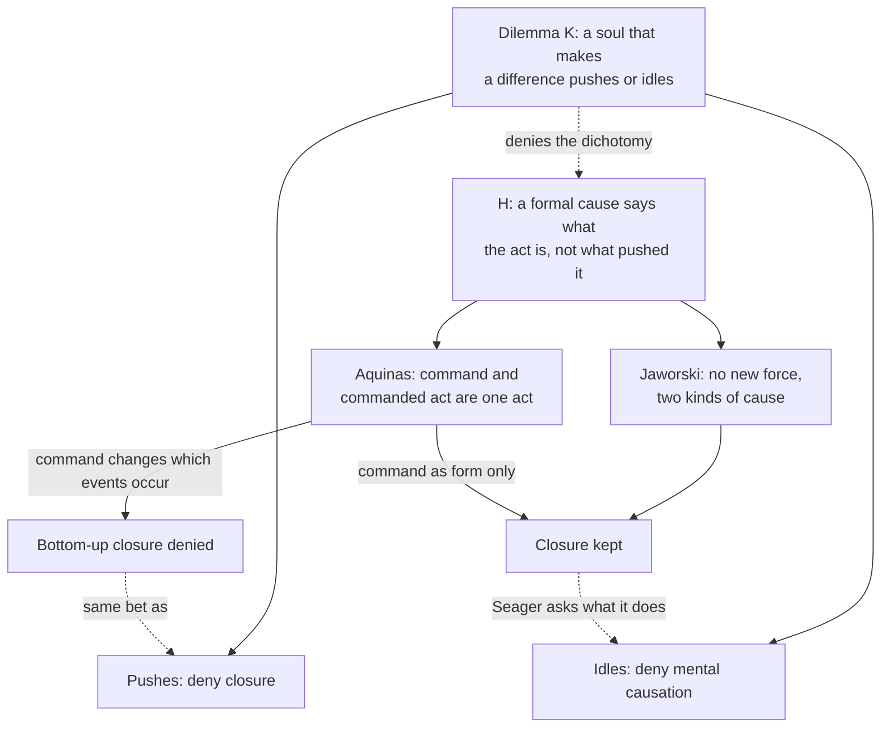

# Philosophy of Mind · Lesson 5.3: Hylomorphism tested

> ⏱ ~15 min · Module 5: Soul as form: the hylomorphic view · Builds on: [5.2](05-02-is-the-intellect-a-bodily-power.md), [2.4](02-04-mental-causation-and-the-exclusion-problem.md), [1.2](01-02-substance-dualism-today.md) · Unlocks: [6.1](06-01-computationalism-and-the-turing-test.md)

## Why this matters

Three men with large left-hemisphere lesions, two of them from strokes, could no longer tell from word order who did what to whom in a sentence. Yet given $90 - 60$ and $60 - 90$, they kept the two apart. A [hylomorphist](../reference.md#hylomorphism) says thought belongs to a [soul that is the body's form](../reference.md#soul-as-form); the Thomist adds that its highest act uses no organ. Two facts about brains test that: their physical causes seem to leave the soul nothing to do, and damage to them damages thought.

## The idea

Why did the tower of blocks fall? The cat knocked it. Why is it a tower, not a heap? The way the blocks are stacked. One answer names what brought something about, the other what it is, and nobody thinks they compete.

[2.4](02-04-mental-causation-and-the-exclusion-problem.md)'s [exclusion argument](../reference.md#exclusion-argument) asks what produced your reach for a glass, finds a sufficient neural answer, and leaves your decision nothing to do. The hylomorphist's soul answers the other question: it makes those motor events a woman's reaching for water, not a twitch. [5.1](05-01-the-soul-as-the-form-of-the-body.md) dissolved the contact problem and left closure standing; [5.2](05-02-is-the-intellect-a-bodily-power.md) argued that intellect uses no organ. Three tests follow: does the formal answer escape exclusion, why does brain damage damage an organless intellect, and is this [emergent dualism](../reference.md#emergent-dualism) renamed?

## Source

Aquinas, *Summa Theologiae* I q.84 a.7, *respondeo*, first reason (tr. Fathers of the English Dominican Province, second and revised edition, 1922; New Advent text):

> [T]he intellect, being a power that does not make use of a corporeal organ, would in no way be hindered in its act through the lesion of a corporeal organ, if for its act there were not required the act of some power that does make use of a corporeal organ. [...] Wherefore it is clear that for the intellect to understand actually, not only when it acquires fresh knowledge, but also when it applies knowledge already acquired, there is need for the act of the imagination and of the other powers. For when the act of the imagination is hindered by a lesion of the corporeal organ, for instance in a case of frenzy; or when the act of the memory is hindered, as in the case of lethargy, we see that a man is hindered from actually understanding things of which he had a previous knowledge.

The shape is a counterfactual with a failed antecedent: lesions would not hinder intellect *if* it needed no bodily power; it needs one, so they do. Three words decide it. "Actually": the hindrance falls on the exercise, not on knowledge held as a habit. "Applies": dependence lasts beyond learning, so no stock of concepts frees thinking from images. "Hindered", not destroyed. The images are phantasms ([`thomistic-synthesis` 4.1](../../thomistic-synthesis/lessons/04-01-how-a-human-intellect-knows.md)).

## The argument

**The dilemma** ([1.1](01-01-the-mind-body-problem.md) promised it here; [`apologetics-foundations` 4.4](../../apologetics-foundations/lessons/04-04-divine-action-miracles-and-quantum-indeterminacy.md) runs it on God).

- **K1.** If the soul makes a difference to what a body does, it is either one more sufficient cause of the bodily event or no cause of it. *In words:* a difference-maker is a push.
- **K2.** If one more sufficient cause, closure fails or every action is overdetermined (2.4's P3–P5). *In words:* a second push means a gap or a double.
- **K3.** If no cause, the event is fixed without it. *In words:* physics does everything.
- **∴ K.** The soul breaks [closure](../reference.md#causal-closure), overdetermines every action, or idles. *In words:* gap, double, or idle.

**The hylomorphist's reply** ([formal and efficient causation](../reference.md#formal-and-efficient-causation)).

- **H1.** "Cause" answers several questions: what brought this about (efficient), what it is (formal), what it is made of, what it is for. *In words:* the four causes are a map of questions, not four forces ([`ancient-medieval-philosophy` 3.2](../../ancient-medieval-philosophy/lessons/03-02-nature-and-the-four-causes.md); [`metaphysics` 2.3](../../metaphysics/lessons/02-03-hylomorphism-and-composition.md)).
- **H2.** A formal cause makes a difference without pushing, by making an event the event it is. *In words:* the soul is why these firings are a reach.
- **H3.** Exclusion (2.4's P4) bars two sufficient causes of one effect of the same kind; a formal and an efficient cause do not compete. *In words:* answers to different questions are not rivals.
- **∴ C.** K1 is false: as form, the soul is neither a second push nor idle. *In words:* the soul shapes the act without pushing it.

**Two ways to cash H2.** William Jaworski (*Structure and the Metaphysics of Mind*, 2016) makes structure an irreducible principle; his slogan, as William Seager's review reports it (*Notre Dame Philosophical Reviews*, 2016), is that structure makes a difference: it accounts for what things can do ([structure as difference-maker](../reference.md#structure-as-difference-maker)). Seager reads him as a [causal pluralist](../reference.md#causal-pluralism): physical and rational causes are distinct kinds and cannot overdetermine an action. He grants that higher-level behaviour never violates lower-level physical laws, and denies that structures exert new forces moving matter as it otherwise would not.

Aquinas says more: his soul also moves the body, though it "does not move the body by its essence, as the form of the body, but by the motive power" (q.76 a.4 ad 2). Intellect directs movement without executing it (q.79 a.11 ad 1), yet directing and executing make one act: "the act of a lower power is in the position of matter in regard to the act of a higher power", so that [command and commanded act](../reference.md#command-and-commanded-act) "are one human act" (ST I-II q.17 a.4).

**Does the Thomist deny closure?** [`apologetics-foundations` 3.1](../../apologetics-foundations/lessons/03-01-naturalism-at-its-best.md) left the intellect open. For God's ordinary action, no: a primary cause does not compete. That reply is closed to a soul, a creature among creatures. The text allows two readings. If the lower power's acting "in virtue of the higher power moving it" means the executing brain events would not occur, from the same physical state, without the command, the Thomist denies closure for them. The SEP entry "Dualism" (§3.6) calls rejecting closure, with the bottom-up picture behind it, the natural response for [hylomorphic dualists](../reference.md#hylomorphic-dualism), noting that doubts about closure would help other dualists as much. If the command is only the form of an act physically caused throughout, closure stands, and the question is what the command does.

**Dependence on the brain.**

- **B1.** Brain damage can impair or abolish every intellectual operation we can test. *In words:* hurt the brain and thinking suffers.
- **B2.** A power that uses no organ would not be impaired by damage to an organ. *In words:* no organ, no wound through it.
- **∴ B3.** Intellect uses an organ, and 5.2's conclusion fails. *In words:* thinking has an organ after all.

Aquinas raised B against himself: understanding needs a phantasm, which cannot exist apart from the body (q.75 a.2 obj. 3). He denies B2: "The body is necessary for the action of the intellect, not as its origin of action, but on the part of the object" (ad 3). The [dependence of intellect on imagination](../reference.md#dependence-of-intellect-on-imagination) predicts deficits wherever imagination and memory fail, dementia included; what remains of the person is [`metaphysics` 6.5](../../metaphysics/lessons/06-05-what-a-person-is.md)'s question. The objection at strength: a reply that blames every deficit on images risks predicting nothing, and some deficits look like losses of concepts themselves. Boss 5(e) weighs that.

**Emergent dualism.** For William Hasker the brain generates a self, as a magnet its field, which then acts on the brain ([1.2](01-02-substance-dualism-today.md)). The hylomorphist reverses the dependence: the form makes the matter a brain. Hasker's self is a new individual; the hylomorphist counts one substance. For Aquinas the intellectual soul is created, not produced by matter ([`creation-grace-last-things` 2.3](../../creation-grace-last-things/lessons/02-03-the-soul-immediately-created-and-immortal.md)). Hasker denies closure; hylomorphists split.

**Where the argument is weakest.** H3. The strongest objection, in Kim's spirit and pressed by Seager on Jaworski: a cause of another kind either changes which physical events occur, and then competes after all, or changes only how we describe them, explaining the reach as a reach without making the mental a cause: explained, but explained away. The strongest reply: the objection assumes the sufficient physical cause is what it is apart from the organism whose state it is, the bottom-up picture Simpson denies (5.1); or, with Jaworski and in the spirit of Tyler Burge ("Mind-Body Causation and Explanatory Practice", 1993), that our best explanations cite rational causes is the evidence about what causes there are. The hylomorphist concedes that a form adds no force, and that a command changing which events occur makes closure fail in brains, an empirical bet. The physicalist concedes that exclusion as stated governs efficient causes, so K1 needs an argument that every difference-maker produces.

## Argument map

The hylomorphist escapes the dilemma at K1, then meets it again over what a command does.

## Worked examples

**Example 1 (clean case: two bronze horses).** Two bronze horses of equal weight stand in a courtyard, one rearing on its hind legs, one lying down. An earthquake shakes both, and the rearing horse topples. Why?

- **Efficient:** the shaking and gravity acting on the bronze.
- **Formal:** its shape, a high centre of mass over a narrow base. Cast lying, the same bronze would have stood; a rearing marble horse would also have fallen. Surviving a change of material, the shape is 2.4's [proportional](../reference.md#proportionality) difference-maker.

Run K. The shape adds no force, so closure is untouched and nothing is overdetermined, yet it is not idle: K1 fails. It was easy because shape is an accidental form, fixed by the bronze's arrangement, and even Kim grants powers to properties of wholes built from their parts ([levels and orders](../reference.md#levels-and-orders)). The soul is a substantial form, which the hylomorphist denies is fixed by arrangement ([5.1](05-01-the-soul-as-the-form-of-the-body.md)). So the statue shows H2 coherent, not that it reaches the soul, which the physicalist says it does only by making the soul as physical as the shape.

**Example 2 (hard case: agrammatic but numerate).** Varley and co-authors ("Agrammatic but numerate", *PNAS*, 2005) tested three men with large left-hemisphere lesions, two from vascular lesions in the left middle cerebral artery's territory, one after an infection. On sentences where only word order says who did what to whom, they did no better than chance. Yet they solved reversed subtractions and divisions, $90 - 60$ against $60 - 90$, and bracket expressions such as $90 - [(3 + 17) \times 3]$.

Run B. The physicalist sees structure-sensitive thought, the kind of operation the Thomist assigns to intellect, dividing along neural lines: grammar lost with one territory, arithmetic kept. An organless power has no lines to divide along. The Thomist reads it through the Source: words are sensible signs, handled by imagination and memory, which have organs, so understanding through words is hindered while understanding through numerals and brackets, whose images survive, goes on.

Here the account stops. Each side reads the boundary as its own prediction, and neither predicted where it would fall; imaging studies, the authors note, had linked calculation to left-hemisphere language regions. Only a deficit the two readings classify differently could decide.

## Watch out

- **You might think the hylomorphist denies causal closure, but actually** hylomorphists split: Jaworski rejects new forces, SEP calls denial natural for hylomorphic dualists, and Aquinas's texts admit both readings.
- **You might think formal versus efficient is mental versus physical, but actually** Aristotle's own efficient cause includes the man who gave advice, and a shape is a formal cause of a physical outcome.
- **You might think brain-dependence refutes an organless intellect, but actually** Aquinas predicts it and raises it against himself. Lesion evidence shows necessity, not implementation ([`neuroscience` 4.4](../../neuroscience/lessons/04-04-disease-a-taste.md)); the objection needs a deficit his reading cannot absorb.

## One-liner

> Making the soul the form of the act, not a push behind it, slips Kim's dilemma; the hylomorphist must then say whether a command changes which brain events occur, denying closure, or only what they are.

## Problems

**P1 (🟢) *(Exegetical.)*** For each explanation, say whether what it cites is a formal or an efficient cause. One line each.

(a) The loop of rope holds the climber without tightening, where a slipknot in the same rope would cinch, because it is tied as a bowline.

(b) The shop shut at noon because the manager decided to close it.

(c) The compass needle swung north because the earth's magnetic field acted on it.

(d) Ice floats on water because its molecules are locked in an open hexagonal lattice that holds them further apart than in the liquid.

(e) Which one of (a)–(d) is the kind of explanation Kim's exclusion argument puts under pressure, and why do the formal ones escape it? One line.

**P2 (🟡) *(Find the crux. Exegetical (a) · Evaluative (b).)*** An invented exchange, written for this problem. A gardener hears that frost is forecast, judges that it will kill her seedlings, and throws a sheet over them.

> **Kimian:** Motor cortex fired, arm muscles contracted, the sheet went over the bed. That chain suffices for the movement. If her judging that frost will kill the seedlings is something other than that chain, it is a second sufficient cause, and everything she does is overdetermined, or it is no cause at all.
>
> **Jaworskian:** Her covering the seedlings is a structured activity of a person. Her reason and the motor chain are two kinds of cause, rational and physical, not two candidates for one job, so they cannot overdetermine anything. Nothing she does breaks a physical law, and no new force steers her arm.

(a) Using the premises of the exclusion argument as numbered in [2.4](02-04-mental-causation-and-the-exclusion-problem.md), name the premise the Jaworskian rejects as it applies here, and say what each side takes "cause" to mean in it.

(b) Say what each side must accept about the reason's role, and name one consideration that would move one side.

150 words or fewer in total; any verdict.

**P3 (🔴) *(Apply to a hard case. Evaluative.)*** Hasker's emergent dualist and a hylomorphist look at the same living brain. Do the two views differ in anything an experiment could detect? State each view in one sentence, name one difference that is testable (saying which hylomorphist it holds for) or argue that none is, and name one difference no experiment reaches. 150 words or fewer; any verdict.

Solutions

**P1** *(Exegetical)*

**Must hit, strict:**

- (a) **Formal.** The explanation cites how the rope runs through itself, what makes this rope a bowline. It cites no push.
- (b) **Efficient.** The decision is the source of the change, as Aristotle's man who gave advice is. Being mental does not make it formal.
- (c) **Efficient.** The field acts on the needle; it is a source of change, not the needle's structure.
- (d) **Formal.** The arrangement of the molecules, what the solid is, explains its density.
- (e) **(b).** Exclusion pits an irreducible mental cause against its neural realizer as producers of one physical effect. (a) and (d) cite what a thing is, not what produced a change, so they claim no share of the producing and P4 never engages; (c) is a physical cause of a physical effect.

**Wrong turns:** calling (b) formal because a decision is mental. Calling (c) formal because a field sounds like structure: Hasker's self is likened to a field precisely because it acts. Calling (d) efficient because the lattice "holds them apart": the explanation cites the arrangement, not a force. Answering (e) with (c) because it names a physical cause.

**Model answer:** (a) Formal: the knot's form. (b) Efficient: a decision is a source of change. (c) Efficient: the field acts on the needle. (d) Formal: the lattice is what ice is. (e) Only (b): Kim sets a mental producer against a neural one, and formal causes produce nothing, so they never compete.

---

**P2** *(Exegetical (a) · Evaluative (b))*

**Accept (a):** "P4, restricted to causes of one kind"; the assumption beneath P4 that all causation is one relation; or a dual-explanandum reading (the reason causes the covering as an action, the chain the sheet's motion), so that P4 finds no single effect with two causes of one kind.

**Must hit, strict (a):**

- P4, exclusion. The Jaworskian denies that the reason and the motor chain are two distinct sufficient causes of one event in P4's sense, since they are causes of different kinds. He keeps P1 (her judgment caused the covering), P2 (it is not the chain), P3 (he does not dispute that the chain suffices: no law broken, no new force) and P5 (kinds that differ cannot overdetermine).
- Kimian: "cause" names one relation, the production of an event, so any two sufficient causes of one event compete. Jaworskian: causal pluralism; rational and physical causation are distinct relations, and structure accounts for what the gardener can do.

**Must hit, any verdict (b):**

- What each must accept. The Kimian: unless her judgment is the motor state (a local identity), it causes nothing physical, and rational explanation is at best a pointer to the real cause. The Jaworskian: the reason changes no physical event the chain does not, so its difference lies in what the event is, a protecting of seedlings from frost, and he must answer the charge that this is redescription.
- One consideration that bears on that, with which side it moves.

**Wrong turns:** "the Jaworskian denies closure", when he rejects new forces; "he accepts systematic overdetermination", which is Mills's route on P5; assimilating him to Yablo, who restricts P4 because mental and neural properties are determinable and determinate, not because they are causes of different kinds; "he denies P2".

**Model answer, one of several:** (a) He rejects P4 as applied: reason and motor chain are not two sufficient causes of one kind, so nothing is excluded or overdetermined. For the Kimian a cause produces its effect, one kind of arrow; for the Jaworskian rational and physical causation are distinct relations. (b) The Kimian must say her reason causes the covering only if it is the motor state; the Jaworskian, that the reason alters no motion the chain does not. Davidson's point would move one side ([2.3](02-03-anomalous-monism-and-supervenience.md)): had she also wanted to keep birds off the bed, the reason she acted on is picked out as the one that caused the covering. If rational causation can do that picking without being production, the Jaworskian gains; if only the chain's causal history can, the Kimian does.

---

**P3** *(Evaluative)*

**Must hit, any verdict:**

- Hasker stated accurately: a brain organized the right way generates a new individual, the self, which brings about brain events the neurons alone would not, so he denies closure. Hylomorphism stated accurately: one substance, whose form makes this matter a living brain and body; for the Thomist, an intellect that uses no organ but needs images.
- A candidate testable difference tied to a specified hylomorphist. Closure: Hasker predicts neural events with no sufficient physical cause; Jaworski's hylomorphist predicts no matter moving as it otherwise would not. A Thomist who denies bottom-up closure predicts the same kind of failure as Hasker, so against him that test does not discriminate.
- A difference no experiment reaches: which way the dependence runs (brain produces self, or form makes matter a brain), how many individuals there are, or where the human soul comes from (produced by matter, or created).
- A verdict that says which hylomorphist it is about.

**Wrong turns:** calling emergent dualism a property dualism, when Hasker posits a new individual; "hylomorphism predicts no dependence on the brain", which q.84 a.7 denies; treating "not testable" as "no difference" or as meaningless, a verdict that needs its own argument; re-running the pairing problem ([1.2](01-02-substance-dualism-today.md) P3).

**Model answer, one of several:** For Hasker, an organized brain generates a self, a new individual that acts on the brain beyond what neurons do. For the hylomorphist, a living human is one substance, its form making this matter a brain. Against Jaworski's hylomorphism there is a testable difference in principle: Hasker predicts brain events with no sufficient physical cause, Jaworski none. Against a Thomist who denies bottom-up closure, that test fails, since both predict gaps of the same kind, and both predict that brain damage impairs thought. What remains is beyond experiment: whether the brain produces the mind or the form makes the brain, whether there is one individual or two, and whether the soul is generated or created. So the views differ testably only where hylomorphists keep closure; elsewhere they differ in metaphysics, which is still a real difference.

## Flashback

**From Lesson [5.1](05-01-the-soul-as-the-form-of-the-body.md) (The soul as the form of the body):** *(Close reading: Exegetical (a)–(b).)* ST I q.76 a.6, "Whether the intellectual soul is united to the body through the medium of accidental dispositions?", from the *respondeo* (tr. Fathers of the English Dominican Province, second and revised edition, 1922; New Advent text):

> If the soul were united to the body, merely as a motor, there would be nothing to prevent the existence of certain dispositions mediating between the soul and the body; on the contrary, they would be necessary, for on the part of the soul would be required the power to move the body; and on the part of the body, a certain aptitude to be moved by the soul.
>
> If, however, the intellectual soul is united to the body as the substantial form [...], it is impossible for any accidental disposition to come between the body and the soul [...].

(a) Which premises of 5.1's case that a form faces no interaction problem do the two paragraphs match, and what would the mediating dispositions have to link? Two sentences.

(b) The reply to the third objection adds that the soul, united to the body "by its very being" as its form, still "guides and moves the body by its power and virtue". Does that bring back the first paragraph's problem, and which question about moving did 5.1 leave open? Two sentences.

Solution

**Must hit, strict (a):**

- The first paragraph meets P5's condition: a soul that only moves the body is a second complete thing, so its power to move and the body's aptitude to be moved must link the two, the link Elisabeth and Kim's [pairing problem](../reference.md#pairing-problem) ask for.

- The second is P6: as substantial form the soul is the body's actuality, not a thing beside it, so nothing comes between them (C3).

**Must hit, strict (b):**

- No. Union by being comes first: the motive power's act "presupposes the body to be already actualized by the soul" (q.76 a.4 ad 2), so mover and moved are parts of one substance and P5's condition stays unmet.

- Open: [causal closure](../reference.md#causal-closure). A soul that moves the body is an efficient cause as well as a form, so the formal-cause reply covers half of Aquinas, as 5.1 notes; whether the movements it commands have sufficient physical causes is this lesson's question.

**Wrong turns:** reading the first paragraph as Aquinas's view rather than the motor view he rejects; reading the reply as conceding union by power, which it sets against union by being; concluding that his soul never moves the body.

**Model answer:** (a) The first paragraph meets P5: a mere mover is a second complete thing, so a power and an aptitude must link them. The second is P6: the soul is the body's actuality, so nothing comes between. (b) No: the motive power's act presupposes that the soul already informs the body, so mover and moved are parts of one substance. Open: closure, since a soul that moves is an efficient cause too.

## Connections

- **Backward:** [2.4](02-04-mental-causation-and-the-exclusion-problem.md) gave the exclusion argument this lesson redraws, and [1.1](01-01-the-mind-body-problem.md) the push-or-idle dilemma. [5.1](05-01-the-soul-as-the-form-of-the-body.md) dissolved the contact problem and left closure here; [5.2](05-02-is-the-intellect-a-bodily-power.md) argued the intellect has no organ, and the Source is the other half of that claim. Phantasms are [`thomistic-synthesis` 4.1](../../thomistic-synthesis/lessons/04-01-how-a-human-intellect-knows.md)'s; the four causes [`ancient-medieval-philosophy` 3.2](../../ancient-medieval-philosophy/lessons/03-02-nature-and-the-four-causes.md)'s; emergent dualism [1.2](01-02-substance-dualism-today.md)'s.
- **Forward:** [6.1](06-01-computationalism-and-the-turing-test.md) turns from the mind as a body's form to the mind as a program. Boss 5(e) weighs the lesion evidence against q.84 a.7 at full strength.
- **Sideways:** the dilemma about the soul is [`apologetics-foundations` 4.4](../../apologetics-foundations/lessons/04-04-divine-action-miracles-and-quantum-indeterminacy.md)'s dilemma about God, where primary causation answers it; [`apologetics-foundations` 3.1](../../apologetics-foundations/lessons/03-01-naturalism-at-its-best.md) tells how closure was earned, and this lesson pays its pointer on the intellect. Necessity versus implementation is [`neuroscience` 4.4](../../neuroscience/lessons/04-04-disease-a-taste.md)'s rule for lesion evidence, and the memory systems that dementia erodes are [`neuroscience` 4.2](../../neuroscience/lessons/04-02-memory-systems.md)'s. Hasker's self and Simpson's grounded parts are strong emergence in the sense of [`philosophy-of-science` 4.5](../../philosophy-of-science/lessons/04-05-reduction-and-emergence.md), and the soul's creation is [`creation-grace-last-things` 2.3](../../creation-grace-last-things/lessons/02-03-the-soul-immediately-created-and-immortal.md)'s.
