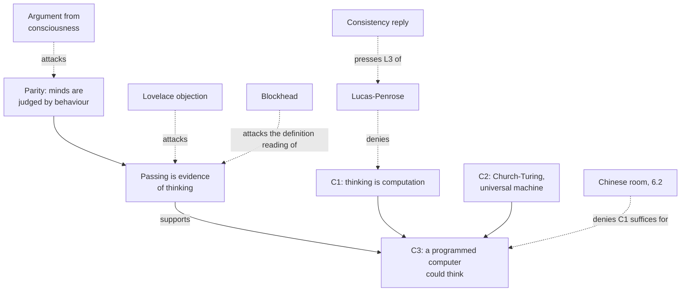

# Philosophy of Mind · Lesson 6.1: Computationalism and the Turing test

> ⏱ ~15 min · Module 6: Machine minds · Builds on: [2.2](02-02-functionalism.md), [4.1](04-01-intentionality-and-folk-psychology.md), [`theory-of-computation` 3.3](../../theory-of-computation/lessons/03-03-church-turing-thesis-and-the-universal-machine.md), [`mathematical-logic` 5.2](../../mathematical-logic/lessons/05-02-second-theorem-undecidability.md) · Unlocks: [6.2](06-02-the-chinese-room.md)

## Why this matters

In early 2025, 284 people took turns texting pairs of hidden witnesses, one human and one machine, for five minutes and then saying which was human. GPT-4.5, prompted to play an introverted young person fluent in internet slang, was picked as the human 73% of the time, more often than the humans it was paired with (Cameron Jones and Benjamin Bergen, arXiv preprint, March 2025). By Turing's 1950 number, a machine has passed. What follows about thinking depends on what the test is for, and what thinking is.

## The idea

A driving test is good evidence that you can drive, but it is not what driving is: someone who had memorized every turn of the examiner's one route would pass and still could not drive. A test is evidence, whose force depends on how the candidate passed; Turing's is of that kind, and Ned Block's Blockhead is the route-memorizer.

The second idea is about the inside. The [computational theory of mind](../reference.md#computational-theory-of-mind) says thinking *is* computation, so the right program could think, whatever it runs on. The Lucas–Penrose argument says Gödel's theorem shows some human thinking is not computation; its critics reply that it assumes self-knowledge that a machine could not prove it had.

Already taught: [machine functionalism](../reference.md#machine-functionalism) ([2.2](02-02-functionalism.md)), the [representational theory of mind](../reference.md#representational-theory-of-mind) ([4.1](04-01-intentionality-and-folk-psychology.md)), the Church–Turing thesis ([`theory-of-computation` 3.3](../../theory-of-computation/lessons/03-03-church-turing-thesis-and-the-universal-machine.md)) and Gödel's theorems ([`mathematical-logic` 5.1](../../mathematical-logic/lessons/05-01-incompleteness-first-theorem.md), [5.2](../../mathematical-logic/lessons/05-02-second-theorem-undecidability.md)). This lesson adds computation to the representational theory and asks what a conversation can show.

## Source

A. A. L. [Ada, Countess of Lovelace], Note G to her translation of L. F. Menabrea's *Sketch of the Analytical Engine*, Taylor's *Scientific Memoirs*, vol. 3 (1843):

> The Analytical Engine has no pretensions whatever to *originate* any thing. It can do whatever we know how to order it to perform. It can follow analysis; but it has no power of anticipating any analytical relations or truths.

The shape: a denial, a capacity, a contrast. The note opens by warning against "exaggerated ideas" of the engine, so "pretensions" are claims fairly made for this engine, not a theorem about all machines. "Originate" carries the objection; "we know how to order" credits the programmer.

## The argument

**The game.** Descartes (*Discourse on Method*, Part V, 1637) held that no machine shaped like us could arrange words in apt reply to whatever is said in its presence, the first of his two tests ([Boss 6](../syllabus.md) reads them). Alan Turing ("Computing Machinery and Intelligence", *Mind*, 1950) set "Can machines think?" aside as too meaningless to discuss and put the [imitation game](../reference.md#imitation-game) in its place: an interrogator exchanges typed messages with two hidden witnesses, a person and a digital computer, and must say which is which; the machine tries to pass as the person. He predicted that within about fifty years machines would leave an average interrogator no more than a 70 per cent chance of the right identification after five minutes, and that educated opinion would by then let one speak of machines thinking without being contradicted.

His case is an argument from parity:

- **T1.** Our grounds for holding that other people think are, in the end, what they say and do. *In words:* you cannot inspect your neighbour's mind either.
- **T2.** A machine that cannot be told from a person under sustained questioning by someone trying to unmask it supplies grounds of the same kind and strength. *In words:* in the game it matches the person.
- **∴ T3.** Without a reason that would not also count against people, we should say it thinks. *In words:* refusing the machine is solipsism applied to one case.

Turing answered nine objections; four matter here. The [argument from consciousness](../reference.md#argument-from-consciousness) (Professor Jefferson's Lister Oration, 1949): no machine equals a brain until it writes a sonnet from emotions felt and knows it wrote it. Reply: that standard leaves only solipsism. [Lady Lovelace's objection](../reference.md#lovelaces-objection): a machine never originates anything or takes us by surprise. Reply: machines often surprise him, and a learning machine's teacher hardly knows its insides. The mathematical objection: Gödel's and Turing's results show each machine fails some question. Reply: no one has shown humans free of such limits, and we beat one machine at a time. Continuity in the nervous system: neurons are not discrete-state devices. Reply: a digital machine can mimic a continuous one past an interrogator's power to tell. The rest: theological, "heads in the sand", various disabilities (it will never be kind, or enjoy strawberries and cream), informality of behaviour, extrasensory perception.

**Computationalism.** The claim about the inside:

- **C1.** Thinking is computation: rule-governed operations on representations, sensitive to their form. *In words:* the mind literally is a computing system (Putnam's machine functionalism, 1967; Fodor's language of thought, 1975; connectionists keep the computing, drop the inner sentences).
- **C2.** Any such computation can be run by a universal machine given time and memory. *In words:* by the [Church–Turing thesis](../reference.md#church-turing-thesis) every effective procedure is Turing-computable, and one machine runs every Turing machine.
- **∴ C3.** A suitably programmed digital computer could think. *In words:* the right program suffices, whatever runs it; Searle calls this [strong AI](../reference.md#strong-and-weak-ai) ([6.2](06-02-the-chinese-room.md)).

**Gödel, stated as needed.** Let $T$ be a consistent, effectively axiomatized theory containing enough arithmetic, $G_T$ its Gödel sentence (provably equivalent in $T$ to "$G_T$ is not provable in $T$"), and $\operatorname{Con}(T)$ the sentence saying $T$ proves no contradiction. Then

$$\text{(F1)}\ \ T \nvdash G_T, \qquad \text{(F2)}\ \ T \vdash \operatorname{Con}(T) \rightarrow G_T, \qquad \text{(F3)}\ \ T \nvdash \operatorname{Con}(T).$$

*In words:* $T$ cannot prove its Gödel sentence, can prove the sentence holds if $T$ is consistent, and cannot prove it is consistent. F1 needs only consistency (the first theorem's other half, $T \nvdash \neg G_T$, needs more); F2 is F1 proved inside $T$; F3 is the second theorem. Lucas needs only F1.

**The [Lucas–Penrose argument](../reference.md#lucas-penrose-argument)** (J. R. Lucas, "Minds, Machines and Gödel", *Philosophy*, 1961):

- **L1.** Suppose a machine $M$ models my mind: what I can establish in arithmetic is what a consistent formal system $T_M$ proves. *In words:* mechanism, assumed for reductio.
- **L2.** By F1, $T_M \nvdash G_M$.
- **L3.** I can see that $G_M$ is true.
- **∴ L4.** I outrun $M$, so $M$ does not model me; and $M$ was arbitrary. *In words:* whatever machine is offered, the mind beats it at one point.

Roger Penrose (*The Emperor's New Mind*, 1989; *Shadows of the Mind*, 1994) recast it for a reasoner who knows she is sound, and inferred non-computable physics in the brain, perhaps in neurons' microtubules.

The [consistency reply](../reference.md#consistency-reply), put to Lucas by Rogers and by Putnam ("Minds and Machines", 1960): what I can see is F2's conditional, which $T_M$ also proves. Detaching $G_M$ needs $\operatorname{Con}(T_M)$, and if L1 is true F3 says I cannot prove it. So L3 either asserts the conditional, which the machine shares, or assumes self-knowledge that mechanism denies. Lucas answered that our inconsistencies are mistakes we withdraw, not policies, and (1976) that we must assume our consistency to think at all. The SEP entry on the computational theory of mind (2024) reports a wide consensus that the Gödelian critique fails.

**[Blockhead](../reference.md#blockhead)** (Ned Block, "Psychologism and Behaviorism", *Philosophical Review*, 1981):

- **B1.** If passing the test were logically sufficient for intelligence, anything that could pass would be intelligent.
- **B2.** A machine could pass that stores, for a test of fixed length, a sensible reply to every possible sequence of the judge's messages, and looks each one up. *In words:* its programmers wrote every answer in advance.
- **B3.** That machine is not intelligent: Block gave it the intelligence of a toaster.
- **∴ B4.** Passing is not logically sufficient. *In words:* whether behaviour is intelligent depends on what produces it, Block's [psychologism](../reference.md#psychologism).

How big is the table? Let the judge send $k$ messages, each one of $N$ possible strings. The machine's replies are fixed by the history, so they add no branches: one entry per judge history:

$$S(k) = N + N^2 + \cdots + N^k = \frac{N^{k+1}-N}{N-1}.$$

Assume, as an undercount, 27 symbols (letters and space), messages of 1 to 300 characters (the cap Jones and Bergen used) and $k = 5$. Then $N = (27^{301}-27)/26 \approx 10^{429.4}$ and $S(5) \approx N^5 \approx 10^{2147}$, against roughly $10^{80}$ atoms in the observable universe. Blockhead is [conceivable](../reference.md#conceivability-and-possibility) and, on any estimate of its size, physically impossible.

**Where the argument is weakest.** T2's "same kind and strength". The strongest objection is Block's: the same behaviour can come from lookup or from thought. The strongest reply, the SEP entry's: no Blockhead can exist in our world, so passing long, expert questioning is good evidence of thought, though not its definition. The Turing side concedes the evidence is defeasible and can be overridden by knowing how the passer works; the psychologist concedes that for other people behaviour is all we have, and we use it.

## Argument map

Two routes lead to a thinking machine, through behaviour and through what thinking is; each objection cuts one.

## Worked examples

**Example 1 (clean case: the 2025 game as evidence).** The study was preregistered and run on two populations. A 73% win rate leaves interrogators right 27% of the time, under Turing's 70%. LLaMa-3.1-405B with the same prompt won 56%; ELIZA, Joseph Weizenbaum's 1966 pattern-matcher, 23%. So T2's antecedent holds, but only for five-minute games with lay interrogators.

Read as evidence, it is narrower. Only 12% of interrogators asked the knowledge and reasoning questions Turing imagined; most made small talk. Without the persona prompt the models passed in only one of the two populations, and the authors conclude that the test measures humanlikeness more than intelligence. Blockhead is ruled out, since these systems answer messages no one wrote replies for; the inside question stays open ([6.2](06-02-the-chinese-room.md), [6.3](06-03-do-language-models-understand.md)). On the definition reading nothing follows; on the evidence reading, the strength depends on game length, interrogator skill and the rivals ruled out.

**Example 2 (hard case: Lucas against a named system).** A mechanist says your arithmetic is Peano arithmetic. Lucas wins: PA does not prove $G_{\mathsf{PA}}$, which is true because PA is consistent, as ZFC proves and Gentzen proved ([`mathematical-logic` 5.2](../../mathematical-logic/lessons/05-02-second-theorem-undecidability.md)). L3 rested on knowing $\operatorname{Con}(\mathsf{PA})$ from outside PA.

Now the mechanist names $T^*$, too vast for anyone to survey (Paul Benacerraf, "God, the Devil, and Gödel", 1967). Lucas can write $\operatorname{Con}(T^*) \rightarrow G_{T^*}$, but $T^*$ proves that too. Asserting $G_{T^*}$ needs $\operatorname{Con}(T^*)$: no outside proof is in view, and if he is $T^*$, F3 bars one from inside.

Here the account stops. Lucas says we may assume our consistency, since we withdraw contradictions when found. The mechanist says assuming is not knowing, and withdrawing the contradictions you find does not show that none are left. Benacerraf: at most it follows that either no formal system captures our arithmetic or we could not recognize one that does. Penrose's soundness premise asks for more, since consistency does not guarantee truth: PA plus the axiom $\neg\operatorname{Con}(\mathsf{PA})$ is consistent if PA is, yet refutes its own true Gödel sentence.

## Watch out

- **You might think Turing said machines can think, but actually** he replaced the question with the game, made predictions, and conceded he had no very convincing positive arguments.
- **You might think the Church–Turing thesis says the mind is a Turing machine, but actually** it is about algorithms. That thinking is one is C1.
- **You might think "not computable" means "not physical", but actually** Penrose holds the mind physical and non-computable, and Ross ([5.2](05-02-is-the-intellect-a-bodily-power.md)) holds addition computable but determinately realized by nothing physical.
- **You might think Blockhead shows the test is worthless, but actually** it targets only the definition reading; being physically impossible, it leaves passing as evidence in our world.

## One-liner

> The imitation game gives evidence about a machine, not a definition of thinking; what the evidence shows turns on what produces the replies, and Gödel settles that only if we can know our own consistency.

## Problems

**P1 (🟢) *(Exegetical.)*** Four complaints about a chatbot, written for this problem. For each, name the objection from Turing's list it raises and give Turing's reply in a clause. One line each.

(a) "It can never take its makers by surprise: whatever it says, they set it up to say."

(b) "It writes a passable sonnet, but it feels nothing about the poem and does not know it has written one."

(c) "Describe a certain machine to it and ask whether that machine will ever answer yes. For some such question it must answer wrongly or not at all."

(d) "Its circuits jump between definite states, but a nerve's response varies smoothly, and a tiny change in its input can make a large difference to its output."

**P2 (🟡) *(Formal (a)–(b) · Exegetical (c).)*** A toy imitation game: the judge sends exactly 3 messages, each a string of exactly 4 digits (0–9), and the machine replies after each. A Blockhead for it stores one reply for every sequence of judge messages it could have received so far.

(a) How many entries does its table need? Give the exact number.

(b) The game is lengthened to 4 judge messages. How many entries does the fourth layer alone add, and roughly how many times the whole three-message table is that? One line.

(c) Does the size of a full-length Blockhead bear on whether passing is logically sufficient for thinking, or on whether passing is good evidence of it? Two sentences.

**P3 (🔴) *(Find the crux. Exegetical (a) · Evaluative (b).)*** An invented exchange, written for this problem.

> **Mechanist:** My hypothesis is that everything you can establish in arithmetic is what one consistent formal system, $T_M$, proves. You can construct its Gödel sentence $G_M$ and prove that if $T_M$ is consistent then $G_M$ is true. So can $T_M$.
>
> **Lucasian:** But I can see that $T_M$ is consistent. It is meant to model me, and I do not affirm both halves of a contradiction: when I find one, I withdraw it. So I see that $G_M$ is true, which $T_M$ cannot prove.

(a) Name the premise of Lucas's argument (L1–L4) the mechanist challenges, and say which of F1–F3 each side relies on.

(b) Say what "see" must mean for that premise to do its work, whether the Lucasian's ground supplies it, and one consideration that would move one side.

150 words or fewer in total; any verdict.

Solutions

**P1** *(Exegetical)*

**Must hit, strict:**

- (a) Lady Lovelace's objection, in Turing's variant, that a machine can never "take us by surprise". Reply: machines surprise him often, and a learning machine's teacher is largely ignorant of what goes on inside it.

- (b) The argument from consciousness (Jefferson's sonnet). Reply: on that standard we could know no one thinks but ourselves, which is solipsism; we grant other people thought on the same evidence.

- (c) The mathematical objection (Turing's own halting-style result; Gödel's theorem in Lucas's later form). Reply: it is only asserted that humans have no such limits, and a human triumphs over one machine at a time.

- (d) The argument from continuity in the nervous system. Reply: a discrete-state machine can mimic a continuous one too closely for an interrogator to use the difference.

**Wrong turns:** calling (b) an argument from various disabilities: Turing says those are often disguised forms of the argument from consciousness, but this one is Jefferson's own. Calling (d) the argument from informality of behaviour, which is about rules of conduct, not continuous states. Giving "Lucas–Penrose" for (c) is accepted only if it is identified as Turing's mathematical objection.

**Model answer:** (a) Lovelace's objection; machines often surprise, and a learning machine's teacher cannot follow its insides. (b) Argument from consciousness; it collapses into solipsism, since we judge people the same way. (c) Mathematical objection; no one has shown humans lack such limits, and we beat one machine at a time. (d) Continuity in the nervous system; a digital machine can mimic a continuous one beyond an interrogator's power to tell.

---

**P2** *(Formal (a)–(b) · Exegetical (c))*

(a) Each message is one of $N = 10^4$ strings. The table needs a reply after the first, second and third messages, one for each judge history of that length:

$$S(3) = 10^4 + 10^8 + 10^{12} = 1{,}000{,}100{,}010{,}000.$$

(b) The fourth layer adds $N^4 = 10^{16}$ entries. Since $10^{16}/S(3) = 10^{12}/100{,}010{,}001 \approx 9{,}999$, it is about ten thousand times the whole three-message table.

**Must hit, strict (c):**

- Logical sufficiency is untouched: Block's argument needs only that the machine is possible in principle, and size does not affect that.
- The size bears on evidence: in our world no Blockhead can be what passes, which removes one cheap explanation of passing (though not every one).

**Wrong turns:** multiplying by the number of possible replies, when the replies are fixed by the history and add no branches. Counting only $N^3 = 10^{12}$, which forgets the replies after the first and second messages. Taking $N = 4 \times 10$ instead of $10^4$. Saying the physical impossibility of Blockhead refutes Block.

**Model answer (c):** The size bears only on whether passing is good evidence: Block's argument needs Blockhead to be logically possible, which no count can disturb. But since no such table could be built in our universe, a real passer is not a Blockhead, and passing gains force as evidence.

---

**P3** *(Exegetical (a) · Evaluative (b))*

**Accept:** any verdict that places the crux at L3 and separates knowing consistency from assuming it.

**Must hit, strict (a):**

- The mechanist challenges L3. L1 and L2 are granted.
- The mechanist relies on F2 (the machine proves the conditional too) and F3 (if L1 holds, $\operatorname{Con}(T_M)$ cannot be proved from inside). The Lucasian relies on F1, plus a claim to know $\operatorname{Con}(T_M)$.

**Must hit, any verdict (b):**

- "See" must mean know, not assume, since the conditional alone gives the machine nothing to lack.
- Assess the ground: whether withdrawing the contradictions you find shows more than a correction policy (the mechanist says it leaves any not yet found); and, since if L1 holds the knowledge cannot come by proof within $T_M$, whether insight beyond proof is available without assuming the conclusion.
- Name a consideration that would move a side, e.g. how often mathematicians have accepted proofs later found wrong (Kempe's 1879 four-colour proof stood until Heawood's 1890 refutation); whether consistency can be warranted from outside for a system no one can survey (Benacerraf); whether an inconsistent reasoner must affirm everything (paraconsistent logic says not).

**Wrong turns:** saying the mechanist denies F1, or that $G_M$ is false. Answering that Lucas is refuted by the second theorem alone: F3 limits proof within $T_M$ and leaves open other ways of knowing. Running the soundness version, which is Penrose's.

**Model answer, one of several:** (a) The crux is L3. The mechanist grants F1 but stresses F2, which gives the machine the same conditional, and F3, which says that if L1 is true the Lucasian cannot prove $\operatorname{Con}(T_M)$. The Lucasian needs F1 and knowledge of consistency. (b) "See" must mean know: assuming consistency gives only the conditional, which $T_M$ shares. The Lucasian's ground falls short. Withdrawing contradictions when found is compatible with one never found, so it supports an assumption, as Lucas's own 1976 reply, that we must assume it, admits. Evidence that would move the mechanist: a general way to warrant the consistency of systems we cannot survey. What would move the Lucasian: a record of mathematicians confidently accepting errors.

## Flashback

**From Lesson [5.2](05-02-is-the-intellect-a-bodily-power.md) (Is the intellect a bodily power?):** *(Exegetical.)* Diagnose this paragraph, invented and written for this problem:

> Ross and Aquinas both deny that thinking is wholly bodily, and for one reason: a body is too determinate to think. Ross's evidence is that a calculator's answers so far fit quus as well as plus, so we cannot yet tell which function it computes, though trying it on large enough sums would settle the matter. Both conclude that the brain plays no part in thought.

(a) What is wrong with the first sentence? One sentence.

(b) What is wrong with the second? Two sentences.

(c) What is wrong with the third, for each thinker? One sentence each.

Solution

**Must hit, strict (a):** "determinate" points opposite ways. For Aquinas a body is too determinate: its own fixed nature would impede receiving every nature (P2, P3 of the [scope argument](../reference.md#argument-from-the-scope-of-intellect)). For Ross a physical process is not determinate enough: it fits rival functions (R2).

**Must hit, strict (b):**

- R2 is not about what anyone can tell: every physical record, counterfactuals included, fits incompossible functions, so there is no physical fact for a test to find.

- A larger test only lengthens a finite record, which a new rival differing beyond it still fits, as 5.2's calculator fits a function that leaves addition past its display.

**Must hit, strict (c):**

- Ross: brain states may be thought's media (n. 13); he denies only that the brain is its organ as the eye is of sight.

- Aquinas: the intellect works through no organ, yet understands only by turning to images (q.84 a.7), so the brain is not idle.

**Wrong turns:** faulting the verdict rather than its reason. Answering (b) only that 68 + 57 tells plus from quus, which defeats one rival and leaves the rest. Giving either thinker the brain as thought's organ.

**Model answer:** (a) The "determinates" run opposite ways: a body's fixed nature is too determinate for Aquinas, a physical process not determinate enough for Ross. (b) R2 says every physical record, counterfactuals included, fits incompossible functions, so no physical fact settles it, whatever we can tell. Larger sums only lengthen a finite record that a rival differing beyond it still fits. (c) Ross allows brain states as thought's media, denying only that the brain is its organ. Aquinas's intellect understands only by turning to images, so the brain is not idle.

## Connections

- **Backward:** [2.2](02-02-functionalism.md) gave Putnam's machine table, of which C1 is the general form, and [4.1](04-01-intentionality-and-folk-psychology.md) the language of thought it computes over. [5.2](05-02-is-the-intellect-a-bodily-power.md)'s Ross denies that any physical process computes a function determinately, a different claim from Lucas's, that no machine's output matches the mind's. The machine, the thesis and the halting problem are [`theory-of-computation` 3.1](../../theory-of-computation/lessons/03-01-turing-machines.md) and [3.3](../../theory-of-computation/lessons/03-03-church-turing-thesis-and-the-universal-machine.md); F1 to F3 are [`mathematical-logic` 5.1](../../mathematical-logic/lessons/05-01-incompleteness-first-theorem.md) and [5.2](../../mathematical-logic/lessons/05-02-second-theorem-undecidability.md).
- **Forward:** [6.2](06-02-the-chinese-room.md) grants a machine the behaviour and denies that C1's kind of computation suffices for understanding. [6.3](06-03-do-language-models-understand.md) asks the inside question of language models, and [6.4](06-04-could-a-machine-be-conscious.md) turns Jefferson's objection into the question of what could show a machine is conscious.
- **Sideways:** Hubert Dreyfus (*What Computers Can't Do*, 1972) turned Heidegger's analysis of skilled coping against the symbolic version of C1 ([`phenomenology-and-personalism` 2.2](../../phenomenology-and-personalism/lessons/02-02-heidegger-dasein-and-being-in-the-world.md)). Blockhead turns on logical against physical possibility, [`metaphysics` 3.1](../../metaphysics/lessons/03-01-kinds-of-necessity.md)'s distinction. Descartes's pilot passage from the same Part V is read in [`modern-philosophy` 1.4](../../modern-philosophy/lessons/01-04-the-real-distinction-and-the-interaction-problem.md), and how the language models in the 2025 game are trained is [`deep-learning` 4.5](../../deep-learning/lessons/04-05-llms-self-supervision-and-scaling-laws.md).
