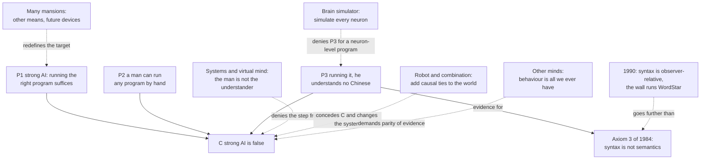

# Philosophy of Mind · Lesson 6.2: The Chinese room

> ⏱ ~15 min · Module 6: Machine minds · Builds on: [6.1](06-01-computationalism-and-the-turing-test.md), [2.2](02-02-functionalism.md), [`theory-of-computation` 3.3](../../theory-of-computation/lessons/03-03-church-turing-thesis-and-the-universal-machine.md) · Unlocks: [6.3](06-03-do-language-models-understand.md), [6.4](06-04-could-a-machine-be-conscious.md)

## Why this matters

Lock a man who reads no Chinese in a room with baskets of Chinese characters and a rulebook, written in English, that says shape by shape which characters to hand out when certain characters come in. Questions in Chinese arrive under the door, fluent answers go back out, and the people outside take him for a native speaker. John Searle (1932–2025) built this case in 1980 against the claim that running the right program is enough to understand. Whether a system that answers well understands anything is now an everyday question ([6.3](06-03-do-language-models-understand.md)).

## The idea

The man is doing what a computer does. A universal machine reads another machine's program as data and imitates it step by step ([`theory-of-computation` 3.3](../../theory-of-computation/lessons/03-03-church-turing-thesis-and-the-universal-machine.md)); the man is the processor, the rulebook the program, the baskets the database. Whatever program is said to produce understanding, he can run it, slowly, answering to the shapes of the characters and never to their meaning. So, Searle concluded, running a program cannot be what understanding is.

[Strong AI](../reference.md#strong-and-weak-ai), in Searle's sense, is the thesis that an appropriately programmed computer literally has a mind: with the right program it understands, as you do. Weak AI says only that computers are powerful tools for modelling the mind, and Searle had no quarrel with it. Nor did he say that no machine can think: brains are machines, and brains think. His target is sufficiency, that a program, run on anything, is enough. ("Strong" has nothing to do with the strong emergence of [`philosophy-of-science` 4.5](../../philosophy-of-science/lessons/04-05-reduction-and-emergence.md); "syntax" means the formal shapes of symbols and rules over them.) His first targets were Roger Schank's programs (Schank and Abelson, 1977), which answered questions about short restaurant stories from stored "scripts".

The room passes a Turing test in Chinese, so if it does not understand, passing the imitation game of [6.1](06-01-computationalism-and-the-turing-test.md) is not sufficient, and the [computational theory of mind](../reference.md#computational-theory-of-mind) is in trouble. Its cousin is [2.2](02-02-functionalism.md)'s [China brain](../reference.md#china-brain), many people realizing a machine table and asked about feeling.

## The argument

**The [Chinese room](../reference.md#chinese-room)** (Searle, "Minds, Brains, and Programs", *Behavioral and Brain Sciences* 3, 1980), as the *Stanford Encyclopedia* reconstructs it.

**P1.** If strong AI is true, there is a program for Chinese such that anything that runs it thereby understands Chinese. *In words:* the right program is enough, whatever runs it.

**P2.** A man who knows no Chinese could run any such program by hand. *In words:* he is a universal machine with a rulebook.

**P3.** Running it, he would not understand Chinese. *In words:* all he learns is which shapes follow which.

**∴ C.** Strong AI is false. *In words:* running a program does not suffice for understanding.

In *Minds, Brains and Science* (1984) Searle gave the general form. Programs are purely formal, or syntactic; minds have contents, or semantics; syntax by itself neither constitutes nor suffices for semantics; so programs by themselves neither constitute nor suffice for minds. The room is the evidence for the third axiom, [syntax is not semantics](../reference.md#syntax-is-not-semantics).

Searle answered six replies he had met in talks.

- **[Systems reply](../reference.md#systems-reply).** The man is one part, like a CPU, of a system that includes rulebook, baskets and scratch paper; the system understands. Searle: let the man memorize everything and work in his head; he is now the whole system and still does not know what the Chinese word for hamburger means. The [virtual mind reply](../reference.md#virtual-mind-reply) (Marvin Minsky, 1980; David Cole, 1991) says running the program may create a distinct understander, neither the man nor the hardware.
- **[Robot reply](../reference.md#robot-reply).** Put the computer in a robot with cameras and arms, so that its symbols are causally tied to hamburgers. This concedes that symbol manipulation alone is not enough, and changes the system; the causal theories of content in [4.2](04-02-naturalizing-content.md) are its allies. Searle: put the room inside the robot; the camera's output arrives as more symbols, and the man is no wiser.
- **[Brain simulator reply](../reference.md#brain-simulator-reply).** Let the program simulate the firing of every neuron in a native speaker's brain (Paul and Patricia Churchland, 1990, pressed a version). Searle: let the man work water pipes and valves arranged as the neurons are; nothing understands, because the simulation copies the formal structure of the firings, not the causal powers that produce understanding. A simulated storm leaves nothing wet.
- **[Combination reply](../reference.md#combination-reply).** A brain simulator in a robot, taken as a whole. Searle: we would credit it with understanding only until we learned that a program drove it.
- **[Other minds reply](../reference.md#other-minds-reply).** You know that others understand only from their behaviour, and the room behaves as well. Searle: the question is not how I know that others have cognitive states but what I attribute when I attribute them, and a program and its outputs can exist without that. The [problem of other minds](../reference.md#problem-of-other-minds) is the human case of the evidence question this module puts to machines.
- **[Many mansions reply](../reference.md#many-mansions-reply).** Engineers will one day build devices with whatever processes produce understanding in brains. Searle: perhaps, but that redefines strong AI as whatever artificially produces cognition, giving up the claim that a program suffices.

His positive view is [biological naturalism](../reference.md#biological-naturalism) (his name for it in *The Rediscovery of the Mind*, 1992): consciousness and intentionality are caused by neurobiological processes and are higher-level biological features of the brain, like digestion. A machine could think if it had causal powers equivalent to the brain's; no program confers them. Critics call this property dualism renamed, which Searle denied ("Why I Am Not a Property Dualist"). A dualist or a Thomist can accept C and go further: [5.2](05-02-is-the-intellect-a-bodily-power.md)'s Ross denies that any physical process determinately computes anything. Daniel Dennett, the illusionists' forerunner ([3.4](03-04-illusionism.md)), held that all intentionality is derived, so Searle's line between the original intentionality of minds and the [derived intentionality](../reference.md#original-and-derived-intentionality) of symbols ([4.1](04-01-intentionality-and-folk-psychology.md)) marks no real difference.

**Observer-relativity and triviality.** In "Is the Brain a Digital Computer?" (his 1990 APA presidential address) Searle went further. Computation is defined syntactically, but syntax, he argued, is not intrinsic to physics: a voltage is a "1" only relative to someone who treats it as one. So whether a system runs a program is [observer-relative](../reference.md#observer-relativity-of-syntax): a wall, he claimed, contains some pattern of molecular motion with the formal structure of WordStar, an early word processor. Understanding is not observer-relative, so "the brain is a computer" is not even a clear hypothesis. Hilary Putnam (*Representation and Reality*, 1988) had argued that every ordinary open system implements every finite-state automaton without inputs and outputs: the [triviality problem](../reference.md#triviality-problem). If it holds, "cognition is computation" says nothing. The standard answer restricts implementation: physical states must cause their successors and support counterfactuals (David Chalmers, 1996; Jack Copeland, 1996).

**Where the argument is weakest.** The step from P3 to C, which treats the man as the candidate understander. The strongest objection is the virtual-mind form of the systems reply: the man is only the implementer, and the answers are not his (asked about its home town, the room names one he has never seen), so his ignorance shows nothing about whether understanding exists. The strongest reply is internalization: once the man memorizes the program he is the whole system, and he finds no Chinese understanding in himself. Cole and Ned Block answer that the result would be two minds in one head, the Chinese one unknown to the English one. Each side concedes something. The systems theorist grants that the man does not understand. Searle grants that the room behaves exactly as a speaker does, so his verdict rests on what he fails to find from the inside, the very evidence the virtual-mind reply calls beside the point.

## Argument map

The replies attach at different places: a step denied, a conclusion conceded, the evidence disputed, the thesis changed.

## Worked examples

**Example 1 (clean case: the room as P1 … ∴ C).** A slip comes under the door: a short story in Chinese about a man whose restaurant meal arrives burnt and who storms out without paying, then a question, "Did he eat it?" P1: strong AI names a program, R, and says whatever runs R understands such stories. P2: the man looks up each character's shape in the rulebook's index, follows the rules it points to, copies characters onto scratch paper, and hands out a string that means "No." P3: ask him in English what the story was about. He can name the rules he applied, and nothing about a meal. C: R gave him no understanding, and R was arbitrary among the programs strong AI could name. The form is valid: P1 says everything that runs R understands; P2 and P3 supply something that runs R and does not.

**Example 2 (hard case: the triviality problem on a sunlit wall).** A patch of wall warms in the morning sun. Read every ten minutes from 8:00, it gives 11.0, 12.4, 13.7, 14.9, 16.0 and 17.0 °C. Target: a three-state counter with no inputs, A → B → C → A. Map readings by position: A is {11.0, 14.9}, B is {12.4, 16.0}, C is {13.7, 17.0}. All five recorded transitions mirror the counter's, so on the [simple mapping account](../reference.md#simple-mapping-account) (any mapping under which physical transitions mirror computational ones counts) the wall ran the counter. Since no reading repeats, regrouping fits the five-step run of any automaton without inputs: Putnam's result in miniature, and Searle's wall.

Now apply the [causal account of implementation](../reference.md#causal-account-of-implementation). Counterfactuals: at 16:00 the cooling wall reads 14.9, an A-state, and ten minutes later 14.1, which is in no class, let alone B. Causation: the sun, not the earlier temperature, moved the wall from 11.0 to 12.4. Copeland adds that the mapping was built after the record, and Peter Godfrey-Smith (2009) that it lumps 11.0 with 14.9 while 12.4, between them, sits elsewhere. A three-flip-flop counter on a clock passes every test: set it to any state and it goes to the right next one.

**Where it strains.** Chalmers accepts that every physical system implements *some* computation; the restriction removes only the claim that each implements every one, which is what made the theory of mind empty. Searle can answer that the observer has moved, not vanished: which causal states count as which symbols is still assigned. Chalmers answers that the causal organization is there whatever we call it. Nothing in the wall decides whether "syntax" names that organization or our reading of it. And even if implementation is objective, the 1984 third axiom is untouched, since the room grants that the program runs.

## Watch out

- **You might think the room shows that no machine can think, but actually** Searle held that brains are machines that think. The target is strong AI: that running a program is sufficient, whatever runs it.

- **You might think Searle's conclusion is that understanding is not physical, or not computable, but actually** biological naturalism makes it a biological feature of brains, and the man computes the very function a speaker does. "Not produced by computation alone" is neither "not computable" nor "not physical".

- **You might think the 1990 wall argument is the room again, but actually** it attacks a different premise. The room grants that the program runs and denies that running suffices for meaning; the wall denies that "runs this program" is an intrinsic fact at all.

## One-liner

> A man can run any program by hand without understanding a word, so, Searle argued, running a program is not enough for understanding; the replies dispute who the understander is, what the evidence is, and whether running a program is a physical fact at all.

## Problems

**P1 (🟢) *(Exegetical.)*** Each statement below (written for this problem) is one of the replies Searle answered in 1980. Name the reply and give Searle's answer. One line each.

(a) "Forget scripts. Let the program compute the firing of every neuron in a native speaker's brain, synapse by synapse, as she reads. Then it does what her brain does."

(b) "Put that neuron-level program inside a humanoid robot that sees, walks and handles things, and look at the whole behaving thing. You would credit it with understanding."

(c) "You credit your colleague with understanding Chinese because of what she says and does. The room says and does the same, so consistency requires crediting it too."

(d) "Your argument is about today's digital computers. Whatever processes produce understanding in brains, engineers will one day build devices that have them, and that will be artificial intelligence."

**P2 (🟡) *(Apply to a hard case: Exegetical (a) · Evaluative (b).)*** A laboratory maps a native Mandarin speaker's brain at the level of single neurons and synapses, and writes a program that computes, millisecond by millisecond, the firing of every one of them. It runs on an ordinary cluster of processors, each updating thousands of simulated neurons in turn. Written questions in Chinese reach the simulated retina through a camera, and the simulated motor signals drive a screen. In blind comparison its answers cannot be told from hers.

(a) State the brain simulator reply as applied to this system, and Searle's answer, naming the distinction his answer turns on. Two sentences.

(b) Searle's water-pipe version of his answer no longer rests on the man's own failure to understand. Say what it rests on instead, whether that ground applies to the cluster as strongly as to the pipes, and what each side must claim about which properties of a brain matter for understanding. Any verdict. 150 words or fewer.

**P3 (🔴) *(Steelman and reply. Evaluative.)*** Searle's answer to the other minds reply takes a few sentences: the question is not how we know that others understand but what we attribute when we say they do, and computational processes and their outputs can exist without it.

(a) Steelman the other minds reply so that this answer does not dispose of it. Your version may not claim that understanding just is behaviour.

(b) Reply as Searle could, and say what your reply costs.

150 words or fewer in all.

Solutions

**P1** *(Exegetical.)*

**Must hit, strict:**

- (a) The brain simulator reply. Searle: let the man operate water pipes and valves arranged like the neurons; still no understanding, because simulating the formal structure of neuron firings does not reproduce the brain's causal powers (simulation is not duplication).

- (b) The combination reply. Searle: we would credit such a robot with understanding only until we learned that its behaviour came from a program; knowing that, by the room's argument, we would withdraw the attribution.

- (c) The other minds reply. Searle: the issue is not how we know that others have cognitive states but what we attribute when we attribute them, and the computational processes and their outputs can exist without it.

- (d) The many mansions reply. Searle: perhaps such devices can be built, but this redefines strong AI as whatever artificially produces cognition, so it abandons the thesis the room attacks, that running a program suffices.

**Wrong turns:** calling (b) the robot reply, when the robot carries a brain simulator and is judged as a whole; calling (a) the systems reply because it talks about what the whole program does; answering (d) "Searle denies machines can think", when he allows any machine with brain-equivalent causal powers.

**Model answer:** (a) brain simulator; Searle's water pipes: it copies the formal structure of the firings, not their causal powers. (b) combination; we credit it only until we learn a program runs it. (c) other minds; the question is what we attribute, not how we know it. (d) many mansions; it trivializes strong AI by giving up the claim that a program suffices.

---

**P2** *(Exegetical (a) · Evaluative (b))*

**Must hit, strict (a):**

- The reply: this program does what a native speaker's brain does, neuron by neuron, so it understands Chinese, as her brain does though no single neuron does.

- Searle's answer: it simulates only the formal structure of the firings, not the brain's causal powers to produce understanding; the distinction is simulation versus duplication (a simulated storm makes nothing wet).

**Must hit, any verdict (b):**

- What the pipe case rests on: not the operator's introspection (he is now only working valves) but the intuition that a system of pipes, however arranged, does not understand, backed by the simulation/duplication distinction.

- Whether it transfers: the cluster is not even arranged like the brain, since each processor updates thousands of neurons in turn, so Searle's ground applies at least as strongly as to the pipes. A replier must say that what matters is the causal organization the program imposes, which the cluster has at the level of the program.

- Each side's claim about what matters: for Searle, the brain's specific causal powers (biological in us), which no program confers; for the replier, fine-grained functional organization, the same in brain, pipes and cluster.

**Wrong turns:** answering that the man still does not understand, when he no longer figures in the case; treating "simulation is not duplication" as settling the case, when whether understanding, unlike wetness, is fixed by organization is exactly what is disputed; turning the answer into fading qualia, which is [6.4](06-04-could-a-machine-be-conscious.md)'s.

**Model answer (b), one of several:** The pipe case no longer turns on what the operator finds in himself; he is a valve-turner. It rests on the intuition that plumbing, however arranged, understands nothing, backed by Searle's distinction: a simulation of a storm is not a storm. That ground applies to the cluster at least as strongly. Its processors are not arranged like neurons at all; they compute numbers describing neurons, as a weather model computes numbers describing rain. So Searle must claim that understanding depends on the brain's specific causal powers, which neither pipes nor processors acquire by running a program. The replier must claim that it depends only on fine-grained causal organization, which the program imposes on whatever runs it, so that brain, pipes and cluster are alike where it counts. The case cannot choose between them: it presupposes an answer to whether understanding is like wetness or like adding.

---

**P3** *(Evaluative)*

**Accept:** a steelman built on parity of evidence, or one built on the idleness of the extra ingredient; either survives Searle's answer because neither says what understanding is.

**Must hit, any verdict:**

- (a) Grant Searle that understanding is an inner state, not behaviour. Then argue from evidence: our only routes to it in others are behaviour and similarity to ourselves; Searle's criterion, brain-equivalent causal powers, can be detected only through those routes; so either behaviour counts for the room as for people, or the attribution to people rests on similarity of constitution, which needs an argument (aliens), or the inner state is evidentially idle (a system without it would behave the same).

- (b) A reply that names extra evidence or a defeater: in humans, shared biology and one's own case; in the room, knowledge of the mechanism, which by the room argument is insufficient, so the behaviour is defeated rather than ignored.

- (b) A cost of that reply, for example: similarity of constitution carries the weight, so a creature unlike us that behaves like us is left undecided until its causal powers are known, and "causal powers equivalent to the brain's" has no test independent of behaviour.

**Wrong turns:** steelmanning as "understanding is just behaving appropriately", which is behaviourism and the very thing Searle's answer rebuts; confusing the other minds reply with the systems reply (it is about evidence, not about which entity understands); saying Searle doubted that other people have minds.

**Model answer, one of several:**

(a) Grant that understanding is an inner state. How do I know my colleague has it? From what she says and does, plus her being made as I am. Searle's criterion, causal powers equivalent to a brain's, is visible only through those two routes. So either behaviour is evidence for the room too, or my belief about her rests on her biology, and then a Martian who talks as well as she does could not be credited with understanding until dissected. If neither will do, the inner state makes no difference anyone could detect.

(b) Searle: behaviour is evidence, but evidence can be defeated. In her case nothing defeats it; in the room's we know the mechanism, and the room argument shows that mechanism insufficient. The cost: everything rests on the room argument and on similarity of constitution, so a behaviourally perfect creature unlike us stays undecided.

## Flashback

**From Lesson [5.3](05-03-hylomorphism-tested.md) (Hylomorphism tested):** *(Diagnose: Exegetical (a)–(b).)* A study-guide paragraph, invented, written for this problem:

> Hylomorphists answer Kim's exclusion argument without touching causal closure. An arch carries a load that would snap a flat beam of the same stone, and its shape adds no force; the soul makes its difference to the body in just that way, and the arch proves it. Aquinas is the clearest case: his soul is the body's form and never its mover.

(a) Find the three errors and correct each from 5.3. One sentence each.

(b) Run the push-or-idle dilemma K on Aquinas as corrected. On each of 5.3's two readings of what a command does, which horn does he take or how does he slip it, and at what cost? Two sentences.

Solution

**Must hit, strict (a):**

- "Without touching causal closure": hylomorphists split. Jaworski keeps [closure](../reference.md#causal-closure); SEP "Dualism" §3.6 calls denying it natural for [hylomorphic dualists](../reference.md#hylomorphic-dualism); Aquinas's texts admit both readings.

- "The arch proves it": it shows only that H2 is coherent. The shape is an accidental form fixed by the stones' arrangement, which even Kim lets have powers ([levels and orders](../reference.md#levels-and-orders)); the soul is a substantial form, which the hylomorphist denies is so fixed.

- "Never its mover": the soul moves the body "by the motive power", though not "by its essence, as the form of the body" (ST I q.76 a.4 ad 2), and [command and commanded act](../reference.md#command-and-commanded-act) are one human act (ST I-II q.17 a.4).

**Must hit, strict (b):**

- If the command changes which brain events occur, so that from the same physical state they would not occur without it, he takes the push horn as a gap: closure fails in brains, an empirical bet.

- If the command is only the form of an act physically caused throughout, closure stands and he denies K1, but owes Seager an answer to what the command does, or slides to the idle horn.

**Wrong turns:** putting the first reading on the overdetermination horn, when the executing events then lack a sufficient physical cause; saving the soul with primary causation, which 5.3 closes to a creature; faulting the arch for not being alive.

**Model answer:** (a) Hylomorphists split on closure: Jaworski keeps it, and Aquinas's texts allow both readings. The arch's shape is an accidental form fixed by arrangement, so it shows that a form can make a difference without force, not that a substantial form does. Aquinas's soul moves the body by its motive power (q.76 a.4 ad 2). (b) If the command changes which brain events occur, he denies closure in brains, an empirical bet; if it only gives a physically caused act its form, closure stands and he slips K1, but must say what the command does or idle.

## Connections

- **Backward:** [6.1](06-01-computationalism-and-the-turing-test.md)'s imitation game is what the room passes and its computational theory of mind is what the room attacks; the man is [`theory-of-computation` 3.3](../../theory-of-computation/lessons/03-03-church-turing-thesis-and-the-universal-machine.md)'s universal machine with a rulebook. [2.2](02-02-functionalism.md)'s China brain asks the room's question about feeling, and [4.1](04-01-intentionality-and-folk-psychology.md) drew the line between original and derived intentionality that Searle relies on. Dennett called the room an intuition pump, the hazard [`philosophical-method` 3.3](../../philosophical-method/lessons/03-03-thought-experiments.md) teaches you to test by turning the knobs.
- **Forward:** The room and the robot reply led Stevan Harnad to the [symbol-grounding problem](../reference.md#symbol-grounding-problem) (1990), which [6.3](06-03-do-language-models-understand.md) puts to language models. Biological naturalism faces substrate independence in [6.4](06-04-could-a-machine-be-conscious.md), where the brain simulator reply returns as gradual neural replacement.
- **Sideways:** Ross's argument in [5.2](05-02-is-the-intellect-a-bodily-power.md) and the triviality problem are one worry about physical computation from two directions: Ross says no physical system computes any function determinately, triviality that every system computes too many; Lewis's naturalness reply there and the causal account here answer alike, by ruling some interpretations out. [`apologetics-foundations` 3.2](../../apologetics-foundations/lessons/03-02-reason.md) draws the same bridge. Multiple realizability in general is [`philosophy-of-science` 4.5](../../philosophy-of-science/lessons/04-05-reduction-and-emergence.md), whose Game of Life embeds a universal computer in a grid whose cells really do cause their successors. Leibniz's mill, this course's Boss 1, is the room's ancestor: walk inside the machine and find nothing that explains a perception.
