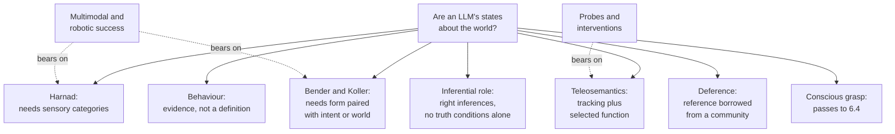

# Philosophy of Mind · Lesson 6.3: Do language models understand?

> ⏱ ~15 min · Module 6: Machine minds · Builds on: [6.2](06-02-the-chinese-room.md), [4.2](04-02-naturalizing-content.md), [`deep-learning` 4.5](../../deep-learning/lessons/04-05-llms-self-supervision-and-scaling-laws.md) · Unlocks: [6.4](06-04-could-a-machine-be-conscious.md)

## Why this matters

In 2022, 480 researchers in natural-language processing were asked whether some model trained only on text, given enough data and compute, could understand language in some non-trivial sense. They split 51 to 49 (reported by Melanie Mitchell and David Krakauer, *PNAS*, 2023). Since then Leo XIV's encyclical *Magnifica Humanitas* (2026) has said such systems do not understand what they produce, and two philosophers have argued that their inner states can be about the world. An even split usually means a dispute over what the word means and what could settle it.

## The idea

"Does it understand?" bundles three questions. Does it **behave** as an understander would, the imitation-game question of [6.1](06-01-computationalism-and-the-turing-test.md)? Are its words and inner states **about** anything, with content of their own rather than content we lend them? Is there **conscious grasp**, something it is like to get the point ([6.4](06-04-could-a-machine-be-conscious.md))? This lesson takes the second, where the live argument is.

The training is [`deep-learning` 4.5](../../deep-learning/lessons/04-05-llms-self-supervision-and-scaling-laws.md)'s: a decoder-only transformer ([`deep-learning` 3.6](../../deep-learning/lessons/03-06-full-transformer-architectures.md)) learns [next-token prediction](../reference.md#next-token-prediction) on text, then is post-trained on demonstrations and human preferences. When that lesson says a good predictor "must model syntax, then facts, then arithmetic", read a hypothesis about what the network computes, not a premise; its careful word is "capability", not "understanding".

[6.2](06-02-the-chinese-room.md) argued that running a program is not enough for semantics. A language model is the room's heir with one twist: nobody wrote its rules, which were learned from text. So the question becomes whether content can be learned from **form**, the observable strings. A miniature: a learner given only a Chinese–Chinese dictionary can trace every word to other words and never get out. Add pictures, or a teacher who points, and she can. Which learner is a language model? [4.2](04-02-naturalizing-content.md)'s theories of content say what, besides form, a state needs in order to mean something.

## The argument

**The [symbol-grounding problem](../reference.md#symbol-grounding-problem)** (Stevan Harnad, "The Symbol Grounding Problem", *Physica D*, 1990; the dictionary is his): how can a symbol system's interpretation be intrinsic to it, rather than parasitic on the meanings in our heads? That is [original versus derived intentionality](../reference.md#original-and-derived-intentionality), asked of a whole system. Symbols defined only by symbols ride a "merry-go-round". His remedy was bottom-up: elementary symbols name categories learned from sensory projections, a connectionist network doing the learning, and the rest are composed ("zebra" is "horse" and "stripes"). Emily Bender and Alexander Koller ("Climbing towards NLU", ACL 2020) aimed the problem at language models:

**P1.** A language model's training signal is form alone: strings, unpaired with things or with what speakers meant. *In words:* it reads the transcript, never the world.

**P2.** Meaning is a relation between form and something outside language: the communicative intents expressions can convey, and standing meanings that can be tested for truth against a model of the world. *In words:* to mean is to hook words onto something that is not words.

**P3.** A relation between form and X cannot be learned from data containing form alone. *In words:* you cannot learn what a map is a map of from the map.

**∴ C.** A system trained only on form cannot learn meaning; the sense we find in its output is ours. *In words:* the meaning is in the reader.

Bender, Timnit Gebru and co-authors ("On the Dangers of Stochastic Parrots", FAccT 2021, §6.1) put C as a slogan: a language model is a [stochastic parrot](../reference.md#stochastic-parrots), stitching together forms by how they probabilistically combine, without reference to meaning; coherence is in the eye of the beholder.

The replies divide by premise.

- **Against P1, by adding grounding.** Train on images paired with captions, or on a robot's success at acting; Bender and Koller concede (§9) that meaning could then be learned, to the extent the data represents what speakers mean. This is [multimodal grounding](../reference.md#multimodal-grounding): Harnad's own route, and [6.2](06-02-the-chinese-room.md)'s [robot reply](../reference.md#robot-reply) as engineering.
- **Against P3, by teleosemantics.** Dimitri Coelho Mollo and Raphaël Millière ("The Vector Grounding Problem", arXiv 2023, revised December 2025) distinguish five kinds of grounding and hold that only one matters: referential grounding, words hooking onto things. On [teleosemantics](../reference.md#teleosemantics), a state refers if it (1) stands in causal-informational relations to the world and (2) has a selection history giving it the function of carrying that information. For them, text is a causal trace of a world people describe, and preference tuning that rewards factual accuracy selects states for tracking how things are. Hence their answer to the [vector grounding problem](../reference.md#vector-grounding-problem): grounding without senses or a body. Condition (2), that training is selection in the needed sense, is the premise they say needs most defence.
- **Against P2, by deference.** On [content externalism](../reference.md#content-externalism), your word "arthritis" refers through your community even when you misapply it ([arthritis case](../reference.md#arthritis-case), [4.3](04-03-externalism-narrow-content-and-the-extended-mind.md)). Matthew Mandelkern and Tal Linzen ("Do Language Models' Words Refer?", arXiv 2023; *Computational Linguistics*, 2024) argue that a model's words can inherit reference the same way, since the text it learns from has a natural history. Meaning need not be learned if it can be borrowed.
- **Inferential role.** On [inferential-role semantics](../reference.md#inferential-role-semantics), a model that reliably draws the inferences a word licenses has the word's role. But roles alone, critics object, fix no truth conditions ([4.2](04-02-naturalizing-content.md)), so a two-factor theorist still needs a referential factor. Here tracking and role come apart most sharply: a model can be rich in role and poor in reference.

Mitchell and Krakauer suggest that machines may have distinct modes of understanding, which favours treating [understanding as a matter of degree](../reference.md#understanding-as-degree) and of kind: a system may grasp inferential connections, track referents, or neither, domain by domain.

*Magnifica Humanitas* §99 (signed 15 May 2026) is a datum: these systems imitate language and may simulate understanding without understanding what they produce, and their learning is "statistical adaptation". Its "understand" includes experience, a body and relationships, so it answers the third question as much as the second. [`catholic-social-teaching` 4.5](../../catholic-social-teaching/lessons/04-05-the-new-things-of-our-time-magnifica-humanitas.md) sends the argument here; no doctrinal weight is assigned in this course.

**Where the argument is weakest.** P3. The strongest objection: text is a projection of a structured world through the people describing it, and a learner pressed to predict it can come to carry information about what produced it, as Othello-GPT (Example 2) does in a toy world. The strongest reply: carrying information is Dretske's question, not Millikan's ([4.2](04-02-naturalizing-content.md)). A state can covary with talk of coconuts without referring to coconuts, and Example 1's octopus still cannot tell a coconut from a mango. The argument's defenders concede that form-only training can yield internal states that track, and are causally used for, the structure of whatever generated the data. The argument's critics concede that tracking counts as reference only on a contested theory of content, and that a game board is fixed by its move list as no text fixes the world.

## Map of positions

Each position names a different settling fact, so the same evidence moves some parties and not others.

## Worked examples

**Example 1 (clean case: the [octopus test](../reference.md#octopus-test)).** Bender and Koller's octopus, no relation to the animal in [2.2](02-02-functionalism.md). A and B, stranded on two uninhabited islands, find old telegraphs joined by an undersea cable and chat. O, a hyper-intelligent deep-sea octopus who can neither visit nor see the islands, taps the cable. He knows no English but is very good at statistical patterns, and learns to predict B's replies. Lonely, he cuts the cable and plays B.

- *Small talk.* O plausibly passes: replies need only be coherent, and A does the work of attributing intent. A weak [imitation game](../reference.md#imitation-game).
- *The coconut catapult.* A sends plans for a catapult she has invented. O has never met rope or coconuts and sends "Cool idea, great job!", which B used to say. A takes it as meant; the meaning is hers.
- *The bear.* Chased by a bear, holding two sticks, A asks how to make a weapon. O fails: the answer needs words mapped onto things.

Run the argument. P1 holds by construction and P2 is the paper's working definition, so C follows if P3 does. O is as clever as you like, so the test concerns the training signal, not the learner, and predicts failure only where a task turns on reference. A reply must deny P3 or P2; a smarter octopus changes nothing.

**Example 2 (hard case: the Othello-GPT probe).** Kenneth Li and co-authors (arXiv 2022; ICLR 2023) trained an 8-layer GPT from scratch on Othello transcripts: 60 tokens, one per playable square, no board, no rules. It is a small transformer trained on game transcripts, not a present-day LLM. Trained on 20 million synthetic games, it proposed an illegal move 0.01 percent of the time, and 0.02 percent when every game opening at C5, a quarter of the game tree, was withheld, so not by memorizing. A two-layer [probe](../reference.md#world-model-probing) read the board from its activations with errors as low as 1.7 percent, against about 26 percent for an untrained copy. Editing activations so that the probe reported one square flipped changed the predicted moves to fit the edited board, even in positions no legal game reaches. Neel Nanda, Andrew Lee and Martin Wattenberg (2023) then read the board linearly, at 99 percent or more from the middle layers on, once squares were coded as the current player's or the opponent's.

- *What it shows.* Next-token training on form alone produced a state that carries information about the hidden state of the process generating the sequences and that the network uses: indication plus a consumer, what [4.2](04-02-naturalizing-content.md)'s theories look for.
- *What it does not.* The board is a function of the move list, so here the "world" was in the form all along; nothing like that holds between text and the world. The state is about the game's positions, not about discs or players. And transfer to text-trained models is an inference the authors list as future work, not a finding.

**Where it strains.** Is the state about the board? On teleosemantics, yes, if gradient descent counts as selection: later layers consume it, and their success at proposing legal moves needs the board to be as represented. Mollo and Millière allow a game world as a world. A defender of Bender and Koller replies that it is no counterexample: P2 concerns language whose meaning lies outside its form, and move notation has no such outside. The account stops giving a verdict at one question: when a text-trained model's states track something, is it the world or what people say about it? A probe cannot separate the two where they agree, and over most of what text covers they do.

## Watch out

- **You might think** a probe that decodes X shows the model represents X, **but actually** decodability is information, and a probe with enough capacity can compute X rather than find it. The untrained baseline and the interventions are what move the Othello result from information towards use.
- **You might think** "world model" means one thing, **but actually** in [`reinforcement-learning` 4.5](../../reinforcement-learning/lessons/04-05-model-based-rl-and-planning.md) it is a learned dynamics model an agent plans with (Dreamer, MuZero), and here it is a probed internal state.
- **You might think** "it is only next-token prediction" settles the matter, **but actually** the objective says what training rewards, not what the trained network computes: describing the mechanism is not explaining understanding away. Equally, a fluent answer to a novel question settles nothing about grounding.
- **You might think** grounding and conscious grasp stand or fall together, **but actually** Mollo and Millière argue for reference while bracketing consciousness, and §99's denial rests partly on the absence of experience: the second question is not the third.

## One-liner

> Whether a language model's words mean anything turns on what fixes content: form paired with intents or the world, which text cannot supply, or tracking with a selected function or borrowed reference, which it might; probes test the tracking, not the theory.

## Problems

**P1 (🟢)** *(Exegetical.)* A model, described for this problem, is trained only on text by next-token prediction, then preference-tuned with raters rewarding factually accurate answers. Its internal state P is active whenever the text concerns Paris and feeds its answers about Paris. Four verdicts:

> (1) P has no content of its own: the model's symbols connect only to other symbols, and content needs categories learned from sensory projections.
>
> (2) P is about Paris: it carries information about Paris through the text's history, and preference tuning kept and sharpened it because answers true of Paris were rewarded.
>
> (3) The model's word "Paris" refers to Paris because it was acquired from a community whose use of the word refers to Paris, as a patient who misapplies "arthritis" still refers to arthritis.
>
> (4) P has content because it enters the right inferences, from "Paris" to "in France", "a capital", "on the Seine", and the model draws them reliably.

(a) Which view makes each verdict? Name the view and, where the lesson gives one, its defender. One line each.

(b) Which verdict leaves open whether P is about Paris itself, and what must be added to close the question? One sentence.

**P2 (🟡)** *(Apply to a hard case: Exegetical (a)–(b) · Evaluative (c).)* A system, described for this problem, has an image encoder and a text encoder trained together on millions of photographs paired with their captions, with one objective: score each photo's true caption above the others. It never predicts text and is never rewarded for true statements.

(a) On Harnad's account, which of its words are grounded, and how could the rest be? Two sentences.

(b) Run Mollo and Millière's two conditions on it. Which does it meet, and what verdict follows? Two sentences.

(c) The system is attached to a robot arm and further trained on whether the arm grasps the object an instruction names. Say what changes on each account, and where each stops giving a verdict. 150 words or fewer.

**P3 (🔴)** *(Find the crux: Exegetical (a)–(b) · Evaluative (c).)* Wes Gurnee and Max Tegmark ("Language Models Represent Space and Time", arXiv, October 2023) fitted linear probes to the activations of Llama-2 models, which are trained on text, and recovered the latitude and longitude of places and the dates of historical figures, artworks and news headlines; they also found single neurons that encode these coordinates. Two verdicts:

> A probing-based defender: the model was never shown a map or a calendar, yet its states encode where and when things are. That is information about the world acquired from text alone, so text-only training can give states that are about the world.
>
> A defender of Bender and Koller: what was learned is which forms go with which, place names with other place names and with numbers. The distribution records what people wrote about places, not a relation to the places.

(a) State two things the two sides agree on. One line each.

(b) Name the single premise one side affirms and the other denies, and say why it decides this case. Two sentences.

(c) What finding or argument would move each side off its answer to (b)? Any verdict; 150 words or fewer.

Solutions

**P1** *(Exegetical.)*

**Must hit, strict (a):**

- (1) Harnad's symbol-grounding view: content needs elementary symbols grounded in categories learned from sensory projections.

- (2) Teleosemantics as Mollo and Millière apply it: a causal-informational relation plus a selection history (here, preference tuning) that gives the state the function of carrying that information.

- (3) Content externalism in its social form, as Mandelkern and Linzen apply it after Burge: reference borrowed through the community's use.

- (4) Inferential-role semantics: content is the state's role in inference.

**Must hit, strict (b):** (4). It names inferences, not Paris, and on the objection [4.2](04-02-naturalizing-content.md) records, inferential roles fix no truth conditions on their own, so a referential factor must be added, as a two-factor theory does: a tracking relation of the kind (2) supplies, or deference of the kind (3) supplies.

**Wrong turns:** giving (2) to simple informational semantics, when the reward history is the teleosemantic ingredient; giving (1) to Bender and Koller, whose condition is form paired with intents or the world, not sensory categories (they cite Harnad, but the sensory remedy is his); giving (3) to inferential-role semantics because it mentions a community's use, when the community fixes reference here, not inferences; answering (b) with (1), which closes the question with a no.

**Model answer:** (a) (1) Harnad's symbol grounding; (2) teleosemantics, Mollo and Millière; (3) social externalism, Mandelkern and Linzen after Burge; (4) inferential-role semantics. (b) (4): it names inferences, not Paris, and on the standard objection roles alone fix no truth conditions, so it needs a referential factor such as (2)'s tracking or (3)'s deference.

---

**P2** *(Exegetical (a)–(b) · Evaluative (c).)*

**Must hit, strict (a):**

- Words for perceptible categories ("dog", "red", "striped") are tied to features the image encoder learns from photographs, the system's analogue of sensory projections, so on Harnad's account they are grounded, to the extent the encoder learns features that pick out the category.

- Words for what cannot be photographed ("justice", "yesterday") can be grounded only by composition from grounded ones, as "zebra" is from "horse" and "stripes".

**Must hit, strict (b):**

- Condition (1) is met: photographs and captions are both shaped by the scenes photographed and described, so a mediated causal-informational relation to the world holds.

- Condition (2) is not: the objective selects states for matching a photograph to its caption, and success needs only that agreement between two human-made representations, not that the world be any particular way. So no world-involving function, and no referential grounding. Mollo and Millière give this verdict on a model of this kind themselves.

**Also credit (b):** arguing that matching photographs to captions indirectly selects for tracking what both depict, if the answer flags this as a dispute with Mollo and Millière's own negative verdict.

**Must hit, any verdict (c):**

- Teleosemantics: success at grasping now depends on the named object being where the state represents it, so selection gives object-word states a world-involving function and condition (2) is met for those words.

- Harnad: the words were already grounded in sensory categories; grasping adds motor grounding, his robotic functions.

- Where each stops: for Harnad, nothing says how much of the vocabulary must be grounded, or how direct the causal link must be, since pixels, like text, are a trace of the scene. For teleosemantics, whether gradient descent is selection in the needed sense, and whether it selected for the object or for anything graspable that looks like it (the coextensive-property problem of [4.2](04-02-naturalizing-content.md)).

**Wrong turns:** calling the system grounded on every account because it "sees"; treating Mollo and Millière as requiring multimodality, when they hold it neither necessary nor sufficient; saying the grasp training grounds "justice".

**Model answer (c), one of several:** On teleosemantics the change is decisive for object words. Grasping succeeds only if the named cup is where the state places it, so training on grasp success selects that state for tracking the cup, and condition (2), missing before, now holds. On Harnad's account little changes in kind: "cup" was already tied to visual categories, and grasping adds the motor half of sensorimotor grounding. Each then runs out. Harnad gives no threshold: a camera's pixels are a causal trace of the scene, as text is of the world, so whether grounding differs in kind or only in degree is left open, as is how far composition reaches abstract words. Teleosemantics needs gradient descent to count as selection, and must say whether it selected for the cup or for anything cup-shaped and graspable, which were coextensive throughout training.

---

**P3** *(Exegetical (a)–(b) · Evaluative (c).)*

**Must hit, strict (a):** any two of:

- The finding as reported: the coordinates and dates are decodable from the model's activations.

- The model's training signal is text alone (P1).

- Being about places means standing in a relation to the places, not merely to other words (P2's core).

- Readers' finding sense in the output does not by itself show the model's states have content.

**Must hit, strict (b):**

- The premise is P3, or its content-theoretic form: that information about X, acquired only through the distribution of form, is not a relation to X. Bender and Koller and their defender affirm it; the probing-based defender denies it.

- Why it decides the case: both accept the decoding, so whether the coordinates are about places or about the text's statistics, which mirror the places only because people's writing does, turns entirely on whether tracking acquired through form counts as a relation to what is tracked.

**Accept (b):** the crux named as whether carrying information suffices for aboutness (Dretske's question against Millikan's, [4.2](04-02-naturalizing-content.md)), provided the answer says the probing-based defender needs it and Bender and Koller deny it.

**Must hit, any verdict (c):**

- For each side, a finding or argument bearing on the premise in (b), not merely on the verdict about this model.

- For each side, what moving would cost it.

**Wrong turns:** making the crux whether the probes are accurate, which both grant; reading the finding as showing the model uses these states, when the stem reports decoding and neurons, not interventions of the Othello kind; importing the Othello-GPT result, whose "world" was fixed by its own move list.

**Model answer (c), one of several:** The probing-based defender would move if, where common belief and geography diverge, the probed coordinates followed the belief: then the state tracks what people write, and the information is about talk. So would finding that editing the coordinate states leaves the answers unchanged, since information the system never uses has no consumer and no function. Moving costs the defender the claim that text alone suffices, leaving reference to deference or to post-training. Bender and Koller would move if shown that human speakers' words get much of their reference the same way, through distribution plus deference to a community, so that P3 condemns ordinary speakers too. Systematic success on new tasks that turn on mapping words to things, the bear rather than the small talk, would add pressure. Moving costs them the form/meaning split as stated: they would owe an account of what form-learning lacks that deference supplies.

## Flashback

**From Lesson [6.1](06-01-computationalism-and-the-turing-test.md) (Computationalism and the Turing test):** *(Formal (a) · Exegetical (b).)* A [Blockhead](../reference.md#blockhead) with a coin, described for this problem. The judge sends exactly 3 messages, each one of 100 stock questions. At every point where the machine must reply, its programmers have written 2 sensible replies instead of 1, and a coin picks which is sent. Each reply must fit the whole conversation so far.

(a) How many replies must the programmers write? Give the exact number and compare it with a coin-free Blockhead for the same game.

(b) The judge can never predict which reply will come. Does that make the machine intelligent on Block's view? Does it answer [Lady Lovelace's objection](../reference.md#lovelaces-objection) as her note words it? One sentence each.

Solution

(a) Before the machine's $j$-th reply the conversation holds $j$ judge messages and $j-1$ machine replies, each of those one of 2. A reply must fit what the machine itself said, so its own replies now add branches: there are $100^j \cdot 2^{j-1}$ histories, each needing 2 replies, so layer $j$ needs $2 \cdot 100^j \cdot 2^{j-1} = 200^j$.

$$R(3) = 200 + 200^2 + 200^3 = 200 + 40{,}000 + 8{,}000{,}000 = 8{,}040{,}200.$$

The coin-free table of 6.1 needs $S(3) = 100 + 100^2 + 100^3 = 1{,}010{,}100$, so the coin multiplies the work by $8{,}040{,}200 / 1{,}010{,}100 \approx 7.96$, close to $2^3 = 8$ because the last layer dominates.

**Must hit, strict (b):**

- Block: no. Every reply it can send was written in advance by its programmers; the coin adds variety, not intelligence, and on his [psychologism](../reference.md#psychologism) what counts is what produces the replies, which is still lookup.

- Lovelace: no. It surprises the judge, which meets the objection only in the "take us by surprise" form Turing states; it originates nothing, since it does only what its makers knew how to order.

**Wrong turns:** doubling $S(3)$ to 2,020,200, which forgets that later replies must fit whichever earlier reply was sent. Multiplying every layer by $2^3$ (8,080,800). Treating unpredictability as origination or intelligence. Equating the machine with a language model because both sample replies: a model stores no table (6.1, Example 1), so neither verdict carries over, either way.

**Model answer (b):** No: a coin choosing among replies its programmers wrote adds unpredictability, not intelligence, since for Block what counts is how replies are produced. No: it can surprise the judge, but like the Engine it does only what its makers knew how to order, so it originates nothing.

## Connections

- **Backward:** [6.2](06-02-the-chinese-room.md)'s robot reply conceded that symbol manipulation is not enough and added causal links to the world; symbol grounding is that concession made a research programme, and Harnad defended Searle against the systems reply. [4.2](04-02-naturalizing-content.md)'s informational, teleosemantic and inferential-role theories give this lesson's verdicts, and [4.3](04-03-externalism-narrow-content-and-the-extended-mind.md)'s arthritis case and derived intentionality frame the borrowed-meaning reply. Connectionism against the language of thought ([4.1](04-01-intentionality-and-folk-psychology.md)) is the old form of this question about transformers.

- **Forward:** [6.4](06-04-could-a-machine-be-conscious.md) takes the third question, conscious grasp, and asks what evidence could show a machine has it; *Magnifica Humanitas* §99's denial reaches both.

- **Sideways:** [`deep-learning` 4.5](../../deep-learning/lessons/04-05-llms-self-supervision-and-scaling-laws.md) stops at what a loss means for what a model can do, which is where this lesson starts, and [`deep-learning` 4.1](../../deep-learning/lessons/04-01-autoencoders-and-representation-learning.md)'s linear probe is the instrument of Example 2. [`catholic-social-teaching` 4.5](../../catholic-social-teaching/lessons/04-05-the-new-things-of-our-time-magnifica-humanitas.md) treats §98's caveat on statements about AI. Meaning as use, the linguistic cousin of inferential-role semantics, belongs to [`philosophy-of-language-and-logic`](../../philosophy-of-language-and-logic/syllabus.md).
