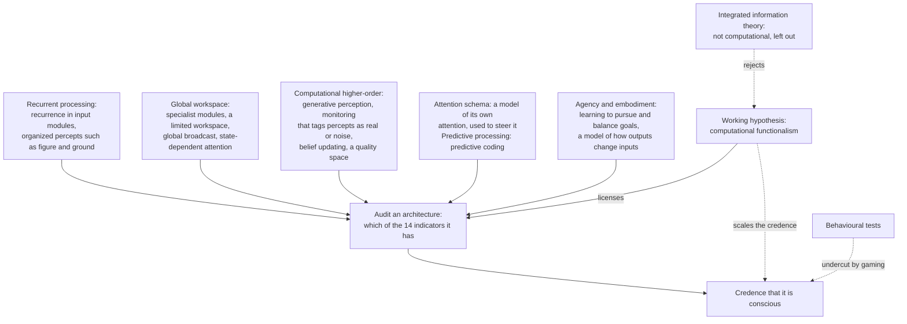

# Philosophy of Mind · Lesson 6.4: Could a machine be conscious?

> ⏱ ~15 min · Module 6: Machine minds · Builds on: [3.3](03-03-global-workspace-and-the-science-of-consciousness.md), [6.2](06-02-the-chinese-room.md), [6.3](06-03-do-language-models-understand.md), [`metaphysics` 6.6](../../metaphysics/lessons/06-06-personal-identity-over-time.md) · Unlocks: the course is complete

## Why this matters

In April 2025 Anthropic announced research on "model welfare", noting no scientific consensus on whether AI systems could be conscious. In August 2025 Mustafa Suleyman of Microsoft AI wrote that there is zero evidence of AI consciousness and called model welfare premature and dangerous. Neither statement is evidence about any machine. This lesson asks what would be, and what to do meanwhile.

## The idea

You credit other people with experience because they are built like you and say so, and an octopus on thinner grounds: shared ancestry, nerves, behaviour hard to watch. A machine breaks both routes. Inside, it is unlike any animal; outside, it was built, often by training on billions of human sentences, to act like us.

Think of a supposed Vermeer that a forger who studied every Vermeer might have made. The brushwork cannot settle it, since the brushwork is what he copied, so you examine what is hard to fake: canvas, pigments. This lesson's main research programme likewise asks how the machine works, not how it behaves, using the theories of [3.3](03-03-global-workspace-and-the-science-of-consciousness.md).

Keep two questions apart. *Could any machine be conscious?* asks whether consciousness depends on what a system is made of. *Is this one?* asks for evidence. [6.3](06-03-do-language-models-understand.md) split understanding into behaviour, content and conscious grasp, and took content; this lesson takes experience itself.

## The argument

**Could any machine?** [Substrate independence](../reference.md#substrate-independence) says consciousness depends on a system's organization, not its material. Its usual form is [computational functionalism](../reference.md#computational-functionalism): implementing the right computations is necessary and sufficient for consciousness. [Biological naturalism](../reference.md#biological-naturalism), as John Searle (1932–2025) held it in [6.2](06-02-the-chinese-room.md), says brains cause consciousness by specific biological powers, which a program only simulates, as a simulation of digestion digests nothing. Duplicating those powers would do; running a program would not. Anil Seth ("Conscious artificial intelligence and biological naturalism", *Behavioral and Brain Sciences*, online April 2025) ties consciousness to being alive, and judges conscious AI unlikely on current trajectories but more plausible as AI grows more brain-like or life-like. [Integrated information theory](../reference.md#integrated-information-theory) answers a third way: the hardware's physical causal structure decides. A feedforward system has no integrated information however it behaves, brain-like hardware would be as conscious as a brain, and a conventional computer has little (*Internet Encyclopedia of Philosophy*, "Integrated Information Theory of Consciousness").

The four families do not line up with these answers: the property dualist David Chalmers argues for substrate independence. The classical hylomorphist denies it for its own reason: an artifact has an arrangement imposed from outside, not a substantial form, so there is no one living thing for sensing to belong to ([`metaphysics` 2.3](../../metaphysics/lessons/02-03-hylomorphism-and-composition.md), which notes more generous hylomorphists).

**Fading qualia.** Chalmers ("Absent Qualia, Fading Qualia, Dancing Qualia", 1995; *The Conscious Mind*, 1996) answers the [absent qualia](../reference.md#absent-qualia) worry of [2.2](02-02-functionalism.md) by running [6.2](06-02-the-chinese-room.md)'s brain simulator neuron by neuron inside one head, a case Zenon Pylyshyn had put to Searle in 1980.

**P1.** Suppose a silicon system with your fine-grained functional organization, fine enough to fix all your dispositions to behave, could lack experience. *In words:* grant absent qualia, for reductio.

**P2.** Replace your neurons one by one with chips that copy each neuron's input-output behaviour. Along the series from you to the silicon twin, experience either vanishes at some step or fades by degrees. *In words:* somewhere the lights go out, abruptly or gradually.

**P3.** Sudden vanishing would let one swap extinguish a whole field of experience, a brute discontinuity in natural law. *In words:* no single neuron is that special.

**P4.** Gradual fading yields a midpoint subject whose red has faded to pink but who, organized as before, judges it vivid and says so; yet rational, unimpaired minds are not systematically wrong about their own experience. *In words:* the halfway person would be deceived about himself and never notice.

**∴ C.** The silicon twin has experiences just like yours: the principle of [organizational invariance](../reference.md#fading-qualia), which Chalmers holds as a natural, not a logical, necessity. *In words:* duplicate the organization and, by law of nature, you duplicate the experience.

**Uploads.** An upload scans a brain and runs the pattern as software. Whether it is *you*, and so Locke's question whether consciousness could pass to another substance ([`modern-philosophy` 3.3](../../modern-philosophy/lessons/03-03-locke-personal-identity.md)), is [`metaphysics` 6.6](../../metaphysics/lessons/06-06-personal-identity-over-time.md)'s. Whether anything conscious arrives is this lesson's. The computational functionalist: yes, if the emulation keeps the fine-grained organization. IIT: little, on conventional hardware. The biological naturalist: no, a simulation is no duplicate. The classical hylomorphist: no, information about a form is not a form informing living matter.

**Is this one? The indicator approach.** Patrick Butlin, Robert Long and seventeen co-authors ("Consciousness in Artificial Intelligence", August 2023) adopt computational functionalism as a working hypothesis. From recurrent processing, global workspace, computational higher-order, attention schema and predictive processing theories, plus agency and embodiment, they derive fourteen [indicator properties](../reference.md#indicator-approach), each checkable in an architecture. The more a system has, the likelier it is conscious, with credence set by how closely it matches each theory, how well supported the theory is, and one's credence in computational functionalism. IIT, incompatible with that hypothesis, supplies none. Their analysis suggested that no current system is conscious and that no obvious technical barrier blocks building systems with the indicators, which, they stress, would not make a system definitely conscious. They revisited the list in *Trends in Cognitive Sciences* (2026).

**The gaming problem.** Kristin Andrews and Jonathan Birch ("What has feelings?", *Aeon*, February 2023) named the [gaming problem](../reference.md#gaming-problem): a system trained on human-generated data can reproduce the behaviours we take as signs of feeling, with no intent to deceive, and then they stop being evidence. A crab's pain behaviour, shaped by no human data, keeps its force. Block's point in [2.2](02-02-functionalism.md), that the China brain's winces are best explained by its design, is the problem in embryo. Self-report is the paradigm case.

**Acting while unsure.** Moral status has no owner in this library; the principle needed is that a being whose experiences feel good or bad has interests that count (a mutual-advantage contractarian demurs, [`ethics` 5.1](../../ethics/lessons/05-01-contractarianism-morality-as-mutual-advantage.md)). Uncertainty then has two layers: an empirical credence that the system is conscious, and moral uncertainty whether that suffices, for which [`decision-theory` 6.3](../../decision-theory/lessons/06-03-moral-uncertainty.md) sets my favourite theory against expected choiceworthiness. Robert Long, Jeff Sebo and co-authors ("Taking AI Welfare Seriously", November 2024) argue that some AI systems may realistically be conscious or robustly agentic soon, and frame [moral patienthood under uncertainty](../reference.md#moral-patienthood-under-uncertainty) as two errors. Over-attribution treats an object as a subject, spending scarce care and perhaps giving rights to systems that act against us; under-attribution treats a subject as an object, with harm that scales with the systems run. With animals they judge under-attribution usually worse; with AI, either could be grave.

Statements, as data: Leo XIV's *Magnifica Humanitas* (May 2026) §99 says AI systems undergo no experiences, feel no joy or pain, and have no body or moral conscience, a claim about AI's nature that [`catholic-social-teaching` 4.5](../../catholic-social-teaching/lessons/04-05-the-new-things-of-our-time-magnifica-humanitas.md) classes as an empirical premise, which §98 warns may date; no doctrinal weight is assigned here. In the 2020 PhilPapers survey, 3.39 percent of philosophers accepted or leaned towards some current AI systems being conscious, and 39.19 percent some future ones.

**Where the argument is weakest.** P4's claim that the midpoint subject *judges* his faded red vivid. Searle (*The Rediscovery of the Mind*, 1992) accepted the case: experience shrinks while behaviour goes on, and the subject's beliefs about his loss may be true but idle. He can add that P4 assumes functional organization fixes belief, the point in dispute. Chalmers replies that the remaining neurons do just what they did before, leaving no processing to carry a belief such as "I am going blind", which would need a magical interaction. A second exit denies P2: Peter Godfrey-Smith (2016) argues that life runs on nanoscale molecular activity, so artificial systems can match living ones only coarsely. Chalmers concedes that where no fine-grained isomorph exists his principle is silent. The biological naturalist concedes that if chips could copy the role, he must accept beliefs no process carries, or experience rational judgment cannot track.

## The indicator approach

Theories become checkable features of an architecture; behaviour reaches the credence only along a dashed edge that gaming undercuts.

## Worked examples

**Example 1 (clean case: fading qualia, run).** Over a year, a patient's visual cortex is replaced region by region with chips that copy each neuron's input-output behaviour. Each month she is shown a ripe tomato. Her organization is preserved, so she says "vivid red" every time, with the original's discriminations, hesitations and memories. Run the dilemma at month six. If her experience is now pink, she is wrong about it and nothing in her could register the error, since the parts forming her judgments work as before. If it went out all at once in month four, one region carried the whole of it. Chalmers finds both incredible: she sees red throughout.

The force comes from P4's tie between experience and rational judgment. The run shows nothing about systems organized unlike us: a transformer is no functional isomorph of a brain, so the argument reaches neuron-copying chips, not language models.

**Example 2 (hard case: auditing a language model).** In June 2022 the engineer Blake Lemoine said Google's LaMDA was sentient, relying largely on its own reports. Chalmers ("Could a Large Language Model be Conscious?", 2023) shows how fragile such reports are: Reed Berkowitz changed one word of Lemoine's question, asking GPT-3 whether it wanted people to know it was *not* sentient, and different runs agreed, disagreed and asked what he meant. Drawn from text full of human talk about consciousness, the reports, Chalmers notes, weigh little.

Butlin and co-authors ran the indicators on transformers, LaMDA included. *Recurrence:* each pass is feedforward, though Chalmers notes a limited recurrence as outputs are fed back in. *Workspace:* the residual stream, the vector every layer reads and adds to ([`deep-learning` 3.5](../../deep-learning/lessons/03-05-the-transformer-block.md)), might be read as a limited workspace broadcast to later layers. They doubt it is a bottleneck, since its width equals the input's, and find no distinct workspace that modules write to and read back from. Their tally: few indicators, low credence.

Where it strains: each step turned on how liberally a theory is read. Is fed-back output recurrence? Is the residual stream a workspace? The theories were fitted to human brains, and, as Birch objects, human evidence does not say how far their conditions can be relaxed. Verdicts pull apart: the workspace theorist's credence rises as architectures add a workspace, IIT's tracks the chips rather than the program, and the biological naturalist sets the audit aside, his credence in computational functionalism being near zero. The method's credence is only as determinate as the readings fed into it.

## Watch out

- **You might think** fading qualia is an argument for physicalism, **but actually** Chalmers is a property dualist: organizational invariance is a law linking organization to experience. Substrate independence and physicalism vary independently; Searle, no dualist, denied the first.

- **You might think** the indicators detect phenomenal consciousness directly, **but actually** most are functions of access: broadcast, monitoring, control of attention. That they amount to experience is [3.3](03-03-global-workspace-and-the-science-of-consciousness.md)'s P4 again ([phenomenal and access consciousness](../reference.md#phenomenal-and-access-consciousness)).

- **You might think** a model's denial that it is conscious is better evidence than its claim, **but actually** both come from training, as Berkowitz's runs showed, and developers shape both (Long and Sebo, 2024).

## One-liner

> Whether a machine could be conscious turns on whether organization or biology matters; whether one is must be read from its architecture, since training on our words games behavioural tests; how to treat it turns on a credence and the cost of each error.

## Problems

**P1 (🟢)** *(Exegetical (a)–(b).)* An engineer describes four features of a planned system:

> 1. A small shared buffer that specialised subsystems compete to write into, whose contents every subsystem then reads.
>
> 2. A component that tags some of the system's perceptual representations as reliable signals of the world and others as noise, and passes the tags to its belief-forming machinery.
>
> 3. A vision module that applies the same processing step to an image again and again, each pass taking the last pass's output as input, until the scene settles into figures against a background.
>
> 4. A simplified model of where the system's own attention is and how it moves, used to steer that attention.

(a) From which theory does each feature come, as an indicator in Butlin and co-authors' list? One line each.

(b) Why does integrated information theory contribute no indicator to that list, and what would an IIT theorist examine to judge this system? Two sentences.

**P2 (🟡)** *(Apply to a hard case: Exegetical (a)–(b) · Evaluative (c).)* Research on animal sentience treats motivational trade-offs as a marker: an animal that accepts a noxious stimulus to reach a resource only when the resource is good enough is weighing the two. Two systems pass the same trade-off test. In a simulated arena, each accepts a "damage" signal to reach food only when the food is rich enough.

> System A is a language-model agent. It receives the arena as a text description and replies with its choice.
>
> System B is a reinforcement-learning agent trained from scratch in simulated worlds whose reward subtracts for damage and adds for food. It has never processed human text, and neither this test nor anything like it was in its training.

(a) Does the gaming problem, as Andrews and Birch state it, arise for A? For B? One sentence each.

(b) Name one fact about how B was built that would bring a version of the problem back. One sentence.

(c) Does B's pass raise the credence that B is conscious? Say what, on the indicator approach, the pass is evidence *of*, and what a biological naturalist says. Any verdict; 100 words or fewer.

**P3 (🔴)** *(Exegetical (a) · Evaluative (b).)*

(a) Name the two errors that Long, Sebo and co-authors say attributing moral patienthood under uncertainty risks, and their reason for not treating either as the clearly lesser error in the case of AI. Two sentences.

(b) A lab's assessors, using the indicator approach, put their credence that its agent has experiences that feel good or bad at 0.05. Two measures are proposed: (i) monitor training runs and stop any in which the agent's internal damage signals stay high for long periods, at small cost; (ii) give the agent's interests standing in every decision to retrain or delete it, at large cost. How should the 0.05 bear on which measures, if any, the lab adopts? Any verdict; 150 words or fewer.

Solutions

**P1** *(Exegetical (a)–(b))*

**Must hit, strict (a):**

- 1: global workspace theory (a limited-capacity workspace with a selection bottleneck, and global broadcast).

- 2: computational higher-order theory, in the form of perceptual reality monitoring (metacognitive monitoring that tells reliable percepts from noise, feeding belief formation).

- 3: recurrent processing theory (algorithmic recurrence in an input module, yielding organized perceptual representations such as figure and ground).

- 4: attention schema theory (a model of the system's own attention, used to control it).

**Must hit, strict (b):** IIT is incompatible with computational functionalism, the list's working hypothesis: it identifies consciousness with the integrated information of a physical causal structure, not with any computation implemented. So the IIT theorist examines the hardware, whether its physical connections are re-entrant or feedforward and how much integrated information they generate, not the architecture as specified in software.

**Wrong turns:** calling 3 predictive processing, when nothing is predicted and no error signal is passed; calling 4 a workspace feature because it involves attention (the workspace's attention selects contents, while 4 is a model *of* attention); saying IIT was left out for lack of evidence, when the reason is its incompatibility with the hypothesis.

**Model answer:** (a) 1, global workspace; 2, computational higher-order (perceptual reality monitoring); 3, recurrent processing; 4, attention schema. (b) IIT does not take consciousness to depend on what computation is implemented, which is the list's working hypothesis, but on the integrated information of a physical causal structure. An IIT theorist would look at the chips: whether their connections are re-entrant and how much integrated information they generate.

---

**P2** *(Exegetical (a)–(b) · Evaluative (c))*

**Must hit, strict (a):**

- A: yes. Its choice comes from a model trained on human-generated text, which describes how pain-weighing creatures behave, so it can reproduce the marker without the process the marker is meant to reveal, and no intent to deceive is needed.

- B: not in Andrews and Birch's form. B had no human-generated data to mimic, so its behaviour, like an animal's, arose from its own history.

**Must hit, strict (b):** any one of: the designers chose the reward or the arenas in order to produce sentience-like trade-offs; B was tuned against this test or close proxies of it; B's reward came from human ratings, or B was pretrained on human demonstrations. Then the behaviour is explained by the design, Block's point in 2.2, and gaming returns through the designer rather than the data.

**Must hit, any verdict (c):**

- Say what the pass is evidence of on the indicator approach: something like agency with flexible responsiveness to competing goals (the agency and embodiment indicator), an architectural feature and one of fourteen, not consciousness directly.

- Say that it raises credence only conditionally: on computational functionalism and on the theories that count agency, and that the reward function explains the weighing without settling whether anything is felt.

- Give the biological naturalist's verdict: B is not alive, or lacks the brain's causal powers, so the pass moves nothing.

**Wrong turns:** treating B's pass as beyond doubt because gaming is absent (no gaming removes one confound, not the gap between function and experience); treating the gaming problem as a charge of deception; treating A's pass as showing nothing at all, when it shows something about A's training and competence.

**Model answer (c), one of several:** A little, and only conditionally. B's pass is good evidence that B has a goal-directed agent's architecture that trades one goal against another, which the indicator approach counts as one indicator of fourteen. That raises credence in proportion to one's credence in computational functionalism and in the theories that count agency. Even then, B's reward function fully explains the weighing, so the pass cannot show that the damage signal is felt. A biological naturalist assigns the pass no weight: whatever B computes, it is not a living organism.

---

**P3** *(Exegetical (a) · Evaluative (b))*

**Must hit, strict (a):** over-attribution, treating an object as a subject or a non-patient as a moral patient (a false positive); and under-attribution, treating a subject as an object (a false negative). With AI both errors could be grave: under-attribution could harm systems at the scale they are run, and over-attribution could waste care we cannot spare and hand rights to systems that might act against us.

**Must hit, any verdict (b):**

- Separate the layers: the empirical credence (0.05) and the moral premise that experiences that feel good or bad suffice for moral patienthood, which is not settled here and which a contractarian denies.

- Say how theory-dependent the 0.05 is: it is conditional on computational functionalism, and a biological naturalist's credence would be near zero.

- Apply a stated rule to both measures and say what it gives for (i) and (ii): an expected-value weighing of credence times harm against cost, a threshold below which a possibility is ignored, or acting only on the likeliest hypothesis; and, for the moral layer, my favourite theory or expected choiceworthiness ([`decision-theory` 6.3](../../decision-theory/lessons/06-03-moral-uncertainty.md)).

- Weigh both errors, and say what would change the verdict: a higher credence, a cheaper (ii), or many copies of the agent.

**Wrong turns:** dismissing 0.05 because it is small, without looking at the stakes; letting a large possible harm swamp any small credence (fanaticism, [`decision-theory` 6.2](../../decision-theory/lessons/06-02-fanaticism-and-tiny-probabilities.md)); equating credence in consciousness with credence in moral patienthood; treating company or Church statements as evidence that sets the credence.

**Model answer (b), one of several:** The 0.05 is not a fact about the agent; it is conditional on computational functionalism and the theories behind the indicators, and on the moral premise that felt good and bad suffice for standing. Granting both, weigh expected harm against cost. Measure (i) costs little and averts a 0.05 chance of prolonged suffering in every run, so it passes on almost any rule that weighs stakes, and someone who rejects the moral premise loses little by it. Measure (ii) is costly, and over-attribution has real costs here, including care diverted from beings we are confident can suffer. At 0.05 it passes only if the harm of deletion, if the agent is a subject, is very large and the copies many. Acting only on the likeliest hypothesis, that nothing is felt, adopts neither. The verdict on (ii) should move with the credence, which is why assessment comes first.

## Flashback

**From Lesson [6.2](06-02-the-chinese-room.md) (The Chinese room):** *(Formal (a) · Exegetical (b).)* A harbour tide gauge, invented for this problem, is read at mid-tide, high water, mid-tide, low water, and so on: 1.2, 2.0, 1.2, 0.4, 1.2, 2.0, 1.2 metres. Type its physical states by reading, as 6.2 typed the wall's.

(a) On the [simple mapping account](../reference.md#simple-mapping-account), does the gauge implement the three-state counter A → B → C → A? Does it implement a two-state toggle, A → B → A? Give the mapping or the obstruction.

(b) Run the [causal account](../reference.md#causal-account-of-implementation) on any implementation (a) finds. Then say what Searle would still call observer-relative in a system that passes, and Chalmers's answer. Three sentences.

Solution

(a) A mapping $f$ from readings to states must carry each recorded transition to one of the automaton's, and without inputs each state has one successor. Reading 1.2 is followed once by 2.0 and once by 0.4, so $f(2.0) = f(0.4)$. Then 1.2 → 2.0 → 1.2 needs two steps from $f(1.2)$ back to $f(1.2)$.

- Counter: two steps from A reach C, from B reach A, from C reach B, never the start. None of the $3^3 = 27$ mappings works.

- Toggle: $f(1.2) = A$, $f(2.0) = f(0.4) = B$ mirrors all six transitions; it and its A–B swap are the only 2 of the $2^3 = 8$ mappings that work.

The wall's trick needed readings that never repeat.

**Must hit, strict (b):**

- The toggle fails: the pull of moon and sun, not the last height, sets the next one, and the counterfactuals fail (at neap tide, high water after 1.2 falls in no class).

- Searle: the observer has moved, not vanished; which causal states count as which symbols is still assigned.

- Chalmers: the causal organization is there whatever we call it; every system implements some computation, not every one.

**Wrong turns:** assuming any record fits any automaton, as the wall's did. Passing the toggle because tides are regular: regularity imposed from outside is not one state causing the next. Giving Copeland's after-the-record point as Searle's.

**Model answer (b):** The toggle fails, since moon and sun, not the last height, set the next one, and at neap tide high water falls in no class. Searle would say that where the tests pass the observer has only moved: which causal states count as which symbols is still assigned. Chalmers answers that the causal organization is there whatever we call it, so each system implements some computation, not every one.

## Connections

- **Backward:** [3.3](03-03-global-workspace-and-the-science-of-consciousness.md) supplied the theories that become indicators here, and its P4, that access is what consciousness consists in, returns inside nearly every indicator. [2.2](02-02-functionalism.md) supplied absent qualia, which fading qualia answers, and Block's design point, the gaming problem's ancestor. [6.2](06-02-the-chinese-room.md) supplied biological naturalism and the line between simulation and duplication, and [6.3](06-03-do-language-models-understand.md)'s probing results are the kind of interpretability an indicator audit needs. [3.4](03-04-illusionism.md) noted that a simple program can mimic our puzzled reports, which is why self-report is confounded. [6.1](06-01-computationalism-and-the-turing-test.md)'s Turing answered Jefferson's argument from consciousness by noting that we grant other people minds on the same kind of evidence; that other-minds problem is the human case of this lesson's question, and the gaming problem is why the answer weakens for a system trained on our words.

- **Forward:** no lesson follows. Moral status still has no owner; [`ethics`](../../ethics/syllabus.md) is its natural home. The architectures any audit has to read are [`deep-learning`](../../deep-learning/syllabus.md)'s, from the transformer of [3.6](../../deep-learning/lessons/03-06-full-transformer-architectures.md) on, and whether an upload is you stays with [`metaphysics` 6.6](../../metaphysics/lessons/06-06-personal-identity-over-time.md).

- **Sideways:** acting on a credence across moral theories is [`decision-theory` 6.3](../../decision-theory/lessons/06-03-moral-uncertainty.md), and the pull of large harms at small probabilities is its 6.2. On desire-satisfaction theories of well-being ([`ethics` 1.2](../../ethics/lessons/01-02-what-is-good-for-a-person.md)), welfare need not involve feeling, which is why Long and Sebo give robust agency a route to moral patienthood of its own. *Magnifica Humanitas* and the level of its statements about AI are [`catholic-social-teaching` 4.5](../../catholic-social-teaching/lessons/04-05-the-new-things-of-our-time-magnifica-humanitas.md)'s. [`neuroscience` 4.3](../../neuroscience/lessons/04-03-attention-decision-making.md) explains commitment to a choice and deliberately stops short of awareness, the same gap every indicator crosses by hypothesis.

## Closing the course

The course began with what makes the mental look different from the physical, aboutness, felt quality and first-person access, and with a triad that forces a choice. Module 2's physicalist programmes each found the mind a place in nature at a price, and Kim's exclusion argument asked whether the nonreductive ones had left the mental anything to do. Module 3 found that consciousness remains a problem after its functions are explained, and gave the illusionist and the panpsychist their opposite exits. Module 4 asked how a state can be about anything and what perception puts us in contact with, and Module 5 stated the hylomorphist's answer that the soul is the form of a living body, which redraws both exclusion and the map of views. Module 6 ran everything on machines, and each earlier dispute returned: whether organization or matter matters, whether behaviour is evidence or definition, whether access is experience. Left open on purpose: whether physicalism is true, whether the hard problem is real, whether content can be naturalized, whether intellect is a bodily power, and whether any machine is or could be conscious. They stay open because the best defenders on each side still have replies the others must answer; what the course gives you is the premise each side must deny, and the price of denying it.
