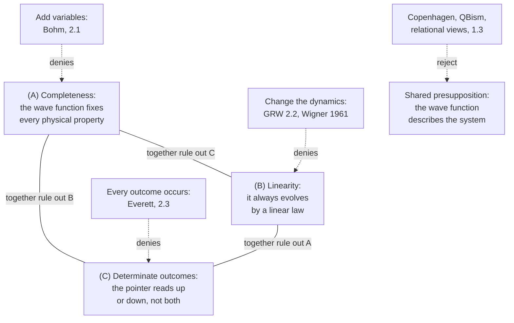

# Philosophy of Physics · Lesson 1.1: The measurement problem as a trilemma

> ⏱ ~15 min · Module 1: The measurement problem · Builds on: [`quantum-mechanics` 1.5](../../quantum-mechanics/lessons/01-05-measurement-expectation-values.md), [`quantum-mechanics` 5.2](../../quantum-mechanics/lessons/05-02-tensor-products-entanglement.md), [`quantum-computing` 2.3](../../quantum-computing/lessons/02-03-the-no-cloning-theorem.md) · Unlocks: [1.2](01-02-decoherence-and-what-it-does-not-do.md), [1.3](01-03-copenhagen-qbism-and-relational-views.md)

## Why this matters

In [`quantum-mechanics` 1.5](../../quantum-mechanics/lessons/01-05-measurement-expectation-values.md) you were handed a rule: "Immediately after obtaining $a_n$, the state becomes $|a_n\rangle$." Nobody said what counts as obtaining. A Geiger counter is made of atoms, and atoms obey the Schrödinger equation, which never makes that jump. So the theory holds two laws for one process and no instruction for when to switch. That is the [measurement problem](../reference.md#measurement-problem), and every repair on offer gives something up.

## The idea

Picture a rulebook with two rules for moving pieces: rule 1 always, rule 2 "when the referee looks." It works until you notice that the referee is also a piece on the board, so rule 1 should cover the looking too. Quantum mechanics is in that position. Its [linear dynamics](../reference.md#linear-dynamics), the Schrödinger equation, evolves every closed system; its [collapse postulate](../reference.md#collapse-postulate) overrides that evolution "on measurement." But a measuring device is a physical system. Run rule 1 through the measurement and the device ends in a superposition of reading up and reading down, which, by the textbook's own rules, is no reading at all.

Tim Maudlin turned the clash into a [trilemma](../reference.md#maudlins-trilemma): the wave function says everything about the system; it always evolves linearly; measurements end with one result. Any two rule out the third. Each interpretation in Modules 1 and 2 chooses which claim to give up, at a price. This lesson sets up the ledger.

One more premise hides in `quantum-mechanics` 1.5, stated there as fact: "Determinate states are eigenstates." Here it is the [eigenvalue-eigenstate link](../reference.md#eigenvalue-eigenstate-link), the [textbook view's](../reference.md#textbook-collapse-view) rule for reading properties off a state: a system has a definite value of an observable if and only if its state is an eigenstate of it. It is a premise, not a result; Bohmian mechanics denies it for position.

## The argument

**Setup.** A spin-½ particle has the z-spin basis $|\text{up}\rangle, |\text{down}\rangle$. A device has a ready state $|r\rangle$ and pointer states $|U\rangle, |D\rangle$, all orthonormal. An [ideal measurement](../reference.md#ideal-measurement) is an evolution $\hat U$ with

$$\hat U\big(|\text{up}\rangle|r\rangle\big) = |\text{up}\rangle|U\rangle, \qquad \hat U\big(|\text{down}\rangle|r\rangle\big) = |\text{down}\rangle|D\rangle.$$

*In words:* if the spin already has a value, the pointer reports it and leaves the spin alone.

**Lemma (the chain).** If $\hat U$ is linear, then for any complex amplitudes $\alpha, \beta$ with $|\alpha|^2 + |\beta|^2 = 1$,

$$\hat U\big((\alpha|\text{up}\rangle + \beta|\text{down}\rangle)|r\rangle\big) = \alpha|\text{up}\rangle|U\rangle + \beta|\text{down}\rangle|D\rangle.$$

*In words:* a linear law runs each branch through separately and adds the results. The same step proves no-cloning in [`quantum-computing` 2.3](../../quantum-computing/lessons/02-03-the-no-cloning-theorem.md): linearity forbids copying there and picking here.

**Theorem (collapse is not linear).** No linear $\hat U$ that measures ideally sends any input with $\alpha\beta \neq 0$ to $|\text{up}\rangle|U\rangle$ or to $|\text{down}\rangle|D\rangle$, even up to a phase. *Proof.* By the lemma the output has overlap $\alpha$ with $|\text{up}\rangle|U\rangle$ and $\beta$ with $|\text{down}\rangle|D\rangle$, while a unit vector equal to either product state up to a phase has overlap of modulus 1 with it and 0 with the other. The output is not even a product state: its coefficient determinant, the $ad - bc$ test of [`quantum-mechanics` 5.2](../../quantum-mechanics/lessons/05-02-tensor-products-entanglement.md), is $\alpha\beta \neq 0$. ∎ *In words:* for the state itself to end in one outcome takes a second, nonlinear law, and the collapse postulate is that law.

**Von Neumann's chain** (*Mathematische Grundlagen der Quantenmechanik*, 1932, ch. VI; paraphrased). John von Neumann wrote the two laws as two kinds of process: collapse on measurement (his process 1) and Schrödinger evolution (process 2). Add links, such as a thermometer, a retina and an optic nerve, and the lemma applies at each, so linearity carries the superposition up the [chain](../reference.md#von-neumann-chain) toward what he called the "abstract ego." He required that the boundary between observed and observer be movable arbitrarily far toward the observer, and argued that the predicted statistics are the same wherever it is drawn. That invariance is why the textbook theory never fails in a lab, and why the lab never tells you where the boundary is.

**Maudlin's trilemma** ("Three Measurement Problems", *Topoi*, 1995). His first problem, the problem of outcomes, in paraphrase:

**(A) Completeness.** The wave function fixes, directly or indirectly, every physical property of the system. *In words:* nothing about the system is missing from $|\psi\rangle$.

**(B) Linearity.** The wave function always evolves by a linear equation, such as Schrödinger's. *In words:* no exceptions, measuring devices included.

**(C) Determinate outcomes.** Measurements always, or at least usually, end with the device indicating up and not down, or down and not up. *In words:* the pointer points one way.

**P1.** By (A) and (B), an ideal measurement of $\alpha|\text{up}\rangle + \beta|\text{down}\rangle$ ends in the lemma's superposition, and that state is the whole physical state of spin and device. *In words:* the superposition is all there is.

**P2.** When $|\alpha| = |\beta|$, nothing in that state favours up over down, so it cannot represent a device indicating one and not the other. *In words:* the symmetry step.

**∴ Conclusion.** (A) and (B) entail that (C) is false. *In words:* keep the first two and the pointer has no reading.

The other pairings run the same way. (A) and (C) entail that (B) is false, because a complete state of a device showing one result cannot be the symmetric superposition, which is what the lemma says any linear law delivers. (B) and (C) entail that (A) is false, because then the same superposition underlies either result, so something beyond it settles which. Maudlin adds two [further problems](../reference.md#problems-of-statistics-and-effect): statistics (a complete wave function evolving deterministically gives identical states identical results, against the Born frequencies) and effect (an outcome must change what later measurements predict). He sorts proposed solutions by the claim they abandon. **The exits**, taught later: deny (A) and add variables ([Bohmian mechanics](../reference.md#bohmian-mechanics), [2.1](02-01-bohmian-mechanics.md)); deny (B) and change the dynamics ([GRW](../reference.md#grw-theory), [2.2](02-02-collapse-theories-grw-and-csl.md)); deny (C), because every outcome occurs ([many-worlds](../reference.md#many-worlds-interpretation), [2.3](02-03-many-worlds-branching.md)); or deny that the trilemma is posed correctly, because the wave function does not describe the system's properties at all ([1.3](01-03-copenhagen-qbism-and-relational-views.md)).

**Bell's complaint.** In ["Against 'measurement'"](../reference.md#against-measurement) (1990), John Bell argued that "measurement", and the words that do the same job, mark where the second law takes over without saying what physical process they name, so they have no place in the formulation of a theory that claims to be exact. The split between the two laws is, in his word, "shifty." Any precise answer is already an exit. Eugene Wigner (1961) gave one: [consciousness causes collapse](../reference.md#consciousness-causes-collapse), a view often credited to von Neumann and Wigner together, which denies (B) at minds.

**Where the argument is weakest.** P2. Maudlin grants (as quoted by F. A. Muller, 2023) that the three claims are not strictly inconsistent: symmetry is not logic, and one could stipulate that the final superposition represents a device reading up. For unequal amplitudes the eigenvalue-eigenstate link does the work instead, and that link is a substantive premise. The strongest reply is that the gap is narrow. A reading rule keyed to the state alone is deterministic, so it collides with the problem of statistics; a chancy rule that leaves the wave function untouched must still let each outcome shape later results, which is the problem of effect. The critic concedes that some rule must connect the wave function to pointer readings; the defender, that the trilemma rests on such a rule and is not a theorem of logic. A different dissent, Copenhagen's and QBism's, rejects the presupposition all three claims share, that the wave function describes the system; 1.3 weighs it.

## Argument map

Solid links pair two claims against the third; dashed arrows are the exits, each buying consistency by denying one claim or, for the views of 1.3, the presupposition all three share.

## Worked examples

**Example 1 (clean case: a cat in the chain).** Erwin Schrödinger's [cat](../reference.md#schrodingers-cat) ("Die gegenwärtige Situation in der Quantenmechanik", 1935; paraphrased) shuts an animal in a chamber with a lethal device that one atom's decay sets off, tuned so that after an hour death and survival are equally likely. Run it with unequal odds. A spin in $\tfrac{5}{13}|\text{up}\rangle + \tfrac{12}{13}|\text{down}\rangle$ passes a magnet; "up" fires a counter, $|r\rangle \to |F\rangle$, while "down" leaves it unfired, $|N\rangle$; a fired counter breaks a flask, $|\text{alive}\rangle \to |\text{dead}\rangle$. Each link is ideal on its definite inputs, so the lemma, applied twice, gives

$$\Big(\tfrac{5}{13}|\text{up}\rangle + \tfrac{12}{13}|\text{down}\rangle\Big)|r\rangle|\text{alive}\rangle \;\longrightarrow\; \tfrac{5}{13}|\text{up}\rangle|F\rangle|\text{dead}\rangle + \tfrac{12}{13}|\text{down}\rangle|N\rangle|\text{alive}\rangle.$$

- **Wherever the cut goes.** Apply the collapse postulate to the spin before any link: $P(\text{up}) = (5/13)^2 = 25/169 \approx 0.148$. Apply it to the counter after the first link, or to the cat at the end: $P(\text{dead}) = 25/169$ again, because the records are orthonormal. The statistics never reveal where collapse happens.

- **The trilemma.** On (A) and (B) the final vector is the whole truth. The projector onto "cat alive" keeps only its second term, so the vector is not an eigenstate of it (the projector's expectation is $144/169 \approx 0.852$, not 0 or 1). By the eigenvalue-eigenstate link the cat is neither alive nor dead, and (C) fails. With amplitudes this unequal the symmetry step is idle; the link does the work.

Schrödinger first sketched the cat in a September 1935 letter answering Einstein's exploding-gunpowder example, as an argument that the wave function cannot be the whole story: aimed at (A), not a picture of collapse.

**Example 2 (hard case: Wigner's friend).** In [Wigner's version](../reference.md#wigners-friend) ("Remarks on the Mind-Body Question", 1961; Hugh Everett had told one in 1956–57), a friend in a sealed lab runs the measurement above, with her memory in place of the cat: $|f_U\rangle$ if she saw up, $|f_D\rangle$ if down.

- **The friend's.** She applies collapse at her own observation: the lab is in $|\text{up}\rangle|f_U\rangle$ (probability $25/169$) or $|\text{down}\rangle|f_D\rangle$ ($144/169$), and she knows which.

- **Wigner's.** Outside, he treats the sealed lab as a closed system: it is in $\tfrac{5}{13}|\text{up}\rangle|f_U\rangle + \tfrac{12}{13}|\text{down}\rangle|f_D\rangle$ until he opens the door and collapses it himself.

When the door opens, both assign the same odds to her saying "up", and she will say she saw her result before he asked: the cut moved, the statistics did not.

**Where it stops.** The textbook theory never says whose description is right while the door is shut: collapse "on measurement" needs a measurer, and it does not say whether a friend is one. Wigner's own verdict: a conscious observer cannot be in a superposition of distinct perceptions, so the friend's awareness itself reduces the state. The textbook view can neither refute nor confirm him; Everett drew the opposite moral. Recent no-go theorems (Frauchiger and Renner, 2018; Bong and colleagues, 2020) sharpen the case; the "friends" in experiments so far are photons or small qubit registers.

## Watch out

- **You might think** the problem is that measuring disturbs the system, **but actually** classical measurements disturb too. The problem is two laws with no rule for when each applies.

- **You might think** a large enough device removes the superposition by itself, **but actually** a linear law has no size threshold: the lemma holds at every link. Whether the environment changes that is [1.2](01-02-decoherence-and-what-it-does-not-do.md)'s question; conflating [decoherence](../reference.md#decoherence) with collapse is the confusion it examines.

- **You might think** the exits are four readings with identical predictions, **but actually** denying (B) changes the physics: collapse models predict small departures that experiments keep bounding ([2.2](02-02-collapse-theories-grw-and-csl.md)). Denying (A) or (C) leaves the standard predictions intact, and the dispute there is over what exists.

- **You might think** "consciousness causes collapse" is von Neumann's thesis, **but actually** he made the boundary movable and stopped short of explicitly giving consciousness a causal role. Wigner stated the thesis in 1961.

## One-liner

> A linear law cannot pick one outcome, so quantum mechanics either leaves something out of the wave function (deny A), adds a second law whose trigger it must define (deny B), or keeps every outcome (deny C), unless the wave function was never a description of the system at all.

## Problems

**P1 (🟢)** *(Apply: Exegetical (a) · Evaluative (b).)* Three views, each invented, written for this problem, and stated without its name:

> (i) Nothing ever collapses. When the run ends, the lab holds one version of the experimenter who saw up and another who saw down, each as real as the other.
>
> (ii) Every particle has a definite position at all times. The wave function never collapses either; it steers the particles, and the pointer ends up wherever its particles are.
>
> (iii) The Schrödinger equation governs every physical system until a conscious mind registers a result, and the registering reduces the state to a single outcome.

(a) Which of (A), (B), (C) does each view deny, and which two does it keep? One line each.

(b) View (iii) offers a precise meaning for "measurement". Say what Bell's complaint would still ask of it, and what answering would cost the view. Two sentences.

**P2 (🟡)** *(Formal model: Formal (a)–(b) · Exegetical (c).)* A spin is prepared in $|\phi\rangle = \tfrac{8}{17}|\text{up}\rangle + \tfrac{15}{17}|\text{down}\rangle$ and measured by a device with ready state $|r\rangle$ and pointer states $|U\rangle, |D\rangle$, all orthonormal. An engineer proposes a "collapse unitary" $\hat V$ with

$$\hat V|\text{up}\rangle|r\rangle = |\text{up}\rangle|U\rangle, \qquad \hat V|\text{down}\rangle|r\rangle = |\text{down}\rangle|D\rangle, \qquad \hat V|\phi\rangle|r\rangle = |\text{down}\rangle|D\rangle.$$

(a) Show that no linear map satisfies all three conditions, and, separately, using inner products, that no unitary map satisfies the first and third. Show the computation.

(b) A second proposal keeps linear evolution and adds a reading rule: the pointer indicates whichever outcome carries the larger amplitude in the final state. In 1,000 runs on $|\phi\rangle$, how many "down" readings does the rule predict? How many does the Born rule lead you to expect, with what standard deviation, and how many standard deviations separate the two? Show the computation.

(c) Which of (A), (B), (C) does the rule in (b) keep, and which further problem of Maudlin's does it run into? Two sentences.

**P3 (🔴)** *(Apply to a hard case: Exegetical (a)–(b) · Evaluative (c).)* Take Example 2's lab and run two exits on it, using only what this lesson says about each.

(a) A collapse exit (deny (B)) on which collapse is triggered physically whenever a macroscopic record forms, with no role for minds. When does the lab's state reduce, and whose description, the friend's or Wigner's, is correct while the door is shut?

(b) The every-outcome exit (deny (C)). The same two questions, and what the friend's report "I saw up" amounts to.

(c) Describe an experiment, possible in principle, on which (a) and (b) disagree; say why it would not separate (b) from the add-variables exit; and name what each of (a) and (b) pays.

150 words or fewer in all.

Solutions

**P1** *(Exegetical (a) · Evaluative (b).)*

**Must hit, strict (a):**

- (i) denies (C) and keeps (A) and (B): every outcome occurs, so no run ends with the device indicating up and not down.

- (ii) denies (A) and keeps (B) and (C): the positions are physical facts the wave function does not fix, while the wave function itself still evolves linearly.

- (iii) denies (B) and keeps (A) and (C): the linear law has an exception at minds, after which the outcome is single and the wave function is again the whole story.

**Must hit, any verdict (b):**

- Say what Bell asks: a criterion in physical terms for which systems count as conscious minds and when, along the chain from counter to cortex, the reduction occurs. "A conscious mind registers" now does the job "measurement" did, so it inherits the demand.

- Say what answering costs. Either the view names a physical mark of consciousness, which then becomes the trigger and must be stated as new physics, or it lets a non-physical mind change the physical state, which buys precision with mind-body interaction that needs its own defence ([`philosophy-of-mind` 1.2](../../philosophy-of-mind/lessons/01-02-substance-dualism-today.md)).

**Wrong turns:** reading (ii) as denying (B) because the particles' motion is not linear: (B) concerns the wave function, which still obeys the Schrödinger equation. Reading (i) as denying (A): the wave function stays complete and is the whole story. Reading (iii) as denying (C) because outcomes wait for a mind: once a mind registers, there is one outcome. Treating (b) as settled by calling consciousness vague, without saying what the view would have to supply.

**Model answer (b), one of several:** Bell would ask which physical systems count as conscious and exactly when, between the counter and the cortex, the reduction happens, since "a conscious mind registers" now marks where the second law takes over and is no more precise than "measurement" was. To answer, the view must either name a physical mark of consciousness, making that mark the trigger and adding it to physics, or let a non-physical mind alter the physical state, which buys precision at the price of an interaction dualism that must be defended on its own terms.

---

**P2** *(Formal (a)–(b) · Exegetical (c).)*

(a) **Linearity.** Write $|\phi\rangle|r\rangle = \tfrac{8}{17}|\text{up}\rangle|r\rangle + \tfrac{15}{17}|\text{down}\rangle|r\rangle$. A linear $\hat V$ obeying the first two conditions must give

$$\hat V|\phi\rangle|r\rangle = \tfrac{8}{17}|\text{up}\rangle|U\rangle + \tfrac{15}{17}|\text{down}\rangle|D\rangle,$$

whose overlap with $|\text{down}\rangle|D\rangle$ is $\tfrac{15}{17} \approx 0.882$, not 1, and with $|\text{up}\rangle|U\rangle$ is $\tfrac{8}{17}$, not 0. So it is not $|\text{down}\rangle|D\rangle$, and the third condition fails.

**Unitarity.** A unitary map preserves inner products. Before: $\langle\text{up}, r|\phi, r\rangle = \tfrac{8}{17} \approx 0.471$. After, by the first and third conditions: $\langle\text{up}, U|\text{down}, D\rangle = 0$. Two states that overlapped would be sent to orthogonal ones, so no unitary satisfies the first and third conditions, whatever it does to $|\text{down}\rangle|r\rangle$.

(b) The linear evolution ends in $\tfrac{8}{17}|\text{up}\rangle|U\rangle + \tfrac{15}{17}|\text{down}\rangle|D\rangle$, and the larger amplitude is $\tfrac{15}{17}$, so the rule predicts "down" in all 1,000 runs. The Born rule gives

$$p = \Big(\tfrac{15}{17}\Big)^2 = \tfrac{225}{289} \approx 0.7785, \qquad np = \tfrac{225000}{289} \approx 778.5,$$

so about 779 "down" readings, with standard deviation

$$\sigma = \sqrt{np(1-p)} = \sqrt{1000 \cdot \tfrac{225}{289} \cdot \tfrac{64}{289}} = \tfrac{1200\sqrt{10}}{289} \approx 13.1.$$

The rule's 1,000 lies $1000 - 778.5 = 221.5$ above, about 17 standard deviations.

(c) The rule keeps all three: the evolution is linear (B), the wave function plus a fixed rule settles the reading, so it is complete (A), and every run has one reading (C), which is Maudlin's admission that the claims are not strictly inconsistent without the symmetry step or the eigenvalue-eigenstate link. It runs into the problem of statistics: identical states always give identical readings, so it cannot reproduce the Born frequencies that experiments show.

**Must hit, strict:**

- (a) The linear extension computed from the first two conditions, and an overlap showing it is not $|\text{down}\rangle|D\rangle$. Then inner-product preservation stated and the $\tfrac{8}{17}$ to $0$ violation shown (or $\tfrac{15}{17}$ to $1$ with the second condition).

- (b) 1,000 from the rule; $p = 225/289$, about 779 expected, $\sigma \approx 13.1$, a gap of about 17 standard deviations.

- (c) All three claims kept; the problem of statistics.

**Accept:** noting that at equal amplitudes the rule gives no verdict, which is where the symmetry step bites.

**Wrong turns:** using unsquared amplitudes, which gives about 882 expected "down" readings; saying the rule denies (A), when the reading is a function of the wave function; naming the problem of effect, which concerns how an outcome shapes later measurements, not the frequencies.

---

**P3** *(Exegetical (a)–(b) · Evaluative (c).)*

**Must hit, strict (a):** the state reduces when the friend's apparatus or memory forms a record, before the door opens. The friend's description is correct, and Wigner's superposition is not: he should assign one of the two product states with the Born odds, not knowing which.

**Must hit, strict (b):** nothing ever reduces. Wigner's superposition is the correct and complete state. "I saw up" is true of the friend in the up branch, while her counterpart in the down branch truly reports down; her single-outcome description is correct only relative to her branch.

**Must hit, any verdict (c):**

- An interference test on the whole lab: reverse the friend's measurement and check whether the spin is back in its prepared state, or measure the lab in a basis that contains the superposition. (b) predicts the interference; (a) predicts it fails some of the time.

- The add-variables exit keeps (B), so its wave function evolves as (b)'s does and predicts the same result. The test separates deniers of (B) from the rest, not (A) from (C).

- Costs: (a) a new law with a threshold for "macroscopic record" that must be made precise and that experiments can test; (b) an account of what single outcomes and probabilities mean when every outcome occurs.

**Wrong turns:** saying the friend and Wigner can settle it by comparing notes, when both predict the same report; claiming the interference test separates Bohm from Everett; running (a) as the consciousness view, which the stem excludes; awarding the win to either exit, which (c) does not ask for.

**Model answer, one of several:** (a) The record in the friend's lab triggers collapse during the run, before Wigner opens the door. She is right; Wigner should assign up-lab or down-lab with the Born odds, not a superposition. (b) Nothing collapses. Wigner's superposition is the whole state, and "I saw up" is true of the friend in the up branch, while her down-branch counterpart truly reports down. (c) Reverse the friend's measurement on the whole lab and test the spin for its prepared state: on (b) it always passes, on (a) it sometimes fails. The add-variables exit keeps linear evolution, so it predicts what (b) predicts; the test divides deniers of (B) from everyone else. (a) pays with a new law and a precise threshold for a record; (b) owes an account of single outcomes and probability.

## Connections

- **Backward:** the collapse postulate and "determinate states are eigenstates" are [`quantum-mechanics` 1.5](../../quantum-mechanics/lessons/01-05-measurement-expectation-values.md)'s, and the product test is [`quantum-mechanics` 5.2](../../quantum-mechanics/lessons/05-02-tensor-products-entanglement.md)'s. The bridge to name: the linearity that proves the no-cloning theorem in [`quantum-computing` 2.3](../../quantum-computing/lessons/02-03-the-no-cloning-theorem.md) is the linearity that forbids collapse here. One premise, two theorems: no copying, no picking.

- **Forward:** [1.2](01-02-decoherence-and-what-it-does-not-do.md) asks whether the environment closes the gap; [1.3](01-03-copenhagen-qbism-and-relational-views.md) takes the fourth exit; [2.1](02-01-bohmian-mechanics.md), [2.2](02-02-collapse-theories-grw-and-csl.md) and [2.3](02-03-many-worlds-branching.md) take the first three and price them. Claim (C) returns in [3.1](03-01-epr-and-bells-theorem-the-premises.md) as the single-outcomes premise of Bell's theorem.

- **Sideways:** Wigner's trigger is a cousin of the view in [`philosophy-of-mind` 1.2](../../philosophy-of-mind/lessons/01-02-substance-dualism-today.md) on which a mind settles what indeterministic laws leave open (Popper and Eccles); there the mind chooses among outcomes, here it causes there to be one. [`apologetics-foundations` 4.4](../../apologetics-foundations/lessons/04-04-divine-action-miracles-and-quantum-indeterminacy.md) asks which of these exits leaves outcomes undetermined, the theological use of the same map. The cat and the friend are thought experiments in the sense of [`philosophical-method` 3.3](../../philosophical-method/lessons/03-03-thought-experiments.md): test rigs built to isolate one premise, not claims about cats.
