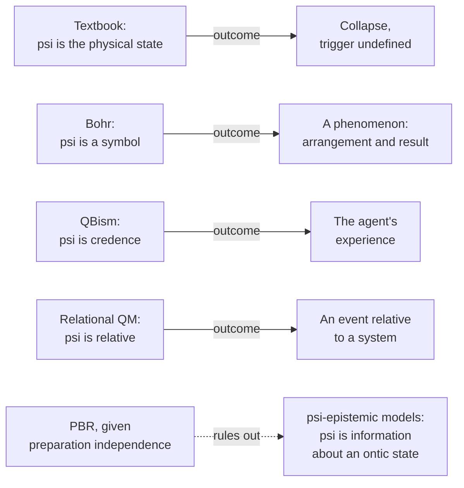

# Philosophy of Physics · Lesson 1.3: Copenhagen, QBism, and relational views

> ⏱ ~15 min · Module 1: The measurement problem · Builds on: [1.1](01-01-the-measurement-problem-as-a-trilemma.md), [1.2](01-02-decoherence-and-what-it-does-not-do.md), [`epistemology` 5.1](../../epistemology/lessons/05-01-credences-and-probabilism.md) · Unlocks: [2.1](02-01-bohmian-mechanics.md), [3.2](03-02-what-bell-rules-out.md)

## Why this matters

In *Nature*'s 2025 survey of 1,101 quantum researchers, 397 (36 percent, by Nature's published data) chose "Copenhagen", more than any other interpretation. Only 56 of them called it correct, and the questionnaire itself footnoted that Copenhagen is not a self-consistent interpretation. [1.1](01-01-the-measurement-problem-as-a-trilemma.md) ended with a fourth exit from [Maudlin's trilemma](../reference.md#maudlins-trilemma): deny that the wave function describes the system at all. This lesson states the views that take it, and the charge each faces: that it answers a different question.

## The idea

A forecast says 70 percent rain; you look outside and it jumps to 100 or to 0. Nobody thinks the jump happened in the clouds. QBism says collapse is that kind of jump, an agent updating her odds. The [measurement problem](../reference.md#measurement-problem) asked why the world ends with one reading when the state contains both; if the state never described the world, the "both" was bookkeeping. The analogy shows the price: weather has an atmosphere, which meteorology describes. What does quantum mechanics describe?

Three views share the move, none of them the textbook view you were taught: for Bohr the state is a symbol for predicting what instruments show, for QBism one agent's credences ([`epistemology` 5.1](../../epistemology/lessons/05-01-credences-and-probabilism.md)), for Carlo Rovelli's relational view what one system can predict of another.

## Source

Niels Bohr, "The Quantum Postulate and the Recent Development of Atomic Theory", *Nature* 121, supplement of 14 April 1928, pp. 580–590, at p. 580: the Como lecture of 16 September 1927, revised.

> Now the quantum postulate implies that any observation of atomic phenomena will involve an interaction with the agency of observation not to be neglected. Accordingly, an independent reality in the ordinary physical sense can neither be ascribed to the phenomena nor to the agencies of observation. After all, the concept of observation is in so far arbitrary as it depends upon which objects are included in the system to be observed. Ultimately every observation can of course be reduced to our sense perceptions. The circumstance, however, that in interpreting observations use has always to be made of theoretical notions, entails that for every particular case it is a question of convenience at what point the concept of observation involving the quantum postulate with its inherent 'irrationality' is brought in.

The passage runs from physics to description. The decisive phrase is "a question of convenience at what point": the describer draws the boundary between observed and observing, case by case. Later writers call it the [Heisenberg cut](../reference.md#heisenberg-cut); Heisenberg and von Neumann both stressed that it moves.

## The argument

**The [textbook collapse view](../reference.md#textbook-collapse-view)** (von Neumann, 1932; Dirac's *Principles* from its second edition, 1935).

**T1.** The state is the complete physical state, with definite values only in eigenstates (the [eigenvalue-eigenstate link](../reference.md#eigenvalue-eigenstate-link)); it evolves linearly, except that on measurement it jumps, with Born probability ([`quantum-mechanics` 1.5](../../quantum-mechanics/lessons/01-05-measurement-expectation-values.md)). *In words:* the wave function is the system, under two laws switched by "measurement".

It keeps 1.1's (A) and (C) and denies (B) at an undefined word, which Bell's ["Against 'measurement'"](../reference.md#against-measurement) (1990) charges with anchoring "the shifty split" of system from apparatus: a statement of the problem, not an exit.

**Bohr's view** (Como, 1927; later work paraphrased via the Stanford Encyclopedia).

**B1. [The quantum postulate](../reference.md#quantum-postulate).** Every atomic process has a discontinuity symbolized by Planck's constant, so observing involves an interaction with the instrument that cannot be neglected. *In words:* no observation without a disturbance too large to subtract.

**B2. Classical concepts.** "Our interpretation of the experimental material rests essentially upon the classical concepts" (1928). *In words:* what we did and learned must be reportable to others in everyday terms.

**B3. [Complementarity](../reference.md#complementarity).** Space-time coordination and causality (conservation of energy and momentum) are "complementary but exclusive features of the description" (1928). *In words:* where-and-when and how-much-energy need arrangements that exclude each other; wave and particle is one illustration, not the definition.

**B4.** The wave function is a symbol for predicting phenomena (whole arrangements with their results), not a picture: nothing physically collapses, and the cut is placed for convenience (Source). *In words:* the cut is in the book, not the world.

Bohr held quantum mechanics complete against EPR ([3.1](03-01-epr-and-bells-theorem-the-premises.md)). Don Howard ("Who Invented the 'Copenhagen Interpretation'? A Study in Mythology", 2004) argues that no unitary Copenhagen view existed before Heisenberg coined the phrase in 1955, and that its observer-induced collapse was Heisenberg's, not Bohr's: the [Copenhagen interpretation](../reference.md#copenhagen-interpretation) is a family name.

**ψ-ontic and ψ-epistemic** (Nicholas Harrigan and Robert Spekkens, 2010).

**D1. [Ontological model](../reference.md#ontological-model).** Preparing $\psi$ yields an ontic (complete physical) state $\lambda$ with distribution $\mu_\psi(\lambda)$; measurement $M$ gives outcome $k$ with probability $\xi(k\mid\lambda,M)$; and $\int \xi(k\mid\lambda,M)\,\mu_\psi(\lambda)\,d\lambda = |\langle k|\psi\rangle|^2$. *In words:* a real state underlies the quantum one.

**D2. [ψ-ontic](../reference.md#psi-ontic-and-psi-epistemic).** The model is ψ-ontic if distinct pure states never share an ontic state, so $\lambda$ fixes $\psi$; otherwise ψ-epistemic. *In words:* is $\psi$ part of reality, or information about it? Bohm, GRW, Everett and the textbook view are ψ-ontic.

**T. [PBR](../reference.md#pbr-theorem)** (Matthew Pusey, Jonathan Barrett and Terry Rudolph, 2012). An ontological model that reproduces the quantum predictions and satisfies [preparation independence](../reference.md#preparation-independence), $\mu_{\psi\otimes\phi}(\lambda_1,\lambda_2) = \mu_\psi(\lambda_1)\,\mu_\phi(\lambda_2)$ for independent preparations, is ψ-ontic. *In words:* if a real state lies underneath, the wave function is part of it. Escapes: deny preparation independence, as retrocausal models do, or reject the framework.

**[QBism](../reference.md#qbism)** (Carlton Caves, Christopher Fuchs and Rüdiger Schack from 2002; named by Fuchs, N. David Mermin and Schack, 2014).

**Q1.** A state encodes one agent's credences $\mathrm{cr}$ about her own future experiences, given her actions, and does not describe the system even partially; the Born rule is an empirically motivated coherence norm on them (Fuchs and Schack, 2013). *In words:* no ontic state, so PBR's framework never starts, and no chance $\Pr$ for the [Principal Principle](../../epistemology/lessons/05-04-the-problem-of-priors.md) to defer to.

**Q2.** An outcome is the acting agent's experience, collapse is her updating, and probability 1 is her certainty, not EPR's [element of reality](../reference.md#criterion-of-reality) (Caves, Fuchs and Schack, 2007). *In words:* a users' manual for acting in a real world, Fuchs's "participatory realism" (2017); QBists deny being instrumentalists in [`philosophy-of-science` 5.4](../../philosophy-of-science/lessons/05-04-constructive-empiricism-and-entity-realism.md)'s sense, since state assignments are true or false of beliefs.

**[Relational quantum mechanics](../reference.md#relational-quantum-mechanics)** (Rovelli, 1996).

**R1.** A variable of system $S$ takes a value only in an interaction, relative to the system $S'$ it affects; relative to a third system, the pair may still be in superposition. Any system, not only an agent, can play observer. *In words:* observers can give different, equally correct accounts of one event.

**R2.** The state is what $S'$ can predict of $S$ given their history; there is no absolute state. *In words:* $\psi$ is a relation, as velocity is; the relative events are real, so, Rovelli holds, not instrumentalism.

Emily Adlam and Rovelli (2023) added a [cross-perspective link](../reference.md#cross-perspective-link): measuring $S'$'s pointer reveals what $S'$ registered.

**The shared move.**

**P1.** Claims (A), (B) and (C) of [1.1](01-01-the-measurement-problem-as-a-trilemma.md) concern one absolute physical state. *In words:* the trilemma presupposes that $\psi$ describes the system.

**P2.** Bohr, QBism and RQM each deny that $\psi$ is such a description. *In words:* a symbol, a credence, a relation.

**∴ C.** For each, the trilemma as posed does not arise: (A) is rejected or relativized, (B) becomes a rule for using the symbol, and (C) holds of a phenomenon, an experience or a relative fact. *In words:* no absolute state, no trilemma as stated.

**[Changing the subject](../reference.md#changing-the-subject).** The objection: the problem asks how the world comes to contain one result, which survives without $\psi$, and each view answers with a primitive physics leaves undefined. Christopher Timpson (2008): QBism predicts but cannot explain why sodium conducts. Federico Laudisa (2019): RQM never says how a relative value comes about. Replies: for Bohr, unambiguous description of phenomena is all physics ever delivered; for QBism, Bell targeted "measurement" as a physical trigger, and a normative theory may take its users as given (Mermin, 2017); for RQM, "when" is at every interaction, and "why this value" is any indeterministic theory's brute chance.

**Where the argument is weakest.** P1. The critic: (C) concerns pointers, not states, so a theory must say what the laboratory contains when the pointer points; the shifty split returns between agent and world, or between perspectives. The reply: demanding an absolute fact assumes what these views deny; each says the pointer reads one value, for the agent or relative to the system. The critic concedes that the trilemma as stated needs an absolute state; each defender, a primitive that Module 2's realist repairs try to derive.

## Map of positions

Each view says what the state is and what an outcome is; PBR constrains only models that posit an ontic state for $\psi$ to be information about.

## Worked examples

**Example 1 (clean case: QBism on one Stern–Gerlach run).** Write $|{\uparrow}_z\rangle, |{\downarrow}_z\rangle$ for spin along $z$, and for an axis $\hat n$ in the $x$–$z$ plane at angle $\theta$ to $z$, $|{\uparrow}_n\rangle = \cos\tfrac{\theta}{2}|{\uparrow}_z\rangle + \sin\tfrac{\theta}{2}|{\downarrow}_z\rangle$ ([`quantum-mechanics` 4.5](../../quantum-mechanics/lessons/04-05-spin-pauli-stern-gerlach.md)). Alice saw an atom leave the upper beam of a $z$-magnet and assigns $|{\uparrow}_z\rangle$: on QBism, her record of betting dispositions, not a property of the atom. Next comes a magnet at $\theta = 120^\circ$.

- **Norm.** Born-rule coherence requires $\mathrm{cr}(\text{up}_n) = \cos^2 60^\circ = \tfrac14$ and $\mathrm{cr}(\text{down}_n) = \tfrac34$: a fair price of 25 cents for a ticket paying 1 dollar on "up".

- **Update.** She sees "up" and assigns $|{\uparrow}_n\rangle$: credence 1 that a repeat along $\hat n$ gives "up", $\tfrac14$ that a following $z$-magnet does. Nothing jumped in the atom; she conditioned on experience.

- **Bob,** who missed the first magnet, assigns $\tfrac12 I$: credence $\tfrac12$. Both are coherent, and neither is wrong about the atom, which neither described.

[`quantum-mechanics` 1.5](../../quantum-mechanics/lessons/01-05-measurement-expectation-values.md) reads $\tfrac14$ as an ensemble frequency; the QBist, as a single-case credence, with long-run frequencies something Alice expects (de Finetti's exchangeability).

**Example 2 (hard case: when does collapse happen?).** An electron crosses a double slit beside a marker that stays $|m_0\rangle$ for the top slit $|t\rangle$ and flips to $|m_1\rangle$ for the bottom slit $|b\rangle$, giving $\tfrac{1}{\sqrt2}(|t\rangle|m_0\rangle + |b\rangle|m_1\rangle)$. Let $\psi_t(x), \psi_b(x)$ be the amplitudes at screen point $x$.

- The screen shows no fringes, $P(x) = \tfrac12\big(|\psi_t(x)|^2 + |\psi_b(x)|^2\big)$, since the marker states are orthogonal ([1.2](01-02-decoherence-and-what-it-does-not-do.md)'s $\eta = 0$).

- Measure the marker in the basis $|m_\pm\rangle = (|m_0\rangle \pm |m_1\rangle)/\sqrt2$, even after the electron lands, and sort the hits: $P(x,\pm) = \tfrac14|\psi_t(x) \pm \psi_b(x)|^2$, fringes and anti-fringes summing to $P(x)$.

- Had the state collapsed when the marker flipped, the result would be a [proper mixture](../reference.md#proper-and-improper-mixtures), each sorted set $\tfrac14\big(|\psi_t|^2 + |\psi_b|^2\big)$: no fringes, against the quantum prediction.

So the textbook view cannot put collapse at the marker, a perfect path record, only somewhere later where nobody will interfere the records: Bell's [FAPP](../reference.md#fapp). Bohr's reply: "when did the state collapse?" treats a symbol as a picture, and "which slit?" applies the classical concept *path* outside the arrangement that defines it. Reading the marker and erasing it are two arrangements, two phenomena.

**Where it strains.** The choice can follow the hit, so whether a spot belongs to a path-phenomenon or a fringe-phenomenon waits on a later act. Critics: then "phenomenon" is no physical notion, and the marker is apparatus or system by fiat. Defenders: the unsorted data never change and nothing is signalled; only the sorting waits. Neither view says what electron and marker are like meanwhile: the textbook view gives no time, and Bohr denies there is a question.

## Watch out

- **You might think** "Copenhagen" means collapse, **but actually** Bohr's complementarity has none; the collapse view is von Neumann's and Dirac's, and the single label is Heisenberg's of 1955.

- **You might think** QBism is ψ-epistemic and so refuted by PBR, **but actually** PBR's ψ-epistemic models posit ontic states; QBism escapes only by rejecting that framework. Wayne Myrvold (2020) argues every Born-rule user is bound by it; the Stanford entry reports no direct QBist reply.

## One-liner

> Bohr, QBism and relational quantum mechanics deny that the wave function absolutely describes the system (it is a symbol, a credence, a relation), which removes the trilemma as posed and leaves each a primitive its critics call the measurement problem renamed.

## Problems

**P1 (🟢)** *(Exegetical (a)–(b).)* Four sentences, written for this problem:

> (i) "The wave function is a real field, and the particles also have positions it does not fix."
>
> (ii) "Two preparations I describe by different pure states can leave the system in exactly the same physical condition; the states differ only in what they say about it."
>
> (iii) "My state for this spin summarizes my odds on what I will experience when I act on it; it describes no physical condition of the spin, completely or partly."
>
> (iv) "The state encodes only our knowledge of a deeper physical condition, but no deeper condition is compatible with two different pure states."

(a) Classify each as ψ-ontic, ψ-epistemic (in Harrigan and Spekkens's sense), or QBist. One line each.

(b) Which of the four does the PBR theorem rule out, given its premises? For each of the others, say in one line why it survives.

**P2 (🟡)** *(Close reading: Exegetical (a)–(c).)* Read the Bohr passage in the Source.

(a) What does the word "Accordingly" make the denial of "independent reality" depend on, and how far does "in the ordinary physical sense" limit that denial? Two sentences.

(b) *Nature*'s 2025 questionnaire glossed Copenhagen as holding that the classical and quantum domains are separate. Does the passage support that gloss? Name the words that decide it. Two sentences.

(c) A reader holding the textbook view takes "is brought in" to mark the moment the wave function collapses. Name two features of the passage that tell against reading a physical process there. Two sentences.

**P3 (🔴)** *(Steelman and reply: Exegetical (a) · Evaluative (b).)* Bell's "Against 'measurement'" (1990) brings two charges against "measurement" in the axioms of quantum mechanics: it anchors a "shifty split" of the world into system and apparatus, and it carries everyday meaning that suggests a result reveals a pre-existing property. Choose one of Bohr's view, QBism, or relational quantum mechanics.

(a) Your chosen view already agrees with the second charge. Say why: what does it take an outcome to be, in place of a revealed pre-existing value? Two sentences.

(b) State the first charge as it applies to your chosen view, at the strength Bell's defenders would give it; then give the best reply the view's defenders make, and say what each side must concede. Do not say whether the view solves the measurement problem. 150 words or fewer.

Solutions

**P1** *(Exegetical (a)–(b).)*

**Must hit, strict (a):**

- (i) ψ-ontic: the wave function is part of the physical state, supplemented by positions (Harrigan and Spekkens's ψ-supplemented case; Bohm).

- (ii) ψ-epistemic: one ontic state is compatible with two distinct pure states.

- (iii) QBist: no ontic state is posited for the state to be about, so it is not an ontological model at all.

- (iv) ψ-ontic: despite the language of knowledge, each ontic state fixes the pure state, which is the definition of ψ-ontic.

**Must hit, strict (b):** PBR rules out (ii) alone, given its premises: an ontological model, the exact quantum predictions, and preparation independence. (i) and (iv) are ψ-ontic, which is what PBR concludes. (iii) survives because PBR's framework presupposes ontic states, which QBism denies; PBR does not apply unless one accepts Myrvold's argument that the framework is compulsory.

**Wrong turns:** classifying (iv) as ψ-epistemic because it says "knowledge": the definition turns on overlap, not vocabulary. Saying PBR refutes QBism. Saying PBR refutes (ii) outright: a ψ-epistemicist can deny preparation independence, as retrocausal modellers do.

**Model answer:** (a) (i) ψ-ontic; (ii) ψ-epistemic; (iii) QBist; (iv) ψ-ontic, since no ontic state is shared by two pure states. (b) Only (ii): given preparation independence and the quantum predictions, ontic distributions for distinct pure states cannot overlap. (i) and (iv) already satisfy that. (iii) posits no ontic states, so the theorem's framework never applies to it.

---

**P2** *(Exegetical (a)–(c).)*

**Must hit, strict (a):**

- "Accordingly" makes the denial a consequence of the previous sentence: the interaction with the agency of observation that, by the quantum postulate, cannot be neglected. It rests on physics, not on a theory of meaning or on idealism.

- "In the ordinary physical sense" limits the denial to the classical idealization of a reality observable without appreciable disturbance; the words do not deny that atoms, or anything, exist.

**Must hit, strict (b):** No. "Neither ... to the phenomena nor to the agencies of observation" denies independent reality to the instruments as well, so the classical side is not a separate, unproblematic domain; and "depends upon which objects are included in the system to be observed" makes the boundary a matter of what is included in the description, not a line between two kinds of thing.

**Must hit, strict (c):** any two of:

- The subject of "is brought in" is "the concept of observation": a concept applied in interpreting observations, not an event in the system.

- Where it is brought in is "a question of convenience", "for every particular case"; a physical process does not occur wherever the describer finds it convenient.

- The passage never mentions a wave function, a state, or a change of state; its vocabulary is interpretation, "theoretical notions", and observation.

**Wrong turns:** reading (a) as Bohr denying that atoms exist (the qualifier blocks this, and he elsewhere treated atoms as real); answering (b) with "yes" because instruments are described classically (that is B2, a claim about description, which the passage says is drawn by convenience); answering (c) by saying collapse is cut-invariant, which is true of the textbook view and not what the passage says.

**Model answer:** (a) "Accordingly" grounds the denial in the preceding claim that observation involves a non-negligible interaction with the instrument, so the denial is a consequence of the quantum postulate. "In the ordinary physical sense" restricts it to classical, disturbance-free reality, not to existence. (b) No: "neither ... to the phenomena nor to the agencies of observation" withholds independent reality from instruments too, and "depends upon which objects are included" makes the boundary a choice in description. (c) What "is brought in" is a concept, "the concept of observation", used "in interpreting observations"; and the point is fixed by "convenience" in each case, with no mention of a state that could change.

---

**P3** *(Exegetical (a) · Evaluative (b).)*

**Must hit, strict (a):** the view denies that a measurement reveals a pre-existing value and says what an outcome is instead. Bohr: a phenomenon, the whole arrangement with its result, since an independent reality in the ordinary sense cannot be ascribed to phenomena (Source). QBism: the acting agent's experience, created in her action. RQM: a value the variable takes only in an interaction, relative to the system affected.

**Must hit, any verdict (b):**

- State the charge against the chosen view in its own terms, not just against "measurement" in general. Bohr: the line between quantum-described object and classically described instrument is "a question of convenience", so the theory itself fixes no physical boundary and "classical concepts" carries the weight. QBism: "agent", "action" and "experience" are primitives with no physical specification, so the split returns as agent against world. RQM: there is no split, but whether a fact relative to one system is itself a fact for everyone, and which interactions make values, must be settled (Pienaar's no-go theorems; Laudisa).

- Give the defenders' reply in its best form. Bohr: the split is epistemic, demanded by what an experiment is, and its placement changes no prediction. QBism: the theory is normative, and like decision theory it may take its users as primitive (Mermin, 2017). RQM: "interaction" is a physical notion that names no special systems, and cross-perspective links (Adlam and Rovelli, 2023) secure shared facts.

- Say what each side concedes. Typically: the critic, that the view no longer uses "measurement" as an undefined physical trigger (QBism, RQM) or that every placement of the cut predicts the same (Bohr); the defender, that the view takes as primitive what realist theories try to derive.

**Wrong turns:** treating the first charge as refuted because the view avoids the word "measurement" (the charge is about an undefined split, whatever it is called); attributing agents or minds to RQM; giving a verdict on whether the view solves the measurement problem, which the problem does not ask for.

**Model answer (b), QBism, one of several:** Bell's defender: QBism renames the split rather than removing it. "Measurement" becomes "an agent's action", "outcome" becomes "her experience", and the theory says nothing about which physical systems are agents or what in the world an experience is. A fundamental theory with an undefined agent in its axioms has the defect Bell named. The QBist reply: Bell's charge targets a theory that claims to describe the world by physical laws and then needs "measurement" to trigger one of them. QBism makes no such claim; it is a normative theory of how to bet on one's experiences, and normative theories, like decision theory, take their users as given. The critic concedes that nothing physical is triggered in QBism and that the split no longer sits in the dynamics. The QBist concedes that the theory leaves unsaid what physics might one day say about agents and experience.

## Flashback

**From Lesson [1.1](01-01-the-measurement-problem-as-a-trilemma.md) (The measurement problem as a trilemma):** *(Formal model: Formal (a) · Exegetical (b).)* A spin in $\tfrac13|\text{up}\rangle + \tfrac{2\sqrt2}{3}|\text{down}\rangle$ is measured ideally in the $z$-basis by device 1 (ready state $|r_1\rangle$, pointers $|U_1\rangle, |D_1\rangle$), then by device 2 (likewise, subscript 2), all orthonormal. A proposal (invented, written for this problem) keeps linear evolution with no collapse and adds a rule: each pointer shows one reading, drawn independently per device, with probability the summed squared amplitude of the final-state terms where it reads so. The wave function is untouched.

(a) Write the final state. Find each device's reading probabilities, the probability that the devices disagree, and $P(U_2 \mid U_1)$, that device 2 reads up given that device 1 did. What does the textbook collapse view give for the last two? Show the computation.

(b) Which of Maudlin's further problems does (a) exhibit? Which of [the trilemma's](../reference.md#maudlins-trilemma) (A), (B), (C) does the proposal deny, and what must it add? Two sentences.

Solution

(a) The lemma, applied at each device, gives

$$\Big(\tfrac13|\text{up}\rangle + \tfrac{2\sqrt2}{3}|\text{down}\rangle\Big)|r_1\rangle|r_2\rangle \;\longrightarrow\; \tfrac13|\text{up}\rangle|U_1\rangle|U_2\rangle + \tfrac{2\sqrt2}{3}|\text{down}\rangle|D_1\rangle|D_2\rangle.$$

Each pointer reads up only in the first term, so $P(U_1) = P(U_2) = \big(\tfrac13\big)^2 = \tfrac19$ and $P(D_1) = P(D_2) = \tfrac89$. With independent draws,

$$P(\text{disagree}) = P(U_1)P(D_2) + P(D_1)P(U_2) = 2\cdot\tfrac19\cdot\tfrac89 = \tfrac{16}{81} \approx 0.198,$$

and $P(U_2 \mid U_1) = P(U_2) = \tfrac19$. On the textbook view, "up" at device 1 collapses the state to $|\text{up}\rangle|U_1\rangle$, so device 2 reads up for certain: $P(U_2 \mid U_1) = 1$ and disagreement $0$, as repeated measurements show.

**Must hit, strict (a):** the two-term final state; $\tfrac19$ and $\tfrac89$; $\tfrac{16}{81}$; $\tfrac19$ against the textbook's $1$ and $0$.

**Must hit, strict (b):**

- The [problem of effect](../reference.md#problems-of-statistics-and-effect): device 1's outcome changes nothing that device 2 is predicted to show.

- It denies (A) and keeps (B) and (C): one final state allows either reading, so the readings are facts the wave function does not fix.

- It must add a law for the readings, making later ones depend on earlier ones: the add-variables exit, whose Bohmian positions have their own dynamics ([2.1](02-01-bohmian-mechanics.md)).

**Wrong turns:** naming the problem of statistics, when each device alone shows Born frequencies; calling the proposal complete, like 1.1 P2's rule, which was a function of the wave function; saying it denies (B).

**Model answer (b):** The problem of effect: device 1's reading leaves device 2's prediction at $\tfrac19$, though each device alone shows Born frequencies. The proposal denies (A), since one final state allows either reading, and keeps (B) and (C); it must give the readings a law of their own that makes later readings follow earlier ones, as Bohmian positions have.

## Connections

- **Backward:** [1.1](01-01-the-measurement-problem-as-a-trilemma.md) posed the trilemma and the movable boundary of von Neumann's chain; this lesson's three views reject its shared presupposition. [1.2](01-02-decoherence-and-what-it-does-not-do.md)'s improper mixture is what forbids collapse at the marker in Example 2, and QBists reread decoherence too, as a constraint on credences rather than a process that picks outcomes.

- **Forward:** [2.1](02-01-bohmian-mechanics.md), [2.2](02-02-collapse-theories-grw-and-csl.md) and [2.3](02-03-many-worlds-branching.md) are the ψ-ontic repairs that try to derive what these views take as primitive. [3.1](03-01-epr-and-bells-theorem-the-premises.md) sets Bohr's reply to EPR, and [3.2](03-02-what-bell-rules-out.md) reconstructs QBism's argument that it removes nonlocality.

- **Sideways:** QBism's state is the credence of [`epistemology` 5.1](../../epistemology/lessons/05-01-credences-and-probabilism.md), updated by the conditionalization of [5.3](../../epistemology/lessons/05-03-conditionalization.md), and it denies the chances the [Principal Principle](../../epistemology/lessons/05-04-the-problem-of-priors.md) defers to; frequency against single-case credence is [`philosophy-of-science` 3.1](../../philosophy-of-science/lessons/03-01-two-schools-of-statistical-inference.md)'s divide. Whether these views are instrumentalist turns on [`philosophy-of-science` 5.4](../../philosophy-of-science/lessons/05-04-constructive-empiricism-and-entity-realism.md)'s distinction, and Laura Candiotto (2017) reads RQM as the ontic structural realism of [5.3](../../philosophy-of-science/lessons/05-03-structural-realism.md) there. Neo-Kantian readings of Bohr's classical concepts look back to Kant's forms of intuition in [`modern-philosophy` 5.2](../../modern-philosophy/lessons/05-02-space-and-time-the-transcendental-aesthetic.md), and RQM's relative values are the quantum cousin of the relational space of [4.1](04-01-leibniz-and-clarke-the-shift-arguments.md).
