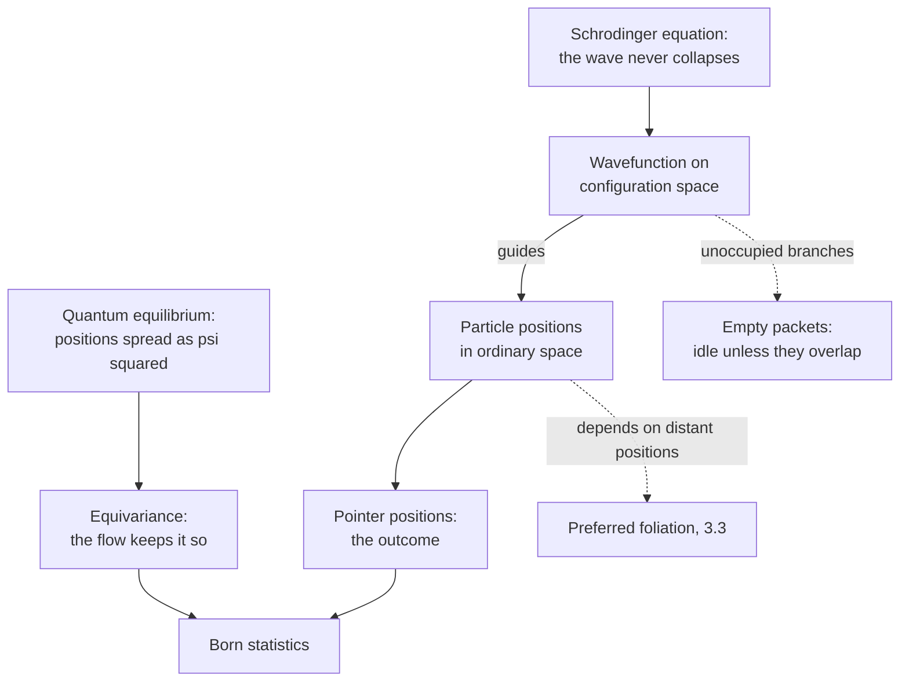
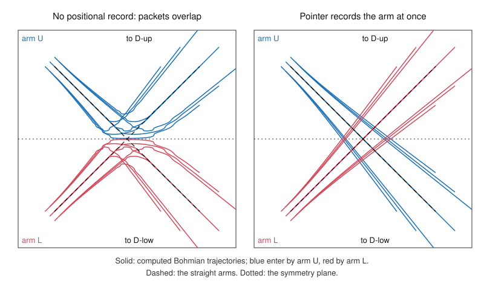

# Philosophy of Physics · Lesson 2.1: Bohmian mechanics

> ⏱ ~15 min · Module 2: The realist solutions · Builds on: [1.1](01-01-the-measurement-problem-as-a-trilemma.md), [1.2](01-02-decoherence-and-what-it-does-not-do.md), [`quantum-mechanics` 1.2](../../quantum-mechanics/lessons/01-02-wavefunction-born-rule.md) · Unlocks: [2.2](02-02-collapse-theories-grw-and-csl.md), [2.3](02-03-many-worlds-branching.md)

## Why this matters

In [`quantum-mechanics` 1.2](../../quantum-mechanics/lessons/01-02-wavefunction-born-rule.md) you computed a probability current $j$ and watched $|\psi|^2$ flow like a fluid that is never created or destroyed. Louis de Broglie in 1927 and David Bohm in 1952 asked the obvious next question: what if something actually rides that flow? The answer is a theory in which pointers always point, nothing collapses, and every textbook prediction comes out the same. Physicists mostly pass it by (6.6% of 1,101 respondents picked it in *Nature*'s 2025 survey); among philosophers answering the 2020 PhilPapers quantum question, hidden variables, Bohm's family, drew 22%, just ahead of many-worlds and collapse.

## The idea

The [measurement problem](../reference.md#measurement-problem) of [1.1](01-01-the-measurement-problem-as-a-trilemma.md) was a trilemma: the wavefunction is complete, it always evolves linearly, and measurements have determinate outcomes. [Bohmian mechanics](../reference.md#bohmian-mechanics) denies the first. A system is described by its wavefunction *and* by the actual positions of its particles. The wavefunction obeys Schrödinger's equation always and never collapses. The particles move along the flow lines of the probability current, at velocity equal to current divided by density. Picture dust in a stream: the water tells each speck where to go, and the specks never push back.

An outcome is where things are. A pointer is made of particles, so it is always somewhere. After a measurement the wavefunction still holds a branch for every result, but the particles occupy one, and [decoherence](../reference.md#decoherence) ([1.2](01-02-decoherence-and-what-it-does-not-do.md)) keeps the branches from overlapping again, so the empty ones stop mattering. Randomness is ignorance of where the particles started: if positions begin distributed as $|\psi|^2$, the flow keeps them so, and Born statistics follow. [`quantum-mechanics` 1.5](../../quantum-mechanics/lessons/01-05-measurement-expectation-values.md) taught that outside an eigenstate an observable "genuinely has no single value"; Bohm denies that for position, which always has one, and stops treating spin and momentum as properties a particle carries.

The price comes in three parts: nonlocal machinery, a wavefunction full of empty branches, and trajectories that no experiment can follow in detail.

## The argument

The set-up (Bohm, "A Suggested Interpretation of the Quantum Theory in Terms of 'Hidden' Variables", 1952, rediscovering de Broglie's 1927 pilot wave). $N$ particles have actual positions $\mathbf{Q}_1,\dots,\mathbf{Q}_N$, together the configuration $Q$, a point in the $3N$-dimensional configuration space. The wavefunction $\psi(\mathbf{q}_1,\dots,\mathbf{q}_N,t)$ is a complex function on that space.

**D1. [Primitive ontology](../reference.md#primitive-ontology).** What the theory says exists in ordinary space is particles, with positions at all times. *In words:* matter is particles; the wave tells them how to move. The term is Dürr, Goldstein and Zanghì's (1992); Allori, Goldstein, Tumulka and Zanghì (2008) made it a programme that [2.2](02-02-collapse-theories-grw-and-csl.md) applies to collapse theories. Bell remarked ("Are There Quantum Jumps?", 1987) that calling the positions "hidden variables" is absurd, since they are what we see; the most hidden thing is the wavefunction.

**D2. Schrödinger dynamics.** $i\hbar\,\partial_t\psi = H\psi$ always, with $\hbar$ the reduced Planck constant and $H$ the Hamiltonian. No collapse rule. *In words:* the wave never jumps.

**D3. The [guidance equation](../reference.md#guidance-equation).**

$$\frac{d\mathbf{Q}_k}{dt} = \frac{\hbar}{m_k}\,\mathrm{Im}\,\frac{\nabla_k\psi}{\psi}\bigg|_{(\mathbf{Q}_1,\dots,\mathbf{Q}_N)},$$

where $m_k$ is particle $k$'s mass and $\nabla_k$ the gradient in its coordinates. In one dimension, writing $\psi = Re^{i\theta}$ with $R, \theta$ real as `quantum-mechanics` 1.2 does, this is $v = \frac{\hbar}{m}\theta' = j/|\psi|^2$: the current that lesson's P3 derived, divided by the density. *In words:* each particle moves along the gradient of the wave's phase, at the speed of the probability flow. The equation is first-order: $\psi$ and the positions fix the velocities, so the theory is deterministic, and two trajectories can never cross in configuration space, since the velocity at each point is single-valued. (The right side is undefined where $\psi = 0$; that solutions exist for all time, from all initial configurations but a set of $|\psi|^2$-probability zero, is a theorem, Berndl, Dürr and others, 1995.)

**Theorem ([equivariance](../reference.md#equivariance)).** If positions are distributed as $\rho(q,0) = |\psi(q,0)|^2$, then $\rho(q,t) = |\psi(q,t)|^2$ for all $t$. *Proof.* Any ensemble carried by a velocity field $v$ obeys $\partial_t\rho + \nabla\cdot(\rho v) = 0$. By D3, $|\psi|^2 v = j$, so the continuity equation of `quantum-mechanics` 1.2 says $|\psi|^2$ obeys the same equation. Same first-order equation, same initial data: assuming uniqueness, same solution. *In words:* specks that start out spread like $|\psi|^2$ stay spread like $|\psi|^2$.

**Hypothesis ([quantum equilibrium](../reference.md#quantum-equilibrium)).** Configurations are $|\psi|^2$-distributed. Dürr, Goldstein and Zanghì ("Quantum Equilibrium and the Origin of Absolute Uncertainty", 1992) do not posit this for ensembles. They take the universe's initial configuration to be [typical](../reference.md#typicality) relative to the $|\Psi|^2$ measure and show that in almost every such universe, positions across many similar subsystems are distributed as $|\psi|^2$ of their effective wavefunctions: Born statistics as a law of large numbers inside one world, the move Boltzmann made for thermodynamics ([5.6](05-06-probability-in-statistical-mechanics.md)). Their payoff is [absolute uncertainty](../reference.md#absolute-uncertainty): no one in such a universe can know a subsystem's configuration more precisely than that $|\psi|^2$ allows. Antony Valentini dissents: equilibrium is reached by relaxation, as thermal equilibrium is (Valentini and Westman, 2005), so [quantum non-equilibrium](../reference.md#quantum-non-equilibrium) may have existed in the early universe and could in principle show in cosmological data (Valentini, 2010).

**Effective collapse.** Let a measurement leave $\Psi(x,y) = \sum_i \psi_i(x)\Phi_i(y)$, with $x$ the system's configuration, $y$ the pointer's, and non-overlapping pointer packets $\Phi_i$. The actual pointer configuration $Y$ lies in one $\Phi_i$, so that term alone guides. The system's [conditional wave function](../reference.md#conditional-wave-function) $\psi(x) = \Psi(x,Y)$ has collapsed to $\psi_i$, exactly as the textbook rule says. *In words:* the collapse rule becomes a theorem about which part of the wave steers. The other packets are [empty wave packets](../reference.md#empty-wave-packets), idle while they stay apart; decoherence makes their recombination practically impossible.

**[Contextuality](../reference.md#contextuality).** An atom in an $x$-spin eigenstate enters a $z$-oriented Stern–Gerlach magnet ([`quantum-mechanics` 4.5](../../quantum-mechanics/lessons/04-05-spin-pauli-stern-gerlach.md)). The packet splits, and in a symmetric set-up an atom starting in its upper half cannot cross the midplane, so it lands in the upper beam, read "$z$-up". Reverse the magnet's polarity and keep the geometry: the same atom still goes up, and up now reads "$z$-down" (David Albert's example, *Quantum Mechanics and Experience*, 1992). *In words:* the result is a joint product of particle and apparatus, not a value the atom carried in. That is how Bohm escapes the [Kochen–Specker theorem](../reference.md#kochen-specker-theorem), which assumes noncontextual values ([3.2](03-02-what-bell-rules-out.md)).

**Nonlocality.** For an entangled $\psi$, particle 1's velocity depends on particle 2's position *at the same instant*, however far away. "Same instant" needs a [preferred foliation](../reference.md#preferred-foliation) of spacetime ([3.3](03-03-nonlocality-and-relativity.md)); in [3.2](03-02-what-bell-rules-out.md)'s terms Bohm violates [parameter independence](../reference.md#parameter-independence). Quantum equilibrium keeps the dependence from carrying a signal.

**Two objections.** *Empty waves.* The unoccupied packets obey the same law as the occupied one: David Deutsch (1996) called pilot-wave theories parallel-universe theories in "chronic denial", and Harvey Brown and David Wallace (2005) argued that the particles do no work in solving the measurement problem. Bohmians reply (Maudlin, 2010, among others) that a world is matter in space, and a branch of a field on configuration space, or of a law (Dürr, Goldstein and Zanghì, 1997), is not one. *[Surrealistic trajectories](../reference.md#surrealistic-trajectories).* Englert, Scully, Süssmann and Walther (1992) showed that with one-bit which-way detectors, Bohmian trajectories can be macroscopically at odds with the track the detectors record. Dürr, Fusseder, Goldstein and Zanghì (1993) replied that Bohm disagrees only with a naive operationalism, not with quantum mechanics; Jeffrey Barrett (2000), that the trajectories are real and the case shows the special role of position records. Mahler and colleagues (2016) reconstructed such trajectories for entangled photons by weak measurement and concluded that they look surreal only if one ignores their nonlocality.

**Where the argument is weakest.** The quantum equilibrium hypothesis, on which every prediction rides. The strongest objection is that typicality relative to the $|\Psi|^2$ measure presupposes the measure it was meant to explain, since under a different measure our universe would be atypical; Valentini adds that if equilibrium is a contingent state, the theory is not strictly empirically equivalent to quantum mechanics. The strongest reply is that the dynamics itself picks the measure: $|\psi|^2$ is essentially the only suitably local distribution that the flow carries into itself (Goldstein and Struyve, 2007), as the Liouville measure is for classical mechanics. The Bohmian concedes that the measure is justified by its naturalness, not derived; the critic concedes that no non-equilibrium has ever been seen, and that Boltzmann faces the same question. The Stanford Encyclopedia (2025 revision) still calls the justification controversial.

## The picture

Solid arrows are the theory's machinery from wave to record; dashed arrows lead to its two standing costs.

## Worked examples

**Example 1 (clean case: plane waves and crossing beams).** For $\psi = e^{ikx}$ the phase is $\theta = kx$, so $v = \hbar k/m$ everywhere, and $|\psi|^2 v = \hbar k/m = j$ (a plane wave idealizes the middle of a long packet). Now cross two such beams symmetrically about the plane $y = 0$, entering by arms U and L. If $\psi(x,-y) = \psi(x,y)$, then $\partial_y\psi = 0$ on the plane, so the vertical velocity vanishes there; since trajectories cannot cross, an atom entering by arm U stays in the upper half and leaves toward detector D-up, along the straight continuation of arm L (left panel). Now let a pointer record the arm the instant the atom passes. Each beam's term then carries its own pointer packet, the terms no longer overlap in the full configuration space, and the atom, guided by its own term alone, goes straight through (right panel).

What decides the path is whether the record is already a matter of where things are.

**Example 2 (hard case: an atom at rest).** Hydrogen's ground state $\psi = e^{-r/a_0}/\sqrt{\pi a_0^3}$, with $a_0$ the Bohr radius, is real, so its phase is constant and $v = 0$ (a real $\psi$ carries no current: `quantum-mechanics` 1.2 P3). The Bohmian electron sits still, although its mean kinetic energy is 13.6 eV and momentum measurements return nonzero values. Einstein pressed this in 1953, in a volume for Max Born, with a particle between two walls, whose stationary state is also real: a body that classically moves to and fro is, for Bohm, at rest.

Bohmians answer in two ways. In Bohm's own second-order form, a "quantum potential" $Q_{\rm B} = -\frac{\hbar^2}{2m}\frac{\nabla^2 R}{R}$, with $R = |\psi|$, exactly cancels the Coulomb pull: $V + Q_{\rm B} = -13.6$ eV everywhere, so no net force acts. In Dürr, Goldstein and Zanghì's first-order reading, momentum is not something the electron has: a momentum measurement switches off the binding, lets the packet fly and records where the electron lands, and the electron gains its velocity as the packet spreads. The critic replies that velocities never matching measured momenta are untestable extras. Here the account stops giving a verdict: both sides agree on every recorded position, and whether the electron "really" rests only the theory's own ontology can answer, the underdetermination [`philosophy-of-science` 2.2](../../philosophy-of-science/lessons/02-02-duhem-quine-and-underdetermination.md) studies.

## Watch out

- **You might think** Bell's theorem or the Kochen–Specker theorem rules Bohm out, **but actually** they rule out *local* and *noncontextual* hidden variables, and Bohmian mechanics is neither. The 2022 Nobel press release's line that quantum mechanics cannot be replaced by a hidden-variable theory is loose in exactly this way.

- **You might think** a deterministic theory makes outcomes predictable, **but actually** absolute uncertainty caps what anyone can know at the Born probabilities: Bohm is deterministic yet no more predictable than the textbook theory ([5.1](05-01-determinism-in-physical-theories.md)).

- **You might think** effective collapse means the wavefunction collapses, **but actually** the universal wavefunction keeps every branch; only a subsystem's conditional wave function jumps. Decoherence keeps branches apart; it does not delete them ([1.2](01-02-decoherence-and-what-it-does-not-do.md)).

- **You might think** probability flows like an incompressible fluid, **but actually** the continuity equation says it is conserved; the Bohmian velocity field bunches and spreads, so particles crowd where they slow down.

## One-liner

> Bohmian mechanics adds particle positions moved by the probability current, making outcomes definite and Born statistics a matter of typical initial positions, at the price of nonlocal guidance, contextual "observables" and a wave full of empty branches.

## Problems

**P1 (🟢)** *(Formal model: Formal (a)–(b).)* A free beam partly reflected by a barrier on its right has, to the left of the barrier, $\psi(x) = e^{ikx} + a\,e^{-ikx}$ with $a$ real, $0 < a < 1$, and $k > 0$.

(a) Derive the Bohmian velocity $v(x)$, and give its values where $|\psi|^2$ is largest and smallest when $a = 1/2$, in units of $\hbar k/m$. Show the computation.

(b) A momentum measurement on this state returns $+\hbar k$ or $-\hbar k$, with probabilities in the ratio of the two components' squared weights. Give them for $a = 1/2$, say in which direction every Bohmian particle in this state moves, and say in one sentence what the pair of answers shows.

**P2 (🟡)** *(Apply to a hard case: Exegetical (a)–(b) · Evaluative (c).)* Take Example 1's crossing beams and put a one-bit which-way detector in each arm before the crossing: a cavity that keeps a photon when the atom passes through it, read by nobody until the atom has reached D-up or D-low (a simplified version of the 1992 Englert–Scully–Süssmann–Walther set-up). The two cavity states are orthogonal but are not particle positions; treat them like spin states. The atom is registered at D-up.

(a) By standard quantum mechanics, which cavity will be found to hold the photon? One sentence.

(b) Which arm did the Bohmian atom pass through? Give the reason, and name the assumption about the detectors it uses. Two sentences.

(c) Give the "surrealistic" reading of (a) and (b) and the Bohmian reply, and say what changes if each detector instead moves a pointer as the atom passes. 150 words or fewer.

**P3 (🔴)** *(Find the crux: Exegetical (a) · Evaluative (b).)*

(a) After a measurement, what is an empty wave packet in Bohmian mechanics, and what does it do while it stays apart from the occupied one? In Example 1's left panel the packet in arm L is empty for an atom entering by arm U until the beams cross: what does it do to that atom there, and why? Three sentences.

(b) Bohmians read the wavefunction in two ways: as a physical field on configuration space that steers the particles, or, with Dürr, Goldstein and Zanghì (1997), as nomological, an object that expresses how the particles move, as the Hamiltonian does in classical mechanics. Two facts seem relevant: the arm-L packet turns the atom back, and the action runs one way (the wave moves the particles; the particles never act on the wave). Find the crux between the two readings: name the premise one side must deny, say whether the two facts settle it, and say what would move each side. Any verdict; 150 words or fewer.

Solutions

**P1** *(Formal (a)–(b).)*

(a) With $\psi = e^{ikx} + a e^{-ikx}$, $\psi' = ik\,(e^{ikx} - a e^{-ikx})$. Multiply by $\psi^*$:

$$\psi^*\psi' = ik\,(e^{-ikx} + a e^{ikx})(e^{ikx} - a e^{-ikx}) = ik\,(1 - a^2) + ika\,(e^{2ikx} - e^{-2ikx}) = ik\,(1-a^2) - 2ka\sin 2kx .$$

So $\mathrm{Im}(\psi^*\psi') = k(1-a^2)$, while $|\psi|^2 = 1 + a^2 + 2a\cos 2kx$. Since $\mathrm{Im}(\psi'/\psi) = \mathrm{Im}(\psi^*\psi')/|\psi|^2$,

$$v(x) = \frac{\hbar k}{m}\,\frac{1-a^2}{1 + a^2 + 2a\cos 2kx}.$$

The current $j = |\psi|^2 v = \frac{\hbar k}{m}(1-a^2)$ is uniform, so $v \propto 1/|\psi|^2$. At $a = 1/2$: the maximum density $(1+a)^2 = 9/4$ (where $\cos 2kx = 1$) gives $v = \frac{3/4}{9/4} = \frac13$; the minimum density $(1-a)^2 = 1/4$ (where $\cos 2kx = -1$) gives $v = \frac{3/4}{1/4} = 3$, in units of $\hbar k/m$.

(b) The weights are $1$ and $a^2 = 1/4$, so $P(+\hbar k) = \frac{1}{1 + 1/4} = \frac45$ and $P(-\hbar k) = \frac15$. Since $1 - a^2 > 0$ and $|\psi|^2 > 0$, $v > 0$ everywhere: every Bohmian particle moves to the right. So one run in five a momentum measurement reports leftward motion for a particle that was moving rightward: the result is produced by the measuring experiment, not read off a velocity the particle had (contextuality).

**Must hit, strict:** $\mathrm{Im}(\psi^*\psi') = k(1-a^2)$ and $|\psi|^2 = 1 + a^2 + 2a\cos 2kx$; $v = \frac13$ and $3$ (in $\hbar k/m$) at the density maximum and minimum; probabilities $\frac45$, $\frac15$; $v > 0$ everywhere; the contrast read as contextuality (or "measured momentum is not $mv$").

**Accept:** noting that the $|\psi|^2$-weighted mean of $mv$ is $\frac35\hbar k$, which equals $\langle p\rangle = (\frac45 - \frac15)\hbar k$: averages agree, individual values do not. Noting that $a = 1$ gives the real standing wave $2\cos kx$ and $v = 0$, Example 2's case. Noting that the density is stationary while $v$ varies, so the flow is conserved but compressible.

**Wrong turns:** taking $v = \pm\hbar k/m$ for the two components separately (the guidance equation uses the whole $\psi$); putting the fast points at the density maxima (it is the reverse, since $j$ is constant); concluding that a fifth of the particles move left.

---

**P2** *(Exegetical (a)–(b) · Evaluative (c).)*

**Must hit, strict (a):** the cavity in arm L. D-up lies on the straight continuation of arm L, and the final state pairs the packet arriving at D-up with "photon in cavity L".

**Must hit, strict (b):**

- Arm U. Write the state as $\psi_{\rm U}|C_{\rm U}\rangle + \psi_{\rm L}|C_{\rm L}\rangle$. With orthogonal cavity states the cross terms drop out of the guidance equation, but the set-up is still mirror-symmetric, so the two contributions to the vertical velocity cancel on the plane $y = 0$ and no trajectory crosses it: an atom found at D-up was in the upper half throughout.

- The assumption: the cavity record is not a particle position, so the two packets still overlap in the configuration space that guides the atom.

**Must hit, any verdict (c):**

- The surrealistic reading (Englert, Scully, Süssmann and Walther, 1992): the detector says L, the trajectory went through U, so Bohm's trajectories are at odds with what is observed and are not real.

- The Bohmian reply (Dürr, Fusseder, Goldstein and Zanghì, 1993; Barrett, 2000): reading "photon in L" as "the atom went through L" assumes straight paths; a record that is not yet a position need not report the path, and the readout is fixed later, with the atom's position, nonlocally. No prediction differs.

- The pointer variant: the branches no longer overlap in configuration space, the atom goes straight (Example 1's right panel), crosses the plane, and the record matches its path.

**Wrong turns:** answering (a) with "cavity U"; saying the Bohmian atom crossed the plane because the detectors decohered the beams (only a positional record separates the packets for the guidance equation); calling the case an empirical refutation of Bohm.

**Model answer (c), one of several:** Englert, Scully, Süssmann and Walther read the case as showing that Bohmian trajectories can be macroscopically at odds with the path the detectors record: the photon is found in cavity L, yet the Bohmian atom went through U, so the trajectories are "surrealistic", not real. The Bohmian replies that the clash is with naive operationalism, not with quantum mechanics: inferring the path from the cavity assumes straight-line motion, and a record that is not yet a position need not report the past path. When the cavities are read, the result is fixed by the whole configuration, the atom at D-up included, which is nonlocal. Barrett adds that this shows position records are special and observation theory-laden. If a pointer moved at once, the branches would be disjoint in configuration space, the atom would cross the plane, and record and path would agree.

---

**P3** *(Exegetical (a) · Evaluative (b).)*

**Must hit, strict (a):**

- An empty packet is a branch of the universal wavefunction that the actual configuration does not occupy, for example the packet for the pointer reading that did not occur.

- While disjoint from the occupied packet it has no effect on the particles, since the guidance equation is evaluated only where they are.

- At the crossing the arm-L packet overlaps the occupied one, so it is no longer empty: it is part of $\psi$ at the atom's position, the symmetric sum makes the vertical velocity vanish on the plane $y = 0$, and the atom, which cannot cross that plane, turns back toward D-up.

**Must hit, any verdict (b):**

- The crux: whether whatever makes a difference to how things move must be a physical thing with a state of its own, or whether a law can make that difference without being one. The field reading affirms the first; the nomological reading denies it.

- The two facts do not settle it. The crossing shows only that the whole $\psi$, not the occupied packet alone, fixes the velocity, which both readings say; a Hamiltonian also tells particles where to go. The one-way action fits a law better than a field, since nothing acts on a law, which is why Dürr, Goldstein and Zanghì take it as a clue (as the Stanford entry reports); but a field reader can posit a field that never responds.

- What would move each side: the field reader, a physics in which the universal wavefunction is static, as a law should be, with the time-dependent Schrödinger equation only phenomenological (Dürr, Goldstein and Zanghì, 1997; Goldstein and Teufel, 2001); the law reader, an argument that something contingent, changing in time and as complex as the universe's wavefunction cannot be a law.

**Wrong turns:** turning (b) into [1.2](01-02-decoherence-and-what-it-does-not-do.md)'s dispute with Deutsch over whether wavefunction structure is a world (the question here is internal to Bohmian mechanics); saying empty packets can never affect anything (overlap shows they can); treating the choice as empirical (both readings use the same equations and predict the same).

**Model answer (b), one of several:** Neither fact settles it. That the arm-L packet turns the atom back shows that the whole wavefunction fixes the velocity at the atom's position, which a law of motion does as well as a field: the Hamiltonian steers a particle without being a thing beside it. The one-way action fits the nomological reading better, since nothing acts on a law, and Dürr, Goldstein and Zanghì treat it as a clue; but a field reader can accept a field that never responds. The crux is whether what makes a difference to motion must be a thing with its own state. The field reader would be moved by a physics in which the universal wavefunction is static, as a law should be, with time dependence only phenomenological; the law reader, by an argument that something contingent, changing in time and as complex as the universe's wavefunction cannot be a law.

## Flashback

**From Lesson [1.2](01-02-decoherence-and-what-it-does-not-do.md) (Decoherence and what it does not do):** *(Formal (a) · Exegetical (b).)* A spin starts in $\frac{3}{\sqrt{13}}|{\uparrow}\rangle + \frac{2}{\sqrt{13}}|{\downarrow}\rangle$. Matrices are in the order $(\uparrow, \downarrow)$, and $|{\pm x}\rangle = (|{\uparrow}\rangle \pm |{\downarrow}\rangle)/\sqrt2$. Run the spin twice from this start. Device Z leaves orthogonal environmental records of $\uparrow$ versus $\downarrow$; device X instead leaves orthogonal records of $+x$ versus $-x$.

(a) Find the spin's [reduced density matrix](../reference.md#reduced-density-matrix) and its purity $\mathrm{Tr}\,\rho_S^2$ after each device. Show the computation.

(b) Which of 1.2's two problems does the contrast bear on, and what did Zurek call the mechanism? What does neither matrix settle? Two sentences.

Solution

(a) Device Z is D2 with $\eta = 0$: the diagonal survives and the coherence goes.

$$\rho_Z = \begin{pmatrix} 9/13 & 0 \\ 0 & 4/13 \end{pmatrix}, \qquad \mathrm{Tr}\,\rho_Z^2 = \frac{81 + 16}{169} = \frac{97}{169} \approx 0.574.$$

Device X is D2 run in the $x$ basis. There the amplitudes are $\langle{\pm x}|\psi\rangle = \frac{3 \pm 2}{\sqrt{26}}$, that is $\frac{5}{\sqrt{26}}$ and $\frac{1}{\sqrt{26}}$, so orthogonal records leave $\rho_X = \frac{25}{26}|{+x}\rangle\langle{+x}| + \frac{1}{26}|{-x}\rangle\langle{-x}|$. With $|{\pm x}\rangle\langle{\pm x}| = \frac12\begin{pmatrix} 1 & \pm 1 \\ \pm 1 & 1 \end{pmatrix}$,

$$\rho_X = \begin{pmatrix} 1/2 & 6/13 \\ 6/13 & 1/2 \end{pmatrix}, \qquad \mathrm{Tr}\,\rho_X^2 = \Big(\frac{25}{26}\Big)^2 + \Big(\frac{1}{26}\Big)^2 = \frac{313}{338} \approx 0.926.$$

The off-diagonal $\frac12\big(\frac{25}{26} - \frac{1}{26}\big) = \frac{6}{13}$ is the starting coherence $\alpha\beta^*$: Z keeps the $z$ weights and erases it, X keeps it and flattens the $z$ weights. X costs less purity because the spin was already near $|{+x}\rangle$, a pointer state for X (D5).

**Must hit, strict (a):** both matrices and purities, with $\rho_X$ built in the $x$ basis and converted.

**Must hit, strict (b):**

- The [preferred-basis problem](../reference.md#preferred-basis-problem): the coupling picks which quantity looks definite; Zurek's [einselection](../reference.md#einselection).

- Neither settles which value obtains: each is an [improper mixture](../reference.md#proper-and-improper-mixtures), and the [and-or problem](../reference.md#and-or-problem) is untouched.

**Wrong turns:** writing $\rho_X = \mathrm{diag}(25/26, 1/26)$, the $x$-basis matrix copied into $(\uparrow, \downarrow)$ slots; reading $\rho_X$ as "the spin is $+x$, with probability $25/26$"; saying device Z left the spin up or down.

**Model answer (b):** The contrast bears on the preferred-basis problem, which Zurek's einselection answers: the coupling, not an observer, fixes which interference is suppressed, so $z$ looks definite after device Z and $x$ after device X. Neither matrix says which value obtains, since each is an improper mixture of a spin still entangled with records of both values, so the and-or problem stands where 1.2 left it.

## Connections

- **Backward:** [1.1](01-01-the-measurement-problem-as-a-trilemma.md) posed the trilemma, and Bohm takes the exit of denying completeness; [1.2](01-02-decoherence-and-what-it-does-not-do.md)'s decoherence is what keeps empty packets apart, so effective collapse holds for all practical purposes. The guidance equation is [`quantum-mechanics` 1.2](../../quantum-mechanics/lessons/01-02-wavefunction-born-rule.md)'s current divided by its density, and the spin example runs on [`quantum-mechanics` 4.5](../../quantum-mechanics/lessons/04-05-spin-pauli-stern-gerlach.md)'s Stern–Gerlach magnet.

- **Forward:** [2.2](02-02-collapse-theories-grw-and-csl.md) asks GRW the same primitive-ontology question (flashes or a mass density); [2.3](02-03-many-worlds-branching.md) takes the empty branches as worlds; [3.2](03-02-what-bell-rules-out.md) places Bohm's violation of parameter independence and owns Kochen–Specker; [3.3](03-03-nonlocality-and-relativity.md) asks what the preferred foliation does to relativity; and [5.6](05-06-probability-in-statistical-mechanics.md) puts Bohmian typicality beside Boltzmann's, the same justification for the same kind of measure.

- **Sideways:** [`apologetics-foundations` 4.4](../../apologetics-foundations/lessons/04-04-divine-action-miracles-and-quantum-indeterminacy.md) uses Bohm's determinism, with only initial positions open, against quantum accounts of divine action, and [`metaphysics` 6.4](../../metaphysics/lessons/06-04-libertarianism-and-its-critics.md) notes that quantum indeterminism, the libertarian's opening, is interpretation-relative. Presentists court the Bohmian foliation in [`metaphysics` 5.2](../../metaphysics/lessons/05-02-presentism-growing-block-eternalism.md). Bohm and the textbook theory as empirically equivalent rivals is [`philosophy-of-science` 2.2](../../philosophy-of-science/lessons/02-02-duhem-quine-and-underdetermination.md)'s underdetermination, and the empty-wave dispute turns on the functionalism of [`philosophy-of-mind` 2.2](../../philosophy-of-mind/lessons/02-02-functionalism.md).
