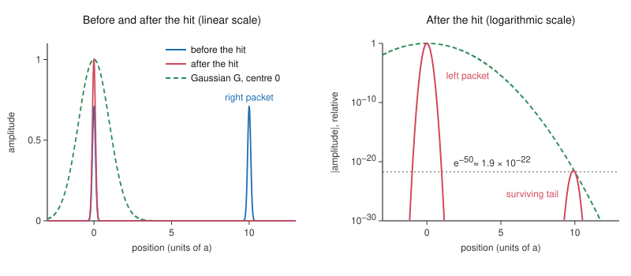

# Philosophy of Physics · Lesson 2.2: Collapse theories: GRW and CSL

> ⏱ ~15 min · Module 2: The realist solutions · Builds on: [1.1](01-01-the-measurement-problem-as-a-trilemma.md), [1.2](01-02-decoherence-and-what-it-does-not-do.md), [2.1](02-01-bohmian-mechanics.md) · Unlocks: [2.3](02-03-many-worlds-branching.md), [3.3](03-03-nonlocality-and-relativity.md)

## Why this matters

In March 2026 the XENON collaboration, whose detector was built to catch dark matter, reported none of the faint X-rays that continuous spontaneous localization predicts, enough to exclude the parameter values originally proposed for it. No other interpretation in this module could be hit that way: Bohm ([2.1](02-01-bohmian-mechanics.md)) and many-worlds ([2.3](02-03-many-worlds-branching.md)) match textbook predictions exactly. Collapse theories answer the measurement problem by changing the physics, which makes them testable, and mortal.

## The idea

[1.1](01-01-the-measurement-problem-as-a-trilemma.md)'s [trilemma](../reference.md#maudlins-trilemma) was: (A) the wavefunction is complete, (B) it always evolves linearly, (C) measurements have determinate outcomes. A [collapse theory](../reference.md#grw-theory) denies (B). The textbook [collapse](../reference.md#collapse-postulate) of [`quantum-mechanics` 1.5](../../quantum-mechanics/lessons/01-05-measurement-expectation-values.md) stays, but it stops waiting for a "measurement": it becomes a physical process with a rate, happening to everything, observed or not.

The trick is a lottery. Every particle holds a ticket that almost never wins: on average once in hundreds of millions of years, its wavefunction is suddenly squeezed into a region about a ten-thousandth of a millimetre wide, at a random place where the wave was large. One atom in an interferometer will essentially never be squeezed, so microscopic experiments come out as quantum mechanics says. A pointer holds about $10^{23}$ tickets, and its particles are entangled: in the "points left" term all of them are on the left. Squeeze any one and the whole "points right" term is crushed, within a split second. One rule, no observer, no cut between micro and macro.

Two questions follow. What does this theory say exists in ordinary space? And since a squeezed wave is never exactly zero elsewhere, is the other outcome gone?

## The argument

The set-up (Ghirardi, Rimini and Weber, "Unified Dynamics for Microscopic and Macroscopic Systems", 1986). $N$ particles have a wavefunction $\psi(\mathbf q_1,\dots,\mathbf q_N)$ that obeys Schrödinger's equation, except at random instants.

**D1. The hit.** When particle $i$ is hit with centre $\mathbf x$,

$$\psi \;\longmapsto\; \frac{G_{\mathbf x}(\mathbf q_i)\,\psi}{\lVert G_{\mathbf x}(\mathbf q_i)\,\psi\rVert}, \qquad G_{\mathbf x}(\mathbf q) = K\,e^{-(\mathbf q-\mathbf x)^2/2a^2},$$

with $a$ the [localization width](../reference.md#localization-width) and $K$ fixed so that $\int |G_{\mathbf x}(\mathbf q)|^2\,d^3x = 1$. *In words:* multiply the wave by a bump about $a$ wide, then renormalize. Convention: this is GRW's own, as the Stanford Encyclopedia presents it, with $2a^2$ in the amplitude. Allori, Goldstein, Tumulka and Zanghì (2008) write a Gaussian with $2\sigma^2$ as an operator and apply its square root, so their amplitude carries $4\sigma^2$; check which before comparing numbers.

**D2. Where.** The centre $\mathbf x$ has probability density $\lVert G_{\mathbf x}(\mathbf q_i)\,\psi\rVert^2$. *In words:* hits land where the wave is big.

**D3. When.** Each particle's hits form a Poisson process with rate $\lambda_{\rm GRW}$ (subscripted because Module 3 uses $\lambda$ for the complete state). GRW chose the [localization rate](../reference.md#localization-rate) $\lambda_{\rm GRW} = 10^{-16}\,\mathrm{s}^{-1}$ and $a = 10^{-7}$ m. *In words:* hits are rare, and wide enough to leave an atom's internal structure almost untouched.

**Theorem ([amplification](../reference.md#amplification)).** Let a pointer of $N$ particles end in $\alpha|P_L\rangle + \beta|P_R\rangle$, every particle displaced by $d \gg a$ between the terms. Independent Poisson processes merge, so the pointer is hit at rate $N\lambda_{\rm GRW}$. A hit on any particle $i$ centred near its left position multiplies the right term by about $e^{-d^2/2a^2}$, since that term needs particle $i$ on the right; and for narrow packets the centre falls near the left with probability $|\alpha|^2$, because the two terms contribute $|\alpha|^2$ and $|\beta|^2$ times $\int|G|^2 = 1$. *In words:* one hit anywhere settles the whole pointer, with Born's odds. What counts is the number of particles displaced by more than $a$, not the number present. A macroscopic body is hit every $10^{-7}$ s or so; Bell ("Are There Quantum Jumps?", 1987) put it that Schrödinger's cat stays both dead and alive only for a split second.

So (B) fails on the individual state, which jumps nonlinearly and at random; (C) holds, because superposed displaced matter does not last. Averaged over centres, a hit sends $\rho \mapsto \int G_{\mathbf x}\,\rho\,G_{\mathbf x}\,d^3x$, a position-dephasing channel in the Kraus form of [`quantum-computing` 5.1](../../quantum-computing/lessons/05-01-quantum-channels-and-decoherence.md). Linear on $\rho$, it cannot signal ([3.3](03-03-nonlocality-and-relativity.md)). The price includes energy: a hit adds on average $3\hbar^2/4ma^2$ of kinetic energy to a particle of mass $m$ ($\hbar$ the reduced Planck constant), about 3 neV for a nucleon. The original version's energy production clashed with proton-lifetime data (Pearle and Squires, 1994), one reason later versions make the rate proportional to mass: $10^{-16}\,\mathrm{s}^{-1}$ per nucleon, about 2,000 times less per electron.

**[CSL](../reference.md#csl)** (Pearle, 1989; Ghirardi, Pearle and Rimini, 1990) replaces the jumps by a continuous random drift of the state and, unlike GRW's original model, respects the symmetry of identical particles. In the encyclopedia's simplified form, coherence between two arrangements decays as $\exp[-\lambda_{\rm CSL}\, t\sum_k (n_k - m_k)^2]$, with $n_k, m_k$ the nucleon counts in the $k$-th cell of side $a$: matter moved together within a cell counts quadratically. Lajos Diósi and Roger Penrose (whose idea goes back to *The Emperor's New Mind*, 1989) tied the rate to gravity, so that a superposition of differently curved spacetimes decays: the Diósi–Penrose model.

**D4. [Primitive ontology](../reference.md#primitive-ontology).** $\psi$ lives on $3N$-dimensional configuration space. Read alone (sometimes called GRW0), it gives [wavefunction realism](../reference.md#wavefunction-realism) ([2.3](02-03-many-worlds-branching.md)). Two proposals put matter in ordinary space. On the [flash ontology](../reference.md#flash-ontology) (Bell, 1987; relativistic versions Dove, 1996, and Tumulka, 2006), what exists is the hits themselves, points of spacetime, and a piece of matter is, in Bell's phrase, "a galaxy of such events"; between flashes space is empty. On the [mass-density ontology](../reference.md#mass-density-ontology) (Ghirardi, Grassi and Benatti, 1995), what exists is a field $m(\mathbf x,t) = \langle\psi_t|M(\mathbf x)|\psi_t\rangle$, with $M(\mathbf x)$ the mass-density operator; a particle in two packets has half its mass in each. Allori, Goldstein, Tumulka and Zanghì (2008) named the two (GRWf, GRWm) and, like Maudlin (2010), demand that a fundamental theory say what matter in three-dimensional space it is about: that physics recover the manifest image of objects in space, a demand Husserl's *Crisis* makes in another key ([`phenomenology-and-personalism` 1.4](../../phenomenology-and-personalism/lessons/01-04-the-lifeworld-and-the-crisis-of-the-sciences.md)).

**The [tails problem](../reference.md#tails-problem).** A Gaussian is never zero, so after a hit the crushed term survives, tiny. Abner Shimony (1990) asked that tails not be tolerated if the senses could tell their parts apart, however low their amplitude; David Albert (*Quantum Mechanics and Experience*, 1992, ch. 5) noted that on the eigenvalue–eigenstate link a pointer with tails is in no position eigenstate, so it points nowhere. GRW's defenders reply that the trouble comes from keeping $|\psi|^2$ as a probability of position: on the mass-density view a pointer is where almost all of its mass is. Peter Lewis (1997) answered that "almost all" makes counting misbehave; Kelvin McQueen ("Four Tails Problems for Dynamical Collapse Theories", 2015) calls Albert's version, the bare tails problem, a pseudo-problem once the link is relaxed, and separates it from the structured tail: a low-weight copy of the other outcome, with all its structure.

**Where the argument is weakest.** The amplification premise: that every outcome a person can see is first recorded by displacing many particles. Albert and Vaidman (1989) built a counterexample: a spin superposition sends a particle to one of two spots on a fluorescent screen, a few atoms are excited by displacements smaller than $a$, a few photons fly out (hits act on matter, not light), and a human eye registers a few of them. No hit separates the branches before the observer. The strongest reply (Aicardi, Borsellino, Ghirardi and Grassi, 1991) is that the nerve signal to the visual cortex moves enough ions to trigger collapse within the time of perception, and the brain is simply the first macroscopic displacer in the chain: a spark chamber in its place would do the same. The defender concedes that in such set-ups the outcome becomes definite inside the observer; the critic concedes that no consciousness is invoked. Stephen Adler (2003) proposed raising the rate about $10^9$-fold so collapse would happen in the eye's rods, where fewer than $10^5$ molecules are affected; experiments have since excluded that proposal, at least with white noise (Stanford Encyclopedia, 2025 revision).

## The picture

A hit centred on the left packet leaves the right one at about $10^{-22}$ of its amplitude: crushed, not gone.

## Worked examples

**Example 1 (clean case: one hit, two packets).** A particle is in $\frac{1}{\sqrt2}(|L\rangle + |R\rangle)$, two packets much narrower than $a$, separated by $d = 1\ \mu\mathrm m = 10a$, and a hit lands exactly on the left packet. D1 multiplies the right amplitude by

$$e^{-d^2/2a^2} = e^{-50} \approx 1.9\times10^{-22},$$

so the right term's relative weight is $e^{-100} \approx 3.7\times10^{-44}$. In the other convention ($4\sigma^2$ in the amplitude, $\sigma = a$) the same hit leaves amplitude $e^{-25} \approx 1.4\times10^{-11}$. The centre is itself random: given the left packet, it spreads with standard deviation $a/\sqrt2$, and a centre shifted by $s$ toward the right packet raises the tail by $e^{sd/a^2}$, about $e^{7.1} \approx 10^3$ at one standard deviation. Every version agrees: one packet dominates, the other is down by many orders of magnitude, and nothing makes it zero.

**Example 2 (hard case: can an interferometer catch GRW?).** Molecular interferometers have sent molecules of over 10,000 nucleons through gratings. Take $N = 10^4$ nucleons, arms farther apart than $a$, and a flight time of $t = 10$ ms (a round number for illustration). The expected number of hits on original GRW is

$$N\lambda_{\rm GRW}\,t = 10^4 \times 10^{-16}\,\mathrm{s}^{-1}\times 10^{-2}\,\mathrm{s} = 10^{-14},$$

so interference survives in all but about one run in $10^{14}$. A hit becomes likely only if $\lambda_{\rm GRW} \gtrsim 1/Nt = 10^{-2}\,\mathrm{s}^{-1}$, fourteen orders of magnitude above GRW's value. CSL's quadratic counting helps: for a molecule smaller than $a$, the encyclopedia's formula gives a decay rate $2N^2\lambda_{\rm CSL}$, which is $2\times10^{-8}\,\mathrm{s}^{-1}$ at $\lambda_{\rm CSL} = 10^{-16}\,\mathrm{s}^{-1}$: still only $2\times10^{-10}$ over the flight. An effect of order one needs $\lambda_{\rm CSL}$ near $5\times10^{-7}\,\mathrm{s}^{-1}$. That is the arithmetic behind the encyclopedia's report that such experiments cannot yet test even Adler's rate, let alone GRW's.

The decisive [tests](../reference.md#tests-of-collapse-models) are non-interferometric (Carlesso and colleagues' 2022 review): collapse jiggles matter, which heats it, shakes test masses and makes charged particles radiate. LISA Pathfinder bounds the CSL rate at about $3\times10^{-8}\,\mathrm{s}^{-1}$ (Helou and colleagues, 2017); a germanium detector under the Gran Sasso ruled out the parameter-free Diósi–Penrose model (Donadi and colleagues, 2020); and XENONnT excluded white-noise CSL's originally proposed strength and correlation length (2026).

Here the account stops giving a verdict. Each result kills a model at a parameter setting, not "collapse": Diósi–Penrose survives with a free cutoff, and coloured-noise and dissipative CSL have their own parameter spaces. The critic sees a theory retreating into unexplored corners, a Lakatosian protective belt ([`philosophy-of-science` 2.5](../../philosophy-of-science/lessons/02-05-lakatos-and-feyerabend.md)). The defender answers that the window is closed from below too, since the rate must collapse pointers fast, so the theory can lose outright. And a positive signal would not settle things: extra noise might be decoherence from an unnoticed environment, which Bohm and Everett read their own way.

## Watch out

- **You might think** a GRW hit is [decoherence](../reference.md#decoherence) under another name, since both act on $\rho$ as a dephasing channel, **but actually** decoherence leaves the global state a superposition, an [improper mixture](../reference.md#proper-and-improper-mixtures) ([1.2](01-02-decoherence-and-what-it-does-not-do.md)), while a hit changes the individual state with no interaction at all. The mixture over which hit occurred is proper: ignorance of a fact.

- **You might think** the realist interpretations are empirically equivalent, **but actually** GRW alone predicts heating, noise and radiation that standard quantum mechanics does not, which is why [`apologetics-foundations` 4.4](../../apologetics-foundations/lessons/04-04-divine-action-miracles-and-quantum-indeterminacy.md) sets it apart from Bohm and Everett.

- **You might think** a sharper collapse function would abolish tails, **but actually** any wave with compact support spreads over all space at once under the Schrödinger equation, so bare tails return immediately whatever the bump.

- **You might think** the 2026 exclusion refutes collapse theories, **but actually** it excludes one model at its original parameters; the family survives elsewhere in its parameter space.

## One-liner

> GRW makes collapse a law (rare, random hits that a pointer's $10^{23}$ particles amplify into a split second), buying determinate outcomes with no observer at the price of energy non-conservation, a choice of what matter is, tails that never vanish, and predictions that experiment keeps squeezing.

## Problems

**P1 (🟢)** *(Apply to a hard case: Exegetical (a)–(c).)* A single neutron in an interferometer is in an equal superposition of two packets, one in each arm, 2 cm apart; each packet is far wider than $a$. Suppose that, against the odds, it is hit, with the centre in the upper arm. One line each, for the mass-density ontology and for the flash ontology:

(a) What exists in space in the interferometer before the hit?

(b) What exists just after it?

(c) Where, after the hit, is the "tail" of the lower packet?

**P2 (🟡)** *(Formal model: Formal (a)–(b) · Evaluative (c).)* A pointer of mass $M = 1$ kg ends a measurement in $\frac{1}{\sqrt2}(|P_L\rangle + |P_R\rangle)$, each of its nucleons displaced by $d = 0.5\ \mu$m between the terms. Use GRW's convention (D1), packets much narrower than $a = 10^{-7}$ m, the nucleon mass $m_N = 1.6726\times10^{-27}$ kg, and treat every hit as centred exactly on its nucleon's left position.

(a) After one hit, give the right term's weight relative to the left, and the mass that the mass-density ontology locates at the right position. Show the computation.

(b) After $k$ hits, what is that mass? Find the smallest $k$ for which it is less than one nucleon's mass. Show the computation.

(c) Can any finite number of hits make it zero, and what question does the computation leave open? Two sentences.

**P3 (🔴)** *(Steelman and reply: Exegetical (a) · Evaluative (b).)*

(a) Distinguish the bare tails problem from the structured tails problem, as McQueen (2015) does. One sentence each.

(b) Is the structured tails problem a real problem for GRW? State it at its strongest, give the best reply from one primitive ontology (mass density or flashes, your choice), and say what each side concedes. Any verdict; 150 words or fewer.

Solutions

**P1** *(Exegetical (a)–(c).)*

**Must hit, strict:**

- (a) Mass density: a mass field with half the neutron's mass spread over each packet. Flashes: nothing; no hit has occurred, so the region contains no matter (the wavefunction is not in space).

- (b) Mass density: almost all the mass concentrated within about $a$ of the hit centre in the upper arm, which then spreads again under the Schrödinger equation. Flashes: exactly one flash, a single spacetime point in the upper arm at the time of the hit; after it, empty space again.

- (c) Mass density: a real but absurdly small amount of mass in the lower arm (relative weight about $e^{-d^2/a^2} = e^{-4\times10^{10}}$, since $d = 2\times10^{5}a$), and around the upper packet beyond the localized region. Flashes: nowhere in space; the tail is part of the wavefunction, which only sets the chances of future flashes, and a future flash there is all but impossible.

**Wrong turns:** saying the hit puts the neutron "in the upper packet" as a whole (it localizes to a region about $a$ wide inside it); giving the flash ontology a persistent particle between flashes; treating the tail as matter on the flash view.

---

**P2** *(Formal (a)–(b) · Evaluative (c).)*

(a) Each hit centred on a nucleon's left position multiplies the right amplitude by $e^{-d^2/2a^2}$ and its weight by $e^{-d^2/a^2}$. Here $d/a = 5$, so the relative weight is $e^{-25} \approx 1.39\times10^{-11}$. The mass density at a point sums each nucleon's mass times its probability density there, so the mass at the right position is $M\,\frac{e^{-25}}{1+e^{-25}} \approx 1.39\times10^{-11}$ kg, about $8.3\times10^{15}$ nucleon masses.

(b) After $k$ hits the relative weight is $e^{-25k}$ and the mass is $M e^{-25k}/(1+e^{-25k}) \approx M e^{-25k}$. It is below $m_N$ when $25k > \ln(M/m_N) = \ln(5.98\times10^{26}) = 61.66$, so $k > 2.47$: the smallest is $k = 3$. Check: $k = 2$ leaves $1.93\times10^{-22}$ kg (about $1.2\times10^{5}$ nucleon masses); $k = 3$ leaves $2.68\times10^{-33}$ kg (about $1.6\times10^{-6}$ of one nucleon's mass).

(c) No: $e^{-25k} > 0$ for every finite $k$, so the right term never vanishes; it only becomes smaller than any given amount. What the computation leaves open is whether a sliver of mass, or a low-weight structured copy of the other outcome, counts as anything real at the right position, which is the tails problem.

**Must hit, strict:** weight factor $e^{-d^2/a^2}$ per hit (not $e^{-d^2/2a^2}$, which is the amplitude); $e^{-25} \approx 1.39\times10^{-11}$ and about $1.4\times10^{-11}$ kg; $\ln(M/m_N) \approx 61.7$; $k = 3$; nonzero for every finite $k$.

**Accept:** using $1/1.6726\times10^{-27}$ as the nucleon count and ignoring electrons; noting that in the $4\sigma^2$ convention the per-hit weight is $e^{-12.5}$ and $k = 5$.

**Wrong turns:** squaring twice or not at all; dividing the mass by the number of nucleons (each nucleon's marginal carries the same weight, so the whole of $M$ is multiplied by it).

---

**P3** *(Exegetical (a) · Evaluative (b).)*

**Must hit, strict (a):**

- Bare tails: after a hit some tiny amplitude remains on the other outcome, so the pointer is in no eigenstate of position, and on the eigenvalue–eigenstate link it has no definite reading. McQueen calls this a pseudo-problem: the link is optional (neither Bohm nor Everett keeps it), and a relaxed link, such as Albert and Loewer's "fuzzy link" (a particle is in a region if nearly all its squared amplitude is there), disposes of it.

- Structured tails: the crushed term is not featureless; it is a low-weight copy of the other outcome (pointer, cat, observer) with all their structure, evolving as they would.

**Must hit, any verdict (b):**

- The strongest version: if what makes a pointer or an observer real is structure in the wavefunction, the structured tail contains a second, low-weight pointer and observer, so GRW is a many-worlds theory with unequal weights ([2.3](02-03-many-worlds-branching.md)).

- A reply from one ontology. Mass density: matter is the field $m(\mathbf x,t)$, and the tail is a sliver of it (P2), so whether there is a second pointer turns on whether structure at tiny density counts; the reply needs a reason to treat high and low density differently. Flashes: the tail holds no flashes, except with negligible probability, so no matter at all; the wavefunction is not what exists.

- Concessions: the critic concedes that the theory's matter, as specified, is overwhelmingly in one place; the defender concedes that the reply works only by denying that wavefunction structure alone makes a world, the same premise Bohmians deny about empty packets ([2.1](02-01-bohmian-mechanics.md)).

**Wrong turns:** offering a collapse function with compact support as a free cure (Schrödinger spreading restores featureless tails at once, and McQueen, who grants that such a function would stop structured tails forming, argues it brings new trouble with relativity); treating the problem as empirical; treating tails as peculiar to GRW (every wavefunction has them; GRW's novelty is shrinking the other outcome's branch to a tail).

**Model answer (b), one of several:** At its strongest the problem says the crushed term is not noise but a faint copy of the other outcome, pointer and observer included, obeying the same laws. If structure in the wavefunction is what makes a world, GRW has two, one of tiny weight. On the flash ontology this has a clean answer: matter is flashes, and the tail contains none except with negligible probability, so the second pointer is not there; the wavefunction only sets chances. The critic concedes that the matter the theory posits is in one place. The defender concedes that the reply is the Bohmian's reply to empty packets: it holds only if worlds are made of primitive ontology in spacetime, not of wavefunction structure. So the tails problem is real exactly for those who already think structure suffices, and empty for those who do not; I take it to be a real cost, payable in that premise.

## Flashback

**From Lesson [1.3](01-03-copenhagen-qbism-and-relational-views.md) (Copenhagen, QBism, and relational views):** *(Formal (a) · Exegetical (b).)* A toy [ontological model](../reference.md#ontological-model) of one qubit, written for this problem: ontic states $\lambda \in \{1,2,3,4\}$; $|0\rangle$ gives $\mu_0$ uniform on $\{1,2\}$, and $|{+}\rangle = (|0\rangle + |1\rangle)/\sqrt2$ gives $\mu_+$ uniform on $\{1,3\}$; $Z$ reads 0 exactly when $\lambda \in \{1,2\}$, $X$ reads $+$ exactly when $\lambda \in \{1,3\}$.

(a) Check its four predictions against the Born rule. Is it ψ-ontic? Then take two qubits, each prepared in $|0\rangle$ or $|{+}\rangle$, with [preparation independence](../reference.md#preparation-independence). PBR's entangled measurement $M$ has four outcomes, outcome $k$ having quantum probability 0 on the $k$-th product preparation. Show that every response function $\xi(k \mid \lambda_1,\lambda_2,M)$ gives some preparation its forbidden outcome, and bound that probability below. Show the computation.

(b) Does this refute ψ-epistemic views, QBism, or neither, and what does each escape give up? Two sentences.

Solution

(a) One qubit:

- $Z$ on $|0\rangle$: $\mu_0(\{1,2\}) = 1 = |\langle 0|0\rangle|^2$. $X$ on $|0\rangle$: $\mu_0(\{1,3\}) = \mu_0(1) = \tfrac12 = |\langle{+}|0\rangle|^2$.

- $Z$ on $|{+}\rangle$: $\mu_+(\{1,2\}) = \tfrac12 = |\langle 0|{+}\rangle|^2$. $X$ on $|{+}\rangle$: $\mu_+(\{1,3\}) = 1$.

All four match, yet $\lambda = 1$ can come from either preparation, so the model is ψ-epistemic.

Two qubits: number the product preparations $|0\rangle|0\rangle, |0\rangle|{+}\rangle, |{+}\rangle|0\rangle, |{+}\rangle|{+}\rangle$ as $k = 1,\dots,4$. Preparation independence gives every one of them, $|\psi\rangle|\phi\rangle$ with $\psi, \phi \in \{0, {+}\}$, the ontic pair $(1,1)$ with probability

$$\mu_\psi(1)\,\mu_\phi(1) = \tfrac12\cdot\tfrac12 = \tfrac14.$$

At $(1,1)$ the four values $\xi(k \mid 1,1,M)$ sum to 1, so some $k^*$ has $\xi(k^* \mid 1,1,M) \ge \tfrac14$. Preparation $k^*$ then yields outcome $k^*$ with probability at least $\tfrac14\cdot\tfrac14 = \tfrac1{16}$, where quantum mechanics says 0. No response function escapes.

**Must hit, strict (a):** the four matches; ψ-epistemic because $\lambda = 1$ is shared; $\tfrac14$ for $(1,1)$ under every product preparation, by preparation independence; some $\xi \ge \tfrac14$; the bound $\tfrac1{16} > 0$.

**Must hit, strict (b):** neither outright; PBR's conclusion (a model reproducing the quantum predictions under preparation independence is ψ-ontic); retrocausal models deny preparation independence; QBism escapes only by rejecting the ontological-models framework.

**Wrong turns:** calling the model ψ-ontic because each state has its own distribution (overlap decides); multiplying the two $\tfrac12$s without naming preparation independence as the licence; saying the toy's failure refutes QBism.

**Model answer (b):** Neither outright: the failure is PBR in miniature, showing that a model which reproduces the quantum predictions under preparation independence must be ψ-ontic. A ψ-epistemicist can deny preparation independence, as retrocausal models do, while QBism escapes only by rejecting the framework, positing no ontic state for $\psi$ to be information about (Wayne Myrvold argues every Born-rule user is bound by it; the Stanford entry reports no direct QBist reply).

## Connections

- **Backward:** [1.1](01-01-the-measurement-problem-as-a-trilemma.md)'s trilemma, with (B) denied; [`quantum-mechanics` 1.5](../../quantum-mechanics/lessons/01-05-measurement-expectation-values.md)'s collapse made a law; [1.2](01-02-decoherence-and-what-it-does-not-do.md)'s improper mixtures, against which a hit's proper mixture is defined; [`quantum-computing` 5.1](../../quantum-computing/lessons/05-01-quantum-channels-and-decoherence.md)'s Kraus form for the averaged hit; and [2.1](02-01-bohmian-mechanics.md)'s primitive-ontology programme, now with flashes or a mass density in place of particles.

- **Forward:** [2.3](02-03-many-worlds-branching.md) takes the structured tails' premise, that wavefunction structure suffices for a world, as its own; [3.2](03-02-what-bell-rules-out.md) shows GRW violates outcome independence, not parameter independence; [3.3](03-03-nonlocality-and-relativity.md) gives the relativistic GRW of Dove and of Tumulka and why linearity on $\rho$ blocks signalling; [5.1](05-01-determinism-in-physical-theories.md) counts GRW among the indeterministic theories; and Albert (*Time and Chance*, 2000) uses GRW's chances to ground the probabilities of statistical mechanics ([5.6](05-06-probability-in-statistical-mechanics.md)).

- **Sideways:** [`apologetics-foundations` 4.4](../../apologetics-foundations/lessons/04-04-divine-action-miracles-and-quantum-indeterminacy.md) uses GRW's genuinely open outcomes as a possible causal joint for divine action; Penrose's gravitational collapse sits beside his non-computability argument in [`philosophy-of-mind` 6.1](../../philosophy-of-mind/lessons/06-01-computationalism-and-the-turing-test.md); the primitive-ontology demand is the physicist's version of the lifeworld question in [`phenomenology-and-personalism` 1.4](../../phenomenology-and-personalism/lessons/01-04-the-lifeworld-and-the-crisis-of-the-sciences.md); GRW's testability is what breaks the empirical equivalence that [`philosophy-of-science` 2.2](../../philosophy-of-science/lessons/02-02-duhem-quine-and-underdetermination.md) studies; and the shrinking parameter window is a live case for [`philosophy-of-science` 2.5](../../philosophy-of-science/lessons/02-05-lakatos-and-feyerabend.md).
