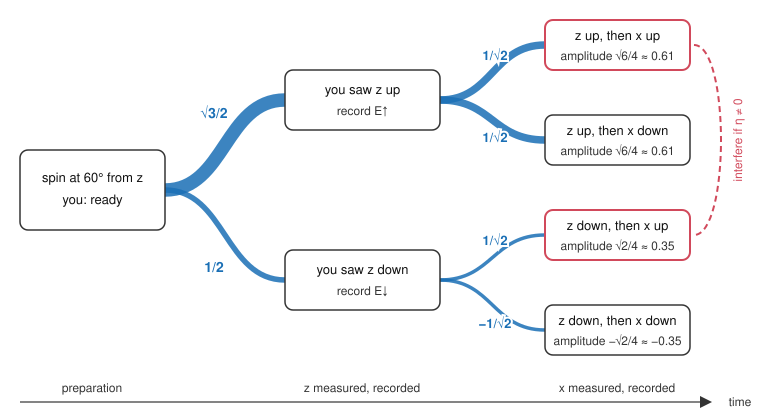

# Philosophy of Physics · Lesson 2.3: Many-worlds I: branching

> ⏱ ~15 min · Module 2: The realist solutions · Builds on: [1.1](01-01-the-measurement-problem-as-a-trilemma.md), [1.2](01-02-decoherence-and-what-it-does-not-do.md), [`quantum-mechanics` 5.2](../../quantum-mechanics/lessons/05-02-tensor-products-entanglement.md) · Unlocks: [2.4](02-04-many-worlds-the-probability-problem.md), [3.2](03-02-what-bell-rules-out.md)

## Why this matters

Send a spin prepared at 60° from the $z$-axis through a Stern–Gerlach magnet ([`quantum-mechanics` 4.5](../../quantum-mechanics/lessons/04-05-spin-pauli-stern-gerlach.md)) and let the Schrödinger equation run on spin, detector and you. You get a sum of two terms: in one you saw up, in the other you saw down. In [1.1](01-01-the-measurement-problem-as-a-trilemma.md) that sum was the problem. In 1957 Hugh Everett III, in the thesis he wrote as a Princeton graduate student, proposed that it is the answer: the equation is right, and both terms describe you. This lesson asks what that proposal says exists: what a [branch](../reference.md#branching) is, whether there is a fact about how many, and in what space the one fundamental object lives.

## The idea

Recall [Maudlin's trilemma](../reference.md#maudlins-trilemma) from 1.1: (A) the wavefunction is complete, (B) it always evolves linearly, (C) measurements have determinate outcomes. Bohmian mechanics denies (A) ([2.1](02-01-bohmian-mechanics.md)) and GRW denies (B) ([2.2](02-02-collapse-theories-grw-and-csl.md)). The [many-worlds interpretation](../reference.md#many-worlds-interpretation) keeps (A) and (B) and denies (C) as stated: a measurement has no single outcome. Every outcome occurs, each paired with an observer who saw it.

An analogy for Everett's own idea. "It is noon" is neither true nor false of the Earth as a whole; it is true relative to a longitude. Everett said the same of outcomes. After the run there is no absolute fact about what you saw, only what you saw relative to the state of the spin, and what the spin is relative to your record. That is his [relative-state](../reference.md#relative-state) formulation.

Three questions follow. A vector splits into components in infinitely many ways (the [preferred-basis problem](../reference.md#preferred-basis-problem) of [1.2](01-02-decoherence-and-what-it-does-not-do.md)): what makes "saw up" plus "saw down" the right split? Are the components *worlds*? Bryce DeWitt (1970) said yes and popularized the name "many worlds"; David Wallace's modern answer says yes, in the way a tiger or a hurricane is a thing: a pattern in something more basic, defined well enough for every purpose but not exactly. And what is the basic thing: one vector, but a field on what space?

## The argument

**Everett's relative-state formulation** ("'Relative State' Formulation of Quantum Mechanics", *Reviews of Modern Physics*, 1957; the longer draft thesis was titled "Wave Mechanics Without Probability").

**E1. The universal state is complete and always evolves by the Schrödinger equation.** *In words:* keep (A) and (B), drop the collapse rule. Everett called the result pure wave mechanics.

**E2. An ideal measurement correlates.** If the device records $|{\uparrow}\rangle$ as $|E_\uparrow\rangle$ and $|{\downarrow}\rangle$ as $|E_\downarrow\rangle$, linearity (1.1's formal step) gives

$$(\alpha|{\uparrow}\rangle + \beta|{\downarrow}\rangle)|E_0\rangle \;\longrightarrow\; \alpha|{\uparrow}\rangle|E_\uparrow\rangle + \beta|{\downarrow}\rangle|E_\downarrow\rangle,$$

where $\alpha, \beta$ are amplitudes with $|\alpha|^2 + |\beta|^2 = 1$, $|E_0\rangle$ is the ready state, and each $|E\rangle$ stands for everything that holds the record: your memory, the apparatus, the stray photons. *In words:* measurement is entanglement ([`quantum-mechanics` 5.2](../../quantum-mechanics/lessons/05-02-tensor-products-entanglement.md)).

**E3. Relative states.** Write the composite state $|\Psi\rangle$ spin first, as in E2. Relative to a record state $|E\rangle$, the spin's state is $(I \otimes \langle E|)\,|\Psi\rangle$, normalized, with $I$ the identity on the spin. With orthogonal records, the spin relative to $|E_\uparrow\rangle$ is $|{\uparrow}\rangle$. *In words:* fix what was recorded and ask what the spin is, given that.

**∴ C. Every outcome occurs, each definite relative to a record of it, none absolutely.** *In words:* the superposition does not fail to describe one outcome; it describes all of them.

Everett avoided talk of worlds and named no preferred basis (SEP, "Everett's Relative-State Formulation of Quantum Mechanics"). DeWitt took the components to be physically splitting worlds, which needs a rule saying which components count. Wallace ("Everett and Structure", 2003; *The Emergent Multiverse*, 2012) supplies one without a new postulate:

**W1. Decoherence selects the split.** Environmental monitoring makes some states robust and suppresses interference between components that differ in them ([decoherence](../reference.md#decoherence), 1.2). *In words:* the dynamics, not a postulate, picks out quasi-classical components.

**W2. Dennett's criterion.** A macro-object is a pattern, and it is real if theories that include it explain and predict well. Wallace names it for Daniel Dennett, whose "Real Patterns" (1991) proposed a very similar view with a test of compression: a pattern in data is real if a description using it is more efficient than listing the data bit by bit. *In words:* a tiger is real because tiger-talk predicts what the particles do far more cheaply than particle-talk. [`philosophy-of-mind` 4.1](../../philosophy-of-mind/lessons/04-01-intentionality-and-folk-psychology.md) uses [real patterns](../reference.md#real-patterns) for beliefs; here they carry worlds.

**W3. Decohered components are such patterns.** Each evolves, to excellent approximation, as an independent quasi-classical history. *In words:* a branch is a tiger-grade thing.

**∴ C. [Branches are real, emergent and approximately defined](../reference.md#emergent-branches), and there is no exact fact about how many there are.** *In words:* asking for the exact number of worlds is like asking for the exact number of valleys in a mountain range.

On this account the [and-or problem](../reference.md#and-or-problem) that decoherence left open in 1.2 is no problem: "and" is the answer. The emergence is weak in Chalmers's sense from [`philosophy-of-science` 4.5](../../philosophy-of-science/lessons/04-05-reduction-and-emergence.md): every fact about branches follows from the universal state, though nobody would read them off it unaided.

**What is fundamental?** Two Everettian answers keep one state and differ on its space. [Wavefunction realism](../reference.md#wavefunction-realism) (David Albert, "Elementary Quantum Metaphysics", 1996; Alyssa Ney, *The World in the Wave Function*, 2021): the wavefunction of $N$ particles is a field on a $3N$-dimensional configuration space, and that space is fundamental. There the ontology is [separable](../reference.md#separability), the state of a whole fixed by the states of its parts, and three-dimensional space must be explained as emergent. [Spacetime state realism](../reference.md#spacetime-state-realism) (Wallace and Christopher Timpson, "Quantum Mechanics on Spacetime I", 2010): spacetime is fundamental, and each region has a quantum state, its reduced density operator. The price is nonseparability: the state of a region is not fixed by the states of its subregions. Tim Maudlin (2010) leads an objection aimed at the first view: a field on configuration space is the wrong kind of object to compose tables and cats, which need something in spacetime (the [primitive ontology](../reference.md#primitive-ontology) of 2.1–2.2).

**The incredulous stare.** David Lewis named the reaction to his plurality of worlds ([`metaphysics` 3.2](../../metaphysics/lessons/03-02-what-possible-worlds-are.md)); Everett meets it too. The Everettian reply is that Ockham's razor should count laws and postulates, not entities, and many-worlds adds nothing to the Schrödinger equation (SEP, "Many-Worlds Interpretation of Quantum Mechanics"). Meir Hemmo and Orly Shenker (2022) answer that the economy is idle if the postulates alone cannot explain experience.

**Where the argument is weakest.** W2, applied to observers. [1.2](01-02-decoherence-and-what-it-does-not-do.md) met the complaint that branches are only approximate, Adrian Kent's demand ("Against Many-Worlds Interpretations", 1990) for an explicit, precise rule, and Wallace's reply that emergent structure always is approximate; he calls the demand the [fallacy of exactness](../reference.md#fallacy-of-exactness). The harder pressure is on "useful". The objection: usefulness is relative to describers, so worlds, and the observers in them, would exist only at a level of description someone picks, an odd result for a theory meant to remove observers from the foundations. The reply: whether a compressing description exists does not depend on anyone using it (Dennett's own point), and decoherence makes the quasi-classical description the efficient one, objectively. The Everettian concedes that "world" is not a fundamental category and that the view needs something like functionalism about observers (Wallace 2003; [`philosophy-of-mind` 2.2](../../philosophy-of-mind/lessons/02-02-functionalism.md)): a person is whatever pattern behaves as one. The critic concedes that tigers and quasi-particles are real by the same test, and must say why outcomes, unlike tigers, need a fundamental ground.

## The picture

Edge widths are proportional to squared amplitude (what that weight means is [2.4](02-04-many-worlds-the-probability-problem.md)'s question), and the two "x up" endings stay separate branches only because the $z$-records differ.

## Worked examples

**Example 1 (clean case: two Stern–Gerlach runs in the universal state).** Prepare $\frac{\sqrt3}{2}|{\uparrow}\rangle + \frac12|{\downarrow}\rangle$, a spin at 60° from $z$. Measure $z$ with orthogonal records, $\langle E_\uparrow|E_\downarrow\rangle = 0$:

$$\tfrac{\sqrt3}{2}\,|{\uparrow}\rangle|E_\uparrow\rangle + \tfrac12\,|{\downarrow}\rangle|E_\downarrow\rangle.$$

Relative to $|E_\uparrow\rangle$ the spin is $|{\uparrow}\rangle$; relative to $|E_\downarrow\rangle$ it is $|{\downarrow}\rangle$. Now measure $x$ in each branch, using $|{\uparrow}\rangle = (|{+x}\rangle + |{-x}\rangle)/\sqrt2$ and $|{\downarrow}\rangle = (|{+x}\rangle - |{-x}\rangle)/\sqrt2$. Four branches result, with amplitudes $\sqrt6/4 \approx 0.61$ (twice), $\sqrt2/4 \approx 0.35$ and $-\sqrt2/4$, as in the figure.

The test of branchhood is $x$-up, reached by two routes. With orthogonal records the routes cannot interfere, so the squared amplitudes add: $\frac38 + \frac18 = \frac12$. Had the $z$-coupling left no record ($|E_\uparrow\rangle = |E_\downarrow\rangle$), the amplitudes would add first: $\big(\tfrac{\sqrt3}{2} + \tfrac12\big)^2/2 = \frac{2+\sqrt3}{4} \approx 0.93$. The branches exist because of the records: a branch is a component that no longer interferes with its siblings. Every interpretation predicts these numbers; the Everettian adds only that nothing beyond them happens.

**Example 2 (hard case: a continuous pointer).** Now record a particle's position with a pointer whose reading is continuous. The final state is a continuum of terms, each pairing a position with a pointer packet centred on the matching reading. Take Gaussian packets $\psi_a(y) = (2\pi s^2)^{-1/4}e^{-(y-a)^2/4s^2}$, where $y$ is the pointer coordinate, $a$ the reading and $s$ the spread of $|\psi_a|^2$. Readings $d$ apart overlap by

$$\langle\psi_a|\psi_{a+d}\rangle = e^{-d^2/8s^2},$$

which is 0.88 at $d = s$, 0.14 at $d = 4s$ and $3.7\times10^{-6}$ at $d = 10s$, and the environment drives overlaps lower still. Nowhere does the overlap jump from "one branch" to "two". So how many worlds did the measurement make? Bin the readings and the answer is the number of bins, which you chose.

Wallace's answer: there is no fact here to miss. The branching structure is real at the grain where the pointer description predicts well, and the count is as conventional as the number of valleys. It is his reason (2012) for refusing to weight outcomes by branch number, the move [2.4](02-04-many-worlds-the-probability-problem.md) examines. The critic's answer, in Kent's line: "every outcome occurs" then has definite content only once a grain is chosen, and what exists should not depend on how finely we bin. Here the account stops giving a verdict. The state, the overlaps and every prediction are fixed; the number of worlds is not. Both sides accept that; they divide on whether a fundamental theory owes more.

## Watch out

- **You might think many-worlds is the multiverse cosmologists discuss, but actually** the two share a word. The [cosmological multiverse](../reference.md#everettian-and-cosmological-multiverses) of [`philosophy-of-religion` 3.2](../../philosophy-of-religion/lessons/03-02-fine-tuning-the-objections.md) comes from particular cosmological models (inflation, a landscape of vacua) and is invoked to explain fine-tuning. Everett's branches come from applying the Schrödinger equation to everything and are invoked to solve the measurement problem. Keep "branch" or "world" for Everett and "universe" for the cosmologists.

- **You might think Everett branches are Lewis's possible worlds, but actually** Lewis's worlds ([`metaphysics` 3.2](../../metaphysics/lessons/03-02-what-possible-worlds-are.md), T1–T2) are spatiotemporally isolated and include every way things could be, while branches are parts of one actual state, share a past, can in principle interfere, and realize only what one Schrödinger evolution produces. Alastair Wilson (*The Nature of Contingency*, 2020) argues that branches can nonetheless do the work possible worlds do.

- **You might think branching creates matter, or decoherence removes the other branches, but actually** there is one state with conserved norm. Branching divides amplitude, and decoherence only stops components interfering; every component remains. On Wallace's account branching also spreads out from the interaction rather than happening everywhere at once, though some Everettians (Lev Vaidman) prefer global branching.

## One-liner

> Many-worlds keeps the Schrödinger equation and denies that measurements have single outcomes; on the modern account branches are real but emergent patterns picked out by decoherence, with no exact count, and the open question is whether the one fundamental state lives in spacetime or in a space of $3N$ dimensions.

## Problems

**P1 (🟢)** *(Exegetical.)*

(a) Give three contrasts between Everett's branches and the universes of the cosmological multiverse in [`philosophy-of-religion` 3.2](../../philosophy-of-religion/lessons/03-02-fine-tuning-the-objections.md). One line each.

(b) On the 2020 PhilPapers Survey's quantum-mechanics question, the strongest correlation reported is between accepting many-worlds and accepting a multiverse explanation of cosmological fine-tuning ($r = 0.46$, 377 respondents). Does the correlation show that the two are one hypothesis? Two sentences.

**P2 (🟡)** *(Apply to a hard case: Formal (a) · Evaluative (b).)* A spin in the state $\frac{2}{\sqrt5}|{\uparrow}\rangle + \frac{1}{\sqrt5}|{\downarrow}\rangle$ is coupled to a device that records $z$, leaving

$$\tfrac{2}{\sqrt5}\,|{\uparrow}\rangle|E_\uparrow\rangle + \tfrac{1}{\sqrt5}\,|{\downarrow}\rangle|E_\downarrow\rangle$$

with normalized records whose overlap $\eta = \langle E_\uparrow|E_\downarrow\rangle$ is real and between 0 and 1. The spin is then measured along $x$, with $|{+x}\rangle = (|{\uparrow}\rangle + |{\downarrow}\rangle)/\sqrt2$.

(a) Show that the Born-rule probability of $x$-up, the number every interpretation predicts for the observed frequency, is $\frac12 + \frac25\eta$, and evaluate it at $\eta = 0.95$, $0.4$ and $10^{-12}$. Show the computation.

(b) In which of the three cases did the $z$-coupling leave two branches, by Wallace's criterion? Say where the criterion stops giving a verdict, and what Wallace and a critic in Kent's line each say about that. 150 words or fewer.

**P3 (🔴)** *(Find the crux: Exegetical (a) · Evaluative (b).)* Wavefunction realists (Albert, Ney) and spacetime state realists (Wallace and Timpson) agree that the universal quantum state is complete and evolves linearly. They disagree about which space is fundamental.

(a) As this lesson reconstructs the dispute, name the single premise one side affirms and the other denies, and state a conditional both would sign. Two sentences.

(b) Name one consideration that should move each side, and say what giving way would cost each. 150 words or fewer.

Solutions

**P1** *(Exegetical.)*

**Accept:** any three of the contrasts below, in any wording.

**Must hit, strict (a):**

- Origin: Everett's branches follow from applying the Schrödinger equation to everything, with no added physics; the cosmological universes come from particular, contested cosmological models (eternal inflation, a landscape of vacua).

- Role: branches are posited to solve the measurement problem; the universes are invoked to explain fine-tuning by a selection effect.

- What varies: branches evolve under one set of laws from one state and differ only in what quantum events settled; the cosmological multiverse is postulated precisely to vary the constants.

- Relation: branches overlap in one space, share a past, and can in principle interfere; pocket universes are separate regions, causally cut off from one another.

**Must hit, strict (b):** no. A correlation in who accepts what records shared dispositions among respondents (for instance, comfort with abundant unobservable ontology), not identity of content; the two hypotheses are logically independent, since each can be held without the other.

**Wrong turns:** calling the branches "universes" and the difference merely one of number; saying the cosmological multiverse also solves the measurement problem; reading $r = 0.46$ as a proportion of respondents.

**Model answer:** (a) Branches come from unmodified quantum mechanics, the universes from specific cosmological models. Branches are posited for the measurement problem, the universes for fine-tuning. Branches share laws, constants and a past and can in principle interfere; the universes vary the constants and are causally isolated regions. (b) No: a correlation among philosophers' acceptances reflects what kinds of view attract the same people, not what the views say. Many-worlds is consistent with a single inflationary region, and eternal inflation with a collapse theory.

---

**P2** *(Formal (a) · Evaluative (b).)*

(a) Project the spin onto $|{+x}\rangle$. Since $\langle{+x}|{\uparrow}\rangle = \langle{+x}|{\downarrow}\rangle = 1/\sqrt2$, the unnormalized remainder is

$$\tfrac{1}{\sqrt2}\Big(\tfrac{2}{\sqrt5}|E_\uparrow\rangle + \tfrac{1}{\sqrt5}|E_\downarrow\rangle\Big).$$

Its squared norm is

$$\tfrac12\Big(\tfrac45 + \tfrac15 + 2\cdot\tfrac{2}{5}\,\mathrm{Re}\,\langle E_\uparrow|E_\downarrow\rangle\Big) = \tfrac12 + \tfrac25\,\eta,$$

using real $\eta$. At $\eta = 0.95$: $0.5 + 0.38 = 0.88$. At $\eta = 0.4$: $0.5 + 0.16 = 0.66$. At $\eta = 10^{-12}$: $0.5 + 4\times10^{-13}$, indistinguishable from $0.5$. For reference, no record ($\eta = 1$) gives $0.9$ and orthogonal records give $0.5$.

**Must hit, strict (a):** the cross term $2\cdot\frac{2}{\sqrt5}\cdot\frac{1}{\sqrt5}\,\eta = \frac45\eta$ inside the bracket, halved; the three values 0.88, 0.66 and $0.5 + 4\times10^{-13}$.

**Must hit, any verdict (b):**

- At $10^{-12}$, two branches: the components evolve independently to an accuracy no prediction can reach, so the two-record description is the useful one.

- At $0.95$, not two: interference is nearly full, and a two-branch description, which predicts 0.5, is badly wrong.

- At $0.4$, the criterion gives no verdict: the two-branch description is neither useful nor useless. Say Wallace's response (no sharp line is needed; branchhood is graded, as for quasi-particles, and macroscopic records drive $\eta$ to near zero almost at once) and the critic's (an ontology of worlds needs a precise rule, not a degree of usefulness).

**Wrong turns:** reading $\eta = 0.4$ as "40 per cent of a branch" or as the probability of a branch; treating 0.66 as the chance of being in the up branch; giving Wallace a numerical threshold.

**Model answer (b), one of several:** At $\eta = 10^{-12}$ the coupling left two branches: the interference term, $4\times10^{-13}$, makes no difference any prediction could detect, so describing two independent records is what Dennett's criterion rewards. At $0.95$ it left essentially one, since treating the components as separate worlds predicts 0.5 where 0.88 is observed. At $0.4$ neither description earns its keep, and the criterion goes quiet. Wallace says that is no defect: real patterns have blurred edges, as quasi-particles fade as their lifetime shortens, and for macroscopic records the blurred regime lasts only an instant. A critic in Kent's line says that is exactly the defect: if worlds are what exists, there must be a fact about when there are two, and "when the description is useful enough" is not one.

---

**P3** *(Exegetical (a) · Evaluative (b).)*

**Accept:** a crux framed either as separability or as the fundamentality of spacetime, provided the answer shows that an entangled universal state, described by its wavefunction, cannot have both. Credit noting a third route, Deutsch and Hayden's local descriptors, which claims both at a large cost in complexity (SEP, "Many-Worlds Interpretation").

**Must hit, strict (a):**

- The premise: the fundamental ontology must be separable, the state of any whole fixed by the states of its parts. Wavefunction realists affirm it; spacetime state realists deny it.

- A conditional both sign: "For an entangled universal state, if the fundamental ontology is separable, its space is configuration space rather than spacetime; if its space is spacetime, it is nonseparable."

**Must hit, any verdict (b):**

- One consideration bearing on each side, stated as the side would face it.

- The cost of giving way for each: for the wavefunction realist, accepting nonseparability; for the spacetime state realist, accepting that the space we live in is not fundamental.

**Wrong turns:** making the crux whether the wavefunction is real, which both assert; making it whether the theory is local in the sense of no signalling, which both satisfy; attributing a primitive ontology to either side.

**Model answer (b), one of several:** The wavefunction realist should be moved if configuration space cannot be had in the theories that matter. Quantum field theory has no fixed particle number, and relativity is formulated on spacetime, so a single $3N$-dimensional arena looks like an artefact of nonrelativistic mechanics. Wallace and Timpson argue that their view sits better with relativity; Ney's book answers in a chapter on the relativistic setting. Add Maudlin's charge that tables need something in spacetime. Giving way costs separability. The spacetime state realist should be moved by an argument that a fundamental ontology must be separable: that the whole should be nothing over its local parts, a physical analogue of Lewis's Humean supervenience. Giving way costs the fundamentality of spacetime, the space of every experiment.

## Flashback

**From Lesson [2.1](02-01-bohmian-mechanics.md) (Bohmian mechanics):** *(Formal (a) · Exegetical (b).)* Ignore spin, and apply the [guidance equation](../reference.md#guidance-equation) to hydrogen's electron (mass $m$) in spherical coordinates $(r, \theta, \phi)$, where the gradient's $\phi$-component is $\frac{1}{r\sin\theta}\partial_\phi$. The $2p$ state with $L_z = +\hbar$ is $\psi_+ = N\,r\,e^{-r/2a_0}\sin\theta\,e^{i\phi}$, with $N$ a real constant and $a_0$ the Bohr radius.

(a) Find the Bohmian velocity field. Then give the speed and the angular momentum $L_z = m\,r_\perp v_\phi$ of an electron at distance $r_\perp = a_0$ from the $z$-axis. Show the computation.

(b) The real orbital $2p_x \propto r\,e^{-r/2a_0}\sin\theta\cos\phi$ superposes the $L_z = \pm\hbar$ states with equal weights. Give its Bohmian velocity and the $L_z$ results with their probabilities, and say what the Bohmian takes that measurement to show. Two sentences.

Solution

(a) Only the factor $e^{i\phi}$ is complex. The radial and polar parts of $\nabla\psi_+/\psi_+$ are real, $\frac1r - \frac{1}{2a_0}$ and $\frac{\cot\theta}{r}$, while the azimuthal part is $\frac{1}{r\sin\theta}\,\partial_\phi\ln\psi_+ = \frac{i}{r\sin\theta}$. So

$$\mathbf v = \frac{\hbar}{m}\,\mathrm{Im}\,\frac{\nabla\psi_+}{\psi_+} = \frac{\hbar}{m\,r\sin\theta}\,\hat{\boldsymbol\phi}.$$

Every electron circles the $z$-axis at fixed $r$ and $\theta$, at speed $\hbar/(m r_\perp)$, so $L_z = m\,r_\perp \cdot \frac{\hbar}{m r_\perp} = \hbar$ on every orbit. At $r_\perp = a_0$ the speed is $\hbar/(m a_0) \approx 2.19 \times 10^6$ m/s, Bohr's first-orbit speed, and $L_z = \hbar$. In this state motion and eigenvalue agree.

(b) $2p_x$ is real, so its phase is constant and $\mathbf v = 0$: the electron rests, as in 2.1's Example 2. Since $\sin\theta\cos\phi = \frac12\sin\theta\,(e^{i\phi} + e^{-i\phi})$, an $L_z$ measurement returns $+\hbar$ or $-\hbar$, each with probability $\frac12$.

**Must hit, strict (a):** the velocity from the phase alone; $L_z = \hbar$ on every orbit; about $2.19 \times 10^6$ m/s at $a_0$.

**Must hit, strict (b):**

- $\mathbf v = 0$, yet results $\pm\hbar$, probability $\frac12$ each.

- The result is not a value the electron carried; the measuring interaction, acting on its actual position, produces it: [contextuality](../reference.md#contextuality). Only position is possessed.

**Wrong turns:** differentiating $|\psi|$ instead of the phase; saying the $2p_x$ electron circles one way or the other, half the time each, which reads the statistics back into the trajectories; calling the mismatch an empirical problem for Bohm, which predicts the same $\pm\hbar$ statistics.

**Model answer (b):** The real orbital has constant phase, so every Bohmian electron in it is at rest, yet an $L_z$ measurement returns $+\hbar$ or $-\hbar$, each with probability $\frac12$. For the Bohmian the measurement reveals no angular momentum the electron had: the result is made by the measuring interaction acting on its position, which is contextuality, and the match between motion and eigenvalue in (a) belongs to that state, not to measurement in general.

## Connections

- **Backward:** [1.1](01-01-the-measurement-problem-as-a-trilemma.md) supplies the trilemma Everett answers by denying (C), and [1.2](01-02-decoherence-and-what-it-does-not-do.md) supplies decoherence, which answers the preferred-basis question and, for the Everettian alone, leaves no and-or problem behind. [`quantum-computing` 5.1](../../quantum-computing/lessons/05-01-quantum-channels-and-decoherence.md)'s slogan that noise is a unitary you cannot see all of is this view's physics stated as physics. [2.1](02-01-bohmian-mechanics.md)'s empty wave packets are, on the Everettian charge, these branches with a particle added; [2.2](02-02-collapse-theories-grw-and-csl.md) is the theory that removes them.

- **Forward:** [2.4](02-04-many-worlds-the-probability-problem.md) asks what the squared amplitudes in the figure mean when every branch is real and their number is not fixed. [3.2](03-02-what-bell-rules-out.md) returns to Everett: Bell's theorem assumes that each run has a single outcome, the premise many-worlds denies.

- **Sideways:** real patterns come from [`philosophy-of-mind` 4.1](../../philosophy-of-mind/lessons/04-01-intentionality-and-folk-psychology.md), and the functionalism the account needs about observers from [`philosophy-of-mind` 2.2](../../philosophy-of-mind/lessons/02-02-functionalism.md); weak emergence is [`philosophy-of-science` 4.5](../../philosophy-of-science/lessons/04-05-reduction-and-emergence.md)'s. The priority monist's appeal to entangled wholes in [`metaphysics` 2.4](../../metaphysics/lessons/02-04-essence-and-grounding.md) is spacetime state realism's nonseparability read as metaphysics, and Lewis's worlds in [`metaphysics` 3.2](../../metaphysics/lessons/03-02-what-possible-worlds-are.md) are the plurality branches are not. The cosmological multiverse is [`philosophy-of-religion` 3.2](../../philosophy-of-religion/lessons/03-02-fine-tuning-the-objections.md)'s, and [`apologetics-foundations` 4.4](../../apologetics-foundations/lessons/04-04-divine-action-miracles-and-quantum-indeterminacy.md) draws the theological consequence that on Everett every outcome occurs and none is left to be selected.
