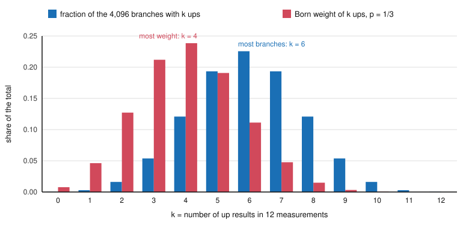

# Philosophy of Physics · Lesson 2.4: Many-worlds II: the probability problem

> ⏱ ~15 min · Module 2: The realist solutions · Builds on: [2.3](02-03-many-worlds-branching.md), [`decision-theory` 1.4](../../decision-theory/lessons/01-04-what-a-representation-theorem-shows.md), [`philosophy-of-science` 1.3](../../philosophy-of-science/lessons/01-03-confirmation-as-probability-raising.md) · Unlocks: [3.1](03-01-epr-and-bells-theorem-the-premises.md), [5.6](05-06-probability-in-statistical-mechanics.md)

## Why this matters

Measure a spin with Born probability 1/3 for up on twelve fresh copies and you will probably see about four ups. [`quantum-mechanics` 1.2](../../quantum-mechanics/lessons/01-02-wavefunction-born-rule.md) handed you that rule as a postulate. On many-worlds, after twelve measurements some successor of you has recorded each of the 4,096 sequences, and most of them, by count, saw about six ups. So why expect four, and why is a record of four evidence for a theory on which every record is made? In [2.3](02-03-many-worlds-branching.md) branching solved the measurement problem; here it threatens probability.

## The idea

Step into a booth that will wake one copy of you in a red room and one in a blue room. Asked beforehand for the chance of waking in red, you might say one half, or that the question has no answer because both happen. Many-worlds puts you in that booth whenever a measurement decoheres, with one twist: the copies differ in weight. One branch carries squared amplitude 1/3, the other 2/3.

That yields three problems. David Wallace named the first two ("Everettian Rationality", 2003). The [incoherence problem](../reference.md#incoherence-problem): when every outcome occurs, what is there to be uncertain about? The [quantitative problem](../reference.md#quantitative-problem): granted some uncertainty, why should it follow squared amplitudes rather than an equal share per branch? The [evidential problem](../reference.md#evidential-problem), pressed by Hilary Greaves and Wayne Myrvold ("Everett and Evidence", 2010): how can observed frequencies confirm a theory on which every frequency is observed?

The tempting answer to the second is [branch counting](../reference.md#branch-counting): each branch holds one of you, so give each the same share. That is indifference applied to branches, and [`epistemology` 5.4](../../epistemology/lessons/05-04-the-problem-of-priors.md) showed indifference is only as good as its partition; [2.3](02-03-many-worlds-branching.md) added that decoherence fixes no exact number of [emergent branches](../reference.md#emergent-branches). The answers below try to earn the [Born weight](../reference.md#born-weight) instead: from rational choice, from self-location, from confirmation.

## The argument

**Setup.** Spin states are $|\text{up}\rangle$ and $|\text{down}\rangle$. Measuring $\alpha|\text{up}\rangle + \beta|\text{down}\rangle$, with $|\alpha|^2 + |\beta|^2 = 1$, leaves two decohered branches with Born weights $w_{\text{up}} = |\alpha|^2$ and $w_{\text{down}} = |\beta|^2$. Repeat on $n$ fresh copies with $p = |\alpha|^2$, idealizing each measurement as splitting every branch in two:

$$N(k) = \binom{n}{k}, \qquad w(k) = \binom{n}{k}\,p^k(1-p)^{n-k},$$

where $N(k)$ counts the branches with $k$ ups among the $2^n$, and $w(k)$ is their total Born weight. *In words:* counting gives every branch the share $2^{-n}$; weighting gives it the product of its squared amplitudes.

The two agree only at $p = \tfrac12$: by the law of large numbers the weight piles up near frequency $p$, the count near $\tfrac12$. Everett (1957) argued that a measure additive under further branching must be squared amplitude, by which almost all branches show quantum statistics; Jeffrey Barrett (SEP) notes that counting is just as consistent and that uniqueness needed further assumptions.

**The decision-theoretic answer.** David Deutsch ("Quantum Theory of Probability and Decisions", 1999) proposed reading probability off rational betting, as [`decision-theory` 2.2](../../decision-theory/lessons/02-02-probability-from-preference.md) reads credence off preference. Wallace (2003, 2007; "How to Prove the Born Rule", 2010; *The Emergent Multiverse*, 2012) made the assumptions explicit. In [`decision-theory` 1.4](../../decision-theory/lessons/01-04-what-a-representation-theorem-shows.md)'s schematic form, for preferences $\succeq_\psi$ over acts (physical operations ending in rewards) available at quantum state $\psi$:

$$\succeq_\psi \text{ satisfies the axioms} \iff \exists\, u:\; U \succeq_\psi V \Leftrightarrow \sum_r w_U(r)\,u(r) \ge \sum_r w_V(r)\,u(r).$$

Here $w_U(r)$ is the total Born weight of the branches in which act $U$ yields reward $r$, and $u$ is unique up to $au + c$ with $a > 0$, as in [`decision-theory` 1.3](../../decision-theory/lessons/01-03-the-vnm-theorem-and-how-utility-is-built.md). *In words:* an agent who obeys the axioms acts exactly as if maximizing expected utility with Born weights as probabilities. This is the [Deutsch–Wallace theorem](../reference.md#deutsch-wallace-theorem).

Wallace's 2010 axioms are four of richness (reward availability, branching availability, erasure, problem continuity) and six of rationality, which carry the argument:

- **Ordering** and [diachronic consistency](../reference.md#diachronic-consistency): if each future self will prefer $V_i$ to $V_i'$ in her branch, the agent now prefers the plan containing the $V_i$. *In words:* `decision-theory` 1.4's dynamic consistency, branch by branch.
- **Macrostate indifference** (not caring which microstate realizes an outcome) and [branching indifference](../reference.md#branching-indifference): a measurement that splits your future into several macrostates, all with the same reward, leaves an act's value unchanged. *In words:* more copies, same payoff, same value.
- **State supervenience** (preferences depend only on the physical state an act produces) and **solution continuity** (tiny changes to acts do not flip preferences).

Hilary Greaves ("Understanding Deutsch's Probability in a Deterministic Multiverse", 2004) argued that the theorem needs no uncertainty: the weights measure how much a rational Everettian should *care* about each successor. Simon Saunders ("Time, Quantum Mechanics, and Probability", 1998) kept uncertainty, arguing from Parfit's fission cases ([`metaphysics` 6.6](../../metaphysics/lessons/06-06-personal-identity-over-time.md)) that one awaiting branching should expect to become one successor or another. David Albert (2010) offers, half in jest, a [fatness rule](../reference.md#fatness-rule) weighting each branch by Born weight times your body mass there; Wallace argues it breaks an axiom. Huw Price and Adrian Kent (both 2010) deny that the axioms are requirements of rationality; Emily Adlam and Jacob Barandes (preprint, 2026) argue that no route to the Born rule can succeed.

**The self-locating answer.** Lev Vaidman ("On Schizophrenic Experiences of the Neutron", 1998): after decoherence and before you look, there is a fact about which branch you are in, and you do not know it. In his sleeping-pill case you are carried, asleep, to room A or B according to the outcome, and asked on waking, eyes closed, which room you are in. That is [self-locating uncertainty](../reference.md#self-locating-uncertainty): ignorance of where you are, not of what happens. Vaidman postulates the number. Charles Sebens and Sean Carroll ("Self-Locating Uncertainty and the Origin of Probability in Everettian Quantum Mechanics", 2018) derive the Born rule as the unique rational credence from the [epistemic separability principle](../reference.md#epistemic-separability-principle): changes purely to the environment do not change the credences you should assign to outcomes in a local subsystem. Equal credence per branch, they argue, is a temptation to resist. Albert objects that the uncertainty arrives "too late", after the bets it should guide; Kent (2015) and Kelvin McQueen with Vaidman (2019), that an observer not yet branched herself has no branch to be unsure of.

**The evidential problem.** Use [`philosophy-of-science` 1.3](../../philosophy-of-science/lessons/01-03-confirmation-as-probability-raising.md)'s measures, writing its credence $P$ as $\mathrm{cr}$:

$$d = \mathrm{cr}(H \mid E) - \mathrm{cr}(H), \qquad r = \ln\frac{\mathrm{cr}(H \mid E)}{\mathrm{cr}(H)}, \qquad l = \ln\frac{\mathrm{cr}(E \mid H)}{\mathrm{cr}(E \mid \neg H)}.$$

If the likelihood of a record $E$ on an Everettian theory is the chance that some successor makes it, it is 1 for every record on every Everettian rival, so $d = r = l = 0$. *In words:* no data could favour one such rival. Greaves and Myrvold build the evidence relation from betting preferences, as Savage builds credence ([`decision-theory` 2.1](../../decision-theory/lessons/02-01-savages-framework.md)); an agent unsure whether her world branches then updates with branch weights in the likelihood slot, and frequencies support Everett with Born weights as strongly as a chance theory with the same numbers. Everett and Bohmian mechanics in [quantum equilibrium](../reference.md#quantum-equilibrium) then have the same observational consequences: [`philosophy-of-science` 2.2](../../philosophy-of-science/lessons/02-02-duhem-quine-and-underdetermination.md)'s empirically equivalent theories. Kent (2010) replies with toy models where branch weights exist but play no role in decision or confirmation.

**Where the argument is weakest.** The bridge from decision weight to probability. The objection (Price; Kent): the analogy with classical decision under uncertainty fails once every outcome occurs. You receive them all, so caring how goods are spread across successors, as Price's agent does who treats them as a just ruler treats subjects, is no error, and the theorem yields a caring measure, not a probability of anything. The reply (Wallace; Greaves; Saunders, "Chance in the Everett Interpretation", 2010): Born weights do everything single-world chance does. They guide action, by the theorem, and are estimated from frequencies, by Greaves and Myrvold; the step from weight to credence is derived, where the single-world step, the [principal principle](../../epistemology/lessons/05-04-the-problem-of-priors.md), is postulated; and most of Price's concern fits into the utility function. The Everettian concedes that "probability" names a role filled, not ignorance of which outcome will happen; the critic, that single-world chance also rests on a postulate linking it to credence.

## The picture

The same 4,096 branches, two measures: counting crowds them near six ups, weighting near four.

## Worked examples

**Example 1 (clean case: two measures on one tree).** Twelve measurements at $p = \tfrac13$ give $2^{12} = 4096$ branches. The count peaks at $k = 6$: $\binom{12}{6} = 924$ branches, 0.226 of them, carrying Born weight 0.111. The weight peaks at $k = 4$: $w(4) = \binom{12}{4}\,2^8/3^{12} = 0.238$, on only $495$ branches, 0.121 of them.

Now the evidential question. Let $H$ be many-worlds with Born weights and $H'$ many-worlds with branch counting, credence divided between just these two, so $\neg H$ is $H'$. Take $E$ to be one particular sequence with 4 ups. Then $\mathrm{cr}(E \mid H) = (\tfrac13)^4(\tfrac23)^8 = 4.817 \times 10^{-4}$ and $\mathrm{cr}(E \mid H') = 2^{-12} = 2.441 \times 10^{-4}$, so

$$l = \ln\frac{2^{20}}{3^{12}} = \ln 1.973 = 0.680.$$

With equal priors, $\mathrm{cr}(H \mid E) = 0.664$, so $d = 0.164$ and $r = 0.283$: all positive, of different sizes. On the some-successor likelihood both are 1 and every measure is 0. Data discriminate only once a measure fills the likelihood slot, and which measure belongs there is the quantitative problem.

**Example 2 (hard case: the Deutsch–Wallace move on a bet).** A spin has amplitudes $\tfrac12$ for up and $\tfrac{\sqrt3}{2}$ for down, so Born weights $\tfrac14$ and $\tfrac34$. The bet pays reward $R$ on up and $S$ on down; set $u(R) = 1$, $u(S) = 0$.

1. *Branching availability.* In the down branch your successor can run a further measurement, $\tfrac{\sqrt3}{2}|\text{down}\rangle \to \tfrac12\big(|d_1\rangle + |d_2\rangle + |d_3\rangle\big)$, three branches each of weight $\tfrac14$, all still paying $S$.
2. *Branching indifference, then diachronic consistency.* That successor does not care whether the split happens, so you are indifferent now between the bet and the bet followed by the split.
3. *Erasure and state supervenience.* Now four branches have equal amplitude. Paying $R$ on $d_1$ instead of on up, then erasing the record of which result was rewarded, leaves the same physical state, so the two acts are worth the same. Equal decision weights summing to 1 give each branch $\tfrac14$.

So the bet is worth $\tfrac14 u(R) + \tfrac34 u(S) = \tfrac14$, the Born weight. A branch counter values it at $\tfrac12$ before the split and $\tfrac14$ after. She must want the down-successor not to split, a preference about a measurement in a branch where she gains nothing, which step 2 forbids.

Here the account stops. The derivation convicts the counter only if branching indifference is a requirement of rationality. Wallace says it is forced: decoherence fixes no branch number, and branching is continuous and uncontrollable, so no strategy sensitive to it can be carried out. Kent replies that in a theory with sharply defined branches, coherent strategies violate the axioms, so the axiom comes from physics, not from reason. The example cannot settle it: it idealizes a definite count of four.

## Watch out

- **You might think branch counting is the neutral default, but actually** it is indifference over one partition, which [`epistemology` 5.4](../../epistemology/lessons/05-04-the-problem-of-priors.md) shows is never neutral, and decoherence does not even fix the partition.
- **You might think the Deutsch–Wallace theorem derives probability from quantum mechanics alone, but actually** it is a representation theorem: agents who obey ten axioms act as if Born weights were probabilities, so its normative force is the axioms'.
- **You might think a Born weight is a frequency, a chance or a credence, but actually** it is a feature of the state that each answer argues into a decision weight, a self-locating credence or a likelihood. Frequencies near it fill most weight, not most branches.
- **You might think self-locating uncertainty is uncertainty about the outcome before the measurement, but actually** it exists only between decoherence and looking: too late, Albert says, for bets made before.

## One-liner

> On many-worlds every outcome happens, so the Born rule must be earned as a rule for betting, for locating yourself or for weighing evidence, and the dispute is whether what earns it is reason or physics in disguise.

## Problems

**P1 (🟢) *(Diagnose. Exegetical, strict.)*** Four complaints about probability on many-worlds (invented, written for this problem, attributed to no one). For each, one line: say which of the incoherence, quantitative and evidential problems it presses, and name one answer from this lesson aimed at it.

(a) "Before the measurement I know for certain that one successor will see up and one will see down. Nothing is hidden from me, so 'one third for up' has no content."

(b) "Grant that I can be unsure which successor I will be. The two are alike in everything either could detect from inside, so why not one half each?"

(c) "Labs report frequencies near the Born values and call that support for quantum mechanics. On this theory some lab reports every frequency, so the theory would have welcomed any report at all."

(d) "Even if, after the sleeping pill, I am unsure which room I am in, I had to decide on the bet before the measurement, when nothing was unknown to me."

**P2 (🟡) *(Formal model. Formal (a) · Exegetical (b).)*** A spin with Born weight $p = \tfrac14$ for up is measured on $n = 8$ fresh copies. Treat each measurement as turning every existing branch into one up-branch and one down-branch. Call a branch *Born-typical* if its frequency of up satisfies $|k/8 - \tfrac14| \le \tfrac18$, endpoints included.

(a) Compute the fraction of branches that are Born-typical and the total Born weight of those branches, each as an exact fraction and to three decimals. Show the computation; a calculator is fine.

(b) Hold the band fixed and let $n$ grow. In three sentences: what happens to each number, and what does the gap show an Everettian must justify?

**P3 (🔴) *(Steelman and reply. Evaluative.)*** Albert's *fatness rule*: weight each branch by its Born weight times your body mass in that branch, renormalize, and maximize expected utility with those weights.

(a) Steelman the rule as a counterexample to the claim that the Deutsch–Wallace theorem shows the Born rule to be rationally required.

(b) Give the strongest Everettian reply: name the axiom the fatness agent violates, show the violation in a concrete case, and say what the reply concedes.

150 words or fewer in all.

Solutions

**P1** *(Exegetical, strict)*

**Accept:** for each part, any one of the answers listed for it; for (d), the label "incoherence" given as an objection to the self-locating answer.

**Must hit, strict:**

- (a) Incoherence: with every outcome certain to occur, nothing seems left to be uncertain about. Answers: Greaves's caring measure (no uncertainty needed), Saunders's subjective uncertainty, or Vaidman's self-location after branching.

- (b) Quantitative: uncertainty is granted; the question is why squared amplitudes rather than an equal share per branch. Answers: the Deutsch–Wallace theorem (branching indifference rules counting out) or Sebens and Carroll's epistemic separability principle.

- (c) Evidential: if the likelihood is "some branch records it", every record has likelihood 1, so no record confirms. Answer: Greaves and Myrvold, branch weights in the likelihood slot (Kent's toy models press back).

- (d) Incoherence, aimed at the self-locating answer: the uncertainty exists only after the measurement, too late for a decision made before. This is Albert's objection; Greaves's caring measure is one way around it, since it needs no uncertainty at any time.

**Wrong turns:** calling (b) incoherence because it mentions uncertainty; it grants that uncertainty makes sense and asks for the number. Calling (c) quantitative: it asks whether any record could be evidence, not which measure is right. Calling (d) evidential because it mentions a bet.

**Model answer:** (a) Incoherence; Greaves's caring measure. (b) Quantitative; the Deutsch–Wallace theorem. (c) Evidential; Greaves and Myrvold's weighted likelihoods. (d) Incoherence, as Albert's "too late" objection to Vaidman; Greaves's caring measure avoids it.

---

**P2** *(Formal (a) · Exegetical (b))*

(a) $|k/8 - \tfrac14| \le \tfrac18$ means $\tfrac18 \le k/8 \le \tfrac38$, so $k \in \{1, 2, 3\}$. There are $2^8 = 256$ branches, with $\binom{8}{1} = 8$, $\binom{8}{2} = 28$, $\binom{8}{3} = 56$ of them at $k = 1, 2, 3$:

$$\text{count fraction} = \frac{8 + 28 + 56}{256} = \frac{92}{256} = \frac{23}{64} \approx 0.359.$$

Each branch with $k$ ups has weight $(\tfrac14)^k(\tfrac34)^{8-k} = 3^{8-k}/4^8$, and $4^8 = 65536$:

$$w = \frac{8 \cdot 3^7 + 28 \cdot 3^6 + 56 \cdot 3^5}{65536} = \frac{17496 + 20412 + 13608}{65536} = \frac{51516}{65536} = \frac{12879}{16384} \approx 0.786.$$

(b) As $n$ grows the count fraction falls toward 0, because the count concentrates near frequency $\tfrac12$, which is $\tfrac14$ away from $p$ and so outside the band; it is 0.0769 at $n = 40$. The Born weight rises toward 1 by the law of large numbers; it is 0.958 at $n = 40$. So records like ours are typical by weight and atypical by count, and the Everettian must justify treating squared amplitude, not the count, as the measure that sets credence and counts as typical: the quantitative problem.

**Must hit, strict:**

- The band as $k \in \{1, 2, 3\}$, endpoints included.
- $23/64 \approx 0.359$ and $12879/16384 \approx 0.786$, with the sums shown.
- Count fraction toward 0 and Born weight toward 1, each with its reason.
- The gap as the quantitative problem: the measure, not the branching, must be justified.

**Wrong turns:** dropping $k = 1$ or $k = 3$ by reading the band as strict. Weighting the count fraction by $p$: counting gives every branch the same share. Saying the count fraction "also tends to 1 more slowly": it tends to 0 for any band that excludes $\tfrac12$.

---

**P3** *(Evaluative)*

**Must hit, any verdict:**

- (a) The rule is well defined, gives a probability measure, and does not depend on branch number, so the reply that branch number is undefined does not touch it. If every outcome occurs there is no further fact for a weighting to track, so it is the axioms that must be shown to bind.
- (b) It violates diachronic consistency. A concrete case: after a win, a successor is indifferent to dieting, but the agent now wants winning successors to gain mass and losing ones to lose it, so she plans against her own successors' choices; branching is everywhere, so the conflict is too.
- What the reply concedes: the theorem binds only as far as diachronic consistency does, a norm Wallace defends by what acting over time requires, not by logic (compare the sequential-choice premises of [`decision-theory` 1.4](../../decision-theory/lessons/01-04-what-a-representation-theorem-shows.md)); and the fatness agent is coherent at any one time.

**Wrong turns:** naming branching indifference; the rule ignores branch number. Calling the agent incoherent at a time; her weights obey the probability axioms. Ending with "so the Born rule is right" or "so the theorem fails" without the concession.

**Model answer, one of several:** (a) The fatness rule is well defined and coherent at every moment, and unlike counting it ignores branch number, so the vagueness of branching cannot rule it out. If every outcome happens there is no chance for credence to track, so any coherent weighting is a rival, and the theorem must show its axioms bind. (b) Wallace: it breaks diachronic consistency. After a win the successor is indifferent to dieting, but the agent now wants that successor heavier, and after a loss lighter, so she would pay to overrule her own future choices, in every branch, every time. That concedes the derivation is only as strong as diachronic consistency, defended by what agency over time needs rather than by logic, and that the agent is coherent at each moment.

## Flashback

**From Lesson [2.2](02-02-collapse-theories-grw-and-csl.md) (Collapse theories: GRW and CSL):** *(Formal (a) · Exegetical (b).)* A dust grain of mass $1.0\times10^{-12}$ kg is put in an equal superposition of two positions $1\ \mu\mathrm m$ apart, ten localization widths $a = 10^{-7}$ m. Use the mass-proportional [localization rate](../reference.md#localization-rate), $\lambda_{\rm GRW} = 10^{-16}\,\mathrm{s}^{-1}$ per nucleon, neglect electrons, and take $m_N = 1.6726\times10^{-27}$ kg.

(a) Find the grain's hit rate, the mean time until the superposition is settled, and the probability that it survives one second. Then give the mean time at Adler's rate, $10^{-7}\,\mathrm{s}^{-1}$ per nucleon. What does the comparison show about where GRW draws the line between micro and macro? Show the computation.

(b) Adler wanted collapse to finish in the eye's rods. Which counterexample to [amplification](../reference.md#amplification) makes the eye matter, how do Aicardi and colleagues answer it at GRW's own rate, and what does each side concede? Three sentences.

Solution

(a) The grain holds $N = 1.0\times10^{-12}/1.6726\times10^{-27} = 5.98\times10^{14}$ nucleons, each displaced by $10a$, so any one hit settles it (amplification). Hits arrive at

$$N\lambda_{\rm GRW} = 5.98\times10^{14}\times10^{-16}\,\mathrm{s}^{-1} = 0.0598\,\mathrm{s}^{-1},$$

a mean wait of $1/0.0598 = 16.7$ s and a one-second survival probability of $e^{-0.0598} = 0.942$. At Adler's rate, $N\lambda = 5.98\times10^{7}\,\mathrm{s}^{-1}$ and the mean wait is $1.67\times10^{-8}$ s. There is no cut, only a crossover set by rate times number displaced: at GRW's rate the grain stays superposed for seconds, far from both the lone particle and the pointer; at Adler's it is settled in about 17 ns.

**Must hit, strict (a):** $5.98\times10^{14}$; $0.0598\,\mathrm{s}^{-1}$; 16.7 s; 0.942; $1.67\times10^{-8}$ s; one hit settles because every nucleon moves more than $a$; the line set by parameters, not an observer.

**Must hit, strict (b):** the fluorescent-screen case; displacements below $a$ and photons, which hits do not touch; the nerve-signal reply; both concessions.

**Accept:** adding that experiments have since excluded Adler's rate, at least with white noise.

**Wrong turns:** using $\lambda_{\rm GRW}$ for the whole grain; giving the half-life, $16.7\ln 2 = 11.6$ s, as the mean; reading Aicardi and colleagues as giving the mind a role.

**Model answer (b):** Albert and Vaidman (1989): a particle lands on one of two spots of a fluorescent screen, exciting a few atoms over less than $a$, whose photons hits do not touch, so nothing separates the branches before an eye registers a few photons. Aicardi and colleagues (1991): the nerve signal to the visual cortex moves enough ions to collapse within the time of perception, so the brain is just the first macroscopic displacer; a spark chamber would serve as well. The defender concedes that the outcome becomes definite inside the observer; the critic, that no consciousness is invoked.

## Connections

- **Backward:** [2.3](02-03-many-worlds-branching.md) made branches emergent with no exact count, the fact Wallace uses against counting. [`quantum-mechanics` 1.2](../../quantum-mechanics/lessons/01-02-wavefunction-born-rule.md) postulated the Born rule that this lesson tries to earn. [`epistemology` 5.4](../../epistemology/lessons/05-04-the-problem-of-priors.md) supplied indifference and its partition dependence, and the principal principle the Everettian claims to derive.
- **Forward:** [3.1](03-01-epr-and-bells-theorem-the-premises.md) and [3.2](03-02-what-bell-rules-out.md) need many-worlds' denial of single outcomes and the weights that keep its statistics quantum. [5.6](05-06-probability-in-statistical-mechanics.md) asks of the statistical-mechanical measure what this lesson asked of squared amplitude, beside Bohmian typicality from [2.1](02-01-bohmian-mechanics.md): where does the measure come from?
- **Sideways:** the Deutsch–Wallace theorem is the same move as the representation theorems of [`decision-theory` 1.3](../../decision-theory/lessons/01-03-the-vnm-theorem-and-how-utility-is-built.md) and [2.2](../../decision-theory/lessons/02-02-probability-from-preference.md), probabilities derived from rational preference, and inherits [`decision-theory` 1.4](../../decision-theory/lessons/01-04-what-a-representation-theorem-shows.md)'s question of what such a theorem shows. Saunders's subjective uncertainty borrows the fission cases of [`metaphysics` 6.6](../../metaphysics/lessons/06-06-personal-identity-over-time.md). The some-successor likelihood of 1 has the shape of Sober's observation-selection objection in [`philosophy-of-religion` 3.2](../../philosophy-of-religion/lessons/03-02-fine-tuning-the-objections.md), where a likelihood of 1 on every hypothesis also cancels the inference.
