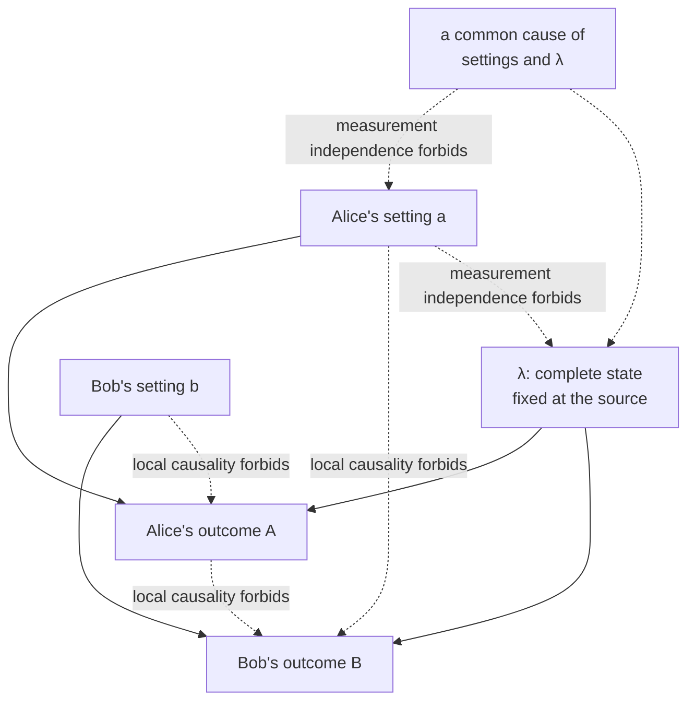

# Philosophy of Physics · Lesson 3.1: EPR and Bell's theorem: the premises

> ⏱ ~15 min · Module 3: Bell's theorem and nonlocality · Builds on: [2.1](02-01-bohmian-mechanics.md), [`quantum-mechanics` 5.3](../../quantum-mechanics/lessons/05-03-bell-inequality-nonlocality.md), [`quantum-computing` 2.6](../../quantum-computing/lessons/02-06-the-chsh-game-and-device-independence.md) · Unlocks: [3.2](03-02-what-bell-rules-out.md), [3.3](03-03-nonlocality-and-relativity.md)

## Why this matters

In 2015 a Delft team measured electron spins 1.3 km apart and, over 245 trials, found $S = 2.42 \pm 0.20$ against a ceiling of 2 (Hensen et al.; the experiments are in [`photonics-quantum-optics` 4.4](../../photonics-quantum-optics/lessons/04-04-entangled-photons-bell-tests.md)). A violated inequality refutes a conjunction, so what the result means depends on the list of premises. [`quantum-computing` 2.6](../../quantum-computing/lessons/02-06-the-chsh-game-and-device-independence.md) P2 lists two, locality and realism. This lesson rebuilds the list: the mature theorem needs neither 2.6's "realism" nor hidden variables as premises, and needs two that no sibling names.

## The idea

In 1935 Einstein, Boris Podolsky and Nathan Rosen (EPR) pointed to a pair of particles so correlated that measuring one lets you predict the other with certainty, without touching it. If you can predict a distant value without disturbing anything, they argued, the value was there already; quantum mechanics assigns no such values, so it leaves something out. [`quantum-mechanics` 5.3](../../quantum-mechanics/lessons/05-03-bell-inequality-nonlocality.md) told this as gloves mailed in two boxes.

John Bell (1964) granted EPR their missing values and asked what they predict when the two sides measure *different* quantities. Picture two exam candidates in separate rooms who may agree a plan beforehand but not talk afterwards ([`quantum-computing` 2.6](../../quantum-computing/lessons/02-06-the-chsh-game-and-device-independence.md) plays this as the CHSH game). Their joint score has a ceiling resting on more than "no talking". Each candidate writes one answer. The plan was not fitted to the questions the examiner will ask. And once you know the whole plan, one candidate's answer tells you nothing further about the other's. Entangled particles beat the ceiling, so one of those assumptions fails in our world; [3.2](03-02-what-bell-rules-out.md) asks which one each interpretation gives up.

## The argument

**EPR's ingredients** ("Can Quantum-Mechanical Description of Physical Reality Be Considered Complete?", 1935), paraphrased.

- *Completeness, a necessary condition.* A complete theory contains a counterpart for each element of physical reality. *In words:* a theory silent about something real is incomplete.

- *The [criterion of reality](../reference.md#criterion-of-reality), a sufficient condition.* If we can predict a quantity's value with certainty, by a procedure that does not disturb the system ("without in any way disturbing" is EPR's phrase), then an element of reality corresponds to that quantity. *In words:* certainty obtained at a distance reveals something already there.

- *Separability and locality* (assumed without comment on p. 779). Systems far apart each have their own real state, and a measurement on one makes no real change in the other. *In words:* what is real over there does not depend on what I do over here.

From these, EPR concluded that quantum mechanics is incomplete ([the EPR argument](../reference.md#epr-argument); Example 1 runs it). Einstein later recast it as a dilemma: incomplete or nonlocal.

**Bell's set-up.** Alice chooses setting $a$ or $a'$, Bob $b$ or $b'$; outcomes are $A, B \in \{+1, -1\}$. Let $\lambda$ be the complete state of the pair at the source: whatever the theory says fixes the probabilities of later events, whether the quantum state alone or the state plus [hidden variables](../reference.md#hidden-variables). Its distribution is $p(\lambda)$ ($\rho$ is kept for density matrices). The correlation is $E(a,b) = \sum_{A,B} AB\,P(A,B\mid a,b)$, and

$$S = E(a,b) - E(a,b') + E(a',b) + E(a',b'),$$

the convention of `quantum-mechanics` 5.3. `quantum-computing` 2.6 subtracts a different term; reading its inputs $x = 0, 1$ as $a', a$ and $y = 0, 1$ as $b, b'$ turns its $S$ into this one.

**P1. [Single outcomes](../reference.md#single-outcomes).** Each run ends with exactly one value of $A$ and one of $B$. *In words:* every run has a result, so $E$ averages one product per run.

**P2. [Local causality](../reference.md#local-causality)** (Bell, "The Theory of Local Beables", 1976; "La nouvelle cuisine", 1990). The probability of an event, given a complete specification of what happens in its past light cone, is unchanged by further information about events at spacelike separation. In this experiment it yields [factorizability](../reference.md#factorizability):

$$P(A,B\mid a,b,\lambda) = P(A\mid a,\lambda)\,P(B\mid b,\lambda).$$

*In words:* once the complete state is fixed, Bob's setting and result tell you nothing more about Alice's result, and conversely.

**P3. [Measurement independence](../reference.md#measurement-independence).** $p(\lambda\mid a,b) = p(\lambda)$. *In words:* the population of complete states is the same whichever settings get chosen.

**Step 1: deterministic models.** Suppose each $\lambda$ fixes all four outcomes, $A = A(a,\lambda)$, $A' = A(a',\lambda)$, $B = B(b,\lambda)$, $B' = B(b',\lambda)$, each $\pm 1$. P1 makes each a single number; P2 keeps $A$ from depending on Bob's setting. Then

$$S_\lambda = AB - AB' + A'B + A'B' = A(B - B') + A'(B + B') = \pm 2,$$

because one bracket is $0$ and the other $\pm 2$. Of the 16 deterministic strategies, 8 give $+2$ and 8 give $-2$ (`quantum-computing` 2.6 Example 1 enumerates them as game strategies; `quantum-mechanics` 5.3 gives this proof).

**Step 2: mixtures, where P3 enters.** $S = \sum_\lambda p(\lambda) S_\lambda$, so $|S| \le 2$. The four correlations come from four different sets of runs; writing all four with one $p(\lambda)$ *is* measurement independence. With $p(\lambda \mid a,b)$ the sum $\sum_\lambda [\,p(\lambda\mid a,b)AB - p(\lambda\mid a,b')AB' + \dots]$ no longer regroups into $\sum_\lambda p(\lambda)S_\lambda$, and the bound is gone. All three sibling proofs take this step silently.

**Step 3: chancy outcomes add nothing.** Given a factorizable model, enlarge $\lambda$ to $(\lambda, u, v)$ with $u, v$ uniform on $[0,1]$, independent of each other and of the settings, and set $A = +1$ exactly when $u < P(A{=}{+1}\mid a,\lambda)$, and likewise $B$ with $v$. Independence of $u$ and $v$ reproduces P2's product, so this deterministic model has the same statistics and Steps 1 and 2 apply. Arthur Fine ("Hidden Variables, Joint Probability, and the Bell Inequalities", 1982) proved the full equivalence for this experiment, given setting-independent marginals: a deterministic model exists if and only if a factorizable stochastic one does, if and only if one joint distribution over all four quantities reproduces the observed pair statistics, if and only if the Bell inequalities hold (the [CHSH inequality](../reference.md#chsh-inequality) with the minus sign in each of the four places). This is [Fine's theorem](../reference.md#fines-theorem); its joint-distribution clause is `quantum-mechanics` 5.3's "joint distributions that don't exist".

**∴ C.** No theory satisfying P1–P3 gives $|S| > 2$. The singlet gives $E = -\cos\theta_{ab}$ and $|S| = 2\sqrt2$ at `quantum-mechanics` 5.3's angles, the most any quantum state allows ([Tsirelson's bound](../reference.md#tsirelson-bound), Cirel'son 1980), and experiment agrees. *In words:* at least one of single outcomes, local causality and measurement independence is false of our world.

Two things are absent. [Outcome determinism](../reference.md#outcome-determinism), `quantum-computing` 2.6's "realism", is used in Step 1 and discharged by Step 3; Bell's 1964 paper derived it (Example 1). "Hidden variables" names one way of making $\lambda$ complete, not a premise (Example 2). Two premises were buried: P3, made explicit by Bell after Shimony, Horne and Clauser's 1976 comment, and P1, visible once [many-worlds](../reference.md#many-worlds-interpretation) denies it.

**Where the argument is weakest.** P2's passage from relativity to factorizability. On the SEP entry's analysis, local causality joins two ideas: causes lie in the past light cone, and Reichenbach's common-cause principle, that correlated events not causally linked are screened off by a common cause. The strongest objection (van Fraassen, "The Charybdis of Realism", 1982; Fine, "Do Correlations Need to Be Explained?", 1989): relativity licenses only the first; the second is a demand for explanation, so a violation shows that some correlations lack a common cause, not that anything acts at a distance. The strongest reply is Bell's ("Bertlmann's Socks and the Nature of Reality", 1981): science treats correlations as calling for explanation, and a theory that leaves distant correlations brute has declined the question, not shown itself local. The critic concedes that nothing local explains the correlations; Bell's side concedes that factorizability says more than the light cone, and Bell warned that sharpening his intuitive principle into mathematics deserved suspicion.

## Argument map

Solid arrows are allowed influences; each dashed arrow is one the named premise forbids, and single outcomes says each outcome box holds one value per run.

## Worked examples

**Example 1 (clean case: EPR on the singlet).** David Bohm's version (*Quantum Theory*, 1951, §§22.15–22.18) uses the singlet $|\Psi^-\rangle = \tfrac{1}{\sqrt2}(|{\uparrow\downarrow}\rangle - |{\downarrow\uparrow}\rangle)$ of [`quantum-mechanics` 5.2](../../quantum-mechanics/lessons/05-02-tensor-products-entanglement.md), which gives opposite results whenever both sides measure along one axis.

- Alice measures spin along $z$ and gets $+1$, so she can predict with certainty, without touching Bob's particle, that his $z$-result will be $-1$. By the criterion, his $z$-spin is an element of reality; had she measured $x$, his $x$-spin would be.

- By separability and locality, Bob's real state is the same whichever axis Alice chose, so both spins are elements of reality at once.

- No spin state is an eigenstate of both $\sigma_z$ and $\sigma_x$, so by the completeness condition quantum mechanics is incomplete.

Inside Bell's framework, let $p = P(A{=}{+1}\mid z,\lambda)$ and $q = P(B{=}{+1}\mid z,\lambda)$. With factorizability, perfect anticorrelation needs $pq = 0$ and $(1-p)(1-q) = 0$ for (almost) every $\lambda$, since both are non-negative and average to zero. The only solutions are $(p, q) = (1, 0)$ and $(0, 1)$: each $\lambda$ fixes Alice's $z$-result and Bob's opposite one, and likewise for any axis. This is Bell's 1964 route (Suppes and Zanotti, 1976, proved it in general): pre-set values follow from locality plus perfect correlation. Such tables reproduce every same-axis correlation ([`quantum-computing` 2.1](../../quantum-computing/lessons/02-01-bell-states-and-generating-entanglement.md) Example 1).

**Example 2 (hard case: what "complete" does).** A source flips a fair coin and tells both particles to answer $+1$ on heads and $-1$ on tails, whatever the settings: nothing nonlocal happens. Yet conditional on a description that omits the coin, $P(+,+) = \tfrac12$ while $P(A{=}{+1})\,P(B{=}{+1}) = \tfrac14$: factorizability fails. So factorizability tests locality only when conditioned on a *complete* specification, which is why Bell (1990) demands a full specification of the [local beables](../reference.md#local-beables), the things the theory says physically exist, in a region of each event's past light cone that shields it from the other's past.

Now take orthodox quantum mechanics at its word and let $\lambda$ be $|\Psi^-\rangle$ itself. At equal settings $P(A{=}{+1}\mid\lambda) = P(B{=}{+1}\mid\lambda) = \tfrac12$, but $P(+,+\mid\lambda) = 0 \ne \tfrac14$. By its own completeness claim, orthodox quantum mechanics violates local causality; the theorem shows that no added variables restore it. EPR's dilemma, incomplete or nonlocal, becomes nonlocal in Bell's sense either way, given P1 and P3.

**Where it strains.** Local causality presupposes that a theory names its local beables. Bohm's particle positions ([2.1](02-01-bohmian-mechanics.md)) and GRW's flashes ([2.2](02-02-collapse-theories-grw-and-csl.md)) qualify. On QBism ([1.3](01-03-copenhagen-qbism-and-relational-views.md)) the quantum state is an agent's degrees of belief, and the Copenhagen physicist declines to say what happens between preparation and record, so a complete specification of the past light cone has no agreed content. Bell's side answers that a theory silent about beables cannot claim to be local either; the QBist answers that the theorem's $\lambda$ is not part of their theory. Until the beables are named, the account gives no verdict.

## Watch out

- **You might think** Bell assumed "realism", pre-existing values, as a separate premise, so that dropping it saves locality, **but actually** factorizability allows chancy outcomes (Step 3), and the 1964 version derived the values from locality and perfect correlation (Example 1). Whether some other sense of "realism" is presupposed is [3.2](03-02-what-bell-rules-out.md)'s dispute.

- **You might think** factorizability is [no-signalling](../reference.md#no-signalling), **but actually** no-signalling constrains what you can observe, marginals averaged over $\lambda$, while factorizability constrains probabilities given $\lambda$. Quantum mechanics violates the second and respects the first ([3.3](03-03-nonlocality-and-relativity.md)).

- **You might think** Bell refuted hidden variables, as the 2022 Nobel press release puts it, **but actually** Bohmian mechanics ([2.1](02-01-bohmian-mechanics.md)) is a hidden-variable theory that reproduces the quantum statistics. What fails is local causality, given P1 and P3.

- **You might think** measurement independence is the assumption that experimenters have free will, **but actually** it needs only that whatever fixes the settings (a random-number generator, a keystroke, starlight) be statistically independent of $\lambda$. Freedom in the sense of [`metaphysics` 6.1](../../metaphysics/lessons/06-01-determinism-and-the-consequence-argument.md) is a different question.

## One-liner

> Bell's bound follows from single outcomes, local causality (factorizability given the complete state) and measurement independence, with neither pre-set values nor hidden variables as premises, so its violation forces a choice among those three.

## Problems

**P1 (🟢)** *(Reconstruct: Exegetical (a)–(b).)* EPR's own example uses two particles that have interacted so that their total momentum along $x$ is zero and their $x$-positions are correlated: measuring either quantity on Albert's particle lets you predict the same quantity on Niels's particle with certainty.

(a) Reconstruct EPR's argument for this example in at most six numbered premises and a conclusion. Mark the premise that is the criterion of reality and the one (or ones) expressing separability and locality.

(b) A popular version, which Fine's SEP entry on the EPR argument traces to Bohr's 1935 summary, runs as follows. Albert may freely choose to measure position or momentum; either way, Niels's corresponding quantity is real; so both are real. Say why the conclusion does not follow from the criterion alone, and which of your premises repairs it. Two sentences.

**P2 (🟡)** *(Formal model: Formal (a)–(c).)* A source draws $\lambda = (s, k)$, with $s \in \{+1, -1\}$ and $k \in \{0, 1\}$, the four values equally likely and drawn independently of the settings. Each run gives one outcome on each side:

- Alice, at either setting: $A = s$.

- Bob at $b$: $B = s$.

- Bob at $b'$: $B = -s$ if Alice's setting is $a$; $B = s$ if Alice's setting is $a'$ and $k = 0$; $B = -s$ if Alice's setting is $a'$ and $k = 1$.

(a) Compute the four correlations and $S = E(a,b) - E(a,b') + E(a',b) + E(a',b')$. Show the computation.

(b) Which of the lesson's three premises (single outcomes, local causality, measurement independence) does the model violate? Exhibit one value of $\lambda$ and Bob's setting for which Alice's choice changes Bob's outcome. Two sentences.

(c) Compute $P(B{=}{+1})$ at $b'$ when Alice chooses $a$ and when she chooses $a'$. Could Alice use the model to send Bob a message? Then say in one sentence what the model shows about violating local causality and signalling.

**P3 (🔴)** *(Find the crux: Exegetical (a) · Evaluative (b).)* Bohr replied to EPR in 1935 under the same title, saying their criterion is ambiguous about the words "without in any way disturbing".

(a) On Fine's reading in the SEP entry on the EPR argument, what does Bohr concede about Albert's measurement and Niels's system, and what does he claim instead? Name the premise of your reconstruction in P1(a) that the claim denies. Two sentences.

(b) Name the crux between Einstein and Bohr as one premise, and say what argument or evidence would move each side, including whether Bell's theorem does. Any verdict; 150 words or fewer.

Solutions

**P1** *(Exegetical (a)–(b).)*

**Must hit, strict (a):**

- A completeness condition: a complete theory has a counterpart for every element of reality.

- The criterion of reality, marked: certain prediction without disturbance suffices for an element of reality.

- The set-up premise: measuring Albert's position (momentum) lets you predict Niels's position (momentum) with certainty.

- Separability and locality, marked: Niels's particle has its own real state, and nothing done to Albert's particle changes it.

- The quantum premise: no wave function assigns definite values to both position and momentum.

- Conclusion: quantum mechanics is incomplete. The step to "both are real at once" must go through separability and locality.

**Must hit, strict (b):** the criterion, applied to whichever measurement is actually made, yields the reality of only one quantity in that run, and the two measurements cannot be made together, so the freedom to choose gives one or the other, never both. Separability and locality repair it: Niels's real state is the same whichever measurement Albert chooses, so it contains both elements at once.

**Wrong turns:** concluding that quantum mechanics is false, or that there is action at a distance (EPR conclude incompleteness and assume locality); treating the criterion as a definition of reality, necessary as well as sufficient; leaving out separability, without which "Niels's real state" has no subject; placing the quantum premise before the criterion has been applied.

**Model answer:** (a) **P1** A complete theory has a counterpart for every element of physical reality. **P2 (criterion of reality)** If, without disturbing a system, we can predict a quantity's value with certainty, an element of reality corresponds to it. **P3** In EPR's state, measuring the position of Albert's particle lets us predict the position of Niels's with certainty, and likewise for momentum. **P4 (separability)** Far apart, each particle has its own real state. **P5 (locality)** No measurement on Albert's particle changes the real state of Niels's. **P6** No wave function assigns definite values to both position and momentum. From P2 and P3, whichever quantity Albert measures, the corresponding quantity of Niels's particle is real; by P4 and P5, Niels's real state is the same either way, so both are real at once. **∴ C** By P1 and P6, the quantum description is incomplete. (b) The criterion gives the reality of position in a run where Albert measures position and of momentum in a run where he measures momentum, never both in one run, since the two measurements are incompatible. P4 and P5 supply the missing step: what is real about Niels's particle does not depend on Albert's choice, so it holds both elements together.

---

**P2** *(Formal (a)–(c).)*

(a) Each $\lambda$ has probability $\tfrac14$, and $s^2 = 1$.

- $E(a,b) = \langle s \cdot s\rangle = 1$.

- $E(a,b') = \langle s\cdot(-s)\rangle = -1$.

- $E(a',b) = \langle s\cdot s\rangle = 1$.

- $E(a',b')$: for $k = 0$ the product is $s \cdot s = 1$; for $k = 1$ it is $s\cdot(-s) = -1$; so $E(a',b') = \tfrac12(1) + \tfrac12(-1) = 0$.

$$S = 1 - (-1) + 1 + 0 = 3.$$

(b) Local causality. Take $\lambda = (+1, 0)$ with Bob at $b'$: $B = -1$ if Alice chooses $a$ and $B = +1$ if she chooses $a'$, so $P(B\mid b', \lambda)$ depends on Alice's distant setting and factorizability fails. Measurement independence holds by construction ($\lambda$ is drawn independently of the settings) and single outcomes hold (one $A$ and one $B$ per run).

(c) If Alice chooses $a$, $B = -s$, so $P(B{=}{+1}) = \tfrac12$. If she chooses $a'$, $B = s$ for $k = 0$ and $-s$ for $k = 1$, so again $P(B{=}{+1}) = \tfrac12$. At $b$, $P(B{=}{+1}) = P(s{=}{+1}) = \tfrac12$ under either choice. Bob's frequencies never depend on Alice's setting, so she cannot signal: the dependence is hidden because Bob cannot know $s$. A theory can violate local causality outright without permitting signalling.

**Must hit, strict:** the four correlations $1, -1, 1, 0$ and $S = 3$, with the minus sign on $E(a,b')$ applied; local causality identified as the failed premise, with a witness $\lambda = (\pm1, 0)$ at $b'$; single outcomes and measurement independence checked and shown to hold; both marginals at $b'$ equal to $\tfrac12$; no signal.

**Accept:** naming the failure "parameter dependence" or "Bob's outcome depends on Alice's setting" ([3.2](03-02-what-bell-rules-out.md) names it); noting that $S = 3$ exceeds Tsirelson's $2\sqrt2 \approx 2.83$, so no quantum system reproduces these correlations either.

**Wrong turns:** dropping the minus sign and getting $S = 1$; averaging $E(a',b')$ over $s$ only and getting $\pm 1$; blaming measurement independence because Bob's rule mentions Alice's setting (that is the outcome depending on a distant setting, not $\lambda$ depending on the settings); concluding from the failure of P2 that the model must signal.

---

**P3** *(Exegetical (a) · Evaluative (b).)*

**Must hit, strict (a):**

- Concedes: there is no mechanical disturbance of Niels's system by Albert's measurement.

- Claims: Albert's measurement influences the very conditions that define what kinds of prediction can be made about Niels's system, and those conditions belong to what "physical reality" covers.

- So Bohr denies locality (P5 in the model reconstruction) for reality in his enlarged sense: Albert's choice changes what is real of Niels's system, and the criterion's no-disturbance clause is not met.

**Accept:** locating the denial in the criterion's application ("the prediction is not made without disturbing the system") rather than in P5, if the answer says the disturbance is to the defining conditions, not a mechanical one. **Accept** the relational reading the same entry offers as an alternative (quantities are relations to a measuring context, so Niels's particle has no position until a position context is set), if labelled as the alternative.

**Must hit, any verdict (b):**

- State the crux as one premise: whether what is real about a system is fixed by what is local to it (separability with locality) or depends on the whole experimental arrangement, distant parts included.

- Say what bears on Einstein's side: Bell shows that a completion keeping local causality must give up single outcomes or measurement independence, and experiment agrees with quantum mechanics. Note that Einstein's locality concerns real states, Bell's concerns outcome probabilities.

- Say what bears on Bohr's side: Bell's theorem targets theories with a complete state $\lambda$, which Bohr does not offer, so it does not refute him directly; what would press him is an argument that the "conditions" must be physical, which makes his reply a distant influence by his own lights.

**Wrong turns:** "Bell proved Bohr right" (Bell tests a premise set, not complementarity, and Bell's reading is that orthodox quantum mechanics is itself not locally causal, Example 2); "Bohr showed the measurement disturbs Niels's particle" (he denies any mechanical disturbance); treating the crux as whether quantum predictions are correct, which both accept.

**Model answer (b), one of several:** The crux is separability with locality: is Niels's physical reality settled by facts at Niels's particle, or does it include the arrangement at Albert's end? Einstein needs the first to get both elements of reality; Bohr denies it by folding the defining conditions into reality. Bell's theorem moves Einstein's side most: any completion that keeps outcomes local, single and independent of settings contradicts quantum statistics, which experiment confirms, so keeping his locality now costs single outcomes or measurement independence. Bell does not refute Bohr, who offers no $\lambda$ to factorize, but it sharpens the question he left: if the defining conditions are physical, his reply is a distant influence after all; if they are not, his reply is semantic and needs the relational story of 1.3. Evidence would not settle that; an account of what Bohr counts as real would.

## Flashback

**From Lesson [2.3](02-03-many-worlds-branching.md) (Many-worlds I: branching):** *(Formal (a) · Exegetical (b).)* A $z$-measurement on the spin $\tfrac{1}{\sqrt{10}}|{\uparrow}\rangle + \tfrac{3}{\sqrt{10}}|{\downarrow}\rangle$ leaves, spin first,

$$|\Psi\rangle = \tfrac{1}{\sqrt{10}}\,|{\uparrow}\rangle|E_\uparrow\rangle + \tfrac{3}{\sqrt{10}}\,|{\downarrow}\rangle|E_\downarrow\rangle,$$

with normalized records whose overlap $\eta = \langle E_\uparrow|E_\downarrow\rangle$ is real.

(a) By 2.3's E3, find the spin's normalized [relative state](../reference.md#relative-state) with respect to $|E_\uparrow\rangle$ when $\eta = \tfrac13$. Then take orthogonal records ($\eta = 0$) and find the spin's state relative to the device state $|D\rangle = (|E_\uparrow\rangle + |E_\downarrow\rangle)/\sqrt2$. Show the computation.

(b) E1–E3 assign a relative state to every device state, and Everett named no preferred basis. Which premise of Wallace's reconstruction keeps both of (a)'s results from counting as outcomes, and how does it deal with each? Two sentences.

Solution

(a) E3 applies $I \otimes \langle E_\uparrow|$, and the overlap enters through $\langle E_\uparrow|E_\downarrow\rangle = \eta$:

$$(I\otimes\langle E_\uparrow|)\,|\Psi\rangle = \tfrac{1}{\sqrt{10}}\,|{\uparrow}\rangle + \tfrac{3\eta}{\sqrt{10}}\,|{\downarrow}\rangle = \tfrac{1}{\sqrt{10}}\big(|{\uparrow}\rangle + |{\downarrow}\rangle\big) \quad \text{at } \eta = \tfrac13.$$

Its squared norm is $\tfrac{1}{10} + \tfrac{1}{10} = \tfrac15$, so the relative state is $(|{\uparrow}\rangle + |{\downarrow}\rangle)/\sqrt2 = |{+x}\rangle$: relative to the "up" record, up and down are equally weighted.

At $\eta = 0$, $|D\rangle$ is normalized and $\langle D|E_\uparrow\rangle = \langle D|E_\downarrow\rangle = \tfrac{1}{\sqrt2}$, so

$$(I\otimes\langle D|)\,|\Psi\rangle = \tfrac{1}{\sqrt2}\Big(\tfrac{1}{\sqrt{10}}\,|{\uparrow}\rangle + \tfrac{3}{\sqrt{10}}\,|{\downarrow}\rangle\Big),$$

with squared norm $\tfrac12$. Normalized, it is the spin's state before the measurement: relative to $|D\rangle$, nothing was recorded.

**Must hit, strict (a):** $\eta$ on the $|{\downarrow}\rangle$ term; the squared norm $\tfrac15$ and the result $|{+x}\rangle$; both overlaps with $|D\rangle$ equal to $1/\sqrt2$, returning the pre-measurement state.

**Must hit, strict (b):**

- W1, decoherence selects the split: the dynamics, not a postulate, picks the records.

- $|D\rangle$: monitoring keeps the records robust and leaves superpositions of them, such as $|D\rangle$, fragile, so a state relative to $|D\rangle$ lies in no quasi-classical component.

- $\eta = \tfrac13$: monitoring drives the overlap toward zero, after which each record fixes the spin; until then the components interfere and are not two branches (W3).

**Wrong turns:** reading $\tfrac15$ as the up branch's weight (with orthogonal records it is $\tfrac{1}{10}$; the other $\tfrac{1}{10}$ is the down component's overlap with the up record); answering with DeWitt's splitting, which needs the very rule asked for.

**Model answer (b):** W1: decoherence, not a postulate, makes $|E_\uparrow\rangle$ and $|E_\downarrow\rangle$ the records, since environmental monitoring leaves them robust and leaves a superposition such as $|D\rangle$ fragile, so the state relative to $|D\rangle$ describes no branch. The same monitoring drives $\eta$ to near zero almost at once, after which the spin is definite relative to each record; at $\eta = \tfrac13$ the components still interfere, so by W3 there are not yet two branches.

## Connections

- **Backward:** the quantum value, the bound and the experiments are physics from [`quantum-mechanics` 5.3](../../quantum-mechanics/lessons/05-03-bell-inequality-nonlocality.md), [`quantum-computing` 2.6](../../quantum-computing/lessons/02-06-the-chsh-game-and-device-independence.md) and [`photonics-quantum-optics` 4.4](../../photonics-quantum-optics/lessons/04-04-entangled-photons-bell-tests.md); this lesson added only the premises. Single outcomes is the third claim of the measurement problem ([1.1](01-01-the-measurement-problem-as-a-trilemma.md)), and Bohmian mechanics ([2.1](02-01-bohmian-mechanics.md)) is the nonlocal hidden-variable theory whose existence prompted Bell to ask whether locality could be had.

- **Forward:** [3.2](03-02-what-bell-rules-out.md) splits factorizability into two halves and maps each interpretation to the premise it gives up, including the superdeterminist and retrocausal denials of measurement independence; [3.3](03-03-nonlocality-and-relativity.md) asks whether what fails can coexist with relativity.

- **Sideways:** factorizability is [screening off](../../philosophy-of-science/lessons/04-02-causal-explanation.md) (`philosophy-of-science` 4.2) applied to two distant outcomes: $\lambda$ plays the common cause, and Bell's theorem says no such cause screens off the quantum correlations. Whether a correlation without a screening cause is causation is the counterfactual question of [`metaphysics` 4.2](../../metaphysics/lessons/04-02-counterfactual-causation.md), which 3.3 asks of Bell pairs. Fine's theorem is a fact about probability: the four observed pair distributions admit no joint distribution, so no single sample space holds all four quantities.
