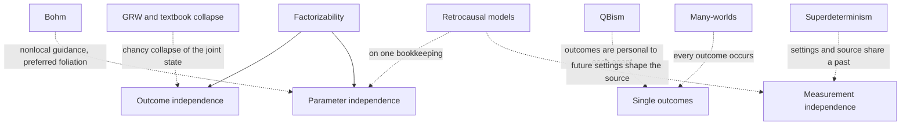

# Philosophy of Physics · Lesson 3.2: What Bell rules out

> ⏱ ~15 min · Module 3: Bell's theorem and nonlocality · Builds on: [3.1](03-01-epr-and-bells-theorem-the-premises.md), [`quantum-computing` 2.6](../../quantum-computing/lessons/02-06-the-chsh-game-and-device-independence.md) · Unlocks: [3.3](03-03-nonlocality-and-relativity.md)

## Why this matters

Three lessons in this library compute the same $|S| = 2\sqrt2$ and draw opposite morals. [`quantum-mechanics` 5.3](../../quantum-mechanics/lessons/05-03-bell-inequality-nonlocality.md) concludes that "nature is genuinely nonlocal". The key to [`quantum-computing` 2.6](../../quantum-computing/lessons/02-06-the-chsh-game-and-device-independence.md) P2 says quantum mechanics "respects locality exactly" and, on the operational reading, gives up realism, and [`photonics-quantum-optics` 4.4](../../photonics-quantum-optics/lessons/04-04-entangled-photons-bell-tests.md) agrees that it "keeps locality (no signaling) but drops realism". The physics in all three is right. They differ over which premise to give up, and Bell's theorem by itself does not choose.

## The idea

[3.1](03-01-epr-and-bells-theorem-the-premises.md) derived the [CHSH bound](../reference.md#chsh-inequality) from three premises: [factorizability](../reference.md#factorizability), [measurement independence](../reference.md#measurement-independence) and [single outcomes](../reference.md#single-outcomes). The violation is settled. But an experiment that refutes a conclusion refutes the conjunction of its premises, not a particular one: Duhem's point from [`philosophy-of-science` 2.2](../../philosophy-of-science/lessons/02-02-duhem-quine-and-underdetermination.md). An empty key hook in a room four people could enter proves that someone took the key, not who.

Splitting factorizability in two gives four suspects: parameter independence, outcome independence, measurement independence, single outcomes. Each interpretation of Module 2, and three more, names a different one and pays a different price, and the quarrel over "local realism" is a quarrel over which suspect the label points at.

## The argument

**Setting.** Alice chooses setting $a$ or $a'$, Bob $b$ or $b'$; outcomes are $A, B \in \{+1, -1\}$; $\lambda$ is the *complete* state of the pair at the source, whatever a theory says that is. [3.1](03-01-epr-and-bells-theorem-the-premises.md)'s factorizability is

$$\textbf{F:}\quad P(A,B\mid a,b,\lambda) = P(A\mid a,\lambda)\,P(B\mid b,\lambda).$$

**D1. [Parameter independence](../reference.md#parameter-independence) (PI).** $P(A\mid a,b,\lambda) = P(A\mid a,b',\lambda)$, and likewise for Bob's outcome under a change of Alice's setting. *In words:* given the complete state, the chances at one wing do not depend on the setting chosen at the other.

**D2. [Outcome independence](../reference.md#outcome-independence) (OI).** $P(A,B\mid a,b,\lambda) = P(A\mid a,b,\lambda)\,P(B\mid a,b,\lambda)$. *In words:* given the complete state and both settings, learning the far outcome tells you nothing more about the near one.

**T1. [Jarrett's theorem](../reference.md#jarrett-decomposition)** (Jon Jarrett, *Noûs*, 1984, who called the conditions "locality" and "completeness"; Clauser and Horne had parsed the condition this way in 1974, and the names PI and OI are Abner Shimony's). F holds if and only if PI and OI both hold. *Proof.* Summing F over $B$ gives $P(A\mid a,b,\lambda) = P(A\mid a,\lambda)$, free of $b$, which is PI; F then says the joint is the product of these marginals, which is OI. Conversely, OI writes the joint as a product of marginals that may mention both settings, and PI deletes the far setting from each. *In words:* a violation of F is a violation of PI, of OI, or of both.

**T2. [Outcome determinism](../reference.md#outcome-determinism) implies OI.** If $P(A\mid a,b,\lambda) \in \{0,1\}$, then for the certain value of $A$ the joint equals Bob's marginal, and for the other value both sides of D2 are zero. *In words:* if the complete state fixes Alice's result, Bob's result has nothing left to tell her. So a deterministic theory that violates F must violate PI.

Both conditions concern the complete state. A correlation that vanishes once $\lambda$ is fully specified is a common cause screening off its effects ([`philosophy-of-science` 4.2](../../philosophy-of-science/lessons/04-02-causal-explanation.md)); only one that survives counts against OI. And both presuppose one outcome per wing per run.

**The menu.** **P1** PI. **P2** OI. **P3** measurement independence, $p(\lambda\mid a,b) = p(\lambda)$, as in 3.1. **P4** single outcomes. **P5** the quantum violation of CHSH, observed with the locality and detection [loopholes](../reference.md#loopholes) closed in the same experiments (Hensen et al., Giustina et al., Shalm et al., 2015; cited as physics in [`quantum-computing` 2.6](../../quantum-computing/lessons/02-06-the-chsh-game-and-device-independence.md) and [`photonics-quantum-optics` 4.4](../../photonics-quantum-optics/lessons/04-04-entangled-photons-bell-tests.md)), and recognized by the 2022 Nobel Prize to Aspect, Clauser and Zeilinger. **∴ C.** At least one of P1–P4 is false. *In words:* nature broke the bound, so a theory of nature must drop a premise.

**Who drops what.**

- **[Bohmian mechanics](../reference.md#bohmian-mechanics)** (de Broglie 1927, Bohm 1952). $\lambda$ includes the particle positions and fixes every outcome, so OI holds by T2 and PI fails: Alice's particle moves differently according to Bob's setting, at once, along a [preferred foliation](../reference.md#preferred-foliation). Nobody can exploit this to signal, because nobody can know or control positions more finely than $|\psi|^2$ allows ([2.1](02-01-bohmian-mechanics.md)).

- **[GRW](../reference.md#grw-theory)** (Ghirardi, Rimini and Weber, 1986) and the textbook collapse. $\lambda$ is the wavefunction; PI holds and OI fails. Bell showed this for GRW in 1987, and Ghirardi, Grassi, Butterfield and Fleming (1993) in general.

- **[Many-worlds](../reference.md#many-worlds-interpretation)** denies P4: every outcome occurs, so PI and OI, defined for *the* outcome, do not apply as stated. Everettians such as Brown and Timpson (2016) and Vaidman argue that Alice's measurement changes only a relation between her and Bob, and no local state is changed from afar; others read the same change as nonlocal.

- **[QBism](../reference.md#qbism)** (Fuchs, Mermin and Schack, *American Journal of Physics*, 2014). An outcome is the experience of the agent who acts. Alice experiences only events where she is, and Bob's report reaches her as one more of those. The theory concerns correlations among one agent's coincident experiences, with no pair of objective, spacelike-separated outcomes for an influence to connect. The price is that outcomes are no longer agent-independent facts.

- **[Superdeterminism](../reference.md#superdeterminism)** denies P3: a common past fixes both the settings and $\lambda$. Bell named it in an interview (*The Ghost in the Atom*, Davies and Brown, 1986); Gerard 't Hooft, and Sabine Hossenfelder and Tim Palmer ("Rethinking Superdeterminism", 2020), defend it. Shimony, Horne and Clauser (1976) pressed the [conspiracy objection](../reference.md#conspiracy-objection): every randomized experiment assumes such independence, so dropping it without a specific mechanism abandons experimental science. Hossenfelder and Palmer reply that "conspiratorial" means fine-tuned relative to some measure, and that a theory with a more restricted state space can make the needed correlations typical. Experiments push P3 back without closing it: cosmic Bell tests drew settings from Milky Way starlight (2017) and quasar light (2018), placing any setting-source correlation at least 7.8 billion years in the past, and the BIG Bell Test (2018) used choices from about 100,000 people.

- **[Retrocausal models](../reference.md#retrocausality)** (Huw Price, *Time's Arrow and Archimedes' Point*, 1996; Ken Wharton and Nathan Argaman, *Reviews of Modern Physics*, 2020) deny P3 by another route: the future settings influence $\lambda$ at the source. Example 2 asks whether that is a denial of P3 or of locality.

**[Local realism](../reference.md#local-realism).** For Clauser and Shimony (1978) a local realistic theory is one satisfying F, chancy theories included. For Mermin (1980) local realism is PI plus outcome determinism. The Stanford Encyclopedia's entry "Bell's Theorem" (§3.3) calls the slogan in Mermin's sense "true but misleading", since by T1 PI and OI already yield the bound without determinism. Tim Maudlin ("What Bell Did", 2014) and Travis Norsen ("Against 'Realism'", 2007) argue that no sense of "realism" is a premise of the theorem beyond what all physics presupposes, so what fails is locality. Howard Wiseman ("The Two Bell's Theorems of John Bell", 2014) finds two theorems: Bell's 1964 one assumes locality and determinism, his 1976 one [local causality](../reference.md#local-causality) alone. Realists give up local causality; operationalists keep a locality defined by what agents can do and give up determinism. [`quantum-mechanics` 5.3](../../quantum-mechanics/lessons/05-03-bell-inequality-nonlocality.md) speaks for the first camp, [`quantum-computing` 2.6](../../quantum-computing/lessons/02-06-the-chsh-game-and-device-independence.md) and [`photonics-quantum-optics` 4.4](../../photonics-quantum-optics/lessons/04-04-entangled-photons-bell-tests.md) for the second.

**[Kochen–Specker](../reference.md#kochen-specker-theorem)** (Bell 1966; Kochen and Specker 1967) is a neighbouring no-go result with no locality premise: for one system with three or more levels, no assignment of definite values to all observables can be independent of which compatible observables are measured alongside. Hidden-variable theories must be [contextual](../reference.md#contextuality), as Bohm's is. Simultaneous definite values, the "realism" of the operational reading, is what this theorem constrains.

**Where the argument is weakest.** P3. The superdeterminist's objection: measurement independence is a contingent claim about initial conditions, learned from classical and linear systems, and nothing guarantees it at the fundamental level. The strongest reply: the same posit licenses every randomized trial, so denying it to escape one result undercuts the evidence for all. The superdeterminist concedes that existing models are still in their infancy; the critic concedes that no experiment can close this loophole, so the case against superdeterminism is methodological.

## Map of positions

Each dashed arrow runs from a view to the premise it denies, labelled with what it posits instead.

## Worked examples

**Example 1 (clean case: orthodox quantum mechanics on the singlet).** Take $\lambda$ to be the singlet state itself, as 3.1's Example 2 did, and let $\theta$ be the angle between Alice's and Bob's axes. From [`quantum-mechanics` 5.3](../../quantum-mechanics/lessons/05-03-bell-inequality-nonlocality.md),

$$P(A,B\mid a,b) = \tfrac14\left(1 - AB\cos\theta\right).$$

- **PI.** Summing over $B$: $P(A\mid a,b) = \tfrac14(1 - A\cos\theta) + \tfrac14(1 + A\cos\theta) = \tfrac12$, whatever Bob's setting. PI holds.

- **OI.** $P(A{=}{+}1\mid B{=}{+}1) = \dfrac{\tfrac14(1 - \cos\theta)}{\tfrac12} = \sin^2\tfrac{\theta}{2}$ and $P(A{=}{+}1\mid B{=}{-}1) = \cos^2\tfrac{\theta}{2}$, against $P(A{=}{+}1) = \tfrac12$. These differ unless $\cos\theta = 0$. OI fails.

So F fails through OI alone. What shifts Alice's chances is Bob's *outcome*, which he cannot choose, so nothing is signalled ([3.3](03-03-nonlocality-and-relativity.md) takes up relativity). On the operational reading, the flat marginal is the sense in which quantum mechanics "respects locality exactly"; on Bell's 1976 reading, the OI failure is itself a failure of local causality. Bohm gives the same statistics with the opposite split: with positions in $\lambda$, each outcome is fixed, OI holds trivially, and PI fails, hidden by averaging over $|\psi|^2$. Which premise fails is a fact about the theory, not about the data.

**Example 2 (hard case: retrocausality).** Bob's setting $b$, chosen at time $t_2$, influences the pair's state at the source at an earlier time $t_0$, running back along his particle's worldline; that state then shapes Alice's outcome. Every link is timelike and Lorentz covariant: Wharton and Argaman call such models locally mediated.

- Take $\lambda$ to be the state actually present at the source, the imprint of $b$ included. Then $p(\lambda\mid a,b) \neq p(\lambda)$: P3 fails, and PI and OI can hold.

- Take $\lambda$ to be the state as earlier causes alone fix it, as forward-in-time causal thinking assumes. Then Alice's chances depend on $b$ through an influence $\lambda$ leaves out, and PI fails too.

The Stanford Encyclopedia's Bell entry files it both ways: as violating measurement independence and PI (§8.1.1), and as rejecting causal locality (§8.1.3). **Where it strains.** The verdict turns on two things the theorem leaves open: what counts as the complete state, and whether causes must precede their effects. Defenders who read causation in interventionist, perspectival terms (Price's line) call the model nonlocal only in that spacelike events depend on each other, and local in another sense: continuous action along timelike paths. Hossenfelder answers that a cause running backward in time is meaningless, so such a model is superdeterminism under another name. Nobody disputes a prediction; they dispute what "cause" and "local" mean.

## Watch out

- **You might think** dropping "realism" (outcome determinism) lets a theory keep locality in Bell's sense, **but actually** PI and OI already give the bound (T1), so an indeterministic theory that keeps PI must drop OI, as orthodox quantum mechanics does.

- **You might think** experiment tells you which of PI and OI fails, or that a PI violation means signals, **but actually** neither follows. The split is relative to what a theory counts as the complete state: Bohm and orthodox quantum mechanics give identical statistics with opposite splits (Example 1, P2). And Bohm violates PI without signalling, since positions cannot be controlled.

- **You might think** superdeterminism, retrocausality and many-worlds are loopholes like detection efficiency, **but actually** none is an experimental flaw. The locality and detection loopholes were closed together in 2015; measurement independence, which the first two deny, can be pushed back but never closed; many-worlds accepts every prediction and denies a premise of the theorem's framing.

- **You might think** Kochen–Specker is Bell's theorem again, **but actually** it concerns one system, needs no locality premise, and rules out only noncontextual value assignments, which Bohm already gives up.

## One-liner

> Experiment refutes a conjunction, not a conjunct: each interpretation keeps the measured violation by denying parameter independence, outcome independence, measurement independence or single outcomes, and "local realism" names different conjuncts for different authors.

## Problems

**P1 (🟢)** *(Reconstruct: Exegetical (a)–(b).)* Fuchs, Mermin and Schack ("An Introduction to QBism with an Application to the Locality of Quantum Mechanics", 2014) argue that QBism removes quantum nonlocality.

(a) Reconstruct their argument in four numbered premises and a conclusion.

(b) Which of 3.1's premises for the CHSH bound does the argument refuse, and which of your premises carries the refusal? One sentence each.

**P2 (🟡)** *(Formal model: Formal (a)–(b) · Exegetical (c).)* A toy hidden-variable model has two complete states, $\lambda_1$ with probability $\tfrac13$ and $\lambda_2$ with probability $\tfrac23$, whatever the settings. Alice measures at setting $a$; Bob chooses $b$ or $b'$; outcomes are $\pm1$. The table gives $P(A,B\mid a,y,\lambda)$, where $y$ is Bob's setting.

| state | Bob's setting $y$ | $P(+1,+1)$ | $P(+1,-1)$ | $P(-1,+1)$ | $P(-1,-1)$ |
|---|---|---|---|---|---|
| $\lambda_1$ | $b$ | 1/2 | 1/6 | 1/4 | 1/12 |
| $\lambda_1$ | $b'$ | 1/15 | 1/10 | 1/3 | 1/2 |
| $\lambda_2$ | $b$ | 3/20 | 1/10 | 9/20 | 3/10 |
| $\lambda_2$ | $b'$ | 1/3 | 1/6 | 1/3 | 1/6 |

(a) For each state, compute Alice's marginal $P(A{=}{+}1\mid a,y,\lambda)$ at $y = b$ and at $y = b'$, and say whether the clause of PI that concerns Alice's outcome holds. Then check OI in each row. Show the computation.

(b) Someone who takes the preparation alone as the complete state sees only the statistics averaged over $\lambda_1$ and $\lambda_2$. Compute Alice's averaged marginal at $b$ and at $b'$. Then test OI at Bob's setting $b$ by comparing the averaged $P(+1,+1)$ with the product of the averaged marginals. Show the computation.

(c) What do (a) and (b) together show about whether experiment can settle which of PI and OI a theory violates? Two sentences.

**P3 (🔴)** *(Find the crux: Exegetical (a)–(b) · Evaluative (c).)* Shimony, Horne and Clauser (1976) object that superdeterministic accounts of Bell correlations are conspiratorial; Hossenfelder and Palmer (2020) reply.

(a) State the objection and the reply. One sentence each.

(b) Name the single premise one side affirms and the other denies, and state it as a conditional both would sign. Two sentences.

(c) Is the conspiracy charge a scientific objection or a philosophical one? Say what finding or argument would move each side. Any verdict; 150 words or fewer.

Solutions

**P1** *(Exegetical (a)–(b).)*

**Must hit, strict (a):**

- An outcome is the personal experience of the agent whose action elicits it.

- An agent experiences only events where she is.

- Another agent's report of his outcome reaches her as a further experience of her own, where she is.

- Quantum probabilities, including probability 1, are the agent's degrees of belief, not properties of a distant system, so certainty about Bob's result licenses no element of reality at Bob's wing.

- ∴ Quantum theory, as each agent uses it, governs correlations among her own spatially coincident experiences, so it never posits an influence between spacelike-separated events.

**Accept (b):** either of two formulations of the refused premise, if the carrying premise is named.

**Must hit, strict (b):**

- The refused premise is single outcomes in the sense the theorem needs: one objective outcome at each wing, the same for every agent. (Accept: that there is a complete physical state $\lambda$, a description of the pair independent of agents, for factorizability to condition on.)

- The premise that carries the refusal is the first, that outcomes are personal experiences; the fourth blocks EPR's inference to an element of reality.

**Wrong turns:** saying QBism violates PI or OI (it denies they have anything objective to apply to); saying it denies measurement independence; saying Bob's outcome does not exist for QBism (it exists as Bob's experience, and reaches Alice only through his report).

**Model answer:** (a) P1 A measurement outcome is the experience of the agent who acts. P2 Alice experiences only events where she is. P3 Bob's report is one more experience of Alice's, at her location. P4 Her probabilities, even probability 1, are her beliefs, not properties of Bob's particle. ∴ C Quantum theory relates Alice's coincident experiences, so nothing in it acts between distant events. (b) It refuses single outcomes as the theorem needs them: an objective outcome at each wing. P1 carries the refusal, with P4 blocking the EPR route to hidden values.

---

**P2** *(Formal (a)–(b) · Exegetical (c).)*

(a) Alice's marginal is the sum of the first two entries of a row, $P(+1,+1) + P(+1,-1)$.

- $\lambda_1$: at $b$, $\tfrac12 + \tfrac16 = \tfrac23$; at $b'$, $\tfrac1{15} + \tfrac1{10} = \tfrac16$. They differ, so PI fails.

- $\lambda_2$: at $b$, $\tfrac3{20} + \tfrac1{10} = \tfrac14$; at $b'$, $\tfrac13 + \tfrac16 = \tfrac12$. PI fails again.

For OI, Bob's marginal is $P(+1,+1) + P(-1,+1)$, and for a two-by-two table OI holds exactly when $P(+1,+1)$ equals the product of the two marginals (the other entries then follow).

- $\lambda_1, b$: Bob $\tfrac12 + \tfrac14 = \tfrac34$; $\tfrac23 \cdot \tfrac34 = \tfrac12$. ✓

- $\lambda_1, b'$: Bob $\tfrac1{15} + \tfrac13 = \tfrac25$; $\tfrac16 \cdot \tfrac25 = \tfrac1{15}$. ✓

- $\lambda_2, b$: Bob $\tfrac3{20} + \tfrac9{20} = \tfrac35$; $\tfrac14 \cdot \tfrac35 = \tfrac3{20}$. ✓

- $\lambda_2, b'$: Bob $\tfrac13 + \tfrac13 = \tfrac23$; $\tfrac12 \cdot \tfrac23 = \tfrac13$. ✓

OI holds in every row; PI fails in both states.

(b) Weight each state's numbers by $\tfrac13$ and $\tfrac23$.

$$P(A{=}{+}1\mid a,b) = \tfrac13\cdot\tfrac23 + \tfrac23\cdot\tfrac14 = \tfrac29 + \tfrac16 = \tfrac{7}{18},\qquad P(A{=}{+}1\mid a,b') = \tfrac13\cdot\tfrac16 + \tfrac23\cdot\tfrac12 = \tfrac1{18} + \tfrac13 = \tfrac{7}{18}.$$

Both are $\tfrac{7}{18} \approx 0.389$, so on the coarse description PI holds. At $b$, Bob's averaged marginal is $\tfrac13\cdot\tfrac34 + \tfrac23\cdot\tfrac35 = \tfrac14 + \tfrac25 = \tfrac{13}{20}$, and

$$P(+1,+1\mid a,b) = \tfrac13\cdot\tfrac12 + \tfrac23\cdot\tfrac{3}{20} = \tfrac16 + \tfrac1{10} = \tfrac4{15} = \tfrac{96}{360},\qquad \tfrac{7}{18}\cdot\tfrac{13}{20} = \tfrac{91}{360}.$$

They differ ($0.267$ against $0.253$), so on the coarse description OI fails.

(c) The same statistics violate PI and respect OI when the complete state includes $\lambda$, and respect PI and violate OI when the preparation alone is the complete state. So which conjunct of factorizability fails is fixed by what a theory says the complete state is, not by the data, which is the contrast between Bohm and orthodox quantum mechanics in Example 1.

**Must hit, strict:** (a) the four marginals $\tfrac23, \tfrac16, \tfrac14, \tfrac12$ with the verdict that PI fails, and an OI check in every row with the verdict that OI holds; (b) both averages $\tfrac7{18}$ (PI holds), Bob's $\tfrac{13}{20}$, and $\tfrac4{15} \ne \tfrac{91}{360}$ (OI fails); (c) the split is relative to the complete state, so the data alone do not decide it.

**Wrong turns:** comparing marginals across different states rather than across Bob's settings within one state; using averaged numbers in (a), where OI must be checked state by state; concluding from (b) that the model "really" respects PI, when by its own lights the preparation is not the complete state; concluding from (c) that PI and OI are meaningless, when each is well defined once a theory names its complete state.

---

**P3** *(Exegetical (a)–(b) · Evaluative (c).)*

**Must hit, strict (a):**

- Objection: settings could in principle be correlated with $\lambda$ through some factor in the overlap of their past light cones, but positing that with no specific mechanism would cast the same doubt on every randomized experiment, so taking it seriously abandons the project of finding laws by experiment.

- Reply: "conspiratorial" or "fine-tuned" means the required initial conditions form a small set by some physically salient measure; in a theory whose state space is more restricted than usually assumed, that measure can make them large, and the hypothesis may be testable.

**Accept (b):** a crux framed as whether a specified mechanism with independent support exists, if it is tied to the status of statistical independence.

**Must hit, strict (b):**

- The premise: statistical independence of settings and hidden state is a precondition of experimental inference, not an empirical generalization. Shimony, Horne and Clauser affirm it; Hossenfelder and Palmer deny it, holding that the expectation comes from classical and linear systems that may mislead at the fundamental level.

- A conditional both would sign: "If statistical independence is a precondition of experimental inference, a theory that denies it undercuts its own evidence; if it is an empirical generalization, a fundamental theory may deny it while laboratory randomizers stay reliable for every practical purpose."

**Must hit, any verdict (c):**

- Say which version of the charge the verdict concerns: the methodological one (Shimony, Horne and Clauser) or the fine-tuning one (as Hossenfelder and Palmer reconstruct it), and classify it.

- Name what would move the superdeterminist (an explicit model, with its measure, failing to reproduce quantum statistics, or a failed test of the deviations the view predicts) and what would move the critic (a worked theory in which the correlations are typical and which passes a novel test).

- Note that cosmic and human-choice Bell tests do not decide it: they push the correlation back in time, and superdeterminism places it in the initial conditions.

**Wrong turns:** treating measurement independence as libertarian free will (Bell (1977) held that a deterministic randomizer is free enough); saying the cosmic Bell tests refuted superdeterminism; reading Shimony, Horne and Clauser as rejecting Bell's conclusion (their aim was to make the assumption explicit).

**Model answer (c), one of several:** Both, depending on which charge is meant. As Shimony, Horne and Clauser put it, the charge is methodological: no measurement can show that setting choices are independent of everything in their past, so the objection is that denying independence undermines the evidential standing of experiment itself. That is philosophy of science, not a prediction. As Hossenfelder and Palmer reconstruct it, the charge is fine-tuning relative to a measure, the kind of objection physicists press against theories, and it becomes scientific once a theory supplies its state space, measure and predictions. The superdeterminist would be moved if a fully specified model failed to reproduce quantum statistics or its predicted deviations failed to appear. The critic would be moved by a worked theory whose required correlations are typical and which passes a novel test. Cosmic Bell tests move neither, since an initial-condition correlation predicts them too.

## Flashback

**From Lesson [2.4](02-04-many-worlds-the-probability-problem.md) (Many-worlds II: the probability problem):** *(Formal model: Formal (a) · Exegetical (b).)* Alice and Bob measure a singlet pair along axes at angle $\theta$, with $\cos\theta = \tfrac13$. On many-worlds, once their records are compared, idealize the run as leaving four branches, one for each pair of outcomes $(A,B)$ with $A, B = \pm1$, carrying [Born weight](../reference.md#born-weight) $w(A,B) = \tfrac14(1 - AB\cos\theta)$.

(a) Compute the four Born weights and the correlation $E = \sum AB\,w(A,B)$. Then compute $E$ again by [branch counting](../reference.md#branch-counting), which gives every branch the same share, and say what $S$ counting gives at any four settings. Show the computation.

(b) This lesson has many-worlds keep the measured violation by denying [single outcomes](../reference.md#single-outcomes). Which of 2.4's three problems does (a) show that exit must solve, and which answer in 2.4 rules counting out, by which principle? Two sentences.

Solution

(a) With $\cos\theta = \tfrac13$,

$$w(+1,+1) = w(-1,-1) = \tfrac14\left(1 - \tfrac13\right) = \tfrac16, \qquad w(+1,-1) = w(-1,+1) = \tfrac14\left(1 + \tfrac13\right) = \tfrac13,$$

which sum to 1, so

$$E_{\text{Born}} = \tfrac16 + \tfrac16 - \tfrac13 - \tfrac13 = -\tfrac13 = -\cos\theta, \qquad E_{\text{count}} = \tfrac14\,(1 + 1 - 1 - 1) = 0.$$

Counting sees the same four branches at every pair of settings, so every correlation is 0 and $S = E(a,b) - E(a,b') + E(a',b) + E(a',b') = 0$. Over many runs, most branches by count record correlations near 0, well inside the CHSH bound; most weight sits near $-\cos\theta$.

**Must hit, strict (a):** the weights $\tfrac16, \tfrac13, \tfrac13, \tfrac16$; $E_{\text{Born}} = -\tfrac13$; $E_{\text{count}} = 0$ whatever $\theta$, so $S = 0$.

**Accept (b):** adding the evidential problem (Greaves and Myrvold's weights in the likelihood slot make the observed violation count against counting), if the quantitative problem is named as what (a) shows.

**Must hit, strict (b):**

- The quantitative problem: why squared amplitude rather than an equal share per branch. The equal share predicts no correlation, so the exit keeps the observed violation only if the Born weight is the measure.

- One answer with its principle: the Deutsch–Wallace theorem through branching indifference (a split that leaves every reward unchanged leaves an act's value unchanged), or Sebens and Carroll through the epistemic separability principle (changes purely to the environment leave credences about a local subsystem unchanged).

**Wrong turns:** calling it the incoherence problem: (a) grants a measure and asks which. Saying counting gives a weaker correlation; it gives exactly 0. Citing diachronic consistency alone, as against Albert's fatness rule: counting is sensitive to the split itself, which branching indifference forbids.

**Model answer (b):** It is the quantitative problem: counting gives no correlation at any settings, so many-worlds keeps the observed violation only if squared amplitude, not branch number, sets the weights. The Deutsch–Wallace theorem rules counting out through branching indifference, since a counter revalues an act when a split leaves every reward the same; Sebens and Carroll reach the Born weight through the epistemic separability principle.

## Connections

- **Backward:** [3.1](03-01-epr-and-bells-theorem-the-premises.md) supplied the premises and the bound, and the computation is the physics of [`quantum-mechanics` 5.3](../../quantum-mechanics/lessons/05-03-bell-inequality-nonlocality.md), [`quantum-computing` 2.6](../../quantum-computing/lessons/02-06-the-chsh-game-and-device-independence.md) and [`photonics-quantum-optics` 4.4](../../photonics-quantum-optics/lessons/04-04-entangled-photons-bell-tests.md). Bohm, GRW and many-worlds come from [2.1](02-01-bohmian-mechanics.md)–[2.3](02-03-many-worlds-branching.md), and QBism from [1.3](01-03-copenhagen-qbism-and-relational-views.md).

- **Forward:** [3.3](03-03-nonlocality-and-relativity.md) asks whether a PI violation, which needs a preferred foliation, and an OI violation, which may not, can each live with relativity, and whether Bell correlations are causal at all. [5.1](05-01-determinism-in-physical-theories.md) returns to the fact that Bohm and Everett are deterministic and the collapse theories are not.

- **Sideways:** The refutation of a conjunction is Duhem's problem ([`philosophy-of-science` 2.2](../../philosophy-of-science/lessons/02-02-duhem-quine-and-underdetermination.md)), and OI is Reichenbach's screening off applied to $\lambda$ ([`philosophy-of-science` 4.2](../../philosophy-of-science/lessons/04-02-causal-explanation.md)). Retrocausality turns on what a cause is, the question of [`metaphysics` 4.2](../../metaphysics/lessons/04-02-counterfactual-causation.md); superdeterminism is a claim about statistical independence, not about freedom, which [`metaphysics` 6.1](../../metaphysics/lessons/06-01-determinism-and-the-consequence-argument.md) treats.
