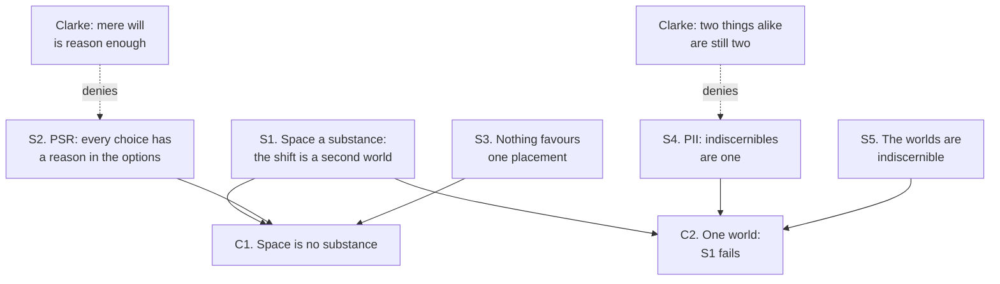

# Philosophy of Physics · Lesson 4.1: Leibniz and Clarke: the shift arguments

> ⏱ ~15 min · Module 4: Space and spacetime · Builds on: [`modern-philosophy` 2.3](../../modern-philosophy/lessons/02-03-leibniz-sufficient-reason-and-monads.md), [`philosophy-of-science` 2.2](../../philosophy-of-science/lessons/02-02-duhem-quine-and-underdetermination.md) · Unlocks: [4.2](04-02-newtons-bucket-and-the-structure-inertia-needs.md), [4.5](04-05-the-hole-argument.md)

## Why this matters

Move everything in the universe three metres north. Every distance stays the same, every law runs as before, and no instrument could register the move. Did anything happen? In 1715 and 1716 Leibniz and Samuel Clarke, Newton's ally, traded five letters each over questions like this, and the answer decides whether space is a thing or a pattern of relations. The argument outlived both men: its descendants are the hole argument of [4.5](04-05-the-hole-argument.md) and the gauge debates of [6.2](06-02-gauge-as-surplus-structure.md).

## The idea

Slide every bird in a photograph of a flock an inch left inside a blank frame. All relations are kept. A new picture? Yes if the frame counts; no if the picture is just the flock.

[Substantivalism](../reference.md#substantivalism) says space is the frame: it exists in its own right, and the world sits somewhere in it (a modern label; neither Newton nor Clarke used it). [Relationalism](../reference.md#relationalism) says space is the flock's pattern and nothing more. Leibniz: "I hold it to be an Order of Coexistences, as Time is an Order of Successions" (Third Paper §4, Clarke's translation, 1717).

A **shift** is a world exactly like ours in every relation but placed elsewhere (the [static shift](../reference.md#static-shift)) or moving uniformly as a whole (the [kinematic shift](../reference.md#kinematic-shift)). The substantivalist counts it as a second possible world, the relationalist does not, and Leibniz argues that counting two is absurd.

[`modern-philosophy` 2.3](../../modern-philosophy/lessons/02-03-leibniz-sufficient-reason-and-monads.md) taught the [principle of sufficient reason](../reference.md#principle-of-sufficient-reason) (PSR) and the [identity of indiscernibles](../reference.md#identity-of-indiscernibles) (PII) and stated the static shift in a sentence. [`philosophy-of-science` 2.2](../../philosophy-of-science/lessons/02-02-duhem-quine-and-underdetermination.md) Example 2 set the kinematic shift as underdetermination, Newton's $T_0$ against rivals $T_v$ whose centre drifts at velocity $v$. This lesson reads the letters: what Leibniz needs, how Clarke answered, and why the two shifts differ.

## Source

Leibniz, Fifth Paper §52, in Samuel Clarke (ed. and tr.), *A Collection of Papers* (London, 1717), pp. 211–213, long s modernized. "The Author" is Clarke.

> [...] 'tis unreasonable it should have motion any otherwise, than as its parts change their Situation among themselves; because such a motion would produce no Change that could be observed, and would be without Design. [...] The Author replies now, that the reality of Motion does not depend upon being observed; and that a Ship may go forward, and yet a Man, who is in the Ship, may not perceive it. I answer, Motion does not indeed depend upon being Observed; but it does depend upon being possible to be Observed. There is no Motion, when there is no Change that can be Observed. And when there is no Change that can be Observed, there is no Change at all. The contrary Opinion is grounded upon the Supposition of a real absolute Space, which I have demonstratively confuted by the Principle of the want of a sufficient Reason of things.

The shape is concession, then correction. Leibniz grants Clarke that motion can be real and unobserved, then moves one word, to "possible to be Observed", and widens the claim from motion to every change. The grounds pull two ways: "no Change that could be observed" is epistemic, while "without Design" and the closing appeal to sufficient reason are metaphysical. The two readings below turn on which ground carries the argument.

## The argument

**The static shift** (Third Paper §5; Fourth Paper §§5–6). Space without bodies is "absolutely Uniform", so God, keeping every relation among bodies, could have no reason to place them one way rather than another, "for instance, by changing East into West". The Fourth Paper adds the PII, in the sentence `modern-philosophy` 2.3 quotes, and calls the shifted universe "an impossible Fiction".

**S1.** If space is a substance, a world with every body displaced together, relations kept, is a second possible world. *In words:* the substantivalist must count it.

**S2.** God chooses nothing without a reason that favours the choice (the PSR, at Leibniz's strength). *In words:* every choice has its reason in the options.

**S3.** Nothing favours the actual placement over the shifted one. *In words:* here is no better than three metres north.

**∴ C1.** Space is not a substance, for otherwise God chose without a reason (S1–S3).

**S4.** Things indiscernible from each other are one thing (the PII). *In words:* no two things share every quality.

**S5.** The actual and the shifted world are indiscernible. *In words:* no quality tells them apart.

**∴ C2.** They are one world, so S1 fails, and substantivalism with it (S1, S4, S5).

**Clarke's replies.** He grants the PSR but denies S2's strength: among options indifferent in their own nature, "mere Will, without any thing External to influence it, is alone That sufficient Reason" (Third Reply §2), the [mere-will reply](../reference.md#mere-will-reply). Against S4: "different Spaces are really different or distinct one from another, though they be perfectly alike" (same section), and "Two things, by being exactly alike, do not cease to be Two" (Fourth Reply §§5–6).

**The kinematic shift** is Clarke's. If space were only the order of things, God might "remove in a streight Line the whole Material World Entire, with any swiftness whatsoever", it would stay in "the same Place", and "nothing would receive any Shock upon the most sudden stopping of that Motion" (Third Reply §4). Leibniz turned it round (Fourth Paper §13):

**K1.** If space is a substance, the whole world moving uniformly in a straight line and the world at rest are two states. *In words:* absolute velocity is a fact.

**K2.** The two states differ in no relation among bodies and in nothing observable. *In words:* Galileo's ship, made universal.

**K3.** "two States indiscernible from each other, are the same State", and God does nothing without reason. *In words:* the PII and the PSR again.

**∴ C3.** The supposed motion is "a change without any change"; there is no absolute space for it to be motion in.

Clarke replied with the ship (Fourth Reply §13): its unperceived motion "is a real different State, and has real different Effects", a sudden stop would show others, and so would the universe's. He cited Newton's Scholium ([4.2](04-02-newtons-bucket-and-the-structure-inertia-needs.md)).

**Two readings.** What makes S5 and K3 work? On the **verificationist** reading, "indiscernible" means no possible observation tells the states apart, and the operative premise is §52's [observability principle](../reference.md#observability-principle); God and the PSR drop out. (The label is twentieth-century; fitting it to Leibniz needs arguing.) On the **metaphysical** reading, the operative premises are the PSR and the PII as necessary truths, which make metaphysics "real and demonstrative" (Fourth Paper §5); §52 itself rests observability on sufficient reason. The [two readings](../reference.md#verificationist-and-metaphysical-readings) differ in reach. The first condemns any undetectable quantity and spares any detectable one; the second condemns any reasonless choice and any exact duplicate, detectable or not.

Tim Maudlin ("Buckets of Water and Waves of Space", 1993) argued that running the two shifts together hid a substantivalism that survives Leibniz. The static shift leaves us ignorant of nothing: the shifted world can be described only from here, as everything moved three metres from where it is, and we know which world is actual. Absolute velocity really is unknowable, but a substantivalist can drop it and keep the rest: 4.2's Galilean spacetime.

**Where the argument is weakest.** The step from "indiscernible" to "one" (S4–S5, K3). The strongest objection is Clarke's, sharpened: the PII begs the question about places, since if places are things, two alike are two; and by Maudlin's point the static shift poses no unanswerable question, so even a verificationist has no complaint. The strongest reply: the extra worlds make no difference to anything, and Shamik Dasgupta ("Inexpressible Ignorance", 2015) argues that ignorance we cannot put into words is still ignorance. Each side pays. Leibniz rests on principles that cost elsewhere: the verification principle threatens itself ([`philosophical-method` 4.1](../../philosophical-method/lessons/04-01-objections-and-replies.md)), and the PII faces symmetric counterexamples ([`metaphysics` 2.1](../../metaphysics/lessons/02-01-substance-and-accident.md)). The substantivalist must accept differences no quality marks, or stop counting shifted worlds as two, the anti-haecceitist route of [sophisticated substantivalism](../reference.md#sophisticated-substantivalism) (4.5). In the 2020 PhilPapers Survey, 45% of 626 respondents accepted or leaned towards relationism about spacetime, 27% substantivalism.

## Argument map

Solid arrows run the static shift's PSR and PII versions; dashed arrows are Clarke's replies (Third Reply §2, Fourth Reply §§5–6), each denying a principle, not the physics.

## Worked examples

**Example 1 (clean case: three metres north).** Let world $W$ have bodies at positions $\mathbf{x}_i(t)$, and let $W_{\mathbf{d}}$ have them at $\mathbf{x}_i(t) + \mathbf{d}$ for a fixed vector $\mathbf{d}$, three metres north, say. Every separation is unchanged, $(\mathbf{x}_i + \mathbf{d}) - (\mathbf{x}_j + \mathbf{d}) = \mathbf{x}_i - \mathbf{x}_j$. If forces depend only on separations,

$$m_i\,\ddot{\mathbf{x}}_i = \sum_{j \neq i} \mathbf{F}_{ij}(\mathbf{x}_i - \mathbf{x}_j),$$

where $m_i$ is the mass of body $i$ and $\mathbf{F}_{ij}$ the force on it from body $j$, then $W_{\mathbf{d}}$'s history solves them whenever $W$'s does. The shift is a symmetry of the laws, the one [`analytical-mechanics` 2.2](../../analytical-mechanics/lessons/02-02-noethers-theorem.md) turns into conservation of momentum. Leibniz's "East into West" is a rotation or a reflection, and either keeps every distance.

Now count: the substantivalist has one world for each $\mathbf{d}$, a three-dimensional continuum, the relationalist one. The PSR version asks why $\mathbf{d} = \mathbf{0}$; the PII version makes $W$ and $W_{\mathbf{d}}$ one world. Clarke's replies leave the physics alone. The argument is valid, and the dispute sits on S2 and S4.

**Example 2 (hard case: the kinematic shift once rotation is admitted).** Give every body a common velocity, $\mathbf{x}_i(t) \to \mathbf{x}_i(t) + \mathbf{v}t$ for constant $\mathbf{v}$. Separations and accelerations are unchanged, so the laws hold in one world exactly when they hold in the other: Newton's own Corollary V, motions among bodies are the same "whether that space is at rest, or moves uniformly forwards in a right line without any circular motion" (Motte, 1729). Clarke's sudden stop does not break the tie. A body whose velocity changes by $\Delta\mathbf{u}$ receives the impulse $m\,\Delta\mathbf{u}$ whatever its velocity was, so a resting world given the same jolt shakes the same way. The shock reveals the change, not the state.

Now take the proviso, "without any circular motion". Set the whole world rotating rigidly at angular velocity $\omega$. Every separation stays fixed, but a body at distance $r$ from the axis accelerates toward it at $\omega^2 r$ and needs a force $m\omega^2 r$ to stay on its circle: cords stretch, and water climbs a bucket's sides ([4.2](04-02-newtons-bucket-and-the-structure-inertia-needs.md)). Rotation is detectable, so §52 turns round: on the verificationist reading Leibniz must grant a difference no relation among bodies records. In §53 he does, granting [absolute true motion](../reference.md#absolute-true-motion) where "the immediate Cause of the Change is in the Body".

Here the shift argument stops giving a verdict: there is no indiscernible pair for the PII or observability to collapse. The substantivalist says the rotation is relative to space, or to the structure [Galilean spacetime](../reference.md#galilean-spacetime) keeps after dropping absolute velocity. The relationalist says the standard lives in the bodies (Leibniz's cause) or in the laws (Nick Huggett's regularity relationalism, 4.2). Whether §53 squares with §52 is P3.

## Watch out

- **You might think** the kinematic shift is Leibniz's argument, **but actually** Clarke raised it (Third Reply §4) and Leibniz turned it (Fourth Paper §13).

- **You might think** the kinematic shift refutes substantivalism, **but actually** at most it tells against space that persists through time, which makes absolute velocity a fact. Substantivalism about space is not substantivalism about spacetime: Galilean spacetime has no absolute velocity and keeps absolute rotation.

- **You might think** a shift is a change of coordinates, **but actually** renaming the origin is a passive change that alters no fact on anyone's view. The shift moves the matter while space stays put, an active change only a substantivalist can describe ([active and passive diffeomorphisms](../reference.md#active-and-passive-diffeomorphisms), formalized in [4.5](04-05-the-hole-argument.md)).

## One-liner

> Shift or drift the whole world and no observation changes; whether that unmakes space depends on whether Leibniz leans on observability or on sufficient reason and indiscernibility, and his opponents deny a principle, never the physics.

## Problems

**P1 (🟢)** *(Close reading: Exegetical.)* Leibniz, Fifth Paper §47 (Clarke, 1717, p. 199), defines place:

> Place is That, which is the Same in different moments to different existent Things, when their Relations of Co-existence with certain Other Existents, which are supposed to continue fixed from one of those Moments to the other, agree intirely together.

(a) What makes body B, now, be in the place body A occupied earlier? One line.

(b) Which words carry the definition's one assumption, and could that assumption be checked from the relations among bodies alone? Two sentences.

**P2 (🟡)** *(Find the crux: Exegetical (a) · Evaluative (b)–(c).)* A verificationist reader and a metaphysical reader of Leibniz agree that K1 states the substantivalist's commitment and that the kinematic shift is valid.

(a) Name the premise they state differently, and give each version. One line each.

(b) A defender of absolute space replies that God has a reason to make the world at rest rather than moving, since rest is the one state of motion that favours no direction. Which version of the premise does this reply engage, and which does it leave standing?

(c) Could the same kind of reply be made to the static shift? Say why or why not, and what follows about which shift the PSR version handles better.

150 words or fewer for (b) and (c) together.

**P3 (🔴)** *(Steelman and reply: Evaluative.)* In the Fifth Paper §53 Leibniz, having denied that Newton's Scholium proves "the reality of Space in it self", continues:

> However, I grant there is a difference between an absolute true motion of a Body, and a mere relative Change of its Situation with respect to another Body.

He adds that a body "is truly in Motion" when "the immediate Cause of the Change is in the Body". Is the concession consistent with §52's observability principle and with relationalism? Give the strongest case that it is not, then the best reply on Leibniz's behalf, and say what each side must concede. 150 words or fewer.

Solutions

**P1** *(Exegetical.)*

**Must hit, strict (a):** B is where A was when B's relations of co-existence (situation and distance) to certain other bodies now agree entirely with the relations A had to those same bodies, those bodies being taken to have stayed fixed. Place is defined through agreement of relations to reference bodies, not as a region of absolute space.

**Must hit, strict (b):**

- The words "which are supposed to continue fixed": the definition works only if the reference bodies have not moved, and that is supposed, not observed.

- Relations alone cannot settle it. They show that A's relation to the reference bodies changed, not whether A moved or the reference bodies did, and a common motion of everything leaves every relation as it was. Leibniz's next sentence supplies a different test: fixed existents are those in which there has been "no cause of any Change", that is, "no Motion".

**Accept:** citing "supposing, or feigning", Leibniz's own phrase earlier in §47, as his word for the assumption.

**Wrong turns:** reading "the Same" as one relation literally shared by A and B; §47 goes on to say that two subjects' relations only agree, and that the place the mind treats as the same is "an Ideal Thing". Reading "fixed" as fixed in absolute space, which would make the definition presuppose what Leibniz denies.

**Model answer:** (a) B is where A was when B now stands in exactly the relations to certain reference bodies that A stood in to them, those bodies being taken as unmoved. (b) "Which are supposed to continue fixed": the reference bodies' rest is assumed, not observed. Relations alone cannot confirm it, since they record that A and the reference bodies changed their relation but not which of them moved; Leibniz's next sentence brings in a causal test, the absence of any "cause of any Change" in the reference bodies.

---

**P2** *(Exegetical (a) · Evaluative (b)–(c).)*

**Must hit, strict (a):** the premise is K3, the step from "the two states cannot be told apart" to "they are one state" (equivalently, what "indiscernible" means in K2 and K3).

- Verificationist: states that no possible observation could distinguish are the same state (§52).

- Metaphysical: states that share every quality are identical (the PII), and God makes no choice without a reason (the PSR), whether or not anyone could observe the difference.

**Must hit, any verdict (b):**

- It engages only the PSR version: if rest is privileged, God has a reason to choose it, so the kinematic counterpart of S2 and S3 fails.

- It leaves standing the PII version (the resting and the moving world still share every quality) and the verificationist version (rest is no more observable than any other velocity).

**Must hit, any verdict (c):**

- No: on Leibniz's premise, which Newton shares, every point of space is like every other ("absolutely Uniform"), so no placement stands out and no reason could favour one.

- So the PSR version is strongest against the static shift; against the kinematic shift the work falls to the PII or to observability.

**Wrong turns:** treating the reply as refuting the kinematic shift outright, when two versions survive it; treating rest as observable; naming the crux as whether absolute space exists, which is the conclusion both readers reach, not a premise they dispute.

**Model answer (b)–(c), one of several:** The reply engages only the PSR version. If rest favours no direction, God has a reason to choose it, and Newton did take the centre of the world to be at rest. The PII version is untouched, since the resting and moving worlds still share every quality, and so is the verificationist version, since rest is as undetectable as any other velocity. The static shift admits no such reply. On Leibniz's premise, which Newton shares, every point of space is like every other, so no placement stands out for a reason to favour. The PSR version is therefore at full strength against the static shift and weakest against the kinematic one, where the argument has to be carried by indiscernibility or observability.

---

**P3** *(Evaluative.)*

**Must hit, any verdict:**

- State the concession and its criterion: true motion differs from relative change, and a body is truly moving when the immediate cause of the change is in it.

- Test it against §52: say whether that cause is "possible to be Observed". The effects of changing motion (stresses, a concave water surface, collisions) are observable; which of two bodies in uniform relative motion carries the cause is not.

- Test it against relationalism, separating relationalism about space (space is an order of coexistences; §53 still denies that the Scholium proves the reality of space) from relationalism about motion (all motion is relative change), which §53 gives up.

- Say what each side must concede.

**Accept:** the reading of Carl Hoefer, Nick Huggett and James Read ("Absolute and Relational Space and Motion: Classical Theories", *Stanford Encyclopedia of Philosophy*, 2021), on which the concession records Leibniz's agreement with Newton against Descartes that merely relative motion is not true motion, while Leibniz grounds true motion in force rather than in space; credit it as one reading, not as the answer.

**Wrong turns:** reading §53 as conceding absolute space, when the same section denies that the Scholium proves it; reading §52 as "unobserved motion is no motion", when it says unobservable; bringing in counterexamples to the PII, which bear on S4, not on motion.

**Model answer, one of several:** *The case against.* §52 says a change no one could observe is no change. Yet when two bodies are in uniform relative motion, no observation shows which carries "the immediate Cause"; §53 makes a real difference out of an unobservable one. And if relationalism says motion is change of relations, §53 grants true motion beyond them. *The reply.* §52 concerns changes, and whether a body has acquired motion is observable in its effects: collisions, stresses, a bucket's rising water. Leibniz's relationalism is about space, which §53 still denies; true motion lives in the body's own force, not in a place. *Concessions.* The critic must grant that §53 never reinstates absolute space. Leibniz must grant that his view is not a purely relational theory of motion, and that he owes a criterion for where the cause lies that uses no spatial standard, which the bucket in 4.2 makes urgent.

## Flashback

**From Lesson [3.2](03-02-what-bell-rules-out.md) (What Bell rules out):** *(Formal (a)–(b).)* Pairs are emitted in $|\psi\rangle = \tfrac13|{\uparrow\uparrow}\rangle + \tfrac{2\sqrt2}{3}|{\downarrow\downarrow}\rangle$, Alice's spin written first. Alice always measures along $z$; Bob measures along $z$ (setting $b$) or along $x$ (setting $b'$). Outcome $+1$ means up along the axis measured, with $|{\pm x}\rangle = (|{\uparrow}\rangle \pm |{\downarrow}\rangle)/\sqrt2$.

(a) Take the quantum state as the complete state $\lambda$. Compute the four joint probabilities at each of Bob's settings, then test Alice's clause of [parameter independence](../reference.md#parameter-independence), and test [outcome independence](../reference.md#outcome-independence) at each setting. Show the computation.

(b) Does the OI failure in (a) show that no theory satisfying [factorizability](../reference.md#factorizability) and [measurement independence](../reference.md#measurement-independence) gives these statistics? Answer with T2 and 3.2's remark on common causes, then say what Bell's argument needs that this experiment lacks. Two sentences.

Solution

(a) Each probability is a squared amplitude, $P(A,B) = |\langle A,B|\psi\rangle|^2$, with $\langle{\pm x}|{\uparrow}\rangle = \tfrac{1}{\sqrt2}$ and $\langle{\pm x}|{\downarrow}\rangle = \pm\tfrac{1}{\sqrt2}$.

- At $b$: $P(+1,+1) = \tfrac19$, $P(-1,-1) = \tfrac89$, and both mixed outcomes are 0.

- At $b'$: $P(+1,\pm1) = \tfrac19\cdot\tfrac12 = \tfrac1{18}$ and $P(-1,\pm1) = \tfrac89\cdot\tfrac12 = \tfrac49$.

PI: Alice's marginal $P(A{=}{+}1)$ is $\tfrac19 + 0 = \tfrac19$ at $b$ and $\tfrac1{18} + \tfrac1{18} = \tfrac19$ at $b'$. It holds.

OI, tested on $P(+1,+1)$ against the product of the marginals, which decides a two-by-two table: at $b$, Bob's marginal is $\tfrac19$, and $\tfrac19\cdot\tfrac19 = \tfrac1{81} \neq \tfrac19$, so OI fails (indeed $P(A{=}{+}1\mid B{=}{+}1) = 1$). At $b'$, Bob's marginal is $\tfrac1{18} + \tfrac49 = \tfrac12$, and $\tfrac19\cdot\tfrac12 = \tfrac1{18}$, so OI holds.

(b) No. Let $\lambda$ be two hidden bits drawn independently of the settings: one fixes both $z$ results (both up with probability $\tfrac19$, both down otherwise), and a fair coin fixes Bob's $x$ result. This gives $\tfrac19, 0, 0, \tfrac89$ at $b$ and $\tfrac1{18}, \tfrac1{18}, \tfrac49, \tfrac49$ at $b'$, the table of (a). Every outcome is fixed, so OI holds by T2; each depends only on its own wing's setting, so PI holds, and by T1 the model is factorizable. The $z$-correlation is a common cause that the finer $\lambda$ screens off. Bell's argument needs two settings at each wing and a CHSH violation; with Alice at one setting there is no CHSH expression to violate.

**Must hit, strict:** the eight probabilities; Alice's marginal $\tfrac19$ twice; OI failing at $b$ and holding at $b'$; "no", with a setting-independent model that reproduces the table, OI from T2 and PI from local dependence; two settings per wing and a CHSH violation.

**Wrong turns:** reading (a)'s OI failure as proof of nonlocality; taking PI's holding in (a) to make the quantum description factorizable, when it fails through OI; letting the model's distribution depend on Bob's setting, which gives up measurement independence.

## Connections

- **Backward:** the PSR and the PII, and the one-sentence static shift, come from [`modern-philosophy` 2.3](../../modern-philosophy/lessons/02-03-leibniz-sufficient-reason-and-monads.md), whose Example 1 runs the same reasoning on indiscernible monads; the PSR as a live principle, the one Clarke's mere will tests, is [`metaphysics` 3.3](../../metaphysics/lessons/03-03-brute-facts-and-necessary-existence.md). The kinematic shift was [`philosophy-of-science` 2.2](../../philosophy-of-science/lessons/02-02-duhem-quine-and-underdetermination.md)'s family $T_v$; there the question was whether a rival theory exists, here whether a quantity does.

- **Forward:** [4.2](04-02-newtons-bucket-and-the-structure-inertia-needs.md) reads Newton's bucket and globes and builds Galilean spacetime, which concedes the kinematic shift to Leibniz and rotation to Newton. [4.5](04-05-the-hole-argument.md)'s hole argument is the shift moved into general relativity, and the reply called Leibniz equivalence is named for him. [6.1](06-01-symmetries-and-what-they-tell-us.md) asks when a symmetry like the boost marks surplus structure, setting Galileo's ship, a boost of part of the world, against the boost of the whole.

- **Sideways:** both shifts are symmetries of Newton's laws, and Noether's theorem in [`analytical-mechanics` 2.2](../../analytical-mechanics/lessons/02-02-noethers-theorem.md) turns them into momentum conservation and its boost counterpart. Kant's 1768 use of incongruent counterparts for absolute space against Leibniz is in [`modern-philosophy` 5.2](../../modern-philosophy/lessons/05-02-space-and-time-the-transcendental-aesthetic.md). Clarke's own sufficient-reason argument for God is [`philosophy-of-religion` 2.4](../../philosophy-of-religion/lessons/02-04-cosmological-arguments-sufficient-reason.md). The question both shifts pose, whether mathematically distinct but empirically identical models are distinct worlds, returns for gauge potentials in [6.2](06-02-gauge-as-surplus-structure.md).
