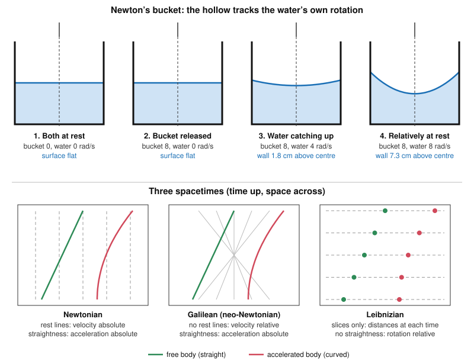

# Philosophy of Physics · Lesson 4.2: Newton's bucket and the structure inertia needs

> ⏱ ~15 min · Module 4: Space and spacetime · Builds on: [4.1](04-01-leibniz-and-clarke-the-shift-arguments.md), [`relativity` 4.5](../../relativity/lessons/04-05-geodesics.md), [`analytical-mechanics` 2.2](../../analytical-mechanics/lessons/02-02-noethers-theorem.md) · Unlocks: [4.3](04-03-the-conventionality-of-simultaneity.md), [4.5](04-05-the-hole-argument.md), [6.1](06-01-symmetries-and-what-they-tell-us.md)

## Why this matters

Twist a bucket's cord, fill the bucket with water and let go. The bucket spins at once while the water stays flat; slowly the water catches up and climbs the wall, and it is most hollow when it has stopped moving relative to the bucket. Something tells the water it is turning, and it is not the bucket. [`mechanics-refresher` 1.2](../../mechanics-refresher/lessons/01-02-newtons-laws.md) said the first law holds in "a reference frame that is itself not accelerating" and never said relative to what: this lesson is where that bill comes due.

## The idea

[4.1](04-01-leibniz-and-clarke-the-shift-arguments.md) left Leibniz a strong hand against place and uniform velocity: shift the whole world, or set it coasting, and nothing observable changes. Rotation is different. Spinning water climbs walls, a cord between two whirling stones goes taut, a Foucault pendulum's plane turns ([`differential-geometry` 4.2](../../differential-geometry/lessons/04-02-parallel-transport.md) reads that as holonomy), and the Coriolis term is bookkeeping that is real in its consequences ([`atmospheric-science` 4.2](../../atmospheric-science/lessons/04-02-coriolis-effect.md)). Newton concluded that such effects reveal *true* motion, motion with respect to [absolute space](../reference.md#absolute-space).

Three answers followed. Newton: space is a thing, so place, velocity and rotation are all absolute. Ernst Mach: the water rotates relative to the rest of the universe's matter, so rotation is relative after all. Howard Stein and John Earman: the effects need much less than Newton's space.

The third answer is a picture. Draw a body's history as a line through spacetime, time running up the page. Newton's space supplies a family of vertical lines, the histories of places at rest, so every line's tilt, its velocity, is a fact. Now erase the verticals but keep the rule that says which lines are straight. Tilt becomes relative, since no line is "the vertical". Bending stays absolute, since straightness is still there, and acceleration and rotation are bending. That rule is [affine structure](../reference.md#affine-structure), a connection, and you have met it: [`relativity` 4.5](../../relativity/lessons/04-05-geodesics.md) wrote free motion as a geodesic and found the centrifugal and Coriolis terms among the Christoffel symbols. An [inertial frame](../reference.md#inertial-frame) is one whose straight coordinate lines are the connection's, which is [`relativity` 1.1](../../relativity/lessons/01-01-postulates-simultaneity.md)'s definition (free particles move uniformly). "Not accelerating" stops being circular: it means not accelerating relative to the connection.

## The argument

Newton's Scholium to the Definitions (Motte, 1729, vol. 1; [`relativity` 1.1](../../relativity/lessons/01-01-postulates-simultaneity.md) quotes its sentence on absolute time) states: "Absolute Space, in its own nature, without regard to any thing external, remains always similar and immoveable" (p. 9). It then argues that true motion cannot be defined by relations to other bodies. The [bucket](../reference.md#newtons-bucket) (pp. 15–16) and the [globes](../reference.md#rotating-globes) (pp. 17–18), in the reconstruction Mach attacked:

**P1.** The water's concavity is an endeavour to recede from the axis, an effect of circular motion. *In words:* hollowing is how rotation shows.

**P2.** The concavity is absent when the water turns fastest relative to the bucket, and greatest when the two are relatively at rest. *In words:* the hollow does not track motion relative to the surrounding bodies.

**C1.** True circular motion is not rotation relative to the surrounding bodies. *In words:* the bucket is not the reference.

**P3.** Two globes joined by a cord and revolving show the endeavour as tension, measurable with nothing else in the universe. *In words:* no reference body is needed at all.

**∴ C2.** True rotation is rotation with respect to absolute space. *In words:* the reference is space itself.

The target of C1 was Descartes, who defined motion as transfer from the immediately surrounding bodies (Stein, "Newtonian Space-Time", 1967). Robert Rynasiewicz's Stanford Encyclopedia entry on Newton's views adds that the globes passage answers a different question: how true motions can be *found*, given that absolute space cannot be seen.

**Mach's reply** (*The Science of Mechanics*, tr. McCormack, 1893, p. 232) grants C1 and refuses C2. The bucket shows only that rotation relative to its sides produces no noticeable centrifugal forces, while rotation "with respect to the mass of the earth and the other celestial bodies" does. On P3: "No one is competent to say how the experiment would turn out if the sides of the vessel increased in thickness and mass till they were ultimately several leagues thick." *In words:* an empty universe is a world nobody has tested. [Mach's principle](../reference.md#machs-principle), the demand that inertia be fixed by the universe's matter, is Einstein's name ("Machsches Prinzip", in "Prinzipielles zur allgemeinen Relativitätstheorie", 1918), not Mach's, and Mach supplied no law.

**Three spacetimes.** Write $t$ for time, $\mathbf{x}$ for position, $R$ for a rotation matrix, $\mathbf{a}$ for a displacement and $\mathbf{u}$ for a constant velocity. Each structure is fixed by the transformations that preserve it (all include $t \to t + t_0$):

- [Newtonian spacetime](../reference.md#newtonian-spacetime): absolute time, Euclidean distance at each time, and absolute space (which point now is the same place as which point then). Symmetries $\mathbf{x} \to R\mathbf{x} + \mathbf{a}$, with $R$ and $\mathbf{a}$ constant.

- [Galilean spacetime](../reference.md#galilean-spacetime), or neo-Newtonian (Stein 1967; Earman, *World Enough and Space-Time*, 1989): absolute time, distance at each time, and a flat connection, with no absolute space. Symmetries $\mathbf{x} \to R\mathbf{x} + \mathbf{u}t + \mathbf{a}$.

- [Leibnizian spacetime](../reference.md#leibnizian-spacetime) (Earman's name): time and distance at each time only. Symmetries $\mathbf{x} \to R(t)\mathbf{x} + \mathbf{a}(t)$, with any time-dependent rotation and shift.

*In words:* more structure, fewer symmetries. Newtonian spacetime makes velocity and rotation absolute, Galilean rotation without velocity, Leibnizian neither.

**[Symmetry matching](../reference.md#symmetry-matching).** Newton's laws, with forces depending on relative distances, are unchanged by every Galilean transformation; [`analytical-mechanics` 2.2](../../analytical-mechanics/lessons/02-02-noethers-theorem.md) P3 shows the boost is a symmetry. Earman asks that spacetime and dynamical symmetries coincide ([6.1](06-01-symmetries-and-what-they-tell-us.md) states his principles). Newtonian spacetime has too few symmetries: its absolute velocity is structure the laws never use, the idle $v$ that [`philosophy-of-science` 2.2](../../philosophy-of-science/lessons/02-02-duhem-quine-and-underdetermination.md) Ex 2 has Stanford delete. Newton's Corollary V says so itself: "The motions of bodies included in a given space are the same among themselves, whether that space is at rest, or moves uniformly forwards in a right line without any circular motion" (p. 30). Leibnizian spacetime has too many: a time-dependent rotation preserves its structure but changes the laws, adding centrifugal and Coriolis terms. Galilean spacetime fits. *In words:* it gives the laws exactly what they use, and so concedes the [kinematic shift](../reference.md#kinematic-shift) to Leibniz and the bucket to Newton.

**[Relationalism](../reference.md#relationalism) revived.** Julian Barbour and Bruno Bertotti ("Mach's Principle and the Structure of Dynamical Theories", 1982) build dynamics from relative configurations alone. [Best matching](../reference.md#best-matching) shifts and rotates each configuration against its predecessor until their difference is least, and the dynamics runs on that fit. It reproduces Newtonian particle dynamics, but only the solutions in which the universe's total angular momentum is zero. Nick Huggett's [regularity relationalism](../reference.md#regularity-relationalism) ("The Regularity Account of Relational Spacetime", 2006) takes another route: the laws, inertial frames included, are the best system of a world of bodies and their changing distances (best systems are [`metaphysics` 4.3](../../metaphysics/lessons/04-03-powers-dispositions-and-laws.md)'s), so the laws privilege frames with no geometry behind them and the connection summarizes relations rather than housing them. Against both, Tim Maudlin ("Buckets of Water and Waves of Space", 1993) argues that spacetime is probably a substance.

**Where the argument is weakest.** The step from C1 and P3 to C2. The strongest objection is Stein's: absolute rotation needs only a connection, and a connection carries no absolute place, so the bucket proves less than Newton's space. The strongest reply is the substantivalist's: a connection is structure at points where no body is, so it must belong to something, and the relationalist pays for the bucket in laws, either restricting the solutions (Barbour and Bertotti) or making inertia a regularity with nothing behind it (Huggett). Each side concedes something. The substantivalist gives up Newton's enduring places and keeps spacetime structure. The relationalist gives up the idea that the bodies' relative distances alone fix how they move.

## The picture

The hollow tracks the water's own rotation, not its rotation relative to the bucket (top), and Galilean spacetime keeps exactly the structure that makes the hollow a fact, straightness without rest (bottom).

## Worked examples

**Example 1 (clean case: the bucket in Newtonian spacetime).** A bucket has inner radius $b = 0.15$ m. Water turning rigidly at angular velocity $\omega$ has the surface $z(r) = \omega^2 r^2/2g$ above its lowest point, where $r$ is the distance from the axis and $g = 9.81$ m/s². Newton's four stages, ending at 8 rad/s:

1. Bucket and water at rest: flat.

2. Bucket at 8 rad/s, water still at rest: flat, though relative rotation is greatest.

3. Water at 4 rad/s: the wall stands 1.8 cm above the centre.

4. Water at 8 rad/s, at rest relative to the bucket: 7.3 cm.

Newtonian spacetime answers every question. The water's rotation relative to absolute space is 0, 0, 4 and 8 rad/s, and the height measures it: $\omega = \sqrt{2g\,\Delta h}/b$, so a rise $\Delta h$ of 7.34 cm gives back 8.0 rad/s. The theory also gives the bucket a velocity through absolute space, and here it goes silent: no stage, height or reading would differ if that velocity were otherwise.

**Example 2 (hard case: Galilean spacetime and Mach's thick vessel).** Galilean spacetime returns the same four rates, now as the rate at which the water's worldlines twist relative to the connection, and it returns no velocity, losing nothing the bucket measured.

Now thicken the vessel, as Mach asked, until its walls are leagues thick and as massive as you like. Newtonian and Galilean mechanics answer at once: the connection is fixed, and a uniform shell exerts no net force inside, so nothing changes. General relativity answers differently: rotating mass drags inertial frames ([`relativity` 6.4](../../relativity/lessons/06-04-kerr-charged-holes.md)), and Brill and Cohen (1966) showed that inside a rotating shell massive enough for its radius the dragging becomes complete. Einstein's 1916 paper had raised Mach's worry (§2, Perrett and Jeffery, 1923, pp. 112–113), calling the privileged space of Newton's mechanics "a merely factitious cause"; in 1918 he granted that his 1915 equations break the principle, since empty flat spacetime solves them, and thought the cosmological term restored it.

**Where it strains.** No theory here gives a neutral verdict. The Machian says both predictions come from theories that already posit inertial structure matter does not fix, so neither tests his claim. The substantivalist says frame dragging is the metric, a dynamical thing, responding to matter, not inertia reducing to it. The strain runs the other way too. Newton's Corollary VI says that bodies all urged by equal accelerative forces along parallel lines move among themselves as if no such forces acted. Simon Saunders ("Rethinking Newton's Principia", 2013) argues that gravitation therefore needs only what he calls Newton–Huygens spacetime (Earman's "Maxwellian" spacetime): absolute rotation without absolute linear acceleration. Even Galilean spacetime may carry structure the laws never use, though James Weatherall (2016) replies that gravity's trajectories restore a standard of acceleration.

## Watch out

- **You might think** the bucket proves that space is a thing, **but actually** it shows at most that rotation is not relative to nearby bodies, Descartes's definition. Galilean spacetime has absolute rotation and no absolute place, and Huggett's relationalist gets rotation from laws that systematize relations.

- **You might think** [substantivalism](../reference.md#substantivalism) about space and about spacetime are one view, **but actually** a Galilean substantivalist believes in spacetime points and a connection while denying that a point of space persists through time. Newton's "immoveable" space is exactly what she gives up.

- **You might think** "fictitious" forces are unreal, so the hollow is an artefact of a frame, **but actually** the surface's shape is the same in every frame. What depends on the frame is whether you describe it with a centrifugal force.

- **You might think** Mach stated Mach's principle, **but actually** the name is Einstein's (1918) and Mach offered a demand without a law. Best matching is one attempt to supply the law, at the price of a non-rotating universe.

## One-liner

> Rotation shows where velocity does not, so the laws need a rule for which motions are straight, or at least unrotating, but none for which things are at rest; whether that rule is a substance, a restriction on solutions or a summary of relations is the dispute that remains.

## Problems

**P1 (🟢)** *(Close reading: Exegetical (a)–(b).)* Newton, Scholium to the Definitions (Motte, *The Mathematical Principles of Natural Philosophy*, London, 1729, vol. 1, pp. 17–18), from its final paragraph:

> [...] the parts of that immoveable space [...] do by no means come under the observation of our senses. Yet the thing is not altogether desperate; for we have some arguments to guide us, [...] partly from the forces, which are the causes and effects of the true motions. For instance, if two globes kept at a given distance one from the other, by means of a cord that connects them, were revolv'd about their common centre of gravity; we might, from the tension of the cord, discover the endeavour of the globes to recede from the axe of their motion, and from thence we might compute the quantity of their circular motions. [...] And thus we might find both the quantity and the determination of this circular motion, ev'n in an immense vacuum, where there was nothing external or sensible with which the globes could be compar'd.

The omitted sentences press equally on alternate faces of the globes and watch whether the tension rises or falls.

(a) What two things does Newton say the globes let us find, and how is each found? One line each.

(b) Which words show that the passage answers how true motion is known, rather than whether it exists? Which words make the case one that no rotation relative to other bodies could explain? Two sentences.

**P2 (🟡)** *(Formal model: Formal (a)–(b) · Exegetical (c).)* In an inertial frame $S$, two globes of mass $m$ joined by a cord revolve about the origin in the $xy$-plane: $\mathbf{x}_{1,2}(t) = \pm r(\cos\omega t, \sin\omega t, 0)$. Consider a boosted frame, $\mathbf{x}' = \mathbf{x} - \mathbf{u}t$ with constant $\mathbf{u}$, and a rotating frame, $\mathbf{x}'' = R(-\Omega t)\,\mathbf{x}$ with $\Omega = \omega$, where $R(\theta)$ rotates by $\theta$ about the $z$-axis.

(a) In $S$ and in each new frame, compute globe 1's velocity and acceleration, the distance between the globes, and the angular velocity of the line joining them. Say which of the four quantities each transformation preserves. Show the computation.

(b) Take $m = 2$ kg, $r = 0.5$ m and $\omega = 3$ rad/s. Compute the cord's tension from Newton's second law in $S$. Then write the second law for globe 1 in each new frame, with the cord's pull as the only force, and say in which frame it fails and what term must be added. Show the computation.

(c) Which of Newtonian, Galilean and Leibnizian spacetime has exactly the symmetries that (b) shows the laws to have, and what does each of the other two get wrong? Two sentences.

**P3 (🔴)** *(Apply to a hard case: Exegetical (a) · Evaluative (b).)* Empty the universe of everything except P2's globes, cord taut and separation fixed.

(a) What does each of these say about this world: Galilean spacetime; Mach, applying his reply to the bucket; Barbour and Bertotti's best matching? One line each.

(b) Does Galilean (neo-Newtonian) spacetime vindicate Newton or Leibniz? Any verdict, including "neither" or "both, on different questions"; 150 words or fewer.

Solutions

**P1** *(Exegetical (a)–(b).)*

**Must hit, strict (a):**

- The quantity of the circular motion (its rate): computed from the tension of the cord, which measures "the endeavour of the globes to recede from the axe".

- The determination (the sense or direction of rotation): found from whether the tension rises or falls when equal forces are impressed on alternate faces.

**Must hit, strict (b):**

- Knowing, not existing: "do by no means come under the observation of our senses", "the thing is not altogether desperate", "arguments to guide us", and the verbs "discover", "compute", "find". The forces enter as evidence, "the causes and effects of the true motions".

- No relative rotation: "ev'n in an immense vacuum, where there was nothing external or sensible with which the globes could be compar'd", together with "kept at a given distance": the one relation the globes have, their distance, never changes.

**Wrong turns:** reading the paragraph as Newton's proof that absolute space exists, which is the job of the arguments before it, the bucket among them (Rynasiewicz's reading in the Stanford Encyclopedia). Taking "determination" to mean the amount. Saying the globes rotate relative to each other: their distance is fixed, and there is nothing else to rotate relative to.

**Model answer:** (a) The quantity of the rotation, computed from the cord's tension, which measures the endeavour to recede from the axis; and its determination, or direction, found by pushing equally on alternate faces and seeing whether the tension rises or falls. (b) "Do by no means come under the observation of our senses" and "the thing is not altogether desperate" set an epistemic problem, which "discover", "compute" and "find" answer from the forces as "causes and effects". "Ev'n in an immense vacuum, where there was nothing external or sensible with which the globes could be compar'd", with the globes "kept at a given distance", rules out every relative rotation.

---

**P2** *(Formal (a)–(b) · Exegetical (c).)*

(a) In $S$: differentiate $\mathbf{x}_1 = r(\cos\omega t, \sin\omega t, 0)$ to get

$$\dot{\mathbf{x}}_1 = r\omega(-\sin\omega t, \cos\omega t, 0), \qquad \ddot{\mathbf{x}}_1 = -\omega^2\mathbf{x}_1.$$

The separation $\mathbf{x}_1 - \mathbf{x}_2 = 2\mathbf{x}_1$ has length $2r$ and turns at $\omega$.

Boost: $\mathbf{x}_1' = \mathbf{x}_1 - \mathbf{u}t$, so $\dot{\mathbf{x}}_1' = \dot{\mathbf{x}}_1 - \mathbf{u}$ and $\ddot{\mathbf{x}}_1' = \ddot{\mathbf{x}}_1$. The $\mathbf{u}t$ terms cancel in $\mathbf{x}_1' - \mathbf{x}_2' = \mathbf{x}_1 - \mathbf{x}_2$, so the distance is $2r$ and the line turns at $\omega$. Preserved: acceleration, distance, angular velocity. Changed: velocity.

Rotating frame: $\mathbf{x}_1'' = R(-\omega t)\,r(\cos\omega t, \sin\omega t, 0) = (r, 0, 0)$, a constant, and $\mathbf{x}_2'' = (-r, 0, 0)$. So $\dot{\mathbf{x}}_1'' = \mathbf{0}$, $\ddot{\mathbf{x}}_1'' = \mathbf{0}$, the distance is $2r$, and the line does not turn (in general it turns at $\omega - \Omega$). Preserved: distance only.

(b) In $S$ the cord supplies the whole force: $T = m\omega^2 r = 2 \times 3^2 \times 0.5 = 9$ N, toward the centre ($|\ddot{\mathbf{x}}_1| = 4.5$ m/s², speed $r\omega = 1.5$ m/s).

Boost: the pull depends only on the separation, which is unchanged, and $m\ddot{\mathbf{x}}_1' = m\ddot{\mathbf{x}}_1$, so $m\ddot{\mathbf{x}}_1' = \mathbf{F}$ holds as before.

Rotating frame: $m\ddot{\mathbf{x}}_1'' = \mathbf{0}$, but the cord still pulls inward with 9 N, so the law fails. Balance needs the centrifugal term $-m\boldsymbol{\Omega}\times(\boldsymbol{\Omega}\times\mathbf{x}'')$, of size $m\Omega^2 r = 9$ N outward, with $\boldsymbol{\Omega} = \Omega\hat{\mathbf{z}}$. The Coriolis term $-2m\boldsymbol{\Omega}\times\dot{\mathbf{x}}''$ also belongs to the law in this frame and vanishes here because $\dot{\mathbf{x}}'' = \mathbf{0}$.

(c) Galilean spacetime: its symmetries $\mathbf{x} \to R\mathbf{x} + \mathbf{u}t + \mathbf{a}$ are exactly the transformations that keep $m\ddot{\mathbf{x}} = \mathbf{F}$. Newtonian spacetime does not count boosts as symmetries, so it posits an absolute velocity the laws never use; Leibnizian spacetime counts the rotating frame as a symmetry although the law fails there, so it cannot say the globes rotate.

**Must hit, strict:**

- Velocity shifts by $-\mathbf{u}$ under the boost; acceleration, distance and angular velocity are unchanged.

- In the rotating frame the globes are at rest with zero acceleration; the distance $2r$ survives and the angular velocity drops to $\omega - \Omega = 0$.

- $T = 9$ N; the second law fails only in the rotating frame and needs the centrifugal term ($9$ N), with Coriolis zero here.

- (c): Galilean matches; Newtonian has too much structure (absolute velocity), Leibnizian too little (no rotation).

**Wrong turns:** letting the boost change the acceleration; letting the rotation change the distance; calling the centrifugal term a force in $S$; arguing that the rotating frame is ruled out because the globes are at rest in it, when it is ruled out because the law changes form there.

---

**P3** *(Exegetical (a) · Evaluative (b).)*

**Accept (a):** for Mach, either "he declines to predict" or "on a Machian law the cord would be slack", provided the second is credited to a Machian law and not to Mach's text.

**Must hit, strict (a):**

- Galilean spacetime: the globes rotate at $\omega$, since their worldlines are helices curved relative to the connection, and the cord carries $m\omega^2 r$ (9 N with P2's numbers); their centre has no velocity at all.

- Mach: the case is a counterfactual about a universe nobody has observed, so "no one is competent to say" whether the cord would be taut. A law of the kind Einstein later named Mach's principle, inertia fixed by other masses, gives no reason for it to be taut.

- Barbour and Bertotti: the only relation, one distance, never changes, so best matching makes the history static. The Newtonian description has total angular momentum $2mr^2\omega = 3$ kg m²/s, outside the zero-angular-momentum sector the theory reproduces, so the taut-cord world is impossible, not rotating.

**Must hit, any verdict (b):**

- What it concedes to Leibniz: no absolute place or velocity, so the static and kinematic shifts of 4.1 are no difference.

- What it concedes to Newton: absolute acceleration and rotation, and structure that instantaneous relative distances do not fix, so the globes rotate in an empty world.

- The crux: whether that structure needs a bearer, spacetime as a substance, or can be a feature of laws over relations; equivalently, whether "Newton" means absolute space or absolute motion.

- One relationalist rescue at its defenders' strength, with its cost: best matching (no rotating universes) or Huggett (laws as a best system, inertia a regularity with nothing behind it).

**Wrong turns:** treating Galilean spacetime as Newton's space with a new name. Saying it makes rotation relative to the fixed stars. Saying Huggett denies that rotation is a fact: his best system privileges frames, and rotation is defined relative to them. Settling the question by appeal to general relativity alone, whose metric each side reads its own way.

**Model answer (b), one of several:** Both, on different questions, and the remaining question is open. On motion, Newton wins: rotation and acceleration are absolute, and the globes rotate with nothing to rotate relative to. On space, Leibniz wins: there is no fact about where the world is or how fast it moves, which is why the shifts make no difference. What neither concession settles is what the connection is. The substantivalist says straightness at points where no body is must belong to something, so spacetime is a substance, just not Newton's. The relationalist answers in two ways. Barbour and Bertotti rebuild the dynamics from relations, at the price of declaring a rotating universe impossible. Huggett takes the inertial structure to be a feature of the best system of the relations, at the price of Humean laws. Which price is higher is the dispute.

## Flashback

**From Lesson [3.3](03-03-nonlocality-and-relativity.md) (Nonlocality and relativity):** *(Close reading: Exegetical (a)–(b).)* Einstein, *Relativity: The Special and General Theory*, ch. IX, tr. R. W. Lawson (Methuen, 1920; the Project Gutenberg text of the 1924 revised edition):

> Events which are simultaneous with reference to the embankment are not simultaneous with respect to the train, and *vice versa* (relativity of simultaneity). Every reference-body (co-ordinate system) has its own particular time; unless we are told the reference-body to which the statement of time refers, there is no meaning in a statement of the time of an event.

(a) Which premise of 3.3's argument does the second sentence supply, and which word of the textbook collapse story does it empty? One sentence.

(b) How do Bohmian mechanics, Fleming's collapse and Tumulka's flash GRW each meet the demand to be "told the reference-body", and which adds a [preferred foliation](../reference.md#preferred-foliation)? One line each.

Solution

**Accept (a):** D2 (frame-dependent order) named with P3, if the emptied word is identified.

**Must hit, strict (a):** P3: if the nonlocal dependence is a process occurring at a time, "at a time" picks out a spacelike hypersurface, and the light cones pick out none. The word emptied is "instantly", in "Alice's measurement changes Bob's state instantly", which is not yet a relativistic law.

**Accept (b):** for Bohm, 3.3's note on the 2014 proposal that the universal wavefunction fixes the foliation covariantly, if the answer adds that a distinguished foliation is still needed.

**Must hit, strict (b):**

- Bohmian mechanics names one reference body for everything: a preferred foliation whose leaves fix the "same time" at which the other particles' positions set each particle's velocity, hidden by equilibrium. It fails Maudlin's question (v).

- Fleming takes the passage at its word: the state is collapsed on every spacelike hyperplane through the measurement, so a state, like a time, is hyperplane-relative, and no hyperplane is preferred.

- Flash GRW (Tumulka 2006; Dove 1996) needs none: its world is flashes, not states, under one joint chance law that no foliation enters, so no change happens "at a time".

- Only Bohm adds a preferred foliation.

**Wrong turns:** answering with no-signalling, which settles question (ii), not which hypersurface a collapse runs along. Giving Fleming a preferred hyperplane, or flash GRW the lab frame. Making every time order frame-relative: D2 concerns spacelike pairs. Treating Bohm's foliation as extra in every spacetime: in this lesson's Galilean spacetime absolute time already supplies its leaves.

**Model answer:** (a) P3, that "at a time" needs a spacelike hypersurface the light cones do not supply, so the collapse story's "instantly" means nothing until one is named. (b) Bohm names a hidden preferred foliation along which positions guide each other. Fleming makes the state hyperplane-relative, collapsed on every hyperplane through the measurement. Flash GRW needs no reference body: one joint chance law for the flashes, with no foliation in it. Only Bohm adds a preferred foliation, failing (v).

## Connections

- **Backward:** Galilean spacetime is [4.1](04-01-leibniz-and-clarke-the-shift-arguments.md)'s kinematic shift made into geometry, with a world at rest and the same world coasting counted as one, and it is [`philosophy-of-science` 2.2](../../philosophy-of-science/lessons/02-02-duhem-quine-and-underdetermination.md)'s "delete $v$" done by deleting structure. It cashes out the inertial frame of [`mechanics-refresher` 1.2](../../mechanics-refresher/lessons/01-02-newtons-laws.md) with the connection of [`relativity` 4.5](../../relativity/lessons/04-05-geodesics.md).

- **Forward:** [4.3](04-03-the-conventionality-of-simultaneity.md) replaces absolute time with Minkowski spacetime, which keeps a flat connection and loses absolute simultaneity. [4.5](04-05-the-hole-argument.md) asks whether substantivalism about spacetime points survives general relativity's dynamical metric, where Machian frame dragging ([`relativity` 6.4](../../relativity/lessons/06-04-kerr-charged-holes.md)) lives. [6.1](06-01-symmetries-and-what-they-tell-us.md) states the symmetry principles used above in general.

- **Sideways:** Galilean spacetime is the geometry behind the Galilean invariance of [`analytical-mechanics` 2.2](../../analytical-mechanics/lessons/02-02-noethers-theorem.md), whose boost charge says the centre of mass moves uniformly, the laws' own admission that velocity is idle. Huggett's view applies the best-system account of laws from [`metaphysics` 4.3](../../metaphysics/lessons/04-03-powers-dispositions-and-laws.md) to spacetime, and inertia is the standard objection to "whatever is moved is moved by another" in [`metaphysics` 4.4](../../metaphysics/lessons/04-04-ordered-causal-series.md). The rotating Earth of [`atmospheric-science` 4.2](../../atmospheric-science/lessons/04-02-coriolis-effect.md) and the Foucault pendulum of [`differential-geometry` 4.2](../../differential-geometry/lessons/04-02-parallel-transport.md) are the bucket at planetary scale.
