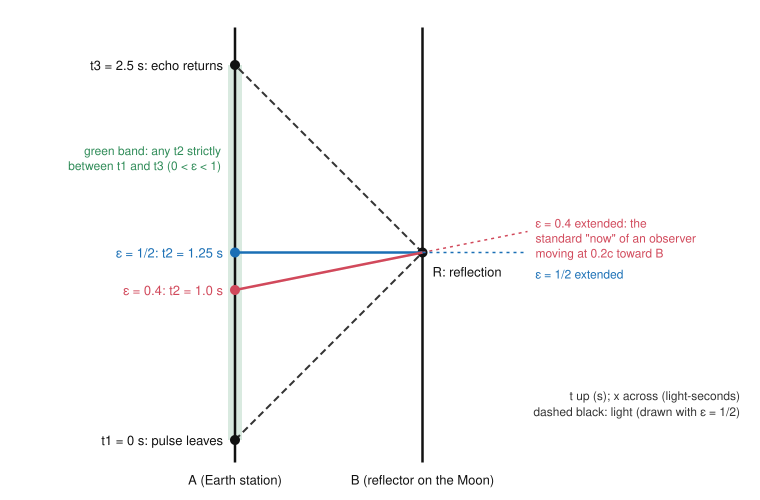

# Philosophy of Physics · Lesson 4.3: The conventionality of simultaneity

> ⏱ ~15 min · Module 4: Space and spacetime · Builds on: [4.1](04-01-leibniz-and-clarke-the-shift-arguments.md), [`relativity` 1.1](../../relativity/lessons/01-01-postulates-simultaneity.md), [`relativity` 1.4](../../relativity/lessons/01-04-spacetime-interval-causality.md) · Unlocks: [4.4](04-04-geometry-convention-or-dynamics.md), [`metaphysics` 5.2](../../metaphysics/lessons/05-02-presentism-growing-block-eternalism.md)

## Why this matters

Since 1969 observatories have fired laser pulses at reflectors the Apollo astronauts left on the Moon and timed the echoes: about two and a half seconds there and back. Nobody has timed the trip up. That needs a Moon clock set to agree with the Earth clock, and setting it by light signals needs the one-way speed you wanted to measure. Whether "the pulse reached the Moon after 1.25 seconds" is a fact or a choice decides what relativity can tell metaphysics about time, including whether the future is already real.

## The idea

One clock can time a round trip. Timing one leg needs two clocks already synchronized, and synchronizing them by light needs the one-way speed. Hans Reichenbach (*Philosophie der Raum-Zeit-Lehre*, 1928) concluded that any time assigned to the reflection, strictly between departure and return, fits every round-trip measurement, so choosing one is a [convention](../reference.md#conventionality-of-simultaneity). Poincaré had said as much in 1898 of astronomers timing light: "He has begun by _supposing_ that light has a constant velocity, and in particular that its velocity is the same in all directions. That is a postulate without which no measurement of this velocity could be attempted" ("The Measure of Time", tr. G. B. Halsted, *The Foundations of Science*, 1913).

[`relativity` 1.1](../../relativity/lessons/01-01-postulates-simultaneity.md) synchronizes clocks by a flash from their midpoint, the physics course's working definition; this lesson keeps its settled relativity of simultaneity and asks what the flash assumed. Popper's [conventionalist stratagem](../../philosophy-of-science/lessons/02-01-popper-conjectures-and-refutations.md) is a banned rescue of a theory by redefinition, aimed at Poincaré-style moves, and [`metaphysics` 5.3](../../metaphysics/lessons/05-03-coincidence-and-the-ship-of-theseus.md)'s conventionalist calls a persistence question verbal. The thesis here is a third: a theory's invariant structure leaves a parameter unfixed. Malament challenges it; Rietdijk, Putnam and Stein carry it into the metaphysics of time.

## The argument

**[Einstein's rule](../reference.md#einstein-synchronization)** (1905, §1, in Perrett and Jeffery's translation, 1923). A ray leaves A at A-time $t_A$, is reflected at B at B-time $t_B$, and returns to A at $t'_A$. The clocks are synchronous if

$$t_B - t_A = t'_A - t_B .$$

*In words:* the trip out and the trip back take equal time.

**[Reichenbach's ε](../reference.md#reichenbach-epsilon).** A signal leaves A at $t_1$, reflects at B, and returns at $t_3$; the reflection is assigned

$$t_2 = t_1 + \varepsilon\,(t_3 - t_1), \qquad 0 < \varepsilon < 1 .$$

With A and B a distance $d$ apart, so $t_3 - t_1 = 2d/c$, the [one-way speeds](../reference.md#one-way-speed-of-light) are

$$c_{\text{out}} = \frac{c}{2\varepsilon}, \qquad c_{\text{back}} = \frac{c}{2(1-\varepsilon)},$$

whose harmonic mean is $c$ for every $\varepsilon$. *In words:* every ε reproduces the measured round trip, and only $\varepsilon = \tfrac12$, Einstein's rule, makes the legs equal. The bounds keep the reflection after the departure that causes it and before the return it causes.

**The midpoint flash is $\varepsilon = \tfrac12$ in disguise.** A flash from the midpoint of clocks P and Q, a distance $L$ apart (Q in the outbound direction), reaches Q later than P by $(2\varepsilon - 1)L/c$, which vanishes only at $\varepsilon = \tfrac12$. *In words:* setting both clocks to the same reading on arrival assumes equal speeds from the middle.

**The conventionality argument** (Reichenbach 1928; Adolf Grünbaum, *Philosophical Problems of Space and Time*, 1963).

**P1.** The only non-conventional ground for saying two distant events are *not* simultaneous is that a causal signal could connect them. *In words:* time order at a distance is causal order or nothing.

**P2.** In special relativity no causal signal outruns light. *In words:* the [light cones](../../relativity/lessons/01-04-spacetime-interval-causality.md) bound every influence.

**P3.** Every event at A strictly between $t_1$ and $t_3$ is spacelike to the reflection. *In words:* no signal links the reflection to any one of those moments.

**∴ C.** No physical fact fixes which of them is simultaneous with the reflection; any ε in $(0,1)$ may be chosen. *In words:* "same time over there" contains a choice.

Grünbaum adds that $\varepsilon = \tfrac12$ is simpler only in notation. Proposed one-way measurements, by slowly transported clocks (Ellis and Bowman, 1967) or by momentum conservation, were each argued to presuppose an equivalent convention (Winnie 1970; Salmon 1977).

**[Malament's theorem](../reference.md#malaments-simultaneity-theorem)** (David Malament, *Noûs*, 1977). Let $O$ be an inertial worldline. If a relation $S$ (i) is definable from symmetric causal connectibility and $O$, (ii) is an equivalence relation, (iii) relates some event on $O$ to some event off it, and (iv) is not universal, then $S$ is standard synchrony relative to $O$. *In words:* build simultaneity from which events could signal which, plus one inertial worldline, and only $\varepsilon = \tfrac12$ comes out. "Definable" works in the proof as invariance under every map that preserves causal connectibility and carries $O$ onto itself; one such map, a time reflection fixing the reflection event, swaps departure and return and so sends $\varepsilon$ to $1 - \varepsilon$.

Allen Janis (1983) and Grünbaum (2010): each inertial worldline gets its own unique synchrony, and choosing the worldline has exactly the latitude of ε (Example 1). Michael Redhead (1993) and Grünbaum question premise (ii). Sahotra Sarkar and John Stachel (1999) deny that simultaneity must be invariant under time reflection; without that, "lies on the past light cone of a fixed event" also qualifies.

**The [Rietdijk–Putnam argument](../reference.md#rietdijk-putnam-argument)** (C. W. Rietdijk, 1966; Hilary Putnam, "Time and Physical Geometry", 1967). Putnam assumes that I-now am real and that some other observer, perhaps moving relative to me, is real. His principle "There Are No Privileged Observers": if all and only the things bearing a frame-independent relation $R$ to me-now are real, and you-now are real, the same holds for you-now; he notes that this requires $R$ to be transitive. Read his principle that what exists now is real with each observer's own simultaneity. Let Bob pass Alice at event O at $0.6c$, heading for a relay station 3 light-hours away at rest relative to her. Bob's simultaneity through O meets the relay at Alice's time $t = vx/c^2 = 1.8$ hours. Bob is real for Alice, being where she is; the relay event is real for Bob; by transitivity it is real for Alice, though it lies in her future. Enough observers reach every event: the [block universe](../reference.md#block-universe). Penrose's walking version (*The Emperor's New Mind*, 1989) is [`relativity` 1.1](../../relativity/lessons/01-01-postulates-simultaneity.md) Example 2.

**[Stein's reply](../reference.md#point-relative-becoming)** (Howard Stein, "On Einstein–Minkowski Space-Time", 1968; "On Relativity Theory and Openness of the Future", 1991). Seek a relation "$y$ has already become for $x$" defined from spacetime's intrinsic structure, reflexive, transitive and not universal. One exists: $y$ lies in or on $x$'s past light cone. And if two distinct events bear it to each other, it is universal. *In words:* a present that has not swallowed everything is a single point, so becoming is relative to a here-now, not to a frame's slice. Craig Callender (2000) prices it: a present should contain some event besides its owner, yet the only alternative Stein's result leaves is the block.

Persistence takes the same hit, as [`metaphysics` 5.4](../../metaphysics/lessons/05-04-endurance-perdurance-and-stages.md) notes: a thing wholly present at each moment must be wholly present on every slice of its history any frame cuts, so endurance needs frame- or foliation-relative presence. Perdurantists such as Yuri Balashov (*Persistence and Spacetime*, 2010) claim the advantage; Cody Gilmore ("Where in the Relativistic World Are We?", 2006) builds relativistic endurance in reply.

[`metaphysics` 5.1](../../metaphysics/lessons/05-01-the-a-theory-and-the-b-theory.md) names the presentist's exits: a privileged frame undetectable in principle, a [preferred foliation](../reference.md#preferred-foliation) like the one Bohmian mechanics needs ([3.3](03-03-nonlocality-and-relativity.md)); or [presentness relativized to frames](../reference.md#frame-relative-presentism), on which existence would come out frame-relative, as [`metaphysics` 5.2](../../metaphysics/lessons/05-02-presentism-growing-block-eternalism.md) states the objection. The verdict on presentism belongs to metaphysics 5.2.

**Where the argument is weakest.** Malament's premise (i), definability. The strongest objection (Janis, Grünbaum): the theorem relativizes simultaneity to an inertial worldline, and every ε-relation in A's frame is the standard relation of some observer moving past A, so the convention has moved, not vanished. The strongest reply, on Malament's behalf: the conventionalist asked about A's rest frame, so the question supplies $O$, and relative to it the causal facts fix $\varepsilon = \tfrac12$. The conventionalist concedes that, given the worldline, only standard synchrony is causally definable. The anti-conventionalist concedes that the theorem bites only if definability, time-reflection invariance included, is the test of the non-conventional, a philosophical choice.

## The picture

The echo fixes only $t_1$ and $t_3$; the $\varepsilon = 0.4$ pairing is the "now" of an observer passing at $0.2c$.

## Worked examples

**Example 1 (clean case: the lunar echo).** Idealize both as at rest in one inertial frame. The pulse leaves at $t_1 = 0$ and returns at $t_3 = 2.5$ s, so the Moon is 1.25 light-seconds away, about 374,700 km, and Einstein's rule gives $t_2 = 1.25$ s.

- Someone holds that light goes up at $\tfrac54 c$. Then $\varepsilon = c/(2 \cdot \tfrac54 c) = 0.4$ and $t_2 = 0.4 \times 2.5 = 1.0$ s; light returns at $c/(2 \times 0.6) = \tfrac56 c$, so 1.0 s up and 1.5 s down, 2.5 s in all. A Moon clock set this way reads 0.25 s behind an Einstein-synchronized one.

- The echo permits any $t_2$ strictly between 0 and 2.5 s, so any upward speed above $c/2$.

- The arithmetic behind Janis's point: an observer passing the station toward the Moon at $v$ has simultaneity lines $t = vx/c^2 + \text{const}$. With $v = 0.2c$, the line through the reflection (1.25 light-seconds, 1.25 s) meets the station at $1.25 - 0.2 \times 1.25 = 1.0$ s, the $\varepsilon = 0.4$ assignment. In general $\varepsilon$ matches $v = (1 - 2\varepsilon)c$, and $0 < \varepsilon < 1$ is exactly $-c < v < c$.

**Example 2 (hard case: symmetry and transitivity).** 1905 §1 assumes the definition holds for any number of clocks: if B is synchronous with A, then A with B; if A is synchronous with B and with C, then B with C. His popular book calls the transitivity clause "a physical hypothesis about the law of propagation of light" (*Relativity*, ch. VIII, note, Lawson's translation). Do these conditions force $\varepsilon = \tfrac12$?

Try the time coordinate $t' = t + \mathbf{k}\cdot\mathbf{x}/c$, with $t$ and $\mathbf{x}$ standard and $\mathbf{k} = -0.2\,\hat{\mathbf{x}}$. A signal from P to Q then gets $\varepsilon_{PQ} = \tfrac12(1 + \mathbf{k}\cdot\hat{\mathbf{n}}_{PQ})$, with $\hat{\mathbf{n}}_{PQ}$ the unit vector from P to Q. Put clocks at A $(0,0)$, B $(3,0)$ and C $(0,4)$, in light-seconds.

- $\varepsilon_{AB} = 0.4$ and $\varepsilon_{BA} = 0.6$; $\varepsilon_{AC} = \varepsilon_{CA} = 0.5$; $\hat{\mathbf{n}}_{BC} = (-0.6, 0.8)$, so $\varepsilon_{BC} = 0.56$ and $\varepsilon_{CB} = 0.44$.

- A clock set by $\varepsilon_{PQ}$ sits $(2\varepsilon_{PQ} - 1)\,d_{PQ}/c$ from the clock that set it. A to B to C gives $-0.6$ s, then $+0.6$ s: total 0, as A to C directly.

- Each reverse ε is 1 minus the forward one, so the relation is symmetric; it is transitive because every reading comes from one time function.

So Einstein's conditions admit a family: any $|\mathbf{k}| < 1$, and more generally any time function $t + \varphi(\mathbf{x})/c$ with $|\nabla\varphi| < 1$ (the scalar-field freedom of Minguzzi 2002). What they exclude is one ε in every direction (problem P2). Here the account stops. Fixing $\mathbf{k} = 0$ needs isotropy, which the conventionalist calls the convention restated and the anti-conventionalist calls the rotational symmetry of the laws about $O$, Malament's invariance demand again.

## Watch out

- **You might think** the conventionality thesis is the relativity of simultaneity, **but actually** that is settled physics: frames that each use standard synchrony disagree. Conventionality is a further claim about a single frame.

- **You might think** Malament proved conventionalism false, or proved nothing, **but actually** he proved a uniqueness theorem whose premises are the dispute: definability, time-reflection invariance, and simultaneity as an equivalence relation.

- **You might think** Stein's reply rescues presentism, **but actually** his becoming is relative to a point: no event spacelike to you is present to you. And the block conclusion is fatalism (Savitt's term), not [determinism](05-01-determinism-in-physical-theories.md): no law of motion appears in it.

## One-liner

> Round trips fix only an interval for a distant event's time; Malament asks whether causal structure leaves $\varepsilon = \tfrac12$ as the only real choice, and Stein answers Rietdijk and Putnam's block with a present the size of a point.

## Problems

**P1 (🟢)** *(Close reading: Exegetical (a)–(c).)* From Einstein, *Relativity: The Special and General Theory*, ch. VIII, tr. R. W. Lawson (Methuen, 1920; the Project Gutenberg text of the 1924 revised edition). The narrator has just objected that the midpoint observer's test assumes light travels from A to M and from B to M at the same speed, which could be checked only with a way of measuring time already in hand.

> After further consideration you cast a somewhat disdainful glance at me—and rightly so—and you declare: “I maintain my previous definition nevertheless, because in reality it assumes absolutely nothing about light. There is only *one* demand to be made of the definition of simultaneity, namely, that in every real case it must supply us with an empirical decision as to whether or not the conception that has to be defined is fulfilled. That my definition satisfies this demand is indisputable. That light requires the same time to traverse the path *A* → *M* as for the path *B* → *M* is in reality neither a *supposition nor a hypothesis* about the physical nature of light, but a *stipulation* which I can make of my own freewill in order to arrive at a definition of simultaneity.”

(a) What exactly is stipulated, and what objection does the stipulation answer? Two sentences.

(b) Which words mark it as a convention rather than a claim about light, and who in the dialogue speaks them? One line each.

(c) Is this Einstein's 1905 round-trip rule or the midpoint version, and which value of Reichenbach's ε does it fix? One sentence.

**P2 (🟡)** *(Formal model: Formal (a)–(b) · Evaluative (c).)* Clocks A and B are at rest in one inertial frame, $d$ apart. Say B is *ε-synchronous with A* when a signal leaving A at A-time $t_1$ and returning at $t_3$ finds B reading $t_1 + \varepsilon(t_3 - t_1)$ at the reflection. Work in standard coordinates, with A reading the standard time $t$ and B reading $t + \delta$ (what a clock reads at an event does not depend on the coordinates used).

(a) Find $\delta$, in terms of $\varepsilon$ and $d$, for which B is ε-synchronous with A. Show the computation.

(b) B now runs the same test on A with the same ε. Show that A passes only if $\varepsilon = \tfrac12$. Then take $\varepsilon = \tfrac13$, $d = 3$ light-seconds and B's emission at B-reading 0: give A's reading at the reflection, B's reading at the return, what the rule demands of A, and the mismatch. Show the computation.

(c) Does (b) refute the conventionality thesis? Two sentences.

**P3 (🔴)** *(Reconstruct: Exegetical (a)–(b) · Evaluative (c).)*

(a) Reconstruct Putnam's 1967 argument, as this lesson presents it, in numbered premises and a conclusion, and mark the step where transitivity does its work.

(b) Which of your premises does Stein deny, and which of Putnam's demands on the relation does Stein keep? Two sentences.

(c) Putnam had considered tying determinateness to the light cone and objected, in substance, that it makes what is determinate depend on its relation to one special person, and that someone whose whole life lies outside your light cone would come to have existed without its ever having been true, for you, that he exists now. Does the objection succeed against Stein? Any verdict; 150 words or fewer. (This is not [`metaphysics` 5.2](../../metaphysics/lessons/05-02-presentism-growing-block-eternalism.md) P3: the question is Stein's relation, not the presentist's escape.)

Solutions

**P1** *(Exegetical (a)–(c).)*

**Must hit, strict (a):**

- What is stipulated: that light takes the same time from A to the midpoint M as from B to M, that is, equal one-way speeds on the two halves of the track.

- The objection answered: circularity. Checking the equality would need clocks already synchronized, which is what the definition was to provide.

**Must hit, strict (b):**

- The words: "neither a *supposition nor a hypothesis* about the physical nature of light, but a *stipulation* which I can make of my own freewill"; supporting: "in reality it assumes absolutely nothing about light".

- The speaker: the imagined reader ("you declare"), whom the narrator endorses ("and rightly so"); the narrator had raised the circularity objection.

**Must hit, strict (c):** the midpoint version, an observer at M receiving both flashes, not the 1905 round trip. It fixes $\varepsilon = \tfrac12$, since it requires equal speeds toward M from both sides.

**Accept:** noting the passage's verificationist criterion ("only *one* demand": an empirical decision in every real case); noting that Einstein's footnote to the next paragraph calls the transitivity of the resulting relation "a physical hypothesis", so the value is stipulated while the consistency is claimed as fact.

**Wrong turns:** reading the stipulation as the light postulate (that $c$ is the same in every frame); the passage says it assumes nothing about light's nature. Taking the narrator's objection to be Einstein's final view. Crediting the passage with Reichenbach's range: it stipulates equality and does not say other values would serve, so whether "of my own freewill" implies alternatives is a further, evaluative reading.

**Model answer:** (a) The stipulation is that light takes equal times from A to M and from B to M. It answers the charge of a logical circle, since testing that equality would need a means of measuring time at both places. (b) "neither a supposition nor a hypothesis about the physical nature of light, but a stipulation which I can make of my own freewill"; spoken by the reader, endorsed by the narrator. (c) The midpoint version, which fixes $\varepsilon = \tfrac12$.

---

**P2** *(Formal (a)–(b) · Evaluative (c).)*

(a) A's test. The signal leaves at standard time $t_1$, when A reads $t_1$; it reaches B at standard $t_1 + d/c$, when B reads $t_1 + d/c + \delta$; it returns at standard $t_1 + 2d/c$, when A reads the same. The rule requires

$$t_1 + \frac{d}{c} + \delta = t_1 + \varepsilon\,\frac{2d}{c} \quad\Longrightarrow\quad \delta = (2\varepsilon - 1)\,\frac{d}{c}.$$

(b) B's test. B emits at B-reading $s$, standard time $s - \delta$. The signal reaches A at standard $s - \delta + d/c$, which A reads; it returns to B at standard $s - \delta + 2d/c$, when B reads $s + 2d/c$. The rule demands that A read $s + 2\varepsilon d/c$. With $\delta$ from (a), A's reading minus the demand is

$$\left(s - \delta + \frac{d}{c}\right) - \left(s + \frac{2\varepsilon d}{c}\right) = (1 - 2\varepsilon)\frac{d}{c} + (1 - 2\varepsilon)\frac{d}{c} = 2(1 - 2\varepsilon)\,\frac{d}{c},$$

which is zero only if $\varepsilon = \tfrac12$.

Numbers, $\varepsilon = \tfrac13$, $d = 3$ light-seconds: $\delta = (\tfrac23 - 1) \times 3 = -1$ s. B emits at B-reading 0, standard time 1 s. The signal reaches A at standard 4 s, so A reads **4 s**; it returns to B at standard 7 s, when B reads **6 s**. The rule demands $0 + \tfrac13 \times 6 = $ **2 s** of A. Mismatch: $4 - 2 = $ **2 s**, which is $2(1 - \tfrac23) \times 3$. A would pass with $\varepsilon' = 4/6 = \tfrac23 = 1 - \varepsilon$.

**Must hit, strict (a)–(b):** $\delta = (2\varepsilon - 1)d/c$; B's emission converted to standard time before the signal is followed; the mismatch $2(1 - 2\varepsilon)d/c$ and its zero at $\varepsilon = \tfrac12$; the readings 4 s and 6 s, the demand 2 s, the mismatch 2 s.

**Must hit, any verdict (c):**

- Say what (b) shows: one ε applied from every clock contradicts Einstein's symmetry condition unless $\varepsilon = \tfrac12$.

- Say what it leaves open: an assignment that is direction-dependent, ε one way and $1 - \varepsilon$ the other, is symmetric (Example 2), so the conventionalist restates the thesis as a freedom in one-way speeds by direction. An anti-conventionalist may answer that the consistency conditions have already cut the freedom down, and that isotropy finishes the job; either verdict passes if both points are made.

**Wrong turns:** shifting A's clock by $\delta$ as well as B's, which counts the offset twice; giving the mismatch as $\delta$ rather than $2(1 - 2\varepsilon)d/c$; declaring the thesis refuted without considering the direction-dependent assignment.

**Model answer (c), one of several:** No. It shows that a single ε used from both ends is inconsistent with symmetry, but an assignment that is symmetric (ε toward B, $1 - \varepsilon$ toward A, here $\tfrac13$ and $\tfrac23$) reproduces every round trip, so the choice survives as a choice of one-way speeds by direction.

---

**P3** *(Exegetical (a)–(b) · Evaluative (c).)*

**Must hit, strict (a):**

- **R1.** I-now am real.

- **R2.** Another observer, possibly moving relative to me, is real.

- **R3.** No privileged observers: if all and only the things bearing $R$ to me-now are real, and you-now are real, then all and only the things bearing $R$ to you-now are real; $R$ is a frame-independent physical relation, and so must be transitive.

- **R4.** Whatever exists now is real, "now" meaning simultaneous with the observer in that observer's own frame.

- **R5.** Special relativity: an observer passing me at speed has events in his simultaneity slice that lie in my future.

- **∴ C.** Some event in my future is real; with enough observers, every event is (the block universe).

- Transitivity works at the last step: the relay event bears $R$ to Bob-at-O (R4), Bob-at-O bears $R$ to Alice-at-O (R1, R2: they coincide), so the relay event bears $R$ to Alice-at-O (R3).

**Must hit, strict (b):** Stein denies R4: what has become for an event need not include anything spacelike to it. He keeps the demands that the relation be frame-independent (defined from spacetime's intrinsic structure), reflexive and transitive, and adds that it not be universal; the causal past (in or on the past light cone) satisfies all of them.

**Must hit, any verdict (c):**

- Say whether Stein's relation privileges anyone in R3's sense: it is defined identically at every event and is frame-independent, so it satisfies R3 as Putnam himself glosses it (a transitive, frame-independent relation); what remains is that determinateness is indexed to a point, which Stein accepts as the result.

- Price the second half: Putnam's case is the cost Callender names with his non-uniqueness condition. On Stein's view no event besides your own here-now is ever present to you, so either that is acceptable or a present needs more than relativity provides.

**Wrong turns:** saying Stein denies transitivity or R1; saying he denies relativity; answering with the presentist's preferred foliation, which is metaphysics 5.2's question and adds structure Stein refuses; calling the block conclusion determinism.

**Model answer (c), one of several:** Against Stein the first charge fails. Putnam's worry was that a relation centred on me makes me special; but Stein's relation is the same at every event and fixed by the light cones, so every observer has my standing, which is what R3, on Putnam's gloss, asked. The second charge is the real one. On Stein's view your friend in the next room is never present to you: her current state becomes definite for you only when it enters your past cone. Putnam's case is the extreme version, a life that is only ever elsewhere and then past. Whether that is a cost depends on what "present" was for. If it was the set of events that have happened for me, Stein delivers it exactly. If it was a shared now, relativity's structure contains none, and having one costs extra structure, a foliation, which Stein declined to add.

## Flashback

**From Lesson [4.1](04-01-leibniz-and-clarke-the-shift-arguments.md) (Leibniz and Clarke: the shift arguments):** *(Exegetical (a)–(b).)* Leibniz, Third Paper §6 (Clarke, *A Collection of Papers*, 1717, pp. 59–61, long s modernized), answers someone who asks why God did not create everything a year sooner and infers that God then acted without a reason:

> The Answer is, That his Inference would be right, if Time was any thing distinct from Things existing in Time. For it would be impossible there should be any Reason, why Things should be applied to such particular Instants, rather than to others, their Succession continuing the same. But then the same Argument proves, that Instants, consider'd without the Things, are Nothing at all; and that they consist only in the successive Order of Things: Which Order remaining the same, one of the two States [...] would not at all differ, nor could be discerned from, the other which Now is.

(a) Which words ground the conclusion in sufficient reason, and which could a reader on 4.1's [verificationist reading](../reference.md#verificationist-and-metaphysical-readings) cite instead? One line each.

(b) By the test 4.1 credits to Maudlin, does the year-sooner world leave us ignorant of some fact, as the [kinematic shift](../reference.md#kinematic-shift) does, or of nothing, as the [static shift](../reference.md#static-shift) does? Two sentences.

Solution

**Must hit, strict (a):**

- Sufficient reason: "it would be impossible there should be any Reason, why Things should be applied to such particular Instants, rather than to others", the step "the same Argument" turns against time distinct from things.

- Verificationist: "nor could be discerned from", which grounds the two states' sameness in their being impossible to tell apart.

**Accept (a):** noting that "would not at all differ", and "discerned" itself, can carry the PII, so the words alone do not settle the reading.

**Must hit, strict (b):**

- Nothing: the alternative can be described only from here, as everything a year earlier than it was, so we know which world is actual.

- It is the static shift moved into time, hiding no quantity as the kinematic shift hides absolute velocity.

**Wrong turns:** reading the passage as denying that time is real, when it makes time the successive order of things; making "nor could be discerned" the whole ground, when the argument is the PSR turned against its user; answering (b) that creation's absolute date is unknown, when the shifted world is picked out only relative to ours.

**Model answer:** (a) "It would be impossible there should be any Reason, why Things should be applied to such particular Instants, rather than to others" grounds it in sufficient reason; a verificationist would cite "nor could be discerned from". (b) Nothing: the year-sooner world can be described only from here, as everything a year earlier than it was, so we know which world is actual. It is a static shift in time and hides no quantity, as the kinematic shift hides absolute velocity.

## Connections

- **Backward:** [`relativity` 1.1](../../relativity/lessons/01-01-postulates-simultaneity.md) supplied the relativity of simultaneity and the midpoint flash, and [`relativity` 1.4](../../relativity/lessons/01-04-spacetime-interval-causality.md) the light cones that premise P2 of the conventionality argument and Stein's relation are built from. Janis's point puts [4.1](04-01-leibniz-and-clarke-the-shift-arguments.md)'s [kinematic shift](../reference.md#kinematic-shift) in a new place: which inertial observer counts as at rest is undetectable, and so is ε, the same equivalence [`philosophy-of-science` 2.2](../../philosophy-of-science/lessons/02-02-duhem-quine-and-underdetermination.md) treats as underdetermination.

- **Forward:** [4.4](04-04-geometry-convention-or-dynamics.md) takes conventionalism up a level, to Poincaré's claim that geometry itself is chosen. [4.5](04-05-the-hole-argument.md) asks the hole argument's version of the question, and Rynasiewicz (2012) argued that the ε-freedom is gauge freedom of the same kind; [6.2](06-02-gauge-as-surplus-structure.md) asks when such freedom is surplus structure. [5.1](05-01-determinism-in-physical-theories.md) separates the fatalism of the block argument from determinism.

- **Sideways:** the metaphysics of time is [`metaphysics` 5.1](../../metaphysics/lessons/05-01-the-a-theory-and-the-b-theory.md)–[5.2](../../metaphysics/lessons/05-02-presentism-growing-block-eternalism.md), which stated the relativity objection and receives the physics back from here; persistence in spacetime is [`metaphysics` 5.4](../../metaphysics/lessons/05-04-endurance-perdurance-and-stages.md). The three senses of "conventional" sit in [`philosophy-of-science` 2.1](../../philosophy-of-science/lessons/02-01-popper-conjectures-and-refutations.md), [`metaphysics` 5.3](../../metaphysics/lessons/05-03-coincidence-and-the-ship-of-theseus.md) and here. Whether a timeless God fits a block better than a present is [`philosophy-of-religion` 1.4](../../philosophy-of-religion/lessons/01-04-eternity-immutability-and-simplicity.md)'s question.
