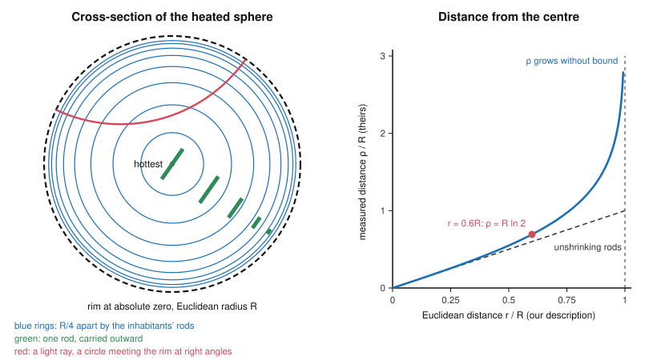

# Philosophy of Physics · Lesson 4.4: Geometry: convention, or dynamics?

> ⏱ ~15 min · Module 4: Space and spacetime · Builds on: [4.3](04-03-the-conventionality-of-simultaneity.md), [`modern-philosophy` 5.2](../../modern-philosophy/lessons/05-02-space-and-time-the-transcendental-aesthetic.md), [`relativity` 1.3](../../relativity/lessons/01-03-dilation-contraction-paradoxes.md) · Unlocks: [4.5](04-05-the-hole-argument.md), [6.1](06-01-symmetries-and-what-they-tell-us.md)

## Why this matters

In [`relativity` 1.3](../../relativity/lessons/01-03-dilation-contraction-paradoxes.md) a moving rod shrinks by $1/\gamma$, derived from two postulates without a word about what the rod is made of. Yet a rod is atoms held apart by electromagnetic forces. So which explains which? Either the geometry of spacetime makes the rod short and the forces fall into line, or the forces make it short and the geometry summarizes what every force does. Henri Poincaré had asked a prior question in 1902: is the geometry of space a fact at all?

## The idea

Kant made Euclidean geometry synthetic a priori; [`modern-philosophy` 5.2](../../modern-philosophy/lessons/05-02-space-and-time-the-transcendental-aesthetic.md) teaches that, and its Example 2 maps the replies of Helmholtz, Reichenbach and Poincaré, the last of which this lesson examines. Non-Euclidean geometries (Bolyai and Lobachevsky around 1830, Riemann in 1854) showed that Euclid's parallel postulate can fail without contradiction, so logic cannot say which geometry space has.

Can measurement? If heat stretched every material by the same fraction, steel tape, table and hand alike, no measurement could reveal it: you could equally say a room is unevenly heated or that it has a different shape. Poincaré built a world on that thought, [the heated sphere](../reference.md#poincares-disk-world) (usually drawn as a disk), whose inhabitants find their space non-Euclidean while we, from outside, describe a Euclidean ball with a strange temperature. Measurement tests geometry only together with physics, Duhem's holism ([`philosophy-of-science` 2.2](../../philosophy-of-science/lessons/02-02-duhem-quine-and-underdetermination.md)) applied to space, and Poincaré concluded that geometry is a convention chosen for convenience: [geometric conventionalism](../reference.md#geometric-conventionalism).

Special relativity deduces that moving rods contract without saying how, and two views dispute what explains it. The [dynamical view](../reference.md#dynamical-view-of-relativity) says the forces in the rod do, and Minkowski geometry summarizes them; the [geometrical view](../reference.md#geometrical-view-of-relativity) says spacetime structure explains why every force behaves alike.

## Source

Einstein, "Geometry and Experience" (Prussian Academy address, 1921), in *Sidelights on Relativity*, tr. G. B. Jeffery and W. Perrett (London: Methuen, 1922), pp. 35–36:

> Geometry (G) predicates nothing about the relations of real things, but only geometry together with the purport (P) of physical laws can do so. Using symbols, we may say that only the sum of (G) + (P) is subject to the control of experience. Thus (G) may be chosen arbitrarily, and also parts of (P); all these laws are conventions. [...]
>
> *Sub specie aeterni* Poincare, in my opinion, is right. [...] It is also clear that the solid body and the clock do not in the conceptual edifice of physics play the part of irreducible elements, but that of composite structures, which may not play any independent part in theoretical physics.

The first paragraph reports, and "chosen arbitrarily" compresses Poincaré, for whom experience guides the choice. The second judges, and two phrases carry it. *Sub specie aeterni*, "under the aspect of eternity", grants the point in principle. "Composite structures" says why: rods and clocks are matter, so what they measure depends on laws physics has yet to supply. Einstein's next sentence hedges, "in the present stage": until such constructions exist he treats rods as given, which makes geometry empirical, his [practical geometry](../reference.md#practical-geometry). The dynamical view takes up the task that hedge postpones.

## The argument

**Poincaré's heated sphere** (*Science and Hypothesis*, 1902; tr. W. J. Greenstreet, 1905, ch. IV, pp. 65–68):

- **S1.** A world fills a sphere of Euclidean radius $R$. At Euclidean distance $r$ from the centre the absolute temperature is proportional to $R^2 - r^2$. *In words:* hottest at the centre, absolute zero at the rim.
- **S2.** All bodies share one coefficient of expansion and take the local temperature at once, so a rod of central length $\ell_0$ has length $\ell(r) = \ell_0(R^2 - r^2)/R^2$. *In words:* everything, limbs included, shrinks toward the rim by one law.
- **S3.** Light's refractive index is inversely proportional to $R^2 - r^2$. *In words:* rays bend, and Poincaré says they become circles.

**Derivation.** An inhabitant lays rods along a radius. A Euclidean step $dr'$ takes $\ell_0\,dr'/\ell(r')$ rods, so the measured distance, in central rods, to Euclidean radius $r$ is

$$\rho(r) = \int_0^r \frac{R^2\,dr'}{R^2 - r'^2} = \frac{R}{2}\ln\frac{R+r}{R-r},$$

which grows without bound as $r \to R$. *In words:* the rim is infinitely many rods away, and the inhabitants "can never reach the boundary". Rods laid round the circle of Euclidean radius $r$ give a measured circumference $C = 2\pi r R^2/(R^2 - r^2)$; eliminating $r$,

$$C = \pi R \sinh\frac{2\rho}{R} > 2\pi\rho.$$

*In words:* circles outgrow Euclid's bound, exactly as in Lobachevsky's geometry with constant curvature $K = -4/R^2$, whose straight lines are S3's light rays. S2 makes rods, limbs and instruments agree; S3 makes sight agree with touch.

**The conventionalist argument.**

- **P1.** Experience tests only geometry and physics together, (G) + (P). *In words:* no measurement checks a geometry without assumptions about the measuring bodies.
- **P2.** In the heated sphere, Euclidean geometry with S1–S3 and Lobachevsky's geometry with no thermal effect predict every observation alike. *In words:* two descriptions, one world.
- **P3.** The case generalizes: any observation interpreted in one geometry can be reinterpreted in another by adjusting the physics (ch. V challenges anyone to find an experiment interpretable in Euclid's system but not in Lobachevsky's). *In words:* every geometry can be rescued.
- **∴ C.** Which geometry space has is a choice guided by experience and settled by convenience, not an experimental fact. *In words:* "One geometry cannot be more true than another; it can only be more convenient" (ch. III, p. 50).

Hans Reichenbach sharpened P2 (*Philosophie der Raum-Zeit-Lehre*, 1928). A [differential force](../reference.md#universal-and-differential-forces) acts on different materials differently, as real heat does, so comparing materials detects it; a universal force acts on all alike and cannot be shielded. S2 makes heat universal. His remedy, a coordinative definition, sets universal forces to zero and makes geometry empirical. Popper's ban on [conventionalist stratagems](../../philosophy-of-science/lessons/02-01-popper-conjectures-and-refutations.md) targets P3's rescue move.

**Principle or construction.** In *The Times* (28 November 1919) Einstein contrasted [constructive theories](../reference.md#principle-and-constructive-theories), built from hypothetical constituents (the kinetic theory of gases), with theories of principle, built on observed general properties (thermodynamics, on the impossibility of perpetual motion). "The theory of relativity is a theory of principle." Yet the article ranks construction higher: "When we say that we understand a group of natural phenomena, we mean that we have found a constructive theory which embraces them."

- **Geometrical view** (Michel Janssen, "Drawing the line between kinematics and dynamics in special relativity", 2009; Tim Maudlin, *Philosophy of Physics: Space and Time*, 2012). Spacetime has Minkowski structure; every law governs fields in it, hence is Lorentz covariant. An ideal clock measures proper time along its worldline (the [clock hypothesis](../reference.md#clock-hypothesis)); a rod's contraction is how one frame's simultaneity slices a worldtube at rest in another. *In words:* one geometry explains at a stroke why all forces agree.
- **Dynamical view** (Harvey Brown, *Physical Relativity*, 2005; Brown and Oliver Pooley, "Minkowski space-time: a glorious non-entity", 2006). Rods and clocks are composite: a moving rod is shorter because the forces holding its parts apart, all Lorentz covariant, settle at a shorter equilibrium, as FitzGerald, Lorentz and Larmor held and John Bell urged teaching ("How to teach special relativity", 1976). Minkowski geometry codifies that shared symmetry and explains nothing the laws do not. *In words:* explanation runs from dynamics to geometry.

John Norton ("Why constructive relativity fails", 2008) presses the dynamical view: its matter laws already presuppose spatiotemporal structure, so the construction assumes part of what it was to construct.

**The bridge to general relativity.** The [equivalence principle](../reference.md#equivalence-principle) ([`relativity` 5.1](../../relativity/lessons/05-01-equivalence-principle.md)) makes gravity act on every body alike, the mark of a universal force; general relativity absorbs it into a curved metric with its own field equations. Brown (*Physical Relativity*, ch. 9) argues that rods and clocks survey even this metric only because of a dynamical fact, secured by the strong equivalence principle: local physics takes special-relativistic form. Oliver Pooley (2013) and James Read (2020) note that every side grants this, so here the views may cease to differ.

**Where the argument is weakest.** P3: the sphere is one hand-built case. The strongest objection: James Weatherall and John Manchak ("The geometry of conventionality", 2014) argue that, with "force" understood in the standard way, a new force field can accommodate a different geometry in Newtonian gravitation but not in relativity theory, and the Stanford Encyclopedia's Poincaré entry reports a long consensus that metric conventionalism is inconsistent with general relativity. The strongest reply loosens "force": Patrick Duerr and Yemima Ben-Menahem (2022), and Duerr and James Read (2024), argue that current spacetime theories admit conventionalist readings. The critic concedes that a non-standard field can always redescribe; the conventionalist concedes that this is the price, so the choice is between theory packages, not a free stipulation.

## The picture

Rings a quarter of $R$ apart by the inhabitants' rods crowd toward a rim they can never reach.

## Worked examples

**Example 1 (clean case: surveying the heated sphere).** Take Euclidean radius $r = 3R/5$, with lengths in central rods.

- *Our description.* The temperature there is $1 - 9/25 = 16/25$ of the centre's, so a rod there is $0.64$ of its central length.
- *Their survey.* $\rho = \frac{R}{2}\ln\frac{8/5}{2/5} = R\ln 2 \approx 0.693R$. The circumference is $C = 2\pi(3R/5)\cdot\frac{25}{16} = \frac{15\pi R}{8} \approx 5.89R$, against $2\pi\rho \approx 4.36R$: a ratio $15/(16\ln 2) \approx 1.353$. At $r = 0.99R$, $\rho \approx 2.65R$.
- *Two descriptions.* Euclid with S1–S3, or Lobachevsky with curvature $-4/R^2$ and unchanging rods; every reading agrees.
- *What would break the tie.* One material with a different coefficient of expansion would make heat differential and detectable; S2 forbids it by fiat. Our heat is differential, which is why surveyors correct for it and nobody calls that a convention.

**Example 2 (hard case: Bell's spaceships).** Two rockets at rest a distance $D$ apart are joined by a thread of natural length $D$ that snaps when stretched by 1 per cent (numbers invented). Identical engine programs keep their launch-frame separation at $D$ until both cut their engines, at speed $v$. The puzzle is Dewan and Beran's (1959); Bell made it famous (1976). Does the thread break?

- *Both views predict.* In their common rest frame the coasting ships are $\gamma D$ apart, so the thread is stretched by the factor $\gamma$. It snaps once $\gamma = 1.01$, at $v = c\sqrt{1 - 1/1.01^2} = (\sqrt{201}/101)\,c \approx 0.140c$.
- *Brown's explanation.* In the launch frame the moving thread's Lorentz-covariant binding forces settle at an equilibrium length $D/\gamma$; held at $D$, it is under real tension.
- *Maudlin's explanation.* The ships' worldlines are $D$ apart on the launch frame's simultaneity slices and $\gamma D$ apart on their own, and no thread of natural length $D$ spans $\gamma D$ unstretched, whatever it is made of.

*Where the account stops.* Both stories use the same Lorentz transformation and give the same breaking speed; no experiment lies between them. What remains is the direction of explanation, a mechanism against a structure covering every material at once, which the case cannot settle; it belongs to the accounts of causal and non-causal explanation in [`philosophy-of-science` 4.2](../../philosophy-of-science/lessons/04-02-causal-explanation.md) and [4.3](../../philosophy-of-science/lessons/04-03-unification-and-the-pragmatics-of-explanation.md).

## Watch out

- **You might think** Poincaré's sphere shows that space is non-Euclidean, or that "convention" means arbitrary, **but actually** he expected Euclid to stay the most convenient, and experience guides the choice without forcing it.
- **You might think** geometric conventionalism and the [conventionality of simultaneity](../reference.md#conventionality-of-simultaneity) ([4.3](04-03-the-conventionality-of-simultaneity.md)) are one thesis, **but actually** they concern different structures, the metric and "at the same time"; conventionalism about persistence ([`metaphysics` 5.3](../../metaphysics/lessons/05-03-coincidence-and-the-ship-of-theseus.md)) is a third.
- **You might think** the dynamical view revives Lorentz's ether, **but actually** Brown accepts every prediction of special relativity, with no ether and no preferred frame; the dispute is over explanation.
- **You might think** acceleration slows the travelling twin's clock, **but actually** by the clock hypothesis an ideal clock's rate depends on its speed alone; the twins differ because their worldlines have unequal proper lengths, and the "acceleration" of [`relativity` 1.3](../../relativity/lessons/01-03-dilation-contraction-paradoxes.md) is the change of inertial frame that bends one of them.

## One-liner

> Poincaré's heated sphere shows that rods test geometry only together with physics, so geometry can look like a convention; relativity asks instead whether Minkowski geometry explains the behaviour of rods and clocks or summarizes their forces, and the rival answers agree on every prediction.

## Problems

**P1 (🟢)** *(Close reading: Exegetical (a)–(c).)* Poincaré, *Science and Hypothesis*, ch. IV, "Conclusions" (tr. W. J. Greenstreet, 1905, pp. 70–71):

> The object of geometry is the study of a particular "group"; but the general concept of group pre-exists in our minds, at least potentially. It is imposed on us not as a form of our sensitiveness, but as a form of our understanding; only, from among all possible groups, we must choose one that will be the standard, so to speak, to which we shall refer natural phenomena. Experiment guides us in this choice, which it does not impose on us. It tells us not what is the truest, but what is the most convenient geometry.

(a) What does the passage make conventional, and what does it say is not? One line each.

(b) Quote the words that give experience a role, and the words that limit it. One line.

(c) The contrast between "a form of our sensitiveness" and "a form of our understanding" answers Kant ([`modern-philosophy` 5.2](../../modern-philosophy/lessons/05-02-space-and-time-the-transcendental-aesthetic.md)). What does Poincaré deny of Kant's view of geometry, and what does he keep? Two sentences.

**P2 (🟡)** *(Formal model: Formal (a)–(b) · Exegetical (c).)* A variant world (invented, written for this problem): an unbounded Euclidean plane whose absolute temperature is proportional to $R^2 + r^2$ at Euclidean distance $r$ from a centre. As in S2, all bodies expand alike, so a rod of length $\ell_0$ at the centre has length $\ell_0(R^2 + r^2)/R^2$; light's refractive index is proportional to $1/(R^2 + r^2)$. Measure lengths in units of the central rod.

(a) Compute the inhabitants' measured distance $\rho(r)$ from the centre to Euclidean radius $r$, and its limit as $r \to \infty$. Show the computation.

(b) Compute the measured circumference $C$ of the circle at $r = R$ and the ratio $C/(2\pi\rho)$ there, and show that measured circumferences shrink as $r$ grows beyond $R$. Show the computation.

(c) What would the inhabitants conclude about the size and shape of their world? In Reichenbach's terms, what kind of force is this temperature, and what single discovery would change that? Two sentences.

**P3 (🔴)** *(Find the crux: Exegetical (a) · Evaluative (b).)* Brown (*Physical Relativity*, 2005) and Maudlin (*Philosophy of Physics: Space and Time*, 2012) agree on every prediction about moving rods and clocks.

(a) State, as one premise, the claim Maudlin's geometrical view asserts and Brown's dynamical view denies, and say what each side leaves unexplained at the bottom of its account. Two sentences.

(b) Suppose a newly found interaction obeyed laws invariant under Lorentz transformations built with an invariant speed different from that of light (invented, written for this problem). How would each view describe a rod held together partly by it, and which view would the discovery cost more? Any verdict; 150 words or fewer.

Solutions

**P1** *(Exegetical (a)–(c).)*

**Must hit, strict (a):**

- Conventional: the choice of one particular group, among all possible groups, as the standard to which natural phenomena are referred, which is the choice of a geometry.
- Not conventional: the general concept of group, which "pre-exists in our minds".

**Must hit, strict (b):** experience's role is "Experiment guides us in this choice"; its limit is "which it does not impose on us", restated as "not what is the truest, but what is the most convenient".

**Must hit, strict (c):**

- Denied: that geometry is fixed by a form of sensibility, Kant's space as the form of outer intuition, so Euclid's geometry is not imposed on us a priori.
- Kept: an a priori element, the concept of group, now placed in the understanding rather than in intuition.

**Wrong turns:** reading "most convenient" as "arbitrary", when the choice is guided. Making the concept of group conventional too. Reading (c) as Poincaré endorsing Kant's synthetic a priori geometry, or as his denying any a priori element.

**Model answer:** (a) The choice of which group, and so which geometry, serves as the standard is conventional; the general concept of group is not, since it pre-exists in the mind. (b) "Experiment guides us in this choice" gives experience its role; "which it does not impose on us" limits it. (c) Poincaré denies that a form of sensibility imposes a particular geometry, so Euclid is no synthetic a priori truth about space. He keeps something a priori, the concept of group, but as a form of the understanding from which we choose.

---

**P2** *(Formal (a)–(b) · Exegetical (c).)*

(a) A Euclidean step $dr'$ takes $R^2\,dr'/(R^2 + r'^2)$ central rods, so

$$\rho(r) = \int_0^r \frac{R^2\,dr'}{R^2 + r'^2} = R\arctan\frac{r}{R} \;\longrightarrow\; \frac{\pi R}{2} \approx 1.571R \quad (r \to \infty).$$

The whole infinite plane lies within a finite measured distance of the centre.

(b) Along the circle of Euclidean radius $r$ each rod has length $(R^2 + r^2)/R^2$, so

$$C(r) = \frac{2\pi r R^2}{R^2 + r^2}, \qquad C(R) = \pi R \approx 3.142R, \qquad \rho(R) = R\arctan 1 = \frac{\pi R}{4} \approx 0.785R,$$

$$\frac{C}{2\pi\rho} = \frac{\pi R}{2\pi \cdot \pi R/4} = \frac{2}{\pi} \approx 0.637 < 1.$$

And $\dfrac{dC}{dr} = \dfrac{2\pi R^2 (R^2 - r^2)}{(R^2 + r^2)^2}$, zero only at $r = R$ and negative beyond: for example $C(2R) = 4\pi R/5 \approx 2.51R$ at $\rho = R\arctan 2 \approx 1.107R$. Circumferences grow, peak and shrink, as lines of latitude do on a sphere; indeed $C = 2\pi(R/2)\sin(2\rho/R)$, a sphere of radius $R/2$, curvature $+4/R^2$.

**Must hit, strict (a)–(b):** the integral with the right integrand; $R\arctan(r/R)$ and the finite limit $\pi R/2$; $C(R) = \pi R$ with $\rho(R) = \pi R/4$; the ratio $2/\pi$; the sign of $dC/dr$ for $r > R$ (or a computed value beyond $R$).

**Accept (c):** adding that rods corrected by a law of expansion for each material, with any remaining universal force set to zero by Reichenbach's coordinative definition, would then measure the plane as Euclidean; comparing two materials alone fixes only the ratio of their responses.

(c) **Must hit, strict:**

- The inhabitants would find a finite, closed world of positive curvature, a sphere of radius $R/2$ whose one far point (our infinity, at measured distance $\pi R/2$) they approach but never reach.
- The temperature is a universal force; a material with a different coefficient of expansion would make it differential and detectable.

**Model answer (c):** They would say they live on a finite sphere of radius $R/2$, curvature $+4/R^2$, with one point they never reach. The temperature is a universal force, and one material expanding at a different rate would make it differential and detectable; with a law of expansion for each material and universal forces set to zero, corrected rods would then show a Euclidean plane.

**Wrong turns:** integrating $\ell(r)$ instead of $1/\ell(r)$, which makes the world larger rather than smaller. Using the Euclidean $r$ as the radius in the ratio. Calling the temperature differential because it varies from place to place: what matters is whether it varies from material to material.

---

**P3** *(Exegetical (a) · Evaluative (b).)*

**Must hit, strict (a):**

- The premise: the Minkowski structure of spacetime explains why all the dynamical laws share one Lorentz covariance (Maudlin asserts it; Brown denies it, holding that the geometry codifies the shared covariance).
- What stays unexplained: for Brown, the fact that every fundamental law is Lorentz covariant with one invariant speed, brute in special relativity or left to a deeper theory; for Maudlin, the Minkowski structure itself, taken as fundamental.

**Model answer (a):** Maudlin asserts and Brown denies that the Minkowski structure of spacetime explains why every dynamical law is Lorentz covariant. Brown is left with that shared covariance as a brute fact (or one for a deeper theory to explain), Maudlin with the Minkowski structure itself.

**Accept (a):** the crux put as Brown and Pooley's challenge (2006), that no mechanism has been given by which a spacetime structure that does nothing could constrain how matter behaves, with the geometrical view answering that the explanation is structural rather than causal.

**Must hit, any verdict (b):**

- Brown's description: rods bound by the new interaction contract by a different factor from rods bound by electromagnetism, so a rod using both is strained, and no single geometry is surveyed by every rod and clock. Say that the dynamical view absorbs this: the geometry only ever codified a common symmetry, and now there is none.
- The geometrical description: spacetime carries two cone structures, each field coupling to one. Say what the view keeps (real structure, now richer) and what it loses: its one-stroke explanation of why all forces agree.
- A verdict, with the cost to the other side named.

**Accept (b):** a geometrical reply in the conditional form James Read (2020) calls the qualified geometrical approach: given how each field couples to a structure, that structure explains the field's symmetries, so two structures explain two symmetries.

**Wrong turns:** treating either view as predicting something different for ordinary rods. Answering that special relativity would be refuted and stopping there, when the question is what each view says explains the rod. Identifying the dynamical view with Lorentz's ether theory.

**Model answer (b), one of several:** For Brown, the discovery changes nothing in principle. Each rod contracts by whatever factor its binding forces dictate; a rod held partly by the new interaction would be strained, as its two kinds of bond prefer different lengths in motion. Minkowski geometry was always a codification of the symmetry the laws happened to share, and now they share less. The geometrical view can answer by enriching spacetime: two cone structures, each field coupling to one, still real and still explanatory for the fields that use each. But its signature argument was that one structure explains at once why all forces agree, and the discovery removes the explanandum. So the discovery costs the geometrical view more, unless it treats the second structure as no less natural than the first; the dynamical view still owes an account of why each family of laws has the symmetry it has.

## Flashback

**From Lesson [4.2](04-02-newtons-bucket-and-the-structure-inertia-needs.md) (Newton's bucket and the structure inertia needs):** *(Formal (a) · Exegetical (b).)* Newton's Scholium to the Definitions (Motte, 1729, vol. 1, pp. 10–11) illustrates absolute motion: the part of the Earth where a ship lies moves truly east at 10010 parts; the ship sails west on the Earth at 10 parts; a sailor walks east in the ship at 1 part. East is positive, and every motion lies along one line.

(a) Find the sailor's velocity relative to the Earth and through [absolute space](../reference.md#absolute-space). Then give all three velocities in a frame moving east at 10001 parts through that space, and say which changed. Show the computation.

(b) In which of [Newtonian](../reference.md#newtonian-spacetime), [Galilean](../reference.md#galilean-spacetime) and [Leibnizian](../reference.md#leibnizian-spacetime) spacetime is each of the sailor's two velocities a fact? If the Earth's part moves because the Earth turns, what of that motion does Galilean spacetime keep? Three sentences.

Solution

(a) Through absolute space velocities add: the ship moves $10010 - 10 = 10000$ parts east and the sailor $10000 + 1 = 10001$. Relative to the Earth he moves $10001 - 10010 = -9$, nine parts west. In the frame moving at $u = 10001$, each velocity becomes $v - u$: the Earth's part $+9$, the ship $-1$, the sailor $0$. Relative velocities are differences, from which $u$ cancels: sailor on ship $0 - (-1) = +1$, ship on Earth $-1 - 9 = -10$, sailor on Earth $0 - 9 = -9$. Only the velocities through space changed.

**Must hit, strict (a):** 10001 east and 9 west; $+9$, $-1$ and $0$; $u$ cancelling from every relative velocity.

**Must hit, strict (b):**

- Velocity through space: a fact only in Newtonian spacetime, whose absolute space says which point now is the same place as which point then; in the other two the boost of (a) is a symmetry.

- Velocity relative to the Earth: a fact in all three, as the rate of change of the sailor's distance from marks on the ground.

- Galilean spacetime keeps the Earth's rotation, its surface's acceleration toward the axis, which the connection makes absolute, and loses only the surface's velocity; Leibnizian keeps neither.

**Wrong turns:** letting the boost change a relative velocity; making rotation relative in Galilean spacetime; crediting Leibnizian spacetime with absolute rotation.

**Model answer (b):** Only Newtonian spacetime makes "10001 parts east" a fact; in Galilean and Leibnizian spacetime the boost of (a) is a symmetry, so the number belongs to a frame. All three make "9 parts west relative to the Earth" a fact, since it is the rate at which his distance from marks on the ground changes. Galilean spacetime keeps the Earth's turning and loses only its surface's velocity; Leibnizian keeps neither.

## Connections

- **Backward:** Kant's synthetic a priori geometry and the one-line map of its critics are [`modern-philosophy` 5.2](../../modern-philosophy/lessons/05-02-space-and-time-the-transcendental-aesthetic.md); the holism behind (G) + (P) is [`philosophy-of-science` 2.2](../../philosophy-of-science/lessons/02-02-duhem-quine-and-underdetermination.md); Reichenbach's other convention, the $\varepsilon$ of simultaneity, is [4.3](04-03-the-conventionality-of-simultaneity.md), and [4.2](04-02-newtons-bucket-and-the-structure-inertia-needs.md) asked which spacetime structure inertia needs and named Huggett's regularity relationism, a metaphysics the dynamical view can adopt. Length contraction itself is derived in [`relativity` 1.3](../../relativity/lessons/01-03-dilation-contraction-paradoxes.md) and proper time in [`relativity` 1.4](../../relativity/lessons/01-04-spacetime-interval-causality.md).
- **Forward:** [4.5](04-05-the-hole-argument.md) takes general relativity's dynamical metric and asks whether its points are real; [6.1](06-01-symmetries-and-what-they-tell-us.md) separates spacetime symmetries from dynamical ones, the distinction the two views draw differently. Einstein's own pair, kinetic theory as constructive and thermodynamics as principle, returns in [5.4](05-04-boltzmann-entropy-and-the-past-hypothesis.md).
- **Sideways:** the inhabitants' circumference test is curvature measured from inside, Gauss's *Theorema Egregium* ([`differential-geometry` 1.4](../../differential-geometry/lessons/01-04-gaussian-curvature-theorema-egregium.md)). Whether geometry *explains* contraction is a test case for the accounts of explanation in [`philosophy-of-science` 4.1](../../philosophy-of-science/lessons/04-01-the-deductive-nomological-model.md) (derivation from law), [4.2](../../philosophy-of-science/lessons/04-02-causal-explanation.md) (causal) and [4.3](../../philosophy-of-science/lessons/04-03-unification-and-the-pragmatics-of-explanation.md) (unification and non-causal explanation), and Poincaré's structural realism about physics is [`philosophy-of-science` 5.3](../../philosophy-of-science/lessons/05-03-structural-realism.md). The equivalence principle that makes gravity a universal force is [`relativity` 5.1](../../relativity/lessons/05-01-equivalence-principle.md).
