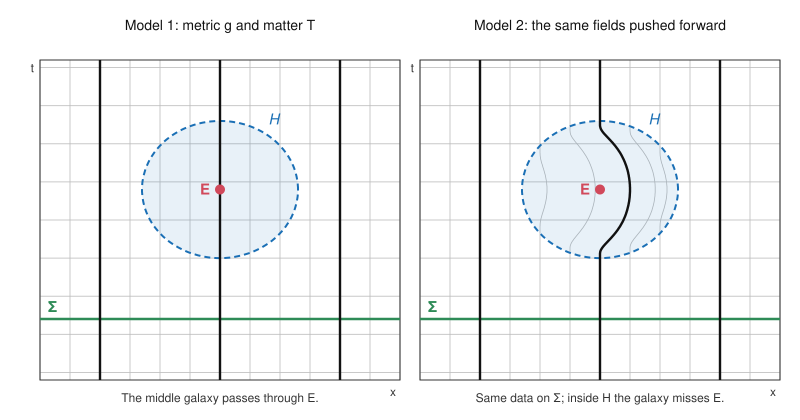

# Philosophy of Physics · Lesson 4.5: The hole argument

> ⏱ ~15 min · Module 4: Space and spacetime · Builds on: [4.1](04-01-leibniz-and-clarke-the-shift-arguments.md), [`relativity` 5.3](../../relativity/lessons/05-03-einstein-field-equations.md), [`differential-geometry` 2.4](../../differential-geometry/lessons/02-04-vector-fields-pushforward.md) · Unlocks: [5.1](05-01-determinism-in-physical-theories.md), [6.2](06-02-gauge-as-surplus-structure.md)

## Why this matters

Late in 1913 Einstein convinced himself that no generally covariant theory of gravity could be deterministic, and spent two years on a theory of limited covariance, though he had already looked at something very close to the right equations; he came back to them in November 1915. Long dismissed as a slip, the argument was shown by John Stachel (1980) to be none, and John Earman and John Norton (1987) turned it on the substantivalist of [4.1](04-01-leibniz-and-clarke-the-shift-arguments.md): if spacetime points are things in their own right, general relativity cannot say what happens at them.

## The idea

Paint a temperature pattern on a rubber band whose grains you can tell apart. Inside one marked stretch, the hole, slide the pattern along the rubber, ruler marks and all, so each temperature sits on a new grain; outside, touch nothing. Every measurement comes out as before. Did anything change? If the grains only keep track of the pattern, no. If they are real places, yes: this grain was at 30 degrees and is now at 25. The second answer is [manifold substantivalism](../reference.md#manifold-substantivalism): the points of the spacetime manifold exist in their own right, whatever fields sit on them.

One formula applies a smooth map to a field in two ways. [Passively](../reference.md#active-and-passive-diffeomorphisms), leave the pattern and repaint the numbers on the grains: a change of coordinates. Actively, keep the numbers and slide the pattern. [`relativity` 4.1](../../relativity/lessons/04-01-manifolds-tangent-spaces.md) states [general covariance](../reference.md#general-covariance) passively ("coordinates are labels the physics must never depend on"), and [5.3](../../relativity/lessons/05-03-einstein-field-equations.md) calls four metric components "pure gauge" in that sense. That is fair physics, and harmless. The [hole argument](../reference.md#hole-argument) runs on the active reading, which no earlier course separates out; this lesson does.

## Source

Einstein, "The Foundation of the General Theory of Relativity" (1916), §3, tr. W. Perrett and G. B. Jeffery, *The Principle of Relativity* (Methuen, 1923; Dover reprint, p. 117):

> That this requirement of general co-variance, which takes away from space and time the last remnant of physical objectivity, is a natural one, will be seen from the following reflexion. All our space-time verifications invariably amount to a determination of space-time coincidences. If, for example, events consisted merely in the motion of material points, then ultimately nothing would be observable but the meetings of two or more of these points. Moreover, the results of our measurings are nothing but verifications of such meetings of the material points of our measuring instruments with other material points, coincidences between the hands of a clock and points on the clock dial, and observed point-events happening at the same place at the same time.

The passage runs from what can be verified ("nothing would be observable but") to what is physically real ("the last remnant of physical objectivity"). Here, without mentioning the hole, Einstein let it go. Stachel named this the [point-coincidence argument](../reference.md#point-coincidence-argument), standardly read as a defence of what is now called Leibniz equivalence: coincidences survive any smooth redistribution, so redistributed models say the same thing. The step from "observable" to "objective" is Leibniz's in his Fifth Paper §52 ([4.1](04-01-leibniz-and-clarke-the-shift-arguments.md)).

## The argument

**Set-up.** A model of general relativity is $\langle M, g, T\rangle$: a four-dimensional manifold $M$ of events, a metric $g$ of signature $(-,+,+,+)$, and matter fields $T$, with $G_{\mu\nu}[g] = \frac{8\pi G}{c^4}T_{\mu\nu}$, where $G_{\mu\nu}[g]$ is the Einstein tensor of $g$ ([`relativity` 5.3](../../relativity/lessons/05-03-einstein-field-equations.md)).

**D1. Pushforward.** For a diffeomorphism $\varphi: M \to M$ ([`differential-geometry` 2.2](../../differential-geometry/lessons/02-02-smooth-maps-diffeomorphisms.md)), the [pushforward](../reference.md#pushforward-of-a-field) $\varphi_*g$ assigns to $\varphi(p)$ what $g$ assigned to $p$, carried over by $\varphi$'s derivative; for a scalar field, $\varphi_*f = f\circ\varphi^{-1}$. Since vectors push forward and functions and covectors pull back ([`differential-geometry` 2.4](../../differential-geometry/lessons/02-04-vector-fields-pushforward.md)), $\varphi_*g = (\varphi^{-1})^*g$. For a short flow along $X$, $\varphi_*g = g - s\,\mathcal{L}_X g + O(s^2)$ ([`differential-geometry` 5.3](../../differential-geometry/lessons/05-03-lie-derivative-killing-vectors.md)). *In words:* whatever held at $p$ now holds at $\varphi(p)$.

**D2. Active and passive.** Write $\varphi$ in a chart as $y = \varphi(x)$. Passive: keep $g$, adopt $y$ as coordinates; the components become $g'_{\mu\nu}(y) = \frac{\partial x^\alpha}{\partial y^\mu}\frac{\partial x^\beta}{\partial y^\nu}\,g_{\alpha\beta}(x)$. Active: keep the chart and replace $g$ by $\varphi_*g$, whose components at the point labelled $y$ are those same numbers. *In words:* one formula, read as new names for the same points or as the same names for a new distribution.

**D3. Hole diffeomorphism.** Let $\Sigma$ be a [Cauchy surface](../reference.md#cauchy-surface) (a slice every inextendible timelike curve crosses once) and $H$ a region whose closure lies to the future of $\Sigma$. A hole diffeomorphism is the identity outside $H$ but not inside. *In words:* nothing moves except inside the hole.

**Lemma (active general covariance).** If $\langle M,g,T\rangle$ is a solution, so is $\langle M,\varphi_*g,\varphi_*T\rangle$, since the Einstein tensor is built from $g$ and nothing else on $M$. For a hole diffeomorphism the two agree outside $H$ (so on $\Sigma$) and differ inside. *In words:* redistribute a solution and you get a solution. The formal core is the count in [`relativity` 5.3](../../relativity/lessons/05-03-einstein-field-equations.md) P1: of ten equations for ten metric components only six evolve the geometry, leaving four free functions. Read passively they are coordinate choice; read actively, the hole map's room. Erich Kretschmann objected (1917) that any theory can be given generally covariant form, so passive covariance alone constrains nothing.

**Earman and Norton, "What Price Spacetime Substantivalism?" (1987):**

**P1. Manifold substantivalism.** The points of $M$ represent spacetime points that exist independently of $g$ and $T$, and each represents the same spacetime point in every model. *In words:* the grains are real and keep their identity when the pattern moves.

**P2. Literal representation.** Every solution, so read, represents a physically possible world. *In words:* what the equations allow could have happened.

**P3.** Active general covariance (the Lemma). *In words:* the redistributed model is a solution too.

**P4.** The two models agree on every invariant, so on every observation: lengths, proper times, accelerations, which worldlines meet. *In words:* nobody could tell them apart.

**C1.** By P1–P3 they represent two possible worlds: in one a galaxy passes through an event $E$ in $H$, in the other it does not. So the substantivalist denies [Leibniz equivalence](../reference.md#leibniz-equivalence): models related by a diffeomorphism represent the same physical situation (Earman and Norton's name, after the static shift). *In words:* two worlds where the relationalist counts one.

**C2.** The worlds agree on $\Sigma$ and everywhere outside $H$ yet differ inside, so the theory is indeterministic ([determinism](../reference.md#determinism) is defined in [5.1](05-01-determinism-in-physical-theories.md)), about a difference P4 makes undetectable.

**∴ C. The [Earman–Norton dilemma](../reference.md#earman-norton-dilemma).** Either keep manifold substantivalism and accept radical indeterminism about unobservable facts, or accept Leibniz equivalence and give manifold substantivalism up. Their methodological premise: whether a theory is deterministic should be settled by physics, not forced by a metaphysics of points. *In words:* real points cost an indeterminism no experiment could see.

**The replies.**

- *Relationalism.* Accept Leibniz equivalence, as the coincidence passage does. James Weatherall (2018) argues, without ruling on substantivalism, that mathematical practice already treats isomorphic models as one; Oliver Pooley and James Read (2021) reply that practice does not settle what models represent.
- *Accept or redefine.* The indeterminism concerns only which points bear which properties, not which pattern occurs; or determinism is redefined as agreement up to diffeomorphism (Butterfield 1989; Brighouse 1994; Melia 1999).
- *[Metric essentialism](../reference.md#metric-essentialism)* (Tim Maudlin 1989, 1990). Each point bears its metrical relations essentially, so the redistributed model, read with the points held fixed, describes no possible world. It denies P2.
- *[Anti-haecceitist substantivalism](../reference.md#anti-haecceitism)* (Carl Hoefer 1996; Pooley 2006). Points exist, but nothing makes a point in one world the same as one in another beyond its structural role ([counterparts](../../metaphysics/lessons/03-02-what-possible-worlds-are.md)). It denies P1's second clause: one possibility, described twice.

Gordon Belot and Earman (2001) named such views [sophisticated substantivalism](../reference.md#sophisticated-substantivalism), in what the Stanford Encyclopedia calls "a somewhat pejorative sense"; Maudlin's is one version. If points' identity derives from their relations, the hole argument joins the identity of quantum particles as physics' case for [ontic structural realism](../reference.md#ontic-structural-realism) (Ladyman 1998; Stachel; Saunders; [`philosophy-of-science` 5.3](../../philosophy-of-science/lessons/05-03-structural-realism.md)); Pooley (2006) denies the analogy runs deep.

**Where the argument is weakest.** P1's second clause. Hoefer locates the whole trouble in primitive identity: a substantivalist needs points to exist and bear the metric, not to carry identities across worlds, and without that clause there are no two worlds. The strongest reply: stripped of trans-world identity, it is unclear what the substantivalist asserts, and Shamik Dasgupta (2011) finds the view metaphysically obscure. The critic concedes that a substantivalist without primitive identity escapes this argument and must be met by another (Norton 1988 offers variants); the defender concedes that if points had primitive identity the indeterminism would be real, as most philosophers of physics seem to conclude.

## The picture

Same data on $\Sigma$, same coincidences everywhere, different answers to whether the galaxy passes through $E$: two worlds for the manifold substantivalist, one drawn twice under Leibniz equivalence.

## Worked examples

**Example 1 (clean case: a hole on a line).** Take $M = \mathbb{R}$ with coordinate $x$, metric $h = dx^2$ and temperature $\Theta(x) = x^2$. Let the hole be $H = (0, 2)$, with the smooth bump $b(x) = \exp\!\big(1 - \frac{1}{1-(x-1)^2}\big)$ on $H$ and $b = 0$ elsewhere; $b(1) = 1$ and $|b'| \le 2.18$. Set $d(x) = x + \tfrac14 b(x)$. Then $d' \ge 1 - 2.18/4 > 0$, $d(0) = 0$ and $d(2) = 2$, so $d$ is a diffeomorphism that maps $H$ onto itself and is the identity outside.

- Outside: $d_*\Theta(3) = \Theta(d^{-1}(3)) = \Theta(3) = 9$. Agreement.
- Inside: $d(1) = \tfrac54$, so at the point with coordinate $\tfrac54$, $d_*\Theta(\tfrac54) = \Theta(1) = 1$, while $\Theta(\tfrac54) = \tfrac{25}{16}$. The same point has a new temperature.
- An invariant: the point at temperature 1 lies at distance 1 from the hole's left edge in both models. Originally it is $x = 1$; in the new model it is $y = \tfrac54$, and the pushed metric $d_*h = \big((d^{-1})'(y)\big)^2\,dy^2$ gives $\int_0^{5/4}(d^{-1})'(y)\,dy = d^{-1}(\tfrac54) - d^{-1}(0) = 1$.

The metric's component is not invariant: at $y = d(\tfrac12) \approx 0.679$ it is $1/d'(\tfrac12)^2 \approx 0.575$, not 1. The ruler marks slid with the pattern.

**Example 2 (hard case: the same map read passively).** Keep $\Theta$ and $h$ and adopt $y = d(x)$ as a coordinate. The point $p$ once labelled $x = 1$ is now labelled $\tfrac54$, and $\Theta$'s component function is $\Theta'(y) = \Theta(d^{-1}(y))$, so $\Theta'(\tfrac54) = 1$: the temperature at $p$, unchanged. The metric component becomes $h'_{yy} = \big((d^{-1})'\big)^2$; no distance changes. This is the very function $\Theta\circ d^{-1}$ that Example 1 called a new field.

Here the account stops. Of two configurations related by a diffeomorphism, the mathematics says only that they are isomorphic, not whether they are one world in two charts, two worlds, or one world described twice. The manifold substantivalist privileges the identity map, which holds each point fixed, so the point labelled $\tfrac54$ really went from $\tfrac{25}{16}$ to 1. The defender of Leibniz equivalence answers that the active reading adds nothing a relabelling could not, since every invariant agrees. With no field equation, the toy shows the hole's shape without its indeterminism.

## Watch out

- **You might think** general covariance as [`relativity` 4.1](../../relativity/lessons/04-01-manifolds-tangent-spaces.md) states it is what the hole argument attacks, **but actually** that is passive covariance, which Kretschmann noted any theory can be given. The argument needs active covariance, which moves fields over fixed points.
- **You might think** the target is substantivalism about space, Newton's and Clarke's, **but actually** it is substantivalism about spacetime, in its manifold form. Identifying spacetime with manifold plus metric (Hoefer 1996) is not hit in the same way.
- **You might think** the argument shows that general relativity is indeterministic, **but actually** it shows that relativity plus manifold substantivalism is: under Leibniz equivalence the development into $H$ is unique up to diffeomorphism. Cauchy horizons are another matter ([5.1](05-01-determinism-in-physical-theories.md)).
- **You might think** the hole is an empty region or a black hole, **but actually** it is any region outside which the map is the identity. Einstein's 1913 hole (his *Loch*) was free of matter; the modern one need not be.

## One-liner

> Read actively, general covariance redistributes any solution inside a hole with nothing observable changed, so a substantivalist whose points keep their identity must call general relativity indeterministic; each reply denies that identity, the possibility of every solution, or substantivalism itself.

## Problems

**P1 (🟢)** *(Apply: Exegetical (a)–(b).)* Four claims:

> (i) Whatever coordinates you lay over the events, the field equations keep the same form.
>
> (ii) Spreading a solution's metric and matter over the manifold in a new way, by a diffeomorphism, gives another solution.
>
> (iii) Two models whose fields differ by a diffeomorphism represent one and the same possible world.
>
> (iv) Even if no observation could tell, there is a fact about whether this galaxy passes through that very event.

(a) Label each as passive general covariance, active general covariance, Leibniz equivalence, or manifold substantivalism. One line each.

(b) Which two of the four together drive the hole argument's indeterminism, which one must the substantivalist then deny, and which one does Einstein's point-coincidence passage support? One line each.

**P2 (🟡)** *(Formal model: Formal (a)–(c).)* On $M = \mathbb{R}$ take the field $f(x) = 4x + 1$ and the hole $H = (-2, 2)$. Let $b(x) = \exp\!\big(1 - \frac{1}{1 - x^2/4}\big)$ for $|x| < 2$ and $b(x) = 0$ otherwise; $b$ is smooth, $0 < b \le 1$ on $H$, $b(0) = 1$, and $|b'(x)| < 1.09$ for all $x$. Let $d(x) = x + \tfrac12 b(x)$.

(a) Show that $d$ is a diffeomorphism of $\mathbb{R}$ that maps $H$ onto itself and is the identity outside it.

(b) Compute $d_*f$ and $f$ at $y = \tfrac12$, at $y_1 = d(1)$ (give $y_1$ to three decimals), and at $y = 3$. Show the computation.

(c) Show that $d_*f$ and $f$ agree at every point outside $H$ and at no point inside it. Then say which premise of the Earman–Norton argument this toy cannot supply, and why. One line.

**P3 (🔴)** *(Find the crux: Exegetical (a) · Evaluative (b).)* Maudlin's metric essentialism and the anti-haecceitist substantivalism of Hoefer and Pooley both keep spacetime points, and both escape the hole argument.

(a) For each, name the premise of the Earman–Norton argument, as reconstructed in this lesson, that it denies, and say what it takes the pair $\langle M, g, T\rangle$, $\langle M, \varphi_*g, \varphi_*T\rangle$ to represent. Two sentences each.

(b) Name the single question on which the two views divide, say what each pays for its answer, and say what consideration would move each side. Any verdict; 150 words or fewer.

Solutions

**P1** *(Exegetical (a)–(b).)*

**Must hit, strict (a):**

- (i) Passive general covariance: a claim about changing coordinates, with the fields left where they are.

- (ii) Active general covariance: the fields are moved over fixed points and solutionhood is preserved (the Lemma).

- (iii) Leibniz equivalence.

- (iv) Manifold substantivalism: a fact about which event the galaxy occupies, beyond every invariant.

**Must hit, strict (b):**

- (ii) and (iv) drive it (with literal representation): active covariance supplies the second solution, and substantivalism counts it as a second world agreeing with the first outside $H$.

- The substantivalist must deny (iii).

- Einstein's passage supports (iii): if all physical content is coincidences, and coincidences survive any diffeomorphism, the two models say the same thing.

**Wrong turns:** labelling (i) as Leibniz equivalence because both say "nothing changes"; (i) is about descriptions of one model, (iii) about what two models represent. Saying (i) and (iv) drive the argument: passive covariance moves no field, so it yields no second model. Reading the coincidence passage as an argument for substantivalism because it mentions point-events.

**Model answer:** (a) (i) passive; (ii) active; (iii) Leibniz equivalence; (iv) manifold substantivalism. (b) (ii) with (iv); the substantivalist denies (iii); Einstein's passage supports (iii).

---

**P2** *(Formal (a)–(c).)*

(a) $d' = 1 + \tfrac12 b' \ge 1 - \tfrac12(1.09) = 0.455 > 0$, so $d$ is smooth and strictly increasing. Outside $H$, $b = 0$, so $d(x) = x$; in particular $d(\pm 2) = \pm 2$. A strictly increasing continuous map fixing $-2$ and $2$ sends $[-2, 2]$ onto itself, and it is the identity elsewhere, so $d$ is a bijection of $\mathbb{R}$. Its inverse is smooth by the inverse function theorem, since $d' \neq 0$. So $d$ is a diffeomorphism, the identity outside $H$, mapping $H$ onto $H$.

(b) Use $d_*f = f\circ d^{-1}$, and find $d^{-1}$ at each point by recognizing it as an image.

- $y = \tfrac12$: $d(0) = 0 + \tfrac12 b(0) = \tfrac12$, so $d^{-1}(\tfrac12) = 0$ and $d_*f(\tfrac12) = f(0) = 1$. But $f(\tfrac12) = 3$.

- $y_1 = d(1) = 1 + \tfrac12\exp\!\big(1 - \tfrac{1}{3/4}\big) = 1 + \tfrac12 e^{-1/3} \approx 1 + \tfrac12(0.7165) = 1.358$. Then $d_*f(y_1) = f(1) = 5$, while $f(y_1) = 4y_1 + 1 = 5 + 2e^{-1/3} \approx 6.433$.

- $y = 3$: outside $H$, $d^{-1}(3) = 3$, so $d_*f(3) = f(3) = 13$.

(c) For $y \notin H$, $d^{-1}(y) = y$, so $d_*f(y) = f(y)$. For $y \in H$, write $y = d(x)$ with $x \in H$; since $b(x) > 0$, $y = x + \tfrac12 b(x) > x$, so $d^{-1}(y) < y$. Because $f$ is strictly increasing, $d_*f(y) = f(d^{-1}(y)) < f(y)$. So the two agree exactly on $\mathbb{R}\setminus H$. The toy cannot supply P3, active general covariance: there is no field equation, so nothing makes $d_*f$ "another solution", and without that there is no indeterminism, only two distributions.

**Must hit, strict:** $d' > 0$ from the bound on $|b'|$, with the identity outside $H$ and the endpoints fixed; the inverse found by recognizing $\tfrac12 = d(0)$ and $y_1 = d(1)$; $b(1) = e^{-1/3}$; the values 1 against 3, 5 against about 6.433, 13 against 13; the strict inequality from $b > 0$ and monotone $f$; P3 named.

**Accept:** naming the missing ingredient as "a generally covariant law" rather than by premise number; noting that the toy does supply an invariant that agrees (the point at value 1 lies at distance 2 from the hole's left edge in both models).

**Wrong turns:** computing $f(d(y))$ instead of $f(d^{-1}(y))$, which gives $d_*f(\tfrac12) = f(d(\tfrac12))$ and pushes the wrong way; claiming the two agree at $y = \tfrac12$ because $\tfrac12$ is "the middle"; saying the toy lacks P1, when P1 is an interpretation, not a piece of mathematics.

---

**P3** *(Exegetical (a) · Evaluative (b).)*

**Must hit, strict (a):**

- Metric essentialism denies P2, literal representation. Each spacetime point bears its metrical relations essentially (Maudlin 1989, 1990), so the model that, with points held fixed, gives those points different metrical relations represents no possible world: of the pair, at most one is possible.

- Anti-haecceitist substantivalism denies P1's second clause, trans-world identity of points. With no fact about which point in one world is which point in another beyond structural role, the pair represents a single possibility described twice (Hoefer 1996; Pooley 2006).

**Must hit, any verdict (b):**

- The crux: whether spacetime points have identity across possible worlds. Maudlin keeps it, constrained by essence; the anti-haecceitist drops it.

- Maudlin's price, for example: the geometry of each region is modally fixed, although in general relativity geometry answers to matter, so "had more mass been here, spacetime here would curve more" is about other points.

- The anti-haecceitist's price: claims about what this point could have been become counterpart claims, and critics such as Dasgupta (2011) find the view obscure.

- What would move each: for Maudlin, a compelling case that this very region could have been curved differently; for the anti-haecceitist, a task (counting possibilities, stating a law) that needs trans-world identity of points.

**Accept:** Teitel's (2019) verdict that refined essentialism does no better than other modal replies, as a consideration against Maudlin, if stated as a report.

**Wrong turns:** saying either denies P3, which is a theorem of the theory; saying Maudlin accepts Leibniz equivalence as stated, when he denies that the second model is a possibility at all; treating "sophisticated substantivalism" as a rival of metric essentialism, when Maudlin's view is one version of it; arguing that one of them is relationalism in disguise, which is not what is asked.

**Model answer (b), one of several:** Both agree that the hole pair is not two possibilities; they disagree about why, and the disagreement is over trans-world identity. For Maudlin a point is the same point in every world where it exists and carries its metrical relations essentially, so the redistributed model is simply impossible. The price is modal: in a theory where matter shapes geometry, this region could not have been shaped otherwise, and counterfactuals about different mass here must be read as being about other points. The anti-haecceitist lets no point be identified across worlds except by its role, so there is nothing for the two models to disagree about. The price is that talk of this point's possibilities becomes counterpart talk, which some find obscure. A good argument that some physical or modal task needs points identified across worlds would favour Maudlin; a persuasive case that one region's geometry is contingent would favour the anti-haecceitist.

## Flashback

**From Lesson [4.3](04-03-the-conventionality-of-simultaneity.md) (The conventionality of simultaneity):** *(Formal (a) · Exegetical (b).)* A press release (invented, written for this problem):

> "Stations P and Q are 8 light-seconds apart. Each zeroed its clock when a flash from a lamp halfway between them arrived, so the clocks were synchronized without assuming anything about the one-way speed of light. A pulse from P then reached Q at Q-time 8.000 seconds: light's one-way speed from P to Q is c, measured at last."

(a) Re-describe the events with light running from P toward Q at $\tfrac53 c$: find [Reichenbach's ε](../reference.md#reichenbach-epsilon), the return speed, and Q's reading when the pulse arrives. Show the computation.

(b) Quote the words that commit the error, and say what 4.3 shows the lamp procedure assumes. Two sentences.

Solution

(a) Take $c = 1$ light-second per second. From $c_{\text{out}} = c/(2\varepsilon)$,

$$\varepsilon = \frac{1}{2 \cdot \frac53} = \frac{3}{10}, \qquad c_{\text{back}} = \frac{c}{2\left(1 - \frac{3}{10}\right)} = \frac57\,c ,$$

and the round trip is as measured: $8/\tfrac53 + 8/\tfrac57 = 4.8 + 11.2 = 16$ s.

Count time $\tau$ from the flash, which covers 4 light-seconds each way: it reaches Q at $4/\tfrac53 = 2.4$ s and P at $4/\tfrac57 = 5.6$ s (the lesson's lag $(2\varepsilon - 1)L/c = -3.2$ s, with $L = 8$). So Q's clock reads $\tau - 2.4$, 3.2 s ahead of P's. The pulse leaves P at $\tau = 5.6$ s, flies $8/\tfrac53 = 4.8$ s, and arrives at $\tau = 10.4$ s, when Q reads $10.4 - 2.4 = 8.0$ s. For any ε, Q reads $(1 - \varepsilon)L/c + 2\varepsilon L/c - \varepsilon L/c = L/c$: the time the pulse saves in flight is exactly Q's head start.

**Must hit, strict (a):** $\varepsilon = \tfrac{3}{10}$, $\tfrac57 c$, 16 s; Q's clock 3.2 s ahead; Q reads 8.0 s, and $L/c$ for every ε.

**Must hit, strict (b):**

- The words: "without assuming anything about the one-way speed of light".

- The lamp procedure is $\varepsilon = \tfrac12$ in disguise: zeroing both clocks on arrival assumes equal travel times from the middle.

**Wrong turns:** zeroing both clocks at one moment but giving the pulse $\tfrac53 c$, which mixes two descriptions and yields a false refutation (4.8 s); calling this the relativity of simultaneity, when one frame is used throughout.

**Model answer (b):** The error is in "without assuming anything about the one-way speed of light". Zeroing both clocks when the flash arrives assumes it took equal times from the midpoint, $\varepsilon = \tfrac12$ in disguise, so the 8.000 s returns the equal speeds the synchronization put in.

## Connections

- **Backward:** The hole map is Leibniz's static shift from [4.1](04-01-leibniz-and-clarke-the-shift-arguments.md), done locally and smoothly: the East–West swap moved every body over fixed places, the hole map moves fields over fixed events, and Clarke's reply that things exactly alike are still two is a denial of Leibniz equivalence. The principles behind the shift are [`modern-philosophy` 2.3](../../modern-philosophy/lessons/02-03-leibniz-sufficient-reason-and-monads.md); the pushforward is [`differential-geometry` 2.4](../../differential-geometry/lessons/02-04-vector-fields-pushforward.md), the Lie derivative [5.3](../../differential-geometry/lessons/05-03-lie-derivative-killing-vectors.md), and the count of free functions [`relativity` 5.3](../../relativity/lessons/05-03-einstein-field-equations.md) P1.
- **Forward:** [5.1](05-01-determinism-in-physical-theories.md) defines determinism for theories and separates the hole's indeterminism, which Leibniz equivalence removes, from Cauchy horizons, which it does not. [6.2](06-02-gauge-as-surplus-structure.md) asks the hole's question of gauge: are two potentials differing by a gauge transformation two states of the world? Both ask whether mathematically distinct, empirically identical models are distinct worlds, and the hole's two tests for surplus structure, verifiability and determinism, carry over. [`relativity` 5.3](../../relativity/lessons/05-03-einstein-field-equations.md) already calls coordinate freedom "gauge" in the passive sense.
- **Sideways:** Primitive identity is the haecceity, or bare particular, of [`metaphysics` 2.1](../../metaphysics/lessons/02-01-substance-and-accident.md); counterparts against trans-world identity are [`metaphysics` 3.2](../../metaphysics/lessons/03-02-what-possible-worlds-are.md); Maudlin's view is an essentialism of the kind [`metaphysics` 2.4](../../metaphysics/lessons/02-04-essence-and-grounding.md) examines. The hole argument limits how literally a realist can read a successful theory ([`philosophy-of-science` 5.1](../../philosophy-of-science/lessons/05-01-realism-and-the-no-miracles-argument.md)), and is one of physics' cases for ontic structural realism ([`philosophy-of-science` 5.3](../../philosophy-of-science/lessons/05-03-structural-realism.md)).
