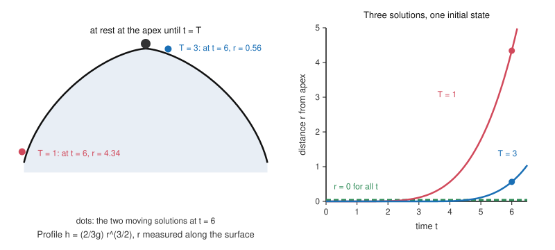

# Philosophy of Physics · Lesson 5.1: Determinism in physical theories

> ⏱ ~15 min · Module 5: Determinism, time's arrow, and probability · Builds on: [4.5](04-05-the-hole-argument.md), [`metaphysics` 6.1](../../metaphysics/lessons/06-01-determinism-and-the-consequence-argument.md), [`dynamical-systems` 1.1](../../dynamical-systems/lessons/01-01-flows-on-the-line.md) · Unlocks: [5.2](05-02-chaos-and-predictability.md), [5.3](05-03-reversible-laws-irreversible-world.md)

## Why this matters

[`dynamical-systems` 1.1](../../dynamical-systems/lessons/01-01-flows-on-the-line.md) told you a trajectory can never reach a fixed point in finite time: uniqueness forbids it. Now slide a ball up a frictionless dome with exactly the speed that brings it to rest at the top. On John Norton's dome it arrives in finite time. Run that film backward and Newton's laws allow a ball that sits on the summit as long as you like and then slides off, unpushed, in any direction. The theory that inspired Laplace's clockwork does not, as written, fix its own future.

## The idea

A theory is deterministic if fixing the complete state at one instant leaves its laws only one history. Picture the laws as an editor who accepts or rejects whole films: the theory is deterministic when any two accepted films that share a single frame share every frame. That makes [determinism](../reference.md#determinism) a property of theories, and of our world only through whichever theory is true. It is also two-sided: one frame fixes the past as well as the future.

[`metaphysics` 6.1](../../metaphysics/lessons/06-01-determinism-and-the-consequence-argument.md) already separated determinism from fatalism and from predictability in words, and states the [contrast with fatalism](../reference.md#determinism-and-fatalism) this lesson relies on: a determined outcome depends on what you do, a fated one does not. This lesson supplies a definition to test theories against, and the results are mixed: Newtonian mechanics as written fails, general relativity fails in places, and quantum mechanics passes or fails by interpretation.

## Source

Laplace, *A Philosophical Essay on Probabilities*, ch. II, tr. F. W. Truscott and F. L. Emory (New York: Wiley, 1902):

> We ought then to regard the present state of the universe as the effect of its anterior state and as the cause of the one which is to follow. Given for one instant an intelligence which could comprehend all the forces by which nature is animated and the respective situation of the beings who compose it — an intelligence sufficiently vast to submit these data to analysis — it would embrace in the same formula the movements of the greatest bodies of the universe and those of the lightest atom; for it, nothing would be uncertain and the future, as the past, would be present to its eyes.

Three things decide the reading. The thesis is staged through a knower, "an intelligence" ("demon" is a later gloss), so predictability is woven into [Laplace's intelligence](../reference.md#laplaces-intelligence); a definition must take the knower out. "Given for one instant" makes it a thesis about the state at a time, and "the future, as the past" makes it two-sided. And the data named are forces and "situation", that is, positions: a law like $F = ma$ is second order, so the state at an instant must include velocities too.

## The argument

**Definition (Earman).** A history $H$ assigns to each time $t$ a complete state $H(t)$; for particles, every position and velocity. A theory is *Laplacian deterministic* if and only if, for any two histories $H_1$ and $H_2$ satisfying its laws, $H_1(t) = H_2(t)$ for some $t$ implies $H_1(t') = H_2(t')$ for all $t'$. *In words:* two worlds the laws allow that match at one instant match at every instant. John Earman framed it over possible worlds in *A Primer on Determinism* (1986) and restated it with histories in "Aspects of Determinism in Modern Physics" (2007). Restricting $t'$ to later times gives future determinism, to earlier times past determinism; if the laws are [time-reversal invariant](../reference.md#time-reversal-invariance) ([5.3](05-03-reversible-laws-irreversible-world.md)), the two stand or fall together. Metaphysics 6.1's "remote past P0 plus laws L entail every later state" is the future variant, stated of the world: the one the consequence argument needs. It presupposes a global time (in relativity, a choice of slicing), a line between laws and initial conditions, and a fixed notion of state.

**Theorem (Picard–Lindelöf, cited).** If $\dot{x} = f(x)$ and $f$ satisfies a [Lipschitz condition](../reference.md#lipschitz-condition) near $x_0$, meaning $|f(x) - f(y)| \le K|x - y|$ for some constant $K$, exactly one solution passes through $x_0$ for a short time. A second-order law is written as first order in position and velocity. *In words:* a force whose slope is bounded cannot let two motions leave one state. [`ode-refresher` 1.1](../../ode-refresher/lessons/01-01-odes-solutions-slope-fields.md) states it with a continuous derivative, a stronger hypothesis.

**[Norton's dome](../reference.md#nortons-dome)** (Norton, "Causation as Folk Science", *Philosophers' Imprint* 3(4), 2003, §3). A unit point mass slides without friction on a symmetric dome in a gravitational field $g$. At distance $r$ from the apex, measured along the surface, the surface lies a depth $h = \frac{2}{3g}r^{3/2}$ below it. The tangential force is $g\,\frac{dh}{dr} = r^{1/2}$, pointing outward, so

$$\ddot r = \sqrt r .$$

Start the mass at rest at the apex at $t = 0$. Staying put, $r(t) = 0$, solves this. So, for every $T \ge 0$ and every radial direction, does rest until $T$ followed by $r(t) = \frac{(t-T)^4}{144}$ for $t > T$ (Boss 5 has you check it). The theorem is silent, not violated: $\frac{d\sqrt r}{dr} = \frac{1}{2\sqrt r}$ grows without bound as $r \to 0$, so no $K$ works at the apex. *In words:* at the one point where the force vanishes, it switches on infinitely steeply, leaving room for motion to begin with no push.

Norton adds two glosses. The first law holds throughout: until $T$ the mass sits unaccelerated at the force-free apex, and after $T$ it is off the apex and pushed; there is no first instant of motion, only a last instant of rest. And the theory supplies no probabilities: a distribution uniform over departure times cannot be normalized. The reversed film is real: launched from $r = 1$ toward the apex at speed $2/\sqrt3 \approx 1.155$, the mass arrives at rest after $2\sqrt3 \approx 3.46$ time units, whereas on a hemisphere the final approach takes infinitely long, as in dynamical-systems 1.1.

**P1.** Newtonian mechanics (three laws, uniform gravity, rigid frictionless surfaces) admits the dome. *In words:* nothing in the theory forbids this surface.

**P2.** On the dome, two histories satisfying those laws agree at $t = 0$ and differ afterward. *In words:* rest forever, and rest-then-slide, share a frame.

**∴ C.** Newtonian mechanics so construed is not deterministic by Earman's definition.

**The other failures.** Unbounded speeds let a particle reach spatial infinity in finite time; its time reverse is one of Earman's [space invaders](../reference.md#space-invaders) (1986, ch. III), arriving from infinity with nothing earlier announcing it. Painlevé conjectured in the 1890s that gravitating point masses could do this without colliding; Zhihong Xia proved it for five bodies ("The Existence of Noncollision Singularities in Newtonian Systems", *Annals of Mathematics*, 1992): these are [non-collision singularities](../reference.md#non-collision-singularities). Special relativity's light cone rules invaders out. In general relativity, vacuum data on a Cauchy surface that satisfy the constraints ([`relativity` 5.3](../../relativity/lessons/05-03-einstein-field-equations.md)) have a maximal development that is unique up to diffeomorphism (Choquet-Bruhat and Geroch, 1969). That qualifier is the [hole argument](../reference.md#hole-argument): with [Leibniz equivalence](../reference.md#leibniz-equivalence) it is determinism, for the manifold substantivalist indeterminism. Beyond the development can lie a [Cauchy horizon](../reference.md#cauchy-horizon), past which the data fix nothing, even up to diffeomorphism, so Leibniz equivalence cannot help; the inner horizon of [`relativity` 6.4](../../relativity/lessons/06-04-kerr-charged-holes.md)'s charged and rotating holes is one. Penrose's strong cosmic censorship conjecture says such horizons are not generic; whether a version holds is open.

Quantum theory splits. [Bohmian mechanics](../reference.md#bohmian-mechanics) ([2.1](02-01-bohmian-mechanics.md)) and the Everettian universal state ([2.3](02-03-many-worlds-branching.md)) evolve deterministically; [GRW](../reference.md#grw-theory) ([2.2](02-02-collapse-theories-grw-and-csl.md)) and textbook collapse do not. So "quantum mechanics is indeterministic" is interpretation-relative, as [`metaphysics` 6.4](../../metaphysics/lessons/06-04-libertarianism-and-its-critics.md) says in deferring here. Yet it cures the collision and non-collision singularities of classical point masses (Earman 2007).

**Where the argument is weakest.** P1. Alexandre Korolev ("Indeterminism, Asymptotic Reasoning, and Time Irreversibility in Classical Physics", 2007) argues that the Lipschitz condition is a tacit part of Newtonian mechanics, tied to the reversibility of its solutions, so the dome's extra solutions are physically impossible artefacts. Critics add that the apex has infinite curvature, a shape any elastic give would destroy, and that every dome of finite apex curvature is deterministic. David Malament ("Norton's Slippery Slope", 2008) presses the prior question: until we say which forces and surfaces "Newtonian particle mechanics" admits, whether it is deterministic has no settled answer. Norton replies ("The Dome: An Unexpectedly Simple Failure of Determinism", 2008) that each idealization is textbook-standard (a sharp table edge has no tangent at all; the dome has one everywhere), and that a Lipschitz requirement is a fourth law that makes a new theory: discarding idealizations only when they yield indeterminism imposes determinism by fiat. The critic concedes that the three laws as written admit the motion. Norton concedes that no real dome exists, and that such indeterminism is exceptional when there are finitely many degrees of freedom (he suggests it is generic with infinitely many).

## The picture

One initial state, three of the infinitely many histories the laws allow: rest forever (green), and departures at $T = 1$ (red) and $T = 3$ (blue).

## Worked examples

**Example 1 (clean case: a frictionless collision).** Two beads on a straight frictionless wire: mass $1$ moving at speed $3$ toward mass $2$ at rest. The state is positions and velocities; between contacts each bead moves freely; at contact, momentum and kinetic energy are conserved. With $v_1, v_2$ the velocities after contact:

$$v_1 + 2v_2 = 3, \qquad v_1^2 + 2v_2^2 = 9.$$

Two roots: $(3, 0)$, the beads passing through each other, and $(-1, 2)$, the bounce (momentum $3$ and kinetic energy $4.5$ conserved). Impenetrability, part of what "bead" means and no conservation law, discards the first. Now run the definition: any history matching this one at $t = 0$, before contact, has the same contact time and outgoing velocities, so it matches at every later time, and reversing velocities covers every earlier time. Deterministic, both ways; but the conservation laws left two futures, and a constraint chose one. With three equal particles meeting at once at 120°, the conservation laws leave the outgoing directions open (SEP, "Causal Determinism"), and determinism fails at the triple collision unless a rule is added.

**Example 2 (hard case: the dome).** Let $H_1$ be rest forever and $H_2$ rest until $T = 1$, then sliding east. They agree at every $t \le 1$ and differ at $t = 6$: $r = 0$ against $r = \frac{625}{144} \approx 4.34$. Future determinism fails. Reverse both: a mass that arrives at the apex at $t = -1$ and stays, against one always at rest. They agree at $t = 0$ and differ at $t = -6$, so past determinism fails too.

Where it strains: add a Lipschitz requirement and the theory becomes deterministic. Earman's definition endorses both verdicts, three-law theory indeterministic, four-law theory deterministic, but cannot say which deserves the name "Newtonian mechanics": Malament's question. Norton answers from history: Newtonians long believed the three laws alone were deterministic, and were wrong about their own theory. The critic answers from practice: as Earman remarks, such forces do not turn up in realistic situations. Neither side takes the dome as news about our world (quantum mechanics forbids a mass exactly at rest at a point, as Norton grants); the dispute is about what a theory is.

## Watch out

- **You might think** determinism is predictability, **but actually** a deterministic theory can defeat every finite predictor ([determinism and predictability](../reference.md#determinism-and-predictability), [5.2](05-02-chaos-and-predictability.md)); a puck balanced on a hemisphere is unstable yet determined.

- **You might think** "quantum mechanics is indeterministic" is a fact about the formalism, **but actually** it is a fact about an interpretation: the [many-worlds](../reference.md#many-worlds-interpretation) state never jumps, Bohm's particles never hesitate.

- **You might think** the dome's ball leaves at random, with some unknown chance, **but actually** Newtonian theory assigns no probabilities at all.

- **You might think** the hole and the dome show the same indeterminism, **but actually** the hole's alternatives differ in no observable respect and merge under Leibniz equivalence, while the dome's differ in where the ball is.

## One-liner

> Determinism is a property of a theory, that any two histories its laws allow which agree at one instant agree at all; Newtonian mechanics fails it on the dome and at infinity, general relativity beyond Cauchy horizons, and quantum mechanics only on some interpretations.

## Problems

**P1 (🟢)** *(Apply to a hard case: Exegetical.)* Classify each theory and setup by Earman's definition: deterministic or not, the reason, and, where it fails, whether future determinism, past determinism or both. One line each.

(i) A frictionless puck at rest exactly at the top of a hemispherical dome in Newtonian gravity.

(ii) Three equal point particles on a frictionless plane, approaching one point along lines 120° apart and colliding at once, with conservation of momentum and kinetic energy as the only collision rule.

(iii) Source-free electromagnetic fields in Minkowski spacetime, with data on a surface of constant time in an inertial frame.

(iv) A charged black hole (Reissner–Nordström, [`relativity` 6.4](../../relativity/lessons/06-04-kerr-charged-holes.md)), with data on a slice outside the hole, asked about the region beyond the inner horizon.

**P2 (🟡)** *(Formal model: Formal (a)–(c).)* A generalized dome gives a unit mass the radial equation of motion $\ddot r = r^{1/3}$, with $r(0) = \dot r(0) = 0$ at the apex.

(a) Look for solutions with $r(t) = 0$ for $t \le T$ and $r(t) = A(t-T)^n$ for $t > T$, where $A > 0$. Find $n$ and $A$, exactly and to three significant figures, and confirm by substitution. Show the computation.

(b) Find the profile $h(r)$, the depth below the apex at distance $r$ along the surface, with gravity $g$ and $h(0) = 0$, that produces this equation. Show that $h''(r)$, which at the apex is the profile's curvature, diverges as $r \to 0$. Show the computation.

(c) For $\ddot r = r^{\beta}$ with $\beta \ge 1$, say why the same construction yields no non-zero solution, and which hypothesis of the uniqueness theorem now holds at the apex. Two sentences.

**P3 (🔴)** *(Counterexample: Exegetical (a) · Evaluative (b).)* Claim: "Newtonian gravitational mechanics of point masses is deterministic."

(a) Build a counterexample from Xia's 1992 result in at most four numbered steps, naming the symmetry you use, and say whether it defeats future determinism, past determinism or both.

(b) A defender replies that adding a boundary condition, "nothing arrives from spatial infinity", restores determinism. Does the reply save the claim, or change the theory? Any verdict; 150 words or fewer.

Solutions

**P1** *(Exegetical.)*

**Must hit, strict:**

- (i) Deterministic, both ways. Near the top the tangential force is about $(g/R)\,r$ for a sphere of radius $R$, which is Lipschitz, so the only solution through rest at the top is to stay; the instability is a fact about prediction, not determinism.

- (ii) Not deterministic, both ways. Three conservation equations leave six outgoing velocity components open (any rotated symmetric triple qualifies, as SEP notes), so histories agreeing before the collision differ after it (future fails); run backward, one outgoing motion can come from incoming triples at any orientation (past fails).

- (iii) Deterministic, both ways. Data on one slice fix the fields everywhere, since nothing propagates outside the light cone; no invaders are possible. Any inertial slicing will do.

- (iv) Not deterministic for that region. The inner horizon is a Cauchy horizon: the data fix the spacetime up to it, and the extensions beyond it are not unique.

**Wrong turns:** calling (i) indeterministic because a nudge would topple the puck; assuming in (ii) that the particles must retrace their paths, which conservation allows but does not require, or saying only future determinism fails; thinking the relativity of simultaneity spoils (iii); locating the failure in (iv) at the event horizon, outside of which nothing goes wrong.

**Model answer:** (i) Deterministic both ways: the force near the top is Lipschitz, so rest is the unique solution; unstable is not undetermined. (ii) Fails both ways: three conservation equations cannot fix six outgoing velocity components (a symmetric triple at any orientation qualifies), and by time reversal the incoming motion is not fixed either. (iii) Deterministic both ways: light-cone propagation fixes the fields from one slice. (iv) Fails beyond the inner horizon, a Cauchy horizon past which the data do not fix the extension.

---

**P2** *(Formal (a)–(c).)*

(a) Write $s = t - T > 0$. Then $r = As^n$, $\dot r = nAs^{n-1}$ and $\ddot r = n(n-1)As^{n-2}$, while $r^{1/3} = A^{1/3}s^{n/3}$. Matching powers of $s$: $n - 2 = n/3$, so $n = 3$. Matching coefficients: $6A = A^{1/3}$, so $A^{2/3} = 1/6$ and

$$A = 6^{-3/2} = \frac{\sqrt6}{36} \approx 0.0680.$$

Substitution: $\ddot r = 6As = 6 \cdot 6^{-3/2}s = 6^{-1/2}s$, and $r^{1/3} = A^{1/3}s = 6^{-1/2}s$. They agree. At $s = 0$, $r$, $\dot r$ and $\ddot r$ all vanish from both sides, and the solution exists for every $T \ge 0$. (Earman's own example, $\ddot x = 6x^{1/3}$ with $x = \pm t^3$, is this case with a coefficient: there $A = 1$.)

(b) The tangential force on a unit mass is $g\,\frac{dh}{dr}$, so set $g\,h'(r) = r^{1/3}$:

$$h(r) = \frac{3}{4g}\,r^{4/3}, \qquad h''(r) = \frac{1}{3g}\,r^{-2/3} \to \infty \text{ as } r \to 0.$$

With $r$ the arc length and $\sin\theta = h'(r)$, the curvature is $\frac{d\theta}{dr} = h''/\cos\theta$, which equals $h''$ at the apex. Norton's profile $\frac{2}{3g}r^{3/2}$ has $h'' = \frac{1}{2g}r^{-1/2}$, also divergent. In general $h = \frac{r^{1+\beta}}{(1+\beta)g}$ has $h'' = \frac{\beta}{g}r^{\beta-1}$, which diverges exactly when $\beta < 1$, the non-Lipschitz range.

(c) Matching powers needs $n - 2 = \beta n$, so $n = 2/(1-\beta)$, which has no value at $\beta = 1$ and is negative for $\beta > 1$, where $As^n$ blows up at $s = 0$ instead of starting from rest. Meanwhile $r^\beta$ has derivative $\beta r^{\beta-1} \le \beta$ on $[0, 1]$, so it is Lipschitz at the apex and Picard–Lindelöf makes rest the only solution.

**Must hit, strict:** $n = 3$ from the powers; $A = 6^{-3/2} \approx 0.0680$ from the coefficients; a substitution check; $h = \frac{3}{4g}r^{4/3}$ with $h'' \propto r^{-2/3}$ unbounded; for $\beta \ge 1$, no positive exponent and a Lipschitz force, hence uniqueness.

**Wrong turns:** taking $n = 4$ by analogy with Norton's dome; keeping the negative root of $A^{2/3} = 1/6$; differentiating $h$ with respect to horizontal distance instead of arc length (it changes the profile, not the apex behaviour); saying for $\beta \ge 1$ that the force is "too weak" rather than naming the Lipschitz condition.

---

**P3** *(Exegetical (a) · Evaluative (b).)*

**Must hit, strict (a):**

1. Xia (1992): five point masses under Newtonian gravity can, without colliding, reach spatial infinity in a finite time $t^*$.

2. Compare that history with an empty world. Both satisfy the laws, and they agree at every $t > t^*$, when all five have left; they differ before. Past determinism fails.

3. Newtonian gravity is time-reversal invariant: reversing the time order and the velocities of an allowed history gives an allowed history.

4. The reverse of Xia's history is a space invader: empty until $-t^*$, then five bodies. It agrees with the empty world before $-t^*$ and differs after. Future determinism fails. Both fail.

**Must hit, any verdict (b):**

- Say what the condition forbids: incoming from infinity. It is not a condition on the state at an instant, so it alters the laws or what counts as a state.

- Notice its direction: it bans invaders but not escapes, so past determinism still fails, and a ban on invaders alone breaks time-reversal invariance (the reverse of an allowed escape is forbidden). Banning escapes too restores the symmetry but forbids certain initial states.

- Compare a case where the laws themselves do the work: in special relativity the light cone forbids invaders without an added clause; or the dome, where a Lipschitz clause plays the same role.

**Wrong turns:** building (a) from collisions, which the stem excludes and which raise a different problem (no rule for continuing past a triple collision); claiming the boundary condition restores determinism in both directions; treating Earman's remark that Xia's initial data have measure zero as restoring determinism, when it only makes the failure rare.

**Model answer (b), one of several:** The reply saves the claim only by changing the theory. "Nothing arrives from infinity" constrains a whole history, not the state at an instant, so the determinism it delivers is that of Newtonian gravity plus a new law. The new law is also lopsided: it forbids invasions but allows escapes, so two histories can still agree after an escape and differ before it. Past determinism fails until escapes are banned as well, and that ban is a restriction on initial states, not a dynamical law. Compare special relativity, where the light cone excludes invaders from inside the dynamics. A defender can bite the bullet: physics always supplements equations with boundary conditions, so the determinism of "Newtonian mechanics in practice" is restored. Then the question is Malament's, whether that package or the bare laws is the theory.

## Flashback

**From Lesson [4.4](04-04-geometry-convention-or-dynamics.md) (Geometry: convention, or dynamics?):** *(Formal (a) · Exegetical (b).)* Poincaré's [heated sphere](../reference.md#poincares-disk-world), S1–S3, with one addition (invented, written for this problem): a glass whose length goes as the square root of the absolute temperature. In central rod-lengths, a glass rod cut equal to an ordinary rod at the centre has length $\sqrt{R^2 - r^2}/R$ at Euclidean distance $r$, where the ordinary rod has $(R^2 - r^2)/R^2$.

(a) Find the measured distance from the centre to $r = \tfrac45 R$ by each kind of rod, the glass-rod distance to the rim, and the ratio of ordinary to glass rod at $\tfrac45 R$. Show the computation.

(b) In Reichenbach's terms, what kind of force is the heat now, and how is it detected? Which premise of 4.4's conventionalist argument fails here, and why? Two sentences.

Solution

(a) A Euclidean step $dr'$ takes $dr'/\ell(r')$ rods. Ordinary rods, by 4.4's integral:

$$\rho_{\text{o}}\big(\tfrac45R\big) = \frac{R}{2}\ln\frac{R + \frac45R}{R - \frac45R} = \frac{R}{2}\ln 9 = R\ln 3 \approx 1.099R .$$

Glass rods:

$$\rho_{\text{g}}(r) = \int_0^r \frac{R\,dr'}{\sqrt{R^2 - r'^2}} = R\arcsin\frac{r}{R}, \qquad \rho_{\text{g}}\big(\tfrac45R\big) = R\arcsin\tfrac45 \approx 0.927R, \qquad \rho_{\text{g}}(R) = \frac{\pi R}{2} \approx 1.571R ,$$

so glass puts the rim a finite distance away, ordinary rods infinitely far. At $\tfrac45R$ the rods are $\tfrac{9}{25}$ and $\sqrt{9/25} = \tfrac35$ of central length, a ratio of $\tfrac35$. In general the ratio is $\sqrt{1 - r^2/R^2}$, the square root of the temperature ratio: the pair is a thermometer.

**Must hit, strict (a):** the integrand $1/\ell$; $R\ln 3$; $R\arcsin\tfrac45$; the finite $\pi R/2$; the ratio $\tfrac35$.

**Must hit, strict (b):**

- A [differential force](../reference.md#universal-and-differential-forces): it acts on glass and other bodies differently, so comparing the materials detects it.

- P2 fails: its two descriptions matched every observation only because S2 made the heat universal. With no thermal effect, rods that agree at the centre agree everywhere; these do not.

**Accept:** adding that a universal component could still be posited on top, which Reichenbach's coordinative definition sets to zero.

**Wrong turns:** taking glass as the true rods, when its rim distance $\pi R/2$ is not the Euclidean $R$ either: the comparison shows that a differential force acts, not which material, if any, is undistorted. Calling the heat differential because it varies from place to place, rather than from material to material.

**Model answer (b):** The heat is now a differential force: it acts on glass and other bodies differently, so rods of the two materials, matched at the centre, disagree elsewhere. P2 fails, because Lobachevsky's geometry with no thermal effect cannot produce that disagreement; the equivalence held only while S2 made the heat universal.

## Connections

- **Backward:** Uniqueness is the theorem of [`dynamical-systems` 1.1](../../dynamical-systems/lessons/01-01-flows-on-the-line.md) and [`ode-refresher` 1.1](../../ode-refresher/lessons/01-01-odes-solutions-slope-fields.md); the dome is a case where its hypothesis fails. [4.5](04-05-the-hole-argument.md) is the general-relativistic indeterminism that Leibniz equivalence dissolves, and [2.1](02-01-bohmian-mechanics.md)–[2.3](02-03-many-worlds-branching.md) supply the interpretations whose determinism differs. [`metaphysics` 6.1](../../metaphysics/lessons/06-01-determinism-and-the-consequence-argument.md) owns fatalism, predictability in words, and the consequence argument.

- **Forward:** [5.2](05-02-chaos-and-predictability.md) computes how a deterministic theory defeats prediction. [5.3](05-03-reversible-laws-irreversible-world.md) asks what time-reversal invariance, used twice here (the reversed dome film, the invaders), does and does not imply. [5.6](05-06-probability-in-statistical-mechanics.md) asks whether a deterministic theory can still contain objective chances.

- **Sideways:** One gap in physical determinism has been put to three uses in this library: a mind settling what the laws leave open (Popper and Eccles, *The Self and Its Brain*, 1977, in [`philosophy-of-mind` 1.2](../../philosophy-of-mind/lessons/01-02-substance-dualism-today.md)), libertarian freedom ([`metaphysics` 6.4](../../metaphysics/lessons/06-04-libertarianism-and-its-critics.md)), and divine action, where [`apologetics-foundations` 4.4](../../apologetics-foundations/lessons/04-04-divine-action-miracles-and-quantum-indeterminacy.md) P1 asks which interpretations leave outcomes open. Earman's definition needs a line between laws and initial conditions, which the best-system account of [`metaphysics` 4.3](../../metaphysics/lessons/04-03-powers-dispositions-and-laws.md) draws. The dome is a thought experiment about a theory rather than the world, the kind [`philosophical-method` 3.3](../../philosophical-method/lessons/03-03-thought-experiments.md) examines.
