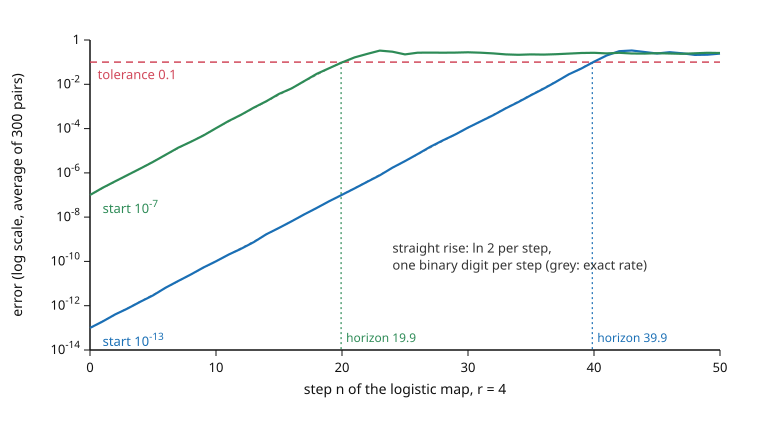

# Philosophy of Physics · Lesson 5.2: Chaos and predictability

> ⏱ ~15 min · Module 5: Determinism, time's arrow, and probability · Builds on: [5.1](05-01-determinism-in-physical-theories.md), [`dynamical-systems` 4.2](../../dynamical-systems/lessons/04-02-sensitive-dependence.md), [`atmospheric-science` 6.5](../../atmospheric-science/lessons/06-05-predictability-two-week-limit.md) · Unlocks: [5.3](05-03-reversible-laws-irreversible-world.md)

## Why this matters

Put one electron at the edge of the observable universe. Its gravity on a box of oxygen is absurdly small, yet Michael Berry reported in 1978 that it ruins any prediction of a molecule's path after about 56 collisions, roughly nine nanoseconds. Is the gas's future therefore open, or only unknown? Karl Popper argued from unpredictability to indeterminism and John Polkinghorne read chaos as openness in nature, while [`dynamical-systems` 4.2](../../dynamical-systems/lessons/04-02-sensitive-dependence.md) concludes "Determinism is not predictability."

## The idea

[5.1](05-01-determinism-in-physical-theories.md) made [determinism](../reference.md#determinism) a property of a theory, on John Earman's test: two models that agree at one time agree at all times. [Predictability](../reference.md#determinism-and-predictability) is different: from a measurement good to finite precision, compute the future within a tolerance. [`metaphysics` 6.1](../../metaphysics/lessons/06-01-determinism-and-the-consequence-argument.md) already separates the two in words.

In a chaotic system, [sensitive dependence](../reference.md#sensitive-dependence) makes a small error grow like $e^{\lambda t}$, so a forecast lives only until a [predictability horizon](../reference.md#predictability-horizon) that grows with the logarithm of your precision. The cleanest picture is [`dynamical-systems` 5.5](../../dynamical-systems/lessons/05-05-symbolic-dynamics-ergodicity.md)'s: the logistic map at $r=4$ is, in disguise, a shift that brings one more binary digit of the present state into play at each step. The future is written in the present's far digits. Determinism says the digits are there; prediction needs someone to have read them. The questions are whether unpredictability bears on determinism at all, whether the far digits are physically there, and whether chaos carries quantum chance up to weather and decisions.

## Source

Henri Poincaré, *Science and Method*, Book I, ch. IV "Chance", tr. Francis Maitland (London: Thomas Nelson, 1914), pp. 67–68:

> A very small cause which escapes our notice determines a considerable effect that we cannot fail to see, and then we say that that effect is due to chance. If we knew exactly the laws of nature and the situation of the universe at the initial moment, we could predict exactly the situation of that same universe at a succeeding moment. But ... we could still only know the initial situation approximately. If that enabled us to predict the succeeding situation with the same approximation, that is all we require ... But it is not always so; it may happen that small differences in the initial conditions produce very great ones in the final phenomena. A small error in the former will produce an enormous error in the latter. Prediction becomes impossible, and we have the fortuitous phenomenon.

Poincaré grants Laplace's conditional ("we could predict exactly") and puts chance in the gap between "exactly" and "approximately". The decisive word is "fortuitous": he calls the outcome chance while asserting the determinism beneath it. Chaos breaks the standard of "that is all we require", not the laws.

## The argument

**The horizon.** Let $\delta(t)$ be the distance between the true state and our estimate.

**A1. Linearized growth.** While $\delta$ is small, $\delta(t)\approx\delta_0e^{\lambda t}$, with $\delta_0$ the initial error and $\lambda>0$ the largest [Lyapunov exponent](../reference.md#lyapunov-exponent) ([`dynamical-systems` 4.4](../../dynamical-systems/lessons/04-04-lyapunov-exponents.md)). *In words:* errors multiply by a fixed factor per unit time, on average.

**A2. Tolerance.** The forecast is useless once $\delta$ reaches a tolerance $\Delta$ below the size of the attractor. *In words:* we decide how wrong is too wrong.

**A3. One scale.** One $\lambda$ governs errors of every size. *In words:* small errors grow no faster than large ones.

From A1 and A2, $\delta_0e^{\lambda t_h}=\Delta$, so

$$t_h=\frac{1}{\lambda}\ln\frac{\Delta}{\delta_0}.$$

*In words:* the horizon counts the factors of $e$ between starting error and tolerance. $1/\lambda$ is the Lyapunov time; [`atmospheric-science` 6.5](../../atmospheric-science/lessons/06-05-predictability-two-week-limit.md)'s doubling time is $T_d=\ln2/\lambda$. Each extra decimal digit of precision buys $\ln10/\lambda$, [`dynamical-systems` 4.2](../../dynamical-systems/lessons/04-02-sensitive-dependence.md)'s thousandfold gain taken one digit at a time. Inverted, a forecast to time $t$ needs $\lambda t/\ln10$ correct digits beyond the tolerance.

A3 is an idealization. Edward Lorenz (1969) modelled a flow with many scales and found that each scale has its own finite range, about an hour for cumulus-sized motions and a few weeks for the largest, which shrinking the initial error could not lengthen, because smaller errors live at faster scales ([`atmospheric-science` 6.5](../../atmospheric-science/lessons/06-05-predictability-two-week-limit.md) P3).

Settled either way: at fixed $t$, $\delta_0e^{\lambda t}\to0$ as $\delta_0\to0$, so exact data still fix a chaotic model's future; what fails is any one precision good for all $t$.

**From unpredictability to indeterminism.** Popper argued this way in 1950 and later defined determinism through predictability (*The Open Universe*, 1982). Polkinghorne (*Science and Creation*, 1988) used critical realism, on which what we can know guides what there is, to read chaotic sensitivity as ontological openness.

**P1.** In a chaotic system no finite precision fixes the outcome beyond a finite horizon. *In words:* the arithmetic above.

**P2.** What no possible measurement could fix is not fixed by the present state. *In words:* limits of knowledge mark limits of fact.

**∴ C.** The future of a chaotic system is not fixed by its present. *In words:* chaos is indeterminism.

As a claim about theories C is false: the logistic map, Lorenz's 1963 equations and Newtonian billiards are chaotic and pass Earman's test. So the argument concerns the world, and P2 carries all the weight; chaos supplies only P1.

**Finite information.** Nicolas Gisin ("Indeterminism in Physics, Classical Chaos and Bohmian Mechanics", *Erkenntnis*, 2021) and Flavio Del Santo with Gisin (*Physical Review A*, 2019) offer a P2 drawn from physics.

**G1.** Classical determinism assumes every quantity has an actual value with infinitely many determinate digits, their [principle of infinite precision](../reference.md#finite-information-quantities). *In words:* the far digits exist.

**G2.** A finite region of space holds only finitely much information. *In words:* no box holds a real number's worth of facts.

**G3.** Almost every real number carries infinite information. *In words:* a typical exact initial condition is an endless list.

**∴ C.** Physical quantities carry finite information, and chaos promotes their not-yet-determinate digits into the macroscopic state at $\lambda/\ln2$ binary digits per unit time, so classical physics so read is indeterministic yet empirically equivalent to the standard reading. *In words:* the future opens as fast as the dynamics consumes digits.

Gisin names the cost. Adding real numbers makes classical mechanics deterministic as adding positions makes Bohmian mechanics deterministic ([2.1](02-01-bohmian-mechanics.md)), and most physicists, he notes, accept the first supplement and reject the second. And something must make undetermined digits determinate, which Del Santo and Gisin treat as a classical measurement problem.

**Amplification.** Maxwell's 1873 essay on free will pictured singular points where "influences whose physical magnitude is too small to be taken account of by a finite being, may produce results of the greatest importance" (Campbell and Garnett, *Life of Maxwell*, 1882, p. 443). The modern [chaos-amplification](../reference.md#chaos-amplification) argument (Hobbs 1991; Kellert 1993): quantum mechanics limits how sharply a state is specified, to a spread $\delta_q$; after about $\frac1\lambda\ln(\Delta/\delta_q)$ chaos has stretched it to macroscopic size. Berry makes the lift immediate for gases: quantum uncertainty alone spoils an oxygen molecule's first collision. Robert Bishop's SEP entry on chaos adds three conditions: an indeterministic reading of quantum mechanics (Bohm and Everett supply none, [2.1](02-01-bohmian-mechanics.md)–[2.3](02-03-many-worlds-branching.md)), no damping or negative local stretching to wash the effect out, and, in brains, a way past parallel redundancy. Kane's use for free will is [`metaphysics` 6.4](../../metaphysics/lessons/06-04-libertarianism-and-its-critics.md)'s, which calls amplification open; the divine-action use is [`apologetics-foundations` 4.4](../../apologetics-foundations/lessons/04-04-divine-action-miracles-and-quantum-indeterminacy.md)'s, where Polkinghorne's proposal differs in kind: chaos itself as openness, the P2 above.

**Quantum chaos.** Schrödinger evolution is unitary, so $\lVert U(t)|\psi\rangle-U(t)|\phi\rangle\rVert=\lVert|\psi\rangle-|\phi\rangle\rVert$: quantum states never separate. Yet many quantum systems have chaotic classical limits, which track them only up to the [Ehrenfest time](../reference.md#ehrenfest-time), of order $\frac1\lambda\ln(S/\hbar)$ for a characteristic action $S$. Wojciech Zurek and Juan Pablo Paz put it near 20 years for Hyperion, Saturn's tumbling moon, and credit decoherence with keeping it classical, though decoherence yields an [improper mixture](../reference.md#proper-and-improper-mixtures) of orientations, not one ([1.2](01-02-decoherence-and-what-it-does-not-do.md)). That is the puzzle of [quantum chaos](../reference.md#quantum-chaos).

**Where the argument is weakest.** The determinist's reply to P2 relies on what Bishop's entry calls the [faithful model assumption](../reference.md#faithful-model-assumption): that the deterministic model represents the world, even beyond the horizon where no data can check it. The strongest objection: Patrick Suppes (1993), using Donald Ornstein's theorems, argued that some processes are equally well described as deterministic or as stochastic however many observations are made, and Lorenz proposed that his many-scale flows are observationally indistinguishable from indeterministic ones. Then no data settle the world's determinism ([`philosophy-of-science` 2.2](../../philosophy-of-science/lessons/02-02-duhem-quine-and-underdetermination.md)). The strongest reply (John Winnie, 1997; Carl Hoefer's SEP entry): the [equivalence](../reference.md#observational-equivalence-of-chaos-and-chance) holds at a chosen coarse-graining, finer observation exposes deterministic structure, and we often know on independent grounds, as with a billiard table, which law governs the system. The determinist concedes that chaotic models' success is no evidence for the world's determinism; the indeterminist concedes that unpredictability is no evidence against it.

## The picture

The error climbs one binary digit per step until it crosses the tolerance, so six more decimal digits of starting precision buy only 19.9 more steps.

## Worked examples

**Example 1 (clean case: the Solar System).** Laplace and Lagrange showed the planets move quasiperiodically to first order in the masses, the backdrop of Laplace's [intelligence](../reference.md#laplaces-intelligence). Jacques Laskar (*Nature*, 1989) integrated an averaged model of the planets over 200 million years and found chaos, with largest exponent about $1/(5\ \text{Myr})$, so that the inner planets' orbits cannot be predicted beyond a few tens of millions of years. Run the horizon:

- Lyapunov time 5 Myr; doubling time $5\ln2\approx3.5$ Myr.

- Each decimal digit of initial precision buys $5\ln10\approx11.5$ Myr.

- A forecast 50 Myr ahead needs $\lambda t/\ln10=10/\ln10\approx4.3$ digits beyond the tolerance; one a billion years ahead needs about 87.

Earman's test: the averaged equations are smooth, so solutions that agree now agree always. The verdicts do not compete: the theory fixes the planets' configuration a billion years out, and stating it would take 87 correct digits of the present.

**Example 2 (hard case: Berry's electron).** Berry, reporting a calculation he credits to Boris Chirikov, treats a gas as hard spheres of radius $r$, free path $\ell$ and speed $V$, disturbed by a mass $M$ at distance $D$, with $G$ Newton's constant. The tidal pull tilts a molecule's rebound by about $\Delta\theta\sim GM\ell^3/(D^3V^2r)$, and each collision multiplies an angular error by about $\ell/r$, so the aim is lost after

$$n\sim\frac{\ln(1/\Delta\theta)}{\ln(\ell/r)}$$

collisions. For oxygen at 0 °C and one atmosphere ($r\approx0.17$ nm, $\ell\approx70$ nm, $V\approx425$ m/s) and an electron $10^{10}$ light years away, $\ln(1/\Delta\theta)\approx311$ and $\ln(\ell/r)\approx6.0$, so $n\approx52$. Berry's inputs gave 56; any plausible inputs give 45 to 63, since every input sits inside a logarithm. At $1.65\times10^{-10}$ s per collision, 56 collisions take nine nanoseconds.

**Where it strains.** Earman's test applies to a whole world or a closed system, and no gas is closed: gravity cannot be screened. In the deterministic theory the gas's own present does not fix its future; the gas plus everything within $10^{10}$ light years does. The determinist says determinism was always a thesis about the whole universe. The critic says a determinism that holds only for the whole universe is idle for the local claims it is usually invoked for. Both accept the physics; they differ on which thesis anyone cared about.

## Watch out

- **You might think** chaos is randomness in the laws, **but actually** the logistic map, Lorenz's equations and Laskar's planets pass 5.1's test; unpredictability is a fact about finite data. The converse fails too ([`metaphysics` 6.1](../../metaphysics/lessons/06-01-determinism-and-the-consequence-argument.md)): chancy outcomes can be practically predictable.

- **You might think** sensitive dependence lets an infinitely small cause make a finite difference in finite time, Maxwell's 1873 definition of instability (*Life*, p. 440), **but actually** in a smooth single-scale system the difference at any fixed time shrinks to zero with the cause. Maxwell's notion fits the [dome](../reference.md#nortons-dome) of 5.1, or many-scale flows if Lorenz's 1969 result holds for them.

- **You might think** $1/\lambda$ is the horizon, **but actually** it is the Lyapunov time, and the horizon multiplies it by $\ln(\Delta/\delta_0)$. And $\lambda$ is an average: an error injected where local stretching is negative first shrinks.

- **You might think** quantum chaos means quantum states diverge exponentially, **but actually** unitary evolution keeps them exactly as far apart as they began.

## One-liner

> Chaos makes the future's dependence on the present exponentially greedy for digits without making it any less a dependence; whether it touches determinism turns on whether the digits are physically there and whether quantum chance feeds them.

## Problems

**P1 (🟢)** *(Formal model: Formal (a)–(b) · Exegetical (c).)* The logistic map $x_{n+1}=4x_n(1-x_n)$ has Lyapunov exponent $\ln2$ per step ([`dynamical-systems` 5.5](../../dynamical-systems/lessons/05-05-symbolic-dynamics-ergodicity.md)). Treat every error as growing at exactly that rate.

(a) A computer stores $x_0$ with an error of about $10^{-16}$. After how many steps does the error reach the tolerance $0.1$? Show the computation.

(b) On Del Santo and Gisin's view, suppose the present fixes only the first 120 binary digits of $x_0$, so that $x_0$ is determinate only to within $2^{-120}$. After how many steps is $x_n$ no longer fixed to within $0.1$ by anything in the present? Show the computation.

(c) At that step, what fixes $x_n$ on the standard real-number reading, and what does Gisin's reading say instead? One sentence each.

**P2 (🟡)** *(Diagnose: Exegetical (a)–(b) · Evaluative (c).)* A paragraph by Corvina Sundqvist in *Saltire Quarterly* (invented, written for this problem):

> Laplace imagined an intelligence that could read the whole future off the present. Chaos theory has buried that dream. (1) The weather two weeks from now cannot be forecast from any measurement we could ever make. (2) So the weather two weeks from now is not yet settled by anything that exists today. (3) It is as open as the moment at which a radioactive nucleus decays. (4) Physics abandoned determinism quietly, and it did not need quantum mechanics to do it.

(a) Which numbered sentence is true as it stands, and at which step does the paragraph pass from a claim about knowledge to a claim about the world? Name the conflation. Two sentences.

(b) What does sentence (3) assume about quantum mechanics, and why, even granting that assumption, does it compare unlike things? Two sentences.

(c) Supply the strongest premise Sundqvist could add to make (2) follow from (1), and say what it costs and what it does to sentence (4). Any verdict; 150 words or fewer.

**P3 (🔴)** *(Reconstruct: Exegetical (a) · Evaluative (b).)* Berry adds that quantum uncertainty alone spoils the aim of an oxygen molecule's first collision. A colleague concludes: "So whether it rains in Bristol a month from today is not fixed by the present state of the world and the laws. Chaos lifts quantum chance to the weather."

(a) Put her argument into numbered premises and a conclusion, adding the unstated premises it needs (at most five premises), and label each premise as physics, interpretation of quantum mechanics, or definition.

(b) Which premise is weakest? Give the strongest objection and the strongest reply, and say what each side concedes. Any verdict; 150 words or fewer.

Solutions

**P1** *(Formal (a)–(b) · Exegetical (c).)*

(a) The error after $n$ steps is $10^{-16}\cdot2^n$. Set it equal to $0.1$:

$$n=\frac{\ln(0.1/10^{-16})}{\ln2}=\frac{15\ln10}{\ln2}\approx\frac{34.54}{0.693}\approx49.8,$$

so about 50 steps. Each step consumes one binary digit, and 15 decimal digits are 49.8 binary digits. (A direct high-precision simulation of 400 pairs started $10^{-16}$ apart gives a median first crossing of 50 steps.)

(b) The spread after $n$ steps is $2^{-120}\cdot2^n$. Set it equal to $0.1$:

$$n=\frac{\ln(0.1\cdot2^{120})}{\ln2}=120-\log_2 10\approx120-3.32=116.7,$$

so about 117 steps.

(c) Standard reading: the remaining digits of $x_0$ exist and fix $x_{117}$ exactly; nobody can know them, so $x_{117}$ is unpredictable but determined. Gisin's reading: those digits are not yet determinate, so the deterministic equation carries real indeterminacy up into $x_{117}$, which is open until something makes the digits determinate.

**Must hit, strict:**

- The horizon formula with the ratio inside the logarithm and $\ln2$ in the denominator, giving about 50 in (a) and about 117 in (b). Accept 49–50 and 116–117.

- (c) The same equation on both readings; the dispute is over the principle of infinite precision, unknown digits on one reading and undetermined digits on the other.

**Wrong turns:** using the largest local stretching factor, 4, instead of the average, which gives about 25 steps; dividing by $\log_{10}2$ while taking a natural logarithm on top; saying in (c) that the standard reading makes $x_{117}$ undetermined because it is unpredictable, which is P2 of the lesson's argument, not the standard reading.

---

**P2** *(Exegetical (a)–(b) · Evaluative (c).)*

**Must hit, strict (a):**

- Sentence (1) is true: it is the two-week limit of [`atmospheric-science` 6.5](../../atmospheric-science/lessons/06-05-predictability-two-week-limit.md), and Lorenz's 1969 result says that no reduction of the initial error lengthens it past a finite range.

- The slide is from (1) to (2), from what no measurement could fix to what nothing fixes. That is the [determinism-and-predictability](../reference.md#determinism-and-predictability) conflation, the unstated P2 of the lesson's argument.

**Must hit, strict (b):**

- (3) assumes that the decay's timing is undetermined by the prior state, which holds on textbook collapse and GRW and fails on Bohmian mechanics (determined by the positions) and on Everett (every outcome occurs).

- Even granting it, the nucleus's openness would be in the law, a chance in the dynamics, while the weather's unpredictability lies in the data: the weather equations are deterministic, and the limit would remain in a wholly Newtonian world.

**Must hit, any verdict (c):**

- Name a premise that makes (2) follow, and show that it does.

- State its cost.

- Say what it does to (4). The finite-information premise and a verificationist premise keep (4); an amplification premise makes (4) false, since it needs quantum mechanics and an indeterministic reading of it.

**Wrong turns:** calling (1) false because ensemble forecasts work, when they forecast distributions rather than the weather; reading (3) as settled physics; supplying "chaotic laws are stochastic", which is false of the models.

**Model answer (c), one of several:** The strongest addition is Gisin's: physical quantities carry only finitely many determinate digits, so the digits the weather will depend on in two weeks do not yet exist. With that, (2) follows from (1) as physics, not as a confusion. It costs three things. It denies the principle of infinite precision, which, as Gisin notes, most physicists assume. It is empirically equivalent to the standard reading, so no forecast failure supports it over its rival. And it needs some process that makes the open digits determinate, a classical measurement problem. It does keep (4), since no quantum mechanics enters. Sundqvist could instead add amplification of quantum chance, but then (4) is false, and she inherits a choice of interpretation and the open question whether molecular differences reach weather scales.

---

**P3** *(Exegetical (a) · Evaluative (b).)*

**Accept (a):** any valid reconstruction with these four contents, in any order and wording:

- Q1 (interpretation): quantum outcomes at the molecular scale are not fixed by the prior state.

- Q2 (physics): quantum spreads in molecular positions exceed what fixes the outcome of the first collision (Berry's estimate).

- Q3 (physics): differences at the molecular scale grow to the scale of weather within a month rather than being damped or averaged out.

- Q4 (definition): if the weather a month ahead depends on outcomes not fixed by the present, then it is not fixed by the present state and the laws.

- ∴ Whether it rains in Bristol a month from today is not fixed by the present state of the world and the laws.

**Must hit, strict (a):** Q1 labelled interpretation, Q2 and Q3 labelled physics, and Q3 stated: Berry's estimate concerns a molecule's path, not the weather.

**Must hit, any verdict (b):**

- Name one premise as weakest, Q1 or Q3 being the live choices.

- If Q1: the objection is that Bohmian mechanics and Everett deny it ([2.1](02-01-bohmian-mechanics.md), [2.3](02-03-many-worlds-branching.md)); the reply is that collapse readings affirm it, so the conclusion holds conditionally.

- If Q3: the objection is damping, negative local stretching and averaging over vast numbers of molecules; the reply is the upscale cascade ([`atmospheric-science` 6.5](../../atmospheric-science/lessons/06-05-predictability-two-week-limit.md)) and Lorenz's many-scale result.

- State what each side concedes.

**Wrong turns:** answering only by classifying the interpretations, which [`apologetics-foundations` 4.4](../../apologetics-foundations/lessons/04-04-divine-action-miracles-and-quantum-indeterminacy.md) P1 sets; reading Berry's estimate as showing chance rather than uncertainty; concluding that chaos alone suffices, which is P2's slide; assuming that undetermined rain would be a fifty-fifty matter, when the chance would be roughly the climatological frequency.

**Model answer (b), one of several:** Q3 is weakest. Berry shows that quantum spread leaves even a molecule's first collision unaimed; he does not show that a different molecular history yields a different storm. The objection: the weather is a coarse-grained quantity, averaged over about $3\times10^{19}$ molecules in each cubic centimetre, and dissipation damps small motions, so molecular differences might never reach synoptic scales. The reply: Lorenz's many-scale result and the upscale cascade suggest that errors at each scale contaminate the next within its own short range, so even molecular differences could reach the weather within weeks. The indeterminist concedes that this is a modelled cascade, not a demonstrated one, and that Q1 is interpretation-relative. The determinist concedes that if both Q1 and the cascade hold, next month's rain is a matter of chance, though a chance near the climatological frequency and so still predictable as a distribution.

## Flashback

**From Lesson [4.5](04-05-the-hole-argument.md) (The hole argument):** *(Apply: Exegetical (a)–(b).)* Late in 1913 Einstein filled spacetime with matter except in one region, the hole, and found that a generally covariant theory admits two metrics that agree everywhere outside it and differ inside. Concluding that no such theory obeys what he called the law of causality (determinism, in later terms), he kept the field equations of limited covariance he had published that year.

(a) On the Stanford Encyclopedia's account, what did Einstein assume without saying so? Which premise of 4.5's reconstruction of the [Earman–Norton dilemma](../reference.md#earman-norton-dilemma) did his theory give up, so that he took neither horn? Two sentences.

(b) A colleague calls this chaos in disguise: sharper data outside the hole would have fixed the metric inside. Using 4.5's P4, say why no data could, and what, if anything, Leibniz equivalence leaves unfixed. Two sentences.

Solution

**Must hit, strict (a):**

- The tacit assumption: two metrics that differ only by a redistribution inside the hole are two physical situations. That denies [Leibniz equivalence](../reference.md#leibniz-equivalence): it is C1, the manifold substantivalist's count.

- Given up: P3, active general covariance, by changing the theory rather than denying a theorem: under limited covariance the redistribution of a solution need not solve the equations. He kept determinism and paid with covariance, so neither horn applies.

**Must hit, strict (b):**

- By P4 the two metrics agree on every invariant, inside the hole and out, so no measurement of any precision separates them.

- Under Leibniz equivalence nothing is left unfixed: the development into the hole is unique up to diffeomorphism. Chaotic alternatives, by contrast, become observably different later.

**Wrong turns:** saying Einstein took the first horn, when he refused the indeterminism and changed the theory; saying his theory gave up only passive covariance, which, as Kretschmann objected, constrains nothing; saying he accepted Leibniz equivalence in 1913, which would have dissolved his worry; treating the hole's indeterminism as unpredictability.

**Model answer:** (a) He tacitly denied Leibniz equivalence, counting two metrics that differ only inside the hole as two physical situations. His limited-covariance theory gave up P3, active general covariance, so the redistributed metric was no longer a solution, and he escaped both horns at the price of covariance until the [point-coincidence argument](../reference.md#point-coincidence-argument) let him accept Leibniz equivalence. (b) By P4 the two metrics agree on every invariant, inside the hole and out, so no measurement of any precision could separate them. Under Leibniz equivalence nothing is left unfixed, since the development into the hole is unique up to diffeomorphism, whereas chaotic alternatives that today's data cannot exclude become observably different later.

## Connections

- **Backward:** [5.1](05-01-determinism-in-physical-theories.md) supplied Earman's definition and the dome. The exponent, the horizon and the digit shift are [`dynamical-systems` 4.2](../../dynamical-systems/lessons/04-02-sensitive-dependence.md), [4.4](../../dynamical-systems/lessons/04-04-lyapunov-exponents.md) and [5.5](../../dynamical-systems/lessons/05-05-symbolic-dynamics-ergodicity.md); the two-week limit and the upscale cascade are [`atmospheric-science` 6.5](../../atmospheric-science/lessons/06-05-predictability-two-week-limit.md); the separation in words is [`metaphysics` 6.1](../../metaphysics/lessons/06-01-determinism-and-the-consequence-argument.md). Poincaré's 1890 three-body work, where the subject began, is in [`orbital-mechanics` 4.5](../../orbital-mechanics/lessons/04-05-restricted-three-body-lagrange-points.md).

- **Forward:** Berry's hard-sphere gas is the kind of system Boltzmann's H-theorem treats, and [5.3](05-03-reversible-laws-irreversible-world.md) asks how reversible collisions like these yield an irreversible world. [5.6](05-06-probability-in-statistical-mechanics.md) asks whether ergodicity, Birkhoff's theorem from [`dynamical-systems` 5.5](../../dynamical-systems/lessons/05-05-symbolic-dynamics-ergodicity.md), can ground statistical probability in a deterministic world.

- **Sideways:** chaos-amplification is the physics behind Kane's libertarianism in [`metaphysics` 6.4](../../metaphysics/lessons/06-04-libertarianism-and-its-critics.md) and behind the divine-action proposals of [`apologetics-foundations` 4.4](../../apologetics-foundations/lessons/04-04-divine-action-miracles-and-quantum-indeterminacy.md), where the theology stays. Suppes's equivalence of chaos and chance is underdetermination ([`philosophy-of-science` 2.2](../../philosophy-of-science/lessons/02-02-duhem-quine-and-underdetermination.md)) in a dynamical key. Gisin's real numbers and Bohm's positions ([2.1](02-01-bohmian-mechanics.md)) are the same move: a supplement that restores determinism.
