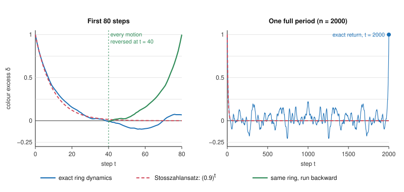

# Philosophy of Physics · Lesson 5.3: Reversible laws, irreversible world

> ⏱ ~15 min · Module 5: Determinism, time's arrow, and probability · Builds on: [5.1](05-01-determinism-in-physical-theories.md), [`dynamical-systems` 2.1](../../dynamical-systems/lessons/02-01-conservative-reversible-systems.md), [`stat-mech` 1.1](../../stat-mech/lessons/01-01-mechanics-to-statistics.md) · Unlocks: [5.4](05-04-boltzmann-entropy-and-the-past-hypothesis.md)

## Why this matters

Run a film of ink spreading through water backward and you see something that never happens. Yet [`stat-mech` 6.2](../../stat-mech/lessons/06-02-entropy-information-arrow.md) tells you the microscopic laws run equally well in both directions, and the second law that entropy can only grow. Read strictly, the two cannot both hold. Johann Loschmidt pressed one version on Boltzmann in 1876, Ernst Zermelo another in 1896; this lesson states both, and Boltzmann's answers.

## The idea

Run a film of a billiard break backward: fifteen balls converge into a triangle. Every collision obeys Newton's laws. That is [time-reversal invariance](../reference.md#time-reversal-invariance): the backward film of any motion the laws allow is itself allowed. [`dynamical-systems` 2.1](../../dynamical-systems/lessons/02-01-conservative-reversible-systems.md) defined it for planar systems by flipping the velocity and running the clock backward; this lesson asks what the flip should be in general.

In 1872 Boltzmann proved that a dilute gas's velocities flow toward Maxwell's distribution, with a quantity $H$ falling all the way: the [H-theorem](../reference.md#h-theorem). If the laws ignore direction, the direction entered through one assumption about collisions, the [Stosszahlansatz](../reference.md#stosszahlansatz): molecules about to collide are uncorrelated. The [reversibility objection](../reference.md#reversibility-objection): reverse every velocity, and $H$ must rise. The [recurrence objection](../reference.md#recurrence-objection): wait, and the gas returns near its start, so $H$ must rise again. Boltzmann answered both that his theorem was about probability.

"Reversible" here is this dynamical sense, not a quasi-static process ([`thermodynamics-physics` 2.3](../../thermodynamics-physics/lessons/02-03-entropy.md)) or a retraceable Stokes flow ([`fluid-dynamics` 3.3](../../fluid-dynamics/lessons/03-03-stokes-flow.md)).

## Source

Boltzmann, "On Certain Questions of the Theory of Gases", *Nature* 51 (28 February 1895), §2, written in English to answer Edward Culverwell's version of the reversal argument:

> Let us compare two motions of a dynamical system. At the beginning of the second motion, let the coordinates specifying the position of every part of the moving system, and the magnitudes of all the corresponding velocities, be the same as they were at the end of the first motion, but let the direction of every velocity be exactly reversed. Then in the second motion the system moves exactly in the opposite way to what it does in the first … It can never be proved from the equations of motion alone, that the minimum function H must always decrease. It can only be deduced from the laws of probability, that if the initial state is not specially arranged for a certain purpose, but haphazard governs freely, the probability that H decreases is always greater than that it increases.

The first half grants the objector that nothing in the dynamics forbids the reversed motion. The second moves the arrow out of "the equations of motion alone" into the initial state, where "not specially arranged" and "haphazard governs freely" carry the weight. They say which states the theorem covers, not why the world is full of them; [5.4](05-04-boltzmann-entropy-and-the-past-hypothesis.md) names the missing fact the [past hypothesis](../reference.md#past-hypothesis).

## The argument

**Time-reversal invariance.** A theory fixes its instantaneous states and the histories $t \mapsto S(t)$ it allows. Let $R$ be an operation on instantaneous states with $R(R(S)) = S$. The theory is time-reversal invariant under $R$ when

$$S(t) \text{ allowed} \;\Longrightarrow\; (TS)(t) := R\big(S(-t)\big) \text{ allowed}.$$

*In words:* play any allowed history backward, apply $R$ to every frame, and you get another allowed history.

Everything turns on $R$. For a Newtonian particle at position $x$ with velocity $v$, $R(x, v) = (x, -v)$. For electromagnetism the textbook choice is $R(E, B, \rho, j) = (E, -B, \rho, -j)$ (electric and magnetic fields, charge and current densities). Whether that is right is [the Albert–Malament dispute](../reference.md#albert-malament-dispute):

- **Albert** (*Time and Chance*, 2000, ch. 1). An instantaneous state must not depend on other times, so velocities are no part of one, and reversal may flip only the rate of change of something it leaves alone. A magnetic field is the rate of change of nothing, so $B$ stays. Then Faraday's law $\nabla\times E = -\partial B/\partial t$ fails for the reversed history: classical electromagnetism is not time-reversal invariant, and flipping $B$ is ad hoc. He says the same of quantum mechanics, whose reversal conjugates the wavefunction.
- **Malament** ("On the Time Reversal Invariance of Classical Electromagnetic Theory", 2004). The field tensor $F_{ab}$ codes the force on a charge through its future-pointing four-velocity, so it is defined only relative to a choice of future. Reverse that choice and $F_{ab}$ flips. An observer's $E$ survives, and $B$, which also needs a handedness of space, flips, as an angular velocity does in a backward film. Albert's operation is time reversal plus a mirror reflection.

Earman (2002) also rejects Albert's conclusion; Bryan Roberts (*Reversing the Arrow of Time*, 2022) reconciles the two. [`nuclear-particle-physics` 4.3](../../nuclear-particle-physics/lessons/04-03-parity-c-cp.md) gives the standard reading and owns the settled exception: weak interactions violate $CP$, hence by $CPT$ also $T$, seen directly in $B$ mesons (BaBar, 2012). That violation is too small and of the wrong kind to make the arrow: it lives in rare decays, its dynamics is still unitary (so fine-grained entropy stays fixed), and Loschmidt's argument runs with $CPT$ in place of $T$.

**The H-theorem** (Boltzmann, 1872). For a dilute gas, with $f(v,t)$ the fraction of molecules with velocity near $v$, let

$$H[f] = \int f \ln f \; d^3v .$$

Under the Boltzmann equation, $dH/dt \le 0$, with equality exactly at Maxwell's distribution. *In words:* $-H$ behaves like an entropy and climbs to equilibrium.

Besides hard spheres and low density, the equation assumes the Stosszahlansatz: collisions per unit time between molecules with velocities $v_1$ and $v_2$ number in proportion to $f(v_1)f(v_2)$. *In words:* molecules about to collide carry no memory of each other. It is imposed on incoming pairs only, since a collision correlates its outgoing pair: the one premise that tells past from future.

**Loschmidt's objection** (1876).

**P1.** The molecular dynamics is time-reversal invariant, with $R$ reversing every velocity. *In words:* the backward film of a lawful motion is lawful.

**P2.** $H$ is the same at a state and at its reversal, since $f(v) \mapsto f(-v)$ leaves the integral unchanged. *In words:* reversal does not change how the speeds are spread.

**P3.** Some histories have $H$ falling between times $t_1$ and $t_2$. *In words:* gases do relax.

**∴ C.** Reversing such a history at $t_2$ gives a lawful history in which $H$ rises for as long, so no theorem from the dynamics alone gives $dH/dt \le 0$ for every state. *In words:* the Stosszahlansatz fails at reversed states.

**Zermelo's objection** (1896) rests on [Poincaré recurrence](../reference.md#poincare-recurrence), from Poincaré's 1890 three-body memoir: if a flow preserves phase volume on a region of finite volume, almost every state returns arbitrarily close to itself, infinitely often. A gas in a rigid box at fixed energy qualifies, by [Liouville's theorem](../../analytical-mechanics/lessons/03-02-phase-space-liouville.md), so its $H$ cannot fall forever.

**Boltzmann's replies.** First, the Source: the theorem holds for most initial states, not all. Second, Poincaré's theorem "is of course correct, but its application to the theory of heat is not" (*Annalen der Physik* 57, 1896; lesson's translation): for a cubic centimetre of air the recurrence time in seconds has *viele Trillionen Stellen*, many trillions of digits, a German *Trillion* being $10^{18}$. Third, why our surroundings are now so improbable is no more a question for natural science, he wrote, than why there are phenomena at all.

**Where the argument is weakest.** The premise under most pressure is Boltzmann's "not specially arranged". The objection: $R$ preserves Liouville measure, so reversed microstates are no rarer than the originals, and the counting that says $H$ will probably fall from a non-equilibrium state says it was probably lower a moment before, as his own H-curve shows. The reply: the phrase concerns how a gas was prepared, and real gases are prepared by a lower-entropy past; [Lanford's theorem](../reference.md#lanfords-theorem) (1975) derives the Boltzmann equation from Hamiltonian dynamics for most initial states, if only in a dilute limit and briefly. Boltzmann concedes that the arrow needs a fact about initial conditions; his critics concede that for unarranged states the rise is overwhelmingly probable on any watchable timescale.

## The picture

The [Kac ring](../reference.md#kac-ring) (Mark Kac, 1959) is the H-theorem in miniature. $n$ balls, white or black, sit at $n$ sites on a circle, and $m$ of the gaps between sites carry a marker. Each step every ball moves one site on, changing colour when it crosses a marker; $\delta = (\text{white} - \text{black})/n$. The ring's Stosszahlansatz says the balls about to cross markers are a fair sample of the colours, a fraction $\mu = m/n$ of each, so

$$\delta_{t+1} = (1-2\mu)\,\delta_t, \qquad \delta_t = (1-2\mu)^t\,\delta_0 \to 0 .$$

The exact dynamics is reversible (move every ball back) and periodic: after $n$ steps every ball has crossed every marker once, so for even $m$ the ring is as it began (for odd $m$, at $2n$). Here $n = 2000$, $m = 100$, $\mu = 0.05$, all white at the start.

One reversible ring: the ansatz fits for a while, reversal undoes it, and recurrence restores it.

## Worked examples

**Example 1 (clean case: Loschmidt's reversal on the ring).** The ansatz predicts $\delta = 0.9^{10} = 0.35$, $0.12$ and $0.9^{40} = 0.0148$ at $t = 10, 20, 40$; the ring gives $0.38$, $0.16$ and $-0.008$. Now reverse every motion at $t = 40$. Each ball retraces its path and recovers its colour: at $t = 80$ the ring is all white, $\delta = 1$, where the ansatz predicts $0.9^{40}\times(-0.008) \approx -0.0001$.

Run Loschmidt's argument. P1 holds: the backward rule is a rule of the same kind. P2 holds: $\delta$ ignores which way the balls move. So the ansatz must fail somewhere, and it fails at the reversed state, whose balls about to cross markers are exactly those whose colours those markers set. Zermelo's half: from $t = 40$ to $1960$, $\delta$ stays within $0.22$ of zero, and at $t = 2000$ it is $1$ again, untouched.

**Example 2 (hard case: a charge in a magnetic field).** A proton circles clockwise, seen from above, in a uniform upward magnetic field. The force $qv\times B$ is perpendicular to its velocity, so its kinetic energy never changes. Run the film backward: it circles counterclockwise. Is that lawful?

- Reverse the velocity and keep $B$: no. The field bends it the other way; after a quarter turn it is a full diameter from the original start.
- Reverse the velocity and flip $B$: yes, the proton retraces its arc.

So conserving energy does not make a system reversible under velocity reversal alone. ([`dynamical-systems` 2.1](../../dynamical-systems/lessons/02-01-conservative-reversible-systems.md) shows that systems $\dot x = y$, $\dot y = -V'(x)$, where no force depends on velocity, are reversible.) Here the account stops, because invariance is defined relative to $R$ and nothing in the equations says what $R$ is. Albert takes the first bullet as the verdict: flipping $B$ puts the proton in a different field, so the backward film shows a different world. Malament takes the second: the sign of $B$ encodes a time orientation and a handedness, which reversal must re-express. Both accept every prediction and that the $B$-flipping map takes solutions to solutions; they disagree about whether it deserves the name.

## Watch out

- **You might think** time-reversal invariant laws mean a world that looks the same run backward, **but actually** they only allow the backward film. The actual history can be wildly asymmetric, with the asymmetry in boundary conditions ([5.4](05-04-boltzmann-entropy-and-the-past-hypothesis.md)).

- **You might think** weak $T$-violation explains the arrow, or that the laws contain none, **but actually** it exists and is not what makes entropy rise: it is tiny, rare, and unitary.

- **You might think** the H-theorem derives the second law from mechanics, **but actually** it needs the Stosszahlansatz too, and that premise carries the asymmetry. Since the ansatz fails at some states, what survives is Boltzmann's weaker claim: entropy almost always rises, for states not specially arranged.

- **You might think** Poincaré recurrence brings every state back exactly, **but actually** almost every state comes back arbitrarily close, and only for a volume-preserving flow on a region of finite volume. Boltzmann doubted the universe is one.

## One-liner

> Reversible laws allow every backward film, so no theorem from them alone makes entropy rise in every case: the H-theorem's arrow came from the Stosszahlansatz, which Loschmidt and Zermelo showed must sometimes fail, and Boltzmann moved it into probability and initial conditions.

## Problems

**P1 (🟢)** *(Diagnose: Exegetical.)* A letter to *Halcyon Science Weekly* by Tove Vellacott (invented, written for this problem) makes three claims against Boltzmann:

> (i) Film a gas as it fills its container, then reverse every molecule's velocity in the last frame: the gas rushes back into its corner. So Boltzmann's count of collisions cannot be right for every state of the gas.
>
> (ii) Seal the gas in a rigid, perfectly smooth box and wait. A theorem of Poincaré's guarantees that it comes back close to its starting arrangement, so whatever H does at first, one day it must climb back.
>
> (iii) No real container is perfectly smooth or insulated, and every gas is jostled by the rest of the universe. So a theorem about an isolated gas tells us nothing about real gases.

(a) For each of (i) and (ii), name the objection, the property of the dynamics it uses, and the premise of the H-theorem it puts under pressure. One line each.

(b) Is (iii) either objection? If granted, does it block (i), (ii), both or neither? Two sentences.

**P2 (🟡)** *(Formal (a)–(b) · Evaluative (c).)* In the [Ehrenfest urn model](../reference.md#ehrenfest-urn) (Paul and Tatiana Ehrenfest, 1907), $N$ numbered balls are split between urns A and B. Each step a number from 1 to $N$ is drawn uniformly at random, and that ball changes urn. In the long run the number $k$ of balls in A has the binomial distribution $\pi(k) = \binom{N}{k}2^{-N}$. [Kac's lemma](../reference.md#kacs-lemma) (Kac, 1947): started in a state $s$, the chain's mean time to return to $s$ is $1/\pi(s)$. Take $N = 40$.

(a) Find the mean return time to "all 40 in A", in steps, and in years at one draw per second (a year is $3.156\times10^7$ s). Show the computation.

(b) Find the mean return time to $k = 20$, and the ratio of (a) to it. Show the computation.

(c) Boltzmann answered Zermelo that recurrence times are too long to matter. Using (a) and (b), say what that reply concedes and what it needs to be true. 100 words or fewer.

**P3 (🔴)** *(Find the crux: Exegetical (a) · Evaluative (b).)* Albert and Malament agree on Maxwell's equations, on every measurement result, and that the map $(E, B, \rho, j) \mapsto (E, -B, \rho, -j)$, applied with $t \to -t$, takes solutions to solutions.

(a) Name the single premise about the time-reversal operation that one affirms and the other denies, and state the crux as a conditional both would sign. Two sentences.

(b) Does the outcome of their dispute matter to the problem of the arrow? Say what Loschmidt's argument needs from the laws, whether each side's view supplies it, and what, if anything, does turn on the dispute. Any verdict; 150 words or fewer.

Solutions

**P1** *(Exegetical (a)–(b).)*

**Must hit, strict (a):**

- (i): the reversibility objection (Loschmidt's). It uses the time-reversal invariance of the molecular dynamics, together with $H$ being unchanged by reversing velocities. It targets the Stosszahlansatz: in the reversed state, molecules about to collide are correlated by their earlier collisions, so the ansatz fails there.

- (ii): the recurrence objection (Zermelo's). It uses Poincaré recurrence, which needs volume-preserving dynamics on a region of finite phase volume (a rigid box at fixed energy). It targets the claim that the Stosszahlansatz, and so $dH/dt \le 0$, holds at all times along one history, even one that starts unarranged.

**Must hit, strict (b):**

- Neither objection. It attacks the idealization of an isolated gas, not a premise about collisions.

- Granted, it blocks both for the gas taken alone: reversing the gas's velocities no longer reverses its history unless the surroundings are reversed too, and recurrence needs an isolated system of finite phase volume. It blocks neither for gas plus surroundings taken as one isolated system, whose dynamics is time-reversal invariant and, if bounded, recurrent.

**Wrong turns:** calling (ii) a reversal argument because $H$ "climbs back"; saying (i) and (ii) target different premises with no mention of the Stosszahlansatz; letting (iii) block only (ii), when an open gas cannot be reversed by flipping its own velocities either; taking (iii) to refute Boltzmann outright, when it relocates both objections to a larger system (Boltzmann himself noted in 1896 that every gas interacts with the whole universe, and kept his theory).

**Model answer:** (a) (i) Loschmidt's reversibility objection: it uses time-reversal invariance and the reversal-invariance of $H$, and shows the Stosszahlansatz fails at reversed states. (ii) Zermelo's recurrence objection: it uses Poincaré recurrence for a bounded, volume-preserving flow, and shows the ansatz cannot hold at all times along one history. (b) Neither; it targets isolation. It blocks both for the gas alone, but both return for gas plus environment taken as one system.

---

**P2** *(Formal (a)–(b) · Evaluative (c).)*

(a) "All 40 in A" is the single state $k = 40$, with $\pi(40) = \binom{40}{40}2^{-40} = 2^{-40}$. By Kac's lemma the mean return time is

$$\frac{1}{\pi(40)} = 2^{40} = 1{,}099{,}511{,}627{,}776 \approx 1.10\times10^{12} \text{ steps}.$$

At one draw per second, $1.10\times10^{12} / 3.156\times10^{7} \approx 3.48\times10^{4}$, about 34,800 years.

(b) $\pi(20) = \binom{40}{20}2^{-40}$ with $\binom{40}{20} = 137{,}846{,}528{,}820$, so

$$\frac{1}{\pi(20)} = \frac{2^{40}}{\binom{40}{20}} = \frac{1{,}099{,}511{,}627{,}776}{137{,}846{,}528{,}820} \approx 7.98 \text{ steps}.$$

The ratio is $\binom{40}{20} \approx 1.38\times10^{11}$. (Check: Stirling's formula gives $2^N/\binom{N}{N/2} \approx \sqrt{\pi N/2} \approx 7.93$.)

**Must hit, strict (a)–(b):** $\pi(40) = 2^{-40}$ and the return time $2^{40} \approx 1.10\times10^{12}$ steps; the conversion to about $3.5\times10^4$ years; $\pi(20) = \binom{40}{20}/2^{40}$ and the return time $\approx 7.98$ steps; the ratio $\binom{40}{20} \approx 1.38\times10^{11}$.

**Must hit, any verdict (c):**

- The reply concedes the theorem: return is certain and its mean time finite, for the low-entropy state as for any other.

- It rests on a scale, not a principle. The return time of the low-entropy state grows like $2^N$, while balanced states recur within a few steps, so the reply needs $N$ large and the step rate slow relative to any observer. At one draw per microsecond, $2^{40}$ steps take about 12.7 days.

- Say what this does to irreversibility: it becomes a claim about timescales relative to $N$, not a law with no exceptions.

**Wrong turns:** using $1/\binom{40}{40}$ or forgetting the $2^{-N}$; dividing by 365 days but forgetting seconds per day; reading Kac's lemma as refuting the approach to balance, when (b) shows balance recurs at once; treating the urn as Loschmidt's reversal: it is a random process, so it models recurrence, not the reversal of deterministic laws.

**Model answer (c), one of several:** The reply concedes everything Zermelo proved: the all-in-A state returns with certainty, on average every $2^{40}$ steps. It denies only relevance, and that depends on numbers. By (b), balanced states recur almost at once, while the ordered state's return time grows like $2^N$. At 40 balls and a draw per microsecond, a lab would see a return in under two weeks. For the $2.7\times10^{19}$ molecules in a cubic centimetre of air, $2^N$ has about $8\times10^{18}$ digits. So on this reply the second law is a large-$N$ statement about timescales, not a law without exceptions.

---

**P3** *(Exegetical (a) · Evaluative (b).)*

**Accept (a):** any phrasing that isolates whether the reversal operation may change only rates of change of what it leaves intact, including one put in terms of what a single frame of the backward film contains.

**Must hit, strict (a):**

- The premise: time reversal may reverse only a quantity that is the rate of change of something it leaves intact (Albert affirms it; Malament denies it, holding that quantities defined relative to a time orientation, or to a time orientation and a handedness, must be re-expressed when the orientation is reversed).

- A conditional both would sign: "If time reversal may change only rates of change of what it leaves intact, then $B$ is unchanged and classical electromagnetism is not time-reversal invariant; if it must re-express quantities defined relative to a time orientation, then $B$ flips and the theory is invariant."

**Must hit, any verdict (b):**

- State what Loschmidt needs: some operation that takes every lawful history to a lawful history run in the opposite time order and leaves the entropy (or $H$) of each macrostate unchanged.

- Say whether each view supplies it. Both grant that the $B$-flipping map does this, so on either view the reversibility objection survives; on Albert's it runs through a symmetry he does not call time reversal.

- Name what does turn on the dispute: whether the classical laws themselves distinguish the two directions of time, which matters to the claim that the arrow puzzle starts from laws with no direction, and to whether the $B$-flip relates two descriptions of one world or two different worlds.

**Wrong turns:** treating the dispute as one about predictions; saying Albert's view explains the arrow, when an asymmetry in electromagnetism's laws has nothing to do with entropy and the $B$-flipping map still reverses every entropy rise; crediting either side with a verdict the rubric does not require.

**Model answer (b), one of several:** For the statistical puzzle, very little. Loschmidt needs an operation that maps each lawful history to a lawful one in reverse time order without changing entropy. Albert and Malament agree that the $B$-flipping map does exactly that, so on Albert's view the objection runs through a symmetry he declines to call time reversal. What turns on the dispute is the starting point of the puzzle, usually posed as: the laws have no preferred direction, so where does the arrow come from? If Albert is right, classical electromagnetism has one, though not one that touches entropy, so the puzzle must be restated as being about the right kind of asymmetry. The dispute also decides whether a world and its $B$-flipped twin are two worlds or one.

## Flashback

**From Lesson [5.1](05-01-determinism-in-physical-theories.md) (Determinism in physical theories):** *(Apply to a hard case: Formal (a) · Exegetical (b).)* A tank drains through a small hole in its floor. By Torricelli's law its water depth $h \ge 0$ obeys $\dot h = -k\sqrt h$; take $k = \tfrac15$, with $h$ in centimetres and $t$ in seconds. The state is $h$ alone.

(a) Find the history with $h(0) = 36$ and when the tank empties. Give a second history that agrees with it at $t = 100$ but not at $t = 0$. Is the law future-deterministic, past-deterministic, or both, in Earman's sense? Where does the [Lipschitz condition](../reference.md#lipschitz-condition) fail? Show the computation.

(b) [Norton's dome](../reference.md#nortons-dome) fails both ways. Which property of Newton's laws, used in 5.1, does Torricelli's law lack, and what does (a) show about whether water's past is determined? Two sentences.

Solution

(a) While $h > 0$, $\frac{d}{dt}\sqrt h = \frac{\dot h}{2\sqrt h} = -\frac{k}{2} = -\frac{1}{10}$, so $\sqrt h = 6 - \frac{t}{10}$:

$$h(t) = \frac{(60 - t)^2}{100} \ \text{ for } t \le 60, \qquad h(t) = 0 \ \text{ for } t \ge 60.$$

It empties at $t = 60$ s. The history $h = \frac{(70-t)^2}{100}$ up to $t = 70$, then $0$, also has $h(100) = 0$, but $h(0) = 49$: past determinism fails. Future determinism holds: $\dot h \le 0$, so an empty tank stays empty, and through any $h > 0$ the solution is unique, emptying time included. The slope of $k\sqrt h$, $\frac{1}{10\sqrt h}$, is unbounded as $h \to 0$: Lipschitz fails at the empty state.

**Must hit, strict (a):** $h = (60-t)^2/100$, empty at 60 s; a second history (any other emptying time up to 100, or $h \equiv 0$); future yes, past no; the slope unbounded at $h = 0$.

**Must hit, strict (b):**

- [Time-reversal invariance](../reference.md#time-reversal-invariance): the dome's departure has a lawful reversed film, so its two directions fail together; the reversed drain, an empty tank filling itself, breaks Torricelli's law.

- Only that the theory whose state is $h$ is past-indeterministic: determinism belongs to a theory with a fixed notion of state, and one tracking where the water went could separate the histories.

**Wrong turns:** "the tank could start draining at any moment"; placing the Lipschitz failure at the full tank; concluding that the world's past is open.

**Model answer (b):** Time-reversal invariance: the dome's forward failure has a lawful reversed film, but an empty tank filling itself breaks Torricelli's law, so here the directions come apart. (a) shows only that the theory whose state is the depth alone is past-indeterministic; one that also tracked where the water went could tell the histories apart.

## Connections

- **Backward:** [5.1](05-01-determinism-in-physical-theories.md) defined determinism as models that agree at one time agreeing at all times; it used time reversal twice, reading the dome's spontaneous departure as the reverse of a ball coasting up to the apex and building the space invaders from escapes, and this lesson says what that operation is. Time-reversal invariance is a different property from determinism: the Boltzmann equation is future-deterministic, fixing a gas's later velocity distributions from its present one, without being invariant, and Newton's laws on the dome are invariant without being deterministic. The chaos of [5.2](05-02-chaos-and-predictability.md) is why reversing a real gas fails in practice: any error in the reversed velocities grows exponentially, a fact about control, not about the laws. The reversal itself extends [`dynamical-systems` 2.1](../../dynamical-systems/lessons/02-01-conservative-reversible-systems.md); [`stat-mech` 1.1](../../stat-mech/lessons/01-01-mechanics-to-statistics.md) states the growth of coarse-grained volume with Boltzmann's qualification, almost always rather than always; and Zermelo's objection uses the volume preservation of [`analytical-mechanics` 3.2](../../analytical-mechanics/lessons/03-02-phase-space-liouville.md).

- **Forward:** [5.4](05-04-boltzmann-entropy-and-the-past-hypothesis.md) turns "not specially arranged" into counting, meets the retrodiction problem the H-curve already shows, and states the past hypothesis. [5.5](05-05-is-the-past-hypothesis-enough.md) takes up the close of the same 1895 letter, Schuetz's idea that our world is a fluctuation in an equilibrium universe. [5.6](05-06-probability-in-statistical-mechanics.md) asks what the probability in Boltzmann's reply is a probability of, and [6.1](06-01-symmetries-and-what-they-tell-us.md) takes up symmetries of laws in general, of which time reversal is one.

- **Sideways:** [`philosophy-of-science` 4.5](../../philosophy-of-science/lessons/04-05-reduction-and-emergence.md) says the second law needs a probabilistic assumption mechanics does not supply; the Stosszahlansatz is where it enters. [`nuclear-particle-physics` 4.3](../../nuclear-particle-physics/lessons/04-03-parity-c-cp.md) owns $CP$, $T$ and $CPT$. Whether time has a direction of its own, apart from what happens in it, is [`metaphysics` 5.1](../../metaphysics/lessons/05-01-the-a-theory-and-the-b-theory.md)'s question; Albert's claim that electromagnetism's laws already distinguish the two directions is one physics input to it.
