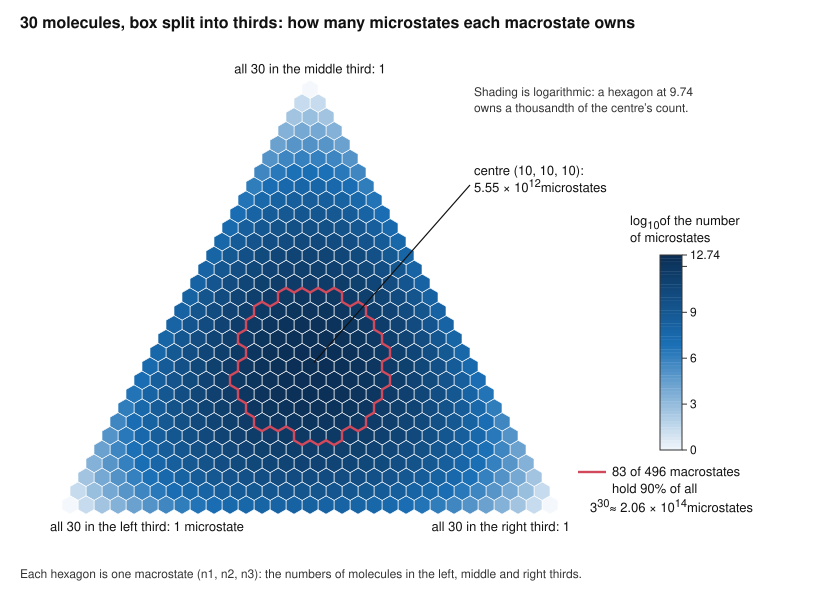

# Philosophy of Physics · Lesson 5.4: Boltzmann entropy and the past hypothesis

> ⏱ ~15 min · Module 5: Determinism, time's arrow, and probability · Builds on: [5.3](05-03-reversible-laws-irreversible-world.md), [`stat-mech` 1.3](../../stat-mech/lessons/01-03-entropy-microcanonical.md), [`stat-mech` 6.2](../../stat-mech/lessons/06-02-entropy-information-arrow.md) · Unlocks: [5.5](05-05-is-the-past-hypothesis-enough.md), [5.6](05-06-probability-in-statistical-mechanics.md)

## Why this matters

Open the tap between a flask of gas and an empty one and the gas spreads into both; run a film of the molecules backward and every frame still obeys Newton's laws. [`stat-mech` 6.2](../../stat-mech/lessons/06-02-entropy-information-arrow.md) answered in one paragraph: overwhelming probability plus a low-entropy start. [5.3](05-03-reversible-laws-irreversible-world.md) showed why probability alone fails: Loschmidt's reversal turns every entropy-raising history into an entropy-lowering one. This lesson builds the two-part answer as its defenders state it: which entropy rises, what the counting makes typical, and what the past hypothesis adds.

## The idea

A new deck of cards comes sorted. Shuffle it a few times and it looks random, because "looks random" covers almost all of the $52!$ orders and "sorted" covers one. That asymmetry of sizes is Boltzmann's whole idea. A [macrostate](../reference.md#macrostate) is what a coarse description fixes (how many molecules sit in each third of a box), a microstate is the exact state of every molecule, and the [Boltzmann entropy](../reference.md#boltzmann-entropy) of a system is the logarithm of how many microstates share its macrostate. Equilibrium is the macrostate that owns nearly all of them, so a system wandering under the dynamics is very likely to wander into bigger macrostates. You did this counting in [`stat-mech` 1.2](../../stat-mech/lessons/01-02-microstates-macrostates-postulate.md) and [1.3](../../stat-mech/lessons/01-03-entropy-microcanonical.md). This lesson asks what it proves.

Now the twist. You find a half-sorted deck on a table and know nothing of its history. The same count says it most probably got half-sorted by luck from a random deck, not by shuffling from a sorted one. You do not believe that, because decks leave the factory sorted. For the universe, the factory is the [past hypothesis](../reference.md#past-hypothesis): the world began in a macrostate of extremely low entropy. Add a rule for spreading probability over that beginning, the [statistical postulate](../reference.md#statistical-postulate), and entropy increase toward the future becomes typical while the absurd retrodiction disappears.

One more character, the [Gibbs entropy](../reference.md#gibbs-entropy), belongs to a probability distribution, not to a system, and cannot be the thing that rises.

## The argument

Take $N$ molecules with phase space $\Gamma$ (all positions and momenta at fixed energy) and its Liouville volume $\mu$, counted in cells of size $h^{3N}$ as in [`stat-mech` 1.2](../../stat-mech/lessons/01-02-microstates-macrostates-postulate.md); $k_B$ is Boltzmann's constant.

**D1. Macrostates.** The macroscopic variables partition $\Gamma$ into regions $\Gamma_M$, one for each macrostate $M$. Each microstate $x$ lies in exactly one, written $M(x)$, and $\Omega(M) = \mu(\Gamma_M)/h^{3N}$. *In words:* every exact state has one coarse description, and $\Omega$ counts the exact states that share it.

**D2. Boltzmann entropy.** $S_B(x) = k_B\ln\Omega(M(x))$. *In words:* a single system's entropy is the log of the size of the region its microstate is in. [`stat-mech` 1.3](../../stat-mech/lessons/01-03-entropy-microcanonical.md) says entropy belongs to the macrostate, not the configuration; $S_B$ agrees, and gives each configuration its macrostate's entropy, so it can change as one system evolves.

**D3. Gibbs entropy.** For a probability density $\rho$ on $\Gamma$ (per cell), $S_G[\rho] = -k_B\int_\Gamma \rho\ln\rho\,d\Gamma$. *In words:* it measures how spread out a distribution over microstates is, so it belongs to an ensemble or a state of knowledge, not to one system. If $\rho$ is uniform on $\Gamma_M$, then $S_G = k_B\ln\Omega(M)$, the agreement [`stat-mech` 6.2](../../stat-mech/lessons/06-02-entropy-information-arrow.md) records as "the same entropy".

**T. Gibbs entropy is constant.** Let $\phi_t$ be the Hamiltonian flow, so an ensemble evolves as $\rho_t(x) = \rho_0(\phi_{-t}x)$. Substitute $y = \phi_{-t}x$:

$$S_G[\rho_t] = -k_B\int \rho_0(\phi_{-t}x)\ln\rho_0(\phi_{-t}x)\,dx = -k_B\int \rho_0(y)\ln\rho_0(y)\left|\det\frac{\partial x}{\partial y}\right|dy = S_G[\rho_0].$$

The only assumption is that the Jacobian determinant is 1: Liouville's volume preservation, proved in [`analytical-mechanics` 3.2](../../analytical-mechanics/lessons/03-02-phase-space-liouville.md). Stat-mech 6.2's Watch out states the constancy. *In words:* no isolated ensemble's Gibbs entropy ever changes, so whatever the second law says rises, it is not this. It is $S_B$, or a Gibbs entropy computed from a [coarse-grained](../reference.md#coarse-graining) density.

**P1. Dominance.** For macroscopic $N$ the equilibrium macrostate fills almost all of $\Gamma$: $\Omega(M_{\text{eq}}) \approx \Omega_{\text{total}}$. *In words:* nearly every microstate is an equilibrium one.

**P2. Statistical postulate** (David Albert, *Time and Chance*, 2000). Given that a system is in $M$, the probability that its microstate lies in a set $A \subseteq \Gamma_M$ is $\mu(A)/\mu(\Gamma_M)$. *In words:* spread probability evenly, by phase-space volume, over whatever the macrostate allows.

**P3. No conspiracy.** In each non-equilibrium $\Gamma_M$, the microstates whose trajectories fail to head into larger regions have tiny measure. *In words:* the dynamics carries almost every microstate toward bigger macrostates.

**∴ C1.** For a system in a non-equilibrium $M$ at time $t$, $S_B$ at later times is higher with probability close to 1. *In words:* entropy increase is [typical](../reference.md#typicality), not certain.

P2 is the probabilistic assumption that [`philosophy-of-science` 4.5](../../philosophy-of-science/lessons/04-05-reduction-and-emergence.md) says mechanics does not supply. A common gloss makes equal a priori probability a consequence of Liouville's theorem; in fact Liouville makes the uniform measure stationary, as it does every density of the form $f(H)$ ([`stat-mech` 1.1](../../stat-mech/lessons/01-01-mechanics-to-statistics.md) P3), so the dynamics permits the postulate without selecting it ([`analytical-mechanics` 3.2](../../analytical-mechanics/lessons/03-02-phase-space-liouville.md)). P3 is dynamical, not combinatorial. Roman Frigg (2009) and Jos Uffink (2007) object that a region's being big does not make atypical states flow into it. Lanford's theorem (1970s) derives Boltzmann's equation for a dilute gas from most initial states, but only for about two fifths of a mean free time; Yu Deng, Zaher Hani and Xiao Ma (2024) extend it to as long as the equation's solution exists.

**The retrodiction problem.** Nothing in P2 or P3 mentions a direction of time, and the dynamics is [time-reversal invariant](../reference.md#time-reversal-invariance). Reversing every momentum carries each $\Gamma_M$ onto the region of the reversed macrostate and preserves $\mu$, so the argument runs backward to **C2:** $S_B$ at *earlier* times was higher, with probability close to 1. *In words:* your half-spread gas, your memories and the fossil record most probably fluctuated out of equilibrium a moment ago. This is 5.3's [reversibility objection](../reference.md#reversibility-objection) in statistical dress.

**PH. The past hypothesis** (Albert's name, 2000). The universe's macrostate at its beginning, $M_0$, had extremely low $S_B$. Albert leaves $M_0$ to be whatever low-entropy, big-bang-like macrocondition cosmology eventually reports. *In words:* the world started in a tiny region of its phase space.

**The Mentaculus.** Apply P2 once, at the beginning, as a uniform distribution on $\Gamma_{M_0}$. Then

$$P\big(S_B \text{ rises after } t \;\big|\; M(t),\ M_0,\ \text{uniform on } \Gamma_{M_0}\big) \approx 1,$$

while higher-entropy pasts get probability near zero, since they are incompatible with $M_0$. *In words:* condition on the beginning as well as the present, and the count stops predicting a messier past. The package of dynamics, PH and statistical postulate is what Albert and Barry Loewer call the [Mentaculus](../reference.md#mentaculus) (Loewer 2012; Albert, *After Physics*, 2015), after a probability map in the Coen brothers' *A Serious Man* (2009). Stat-mech 6.2 states this position as the resolution; here it is one position, and [5.5](05-05-is-the-past-hypothesis-enough.md) sets Price, Callender and Earman against it.

**Is coarse-graining subjective?** Maxwell wrote that the second law "is undoubtedly true as long as we can deal with bodies only in mass" (*Theory of Heat*, 1871, p. 308). E. T. Jaynes ("Gibbs vs Boltzmann Entropies", 1965) generalized. One crystal is many thermodynamic systems, one for each set of variables an experimenter controls, so entropy is a property of the experiments we choose, not of the physical system; he credits Eugene Wigner with calling it anthropomorphic. If what we measure fixes macrostates, it fixes $S_B$ and, it seems, the second law. Boltzmannians reply that macrostates are physical, densities of particle number, energy and momentum over regions much larger than molecules and much smaller than the system; that kettles boil whatever anyone knows (Michael Redhead, Albert and Loewer, against the epistemic reading); and that any reasonable grain shifts $S_B$ by amounts that vanish per molecule (Example 1).

**Where the argument is weakest.** P2. The objection: mechanics does not supply it, and applied to the present macrostate it delivers C2. Applied once, to the first macrostate, it is a posit testable only through its consequences, chosen for a stationarity every $f(H)$ shares. The reply, from Loewer (2001): it earns a place as a law in the best system of [`metaphysics` 4.3](../../metaphysics/lessons/04-03-powers-dispositions-and-laws.md), since one simple measure on one initial region makes thermodynamics probable, and no rival measure does that job. The defender concedes that the probability is posited and justified by the whole system, not derived from mechanics. The critic concedes that every account needs some measure ([5.6](05-06-probability-in-statistical-mechanics.md) compares them) and that this one works.

## The count

Each hexagon is a macrostate: the corners (all 30 molecules in one third) own one microstate each, the centre $(10,10,10)$ owns $5.55\times10^{12}$, and the 83 outlined macrostates, 17% of the 496, hold 90% of the $3^{30}\approx 2.06\times10^{14}$ microstates.

## Worked examples

**Example 1 (clean case: the gas leaves one third).** Thirty molecules sit in the left third of a box behind a partition; the partition is removed. Before: macrostate $(30,0,0)$, $\Omega = 1$, $S_B = 0$. After, if "the gas is somewhere in the box" is the macrostate, all $3^{30}$ assignments qualify:

$$\Delta S = k_B\ln 3^{30} = 30\,k_B\ln 3 \approx 32.96\,k_B.$$

If the final macrostate is instead the most probable one, $(10,10,10)$, $S_B = k_B\ln(5.55\times10^{12}) \approx 29.34\,k_B$, lower by $3.61\,k_B$, because even the largest macrostate holds only 2.7% of the microstates. Which is "the" entropy after? It depends on the grain. Stirling's formula puts the gap at about $\ln\big(2\pi N/(3\sqrt3)\big)$, which grows like $\ln N$ while the entropy grows like $N$: 0.12 $k_B$ per molecule here, and for a mole about $55\,k_B$ against $N\ln 3\approx 6.6\times10^{23}\,k_B$. For a mole the count gives $N_Ak_B\ln 3 = R\ln 3 \approx 9.13$ J/K, the value [`thermodynamics-physics` 2.3](../../thermodynamics-physics/lessons/02-03-entropy.md) Example 1 got by integrating $\delta Q_{\text{rev}}/T$. The grain moves $S_B$ sub-extensively and leaves the direction of change alone: the Boltzmannian's answer to the subjectivity charge.

**Example 2 (hard case: retrodicting the gas).** At noon you find the partition gone and the gas still crowded into the left third. Apply P2 to the noon macrostate alone: almost every compatible microstate spreads out by 12:01 (C1) and, by reversal, was spread out at 11:59 (C2). The count says the gas assembled itself by a fluctuation, and says the same of your memory of opening the tap.

Add the past hypothesis. The partition, the gas cylinder and you are downstream products of the low-entropy beginning. The noon microstates compatible with $M_0$ are those that came from lower entropy, and among them the statistical postulate on $\Gamma_{M_0}$, carried forward by the dynamics, is supposed to make spreading at 12:01 overwhelmingly likely.

**Where it strains.** The PH is about the whole universe, and this gas is a speck. Nothing proves that the uniform measure on $\Gamma_{M_0}$, evolved to the present, is close to uniform on the gas's noon macrostate, which the prediction needs. Eric Winsberg (2004) presses this [subsystem worry](../reference.md#subsystem-worry): a rise in the universe's entropy does not imply one in each subsystem. The branch-systems alternative, after Reichenbach (1956), applies the postulate afresh to each system when it is isolated; Albert rejects it because nothing says the postulate holds for such freshly prepared states. Here the account stops giving a verdict. Defenders treat the near-uniformity as a plausible conjecture, rigorous only in idealized cases; critics reply that a conjecture is not a derivation.

## Watch out

- **You might think** Gibbs and Boltzmann entropy are the same, as [`stat-mech` 6.2](../../stat-mech/lessons/06-02-entropy-information-arrow.md) says, **but actually** they agree only in value, when $\rho$ is flat on one macrostate. Over time they part: $S_G$ of an isolated ensemble never changes, while $S_B$ of each member rises.

- **You might think** Liouville's theorem derives equal a priori probability, **but actually** it shows the uniform measure is stationary, as every $f(H)$ is: the postulate is consistent with the dynamics, not implied by it.

- **You might think** the counting proves the second law, **but actually** it proves only that equilibrium is big. That other states flow into it is P3, a dynamical claim, and the rise is typical, not certain.

- **You might think** entropy is disorder, **but actually** $S_B$ counts phase-space volume at fixed macroscopic variables; whether the biggest macrostate looks messy is a separate fact.

## One-liner

> Boltzmann entropy rises because equilibrium is almost all of phase space, Gibbs entropy cannot rise at all, and the Mentaculus spares the past by adding the past hypothesis and a uniform measure on the beginning.

## Problems

**P1 (🟢)** *(Formal model.)* Twelve molecules move in a box split into four equal quarters. A microstate says which quarter each molecule is in ($4^{12}$ of them); a macrostate is the list of occupation numbers $(n_1, n_2, n_3, n_4)$. Take the dynamics to be some fixed one-to-one map of microstates onto microstates, the discrete version of Liouville's theorem. Show the computation.

(a) Find $\Omega$ and $S_B/k_B$ for $M_0 = (4,4,4,0)$ and $M_{\text{eq}} = (3,3,3,3)$.

(b) An ensemble starts uniform over the microstates of $M_0$. Suppose that at a later step every member is in $M_{\text{eq}}$. Give $S_G/k_B$ of the ensemble at that step and $S_B/k_B$ of each member, and say why the supposition is possible.

(c) Which of the two quantities rose, and what forbids the other from rising? One line.

**P2 (🟡)** *(Diagnose: Exegetical.)* An exhibit placard at the Fairhaven Science Centre (invented, written for this problem) reads:

> **Why time runs one way.** Entropy is disorder. Every isolated system is pushed, molecule by molecule, toward greater disorder: that is the second law, a law of motion as strict as Newton's. It is why your bedroom gets messier on its own, why ink spreads through water, and why the air in this hall can never gather in one corner.

(a) Name three distinct errors, quote the words that carry each, and correct each. One line each.

(b) Give one physical process in which entropy rises while the system becomes more visibly ordered, and say what the count tracks instead of disorder. Two sentences.

**P3 (🔴)** *(Apply to a hard case: Exegetical (a) · Evaluative (b).)* In a spin-echo experiment (Erwin Hahn, 1950), nuclear spins in a sample are tipped to point the same way and then precess in a slightly non-uniform magnetic field. Faster and slower spins fan out, and the sample's net magnetization, the obvious macroscopic variable, decays to zero, as if the spins had relaxed to equilibrium. A second radio-frequency pulse then reverses the fanning: the spins regroup and the magnetization reappears as an "echo", apart from a slower, genuine relaxation.

(a) State what Jaynes (1965) says entropy is a property of, and what the Boltzmannian says fixes a macrostate. One line each.

(b) Does the echo show that the coarse-graining behind $S_B$ is subjective? Any verdict; 150 words or fewer.

Solutions

**P1** *(Formal.)*

(a) Multinomial counts:

$$\Omega(4,4,4,0) = \frac{12!}{4!\,4!\,4!\,0!} = 34650, \qquad \frac{S_B}{k_B} = \ln 34650 \approx 10.45;$$

$$\Omega(3,3,3,3) = \frac{12!}{(3!)^4} = 369600, \qquad \frac{S_B}{k_B} = \ln 369600 \approx 12.82.$$

(b) A one-to-one map sends the ensemble's 34650 equally weighted microstates to 34650 distinct microstates, each still carrying weight $1/34650$. So

$$\frac{S_G}{k_B} = -\sum_i p_i\ln p_i = \ln 34650 \approx 10.45 \quad\text{at every step,}$$

while each member, now in $M_{\text{eq}}$, has $S_B/k_B = \ln 369600 \approx 12.82$, a rise of $\ln(32/3) \approx 2.37$. The supposition is possible because $34650 \le 369600$: there is room in $M_{\text{eq}}$ for every image.

(c) $S_B$ of each member rose; $S_G$ of the ensemble cannot change, because the map is one-to-one (the discrete counterpart of a Jacobian equal to 1).

**Must hit, strict:**

- The two multinomial counts and their logarithms.

- $S_G$ stays at $\ln 34650$ because a bijection only relabels probabilities; it is not recomputed from $M_{\text{eq}}$.

- The room condition $34650 \le 369600$.

- (c) names $S_B$ as what rose and the bijection (Liouville) as what fixes $S_G$.

**Wrong turns:** giving $S_G = \ln 369600$ at the later step, which treats the ensemble as if it had spread over all of $M_{\text{eq}}$ (that is a coarse-grained Gibbs entropy, not the fine-grained one); using $4^{12}$ as the count for $M_{\text{eq}}$; reading (c) as "neither rose, by Liouville".

---

**P2** *(Exegetical.)*

**Must hit, strict (a):** any three of:

- "Entropy is disorder" with the bedroom: $S_B$ counts microstates per macrostate fixed by thermodynamic variables. A room's tidiness is not such a variable, and the bedroom gets messy because people move things, not by the second law.

- "pushed, molecule by molecule ... a law of motion as strict as Newton's": the second law is not a dynamical law. The microscopic laws are time-reversal invariant, and the rise is statistical, typical given the past hypothesis.

- "can never gather in one corner": overwhelmingly improbable, not impossible; the laws allow it.

- "Every isolated system": a system already in equilibrium shows no rise, and a fluctuation downward is allowed.

**Accept (b):** an isolated supercooled liquid that partly freezes (the latent heat warms the rest, and the total entropy rises); a dense fluid of hard spheres that crystallizes, because the ordered lattice leaves each sphere more room to move; a self-gravitating gas that clumps. The count tracks phase-space volume (the number of microstates) at fixed energy, volume and particle number, not visual pattern.

**Wrong turns:** calling ink spreading an error (it is a good example); saying the second law is "only a convention"; replacing "disorder" with "missing information" as if that settled what rises, when Gibbs entropy of an isolated ensemble is constant.

**Model answer:** (a) (i) "Entropy is disorder ... your bedroom": entropy counts microstates of a thermodynamic macrostate, and tidiness is not one. (ii) "a law of motion as strict as Newton's": the second law is statistical; the laws of motion run equally well backward. (iii) "can never gather": it is allowed and overwhelmingly improbable. (b) A supercooled liquid in an insulated flask partly freezes and its entropy rises, because the released latent heat gives the remaining liquid more microstates than the crystal loses. What is counted is phase-space volume at fixed energy, not visible order.

---

**P3** *(Exegetical (a) · Evaluative (b).)*

**Must hit, strict (a):**

- Jaynes: entropy is a property of the set of variables an experimenter chooses to control, not of the physical system ("anthropomorphic", a remark he credits to Wigner).

- Boltzmannian: macrostates are fixed by physical variables, densities of number, energy and momentum on scales much larger than molecules, whatever anyone knows.

**Must hit, any verdict (b):**

- Say what the dephased state is: in the magnetization macrostate, but among the rare microstates whose future, under the pulse, returns to low entropy. The pulse is an intervention, not free evolution.

- Say what objectivity would require: a macrostate choice justified by dynamics, such as which correlations survive and can be recovered, not by what is measured.

- State each side's concession. The Boltzmannian must grant that net magnetization alone was the wrong macrostate here, so the choice needs a principle, or, keeping that macrostate, that $S_B$ fell because the pulse acted on the sample from outside. The Jaynesian must grant that whether a pulse can recover the signal is a fact about the sample, not about us.

**Wrong turns:** saying the echo violates the second law (on a grain that keeps the phase correlations the dephased state was low entropy all along; on the magnetization grain the pulse acts from outside, so the sample is not isolated; either way the genuine relaxation is not reversed); treating the pulse as reversing all molecular motion, which Loschmidt's reversal would require; concluding that any interventionist reading makes entropy subjective.

**Model answer (b), one of several:** The echo shows less than it seems. The dephased sample looked like equilibrium only in one variable; its microstate sat in the tiny set whose future regroups under a pulse. The Boltzmannian can say the macrostate was badly chosen: the phase correlations were physical, long-lived and recoverable, so a good coarse-graining keeps them, and $S_B$ stayed low until genuine relaxation destroyed them. Jaynes can reply that "recoverable" means recoverable by an experimenter with a pulse, so the entropy still tracks available operations. The crux is whether "what the dynamics allows to be recovered" can be stated without mentioning anyone's apparatus. If it can, the grain is objective though not unique; if it cannot, Jaynes's relativity stands, but as relativity to physical operations, not to states of mind.

## Flashback

**From Lesson [5.2](05-02-chaos-and-predictability.md) (Chaos and predictability):** *(Formal model: Formal (a) · Exegetical (b).)* In Berry's estimate (5.2, Example 2), each collision multiplies a molecule's angular error by about $\ell/r$ (free path $\ell$, radius $r$), and its aim is lost when the error reaches about 1 radian. A dilute hard-sphere gas with $\ell/r = 1000$ is spreading out of one corner of its box. An experimenter performs [Loschmidt's reversal](../reference.md#reversibility-objection), flipping every velocity, with an angular error of $10^{-15}$ radian.

(a) For about how many collisions per molecule does the reversed gas retrace its history? How many correct decimal digits of angle would retracing its last 1,000 collisions need? Show the computation.

(b) When the retracing fails, has determinism failed? From the present microstate known to $10^{-15}$ radian, how many collisions back can the laws retrodict the gas's history, and why? Two sentences.

Solution

(a) The factor $\ell/r$ per collision makes 5.2's exponent $\lambda = \ln(\ell/r) = \ln 1000 = 3\ln 10 \approx 6.91$ per collision. With initial error $\delta_0 = 10^{-15}$ and tolerance $\Delta = 1$,

$$n = \frac{1}{\lambda}\ln\frac{\Delta}{\delta_0} = \frac{\ln 10^{15}}{\ln 10^{3}} = \frac{15\ln 10}{3\ln 10} = 5$$

collisions per molecule: $10^{-15}\cdot(10^{3})^{5} = 1$ radian. Inverting, each collision consumes $\lambda/\ln 10 = \log_{10}1000 = 3$ decimal digits, so retracing $m = 1000$ collisions needs $\lambda m/\ln 10 = 3 \times 1000 = 3000$ correct digits, an angular error of at most $10^{-3000}$ radian.

**Must hit, strict (a):** $\lambda = \ln(\ell/r)$ per collision, with $\Delta/\delta_0$ inside the logarithm; 5 collisions; 3 digits per collision; 3,000 digits.

**Must hit, strict (b):**

- No: the mis-reversed gas is a different microstate, whose whole history the laws fix (Earman's test); what fails is predictability.

- Five, as forward: by time-reversal invariance, running the present backward is running its reversal forward, with the same factor $\ell/r$ per collision.

**Wrong turns:** dividing $\ln 10^{15}$ by 1000 rather than by $\ln 1000$; mixing logarithm bases; reading the failure as indeterminism or as a breach of time-reversal invariance; taking the instability to explain the arrow, when the original history, retrodicted from a slightly wrong present, is lost after five collisions too.

**Model answer (b):** No: the mis-reversed gas is in a different microstate, whose whole history the laws fix exactly, so what fails is predictability, at three digits per collision. The laws retrodict only about five collisions back, because under time-reversal invariance running the present backward is running its reversal forward, with the same factor of 1,000 per collision, so the instability that defeats Loschmidt's reversal defeats retrodiction equally.

## Connections

- **Backward:** [5.3](05-03-reversible-laws-irreversible-world.md) set Loschmidt's and Zermelo's objections against the H-theorem; the retrodiction problem here is the first of them restated for typicality. The counting is [`stat-mech` 1.2](../../stat-mech/lessons/01-02-microstates-macrostates-postulate.md)–[1.3](../../stat-mech/lessons/01-03-entropy-microcanonical.md), the Gibbs entropy and the two-part resolution are [`stat-mech` 6.2](../../stat-mech/lessons/06-02-entropy-information-arrow.md), and volume preservation is [`analytical-mechanics` 3.2](../../analytical-mechanics/lessons/03-02-phase-space-liouville.md).

- **Forward:** [5.5](05-05-is-the-past-hypothesis-enough.md) asks whether the past hypothesis can even be stated for a gravitating universe and whether it is a law, a brute fact or something owed an explanation. [5.6](05-06-probability-in-statistical-mechanics.md) asks what the statistical postulate's probabilities are (ergodic averages, typicality or credences), where Jaynes returns with maximum entropy ([`information-theory` 4.4](../../information-theory/lessons/04-04-maximum-entropy-stat-mech.md)).

- **Sideways:** The statistical postulate is the extra premise [`philosophy-of-science` 4.5](../../philosophy-of-science/lessons/04-05-reduction-and-emergence.md) said the reduction of thermodynamics needs, and the Mentaculus is a candidate best system in the sense of [`metaphysics` 4.3](../../metaphysics/lessons/04-03-powers-dispositions-and-laws.md). [`apologetics-foundations` 4.3](../../apologetics-foundations/lessons/04-03-cosmology-what-a-beginning-would-and-would-not-show.md) uses the same low-entropy beginning as evidence in a fine-tuning comparison; that use stays there. Bohmian mechanics ([2.1](02-01-bohmian-mechanics.md)) has the same structure: a measure on the universe's initial configuration that makes the observed statistics typical.
