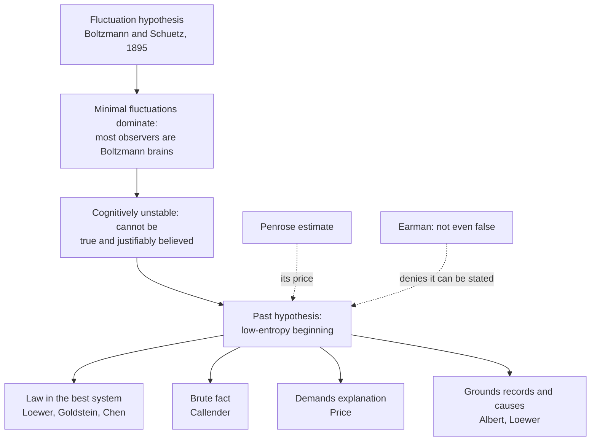

# Philosophy of Physics · Lesson 5.5: Is the past hypothesis enough?

> ⏱ ~15 min · Module 5: Determinism, time's arrow, and probability · Builds on: [5.4](05-04-boltzmann-entropy-and-the-past-hypothesis.md), [5.3](05-03-reversible-laws-irreversible-world.md), [`apologetics-foundations` 4.3](../../apologetics-foundations/lessons/04-03-cosmology-what-a-beginning-would-and-would-not-show.md) · Unlocks: [5.6](05-06-probability-in-statistical-mechanics.md)

## Why this matters

In February 1895 Boltzmann closed a letter to *Nature* with "an idea of my old assistant, Dr. Schuetz": perhaps the universe rests in thermal equilibrium for ever, and our world is one rare local deviation. It was the first rival to [5.4](05-04-boltzmann-entropy-and-the-past-hypothesis.md)'s [past hypothesis](../reference.md#past-hypothesis), and the case against it leaves questions. Can the past hypothesis be stated in the physics we have? Does it need explaining? Does it also make our records reliable, as claimed?

## The idea

Eddington's image: "If an army of monkeys were strumming on typewriters they might write all the books in the British Museum" (*The Nature of the Physical World*, 1928, ch. IV). Suppose you find one page of *Hamlet* in a room of monkey-typed paper. If the page is luck, one page is overwhelmingly likelier than the whole play, so expect the next sheet to be gibberish. If it came from a printer, expect more *Hamlet*. The [fluctuation hypothesis](../reference.md#fluctuation-hypothesis) is the monkey story; the past hypothesis is the printer.

The monkey story predicts the least order that accounts for what you have seen. At the limit the likeliest observer is a lone brain with your memories, assembled by chance a moment ago: a [Boltzmann brain](../reference.md#boltzmann-brains). A theory that says you are probably one undercuts the evidence for believing it.

The printer has a price: a beginning Penrose put at about one part in $10^{10^{123}}$ of the possibilities. Law, brute fact, or puzzle? Earman says "not even false". [`apologetics-foundations` 4.3](../../apologetics-foundations/lessons/04-03-cosmology-what-a-beginning-would-and-would-not-show.md) states Penrose's figure and Carroll's case against Boltzmann brains, to weigh theism against naturalism; this lesson stays inside physics.

## Source

Boltzmann, "On Certain Questions of the Theory of Gases", *Nature* 51 (28 February 1895): 413–415, written in English. From the penultimate paragraph (the scan's "oi" corrected to "of"):

> We assume that the whole universe is, and rests for ever, in thermal equilibrium. The probability that one (only one) part of the universe is in a certain state, is the smaller the further this state is from thermal equilibrium; but this probability is greater, the greater is the universe itself. If we assume the universe great enough, we can make the probability of one relatively small part being in any given state (however far from the state of thermal equilibrium), as great as we please. We can also make the probability great that, though the whole universe is in thermal equilibrium, our world is in its present state.

The passage trades an improbability against a size. "One (only one) part" fixes what is estimated: the chance that *some* region deviates, which grows with the universe. "We can make" and "as great as we please" treat the size as a free parameter. What it computes is the chance that a world like ours exists somewhere.

## The argument

**The fluctuation hypothesis** (Boltzmann 1895, crediting Schuetz; *Vorlesungen über Gastheorie* II, 1898, §90).

**F1.** The universe is vastly larger and older than the observed world, and in thermal equilibrium almost everywhere and always. *In words:* the normal state of things is heat death.

**F2.** A region fluctuates into a macrostate whose [Boltzmann entropy](../reference.md#boltzmann-entropy) lies $\Delta S$ below equilibrium with probability proportional to $e^{-\Delta S/k_B}$, $k_B$ being Boltzmann's constant. *In words:* 5.4's counting read as a chance: probability goes as multiplicity $\Omega = e^{S_B/k_B}$, so each unit of missing entropy costs a factor of $e$.

**F3.** Observers exist only where entropy is far below its maximum. *In words:* nobody lives in heat death.

**∴ C.** Observers find themselves in rare low-entropy regions, with no special beginning. *In words:* we are where the luck is. F3 is observation selection, as in [`philosophy-of-religion` 3.2](../../philosophy-of-religion/lessons/03-02-fine-tuning-the-objections.md). In 1898 Boltzmann drew the moral for time: "For the universe, then, the two directions of time are indistinguishable, as in space there is no up or down" (*Gastheorie* II §90, lesson's translation; *beide Richtungen der Zeit ununterscheidbar*). A living being calls the direction toward less probable states the past.

**The minimal-fluctuation objection.**

**B1.** By F2, a fluctuation that produces less order is exponentially more probable. *In words:* small accidents are cheap.

**B2.** All your evidence (memories, records, the night sky) could come from a fluctuation far smaller than a low-entropy universe: at the limit, a brain in your present state with false memories. *In words:* the cheap accident fits the evidence too.

**∴ B3.** On F1–F3 your evidence most probably comes from a minimal fluctuation. *In words:* your next look should find equilibrium.

**B4.** Your belief in F1 and F2 rests on that same evidence. *In words:* the theory was learned from records.

**∴ C′.** If the fluctuation hypothesis is true, nobody who accepts it on evidence is justified in accepting it. *In words:* it cannot be both true and believed for good reason.

Feynman pressed B3 (*Lectures on Physics*, vol. I, §46-5, 1963): each region not yet examined should then be disordered, and none is. Andreas Albrecht and Lorenzo Sorbo ("Can the Universe Afford Inflation?", 2004) used the name in cosmology, saying the problem is "sometimes called" the Boltzmann's Brain paradox. C′ is Sean Carroll's "cognitively unstable" (2017), cited in apologetics 4.3.

**The past hypothesis and its price.** Albert's past hypothesis (*Time and Chance*, 2000) posits a low-entropy initial macrostate $M_0$; with 5.4's [statistical postulate](../reference.md#statistical-postulate) on $M_0$, unexamined regions are expected to be ordered too, since they share the beginning. Its price is [Penrose's estimate](../reference.md#penroses-estimate) (*The Emperor's New Mind*, 1989). The largest entropy the observable universe's $10^{80}$ or so baryons could have is that of one black hole holding them all, about $10^{123}k_B$ by the Bekenstein–Hawking formula of [`relativity` 6.5](../../relativity/lessons/06-05-black-hole-thermodynamics.md), so a low-entropy start fills about one part in $10^{10^{123}}$ of phase space. Penrose locates the low entropy in gravity: the early matter and radiation were near thermal equilibrium (the microwave background is a near-perfect blackbody, [`cosmology` 3.1](../../cosmology/lessons/03-01-recombination-origin-cmb.md)); what was special was smoothness, since for self-gravitating matter clumping raises entropy.

**Does inflation remove the price?** [`cosmology` 4.2](../../cosmology/lessons/04-02-inflationary-mechanism.md) presents inflation as the fix for [4.1](../../cosmology/lessons/04-01-horizon-flatness-problems.md)'s horizon and flatness problems. The objection: inflation must start from a patch smooth enough to inflate, itself a low-entropy state, and arbitrary initial conditions do not inflate (Price, *Time's Arrow and Archimedes' Point*, 1996, ch. 2). Defenders reply that a small patch is a far smaller entropy deficit than a smooth universe. Albrecht and Sorbo ran the comparison two ways, inflation losing exponentially on one and winning on the other, and left it open.

**Three statuses.**

- **Law.** Barry Loewer ("Determinism and Chance", 2001), Sheldon Goldstein (2001), Eddy Chen (2023): in the best system of [`metaphysics` 4.3](../../metaphysics/lessons/04-03-powers-dispositions-and-laws.md), the past hypothesis and statistical postulate buy all of thermodynamics for one short axiom, and so earn lawhood.

- **[Brute fact](../reference.md#brute-fact-view).** Craig Callender ("There Is No Puzzle about the Low Entropy Past", 2004): it states the initial conditions of the one process there is, and initial conditions are not the kind of thing that needs explaining ([`metaphysics` 3.3](../../metaphysics/lessons/03-03-brute-facts-and-necessary-existence.md)). Boltzmann told Zermelo much the same ([5.3](05-03-reversible-laws-irreversible-world.md)).

- **[Demands explanation](../reference.md#demand-for-explanation).** Huw Price (1996; "On the Origins of the Arrow of Time", 2004): the puzzle is not why entropy rises but why it was ever low. A low-entropy *future* would cry out for explanation, and exempting the past is a temporal double standard.

Whether so improbable a fact needs explaining turns on what explanation is, the question of [`philosophy-of-science` 4.1–4.3](../../philosophy-of-science/lessons/04-03-unification-and-the-pragmatics-of-explanation.md).

**[Not even false](../reference.md#not-even-false).** John Earman ("The 'Past Hypothesis': Not Even False", 2006) grants that a time-asymmetric boundary condition is needed but denies three things: that the early universe's Boltzmann entropy is well defined in general-relativistic cosmology; that a low value would explain why thermodynamics works for the subsystems we care about (5.4's subsystem worry); and that our knowledge of the past rests on Boltzmann entropy.

**The [record asymmetry](../reference.md#record-asymmetry).** Albert (2000) and Loewer (2012): records exist of the past and not the future because the past hypothesis is the world's ultimate ready state (Example 2). The same package is meant to ground the causal and counterfactual asymmetries. Earman's third denial targets this.

**Where the argument is weakest.** B3, which treats you as a random sample of all observers with your experiences. The objection (Carlo Rovelli and David Wolpert, 2024): the argument infers the laws from records, then concludes the records are unreliable, so it undermines itself; with Jordan Scharnhorst (2025) they add that the Boltzmann-brain hypothesis and the second law alike condition on one chosen time. Carroll's reply: that self-undermining is the point, because the theory predicts unreliable records, and no probability over observers helps when the fluctuated ones are locally identical to us. Carroll concedes that data do not rule the theory out; Rovelli and Wolpert concede the statistics but deny that conditioning on the present alone is forced.

## Argument map

Dashed arrows mark a cost and an attack; the three statuses under the past hypothesis are rivals, not steps.

## Worked examples

**Example 1 (clean case: minimal fluctuations in numbers).** A box holds 1,000 molecules in equilibrium, each independently equally likely to be in either half. Through a window you see 10, all on the left. Two fluctuations would explain it: only your 10 are out of equilibrium, probability $2^{-10} = 1/1024$; or all 1,000 are on the left, probability $2^{-1000} \approx 9.3\times10^{-302}$. The second entails what you saw, so

$$P(\text{all } 1000 \text{ left} \mid \text{your } 10 \text{ left}) = \frac{2^{-1000}}{2^{-10}} = 2^{-990} \approx 9.6\times10^{-299}.$$

In F2's terms the deficits are $10\,k_B\ln2$ and $1000\,k_B\ln2$. So the fluctuation hypothesis predicts, almost certainly, that the other 990 are scattered, about 495 a side. Prepare the box instead, all 1,000 pushed left a moment ago (a past hypothesis for the box), and the prediction flips: the next 990 are on the left too. Your 10 molecules play your brain, the 990 the rest of the sky, and we keep finding order there.

**Example 2 (hard case: the footprint).** A fresh footprint on a beach tells you someone walked there. On Albert's account it is a record because the inference uses an earlier ready state: smooth sand before the step. A record of the *future* would need a later ready state, and nothing supplies one, because the [Mentaculus](../reference.md#mentaculus) conditions on $M_0$ at one end of time. Given $M_0$ and the present macrostate, smoother sand earlier is overwhelmingly probable; nothing comparable holds for later sand. Each ready state is known from earlier records; the regress ends at the past hypothesis.

**Where it strains.** Earman's bombed city (1974) records a bomb without having lower entropy than its surroundings, which sinks entropic accounts of records. Albert's survives: reliability is inherited from the beginning, not carried by the record's entropy. But whether one global $M_0$ makes smooth sand yesterday probable on *this* beach is 5.4's subsystem worry again, and Earman denies that inference about the past runs through Boltzmann entropy. Here the account stops giving a verdict: defenders say the derivation exists in outline and has no rival; critics say an outline nobody can check grounds nothing.

## Watch out

- **You might think** observation refutes the fluctuation hypothesis, **but actually** a fluctuation can produce any present state. The objections to it concern what it predicts next (Example 1) and C′, which is epistemic.

- **You might think** Boltzmann's "other world" is an Everettian branch or a universe in a cosmological multiverse, **but actually** it is a distant region of one universe in one spacetime, not a branch of [2.3](02-03-many-worlds-branching.md) or a member of [`philosophy-of-religion` 3.2](../../philosophy-of-religion/lessons/03-02-fine-tuning-the-objections.md)'s multiverse.

- **You might think** the past hypothesis makes the laws of motion time-asymmetric, **but actually** the equations stay [time-reversal invariant](../reference.md#time-reversal-invariance). The asymmetry is a constraint at one end of time: a law on the law view, a boundary condition on the brute-fact view.

## One-liner

> If observers are typical, the fluctuation rival undermines its own evidence, so the arrow seems to need a low-entropy beginning; whether that beginning is a law, a brute fact or a puzzle, whether it can be stated for gravity, and whether it grounds our records all remain open.

## Problems

**P1 (🟢)** *(Close reading: Exegetical (a)–(c).)* The closing paragraph of Boltzmann's 1895 letter (*Nature* 51, p. 415, written in English), which begins three sentences after the Source passage ends; the scan's "wheie" is corrected to "where":

> If this assumption were correct, our world would return more and more to thermal equilibrium; but because the whole universe is so great, it might be probable that at some future time some other world might deviate as far from thermal equilibrium as our world does at present. Then the afore-mentioned H-curve would form a representation of what takes place in the universe. The summits of the curve would represent the worlds where visible motion and life exist.

(a) What does the passage say will happen to our world, and where and when it places other deviations like ours? One sentence each.

(b) The last sentence puts life on the summits. What does that let the hypothesis explain, and which premise does the explanation need that the letter never states? Two sentences.

(c) Does Boltzmann assert the hypothesis here? Name the words that decide it. One sentence.

**P2 (🟡)** *(Formal model: Formal (a)–(b) · Exegetical (c).)* Follow Penrose's procedure. The largest entropy the matter of the observable universe could have is that of one black hole of mass $M$: $S_{\max}/k_B = 4\pi GM^2/(\hbar c)$, which is [`relativity` 6.5](../../relativity/lessons/06-05-black-hole-thermodynamics.md)'s $k_BA/4\ell_P^2$ with $A = 4\pi r_s^2$. Treat the maximal macrostate as filling phase space, so a macrostate of entropy $S_0$ fills the fraction $e^{-(S_{\max}-S_0)/k_B}$. Use $G = 6.674\times10^{-11}$ N m² kg⁻², $\hbar = 1.0546\times10^{-34}$ J s, $c = 2.998\times10^8$ m/s, proton mass $m_p = 1.6726\times10^{-27}$ kg. Show the computation.

(a) Compute $S_{\max}/k_B$ for $M = 10^{80}m_p$.

(b) With $S_0 = 10^{88}k_B$, write the fraction as $10^{-10^{y}}$ and give $y$ to two decimals. Show that $S_0$ moves $y$ by less than $10^{-34}$. Then let $M$ be six times larger, to count dark matter, and give the change in $y$.

(c) The figure is often reported as "the odds against the Big Bang". Say what (b) is a ratio of, which further premise turns it into odds, and which feature of the number survives the changes of input in (b). Three sentences.

**P3 (🔴)** *(Find the crux: Exegetical (a) · Evaluative (b).)* Earman (2006) says the past hypothesis is "not even false". Callender (2010, 2011) and Wallace (2010) treat the trouble as the task of stating the past hypothesis once self-gravitation is included.

(a) Using the paper's abstract and the Stanford Encyclopedia entry "Thermodynamic Asymmetry in Time" (§3.1), say what Earman grants and the three things he denies. One sentence each.

(b) Is Earman's objection to the past hypothesis's content (there is no fact for it to state) or to its formulation (there is a fact that physics cannot yet state)? Name the premise that decides it, and what would move each side. Any verdict; 150 words or fewer.

Solutions

**P1** *(Exegetical (a)–(c).)*

**Must hit, strict (a):**

- Our world returns "more and more" toward thermal equilibrium: its deviation is temporary.

- Other deviations as large as ours occur elsewhere, in "some other world", and later, "at some future time"; the H-curve (§2 of the same letter: $H$ against time, mostly at its minimum, with rare summits) then describes the universe as a whole, with the summits as such worlds.

**Must hit, strict (b):**

- It explains why we observe a world far from equilibrium although such worlds are rare: worlds with "visible motion and life" sit on the summits, so where there are observers there is a summit.

- The unstated premise is observation selection: observers can exist only in far-from-equilibrium regions, so the relevant probability is that of finding such a region given that someone is looking, not that of a randomly chosen region. The letter states only that a large universe makes such a region probable somewhere; F3 of the lesson supplies the rest.

**Must hit, strict (c):** No. The passage is conditional throughout: "If this assumption were correct", "it might be probable", "would form", "would represent".

**Accept (c):** adding that the letter introduces the idea as "an idea of my old assistant, Dr. Schuetz", not as Boltzmann's own.

**Wrong turns:** reading "our world" as the whole universe (it is a small part of it); taking "some other world" as a separate universe or an Everettian branch; saying the passage infers a low-entropy beginning (it denies needing one); answering (b) with the retrodiction problem, which concerns the counting rather than this passage.

**Model answer:** (a) Our world will drift back toward equilibrium. Deviations as large as ours will occur in other regions at later times, so the universe's history is the H-curve, with the summits as such worlds. (b) By putting life on the summits, the hypothesis explains why we see a far-from-equilibrium world in a universe that is almost all equilibrium: wherever someone is looking, there is a summit. That needs the premise that observers exist only in such regions, so that our presence selects them, which the letter never states. (c) No: it is framed as a conditional, "If this assumption were correct", and everything after it is "might" and "would".

---

**P2** *(Formal (a)–(b) · Exegetical (c).)*

(a) $M = 10^{80}\times1.6726\times10^{-27} = 1.6726\times10^{53}$ kg, so $M^2 = 2.798\times10^{106}$ kg². Then

$$\frac{S_{\max}}{k_B} = \frac{4\pi GM^2}{\hbar c} = \frac{4\pi(6.674\times10^{-11})(2.798\times10^{106})}{(1.0546\times10^{-34})(2.998\times10^{8})} = \frac{2.346\times10^{97}}{3.162\times10^{-26}} \approx 7.42\times10^{122},$$

about $7\times10^{42}$ per baryon; Penrose rounds the total to about $10^{123}$.

(b) The fraction is $e^{-(S_{\max}-S_0)/k_B} = 10^{-x}$ with

$$x = \frac{S_{\max}-S_0}{k_B}\log_{10}e = (7.42\times10^{122} - 10^{88})(0.4343) \approx 3.22\times10^{122}, \qquad y = \log_{10}x \approx 122.51 .$$

Since $S_0/S_{\max} \approx 1.3\times10^{-35}$, dropping $S_0$ changes $x$ by that relative amount and $y$ by about $\log_{10}e \times 1.3\times10^{-35} \approx 6\times10^{-36} < 10^{-34}$. For $6M$, $S_{\max} \propto M^2$ grows by 36 to $2.67\times10^{124}k_B$, and $y$ rises by $\log_{10}36 \approx 1.56$, to about 124.06. The quoted $10^{-10^{123}}$ rounds $S_{\max}$ to $10^{123}k_B$ and writes $e^{-10^{123}}$ as $10^{-10^{123}}$; the change of base alone is worth $\log_{10}(\log_{10}e) \approx -0.36$ in $y$.

(c) The number is a ratio of phase-space (Liouville) volumes: the region of low-entropy macrostates against the maximal, black-hole macrostate. It becomes odds only with the premise that the uniform measure gives the probability of the universe's initial state, the statistical postulate applied once to the whole universe (and with a Boltzmann entropy for gravitational degrees of freedom to define the regions). What survives is the order of magnitude of $y$, "a double exponential of about 120 to 125": the present entropy, the base of the logarithm and a factor of six in mass all leave that standing.

**Must hit, strict:**

- (a) $S_{\max}/k_B \approx 7.4\times10^{122}$ from the stated formula.

- (b) $x = (S_{\max}-S_0)\log_{10}e/k_B$, $y \approx 122.51$, the bound on the shift from $S_0$, and $\Delta y = \log_{10}36 \approx 1.56$.

- (c) a ratio of measures, not a frequency; the uniform measure on initial states as the extra premise; robustness only at the level of $y$.

**Wrong turns:** writing $10^{10^{123}}$ as $10^{1230}$; thinking $S_0 = 10^{88}k_B$ matters (it changes $S_{\max} - S_0$ only in the 35th significant figure); treating $y = 123$ as computed rather than rounded; calling the number an observed frequency of universes.

---

**P3** *(Exegetical (a) · Evaluative (b).)*

**Must hit, strict (a):**

- Grants: some time-asymmetric boundary condition is needed to solve the problem of the arrow.

- Denies (1): that the Boltzmann entropy of the universe's initial state is well defined; in general-relativistic cosmology the concept is ill defined or badly hobbled, so the past hypothesis cannot be stated in the theory's terms.

- Denies (2): that a low initial entropy, even if well defined, would explain why thermodynamics works for the subsystems we care about.

- Denies (3): that Boltzmann entropy is what our knowledge of the past rests on, so the past hypothesis's failure would not threaten that knowledge.

**Must hit, any verdict (b):**

- The deciding premise: whether gravitational degrees of freedom admit macrostates and a measure on the space of initial data, so that "low Boltzmann entropy" has a definite meaning. If they do and we lack them, the trouble is formulation; if no such entropy can exist, it is content.

- Note what is not in dispute: the early universe was smooth and its matter nearly in equilibrium. The past hypothesis says more than that, since the Mentaculus needs a macrostate with a uniform measure on it.

- What would move Earman: a definition of gravitational entropy, with a measure, on which the smooth state is a small region and the black-hole value the maximum. What would move the defenders: an argument that no measure on general-relativistic initial data can do the statistical postulate's work.

- Note that Earman's denials (2) and (3) survive even a successful formulation.

**Wrong turns:** answering whether the past hypothesis is a law, a brute fact or a puzzle (a different question); saying Earman denies a low-entropy early universe as a matter of observation; treating "not even false" as "false".

**Model answer (b), one of several:** Mostly content, as Earman means it, though the evidence leaves formulation open. Nobody disputes the observations: a smooth early universe with matter near equilibrium. The question is whether "low Boltzmann entropy" applies to it, and that turns on one premise: that general relativity's degrees of freedom admit macrostates and a measure on initial data. Callender and Wallace treat that as unfinished work, so for them the objection concerns formulation. Earman doubts the concept can be had, which makes it an objection to content: without the measure there is no region for the Mentaculus to spread probability over. A worked definition of gravitational entropy, with a measure that makes the smooth state small, would move him; a proof that no such measure can play the statistical postulate's role would move them. Even then, his claim that subsystems' thermodynamics needs more than a global low entropy would stand.

## Flashback

**From Lesson [5.3](05-03-reversible-laws-irreversible-world.md) (Reversible laws, irreversible world):** *(Formal model: Formal (a) · Exegetical (b).)* A [Kac ring](../reference.md#kac-ring) as in 5.3's picture has $n = 1000$ sites and $m = 25$ markers, placed anywhere. Every ball is white at $t = 0$, and $\delta = (\text{white} - \text{black})/n$.

(a) What does the ring's [Stosszahlansatz](../reference.md#stosszahlansatz) predict for $\delta$ at $t = 1000$, and from which step on does it put $\delta$ below $0.01$? Then find the exact $\delta$ at $t = 999$ and $t = 1000$, show that neither depends on where the markers are, and say how many of the balls about to cross a marker at $t = 999$ are white. Show the computation.

(b) Which premise fails at $t = 999$? Which of 5.3's two objections does the run to $t = 2000$ illustrate, and what property of the exact dynamics does it use? Two sentences.

Solution

(a) The ansatz sends a fraction $\mu = m/n = 0.025$ of each colour across a marker each step, so $\delta_t = (1-2\mu)^t = 0.95^t$:

$$\delta_{1000} = 0.95^{1000} = e^{1000\ln 0.95} = e^{-51.29} \approx 5.3\times10^{-23},$$

and $\delta_t < 0.01$ once $t > \ln 0.01/\ln 0.95 \approx 89.8$, so from $t = 90$.

Exactly: at step $s$ ball $i$ crosses the gap from site $i+s-1$ to $i+s$ (mod $n$). In $n$ steps it crosses every gap, so every marker, once, and changes colour 25 times, an odd number: at $t = 1000$ all are black, $\delta = -1$. At $t = 999$ ball $i$ has crossed every gap but the one from $i-1$ to $i$: if that gap is marked it has changed colour 24 times and is white, otherwise 25 times and black. So

$$\delta_{999} = \frac{25 - 975}{1000} = -0.95,$$

whatever the markers' places. The 25 white balls are exactly those about to cross a marker, where the ansatz expects $0.6$ white crossers and $24.4$ black.

**Must hit, strict (a):** $0.95^t$, $5.3\times10^{-23}$, $t = 90$; each ball crosses each marker once in $n$ steps; $\delta_{1000} = -1$ and $\delta_{999} = -0.95$ for any placement; all 25 crossers white.

**Must hit, strict (b):**

- The ring's Stosszahlansatz, that crossers are a fair sample of the colours, fails outright at $t = 999$: each colour now records the markers crossed.

- Zermelo's [recurrence objection](../reference.md#recurrence-objection): all white again at $t = 2000$, since the exact dynamics is a one-to-one map on finitely many states, hence periodic: the ring's [Poincaré recurrence](../reference.md#poincare-recurrence).

**Wrong turns:** calling this Loschmidt's reversal, when nothing was reversed; using $1-\mu$ for $1-2\mu$; reading $\delta = -1$ as equilibrium, when all black is as ordered as all white; expecting the return at $t = 1000$, which needs even $m$.

**Model answer (b):** The ansatz fails outright at $t = 999$, where all 25 balls about to cross markers are white. The return to all white at $t = 2000$ is Zermelo's objection, resting on the exact dynamics being one-to-one on finitely many states and so periodic.

## Connections

- **Backward:** [5.4](05-04-boltzmann-entropy-and-the-past-hypothesis.md) stated the past hypothesis, the Mentaculus and the subsystem worry, and [5.3](05-03-reversible-laws-irreversible-world.md) read §2 of the same 1895 letter and Boltzmann's reply to Zermelo. The counting is [`stat-mech` 1.2](../../stat-mech/lessons/01-02-microstates-macrostates-postulate.md)–[1.3](../../stat-mech/lessons/01-03-entropy-microcanonical.md), black-hole entropy [`relativity` 6.5](../../relativity/lessons/06-05-black-hole-thermodynamics.md), and inflation [`cosmology` 4.1](../../cosmology/lessons/04-01-horizon-flatness-problems.md)–[4.2](../../cosmology/lessons/04-02-inflationary-mechanism.md).

- **Forward:** [5.6](05-06-probability-in-statistical-mechanics.md) asks what F2's probabilities and the statistical postulate's are: typicality, objective chance or credence. Boltzmann-brain reasoning is self-locating, the same kind the Everettian uses in [2.4](02-04-many-worlds-the-probability-problem.md).

- **Sideways:** [`apologetics-foundations` 4.3](../../apologetics-foundations/lessons/04-03-cosmology-what-a-beginning-would-and-would-not-show.md) uses the low-entropy beginning and Carroll's argument to compare theism with naturalism; that use stays there. Observation selection is [`philosophy-of-religion` 3.2](../../philosophy-of-religion/lessons/03-02-fine-tuning-the-objections.md); brute facts are [`metaphysics` 3.3](../../metaphysics/lessons/03-03-brute-facts-and-necessary-existence.md); the best system is [`metaphysics` 4.3](../../metaphysics/lessons/04-03-powers-dispositions-and-laws.md). A Boltzmann brain differs from the brain in a vat of [`epistemology` 3.1](../../epistemology/lessons/03-01-the-closure-argument.md): the skeptic only needs the scenario to be possible, while here a physical theory makes it probable.
