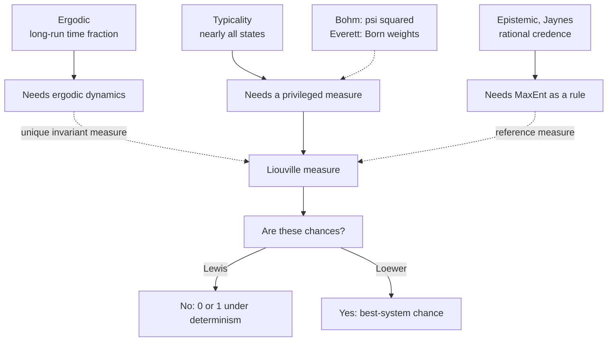

# Philosophy of Physics · Lesson 5.6: Probability in statistical mechanics

> ⏱ ~15 min · Module 5: Determinism, time's arrow, and probability · Builds on: [5.4](05-04-boltzmann-entropy-and-the-past-hypothesis.md), [`stat-mech` 1.1](../../stat-mech/lessons/01-01-mechanics-to-statistics.md), [`dynamical-systems` 5.5](../../dynamical-systems/lessons/05-05-symbolic-dynamics-ergodicity.md), [`epistemology` 5.4](../../epistemology/lessons/05-04-the-problem-of-priors.md) · Unlocks: [6.1](06-01-symmetries-and-what-they-tell-us.md)

## Why this matters

Drop an ice cube into a glass of warm water and statistical mechanics says it will melt, with probability all but 1. Yet the water's microstate and Hamilton's equations already settle whether it melts. A probability strictly between 0 and 1, in a world whose laws fix everything, must be a probability *of* something. [`stat-mech` 1.2](../../stat-mech/lessons/01-02-microstates-macrostates-postulate.md) justified equal a priori probability in one breath as "the least-biased guess" and by ergodicity. Those are two answers, and there is a third.

## The idea

Take one sentence, "the gas is overwhelmingly likely to be in equilibrium", and read it three ways.

- **Time.** Watch one gas long enough and it spends nearly all its time in equilibrium: a long-run fraction, delivered by the dynamics.
- **Count.** Nearly all the ways the gas could be, measured by phase-space volume, are equilibrium ways: shorthand for "nearly all".
- **Credence.** Given what you know, the energy and the volume, that is the degree of belief you should have.

Then a fourth question: are these probabilities **chances**, worldly features that should guide anyone's credence, though the laws are deterministic?

The physics is built: Birkhoff's theorem in [`dynamical-systems` 5.5](../../dynamical-systems/lessons/05-05-symbolic-dynamics-ergodicity.md), maximum entropy in [`stat-mech` 6.2](../../stat-mech/lessons/06-02-entropy-information-arrow.md) and [`information-theory` 4.4](../../information-theory/lessons/04-04-maximum-entropy-stat-mech.md), the Principal Principle in [`epistemology` 5.4](../../epistemology/lessons/05-04-the-problem-of-priors.md). This lesson asks what each shows.

## Source

Henri Poincaré, *Science and Method*, tr. Francis Maitland (London: Thomas Nelson and Sons, [1914]), Book I, ch. IV "Chance", pp. 66–67:

> Chance, then, must be something more than the name we give to our ignorance. ... it is clear that the information that the calculation of probabilities supplies will not cease to be true when the phenomena are better known. The manager of a life insurance company does not know when each of the assured will die, but he relies upon the calculation of probabilities and on the law of large numbers, and he does not make a mistake, since he is able to pay dividends to his shareholders. These dividends would not vanish if a very far-sighted and very indiscreet doctor came, when once the policies were signed, and gave the manager information on the chances of life of the assured. The doctor would dissipate the ignorance of the manager, but he would have no effect upon the dividends, which are evidently not a result of that ignorance.

One page earlier Poincaré had written "Chance is only the measure of our ignorance"; "then, must be something more" turns against it. The probabilities "will not cease to be true" when ignorance is removed, and the dividends are "not a result of that ignorance". What they *are* a result of, the passage leaves open: the law of large numbers names a regularity, not its source.

## The argument

Setting: an isolated Hamiltonian system on its energy surface $\Gamma_E$, flow $\phi_t$, and $\mu$ the microcanonical measure (normalized Liouville volume on $\Gamma_E$), which the flow preserves. A macrostate $M$ occupies $\Gamma_M$ ([5.4](05-04-boltzmann-entropy-and-the-past-hypothesis.md)).

**1. [Birkhoff's theorem](../reference.md#birkhoffs-theorem)**, flow version ([`dynamical-systems` 5.5](../../dynamical-systems/lessons/05-05-symbolic-dynamics-ergodicity.md) states it for maps). For integrable $f$, the time average

$$f^*(x) = \lim_{T\to\infty}\frac1T\int_0^T f(\phi_t x)\,dt$$

exists for $\mu$-almost every $x$, and $\int f^*\,d\mu = \int f\,d\mu$. The flow is **ergodic** (every invariant set has measure 0 or 1) iff $f^* = \int f\,d\mu$ almost everywhere for every $f$.

*In words:* time averages always exist and average out to the phase average; they *equal* it orbit by orbit only if no fat region traps the motion.

**The [ergodic account](../reference.md#ergodic-hypothesis).** P1: the probability of $M$ is the long-run fraction of time spent in $\Gamma_M$. P2: the system is ergodic. ∴ that fraction is $\mu(\Gamma_M)$ for almost every start, and measurements, long compared with molecular times, return phase averages. *In words:* dynamics plus a definition yields the measure. [`dynamical-systems` 5.5](../../dynamical-systems/lessons/05-05-symbolic-dynamics-ergodicity.md) calls this "the microscopic license".

John Earman and Miklós Rédei ("Why Ergodic Theory Does Not Explain the Success of Equilibrium Statistical Mechanics", 1996), with David Malament and Sandy Zabell (1980) and Lawrence Sklar (1993), press four objections:

- **Timescales.** Measurements are finite averages, which can differ widely from infinite ones; and $f^*$ is constant along orbits, so it cannot show an approach to equilibrium.
- **False of the systems.** By the [KAM theorem](../reference.md#kam-theorem), small perturbations of integrable systems keep a positive-measure set of invariant tori; generic Hamiltonian systems are neither integrable nor ergodic (Markus and Meyer, 1974).
- **Not necessary.** The Kac ring and uncoupled anharmonic oscillators behave thermodynamically without being ergodic (Bricmont 2001), so ergodicity cannot be what explains that behaviour.
- **Measure zero.** "Almost every" is relative to $\mu$, the measure in question; the rationals have measure zero and are dense.

Defenders weaken P2 to ergodicity off a set of measure $\varepsilon$ (Peter Vranas, 1998) or on each piece of a decomposition (Roman Frigg and Charlotte Werndl).

**2. [Typicality](../reference.md#typicality)** (Joel Lebowitz, "Boltzmann's Entropy and Time's Arrow", 1993; Sheldon Goldstein, "Boltzmann's Approach to Statistical Mechanics", 2001). P1: equilibrium states fill nearly all of $\Gamma_E$ (5.4's counting). P2: nearly all states in a low-entropy macrostate evolve toward equilibrium. ∴ thermodynamic behaviour is typical, and what nearly every state does needs no further explanation. *In words:* nearly every way of being in this macrostate leads to equilibrium, so expect it.

As in 5.4, Frigg (2009, 2011) and Jos Uffink (2007) object that P2 needs dynamical assumptions. The **[measure objection](../reference.md#measure-objection)** asks: nearly all by which measure? For an oscillator $x = A\cos\theta$, uniform in the phase angle $\theta$ gives $P(|x| > A/2) = 2/3$; uniform in position gives $1/2$ (the lesson of [`epistemology` 5.4](../../epistemology/lessons/05-04-the-problem-of-priors.md)'s cube factory). The defender: the dynamics chooses. The [Liouville measure](../reference.md#liouville-measure) is stationary and unchanged by canonical changes of coordinates ([`analytical-mechanics` 3.4](../../analytical-mechanics/lessons/03-04-canonical-transformations.md)); here it is uniform in $\theta$, matching the oscillator's time fractions. The rejoinder: any density $f(H)$ is stationary ([`stat-mech` 1.1](../../stat-mech/lessons/01-01-mechanics-to-statistics.md) P3), and on $\Gamma_E$ an invariant density must be constant exactly when the flow is ergodic, so typicality's measure leans on the premise it dropped.

**3. [Maximum entropy](../reference.md#maximum-entropy)** (E. T. Jaynes, "Information Theory and Statistical Mechanics", 1957). Probabilities are rational credences: maximize $-\int\rho\ln\rho$ subject to what you know. *In words:* assume nothing the data do not force. On this reading [`stat-mech` 6.2](../../stat-mech/lessons/06-02-entropy-information-arrow.md) is right that the Boltzmann factor was "never an extra postulate": the postulate is a rule of inference. 5.4's objection to epistemic coarse-graining returns (Michael Redhead 1995; David Albert 2000; Barry Loewer 2001): kettles boil whatever anyone knows, so credences cannot explain why. The reply: nobody says ignorance does the boiling. Dynamics does, and maximum entropy says which predictions macroscopic data license. The measure returns: $-\int\rho\ln\rho$ changes under a change of variables ([`information-theory` 4.1](../../information-theory/lessons/04-01-differential-entropy.md)), so the principle needs a reference measure, and Jaynes took Liouville's.

**4. [Objective chance](../reference.md#objective-chance).** The [Principal Principle](../reference.md#principal-principle) (David Lewis, "A Subjectivist's Guide to Objective Chance", 1980), in [`epistemology` 5.4](../../epistemology/lessons/05-04-the-problem-of-priors.md)'s notation ($\mathrm{cr}$ credence, $\Pr$ chance):

$$\mathrm{cr}\big(A \mid \Pr(A) = x \wedge E\big) = x, \qquad E \text{ admissible}.$$

*In words:* known chances fix credence unless you hold evidence that bears on $A$ other than through its chance. For Lewis, chance is indexed to a time, and history up to that time is admissible. His **incompatibilism**, reconstructed: P1: at $t$, the complete history to $t$ and the laws have chance 1. P2: under deterministic laws, these entail $A$ or entail not-$A$. P3: whatever a chance-1 proposition entails has chance 1. ∴ in a deterministic world every chance is 0 or 1 (Lewis, *Philosophical Papers*, vol. II, 1986). *In words:* if the present and the laws settle the future, nothing is left for chance.

**[Deterministic chance](../reference.md#deterministic-chance)** (Loewer, "Determinism and Chance", 2001). On the best-system account, laws balance simplicity and strength "with a third criterion, *fit*, where the system assigns chances" ([`metaphysics` 4.3](../../metaphysics/lessons/04-03-powers-dispositions-and-laws.md)). Adding the [statistical postulate](../reference.md#statistical-postulate) to the dynamics and the past hypothesis, the [Mentaculus](../reference.md#mentaculus) of 5.4, buys all of thermodynamics cheaply, so its probabilities are chances under deterministic dynamics. *In words:* a probability is a chance if it earns its place among the laws. Loewer denies P1 for them: they attach to initial conditions, and the exact microstate is inadmissible. Jonathan Schaffer (2007) defends incompatibilism; Jenann Ismael (2009) and Frigg and Carl Hoefer (2015) are compatibilists. Poincaré's roulette needle shows why they are stable: with a hundred alternating sections, any smooth spread of spins gives red about half the time (the [method of arbitrary functions](../reference.md#method-of-arbitrary-functions)).

**5. Quantum theory.** Bohmian $|\psi|^2$-typicality, with equivariance in stationarity's role ([2.1](02-01-bohmian-mechanics.md)), and Everett's Born weights against branch counting ([2.4](02-04-many-worlds-the-probability-problem.md)) ask the same question: what makes a measure the right one?

**Where the argument is weakest.** The shared premise that one measure is privileged. The objection: stationarity does not single out Liouville's measure, uniqueness needs the ergodicity the KAM objection denies, and maximum entropy needs a reference measure first, so each account presupposes what it should explain. The reply: the measure is a posit judged by its yield, a law of the best system (Loewer) or the dynamics' natural measure (Goldstein), and robust: if $\mu(B) \ge 1-\varepsilon$ and $\nu$ has density at most $K$ relative to $\mu$, then $\nu(B) \ge 1 - K\varepsilon$. The critic concedes that robustness makes the choice idle in practice; the defender concedes that the measure is postulated, not derived.

## Map of positions

Every account routes through one measure; the chance question meets whichever survives.

## Worked examples

**Example 1 (clean case: circle rotations).** Rotate the circle $[0,1)$ by $\alpha$: $x \mapsto x+\alpha \bmod 1$. The invariant $\mu$ is length. Take $g = \mathbf 1_{[0,1/3)}$; its phase average is $1/3$.

*Rational, $\alpha = 1/4$.* Orbits close after four steps. From $x_0 = 0$: $0, \tfrac14, \tfrac12, \tfrac34$, two in $[0,\tfrac13)$, time average $\tfrac12$. From $x_0 = \tfrac25$: $\tfrac25, \tfrac{13}{20}, \tfrac{9}{10}, \tfrac{3}{20}$, one inside, $\tfrac14$. No start gives $\tfrac13$, yet starts giving $\tfrac12$ fill measure $\tfrac13$, and $\tfrac13\cdot\tfrac12 + \tfrac23\cdot\tfrac14 = \tfrac13$: Birkhoff's averaged equality holds, the pointwise one fails. The union of $[\tfrac k4, \tfrac k4+\tfrac18)$, $k = 0,\dots,3$, is invariant with measure $\tfrac12$: not ergodic.

*Irrational, $\alpha = (\sqrt5-1)/2$.* Every orbit is equidistributed (Hermann Weyl, 1916). Over the first $10^5$ steps, from $0$ and from $\tfrac25$ alike, the fraction in $[0,\tfrac13)$ is $0.333$.

This is motion on an integrable system's torus in miniature ([`analytical-mechanics` 4.2](../../analytical-mechanics/lessons/04-02-action-angle-integrability.md)): even the irrational orbit fills its torus without leaving it, the KAM objection's point.

**Example 2 (hard case: the ice cube, and its reversal).** An ice cube in warm water in a sealed, insulated glass.

- *Ergodic:* nearly all the time is spent melted, a long-run fraction silent on whether *this* cube melts in the next ten minutes.
- *Typicality:* nearly all microstates of "ice in warm water" lead to melted water. By the same measure nearly all came *from* melted water, so 5.4's past hypothesis must restrict the measure.
- *Credence:* given the macrostate, maximum entropy predicts melting. What makes the cube melt? The dynamics, says the Jaynesian, as always.

Now reverse every velocity ten minutes later: a "warm water" microstate that unmelts the cube, permitted and of tiny measure. Here the accounts stop giving a verdict. Why is the actual microstate not one of those? The typicality theorist says nothing more is owed; Loewer says a chance law answers it; the incompatibilist says there is no chance here, only a fact about the initial state.

## Watch out

- **You might think** Birkhoff's theorem says time averages equal phase averages, **but actually** it says they exist almost everywhere; equality for every observable *is* ergodicity, an extra premise.
- **You might think** frequency, credence and chance are rival answers, one of them right, **but actually** each owes the others a bridge: time fractions must guide credence, credences must track frequencies, chances need the Principal Principle.
- **You might think** determinism makes statistical probabilities subjective, **but actually** that is Lewis's incompatibilism, a contested thesis; for Loewer they are objective chances under deterministic laws.

## One-liner

> The ergodic, typicality and epistemic accounts each need a privileged measure that stationarity alone does not single out, and whether the result is a chance depends on whether chance can live in a deterministic world.

## Problems

**P1 (🟢) *(Formal (a)–(b) · Exegetical (c))*** Rotate the circle $[0,1)$ by $\alpha = 2/5$, and let $g = \mathbf 1_{[0,1/2)}$.

(a) Compute the time average of $g$ from $x_0 = 0$ and from $x_0 = 3/20$, and give the phase average. Show the computation.

(b) Exhibit an invariant set whose measure is strictly between 0 and 1, and show it is invariant.

(c) Two sentences: does Birkhoff's theorem fail here, and which premise of the ergodic account does this system violate?

**P2 (🟡) *(Exegetical (a), (c) · Formal (b))*** Apply the Principal Principle as [`epistemology` 5.4](../../epistemology/lessons/05-04-the-problem-of-priors.md) states it. For each case say whether the principle fixes Alice's credence, give the value if it does, and say why. A nucleus decays at random with a fixed half-life; the chance of decay within time $t$ is $1 - 2^{-t/T}$ for half-life $T$.

(a) Alice knows the nucleus is of an isotope with half-life 10 minutes, and knows the lab's history up to now. Her credence that it decays in the next 10 minutes?

(b) Alice is unsure of the isotope: credence 0.6 that it is X (half-life 10 minutes), 0.4 that it is Y (half-life 30 minutes). Her credence that it decays in the next 10 minutes? Show the computation.

(c) As in (a), but a detector log stamped 10 minutes from now, from a source she knows to be reliable, reports no decay. Two sentences.

**P3 (🔴) *(Find the crux: Exegetical (a) · Evaluative (b))*** Lewis holds that a deterministic world has no chances other than 0 and 1; Loewer holds that the statistical postulate of the Mentaculus states chances.

(a) Name the single premise one side must deny, and say which side denies it. One sentence.

(b) Say what each side gains and pays by its answer, and what argument would move one of them. Any verdict; 150 words or fewer.

Solutions

**P1** *(Formal (a)–(b) · Exegetical (c))*

(a) The orbit closes after five steps, since $5 \cdot \tfrac25 = 2$, so the average over one period is the exact time average.

From $x_0 = 0$: $0, \tfrac25, \tfrac45, \tfrac15, \tfrac35$. In $[0,\tfrac12)$: $0, \tfrac25, \tfrac15$. Time average $\tfrac35$.

From $x_0 = \tfrac{3}{20}$: $\tfrac{3}{20}, \tfrac{11}{20}, \tfrac{19}{20}, \tfrac{7}{20}, \tfrac{15}{20}$. In $[0,\tfrac12)$: $\tfrac{3}{20}, \tfrac{7}{20}$. Time average $\tfrac25$.

Phase average: $\int_0^1 g\,dx = \tfrac12$. Every start gives $\tfrac25$ or $\tfrac35$, never $\tfrac12$: the five orbit points are spaced $\tfrac15$ apart, so an interval of length $\tfrac12$ holds two or three of them.

(b) Accept any union of the five translates $B + \tfrac k5$ of a set $B \subset [0,\tfrac15)$ with $0 < |B| < \tfrac15$. For example, $A = \bigcup_{k=0}^{4}\,[\tfrac k5, \tfrac k5 + \tfrac1{10})$. Adding $\tfrac25$ sends the $k$-th piece to the $(k+2 \bmod 5)$-th, so $A$ maps onto itself, and its measure is $5 \cdot \tfrac1{10} = \tfrac12$.

(c) No: Birkhoff guarantees only that time averages exist almost everywhere and that their average over starts is the phase average, and here $\tfrac12\cdot\tfrac35 + \tfrac12\cdot\tfrac25 = \tfrac12$ (starts with $x_0 \bmod \tfrac15 < \tfrac1{10}$ give $\tfrac35$). The system violates ergodicity, the account's second premise, so the long-run time fraction depends on the start and gives no single probability for $[0,\tfrac12)$.

**Must hit, strict:** both orbits listed and counted; $\tfrac35$, $\tfrac25$, $\tfrac12$; an invariant set with its invariance shown and a measure strictly between 0 and 1; Birkhoff not violated; ergodicity named as the premise that fails.

**Wrong turns:** treating $x_0 = 0$ as an exceptional measure-zero start; here half of all starts give each value. Saying Birkhoff fails because the time average differs from the phase average. Offering the whole circle or a single orbit (measure 1 or 0) as the invariant set.

---

**P2** *(Exegetical (a), (c) · Formal (b))*

**Must hit, strict (a):** the chance is $1 - 2^{-1} = \tfrac12$; history up to now is admissible; so the principle fixes $\mathrm{cr} = \tfrac12$.

**Must hit, strict (b):**

- The principle applies to each chance hypothesis, and total probability gives credence equal to expected chance.

- Chance under X: $\tfrac12$. Under Y: $1 - 2^{-1/3} \approx 0.2063$.

- $\mathrm{cr} = 0.6 \cdot \tfrac12 + 0.4 \cdot 0.2063 \approx 0.383$.

**Must hit, strict (c):** the log is information about what happens after the time the chance is indexed to, so it is inadmissible and the principle is silent; Alice's credence should follow the reliable report, near 0 for decay, while the chance stays $\tfrac12$.

**Wrong turns:** in (b), averaging the half-lives (18 minutes, chance $1 - 2^{-5/9} \approx 0.320$) instead of averaging the chances. In (c), saying the chance itself has become 0, or that the principle forces $\tfrac12$ against the log.

**Model answer:** (a) Credence $\tfrac12$: the chance is known and her historical evidence is admissible. (b) Credence is expected chance, $0.6 \cdot 0.5 + 0.4\,(1 - 2^{-1/3}) \approx 0.383$. (c) The log reports the future, so it is inadmissible and the principle does not apply. Her credence in decay should be near 0, though the chance was $\tfrac12$.

---

**P3** *(Exegetical (a) · Evaluative (b))*

**Must hit, strict (a):**

- The crux: whether the complete history up to a time has chance 1 at that time (Lewis's P1), so that every chance is conditional on the full microstate and the microstate is admissible for every chance. Loewer denies it for initial-condition chances in the best system.

**Must hit, any verdict (b):**

- Lewis's gain: chance evolves with history and the incompatibility follows; his cost: no objective probabilities in classical statistical mechanics or Bohmian mechanics, which he must read as non-chances.

- Loewer's gain: statistical-mechanical probabilities are objective and lawful; his cost: chances that a demon knowing the microstate may ignore, and an admissibility rule tied to what the best system's probabilities are about.

- What would move it: whether such probabilities can play chance's role, guiding credence through the Principal Principle for agents who lack the microstate, and whether a time-indexed, history-conditional chance is part of the concept or one theory of it.

**Wrong turns:** locating the crux in determinism itself, which both grant. Calling Loewer's probabilities subjective. Arguing that typicality settles it (that is a different question).

**Model answer (a):** They agree the dynamics is deterministic and disagree whether the complete history up to a time has chance 1 at that time, so that every chance is conditional on it: Lewis affirms it, and Loewer denies it for the statistical postulate's chances.

**Model answer (b), one of several:** For Lewis a deterministic present plus the laws entails the future and leaves only 0 and 1; the price is that statistical mechanics and Bohmian mechanics contain no chances. Loewer says the best system can include a probability over initial conditions, the statistical postulate, that earns its place by strength; its chances are not conditional on the microstate, which counts as inadmissible for them. He gains objective probabilities in a deterministic world and pays with chances a demon may ignore. Lewis would move if chance's defining role, guiding credence, could be filled without time-indexing; Loewer would move if the postulate could not guide the credences of agents who lack the microstate.

## Flashback

**From Lesson [5.4](05-04-boltzmann-entropy-and-the-past-hypothesis.md) (Boltzmann entropy and the past hypothesis):** *(Formal (a) · Exegetical (b).)* Six molecules are in a box split into thirds: a microstate says which third each is in ($3^6 = 729$ in all), a macrostate is the occupation list $(n_1, n_2, n_3)$, and the dynamics is a fixed one-to-one map of microstates. An ensemble starts uniform over $(4,2,0)$; later, 9 members are in $(2,2,2)$ and 6 in $(3,2,1)$.

(a) In units of $k_B$, give the fine-grained [Gibbs entropy](../reference.md#gibbs-entropy) and each member's [Boltzmann entropy](../reference.md#boltzmann-entropy), before and after, and the [coarse-grained](../reference.md#coarse-graining) Gibbs entropy $S_{\text{cg}}$ after (each macrostate's share spread evenly over it). Show the computation.

(b) On what choice, not made by the dynamics, do both rising entropies depend? Give 5.4's Boltzmannian reply to the charge that this makes entropy subjective, and say whether its numerical part has force here. Three sentences.

Solution

(a) Multinomial counts: $\Omega(4,2,0) = \frac{6!}{4!\,2!} = 15$, $\Omega(2,2,2) = \frac{6!}{(2!)^3} = 90$, $\Omega(3,2,1) = \frac{6!}{3!\,2!\,1!} = 60$. Before, the density is flat on one macrostate, so all three entropies are $\ln 15 \approx 2.71$.

After, the map has carried the 15 weights of $\frac{1}{15}$ to 15 distinct microstates, so $S_G/k_B = \ln 15 \approx 2.71$ still. Nine members have $S_B/k_B = \ln 90 \approx 4.50$ and six have $\ln 60 \approx 4.09$, rises of $\ln 6$ and $\ln 4$. Coarse-graining spreads $\frac{9}{15}$ over 90 microstates and $\frac{6}{15}$ over 60, which is $\frac{1}{150}$ on each of 150:

$$\frac{S_{\text{cg}}}{k_B} = \ln 150 \approx 5.01.$$

A one-to-one map only relabels probabilities, so $S_G$ cannot move; flattening within cells is not one-to-one, so $S_{\text{cg}}$ can.

**Must hit, strict (a):** the three counts; $S_G = \ln 15$ throughout; $S_B$ from $\ln 15$ to $\ln 90$ or $\ln 60$; $S_{\text{cg}} = \ln 150$.

**Must hit, strict (b):**

- The partition into macrostates.

- 5.4's three-part reply: physical macrostates, kettles, sub-extensive grain shifts.

- Not at six molecules: the grain "somewhere in the box" puts $(2,2,2)$ at $\ln 729$, a shift of $\ln(729/90) \approx 2.09$, more than the rise $\ln 6 \approx 1.79$.

**Wrong turns:** giving $\ln 150$ or $\ln 90$ as the fine-grained value after; using 729 as a member's count; holding that the bijection keeps $S_{\text{cg}}$ fixed too.

**Model answer (b):** Both depend on the partition into macrostates, which fixes each $S_B$ and the cells the density is flattened over. 5.4's Boltzmannian replies that macrostates are physical densities over regions much larger than molecules, that kettles boil whatever anyone knows, and that any reasonable grain moves $S_B$ only sub-extensively, leaving the direction of change alone. At six molecules the last part fails: the grain "somewhere in the box" shifts the $(2,2,2)$ entropy by 2.09, more than the 1.79 rise, so the reply concerns macroscopic $N$, where the shift grows like $\ln N$ and the entropy like $N$.

## Connections

- **Backward:** [5.4](05-04-boltzmann-entropy-and-the-past-hypothesis.md) supplied the statistical postulate and the Mentaculus this lesson asks about; [`stat-mech` 1.1](../../stat-mech/lessons/01-01-mechanics-to-statistics.md) is the physics course's own caution that ergodicity is unproven, against the single-voice licence of [`dynamical-systems` 5.5](../../dynamical-systems/lessons/05-05-symbolic-dynamics-ergodicity.md) and of [`analytical-mechanics` 3.2](../../analytical-mechanics/lessons/03-02-phase-space-liouville.md)'s Example 2. Inside one physics course, [`stat-mech` 1.1](../../stat-mech/lessons/01-01-mechanics-to-statistics.md) calls ignorance "the excuse" and multiplicity the reason, while [6.2](../../stat-mech/lessons/06-02-entropy-information-arrow.md) says entropy *is* missing information: the count and credence readings, neither adopted here. Frequency versus degree of belief is [`philosophy-of-science` 3.1](../../philosophy-of-science/lessons/03-01-two-schools-of-statistical-inference.md), and laws in practice are [`philosophy-of-science` 4.4](../../philosophy-of-science/lessons/04-04-laws-in-the-sciences.md).
- **Forward:** [6.1](06-01-symmetries-and-what-they-tell-us.md) asks when a symmetry marks surplus structure; the case for the Liouville measure, invariance under the dynamics and under canonical changes of coordinates, is already a symmetry argument.
- **Sideways:** Bohmian typicality ([2.1](02-01-bohmian-mechanics.md)) and statistical-mechanical typicality are the same justification for the same kind of measure, and Everett's Born weights ([2.4](02-04-many-worlds-the-probability-problem.md)) face the same rival, a count. Maximum entropy is [`information-theory` 4.4](../../information-theory/lessons/04-04-maximum-entropy-stat-mech.md)'s bridge read as a theory of credence, and the indifference it inherits is [`epistemology` 5.4](../../epistemology/lessons/05-04-the-problem-of-priors.md)'s. [`atmospheric-science` 6.5](../../atmospheric-science/lessons/06-05-predictability-two-week-limit.md) reads an ensemble forecast as a share of plausible atmospheres, an epistemic reading in this lesson's terms.
