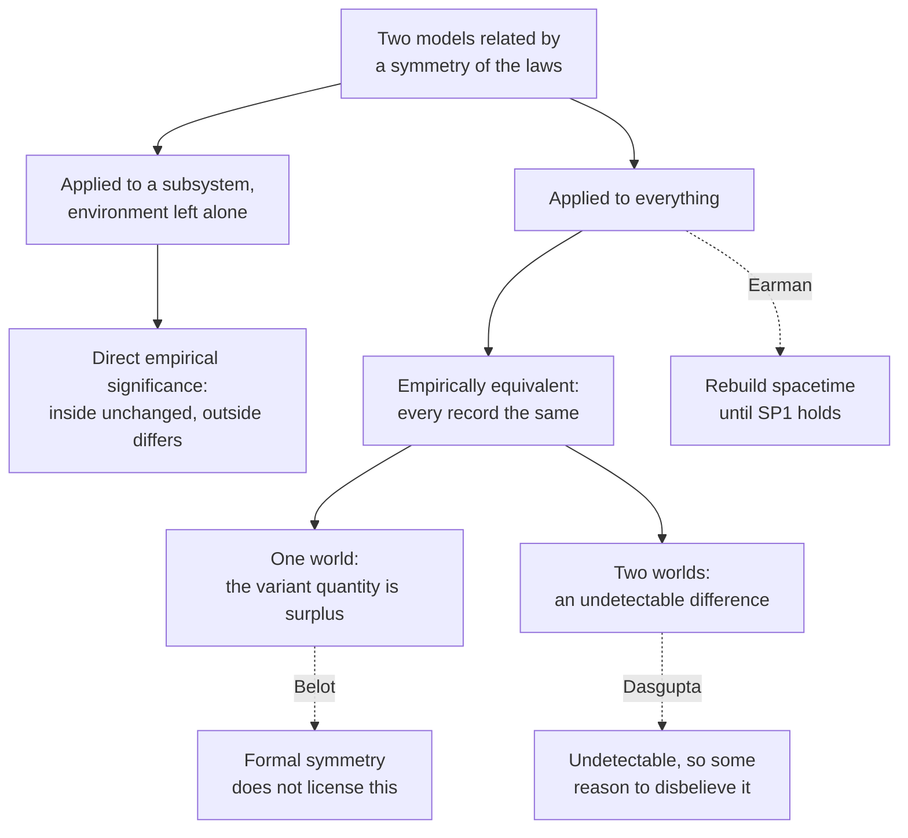

# Philosophy of Physics · Lesson 6.1: Symmetries and what they tell us

> ⏱ ~15 min · Module 6: Symmetry, gauge, and quantum fields · Builds on: [4.1](04-01-leibniz-and-clarke-the-shift-arguments.md), [4.2](04-02-newtons-bucket-and-the-structure-inertia-needs.md), [`analytical-mechanics` 2.2](../../analytical-mechanics/lessons/02-02-noethers-theorem.md) · Unlocks: [6.2](06-02-gauge-as-surplus-structure.md)

## Why this matters

In [`analytical-mechanics` 2.2](../../analytical-mechanics/lessons/02-02-noethers-theorem.md) you slid a pair of particles along a line by $\epsilon$, and momentum conservation fell out. In [4.1](04-01-leibniz-and-clarke-the-shift-arguments.md) Leibniz slid the whole universe and concluded that absolute place is a fiction. It is the same operation. One reading makes it a conservation law, another a verdict on what exists, and a third a fact you can check by looking out of a window. This lesson asks which of those inferences a symmetry licenses, and when symmetry-related models describe one world.

## The idea

A [symmetry](../reference.md#symmetry) is a change that leaves something the same, and everything turns on *what* stays the same. Seal a laboratory in a railway carriage gliding along straight track. Every experiment inside runs as it would at rest: give every body in a solution of the laws the same extra velocity and you get another solution, a *dynamical* symmetry. If spacetime has no standard of absolute rest to register the change, the boost is also a *spacetime* symmetry. John Earman's principles demand that the two lists match ([dynamical and spacetime symmetries](../reference.md#dynamical-and-spacetime-symmetries)).

Step onto the platform and the boost is plain: the carriage slides past. A symmetry applied to part of the world, the rest left alone, is observable from the rest: [direct empirical significance](../reference.md#direct-empirical-significance). Boost the whole universe and there is no platform; every record comes out the same. Is it the same world? Saying yes treats absolute velocity as [surplus structure](../reference.md#surplus-structure): mathematics in the model with nothing in the world answering to it.

Two jobs a symmetry does are settled: it yields conserved quantities (Noether's theorem, below), and it constrains which laws are candidates. Eugene Wigner (*Symmetries and Reflections*, 1967) described Einstein's 1905 work as reversing the old order, so that proposed laws are tested against invariance principles rather than the principles read off the laws. What a law is belongs to [`metaphysics` 4.3](../../metaphysics/lessons/04-03-powers-dispositions-and-laws.md), laws in practice to [`philosophy-of-science` 4.4](../../philosophy-of-science/lessons/04-04-laws-in-the-sciences.md). The contested job is the third: from symmetry to what is real.

## Source

Newton, *Principia*, [Corollary V](../reference.md#newtons-corollaries-v-and-vi) to the Laws of Motion (Motte's translation, London, 1729, vol. 1, p. 30; the statement is in italic in the print; long s modernized):

> *The motions of bodies included in a given space are the same among themselves, whether that space is at rest, or moves uniformly forwards in a right line without any circular motion.*
>
> For the differences of the motions tending towards the same parts, and the sums of those that tend towards contrary parts, are at first (by supposition) in both cases the same; and it is from those sums and differences that the collisions and impulses do arise [...]. Wherefore (by Law 2.) the effects of those collisions will be equal in both cases [...]. A clear proof of which we have from the experiment of a ship: where all motions happen after the same manner, whether the ship is at rest, or is carried uniformly forwards in a right line.

[4.2](04-02-newtons-bucket-and-the-structure-inertia-needs.md) quoted the statement. The shape is a statement, a proof from the second law, and an experiment offered as confirmation. "Among themselves": only relative motions are claimed unchanged, a symmetry claim, not a claim about where the space is. "Without any circular motion": a boost, with rotation excluded, as the bucket requires. "From those sums and differences ... (by Law 2.)": the invariance is derived, but only by assuming that impulses arise from relative motions, which is why the SEP entry "Symmetry and Symmetry Breaking" calls the principle, demoted to a corollary, still an independent assumption. And "a given space": a region and its bodies, a subsystem, checked by experiments made inside one.

## The argument

**Models.** Following Earman (*World Enough and Space-Time*, 1989, §3.4), a model of a spacetime theory $T$ is a manifold $M$ carrying [absolute objects](../reference.md#absolute-and-dynamical-objects) $A$, the same in every model (Newton's standard of rest; the time metric), and dynamical objects $P$, the trajectories or fields, which vary between models and satisfy the laws. A map $d: M \to M$ (a diffeomorphism) carries objects along by pushforward, $d_*$.

**D1. Spacetime symmetry.** $d$ is a spacetime symmetry of $T$ if $d_*A = A$. *In words:* the fixed backdrop cannot register the change. For a fixed metric these are its isometries, generated by Killing vectors ([`differential-geometry` 5.3](../../differential-geometry/lessons/05-03-lie-derivative-killing-vectors.md)); general relativity has no absolute objects, so every diffeomorphism qualifies.

**D2. Dynamical symmetry.** $d$ is a dynamical symmetry of $T$ if, whenever $\langle M, A, P\rangle$ is a model, so is $\langle M, A, d_*P\rangle$. *In words:* it maps solutions to solutions.

**[Earman's symmetry principles](../reference.md#earmans-symmetry-principles)** (1989, p. 46). **SP1:** any dynamical symmetry of $T$ is a spacetime symmetry of $T$. *In words:* spacetime has no structure the laws ignore. **SP2:** any spacetime symmetry of $T$ is a dynamical symmetry of $T$. *In words:* the laws use no structure spacetime lacks. Earman offers them as "conditions of adequacy" on theories of motion: when SP1 fails, cut the surplus spacetime structure away; when SP2 fails, the laws need structure spacetime has not supplied.

**[Noether's theorem](../reference.md#noethers-theorem)** (1918). Each continuous dynamical symmetry of an action yields a conserved quantity, $I = \sum_i (\partial L/\partial\dot q_i)\,\eta_i - F$ in [`analytical-mechanics` 2.2](../../analytical-mechanics/lessons/02-02-noethers-theorem.md)'s notation (fields: [`relativity` 3.2](../../relativity/lessons/03-02-noether-fields.md), [`qft` 1.3](../../qft/lessons/01-03-symmetries-noether-for-fields.md)). *In words:* symmetry of the action gives conservation along solutions. Its [second theorem](../reference.md#noethers-second-theorem) covers local symmetries, which depend on arbitrary functions of space and time: they yield identities among the field equations, not further conserved quantities (Brading and Brown, "Symmetries and Noether's Theorems", 2003). Electric charge is the Noether charge of the *global* phase symmetry, as [`qft` 5.1](../../qft/lessons/05-01-gauge-invariance-photon.md) states.

**Direct empirical significance** (Peter Kosso, "The Empirical Status of Symmetries in Physics", 2000; Katherine Brading and Harvey Brown, "Are Gauge Symmetry Transformations Observable?", 2004). A symmetry has it when there are **(i)** a subsystem on which the transformation, applied to it alone, is a dynamical symmetry, and **(ii)** an untransformed environment relative to which the two situations differ observably. *In words:* nothing inside reveals the change, and something outside does. Consequences routed through the laws, such as conserved quantities, are indirect.

**The [symmetry-to-reality inference](../reference.md#symmetry-to-reality-inference)** (Shamik Dasgupta's name for it, in "Symmetry as an Epistemic Notion (Twice Over)", 2016):

**P1.** We have reason to think the laws $L$ true and complete. *In words:* nothing measurable escapes them.

**P2.** A putative feature $F$ is variant: models related by a symmetry of $L$ agree on everything else and differ in $F$. *In words:* the laws are indifferent to $F$'s value.

**P3.** So $F$ is undetectable: every measurement is a process governed by $L$, and symmetry-related models agree on its outcome. *In words:* no instrument could read $F$.

**P4.** A feature undetectable in principle is one we have some reason not to believe in. *In words:* idle posits are to be shed.

**∴ C.** There is some reason to think $F$ unreal, and the symmetry-related models represent one world. *In words:* the variant quantity is surplus structure.

Dasgupta's "twice over": the inference must pass through the epistemic lemma P3, and the symmetries that support it must be defined partly in epistemic terms, as transformations that preserve what can be detected. Gordon Belot ("Symmetry and Equivalence", 2013) argues that, as a thesis about the symmetries of differential equations, the claim that symmetry-related solutions are physically equivalent is false, and that mixing dynamical and epistemic conditions yields no clean definition. The simplest case of the kind: $m\ddot x = -kx$, with $k$ the spring constant, is linear, so doubling any solution gives a solution, yet the doubled oscillator carries four times the energy and a ruler beside it shows the difference. Belot's own cases include scaling symmetries.

**Where the argument is weakest.** P3. The strongest objection is Belot's: as physics defines symmetries, variance does not entail undetectability, and the oscillator's amplitude is variant yet measurable. The strongest reply is Dasgupta's second sense: doubling the oscillator alone changes its relation to the ruler, so it is no symmetry in the sense the inference needs. Each side gives something up. The defender grants that the inference cannot be read off the equations: it needs an account of what instruments detect, itself physics about which quantities are real. The critic grants that where a theory itself says a quantity is undetectable, as Newtonian mechanics says of absolute velocity, cases like the oscillator leave the inference untouched. A substantivalist attacks P4 instead: things alike in every detectable respect can still be two ([4.1](04-01-leibniz-and-clarke-the-shift-arguments.md)).

## Argument map

Solid arrows are routes from a symmetry; dashed arrows are pressures: Belot against reading identity off the equations, Dasgupta against believing in an undetectable difference, SP1 against structure the laws never use.

## Worked examples

**Example 1 (clean case: Corollary V through both tests).** [4.1](04-01-leibniz-and-clarke-the-shift-arguments.md) Example 2 showed that the [Galilean boost](../reference.md#galilean-boost) $\mathbf x_i(t) \mapsto \mathbf x_i(t) + \mathbf v t$, with the same constant $\mathbf v$ for every body, leaves every separation and acceleration unchanged. So whenever forces depend only on separations, it maps solutions of Newton's laws to solutions: a dynamical symmetry, Corollary V's "by Law 2" in modern form.

Earman's test: in Newtonian spacetime the boost turns a body at rest into one in motion, so it is no spacetime symmetry and SP1 fails. The cure is [Galilean spacetime](../reference.md#galilean-spacetime) ([4.2](04-02-newtons-bucket-and-the-structure-inertia-needs.md)), which keeps absolute acceleration and drops absolute rest. The significance test: boost only the bodies in Newton's "given space", a laboratory, and not the rest of the world. Condition (i) is the corollary itself. Condition (ii) holds because the laboratory now moves past the ground. Kosso, and Brading and Brown, model their criterion on this case under the name of [Galileo's ship](../reference.md#galileos-ship), which [`relativity` 1.1](../../relativity/lessons/01-01-postulates-simultaneity.md) paraphrases as the principle of relativity. Its indirect consequence is the Noether charge $Pt - Mx_{\text{cm}}$ ([`analytical-mechanics` 2.2](../../analytical-mechanics/lessons/02-02-noethers-theorem.md) P3; total momentum $P$, total mass $M$, centre of mass $x_{\text{cm}}$): the centre of mass moves uniformly.

**Example 2 (hard case: boost everything).** Now boost every body there is: the [kinematic shift](../reference.md#kinematic-shift) of [4.1](04-01-leibniz-and-clarke-the-shift-arguments.md), read as underdetermination in [`philosophy-of-science` 2.2](../../philosophy-of-science/lessons/02-02-duhem-quine-and-underdetermination.md) Example 2. Condition (i) holds. Condition (ii) cannot be met, since nothing is left untransformed. So the criterion gives no verdict: it explains how we come to know that a symmetry holds, and is silent on whether two whole-universe models differ.

The symmetry-to-reality inference is at its strongest, since the theory itself says absolute velocity is undetectable; C then makes the two models one world, Leibniz's conclusion. A substantivalist about Newton's space denies P4: two worlds, differing in a way no one could detect. Earman goes round the argument rather than through it: rebuild the theory in Galilean spacetime, where there is no absolute velocity for the models to differ in. What remains is whether models differing only in which points the bodies occupy are distinct, the [hole argument](../reference.md#hole-argument)'s question ([4.5](04-05-the-hole-argument.md)).

## Watch out

- **You might think** a symmetry of the laws and a symmetry of spacetime are one thing, **but actually** they are defined over different objects. Newton's laws in Newtonian spacetime have boosts as dynamical symmetries and not as spacetime symmetries; SP1 and SP2 are norms linking the two lists, not theorems.

- **You might think** charge is the Noether charge of the local gauge symmetry, **but actually** it is that of the global phase symmetry; the local symmetry yields identities, by the second theorem, which tie charge conservation to the electromagnetic field equations.

- **You might think** a symmetry is unobservable, or that "variant, so unreal" is a theorem, **but actually** a boosted subsystem is seen to move against its environment, and the inference to unreality runs through an epistemic premise to "some reason". Mapping solutions to solutions does not make it go, as the doubled oscillator shows.

## One-liner

> A symmetry of the laws yields a conservation law by Noether's theorem, is observable when applied to a subsystem against an untransformed environment, and marks a quantity as surplus only through a premise about believing in the undetectable.

## Problems

**P1 (🟢)** *(Formal model: Formal (a) · Exegetical (b).)* Three bodies move on a line, with positions $x_i(t)$, masses $m_i$, and constants $\kappa, \beta > 0$. Two invented force laws:

$$\text{Law A:}\quad m_i\ddot x_i = \kappa\sum_{j\neq i}(x_j - x_i)^3, \qquad \text{Law B:}\quad m_i\ddot x_i = \kappa\sum_{j\neq i}(x_j - x_i)^3 - \beta\,\dot x_i.$$

The boost sends every trajectory $x_i(t)$ to $x_i(t) + vt$.

(a) For each law, show whether the boost maps solutions to solutions. Where it fails, compute the extra force on each body that the boosted motion would need and the law does not supply, for $\beta = 0.5$ kg/s and $v = 3$ m/s. Show the computation.

(b) Set Law B in Galilean spacetime and consider boosts only. Which of SP1 and SP2 fails, and what structure does the law need that the spacetime lacks? Then replace $-\beta\dot x_i$ by $-\beta(\dot x_i - u)$, where $u$ is the constant velocity of a medium, a dynamical object that the boost carries along ($u \mapsto u + v$). Is the boost now a dynamical symmetry, and where has the standard of rest gone? Two sentences each.

**P2 (🟡)** *(Close reading: Exegetical (a)–(b).)* Newton, *Principia*, Corollary VI to the Laws of Motion (Motte's translation, London, 1729, vol. 1, p. 31; the statement is in italic in the print; long s modernized):

> *If bodies, any how moved among themselves are urged in the direction of parallel lines by equal accelerative forces; they will all continue to move among themselves, after the same manner as if they had been urged by no such forces.*
>
> For these forces acting equally (with respect to the quantities of the bodies to be moved), and in the direction of parallel lines, will (by Law 2.) move all the bodies equally (as to velocity) and therefore will never produce any change in the positions or motions of the bodies among themselves.

(a) What transformation of the bodies' trajectories does the corollary say leaves their motions "among themselves" unchanged? Write it as a map on trajectories, say how it extends Corollary V, and name the words that fix its scope. Three sentences.

(b) A laboratory and everything in it fall freely toward the Earth. Run the two conditions of direct empirical significance on the corollary's symmetry for this subsystem, say what plays the environment, and say which words of the passage limit the verdict for a real laboratory. 150 words or fewer.

**P3 (🔴)** *(Find the crux: Formal (a) · Exegetical (b) · Evaluative (c).)* Take Newtonian gravity for $N$ bodies with masses $m_i$, positions $\mathbf x_i(t)$ and gravitational constant $G$:

$$\ddot{\mathbf x}_i = \sum_{j\neq i}\frac{G m_j(\mathbf x_j - \mathbf x_i)}{|\mathbf x_j - \mathbf x_i|^3}.$$

(a) Show that the map sending every solution $\mathbf x_i(t)$ to $\lambda\,\mathbf x_i(\lambda^{-3/2}t)$, for a constant $\lambda > 0$, sends solutions to solutions, and that scaling positions alone, $\lambda\,\mathbf x_i(t)$, does not. For $\lambda = 4$, by what factor does every orbital period change? Show the computation.

(b) Dasgupta and Belot, as this lesson states their views, agree that mapping solutions to solutions is not enough to license the symmetry-to-reality inference. Say what Dasgupta adds to make the inference go, name the point Belot disputes, and state the crux as a conditional each would sign. Three sentences.

(c) Apply the scaling of (a) to every body in the universe at once. Is absolute scale surplus structure? Any verdict; 150 words or fewer.

Solutions

**P1** *(Formal (a) · Exegetical (b))*

(a) Write $x_i' = x_i + vt$. Then $\dot x_i' = \dot x_i + v$, $\ddot x_i' = \ddot x_i$, and $x_j' - x_i' = x_j - x_i$.

Law A:

$$m_i\ddot x_i' = m_i\ddot x_i = \kappa\sum_{j\neq i}(x_j - x_i)^3 = \kappa\sum_{j\neq i}(x_j' - x_i')^3,$$

so the boosted motion solves Law A, and the boost is a dynamical symmetry.

Law B:

$$m_i\ddot x_i' = \kappa\sum_{j\neq i}(x_j - x_i)^3 - \beta\dot x_i = \kappa\sum_{j\neq i}(x_j' - x_i')^3 - \beta\dot x_i' + \beta v.$$

The boosted motion would need an extra force $+\beta v$ on every body, pointing along the boost, which Law B does not supply: $\beta v = 0.5 \times 3 = 1.5$ N, the same for each body whatever its mass. So the boost is not a symmetry of Law B for any $v \neq 0$. Equivalently, the boosted motion obeys a drag $-\beta(\dot x_i' - v)$ relative to a medium moving at $v$.

**Must hit, strict (a):** relative positions and accelerations are unchanged and velocities shift by $v$; Law A depends only on relative positions, so it passes; Law B's absolute-velocity term leaves the residual $+\beta v = 1.5$ N on each body.

(b) In Galilean spacetime the boost is a spacetime symmetry, and (a) shows it is not a dynamical symmetry of Law B, so SP2 fails. The law's drag term measures velocity against a standard of rest, which Galilean spacetime does not supply; Earman's diagnosis is that the laws need more structure than the spacetime has, here Newtonian spacetime's absolute rest.

With the medium, $\dot x_i' - u' = (\dot x_i + v) - (u + v) = \dot x_i - u$, so the drag is unchanged, and with (a)'s other steps the boosted bodies and medium solve the new law: the boost is a dynamical symmetry and SP2 holds again. The standard of rest has moved out of spacetime into matter: the medium's own state, which the boost transforms along with everything else, rather than an absolute object.

**Must hit, strict (b):** SP2 fails, not SP1; the missing structure is a standard of rest (absolute velocity); with the medium the relative velocity $\dot x_i - u$ is boost-invariant, so the boost is a dynamical symmetry; the rest frame is now a dynamical object, not spacetime structure.

**Accept:** noting that Law A also has a scaling symmetry, $x_i(t) \mapsto \lambda x_i(\lambda t)$, which Law B lacks and the question set aside. It is the kind of case Belot (2013) uses to show that a solution-preserving map need not relate physically equivalent situations.

**Wrong turns:** failing Law B merely because a velocity appears in it (a law depending only on relative velocities, $\dot x_j - \dot x_i$ or $\dot x_i - u$, passes); giving the missing force as $-\beta v$; saying SP1 fails for Law B in Galilean spacetime, which swaps the principles; leaving $u$ unboosted in the second half, which just reinstates (a)'s failure.

---

**P2** *(Exegetical (a)–(b))*

**Must hit, strict (a):**

- The map adds the same displacement to every body: $\mathbf x_i(t) \mapsto \mathbf x_i(t) + \mathbf d(t)$, one $\mathbf d$ for all, whose second derivative $\ddot{\mathbf d}(t)$ is the common accelerative field. Relative positions $\mathbf x_i - \mathbf x_j$ and relative velocities are untouched.

- It extends Corollary V from a common uniform velocity ($\mathbf d = \mathbf v t$, so $\ddot{\mathbf d} = 0$) to a common acceleration.

- Scope words: "equal accelerative forces", glossed by "with respect to the quantities of the bodies", so equal per unit of matter and hence equal accelerations; "in the direction of parallel lines"; and "among themselves", so only relative positions and motions are claimed unchanged.

**Accept:** "uniform acceleration", if the answer says it is the same for every body. The passage does not require the field to be constant in time, so $\mathbf d(t) = \tfrac12\mathbf g t^2$ is one case.

**Must hit, strict (b):**

- Subsystem: the laboratory and its contents. Transformation: the common acceleration toward the Earth.

- Condition (i) holds: by the corollary, everything inside moves among itself as if unforced, so no experiment inside reveals the fall. This is the Newtonian ancestor of the [equivalence principle](../reference.md#equivalence-principle) ([4.4](04-04-geometry-convention-or-dynamics.md); [`relativity` 5.1](../../relativity/lessons/05-01-equivalence-principle.md)).

- Condition (ii) holds: the Earth, the building and the stars are the environment, not falling with the laboratory, so the fall is seen against them.

- The verdict is approximate. "Equal" and "parallel" fail for a real field, which weakens with height and points toward the Earth's centre. Over a height $h = 2$ m near the surface ($g = 9.81$ m/s², Earth radius $R = 6.371\times10^6$ m) the vertical difference is about $2gh/R \approx 6\times10^{-6}$ m/s², so a sensitive enough instrument inside detects the fall through tides. Corollary V is exact for a closed system; Corollary VI holds only as far as the field is uniform across the subsystem.

**Accept:** noting that Simon Saunders ("Rethinking Newton's *Principia*", 2013) uses Corollary VI to argue that Newtonian gravitation needs even less spacetime structure than Galilean spacetime ([4.2](04-02-newtons-bucket-and-the-structure-inertia-needs.md) names this), and that Eleanor Knox (2014) reads Newtonian spacetime structure in light of the equivalence principle. Credit the further point that Newton's comparison case, the same bodies "urged by no such forces", needs a different field in the laboratory, and the field comes from the environment's masses, so the two situations do not share an untouched environment as neatly as two states of motion of a cabin do.

**Wrong turns:** denying direct significance because the laboratory "cannot tell it is falling", which is condition (i), not a failure of (ii); treating the fall as a transformation of the whole universe; ignoring tides; reading "equal accelerative forces" as equal pushes, which would give heavier bodies smaller accelerations, against Newton's own parenthesis.

**Model answer (b):** The subsystem is the laboratory with its contents, and the transformation is the common acceleration toward the Earth. Condition (i) holds: by the corollary, bodies inside move among themselves as if no force acted, so no internal experiment shows the fall. Condition (ii) holds: the Earth and the building are an untransformed environment, against which the fall is plain. So the symmetry has direct empirical significance, but only approximately, because the corollary demands forces that are "equal" and act along "parallel lines". Earth's field weakens with height and converges on its centre, by about $6\times10^{-6}$ m/s² over two metres, so a fine enough experiment inside detects the fall through tides.

---

**P3** *(Formal (a) · Exegetical (b) · Evaluative (c))*

(a) Let $\mathbf x_i'(t) = \lambda\,\mathbf x_i(s)$ with $s = \lambda^{-3/2}t$. Each time derivative brings a factor $\lambda^{-3/2}$, so

$$\ddot{\mathbf x}_i'(t) = \lambda\cdot\lambda^{-3}\,\ddot{\mathbf x}_i(s) = \lambda^{-2}\,\ddot{\mathbf x}_i(s).$$

On the right, every separation scales by $\lambda$:

$$\sum_{j\neq i}\frac{G m_j\,\lambda(\mathbf x_j - \mathbf x_i)}{\lambda^3|\mathbf x_j - \mathbf x_i|^3} = \lambda^{-2}\sum_{j\neq i}\frac{G m_j(\mathbf x_j - \mathbf x_i)}{|\mathbf x_j - \mathbf x_i|^3},$$

evaluated at time $s$. Both sides carry $\lambda^{-2}$, and the original law holds at $s$, so the scaled motions are solutions. Scaling positions alone multiplies the left side by $\lambda$ and the right by $\lambda^{-2}$, a mismatch of $\lambda^3 = 64$ at $\lambda = 4$, so that map fails wherever there is any acceleration. A motion of period $T$ becomes one of period $\lambda^{3/2}T$: at $\lambda = 4$, every period grows by a factor of $8$ (Kepler's third law, $T^2 \propto a^3$).

**Must hit, strict (a):** the $\lambda^{-2}$ on both sides; the $\lambda^3 = 64$ mismatch for positions alone; the period factor 8.

**Must hit, strict (b):**

- Dasgupta adds that the inference must pass through undetectability (P3), and that the symmetries it uses must be defined partly in epistemic terms, as maps that preserve what can be detected.

- Belot disputes that any precise, general definition combining the solution-preserving condition with an epistemic one is available, so the inference has no general licence and each case needs separate judgment.

- A conditional each would sign: "If there is a general criterion, statable without first deciding which quantities are real, for which solution-preserving maps also preserve everything detectable, then variance under those maps is some reason to deny a feature's reality; and if there is none, symmetry by itself settles nothing about what is real."

**Must hit, any verdict (c):**

- Separate the subsystem from the universe. A scaled planetary system alone is detectable against unscaled rulers and clocks, its periods eight times longer, so it has direct significance; the question concerns only the universe-wide map.

- Test P1 of the inference. The scaling is a symmetry of Newtonian gravitation alone; the complete laws fix lengths (atomic sizes are set by the electron's mass and charge and Planck's constant), so in our world universe-wide scaling is not a symmetry of complete laws. Say what that does to the inference.

- For a purely gravitational world, state both sides at strength: Dasgupta's route (variant, hence undetectable, since every ruler and clock scales with it, so some reason to hold that only ratios of distances are real) and Belot's (the map is a formal scaling like the doubled oscillator, and the verdict rests on a judgment about measurement that the equations do not supply).

- Say what would move each side.

**Wrong turns:** answering about a scaled subsystem; assuming the scaling is a symmetry of all of physics; treating the answer to (a) as settling (c).

**Model answer (c), one of several:** Not in our world, and only conditionally in a Newtonian one. Scale a solar system alone and its periods are eight times longer by an outside clock, so the map is no hidden symmetry there. Scale everything and the inference's first premise fails: the complete laws include atomic physics, which fixes lengths, so universe-wide scaling is not a symmetry of them. In a world governed by gravitation alone, every ruler and clock would scale too, and Dasgupta's route gives some reason to hold that only ratios of distances are real. Belot's challenge is that this rests on a claim about what measurement can reach, which the equations do not deliver; the oscillator shows that a formal scaling can relate distinct situations. The critic would be moved by an account of measurement showing that every instrument in such a world scales along; the defender, by a scale-dependent term in its complete laws, which would make scale detectable.

## Flashback

**From Lesson [5.5](05-05-is-the-past-hypothesis-enough.md) (Is the past hypothesis enough?):** *(Close reading: Exegetical (a)–(c).)* Boltzmann, *Vorlesungen über Gastheorie*, II. Teil (Leipzig: J. A. Barth, 1898), §90 (lesson's translation; "single worlds" renders *Einzelwelten*; the cut omits the two sentences 5.5 quoted and paraphrased):

> In the universe, otherwise everywhere in thermal equilibrium, thus dead, there must then occur here and there relatively small regions the size of our stellar space (call them single worlds) which for the relatively short time of aeons deviate considerably from thermal equilibrium, just as often ones in which the state probability increases as ones in which it decreases. [...] This method seems to me the only one by which one can conceive the second law, the heat death of each single world, without a one-sided (*einseitige*) change of the whole universe from a definite initial to a final state.

(a) Which premise of 5.5's [fluctuation hypothesis](../reference.md#fluctuation-hypothesis) does the first sentence state, and what does its last clause imply for the direction of time? Two sentences.

(b) What does the last sentence say the method avoids, and what does 5.5 call that posit? One sentence.

(c) Which phrase does 5.5's minimal-fluctuation objection put under pressure, and why? Two sentences.

Solution

**Must hit, strict (a):**

- F1: equilibrium almost everywhere and always ("otherwise everywhere", "thus dead"), the deviations small and brief.

- Rising and falling state probability occur "just as often", so the universe as a whole has no direction of time; inhabitants of a single world call the direction toward less probable states the past.

**Must hit, strict (b):** a one-sided change of the whole universe from a definite initial state, a low-entropy beginning of everything: the [past hypothesis](../reference.md#past-hypothesis).

**Must hit, strict (c):**

- "The size of our stellar space": by F2 each unit of missing entropy costs a factor of $e$, so by B1 a smaller fluctuation fitting our evidence is exponentially likelier than one as large as all the stars we see.

- So by B3 the next look beyond what we have seen should find equilibrium, as Feynman pressed. The objection grants that such regions "must occur", and denies that we should expect to be in one.

**Accept (c):** "relatively small regions", if the answer says star-sized is not the smallest size that fits the evidence; going on to Boltzmann brains and C′.

**Wrong turns:** reading "single worlds" as separate universes or Everettian branches; taking "one-sided" to mean time-asymmetric laws; finding F3 in the passage (the living being is in the cut).

**Model answer:** (a) F1: equilibrium everywhere but in small, brief regions. Since probability rises "just as often" as it falls, the universe has no direction of time, and each single world's inhabitants call its improbable end the past. (b) A one-sided change of the whole universe from a definite initial state, a low-entropy beginning: the past hypothesis. (c) "The size of our stellar space": by B1 a smaller fluctuation fitting our evidence is exponentially likelier, so by B3 the next look outward should find equilibrium. Such regions occur; we should not expect to be in one.

## Connections

- **Backward:** [4.1](04-01-leibniz-and-clarke-the-shift-arguments.md)'s shifts are symmetries applied to everything, the static one a translation or reflection and the kinematic one a boost; [`modern-philosophy` 2.3](../../modern-philosophy/lessons/02-03-leibniz-sufficient-reason-and-monads.md) Example 1 states the static shift and [`philosophy-of-science` 2.2](../../philosophy-of-science/lessons/02-02-duhem-quine-and-underdetermination.md) Example 2 reads the kinematic one as underdetermination. [4.2](04-02-newtons-bucket-and-the-structure-inertia-needs.md)'s Galilean spacetime is SP1's cure, and Noether's theorem is [`analytical-mechanics` 2.2](../../analytical-mechanics/lessons/02-02-noethers-theorem.md)'s.

- **Forward:** [6.2](06-02-gauge-as-surplus-structure.md) asks whether gauge potentials are surplus structure. There the symmetries are local: Kosso, and Brading and Brown, deny them direct significance, while Hilary Greaves and David Wallace ("Empirical Consequences of Symmetries", 2014) argue that some have it. "Gauge" has three senses in the sibling courses, $L \to L + dF/dt$ ([`analytical-mechanics` 1.2](../../analytical-mechanics/lessons/01-02-least-action-lagrange.md) P3), coordinate freedom in general relativity ([`relativity` 5.3](../../relativity/lessons/05-03-einstein-field-equations.md)) and local $U(1)$ ([`qft` 5.1](../../qft/lessons/05-01-gauge-invariance-photon.md)); 6.2 means the third. [4.5](04-05-the-hole-argument.md)'s [Leibniz equivalence](../reference.md#leibniz-equivalence) is the symmetry-to-reality inference for diffeomorphisms, and [6.3](06-03-particles-fields-or-structure.md) meets the permutation symmetry of identical particles. Corollary VI made local and universal is the equivalence principle of [4.4](04-04-geometry-convention-or-dynamics.md) and [`relativity` 5.1](../../relativity/lessons/05-01-equivalence-principle.md).

- **Sideways:** Whether a symmetry principle is a law about laws or a pattern in them is a question for [`metaphysics` 4.3](../../metaphysics/lessons/04-03-powers-dispositions-and-laws.md); [`philosophy-of-science` 4.4](../../philosophy-of-science/lessons/04-04-laws-in-the-sciences.md) has laws in practice. Social choice runs the same move as "only invariant quantities are real": in [`decision-theory` 5.2](../../decision-theory/lessons/05-02-interpersonal-comparison-and-social-welfare-functions.md) a welfare ranking is meaningful only if it survives every admissible rescaling of utilities. Symmetric laws with asymmetric states, the converse puzzle, are the pitchfork of [`dynamical-systems` 3.2](../../dynamical-systems/lessons/03-02-pitchfork-symmetry.md) and the magnets of [`condensed-matter` 5.3](../../condensed-matter/lessons/05-03-heisenberg-ising.md).
