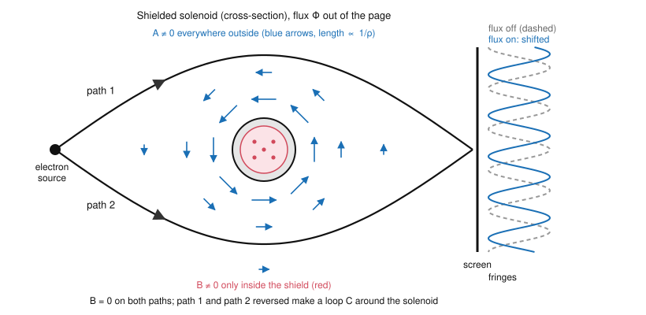

# Philosophy of Physics · Lesson 6.2: Gauge as surplus structure

> ⏱ ~15 min · Module 6: Symmetry, gauge, and quantum fields · Builds on: [6.1](06-01-symmetries-and-what-they-tell-us.md), [4.5](04-05-the-hole-argument.md), [`qft` 5.1](../../qft/lessons/05-01-gauge-invariance-photon.md) · Unlocks: [6.3](06-03-particles-fields-or-structure.md)

## Why this matters

In 1986 Akira Tonomura's group at Hitachi sealed a ring magnet six micrometres across in superconducting niobium, so no field could leak out, and sent electrons past it. Waves through the ring's hole came out half a fringe out of step with waves around it, though none had met a field. Something electromagnetic made a difference where the field was zero, and the only local candidate the equations offer is the potential $\mathbf A$, which [`qft` 5.1](../../qft/lessons/05-01-gauge-invariance-photon.md) called "a redundancy".

## The idea

Picture towns joined by roads, each free to set its clocks as it likes. To compare times you need a correction on each road: add so many minutes when you cross. If a town resets its clocks, the corrections on every road into it change, and nothing anyone measures changes. But drive any loop of roads, adding corrections as you go, and the total survives every resetting. In electromagnetism the clock settings are the phase of a charged particle's wavefunction at each point, the road corrections are the vector potential $\mathbf A$, a resetting is a [gauge transformation](../reference.md#gauge-transformation), and the loop totals are [holonomies](../reference.md#holonomy).

The clock settings look like [surplus structure](../reference.md#surplus-structure), mathematics with nothing in the world answering to it ([6.1](06-01-symmetries-and-what-they-tell-us.md)). Are the road corrections surplus too? The textbook says yes: only the fields $\mathbf E$ and $\mathbf B$ are physical. The [Aharonov–Bohm effect](../reference.md#aharonov-bohm-effect) tests that. It is a loop of roads round a lake: loops on land total zero, the loop round the lake does not, and electrons notice. Richard Healey sorts the replies three ways: only fields are real, and act at a distance; potentials are real at each point; or loop totals are real, and live at no point. ("Gauge" here is local $U(1)$, the third of [6.1](06-01-symmetries-and-what-they-tell-us.md)'s three senses.)

## The argument

**Convention.** For a particle of charge $q$, the potentials $\phi$ and $\mathbf A$ give $\mathbf E = -\nabla\phi - \partial_t\mathbf A$ and $\mathbf B = \nabla\times\mathbf A$. For any smooth, single-valued $\chi(\mathbf x, t)$, the gauge transformation is

$$\mathbf A \to \mathbf A + \nabla\chi, \qquad \phi \to \phi - \partial_t\chi, \qquad \psi \to e^{iq\chi/\hbar}\psi.$$

This is the SI minimal coupling $\mathbf p \to \mathbf p - q\mathbf A$ of [`analytical-mechanics` 2.1](../../analytical-mechanics/lessons/02-01-cyclic-coordinates-momenta.md), and [`qft` 5.1](../../qft/lessons/05-01-gauge-invariance-photon.md)'s $A_\mu \to A_\mu - \frac1e\partial_\mu\alpha$ with $\alpha = q\chi/\hbar$ and $e = q$, once that lesson's mostly-minus metric lowers the spatial index ($A_i = -A^i$). $\mathbf E$ and $\mathbf B$ are unchanged ([`qft` 5.1](../../qft/lessons/05-01-gauge-invariance-photon.md) P1), and the Schrödinger equation with $H = (\mathbf p - q\mathbf A)^2/2m + q\phi$ keeps its form. *In words:* reset the phase everywhere, adjust the potentials, and every prediction stands. Constant $\chi$ is the global symmetry whose Noether charge is electric charge ([6.1](06-01-symmetries-and-what-they-tell-us.md)).

**D1. [Gauge invariance](../reference.md#gauge-invariance).** A quantity is gauge-invariant if every such transformation leaves it unchanged. *In words:* it ignores how the clocks were set. Can gauging one part of the world be seen against the rest, like [6.1](06-01-symmetries-and-what-they-tell-us.md)'s ship? Kosso, Brading and Brown say no; Hilary Greaves and David Wallace (2014) say yes, if the transformation does not die away at the subsystem's edge.

**D2. Surplus structure** (Michael Redhead coined the phrase in "Symmetry in Intertheory Relations", 1975, and applied it in "The Interpretation of Gauge Symmetry", 2002). A theory represents physical structure inside a larger mathematical one; what the larger adds, answering to nothing physical, is surplus. On the surplus reading, gauge-related potentials describe one state. *In words:* the gauge-dependent part of the potential is mathematics only.

**D3. Holonomy.** For a closed loop $C$, the phase factor $e^{(iq/\hbar)\oint_C \mathbf A\cdot d\mathbf l}$ is the holonomy of $\mathbf A$ around $C$: [`differential-geometry` 4.2](../../differential-geometry/lessons/04-02-parallel-transport.md)'s turn of a carried vector, here a phase, with $\mathbf A$ the connection and $\mathbf B$ its curvature ([5.4](../../differential-geometry/lessons/05-04-fiber-bundles-connections.md)). It is gauge-invariant. *In words:* the loop total of the road corrections.

**D4. [Separability](../reference.md#separability)** (Healey's formulation, in the SEP entry "Holism and Nonseparability in Physics"). A theory is spatiotemporally separable if every physical process in a region $R$ supervenes on an assignment of qualitative intrinsic properties to the points of $R$. *In words:* settle what holds at each point and you have settled everything.

**The effect** (settled physics). Werner Ehrenberg and Raymond Siday (1949), then Yakir Aharonov and David Bohm (1959), predicted that electrons passing either side of a long shielded solenoid, with $\mathbf B = 0$ on every path, interfere with a phase difference $q\Phi/\hbar$, where $\Phi$ is the enclosed flux. Robert Chambers saw a shift in 1960 with a magnetized iron whisker, though stray fields left doubt; Tonomura's niobium removed it, trapping flux in quanta $h/2e$ ([`condensed-matter` 5.4](../../condensed-matter/lessons/05-04-superconductivity-phenomena.md)), and an odd number gives $e(h/2e)/\hbar = \pi$, half a fringe. Outside the solenoid $\mathbf A$ cannot be gauged to zero: like [`differential-geometry` 3.3](../../differential-geometry/lessons/03-03-exterior-derivative.md)'s $d\theta$ on the punctured plane, it is closed but not exact.

**The Aharonov–Bohm argument** (after the SEP entry "Gauge Theories in Physics", 2025, §3.1):

**P1.** Changing the enclosed flux shifts the fringes. *In words:* the effect is real.

**P2.** A difference in what happens to the electrons is due to a difference in the electromagnetic state where they travel. *In words:* electromagnetism acts locally.

**P3.** Where they travel, the different fluxes agree on $\mathbf E$ and $\mathbf B$, both zero, and differ only in potentials that no gauge transformation relates. *In words:* there, only $\mathbf A$ registers the flux.

**∴ C.** Potentials that agree on $\mathbf E$ and $\mathbf B$ can represent different electromagnetic states. *In words:* field strengths at points are not the whole of electromagnetism.

[Healey's three interpretations](../reference.md#healeys-three-interpretations) (*Gauging What's Real*, 2007, ch. 2, and "Nonlocality and the Aharonov–Bohm Effect", 1997) are the three responses: deny P2 and keep only fields; accept C with potentials real at points; or accept C with real properties of loops. Example 2 runs them.

**Lemma (the gauge hole).** Let $\chi$ vanish for $t \le t_0$ and not after. Then $(\phi, \mathbf A)$ and its transform solve Maxwell's equations with the same charges and currents, agree up to $t_0$, and differ after. *In words:* if gauge-related potentials are distinct states, their past does not fix their future. It is [4.5](04-05-the-hole-argument.md)'s hole with $\chi$ for the diffeomorphism, and the same dilemma follows: indeterminism no measurement reveals, a privileged gauge, or a gauge version of Leibniz equivalence, which is the surplus reading.

**[Elitzur's theorem](../reference.md#elitzurs-theorem)** ("Impossibility of Spontaneously Breaking Local Symmetries", 1975). In lattice gauge theory without gauge fixing, every local quantity that is not gauge-invariant has expectation value zero, so a local gauge symmetry cannot break spontaneously. *In words:* averaging over all clock settings erases whatever depends on them. [`nuclear-particle-physics` 5.2](../../nuclear-particle-physics/lessons/05-02-electroweak-higgs.md)'s vacuum that breaks the gauge symmetry is textbook shorthand, standardly glossed as a global remnant that survives gauge fixing. John Earman (2004) put the worry: no real mass comes from eating "descriptive fluff". The W and Z do have mass and the Higgs boson was found in 2012, so the mechanism needs a gauge-invariant statement; Simon Friederich (2013) surveys the attempts.

**[Ontic structural realism](../reference.md#ontic-structural-realism) about gauge** (Holger Lyre, "Holism and Structuralism in U(1) Gauge Theory", 2004; the general thesis and the relata objection: [`philosophy-of-science` 5.3](../../philosophy-of-science/lessons/05-03-structural-realism.md)). What there is, is the gauge-invariant structure: the symmetry group and the holonomies, with objects only as equivalence classes under the group. Lyre's case, per the SEP: the gauge principle's success in building the Standard Model would be a miracle if it tracked nothing, yet the potentials are underdetermined. Redhead (2002) found that success puzzling on his own surplus reading.

**Where the argument is weakest.** P2. The strongest objection: it assumes separability, a "state where they travel" built from point states; the holonomy reading denies that the state is pointwise, the fields-only reading that the influence is local. The strongest reply: P2 is why fields displaced action at a distance, and each escape costs either action at a distance or a holism classical physics never needed. The defender concedes that P2 survives only if a gauge-dependent quantity is real or electromagnetism is nonseparable; the critic, that the shift is a hard fact every reading must locate. The SEP reports most philosophers favouring a surplus or scaffolding reading; the dispute is open.

## The setup

$\mathbf B$ vanishes on both paths, $\mathbf A$ does not, and the loop the paths make fixes the shift: each reading must say where the difference lives.

## Worked examples

**Example 1 (clean case: one lattice plaquette).** Lattice gauge theory puts a phase $\theta_{uv}$ on each link from vertex $u$ to $v$, in the continuum limit $(q/\hbar)\int_u^v \mathbf A\cdot d\mathbf l$. A gauge transformation assigns $\alpha_v$ to each vertex and sends $\theta_{uv} \to \theta_{uv} + \alpha_v - \alpha_u$, the lattice form of $\mathbf A \to \mathbf A + \nabla\chi$ with $\alpha = q\chi/\hbar$.

Take a square with vertices 1, 2, 3, 4 in order and $\theta_{12} = \tfrac12$, $\theta_{23} = \tfrac14$, $\theta_{34} = -\tfrac13$, $\theta_{41} = \tfrac16$. The plaquette sum is $W = \tfrac12 + \tfrac14 - \tfrac13 + \tfrac16 = \tfrac{7}{12}$. Set $\alpha_1 = 0$ and clear the links in turn: $\alpha_2 = -\tfrac12$, $\alpha_3 = -\tfrac34$, $\alpha_4 = -\tfrac{5}{12}$ make $\theta_{12}$, $\theta_{23}$, $\theta_{34}$ zero and send $\theta_{41}$ to $\tfrac16 + \tfrac{5}{12} = \tfrac{7}{12}$. The sum survives because, round a loop, each $\alpha_v$ enters once with each sign.

Of four numbers, three are gauge-variable (a constant $\alpha$ does nothing, so three vertex settings do all the work) and one is invariant: the lattice holonomy, which for a small square approaches $q/\hbar$ times the flux through it. Redhead's surplus can be counted. Elitzur in miniature: averaged over all $\alpha_1, \alpha_2$, $e^{i\theta_{12}}$ goes to 0, while $e^{iW}$ is untouched.

**Example 2 (hard case: the Aharonov–Bohm effect, three ways).**

- *Fields only.* Real: $\mathbf E$ and $\mathbf B$ at points, nothing gauge-dependent. Separable. But $\mathbf B = 0$ where the electrons go, so the field inside acts on them at a distance (Bryce DeWitt's 1962 option, per the SEP), denying P2.
- *Localized potentials.* Real: $\mathbf A$ at each point, as Aharonov and Bohm suggested. Separable, and a gauge-dependent quantity counts as real. Healey argues it still does not make the effect local: along any source-to-screen path that does not encircle the solenoid, some gauge gives $\mathbf A$ the same values with the current on as off, so no local interaction there could shift the fringes unless one gauge is the true one. Tim Maudlin (1998) and Ruward Mulder (2021) dispute this; Mulder argues that potentials in the Lorenz gauge, propagating at finite speed, give a local account.
- *Holonomies.* Real: the phase factors of loops (after Wu and Yang, 1975; Healey's choice). Gauge-invariant, and nonseparable, since loop properties do not supervene on properties at points. The interaction is local if the electron's passage is itself nonseparable, spread along the loop.

Here the account stops. Whether the passage is nonseparable is a question about quantum mechanics, and answering it takes an interpretive side (as the SEP entry on holism notes): a Bohmian particle passes one side while its wave passes both ([2.1](02-01-bohmian-mechanics.md)). The holonomy view's locality borrows a verdict this course left open; ontic structural realism, taking holonomy structure as what there is, inherits the nonseparability.

## Watch out

- **You might think** the Aharonov–Bohm effect proved $\mathbf A$ real, **but actually** it shows that $\mathbf E$ and $\mathbf B$ at points underdescribe electromagnetism. The shift depends on $\mathbf A$ only through the loop, which all three readings accommodate.
- **You might think** gauge freedom is simply a redundancy, as [`qft` 5.1](../../qft/lessons/05-01-gauge-invariance-photon.md) says, **but actually** that is the surplus reading, one position among several; the potentials realist denies it and pays with the gauge hole.
- **You might think** the Higgs vacuum spontaneously breaks the electroweak gauge symmetry, **but actually** Elitzur's theorem forbids a local gauge symmetry to break; the phrase refers to a global remnant in a fixed gauge.
- **You might think** holonomy has to do with the holonomic constraints of [`analytical-mechanics` 1.3](../../analytical-mechanics/lessons/01-03-generalized-coordinates-constraints.md), **but actually** they are unrelated; and [`differential-geometry` 4.2](../../differential-geometry/lessons/04-02-parallel-transport.md)'s holonomy is a rotation, a $U(1)$ holonomy a phase factor.

## One-liner

> Gauge transformations leave $\mathbf E$ and $\mathbf B$ alone, so the potential looks like surplus structure; the Aharonov–Bohm effect shows that fields at points underdescribe electromagnetism, forcing a choice among action at a distance, real gauge-dependent potentials, and real nonseparable holonomies.

## Problems

**P1 (🟢)** *(Apply: Exegetical (a)–(b).)* Use this lesson's convention. Let $\mathbf x \neq \mathbf y$ be two points in a region with no solenoid, and $P$ a fixed path from $\mathbf x$ to $\mathbf y$.

(a) Say whether each is gauge-invariant, with the reason in one line: (i) $\mathbf E(\mathbf x)$; (ii) $\mathbf B(\mathbf x)$; (iii) $\phi(\mathbf x)$; (iv) $\mathbf A(\mathbf x)$; (v) $\int_P \mathbf A\cdot d\mathbf l$; (vi) $\psi^*(\mathbf y)\,e^{(iq/\hbar)\int_P \mathbf A\cdot d\mathbf l}\,\psi(\mathbf x)$.

(b) Which of the gauge-invariant quantities are properties of a single point, and what does (vi) show about how gauge invariance and separability relate? Two sentences.

**P2 (🟡)** *(Formal model: Formal (a)–(c).)* Six vertices form a 2 × 3 grid: top row 1, 2, 3 and bottom row 4, 5, 6, left to right. Seven links, oriented $1\to2$, $2\to3$, $4\to5$, $5\to6$, $1\to4$, $2\to5$, $3\to6$, carry phases $\theta_{12} = \tfrac12$, $\theta_{23} = \tfrac13$, $\theta_{45} = \tfrac14$, $\theta_{56} = 0$, $\theta_{14} = \tfrac16$, $\theta_{25} = -\tfrac13$, $\theta_{36} = \tfrac12$. A gauge transformation sends $\theta_{uv} \to \theta_{uv} + \alpha_v - \alpha_u$. The circulation of a loop is the sum of its link phases, with a minus sign for each link traversed against its orientation.

(a) Apply $(\alpha_1, \ldots, \alpha_6) = (0, \tfrac14, -\tfrac12, \tfrac13, \tfrac12, -\tfrac16)$. Give the seven new phases, and the circulations of the left square $1\to2\to5\to4\to1$ and the right square $2\to3\to6\to5\to2$ before and after. Show the computation.

(b) Show that on any graph every closed loop's circulation is unchanged by every gauge transformation, and that here the outer rectangle's circulation is the sum of the two squares'.

(c) For a connected graph with $V$ vertices and $L$ links, show that a gauge transformation can set the phases on the $V - 1$ links of any spanning tree to zero, that the transformations have only $V - 1$ independent parameters, and hence that $L - V + 1$ independent invariants remain. Do it for this grid with the tree $\{12, 23, 14, 25, 36\}$, and say which part of the description Redhead would call surplus. Show the computation.

**P3 (🔴)** *(Find the crux: Exegetical (a) · Evaluative (b).)* Three readings of electromagnetism with charged quantum matter: the *potentials view* (every potential is a distinct physical state, gauge-related ones included), the *fields-only view* (only $\mathbf E$, $\mathbf B$ and the gauge-invariant features of matter are real), and *ontic structural realism* after Lyre (only the gauge-invariant structure is real).

(a) Take this lesson's gauge hole: $\chi$ vanishes for $t \le t_0$ and not after. For each reading, say whether the theory so read is deterministic, and why. One line each.

(b) Does ontic structural realism handle gauge better than the other two? Test all three against the gauge hole and against Redhead's puzzle (why a principle about surplus structure should be so fruitful in building theories), and state the strongest objection to ontic structural realism. Any verdict; 150 words or fewer.

Solutions

**P1** *(Exegetical (a)–(b).)*

**Must hit, strict (a):**

- (i) $\mathbf E$: invariant; the $+\nabla\partial_t\chi$ from $\phi$ cancels the $-\partial_t\nabla\chi$ from $\mathbf A$.

- (ii) $\mathbf B$: invariant; the curl of a gradient is zero ([`qft` 5.1](../../qft/lessons/05-01-gauge-invariance-photon.md) P1 in four-vector form).

- (iii) $\phi(\mathbf x)$: not invariant; it shifts by $-\partial_t\chi(\mathbf x)$.

- (iv) $\mathbf A(\mathbf x)$: not invariant; it shifts by $\nabla\chi(\mathbf x)$.

- (v) $\int_P \mathbf A\cdot d\mathbf l$: not invariant; it shifts by $\int_P \nabla\chi\cdot d\mathbf l = \chi(\mathbf y) - \chi(\mathbf x)$, which need not vanish.

- (vi) Invariant. $\psi^*(\mathbf y)$ gains the phase $-q\chi(\mathbf y)/\hbar$, $\psi(\mathbf x)$ gains $+q\chi(\mathbf x)/\hbar$, and the exponential gains $+q(\chi(\mathbf y) - \chi(\mathbf x))/\hbar$; the three cancel.

**Must hit, strict (b):** only $\mathbf E$ and $\mathbf B$ are properties of a single point. Item (vi) is gauge-invariant but belongs to two points and the path joining them, so gauge invariance can force the physical quantities to be non-pointlike: insisting on invariance pulls against separability even with no hole in space.

**Accept:** citing Gomes's point, reported in the SEP entry on holism, that with charged matter some gauge-invariant quantities do not decompose into quantities on smaller patches; noting that (v) is the open-path analogue of a holonomy and becomes invariant only when capped by charges at its ends, as in (vi), or closed into a loop.

**Wrong turns:** calling (v) invariant because "integrals of $\mathbf A$ give phases you can measure"; only a closed loop or a dressed bilocal like (vi) is invariant. Calling (vi) non-invariant by attaching the exponential's shift to the wrong end. Answering (b) with "invariant means real" as if that were settled; it is the surplus reading's premise, not part of the question.

**Model answer:** (a) (i) invariant; (ii) invariant; (iii) not, shifts by $-\partial_t\chi$; (iv) not, shifts by $\nabla\chi$; (v) not, shifts by $\chi(\mathbf y) - \chi(\mathbf x)$; (vi) invariant, since the end-point phases cancel the line integral's shift. (b) Only $\mathbf E$ and $\mathbf B$ are point properties. Item (vi) is invariant yet attaches to a pair of points and a path, so the gauge-invariant content of a theory with charges is not all assignable to points, and separability is under pressure wherever gauge invariance is demanded.

---

**P2** *(Formal (a)–(c).)*

(a) New phase $= \theta_{uv} + \alpha_v - \alpha_u$:

- $\theta_{12}' = \tfrac12 + \tfrac14 - 0 = \tfrac34$; $\theta_{23}' = \tfrac13 - \tfrac12 - \tfrac14 = -\tfrac{5}{12}$; $\theta_{45}' = \tfrac14 + \tfrac12 - \tfrac13 = \tfrac{5}{12}$; $\theta_{56}' = 0 - \tfrac16 - \tfrac12 = -\tfrac23$.

- $\theta_{14}' = \tfrac16 + \tfrac13 - 0 = \tfrac12$; $\theta_{25}' = -\tfrac13 + \tfrac12 - \tfrac14 = -\tfrac{1}{12}$; $\theta_{36}' = \tfrac12 - \tfrac16 + \tfrac12 = \tfrac56$.

Left square, $\theta_{12} + \theta_{25} - \theta_{45} - \theta_{14}$: before, $\tfrac12 - \tfrac13 - \tfrac14 - \tfrac16 = -\tfrac14$; after, $\tfrac34 - \tfrac{1}{12} - \tfrac{5}{12} - \tfrac12 = -\tfrac14$.

Right square, $\theta_{23} + \theta_{36} - \theta_{56} - \theta_{25}$: before, $\tfrac13 + \tfrac12 - 0 + \tfrac13 = \tfrac76$; after, $-\tfrac{5}{12} + \tfrac56 + \tfrac23 + \tfrac{1}{12} = \tfrac76$.

(b) Traverse a closed loop through vertices $v_1, v_2, \ldots, v_k, v_1$. A link traversed forwards from $u$ to $v$ contributes $\theta_{uv}$, which gains $\alpha_v - \alpha_u$; a link traversed backwards contributes $-\theta_{vu}$, which gains $-(\alpha_u - \alpha_v) = \alpha_v - \alpha_u$ as well. Either way the step from $u$ to $v$ adds $\alpha_v - \alpha_u$, so the loop's total gain telescopes: $(\alpha_{v_2} - \alpha_{v_1}) + \cdots + (\alpha_{v_1} - \alpha_{v_k}) = 0$. The outer rectangle $1\to2\to3\to6\to5\to4\to1$ has circulation $\theta_{12} + \theta_{23} + \theta_{36} - \theta_{56} - \theta_{45} - \theta_{14}$, and adding the two squares cancels $\theta_{25}$ (forwards in the left, backwards in the right), giving the same expression: $-\tfrac14 + \tfrac76 = \tfrac{11}{12}$.

(c) A spanning tree has $V - 1$ links and no loops. Set $\alpha_1 = 0$ and walk out along the tree, choosing each new vertex's $\alpha$ to zero the link just crossed; with no loops there is never a conflict, so all $V - 1$ tree links vanish. The transformations have only $V - 1$ independent parameters, since a constant $\alpha$ changes nothing, so they can move the description in at most $V - 1$ directions. Each of the remaining $L - V + 1$ links closes exactly one loop with the tree, and after this fixing its phase is plus or minus that loop's circulation, which is invariant by (b); the loops are independent because each uses a link no other uses. Here: $\alpha_2 = -\tfrac12$, $\alpha_3 = -\tfrac12 - \tfrac13 = -\tfrac56$, $\alpha_4 = -\tfrac16$, $\alpha_5 = -\tfrac12 + \tfrac13 = -\tfrac16$, $\alpha_6 = -\tfrac56 - \tfrac12 = -\tfrac43$. Then $\theta_{45} \to \tfrac14 - \tfrac16 + \tfrac16 = \tfrac14$, minus the left square's circulation, and $\theta_{56} \to 0 - \tfrac43 + \tfrac16 = -\tfrac76$, minus the right square's. So $L - V + 1 = 7 - 6 + 1 = 2$ invariants. Redhead's surplus is the $V - 1 = 5$ dimensions of the description that a gauge transformation moves: on his reading the seven link phases carry two physical numbers and five surplus ones.

**Must hit, strict:** the seven new phases; both circulations unchanged ($-\tfrac14$ and $\tfrac76$); the telescoping argument, including the reversed link; the outer loop as the sum, $\tfrac{11}{12}$; the tree construction with no conflicts; why at most $V - 1$ (the constant transformation does nothing); the two leftover phases $\tfrac14$ and $-\tfrac76$; the count $2$; the surplus identified as the gauge-variable part of the description.

**Accept:** the count by linear algebra (the vertex-to-link map has rank $V - 1$ on a connected graph, so the invariants number $L - (V - 1)$); calling $L - V + 1$ the number of independent cycles; any spanning tree, with the leftover phases changing accordingly.

**Wrong turns:** counting $V$ independent transformations, which gives $L - V$ invariants; treating the outer rectangle as a third independent invariant; signing a backwards link as $+\theta$ and concluding that the circulation changes; calling the individual link phases surplus "because they changed", rather than identifying the surplus as the directions a transformation can move.

---

**P3** *(Exegetical (a) · Evaluative (b).)*

**Must hit, strict (a):**

- Potentials view: not deterministic. $(\phi, \mathbf A)$ and its transform both solve the equations, agree up to $t_0$ and differ after, and on this view they are distinct states.

- Fields-only view: deterministic. $\mathbf E$, $\mathbf B$ and the gauge-invariant features of matter are unchanged by the transformation, so the two solutions are one history.

- Ontic structural realism: deterministic for the same reason. The gauge-invariant structure, the holonomies included, is identical in the two solutions.

**Accept (a):** noting that a potentials realist who privileges the Lorenz gauge, $\partial_t\phi/c^2 + \nabla\cdot\mathbf A = 0$, restores determinism, since the remaining transformations satisfy the wave equation and one that vanishes before $t_0$ vanishes always; that is Mulder's (2021) route, and it makes which gauge holds a physical fact.

**Must hit, any verdict (b):**

- The potentials view fails the hole test unless it privileges a gauge, but faces no puzzle about the gauge principle: the symmetry relates real, if indistinguishable, states.

- The fields-only view passes the hole test, but must explain the gauge principle's success some other way or count it a heuristic, and the Aharonov–Bohm effect costs it action at a distance.

- Ontic structural realism passes the hole test and answers Redhead by making the symmetry structure itself what is real, so a principle about it is a principle about the world.

- Its strongest objection, at the critics' strength: relations without relata (what is the holonomy structure a structure of?), or that it is Redhead's surplus reading under a new name; and if the structure is holonomies, it inherits their nonseparability.

- A verdict that weighs these costs.

**Wrong turns:** crediting a verdict that "gauge potentials are unreal" as if settled; saying the fields-only view is indeterministic because $\psi$'s phase changes, when that phase is not among what it counts real; treating the gauge hole as an observable effect; classifying the three by locality and separability instead of answering the question asked.

**Model answer (b), one of several:** The gauge hole splits the field. Read literally, potentials make electromagnetism indeterministic over a difference no instrument detects, unless one gauge is declared true; the fields-only view and ontic structural realism count gauge-related solutions as one history. Redhead's puzzle splits it differently. The potentials realist has no puzzle, since the gauge symmetry relates real states, and the fields-only view has the worst of it: a principle about scaffolding built the Standard Model by luck. Ontic structural realism answers both: the invariant structure is real, so the principle that fixes it is about the world. The price is the old one. A structure of phase relations with nothing they relate is hard to state, and once stated it can look like Redhead's surplus reading renamed. If the structure is holonomies, it is nonseparable too. So structural realism does better on these two tests and pays in the clarity of its ontology.

## Flashback

**From Lesson [5.6](05-06-probability-in-statistical-mechanics.md) (Probability in statistical mechanics):** *(Formal (a) · Exegetical (b).)* A planet moves on a Kepler ellipse of eccentricity $e = \tfrac12$. Its true anomaly $f$ is its angle at the Sun from perihelion, and the near side is the arc $|f| < \pi/2$. By Kepler's equation ([`orbital-mechanics` 2.4](../../orbital-mechanics/lessons/02-04-keplers-equation-eccentric-anomaly.md)), the mean anomaly $M = E - e\sin E$ grows uniformly in time, with the eccentric anomaly $E$ given by $\cos E = (e + \cos f)/(1 + e\cos f)$ and running from $0$ to $\pi$ as $f$ does.

(a) What share of the orbit is the near side, by a measure uniform in $f$? What share of the time does the planet spend there? Show the computation.

(b) Which share would 5.6's defender of [typicality](../reference.md#typicality) call the probability of finding the planet there, and on what ground? Every bound orbit of this energy has the same period: what does that ground fix, and what does it leave open? Two sentences.

Solution

(a) Uniform in $f$: the near side spans $\pi$ of the $2\pi$ of angle, a share of $\tfrac12$.

By time: at $f = \pi/2$, $\cos E = \tfrac12$, so $E = \pi/3$ and

$$M = \frac{\pi}{3} - \frac12\sin\frac{\pi}{3} = \frac{\pi}{3} - \frac{\sqrt3}{4} \approx 1.0472 - 0.4330 = 0.6142.$$

Across the near side $M$ runs from $-0.6142$ to $0.6142$, out of $2\pi$ per orbit, so the time share is

$$\frac{2M}{2\pi} = \frac13 - \frac{\sqrt3}{4\pi} \approx 0.1955.$$

Under a fifth of the time, on the half of the angle where the planet moves fastest.

**Must hit, strict (a):** $\tfrac12$ by angle; $E = \pi/3$; $M = \pi/3 - \sqrt3/4$; time share $\tfrac13 - \sqrt3/(4\pi) \approx 0.196$.

**Must hit, strict (b):**

- The time share, because the dynamics chooses: the [Liouville measure](../reference.md#liouville-measure) is stationary, and on one orbit the only stationary measure is uniform in time, that is in $M$, as the oscillator's was uniform in its phase angle $\theta$. Uniform in $f$ is not stationary.

- That fixes the measure along each orbit, not the weights across the orbits of one energy: since they share a period, any spread of eccentricities and orientations, uniform in time along each orbit, is stationary too, and singling out Liouville's needs the ergodicity this integrable flow lacks (5.6's rejoinder).

**Wrong turns:** defaulting to $\tfrac12$ because it is indifferent over angle; taking $E$ as the uniform-in-time variable (it gives $\tfrac13$); counting one half of the near side ($0.098$); saying stationarity alone singles out Liouville's measure on the energy surface.

**Model answer (b):** The time share, about 0.196: the dynamics chooses, since on one orbit the only stationary measure is uniform in $M$, as the oscillator's was in $\theta$. That fixes the measure along each orbit but not across the orbits of one energy, which share a period, so any weighting of them is stationary, and picking Liouville's needs the ergodicity this integrable flow lacks.

## Connections

- **Backward:** [6.1](06-01-symmetries-and-what-they-tell-us.md) supplied surplus structure and the inference from symmetry to reality; here the symmetries are local and their direct observability is disputed. The gauge hole is [4.5](04-05-the-hole-argument.md)'s hole argument, and the surplus reading is its Leibniz equivalence. Healey (2007, as Jonathan Bain's 2008 review reconstructs him) finds the analogy imperfect: a diffeomorphism moves the base points themselves, a gauge transformation acts only on the internal space, and he sees no gauge analogue of Leibniz equivalence. [4.3](04-03-the-conventionality-of-simultaneity.md) reported Rynasiewicz's reading of Reichenbach's ε as freedom of the same kind. The physics is [`qft` 5.1](../../qft/lessons/05-01-gauge-invariance-photon.md), [`differential-geometry` 3.3](../../differential-geometry/lessons/03-03-exterior-derivative.md), [4.2](../../differential-geometry/lessons/04-02-parallel-transport.md) and [5.4](../../differential-geometry/lessons/05-04-fiber-bundles-connections.md), and [`analytical-mechanics` 2.1](../../analytical-mechanics/lessons/02-01-cyclic-coordinates-momenta.md).
- **Forward:** [6.3](06-03-particles-fields-or-structure.md) takes ontic structural realism from gauge fields to particles and asks what a field ontology is. [6.4](06-04-renormalization-and-effective-field-theory.md) meets gauge invariance again: Veltman and 't Hooft used it to give each Yang–Mills theory one presentation free of divergences and another with sensible probabilities, a working use of a supposedly surplus symmetry.
- **Sideways:** The thesis of ontic structural realism, the Newman objection and relations without relata are [`philosophy-of-science` 5.3](../../philosophy-of-science/lessons/05-03-structural-realism.md). Separability is the spatial core of Lewis's Humean supervenience ([`metaphysics` 3.3](../../metaphysics/lessons/03-03-brute-facts-and-necessary-existence.md)) and the premise EPR assumed ([3.1](03-01-epr-and-bells-theorem-the-premises.md)); entangled states violate it in [3.3](03-03-nonlocality-and-relativity.md) and in spacetime state realism ([2.3](02-03-many-worlds-branching.md)), and the holonomy reading makes classical electromagnetism violate it too. The Higgs mechanism of [`nuclear-particle-physics` 5.2](../../nuclear-particle-physics/lessons/05-02-electroweak-higgs.md) is where Elitzur's theorem bites.
