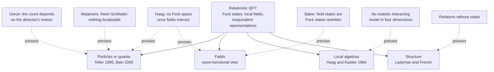

# Philosophy of Physics · Lesson 6.3: Particles, fields, or structure?

> ⏱ ~15 min · Module 6: Symmetry, gauge, and quantum fields · Builds on: [6.2](06-02-gauge-as-surplus-structure.md), [`qft` 2.3](../../qft/lessons/02-03-particles-as-excitations-energy-momentum.md), [`qft` 2.5](../../qft/lessons/02-05-causality-microcausality.md) · Unlocks: [6.4](06-04-renormalization-and-effective-field-theory.md)

## Why this matters

Two detectors start side by side in empty space. One drifts and never clicks. The other is pushed with constant acceleration and clicks as if bathed in warm radiation. [`qft` 2.3](../../qft/lessons/02-03-particles-as-excitations-energy-momentum.md) says a Fock state "*is* a relativistic particle", and [`qft` 1.1](../../qft/lessons/01-01-why-qm-relativity-forces-fields.md) that "the field is what's really localizable, not the particle". That is the physics course's working ontology, and fair as physics. This lesson asks whether it survives the Unruh effect, two no-go theorems and the facelessness of quanta, and what each rival costs.

## The idea

[`qft` 2.2](../../qft/lessons/02-02-creation-annihilation-fock-space.md) turned the free field into one harmonic oscillator per momentum mode: a quantum is one rung up one ladder, and the number operator counts rungs. All particle talk in QFT rests on that count.

Count the waves on a lake. The count looks like a fact about the lake, until a boat crossing it counts differently, nobody can say where one wave ends, and swapping two waves changes nothing that could tell you which was which. Then perhaps the lake is the thing and "waves" a way of describing its states. Or perhaps "lake" too names a pattern. Those are the rivals to particles: fields, local algebras of observables, and structure. [6.2](06-02-gauge-as-surplus-structure.md) asked which gauge structure is real; this lesson asks it of particles.

## The argument

**Setting.** Following the Stanford Encyclopedia's "Quantum Field Theory" (Kuhlmann, revised 2026), a [particle ontology](../reference.md#particle-ontology) takes matter to consist of things that are **(M1)** countable, with a number that does not depend on who counts; **(M2)** localizable, detectable in some bounded region and never in two disjoint regions at once; **(M3)** individuals, each this one and not that. *In words:* a particle can be counted, found and named.

**Reload.** In [`qft` 2.2](../../qft/lessons/02-02-creation-annihilation-fock-space.md)'s normalization, $[a_{\mathbf p}, a_{\mathbf q}^\dagger] = (2\pi)^3\delta^3(\mathbf p - \mathbf q)$ and $N = \int \frac{d^3p}{(2\pi)^3}\, a_{\mathbf p}^\dagger a_{\mathbf p}$ counts quanta on [Fock space](../reference.md#fock-space). An $a$ carrying a mode label is an operator; a bare $a$ below is an acceleration. The modes are positive-frequency with respect to inertial time $t$, and that choice is where the first trouble enters.

**T1. The [Unruh effect](../reference.md#unruh-effect)** (Stephen Fulling 1973; Paul Davies 1975; William Unruh 1976). A detector with constant proper acceleration $a$ through the Minkowski vacuum $|0_M\rangle$ responds as if immersed in thermal radiation at

$$T_U = \frac{\hbar a}{2\pi c k_B},$$

with $\hbar$ the reduced Planck constant, $c$ the speed of light and $k_B$ Boltzmann's constant. $|0_M\rangle$ has $N = 0$ exactly, but the number operator built from the detector's own time (the Rindler number) has no definite value in it, and in the region the detector can see the vacuum is thermal. *In words:* whether particles are present depends on how the counter moves. Seen inertially, the detector's excitation comes with the *emission* of an ordinary quantum, paid for by whatever pushes it (Unruh and Wald 1984). The form is [`relativity` 6.5](../../relativity/lessons/06-05-black-hole-thermodynamics.md)'s Hawking temperature with surface gravity $\kappa$ in place of $a$. The effect follows from free QFT but has not been observed directly. A Bose–Einstein condensate experiment reproduced its thermal signature with nothing accelerated (Hu, Feng, Zhang and Chin, *Nature Physics*, 2019), and a reanalysis of positron-channelling data claims an indication (Lynch, Cohen, Hadad and Kaminer, *Physical Review D*, 2021). Against M1.

**T2. [Malament's theorem](../reference.md#malaments-particle-theorem)** (David Malament, "In Defense of Dogma", 1996). To each bounded region $\Delta$ of a spacelike hyperplane assign a projection $E_\Delta$, "the particle is found in $\Delta$". Assume (i) *translation covariance*: translating a region translates its projection; (ii) *energy*: energy is bounded below in every inertial frame; (iii) *localizability*: $E_{\Delta_1}E_{\Delta_2} = 0$ for disjoint regions of one hyperplane; (iv) *locality*: $E_{\Delta_1}E_{\Delta_2} = E_{\Delta_2}E_{\Delta_1}$ for spacelike-separated regions. Then $E_\Delta = 0$ for every bounded $\Delta$. *In words:* a relativistic quantum theory of localizable particles finds its particle nowhere. (iii) is the particle concept; (iv) is relativity, forbidding statistics in one region to depend on what is done at spacelike separation. The physics is [`qft` 2.5](../../qft/lessons/02-05-causality-microcausality.md)'s Example 2, where a positive-frequency amplitude leaks outside the light cone. Hans Halvorson and Rob Clifton ("No Place for Particles in Relativistic Quantum Theories?", 2002) showed that unsharp localization does not escape. Malament concluded that QFT can only be a field theory. Against M2, and against Hacking's electrons "if you can spray them" ([`philosophy-of-science` 5.4](../../philosophy-of-science/lessons/05-04-constructive-empiricism-and-entity-realism.md)): what is sprayed, if not something localizable?

**T3. The [Reeh–Schlieder theorem](../reference.md#reeh-schlieder-theorem)** (1961). Operations confined to any open region, however small, acting on the vacuum, approximate every state, including states that differ from the vacuum far away. *In words:* the vacuum is so entangled across space that local measurements cannot tell an $N$-particle state from it; Michael Redhead (1995) concluded that no local measurement can confirm that $N$ quanta are present. This presses fields too: [`qft` 1.1](../../qft/lessons/01-01-why-qm-relativity-forces-fields.md)'s slogan holds for field *operators*, local by microcausality, not for *states*.

**T4. [Haag's theorem](../reference.md#haags-theorem)** (Rudolf Haag 1955; Earman and Fraser 2006 for philosophers). An interacting field cannot live in the free Fock representation, so the interaction picture of [`qft` 3.1](../../qft/lessons/03-01-interaction-picture-s-matrix.md) does not exist as written. Doreen Fraser (2008) concludes that interacting theories admit no particle interpretation; Jonathan Bain (2000) keeps particles in the asymptotic states that scattering data refer to. Against M1 wherever something happens.

**D. [Permutation invariance](../reference.md#permutation-invariance) and individuality.** Identical-particle states are symmetric or antisymmetric, and labels are bookkeeping ([`quantum-mechanics` 5.1](../../quantum-mechanics/lessons/05-01-identical-particles.md)). Two electrons in the singlet share every property the state assigns either, so they seem to break the [identity of indiscernibles](../reference.md#identity-of-indiscernibles) ([`metaphysics` 2.1](../../metaphysics/lessons/02-01-substance-and-accident.md)). Steven French and Redhead (1988) posed the dilemma: non-individuals, or individuals by a thisness physics never sees. The received view takes the first horn (French and Décio Krause, *Identity in Physics*, 2006). Simon Saunders (2003, 2006) answers with [weak discernibility](../reference.md#weak-discernibility): the electrons bear the relation "has spin opposite to", which nothing bears to itself, so there are two. James Ladyman (1998) and French and Ladyman (2003) turn the stalemate into [metaphysical underdetermination](../reference.md#metaphysical-underdetermination): the physics fits both packages, so believe only the structure they share. Fock space never raises the question: its states say how many quanta occupy each mode, never which. Paul Teller's quanta (*An Interpretive Introduction to Quantum Field Theory*, 1995) can be counted but not labelled. Against M3.

**The rivals.**

- **[Fields](../reference.md#field-ontology).** The default is the [wave-functional interpretation](../reference.md#wave-functional-interpretation): a state is a superposition of classical field configurations, as a particle's wavefunction superposes positions. Its troubles: a field at a point is not an operator, only smeared fields $\phi(f) = \int \phi(x) f(x)\, d^4x$ are; and David Baker ("Against Field Interpretations of Quantum Field Theory", 2009) shows that wave-functional space is unitarily equivalent to Fock space, so Unruh and Haag carry over.

- **[Local algebras](../reference.md#algebraic-qft)** (Haag and Kastler 1964). Basic is the net $\mathcal O \mapsto \mathcal A(\mathcal O)$, assigning each bounded spacetime region $\mathcal O$ the algebra of observables measurable there; particles and fields are derived. Interacting models of its axioms have been built in lower dimensions, but none yet for a four-dimensional theory of particle physics. [6.4](06-04-renormalization-and-effective-field-theory.md) asks whether philosophers should interpret it.

- **Structure.** [Ontic structural realism](../reference.md#ontic-structural-realism) (Ladyman 1998; Ladyman and Don Ross, *Every Thing Must Go*, 2007): what is real is structure, such as permutation symmetry and the symmetry groups whose representations sort the particle kinds; objects are derivative. The cost is relations without relata ([`philosophy-of-science` 5.3](../../philosophy-of-science/lessons/05-03-structural-realism.md)). The Russellian monist's premise that physics gives only structure ([`philosophy-of-mind` 3.5](../../philosophy-of-mind/lessons/03-05-panpsychism-and-russellian-monism.md)) is the same question asked from the other side.

∴ **C.** If a fundamental particle ontology needs M1–M3, relativistic QFT supplies none, and the field ontology inherits T1, T4 and the state half of T3. *In words:* no-go results bind particles hardest, but no rival walks away free.

**Where the argument is weakest.** The Setting: that particles need M1–M3 *at the fundamental level*. The strongest objection is David Wallace's (2006, 2011): particles are emergent and scale-dependent, real at the energies and in the states where the Fock description applies, much as phonons are in a crystal. The no-go theorems then miss particle physics. The reply: "particle" then no longer names the fundamental ontology, and the question moves to what particles emerge from, where the field realist meets Baker, the algebraist the missing models, the structuralist the relata. The emergentist concedes particles are not fundamental; the critic concedes particle talk is no error where Fock space applies.

## Map of positions

Solid arrows lead to the four candidate ontologies; dashed arrows are results or objections pressing the view they point to.

## Worked examples

**Example 1 (clean case: how warm is the vacuum?).** The constant is $\hbar/(2\pi c k_B) = 4.055\times10^{-21}$ K per m/s$^2$.

- At $a = g = 9.81$ m/s$^2$: $T_U = 3.98\times10^{-20}$ K.

- At $a = 10^{20}$ m/s$^2$: $T_U \approx 0.41$ K.

- One kelvin takes $a \approx 2.47\times10^{20}$ m/s$^2$, about $2.5\times10^{19}\,g$.

The numbers explain why no laboratory meets the effect and change nothing in principle: at any $a > 0$ the two detectors of the opening disagree, which presses M1. What that shows is disputed. Teller (1995): the vacuum has definite Minkowski number zero and only propensities for Rindler quanta, none of them actual. Clifton and Halvorson (2001): neither description is privileged; both are true, in terms of propensities. Arageorgis, Earman and Ruetsche (2003): the Rindler vacuum is not physically realizable, so the effect is no special threat to the particle interpretation, which they think is losing anyway.

**Example 2 (hard case: a laser beam).** A coherent state is the state of ideal laser light ([`photonics-quantum-optics` 3.3](../../photonics-quantum-optics/lessons/03-03-coherent-states.md) owns the physics). Take one mode of a box, so $[a_{\mathbf k}, a_{\mathbf k}^\dagger] = 1$ ([`qft` 2.2](../../qft/lessons/02-02-creation-annihilation-fock-space.md)'s $\delta^3$ is the continuum limit), and $a_{\mathbf k}|z\rangle = z|z\rangle$ with $z = 3$. The counts are Poisson, $P(n) = e^{-|z|^2}|z|^{2n}/n!$:

- $\langle N\rangle = |z|^2 = 9$ and $\operatorname{Var} N = 9$, so the spread is 3; $P(6 \le N \le 12) \approx 0.76$, $P(N = 0) = e^{-9} \approx 1.2\times10^{-4}$.

- The quadrature $X_{\mathbf k} = a_{\mathbf k} + a_{\mathbf k}^\dagger$, proportional to the mode's field amplitude, has mean $2\operatorname{Re} z = 6$ and variance 1, the vacuum's. In the number state $|9\rangle$ it has mean 0 and variance 19.

Each state is sharp for one family of observables and spread for the other. **Where it strains.** Does the beam contain particles? The particle realist: $N$ lacks a definite value as position does in a superposition, ordinary quantum indefiniteness and no refutation. The field realist: the beam is a definite oscillation with vacuum-sized fuzz, yet $|9\rangle$, with zero mean field, is a state of the same field. One Hilbert space serves both readings, Baker's equivalence in miniature, so no state settles which is fundamental. An interpretation must choose its [primitive ontology](../reference.md#primitive-ontology) ([2.1](02-01-bohmian-mechanics.md)): Bell (1987) and Dürr, Goldstein, Tumulka and Zanghì (2004, 2005) give Bohmian particles created and destroyed stochastically; others choose field configurations, surveyed by Ward Struyve (2010).

## Watch out

- **You might think** the Unruh effect is Hawking radiation in flat spacetime, **but actually** nothing loses mass in it: it needs an accelerated detector, while a black hole radiates and shrinks whoever watches. Same formula, different physics.

- **You might think** a state with no definite particle number refutes particles, **but actually** that is ordinary quantum indefiniteness (Example 2). The threats are the count's frame-dependence (T1), non-localizability (T2–T3) and Haag (T4).

- **You might think** [`qft` 1.1](../../qft/lessons/01-01-why-qm-relativity-forces-fields.md)'s "the field is what's really localizable" escapes, **but actually** only smeared field operators are local; Reeh–Schlieder leaves no local test of what a state contains, and Baker carries Unruh and Haag over to field configurations.

- **You might think** this lesson's Malament theorem is [4.3](04-03-the-conventionality-of-simultaneity.md)'s, **but actually** they are different results by one author: 1977 derives simultaneity from causal structure, 1996 rules out localizable relativistic particles.

## One-liner

> Relativistic QFT lets the particle count depend on the counter, finds no localizable particle, loses Fock space under interaction and leaves quanta nameless, and fields, local algebras and structure each inherit part of the trouble.

## Problems

**P1 (🟢)** *(Formal model: Formal (a)–(b) · Evaluative (c).)* Use $\hbar = 1.054571817\times10^{-34}$ J s, $c = 2.99792458\times10^{8}$ m/s and $k_B = 1.380649\times10^{-23}$ J/K.

(a) Compute the Unruh temperature for a detector with proper acceleration $a = 5.0\times10^{21}$ m/s$^2$. Show the computation.

(b) Compute the proper acceleration at which the Unruh temperature equals 2.725 K, the temperature of the cosmic microwave background, in m/s$^2$ and in multiples of $g = 9.81$ m/s$^2$. Show the computation.

(c) A colleague says: "At accelerations like these the effect never shows up, so the observer-dependence of particle number is a curiosity, not a problem for a particle ontology." Say what your numbers do and do not show. Two sentences.

**P2 (🟡)** *(Reconstruct: Exegetical (a) · Evaluative (b).)* Malament, "In Defense of Dogma" (1996).

(a) Reconstruct Malament's argument against localizable relativistic particles in numbered premises and a conclusion. Mark the premise that carries the particle concept and the one that carries relativity.

(b) A particle realist wants to keep the conclusion from biting. Choose one premise to deny, say what replaces it, and say what the denial costs. 150 words or fewer.

**P3 (🔴)** *(Find the crux: Exegetical (a)–(b) · Evaluative (c).)* Does the Unruh effect show that particle number is not a real quantity, or that "particle" was always detector-relative?

(a) In the Minkowski vacuum, what does an inertial detector register, what does a uniformly accelerated detector register, and how does an inertial observer describe the accelerated detector's click (Unruh and Wald 1984)? Two sentences.

(b) Name the single premise that the "not real" reading affirms and the "detector-relative" reading denies. One sentence.

(c) What finding or argument would move each side? Any verdict; 150 words or fewer.

Solutions

**P1** *(Formal (a)–(b) · Evaluative (c).)*

(a) Numerator: $\hbar a = (1.054571817\times10^{-34})(5.0\times10^{21}) = 5.273\times10^{-13}$ J m/s. Denominator: $2\pi c k_B = 2\pi(2.99792458\times10^{8})(1.380649\times10^{-23}) = 2.6007\times10^{-14}$ J m/(s K). So

$$T_U = \frac{5.273\times10^{-13}}{2.6007\times10^{-14}}\ \text{K} \approx 20.3\ \text{K}.$$

(b) Invert: $a = 2\pi c k_B T/\hbar = (2.6007\times10^{-14})(2.725)/(1.054571817\times10^{-34}) \approx 6.72\times10^{20}$ m/s$^2$, and $6.72\times10^{20}/9.81 \approx 6.85\times10^{19}$, so about $6.9\times10^{19}\,g$. Check: $(4.055\times10^{-21})(6.72\times10^{20}) \approx 2.725$ K.

**Must hit, strict (a)–(b):** the formula $T_U = \hbar a/(2\pi c k_B)$ with SI values; the inversion $a = 2\pi c k_B T/\hbar$; $T_U \approx 20.3$ K; $a \approx 6.72\times10^{20}$ m/s$^2 \approx 6.85\times10^{19}\,g$.

**Must hit, any verdict (c):**

- The numbers show that the effect is tiny for any acceleration a laboratory detector undergoes, which is why it has not been observed directly and why ordinary particle counts never disagree.

- They do not touch the conceptual point: the disagreement holds at every $a > 0$, so whether particle number must be observer-independent is a question of principle that small numbers cannot settle (P3 takes it up).

**Wrong turns:** using $h$ for $\hbar$ (a factor $2\pi$ too large); dropping the $2\pi$ in the denominator; reading the smallness as a reason to think the effect is not a consequence of the theory.

**Model answer (c), one of several:** The numbers say the effect is practically invisible: it takes about $7\times10^{19}\,g$ to make the vacuum look as warm as the microwave background. But the theory says the inertial and accelerated counts differ at any acceleration however small, and a fundamental ontology needs to say what exists, not what is easy to see.

---

**P2** *(Exegetical (a) · Evaluative (b).)*

**Must hit, strict (a):**

- **P1** Translation covariance: translating a region translates its detection projection.

- **P2** Energy: energy is bounded below in every inertial frame.

- **P3** Localizability: the particle cannot be found in two disjoint regions of one hyperplane, $E_{\Delta_1}E_{\Delta_2} = 0$. *This carries the particle concept.*

- **P4** Locality: projections for spacelike-separated regions commute, so statistics in one region do not depend on what is done in the other. *This carries relativity.*

- **P5** Malament's theorem: P1–P4 imply $E_\Delta = 0$ for every bounded $\Delta$.

- **P6** A particle is detectable somewhere: some $E_\Delta \neq 0$.

- **∴ C** No relativistic quantum theory of localizable particles satisfies P1–P4; in Malament's reading, relativistic QFT is a theory of fields.

**Must hit, any verdict (b):**

- Name the premise denied and what replaces it.

- State the cost at the strength a critic would.

- If the answer retreats to unsharp localization, note that Halvorson and Clifton (2002) block it.

**Accept:** denying P6 or the theorem's scope rather than a condition: particles as emergent and approximately localized (Wallace), or quanta that are countable but not localizable (Teller), provided the answer says this gives up particles as fundamental, localizable things.

**Wrong turns:** treating P4 as no-signalling of averaged statistics only (it concerns the commutation of the detection projections themselves); denying P2 without noting that a spectrum unbounded below leaves no stable vacuum; calling P5 contestable (it is a theorem).

**Model answer (b), one of several:** Deny P3. Saunders (1995) argues that relativity speaks of events, not things, and an event of one kind can occur in two disjoint regions at once, so the condition is natural only for enduring things. Replace "this particle is here" with "a particle-detection event occurs here". The cost is that particles are no longer things that are somewhere: what remains is a pattern of localized events and the field states that dispose detectors to them, which is close to conceding the field theorist's ontology under a particle name. Denying P4 instead would keep sharp positions only by letting what is done in one region change detection statistics at spacelike separation, which reopens the door to signalling that [3.3](03-03-nonlocality-and-relativity.md) showed quantum theory keeps shut.

---

**P3** *(Exegetical (a)–(b) · Evaluative (c).)*

**Must hit, strict (a):** the inertial detector registers nothing (the vacuum has $N = 0$); the accelerated detector registers a thermal spectrum at $T_U = \hbar a/(2\pi c k_B)$; inertially described, its excitation is accompanied by the emission of a Minkowski quantum, with the energy supplied by whatever accelerates it.

**Must hit, strict (b):** the premise that what exists cannot depend on the state of motion of the detector. The "not real" reading affirms it and concludes that a motion-dependent count is no count of things; the "detector-relative" reading denies it and treats particle-hood as relative, as simultaneity is relative to a frame ([4.3](04-03-the-conventionality-of-simultaneity.md)).

**Accept (b):** "only one of the two number operators, the inertial one, describes real things", which Teller and Arageorgis, Earman and Ruetsche affirm and Clifton and Halvorson deny.

**Must hit, any verdict (c):**

- Note the disanalogy with simultaneity: the Minkowski vacuum is Poincaré invariant, so every *inertial* observer counts zero; the Rindler count is a different observable, not the inertial count seen from another frame.

- Name what would move the "not real" side: an account on which a motion-relative quantity is as real as a frame-relative one, or the observation that curved spacetime has no preferred inertial time and so no preferred count.

- Name what would move the "detector-relative" side: the argument that the Rindler vacuum is not physically realizable, so the Rindler count has no states of its own, or Unruh and Wald's showing that the inertial story explains every click.

**Wrong turns:** treating (b) as whether the effect has been observed (both sides accept the theorem); saying the accelerated detector gains energy from the vacuum (the pushing agent pays); calling the two counts Lorentz transforms of one quantity.

**Model answer (c), one of several:** The "not real" reading would move if relativity's lesson generalized: simultaneity became frame-relative without becoming unreal, and Clifton and Halvorson offer the same for motion-relative counts. The detector-relative reading has to answer a disanalogy, though. Frame-relative quantities are one structure seen through a symmetry; the Rindler count is not the Minkowski count transformed, since every inertial observer agrees the vacuum is empty. So it would move if Arageorgis, Earman and Ruetsche are right that the Rindler vacuum is no physical state, leaving the Rindler concept with nothing of its own to count. Each side's strongest card lies outside flat spacetime: in curved spacetime there is in general no preferred time and no preferred count, which favours relativizing particle-hood unless one concludes, with the first side, that particles were never fundamental.

## Flashback

**From Lesson [6.1](06-01-symmetries-and-what-they-tell-us.md) (Symmetries and what they tell us):** *(Close reading: Exegetical (a)–(b).)* James Clerk Maxwell, *Matter and Motion* (1877), Art. 102, "Relativity of Dynamical Knowledge" (reprinted with Larmor's notes, London: SPCK, 1920, p. 81):

> There are no landmarks in space; one portion of space is exactly like every other portion, so that we cannot tell where we are. We are, as it were, on an unruffled sea, without stars, compass, soundings, wind, or tide, and we cannot tell in what direction we are going. We have no log which we can cast out to take a dead reckoning by; we may compute our rate of motion with respect to the neighbouring bodies, but we do not know how these bodies may be moving in space.

(a) The passage names two things we cannot detect. For each, quote the words, give the transformation that leaves every observation unchanged, and say whether [Earman's symmetry principles](../reference.md#earmans-symmetry-principles) require trimming Newtonian spacetime, and to what. Three sentences.

(b) Does the passage draw the conclusion of the [symmetry-to-reality inference](../reference.md#symmetry-to-reality-inference)? Name the words that decide it, and the premise a substantivalist could deny while accepting every word. Two sentences.

Solution

**Must hit, strict (a):**

- Absolute position ("where we are"): the static shift $\mathbf x_i(t) \mapsto \mathbf x_i(t) + \mathbf c$, a dynamical symmetry and already a spacetime symmetry of Newtonian spacetime, so SP1 and SP2 hold and nothing is trimmed; whether shifted models are distinct is [4.5](04-05-the-hole-argument.md)'s question.

- Absolute velocity ("in what direction we are going", "how these bodies may be moving in space"): the [Galilean boost](../reference.md#galilean-boost) $\mathbf x_i(t) \mapsto \mathbf x_i(t) + \mathbf v t$, dynamical but not spacetime, so SP1 fails; absolute rest goes, leaving [Galilean spacetime](../reference.md#galilean-spacetime), which keeps absolute acceleration.

**Must hit, strict (b):** no conclusion drawn; "we cannot tell" and "we do not know" report ignorance of a fact, not its absence; the substantivalist denies P4 ([4.1](04-01-leibniz-and-clarke-the-shift-arguments.md)).

**Accept (b):** noting that Maxwell goes further elsewhere, "The phrase absolute velocity has as little meaning as absolute position" (Art. 29, p. 22), a claim about meaning this passage does not make; or Maudlin's point ([4.1](04-01-leibniz-and-clarke-the-shift-arguments.md)) that the static shift, unlike a boost, hides no fact from us.

**Wrong turns:** making the static shift fail SP1; reading "our rate of motion with respect to the neighbouring bodies" as a measure of absolute motion; trimming absolute acceleration with absolute rest.

**Model answer:** (a) "Where we are" is absolute position, changed by a static shift, which Newtonian spacetime already counts a spacetime symmetry, so Earman's principles trim nothing. "In what direction we are going" is absolute velocity, changed by a boost, a dynamical but not a spacetime symmetry, so SP1 fails. The cure is Galilean spacetime: absolute rest goes, absolute acceleration stays. (b) It stops at undetectability, resting it on sameness ("exactly like ... so that"): "we cannot tell" and "we do not know how these bodies may be moving in space" report ignorance, not that there is nothing to know. A substantivalist accepts every word and denies P4, that undetectability is some reason for disbelief: things alike in every detectable respect can still be two.

## Connections

- **Backward:** The physics is [`qft` 1.1](../../qft/lessons/01-01-why-qm-relativity-forces-fields.md) (the Compton bound), [2.2](../../qft/lessons/02-02-creation-annihilation-fock-space.md)–[2.3](../../qft/lessons/02-03-particles-as-excitations-energy-momentum.md) (Fock space), [2.5](../../qft/lessons/02-05-causality-microcausality.md) (microcausality and the leaking amplitude) and [3.1](../../qft/lessons/03-01-interaction-picture-s-matrix.md) (the interaction picture Haag's theorem undercuts); uniform acceleration is flat spacetime in accelerated coordinates ([`relativity` 5.1](../../relativity/lessons/05-01-equivalence-principle.md)). [6.1](06-01-symmetries-and-what-they-tell-us.md) asked when symmetry-related descriptions are one world, and permutation invariance is that question for quanta; [6.2](06-02-gauge-as-surplus-structure.md) took structural realism into gauge fields and [4.5](04-05-the-hole-argument.md) into spacetime points.

- **Forward:** [6.4](06-04-renormalization-and-effective-field-theory.md) takes up Wallace's scale-dependent particles as effective realism, and the Fraser–Wallace dispute over whether to interpret algebraic QFT or QFT with cutoffs; its boss problem asks what this lesson's troubles do to what an effective theory is realistic about.

- **Sideways:** The identity of indiscernibles and Black's spheres are [`metaphysics` 2.1](../../metaphysics/lessons/02-01-substance-and-accident.md), which handed quantum individuality here. Structural realism in general, with Newman's objection, is [`philosophy-of-science` 5.3](../../philosophy-of-science/lessons/05-03-structural-realism.md); Hacking's entity realism is [5.4](../../philosophy-of-science/lessons/05-04-constructive-empiricism-and-entity-realism.md). The bridge to [`philosophy-of-mind` 3.5](../../philosophy-of-mind/lessons/03-05-panpsychism-and-russellian-monism.md) is one premise: physics gives only structure, which the ontic structuralist ends with and the Russellian monist starts from. Coherent and Fock states of light are [`photonics-quantum-optics` 3.3](../../photonics-quantum-optics/lessons/03-03-coherent-states.md).
