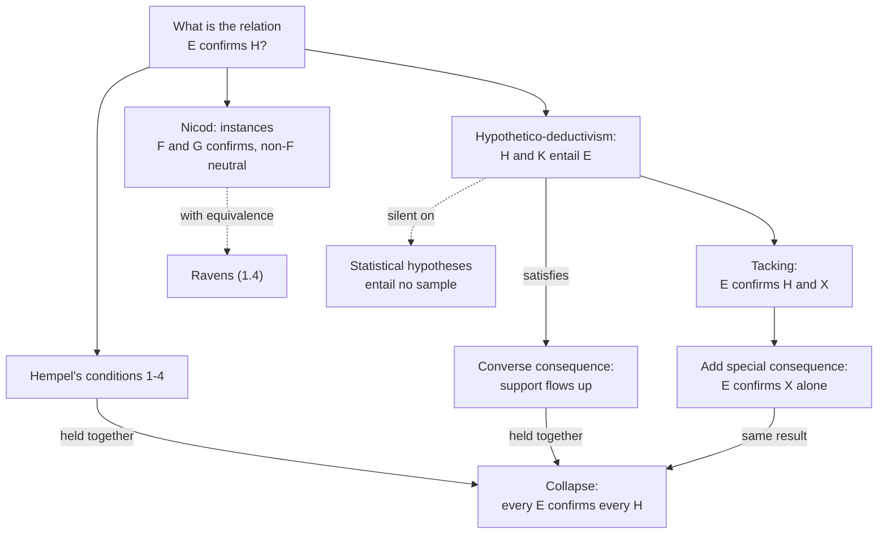

# Philosophy of Science · Lesson 1.1: From Hume to a logic of confirmation

> ⏱ ~15 min · Module 1: Induction and confirmation · Builds on: [`epistemology` 4.2](../../epistemology/lessons/04-02-humes-problem-of-induction.md), [`epistemology` 4.3](../../epistemology/lessons/04-03-answering-hume.md), [`philosophical-method` 1.4](../../philosophical-method/lessons/01-04-argument-forms-and-formal-fallacies.md) · Unlocks: [1.2](01-02-the-new-riddle-of-induction.md), [1.3](01-03-confirmation-as-probability-raising.md), [1.4](01-04-the-ravens-paradox.md)

## Why this matters

Your coefficient comes out with the predicted sign, and the seminar agrees that the data support the theory. Ask what "support" means and the room goes quiet: the regression output reports a sample, and "supports" is a claim about how that sample bears on a theory. This lesson asks what a definition of that relation would have to deliver, then tries the two candidates everyone reaches for first. Each breaks, and the way it breaks sets the agenda for Module 1.

## The idea

[`epistemology` 4.2](../../epistemology/lessons/04-02-humes-problem-of-induction.md) ran Hume's argument that no non-circular reasoning supports the [uniformity principle](../../epistemology/reference.md#uniformity-principle), and [4.3](../../epistemology/lessons/04-03-answering-hume.md) priced four answers. Those lessons ask whether we are entitled to reason from evidence at all. This one sets that aside and asks what they left: when we do reason from evidence, what *is* the relation "$E$ supports $H$"?

Deduction has a rulebook. Whether premises entail a conclusion can be checked by anyone, with no opinion about whether the premises are true. In the 1940s Carl Hempel wanted the same for support: a relation between an evidence report and a hypothesis, fixed by logical form and checkable like a proof. A logic of confirmation would have to do three things. It must give a definition anyone can apply. It must obey the rules any notion of support should obey (rewording a hypothesis cannot change what supports it). And it must reach real science, including theories about things nobody can inspect, and statistical hypotheses.

Two candidates look obvious. **Instances:** a generalization is supported by the cases that fit it. **Predictions:** a theory is supported when what it predicts comes true. The first cannot climb from cases to theories. The second climbs too well, and carries any passenger along.

## Source

Mill, *A System of Logic*, Book III, ch. III §3 (8th ed., New York: Harper, 1882; Project Gutenberg #27942):

> When a chemist announces the existence and properties of a newly-discovered substance, … we feel assured that the conclusions he has arrived at will hold universally, though the induction be founded but on a single instance. … Not all the instances which have been observed since the beginning of the world, in support of the general proposition that all crows are black, would be deemed a sufficient presumption of the truth of the proposition, to outweigh the testimony of one unexceptionable witness who should affirm that in some region of the earth not fully explored, he had caught and examined a crow, and had found it to be gray.
>
> Why is a single instance, in some cases, sufficient for a complete induction, while in others, myriads of concurring instances, without a single exception known or presumed, go such a very little way toward establishing a universal proposition?

The deciding contrast is "a single instance" against "myriads of concurring instances". Both are positive instances of a universal, and the count runs the wrong way. So how much an instance supports is not fixed by its form alone. Mill's neighbouring example (a bird's colour is likelier to vary than the layout of a human body) points to background knowledge of how variable a kind is. Keep that in mind: Hempel's logic sets background knowledge aside on purpose.

## The argument

$H, H'$ are hypotheses, $E$ an evidence report, $K$ background assumptions; $A \vDash B$ means $B$ follows logically from $A$.

**Candidate 1: instances.** [Instance confirmation](../reference.md#instance-confirmation) in its classic form is [Nicod's criterion](../reference.md#nicods-criterion), from Jean Nicod's *Le problème logique de l'induction* (a 1923 Paris thesis, printed 1924), and named by Hempel. For "All $F$ are $G$": an object that is $F$ and $G$ confirms it; an object that is $F$ and not $G$ counts against it, and in fact refutes it; an object that is not $F$ is neutral. Nicod states the first two and (Peter Vranas reports) denies that an object with neither property confirms; full neutrality for non-$F$s is the standard reading. *In words:* only the $F$s matter.

**Hempel's conditions** ("Studies in the Logic of Confirmation", *Mind*, 1945). Whatever confirmation is, he required:

1. **[Entailment](../reference.md#entailment-condition).** If $E \vDash H$, then $E$ confirms $H$. *In words:* proof is the limiting case of support.
2. **[Special consequence](../reference.md#special-consequence-condition).** If $E$ confirms $H$ and $H \vDash H'$, then $E$ confirms $H'$. *In words:* support flows down to whatever the hypothesis commits you to.
3. **[Equivalence](../reference.md#equivalence-condition)**, the special case of 2 where $H$ and $H'$ entail each other. *In words:* rewording cannot change what supports a hypothesis.
4. **[Special consistency](../reference.md#consistency-condition).** If consistent $E$ confirms $H$, and $H$ is incompatible with $H'$, then $E$ does not confirm $H'$. *In words:* evidence cannot back both of two rivals that cannot both be true.

His own definition, on which $E$ confirms $H$ when $E$ entails what $H$ says about the objects $E$ mentions, was built to meet these. Nicod plus equivalence is about to generate the [ravens](../reference.md#ravens-paradox) ([1.4](01-04-the-ravens-paradox.md)). A fifth condition looks just as natural:

5. **[Converse consequence](../reference.md#converse-consequence-condition).** If $E$ confirms $H$ and $H' \vDash H$, then $E$ confirms $H'$. *In words:* support flows up to any stronger theory containing the hypothesis.

**The collapse** ([Hempel's triviality result](../reference.md#hempels-triviality-result)). For any $E$ and $H$:

- **P1.** $E \vDash E$, so $E$ confirms $E$ (entailment).
- **P2.** $E \wedge H \vDash E$, so $E$ confirms $E \wedge H$ (converse consequence, from P1).
- **P3.** $E \wedge H \vDash H$, so $E$ confirms $H$ (special consequence, from P2).
- **∴ C.** Every report confirms every hypothesis.

*In words:* let support flow both up and down, and it reaches anything by way of a conjunction. Hempel kept 1–4 and rejected converse consequence.

**Candidate 2: predictions.** [Hypothetico-deductivism](../reference.md#hypothetico-deductivism) (H-D), for $H \wedge K$ consistent:

$$E \text{ H-D-confirms } H \text{ relative to } K \iff H \wedge K \vDash E \text{ and } K \not\vDash E.$$

*In words:* the hypothesis, with its auxiliaries, predicted $E$, and the auxiliaries could not have done it alone. This is affirming the consequent ([`philosophical-method` 1.4](../../philosophical-method/lessons/01-04-argument-forms-and-formal-fallacies.md)) with "so $H$" weakened to "so $H$ gains support". It is not abduction ([`philosophical-method` 2.1](../../philosophical-method/lessons/02-01-inference-to-the-best-explanation.md)): H-D runs forward from hypothesis to prediction and compares no rivals, while abduction runs backward from a surprise and must beat them. H-D satisfies converse consequence by construction, and violates entailment and special consequence. Hence the [tacking problem](../reference.md#tacking-problem):

- **P1.** $H \wedge K \vDash E$ and $K \not\vDash E$.
- **P2.** For any $X$ consistent with $H \wedge K$, $H \wedge X \wedge K \vDash E$ (added premises never lose a conclusion).
- **∴ C.** $E$ H-D-confirms $H \wedge X$.

*In words:* any statement can ride along on a successful prediction. Clark Glymour's note "Hypothetico-Deductivism Is Hopeless" (*Philosophy of Science*, 1980) pressed this failure of relevance; Ken Gemes's later defence is titled "Hypothetico-Deductivism: Incomplete But Not Hopeless" (*Erkenntnis*, 2005).

Two further limits. A statistical hypothesis ("this coefficient is 0.3") entails no sample, so H-D is silent on it. And since H-D lacks special consequence, the law's successes do not H-D-confirm "the next $F$ is $G$", because that prediction does not entail the old data. For the question Hume left, that is an awkward gap.

**Where the argument is weakest.** The collapse needs converse consequence (its P2), and rejecting that premise is not free. Hempel rejected it, which saves his list but leaves his logic no way up: support travels from a report to what it instantiates and down to consequences, so telescope sightings cannot reach Newton's gravitation. The strongest objection to the whole setup is Carnap's (*Logical Foundations of Probability*, 1950): "confirms" is ambiguous between "makes highly probable" ([absolute confirmation](../reference.md#absolute-confirmation)) and "makes more probable" ([incremental confirmation](../reference.md#incremental-confirmation)). Special consequence and special consistency (given a threshold above one half) hold only of the first, and converse consequence of neither, so on this diagnosis the collapse runs different relations together. The qualitative theorist replies that, minus the condition Hempel rejected, the list is true of one relation, high probability on the evidence, and that a logic of support should not wait on probabilities nobody can state. Each side concedes something: Hempel's heirs, that an instance logic cannot reach theory; Carnap's, that a rulebook has been traded for a prior that now needs defending ([`epistemology` 5.4](../../epistemology/lessons/05-04-the-problem-of-priors.md)).

## Argument map

Each candidate breaks on a different rule: instances on reach and equivalence, the two consequence conditions on each other, prediction on the passengers it cannot refuse.

## Worked examples

**Example 1 (clean case: the piston).** $H$: all gases expand when heated at constant pressure.

- *Nicod.* A nitrogen sample heated in a piston at constant pressure expands: confirms. A gas so heated that did not expand would refute. A heated iron bar is not a gas, so it is neutral, even though it expands.
- *H-D.* Let $K$ be "$a$ is a gas heated at constant pressure" and $E$ be "$a$ expands". Then $H \wedge K \vDash E$ and $K \not\vDash E$, so $E$ H-D-confirms $H$. The verdict matches, but the evidence is carved differently: Nicod takes "$F$ and $G$" as one report, while H-D moves "$F$" into the background. With $K$ empty, $H$ says nothing about $a$, and H-D is silent.
- *Reach.* Kinetic theory $T$ says a gas is a swarm of molecules whose collisions make the pressure and whose mean kinetic energy tracks temperature. No piston reading is an instance of that, so Nicod's criterion has nothing to count. H-D has no such trouble: $T$ plus a dilute-gas auxiliary entails that volume rises with temperature at fixed pressure, so the same piston reading confirms $T$.

**Example 2 (hard case: Nessie rides along).** Let $X$ be "the Loch Ness monster reads Latin". Tacking gives $T \wedge X \wedge K \vDash E$, so the piston reading H-D-confirms "kinetic theory is true and the Loch Ness monster reads Latin". Add special consequence: $T \wedge X \vDash X$, so the reading confirms that the monster reads Latin. H-D and special consequence cannot both stand.

H-D's defenders drop special consequence, and then split. Theo Kuipers (*From Instrumentalism to Constructive Realism*, 2000) accepts that the conjunction is confirmed and notes that $E$ does not H-D-confirm $X$ alone, so the credit stays with $T$. Gerhard Schurz ("Relevant Deduction", 1991) and Gemes (on content parts and natural axiomatizations, 1993) restrict the definition so that only the relevant parts of a theory earn credit.

Here the account stops giving a verdict. "Idle" looks checkable: delete $X$ and the derivation still goes through. But $T \wedge X$ is logically equivalent to $(X \to T) \wedge X$, and in that package neither conjunct yields $E$ without the other. Equivalence says rewording cannot matter, yet whether $X$ is idle depends on the wording. Kuipers needs no test of idleness, only the claim that a confirmed conjunction is harmless. The repairers answer with a privileged way of writing a theory down, and the question becomes what makes one wording the right one. Going probabilistic does not simply escape: if $T \wedge K \vDash E$, then $E$ raises the probability of $T \wedge X$ too, though by less than $T$ on two of [1.3](01-03-confirmation-as-probability-raising.md)'s measures (Hawthorne and Fitelson, 2004).

## Watch out

- **You might think Nicod's criterion says how much a case supports, but actually** it is yes-or-no. Mill's chemist and crows are exactly what a yes-or-no relation on instances cannot register.
- **You might think tacking alone shows a piston confirms the monster, but actually** tacking delivers only the conjunction. Reaching $X$ by itself takes special consequence, which H-D rejects.
- **You might think H-D just is inference to the best explanation, but actually** H-D has no comparative clause. A hypothesis can be H-D-confirmed while a rival predicts the same thing and explains it better.

## One-liner

> A logic of confirmation wants a rulebook for support, and the obvious rules fight: instances cannot reach theories, the two consequence conditions together let everything confirm everything, and prediction confirms whatever rides along.

## Problems

**P1 (🟢) *(Exegetical)*** Each claim below is invented, written for this problem. For each, name the Hempel condition it uses or violates, say which ("uses" or "violates"), and say whether Hempel (1945) accepted that condition. One line each.

> (i) "The audit supports 'every bank that failed was over-leveraged'. So it supports 'every bank that was not over-leveraged did not fail'."
>
> (ii) "The field trial supports 'every trial variety, Russet among them, resists blight'. So it supports 'Russet resists blight'."
>
> (iii) "The field trial supports 'Russet resists blight'. So it supports 'every trial variety, Russet among them, resists blight'."
>
> (iv) "The same sediment core supports 'the lake was fresh in 1300' and supports 'the lake was saline in 1300'." (Take fresh and saline to be incompatible.)

**P2 (🟡) *(Formal (a) · Evaluative (b))*** Read "$E$ confirms $H$" as probability raising, $P(H \mid E) > P(H)$, where $P$ is an ideal agent's credence, which `epistemology` writes $\mathrm{cr}$ ([`prob-stat-refresher` 1.2](../../prob-stat-refresher/lessons/01-02-conditional-probability-bayes.md) for conditional probability).

(a) A fair six-sided die is rolled once, all faces equally likely. Build a counterexample to special consequence: events $E$, $H$, $H'$ with $H \subseteq H'$ (so $H \vDash H'$), $P(H \mid E) > P(H)$ and $P(H' \mid E) < P(H')$. Display the four probabilities.

(b) A defender of Hempel replies: "Raising probability was never what 'confirms' meant." State the reading of "confirms" on which special consequence holds, show in one line why it holds, and say what the reply costs. Any verdict; 100 words or fewer.

**P3 (🔴) *(Exegetical (a) · Evaluative (b))***

(a) The lesson's collapse used three conditions. Reconstruct a shorter one, as numbered premises P1, P2, ∴ C, reaching "every $E$ confirms every $H$" from the entailment condition and the converse consequence condition alone, naming the condition each step uses. (Hint: find a statement that $E$ entails and that $H$ also entails.)

(b) Given (a), which condition would you give up, and what does that cost? Any verdict; 150 words or fewer.

Solutions

**P1** *(Exegetical)*

**Must hit, strict:**

- (i) Uses **equivalence**; accepted. The two generalizations are contrapositives, so each entails the other.
- (ii) Uses **special consequence**; accepted. The generalization entails the claim about Russet, so support moves from stronger to weaker.
- (iii) Uses **converse consequence**; rejected. Support moves from weaker to stronger, which is the condition Hempel gave up.
- (iv) Violates **special consistency**; accepted. One consistent report confirms two incompatible hypotheses.

**Wrong turns:** treating (ii) and (iii) as the same move because they use the same two sentences; the direction of entailment is the whole question. Saying (iv) violates special consequence: neither hypothesis entails the other.

**Model answer:** (i) uses equivalence, accepted. (ii) uses special consequence, accepted. (iii) uses converse consequence, rejected. (iv) violates special consistency, accepted.

---

**P2** *(Formal (a) · Evaluative (b))*

**Accept (a):** any triple of events on the six faces meeting the three conditions (enumeration finds 3,300).

(a) One answer: $E$ is "the roll is at most 3", $\{1,2,3\}$; $H$ is "the roll is a 2", $\{2\}$; $H'$ is "the roll is even", $\{2,4,6\}$. Then $H \subseteq H'$, and

$$P(H) = \tfrac16, \quad P(H \mid E) = \tfrac13, \qquad P(H') = \tfrac12, \quad P(H' \mid E) = \tfrac13.$$

$E$ raises $H$ and lowers $H'$, though $H$ entails $H'$.

**Must hit, any verdict (b):**

- Name the reading: $E$ confirms $H$ when $P(H \mid E)$ exceeds a fixed threshold (Carnap's "makes highly probable").
- Show why the condition holds: if $H \vDash H'$ then $P(H' \mid E) \ge P(H \mid E)$, so the threshold is still passed.
- State a cost, for instance: on that reading $E$ can confirm $H$ while lowering it, so "confirms" no longer means that $E$ helped.

**Wrong turns:** in (a), choosing $H' \subseteq H$, which tests converse consequence. In (b), declaring Hempel refuted, or the die irrelevant, without saying which notion of confirmation is in play.

**Model answer (b), one of several:** Read "confirms" as "makes probable above a threshold $r \ge \tfrac12$". Since $H \vDash H'$ gives $P(H' \mid E) \ge P(H \mid E)$, special consequence holds, and the die is no counterexample: there $P(H \mid E) = \tfrac13$, so $E$ never confirmed $H$. The cost is that confirmation stops tracking whether $E$ helped. Learning the roll is even lowers "not six" from $\tfrac56$ to $\tfrac23$, yet at $r = \tfrac12$ confirms it. The defender saves the rule by changing what it is a rule about.

---

**P3** *(Exegetical (a) · Evaluative (b))*

**Must hit, strict (a):**

- P1. $E \vDash E \vee H$, so $E$ confirms $E \vee H$ (entailment).
- P2. $H \vDash E \vee H$, and $E$ confirms $E \vee H$, so $E$ confirms $H$ (converse consequence).
- ∴ C. Every $E$ confirms every $H$.
- Special consequence is not used.

**Must hit, any verdict (b):**

- Say what (a) rules out: dropping special consequence alone does not stop the collapse, since entailment and converse consequence reach it unaided.
- Choose: give up or restrict converse consequence (Hempel gave it up; Schurz and Gemes restrict the upward flow), give up entailment (H-D's route), or deny that one relation is in play (Carnap).
- Name the cost of that choice: no climb from report to theory if converse goes; a report that fails to confirm what it proves if entailment goes; a privileged wording of theories if the restriction route is taken; a prior to defend on Carnap's route.

**Wrong turns:** answering "drop special consequence" and stopping there. Answering "drop special consistency", which the collapse never uses. Treating Hempel's own choice as settling the matter.

**Model answer (b), one of several:** I would give up converse consequence, as Hempel did. Dropping special consequence would not help, since (a) shows entailment and converse consequence collapse unaided, and converse is the condition that lets support leak into everything stronger than the evidence. The cost is large. Converse consequence is how telescope sightings reach gravitation and piston readings reach molecules. Without it, support stays at the level of what a report instantiates, and confirmation cannot climb to theory. A defender of H-D would keep the climb and give up entailment and special consequence, at the price of a report that does not confirm what it proves and the next-instance gap. Restricting converse to relevant parts keeps more of both, but must say, without privileging a wording, which parts earned the credit.

## Connections

- **Backward:** [`epistemology` 4.2](../../epistemology/lessons/04-02-humes-problem-of-induction.md) and [4.3](../../epistemology/lessons/04-03-answering-hume.md) left Hume's question open, and this lesson asks what the relation is whatever its justification. The form of H-D is the affirming the consequent of [`philosophical-method` 1.4](../../philosophical-method/lessons/01-04-argument-forms-and-formal-fallacies.md).
- **Forward:** [1.2](01-02-the-new-riddle-of-induction.md) shows instance confirmation depends on which predicates you allow. [1.3](01-03-confirmation-as-probability-raising.md) replaces the qualitative relation with probability raising and its rival measures. [1.4](01-04-the-ravens-paradox.md) runs Nicod with equivalence. [2.1](02-01-popper-conjectures-and-refutations.md) keeps only H-D's refuting half, and [2.2](02-02-duhem-quine-and-underdetermination.md) asks what $K$ does when a prediction fails.
- **Sideways:** [`philosophical-method` 2.1](../../philosophical-method/lessons/02-01-inference-to-the-best-explanation.md) is the backward-running, rival-comparing cousin of H-D. [`epistemology` 3.3](../../epistemology/lessons/03-03-moore-and-the-dogmatist.md) uses the H-D idea when it reasons that the skeptic's hypothesis predicts your experience, so that experience cannot count against it. A point hypothesis about a coefficient in [`econometrics` 2.3](../../econometrics/lessons/02-03-hypothesis-tests-confidence-intervals.md) entails no sample, which is why a t-test cannot be H-D confirmation; what it is instead is [3.1](03-01-two-schools-of-statistical-inference.md)'s question.
