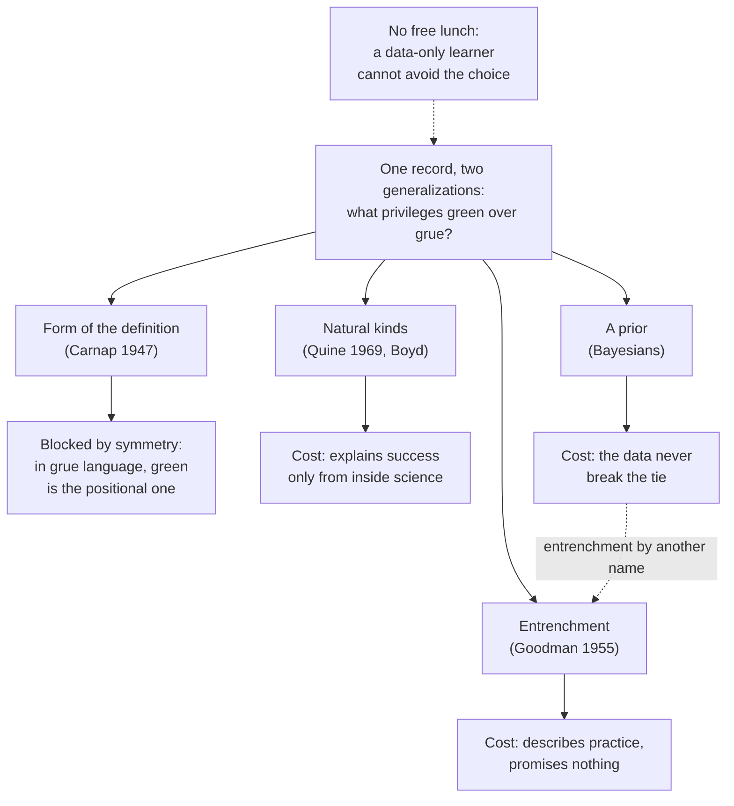

# Philosophy of Science · Lesson 1.2: The new riddle of induction

> ⏱ ~15 min · Module 1: Induction and confirmation · Builds on: [1.1](01-01-from-hume-to-a-logic-of-confirmation.md), [`epistemology` 4.3](../../epistemology/lessons/04-03-answering-hume.md), [`epistemology` 5.4](../../epistemology/lessons/05-04-the-problem-of-priors.md) · Unlocks: [1.3](01-03-confirmation-as-probability-raising.md)

## Why this matters

Fit a regression on data ending last Friday. Now add a term, any coefficient you like, that switches on only after last Friday. Not one residual changes, and the two models disagree about every date to come. You choose between such twins every time you forecast. Nelson Goodman made that choice the problem. Hume asked whether we can trust the step from past to future. Goodman asked which step from past to future we are trying to trust.

## The idea

Every emerald in your notebook is green, and every one was examined before some future date $t$. Coin a word. A thing is **[grue](../reference.md#grue)** if it is examined before $t$ and is green, or is not so examined and is blue. Every emerald in your notebook is grue, by the definition alone. So one notebook fits "all emeralds are green" and "all emeralds are grue" equally well, and they disagree about every emerald not examined before $t$: one says green, the other blue.

No grue emerald changes colour. An emerald examined last year is green and grue for good; the hypothesis sorts emeralds by whether they were examined in time.

Hume wrote that all our experimental conclusions rest "upon the supposition that the future will be conformable to the past" (*Enquiry*, Section IV, Selby-Bigge's edition, 1902). Grue shows how little that says until you name the respect: the future cannot match the past in every respect, and it will match in some respect whatever happens. That is the **[new riddle of induction](../reference.md#new-riddle-of-induction)**. The old problem asks whether induction is justified; the new one asks which inferences count as induction at all. [`epistemology` 4.3](../../epistemology/lessons/04-03-answering-hume.md) has the classic answers to the old problem and flags grue as a constraint on each.

A hypothesis we are willing to extend to unexamined cases is **[projectible](../reference.md#projectibility)**. The split has an older form, [lawlike and accidental generalizations](../reference.md#lawlike-and-accidental-generalizations). One piece of copper conducting electricity raises your confidence that all copper does. One man in the room being a third son does nothing for the claim that all are, though the form is the same (Goodman's pair). Lawlike statements are confirmed by their instances and support counterfactuals; accidental ones, even when true, do neither. Grue sharpens this: two generalizations, all instances shared.

## The argument

Goodman, *Fact, Fiction, and Forecast* (1955). His first version (1946) used marbles drawn by VE day.

**P1.** If confirmation depends only on logical form, then "all $F$ are $G$" is confirmed by its positive instances, whatever $F$ and $G$ are ([Nicod's criterion](../reference.md#nicods-criterion), from [1.1](01-01-from-hume-to-a-logic-of-confirmation.md)). *In words:* the rule does not read the predicates.

**P2.** Every emerald examined before $t$ and found green is grue. *In words:* one record, two true descriptions.

**P3.** So if form alone decides, the record confirms "all emeralds are green" and "all emeralds are grue" alike, and these give incompatible verdicts on any emerald not examined before $t$. *In words:* equal support, opposite forecasts.

**P4.** An adequate account of confirmation does not give both equal support. *In words:* nobody forecasts blue, and a theory of evidence must say why.

**∴ C1.** Confirmation does not depend on logical form alone.

Rudolf Carnap ("On the Application of Inductive Logic", 1947) answered the 1946 version: inductive logic should use purely qualitative predicates, and a **[positional](../reference.md#positional-and-qualitative-predicates)** predicate, one whose definition names a particular time or place, is out. Goodman replied with a partner. **[Bleen](../reference.md#grue)** applies to things examined before $t$ just in case they are blue, and to other things just in case they are green.

| Predicate | if examined before $t$, means | otherwise, means |
|---|---|---|
| grue | green | blue |
| bleen | blue | green |
| green | grue | bleen |
| blue | bleen | grue |

**P5.** A predicate is positional only relative to a choice of primitive predicates. *In words:* start from grue and bleen, and green is the one whose definition names $t$.

**∴ C2.** No test on the form of a predicate's definition separates green from grue.

It is commonly agreed that this finishes any purely syntactic theory of confirmation. What does the separating is open:

**[Entrenchment](../reference.md#entrenchment) (Goodman).** A predicate is entrenched to the extent that it, or any predicate with the same extension, has actually been projected. When conflicting hypotheses have the same record, the one with better entrenched predicates overrides the other. A hypothesis is projectible when it has positive instances, no counterinstances and undetermined cases left, and every conflicting rival is overridden. This describes practice: Goodman held that inductive rules and inferences are justified by adjustment to each other ([`philosophical-method` 3.4](../../philosophical-method/lessons/03-04-intuitions-and-reflective-equilibrium.md)). *Cost:* a record of use promises nothing about the world, and a new predicate starts empty unless it inherits from a parent.

**[Natural kinds](../reference.md#natural-kinds) (W. V. Quine, "Natural Kinds", 1969).** Induction runs on similarity. We inherit a sense of similarity, and natural selection gives some reason to expect it to track real groupings; mature sciences then replace the general notion with specific ones. David Lewis's natural properties ([`metaphysics` 1.3](../../metaphysics/lessons/01-03-universals-the-realists-case.md)) are a different proposal: elite in the world, whatever any creature's psychology. *Cost:* the Darwinian story is itself a product of induction, so it explains our success from inside science. Biological species are the hard case: a species need have no genetic sequence shared by all and only its members, Ghiselin and Hull treat species as individuals, and Richard Boyd keeps them as kinds by trading essences for "homeostatic property clusters" held together by gene flow and shared selection (1991, 1999).

**A prior (Bayesians).** Let $P$ be an ideal agent's credence, $H$ "all emeralds are green", $H^*$ "all emeralds are grue", $E$ the notebook's colours and $K$ which emeralds were examined before $t$. Each hypothesis with $K$ entails $E$, so

$$\frac{P(H \mid E \wedge K)}{P(H^* \mid E \wedge K)} = \frac{P(H \mid K)}{P(H^* \mid K)}.$$

*In words:* the data leave the odds where the prior put them, as [`epistemology` 5.4](../../epistemology/lessons/05-04-the-problem-of-priors.md) showed. So, unlike Nicod's rule, the framework lets a coherent agent favour the green forecast. Press what 5.4 left open: what makes the prior lopsided? The subjective Bayesian says nothing need; coherence is all rationality asks. Critics call that entrenchment by another name. The objective Bayesian wants more, but indifference needs a vocabulary. Spread credence evenly over the proportion of green emeralds and the next unexamined one is probably green; spread it over the proportion of grue ones and that emerald is probably blue, the cube factory again. The best reply is that priors carry background knowledge (an emerald's colour comes from trace chromium or vanadium, which keep no calendar). The rejoinder is that this background came from earlier projections, so the chain ends at a first prior.

**[No free lunch](../reference.md#no-free-lunch) (the formal cousin).** [`statistical-learning` 1.4](../../statistical-learning/lessons/01-04-no-free-lunch-and-inductive-bias.md) proved that, averaged over every labelling of the unseen points, every learner's off-sample error is exactly one half. With $m$ unexamined emeralds there are $2^m$ labellings consistent with the notebook, each one a grue-style predicate. Both results say no data-driven learner escapes choosing which regularities to project. The analogy stops at vocabulary. The theorem fixes the labels and averages over targets; Goodman needs two hypotheses and no average, and asks what makes a labelling "the same as before". Translate green/blue labels into grue/bleen and every unseen label flips. The uniform average cannot notice, because translation only permutes the labellings. A learner that prefers constant labellings reverses its forecast.

**Where the argument is weakest.** The pressure falls on the step from P5 to "no difference that matters". The strongest objection says definitions are the wrong place to look: green things share a reflectance and an emerald's colour has a cause, so the world is asymmetric even if the dictionaries are not. The strongest reply is that every physical fact is stated in some vocabulary, and "reflectance" has a twin in whose terms green emeralds examined before and after $t$ do not match. Calling one description the physically right one uses the distinction at issue. The objector concedes that the asymmetry comes from substantive science or metaphysics, never from logic. Goodman concedes that green and grue do differ, and his symmetry shows only that form cannot reveal how.

## Map of positions

Each branch pays somewhere; the dashed edge is the charge that a prior needs what it was meant to supply.

## Worked examples

**Example 1 (clean case: a flame test).** Every sodium flame examined so far has burned yellow. Let $t$ be 1 January 2040. A flame is *yellac* if it is examined before $t$ and yellow, or not so examined and lilac. Take $H$: all sodium flames are yellow, and $H^*$: all sodium flames are yellac.

| Sodium flame | $H$ forecasts | $H^*$ forecasts |
|---|---|---|
| examined in a 1990 lab | yellow | yellow |
| first examined in 2041 | yellow | lilac |
| burns in 2035, never examined | yellow | lilac |

Each yellow flame on record is an instance of both, so the record does not separate them. Entrenchment does: "yellow" has centuries of projection and "yellac" has none, so $H$ overrides $H^*$ and is projectible. The last row shows why the definition says "examined" and not "after $t$".

**Example 2 (hard case: two models, one training set).** A clinic trains one network twice on the same chest X-rays, changing only the random seed. Both classify every training image correctly and score the same on held-out images from the same machines. A new scanner arrives, and on its unlabelled images the two often disagree. (D'Amour and colleagues named this [underspecification](../reference.md#underspecification) in 2020.) Which model should the forecaster project?

- *Held-out data:* silent. Those images come from the old machines: more of the pre-$t$ notebook.
- *Entrenchment:* learned features have no history of projection, so neither model overrides the other: Goodman's category of **[nonprojectible](../reference.md#projectibility)**, a live conflict with no winner. Show that one keys on lung opacity and the other on a scanner artefact and entrenchment wakes up, but someone had to do the naming.
- *Natural kinds:* favours whichever tracks the disease, once someone shows which; a feature matching no recognizable kind gets no verdict.
- *A prior:* the training procedure is the only prior in the pipeline, and it produced both models. Anything further is imported background about pathology.
- *No free lunch:* says a bias must break the tie, and names none.

Each answer stops where nobody has said what the two models are tracking. Labelling a batch from the new scanner breaks this tie and leaves the next scanner open. A Bayesian calls the imported background a legitimate prior; a Goodmanian calls it a record of projections; a Quinean calls it science continuing what innate similarity began.

## Watch out

- **You might think a grue emerald turns blue at $t$, but actually** none does, and "change" is itself relative to vocabulary: to a grue-speaker, "all emeralds are green" is the hypothesis with a switch in it, grue if examined before $t$ and bleen otherwise.
- **You might think the fix is to ban predicates that mention dates, but actually** that is Carnap's reply, and the table answers it: a ban on mentioning dates needs a privileged list of primitives.
- **You might think Goodman puts green and grue on a par, but actually** he holds that projecting green is legitimate and projecting grue is not, and locates the difference in the history of our projections.
- **You might think projectible means true, but actually** a hypothesis can be projectible and false. If a blue emerald turns up in 2090, "all emeralds are green" was projectible until then. Lawlike likewise marks what instances can confirm, true or not.

## One-liner

> The data cannot say which regularity you have been observing, so every induction has already chosen its predicates, and the live question is what, if anything, earns that choice.

## Problems

**P1 (🟢) *(Exegetical)*** Every ice cube tested so far has floated in water. Let $t$ be 1 January 2050, and treat "floats" and "sinks" as exclusive and exhaustive. "Tested" means put in water and observed.

(a) Define *flink* on the pattern of grue, so that every cube tested so far flinks, and define its partner *sloat* on the pattern of bleen. One line each.

(b) For each cube, say whether it is an instance of or a counterinstance to "all ice floats" and "all ice flinks": (i) tested in 2026, floats; (ii) first tested in 2051, floats; (iii) first tested in 2051, sinks. One line each.

(c) A cube falls into a lake in 2030 and no one ever observes it. What does "all ice flinks" say about it? One line.

(d) Define "floats" using only *flink*, *sloat* and "tested before $t$". One line.

**P2 (🟡) *(Exegetical)*** Find the crux. Carnap: only purely qualitative predicates are fit for inductive logic, and a predicate whose definition names a particular time or place is positional, so grue is out. Goodman: take grue and bleen as primitive, and it is green whose definition names $t$. Both accept every line of the table in "The argument".

(a) Name the one premise Carnap's reply needs and Goodman's symmetry denies. Two sentences.

(b) A defender of Carnap moves the test from definitions to use: green can be applied by looking, while grue can be applied only by someone who also knows when the thing was examined. State what this test must assume to restore the asymmetry, and say what evidence or argument would settle that assumption. 80 words or fewer.

**P3 (🔴) *(Evaluative)*** Entrenchment, natural kinds or a prior: which is best placed to say why we project green rather than grue? Say whether each answer describes, explains or justifies the practice, state the cost of each, and test your choice on a predicate with no track record, such as one a physicist coins for a newly discovered particle. Any verdict; 150 words or fewer.

Solutions

**P1** *(Exegetical)*

**Must hit, strict:**

- (a) Two clauses split on "tested before $t$", the second covering everything else.
- (b) Cases (ii) and (iii) come out opposite for the two hypotheses; case (i) is an instance of both.
- (c) A never-tested cube falls under the second clause.
- (d) The same form as the definition of green from grue and bleen.

**Wrong turns:** writing the second clause as "tested after $t$", which leaves a never-tested cube with no verdict (Goodman's "other things" covers it); saying "all ice flinks" predicts that cubes start sinking at $t$ (a cube tested in 2026 flinks for good and goes on floating).

**Model answer:**

(a) $x$ flinks iff $x$ is tested before $t$ and floats, or $x$ is not so tested and sinks. $x$ sloats iff $x$ is tested before $t$ and sinks, or $x$ is not so tested and floats.

(b) (i) Instance of both: it floats and, being tested before $t$, it flinks. (ii) Instance of "all ice floats", counterinstance to "all ice flinks": first tested after $t$, it flinks only if it sinks. (iii) Counterinstance to "all ice floats", instance of "all ice flinks".

(c) That it sinks, since it is not tested before $t$.

(d) $x$ floats iff $x$ is tested before $t$ and flinks, or $x$ is not so tested and sloats.

---

**P2** *(Exegetical)*

**Must hit, strict (a):**

- The premise: whether a predicate is qualitative or positional is a fact about the predicate itself, independent of which predicates a language takes as primitive.
- Carnap needs it for "grue is positional" to disqualify grue. Goodman denies it, and he need not deny that grue's English definition names $t$.

**Accept (b):** any consideration that bears on whether the inspection test tracks something beyond the inspector's constitution. No source need be named; the test is usually credited to R. G. Swinburne ("Grue", *Analysis*, 1968), reported here at second hand.

**Must hit, strict (b):**

- The assumption: what can be applied without knowing a date is a language-independent mark of the qualitative, so inspection delivers green and not grue.
- A consideration that would settle it, such as evidence about perceivers (human colour vision responds to wavelength and has no date input) together with an answer to whether that fact about us bears on what is confirmed, or an argument that a perceiver wired to switch at $t$ would reverse the test, which would make it a test of constitution.

**Wrong turns:** naming "grue mentions a time" as the crux, since both sides accept that relative to English; treating "you need a clock to use grue" as decisive, which is the claim at issue; saying Goodman denies any difference between green and grue.

**Model answer (a):** Carnap needs it to be a fact about a predicate, independent of the language's primitives, that it is qualitative or positional. Goodman denies this, since the table makes positionality relative to the starting vocabulary.

**Model answer (b):** The test assumes that applicability without a date marks the qualitative independently of language. Human colour vision does respond to wavelength and has no date input, so the asymmetry is real for us. Whether it is more than a fact about us is the open part: a perceiver wired to switch at $t$ would reverse the test. The dispute moves from logic to whether our constitution bears on what is confirmed.

---

**P3** *(Evaluative)*

**Must hit, any verdict:**

- Say what each answer is offered as: entrenchment describes practice (and for Goodman, fit with practice is all the justifying there is); natural kinds (Quine's version) explains why practice tends to succeed; a prior represents the choice inside probability and leaves its source open. Say whether your pick does more than that.
- One accurate cost for each. Entrenchment: conservative, promises nothing about the world, new predicates start empty unless they inherit. Natural kinds: the explanation is itself inductive science, and species strain the notion. Prior: the data never break the tie, so something must fix the prior, and the candidates risk being entrenchment by another name.
- Run the pick on the novel predicate and say whether it gives a verdict or where it stops.

**Wrong turns:** saying a prior "solves it because updating favours green" (the likelihoods are equal, so updating favours neither); treating "grue mentions a time" as settling the matter; dismissing entrenchment as arbitrary without saying what non-arbitrary would require; treating the answers as exclusive when a natural-kinds theorist can offer kinds as the source of a prior.

**Model answer, one of several:** Natural kinds is best placed, because it alone explains why projecting green tends to work, where entrenchment only records that we do it and a prior only represents the choice. Each pays. Entrenchment offers no promise about the world. A prior is left unfixed, since the likelihoods tie and its source may be entrenchment by another name. Natural kinds rests on Darwin and physics, themselves projections, so it explains from inside science without justifying induction to a sceptic; species show that kinds can be vague. A newly coined particle predicate has no innate similarity behind it, and it has little entrenchment either unless it inherits from "charge" or "mass". Quine's answer handles it only by appeal to the theory that introduced it: the predicate is projectible if that theory's kinds are real. That is a verdict conditional on the science, which is the price of this choice.

## Connections

- **Backward:** [1.1](01-01-from-hume-to-a-logic-of-confirmation.md) supplied instance confirmation, which grue shows cannot be a matter of form. [`epistemology` 4.3](../../epistemology/lessons/04-03-answering-hume.md) left Hume's problem open and flagged grue, and [`epistemology` 5.4](../../epistemology/lessons/05-04-the-problem-of-priors.md) located the tie in the prior; this lesson asked what fixes it.
- **Forward:** [1.3](01-03-confirmation-as-probability-raising.md) makes confirmation probabilistic, with the prior's role explicit. [1.4](01-04-the-ravens-paradox.md) is the second paradox of instance confirmation. [1.6](01-06-simplicity-and-curve-fitting.md) asks whether simplicity can do what entrenchment does, and meets the same language-relativity. [4.4](04-04-laws-in-the-sciences.md) returns to how laws are confirmed and projected.
- **Sideways:** Grue ↔ no free lunch in [`statistical-learning` 1.4](../../statistical-learning/lessons/01-04-no-free-lunch-and-inductive-bias.md): no data-driven learner escapes a choice of which regularities to project, and [`statistical-learning` 2.5](../../statistical-learning/lessons/02-05-regularization-as-a-bayesian-prior.md) writes that choice down as a prior. Natural properties are [`metaphysics` 1.3](../../metaphysics/lessons/01-03-universals-the-realists-case.md); mutual adjustment of rules and inferences is [`philosophical-method` 3.4](../../philosophical-method/lessons/03-04-intuitions-and-reflective-equilibrium.md). Whether species are real continues the universals thread of [`ancient-medieval-philosophy` 8.1](../../ancient-medieval-philosophy/lessons/08-01-porphyrys-questions-universals-to-aquinas.md). [`apologetics-foundations` 3.2](../../apologetics-foundations/lessons/03-02-reason.md) borrows grue's finite-fit point for Ross's determinacy argument.
