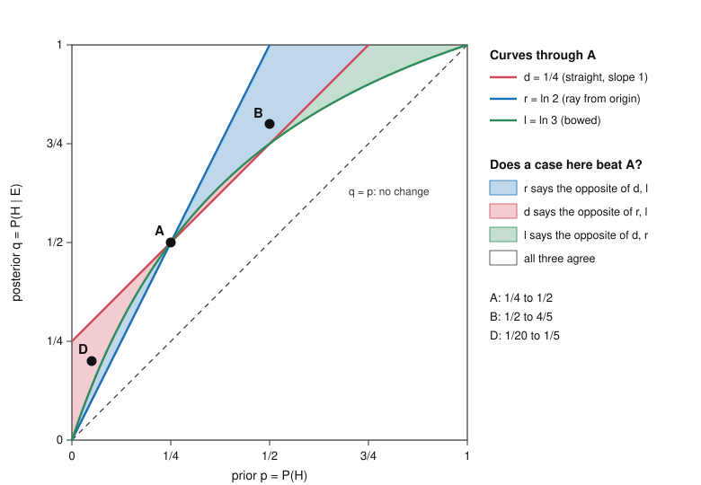

# Philosophy of Science · Lesson 1.3: Confirmation as probability raising

> ⏱ ~15 min · Module 1: Induction and confirmation · Builds on: [1.1](01-01-from-hume-to-a-logic-of-confirmation.md), [`epistemology` 5.3](../../epistemology/lessons/05-03-conditionalization.md), [`philosophical-method` 2.4](../../philosophical-method/lessons/02-04-weighing-evidence-in-odds-form.md) · Unlocks: [1.4](01-04-the-ravens-paradox.md), [1.5](01-05-the-problem-of-old-evidence.md)

## Why this matters

Two results appear in one journal issue. One moves a hypothesis from probability 1/20 to 1/5; the other moves a different hypothesis from 1/2 to 4/5. Which hypothesis was confirmed more? If you have ever watched a risk difference and an odds ratio rank two treatments in opposite orders, you already suspect the answer. [1.1](01-01-from-hume-to-a-logic-of-confirmation.md) looked for a logic of "E supports H" and broke on tacking. Bayesians replace the logic with a probability function, and then find that "how much" has more than one answer.

## The idea

"Confirmed" hides two questions. Is the hypothesis now well supported, or did the evidence make it better supported? A long shot can climb from 1 in 400 to 1 in 40 and still be a long shot: the evidence helped, and you should not believe the hypothesis. A solid theory can slip from 0.95 to 0.90 and still be solid: the evidence hurt, and you go on believing it. Rudolf Carnap called these firmness and increase in firmness.

Stay with increase. A share that climbs from 5 to 20 gains fewer points than one that climbs from 50 to 80, and a far larger percentage. A bookmaker would report a third number: how far the odds shortened. All three gauges agree that the price rose, and they disagree about which rose more. Confirmation has the same three gauges. [`philosophical-method` 2.4](../../philosophical-method/lessons/02-04-weighing-evidence-in-odds-form.md) taught the third, the odds multiplier; this lesson uses it and sets it beside its rivals.

## The math

**Setup.** $P$ is a credence function, `epistemology`'s $\mathrm{cr}$; $\Pr$ stays reserved for chance. That credences should obey the axioms is what the Dutch book and accuracy arguments of [`epistemology` 5.2](../../epistemology/lessons/05-02-dutch-books-and-accuracy.md) defend, and that they should move by conditionalization is [`epistemology` 5.3](../../epistemology/lessons/05-03-conditionalization.md)'s claim; both are taken as given here. Background $K$ stays implicit unless it matters. Assume $0 < P(H) < 1$, $P(E) > 0$ and $P(E \mid \neg H) > 0$.

**1. Two notions** (Carnap, *Logical Foundations of Probability*, 1950; the names firmness and increase in firmness come from the preface to the 1962 second edition).

[Incremental confirmation](../reference.md#incremental-confirmation): $E$ confirms $H$ relative to $K$ iff $P(H \mid E \wedge K) > P(H \mid K)$.

[Absolute confirmation](../reference.md#absolute-confirmation): $E$ confirms $H$ relative to $K$ iff $P(H \mid E \wedge K) > t$, for a fixed threshold $t$.

*In words:* the first asks whether $E$ raised $H$; the second asks whether $H$ is high once $E$ is in. Neither implies the other. Carnap charged (§87) that Hempel's conditions ran the two together: [special consequence](../reference.md#special-consequence-condition) holds for firmness and fails for increase.

**2. Three measures.** Logs are natural throughout; changing the base changes neither sign nor order.

$$d(H,E) = P(H \mid E) - P(H), \qquad r(H,E) = \ln\frac{P(H \mid E)}{P(H)}, \qquad l(H,E) = \ln\frac{P(E \mid H)}{P(E \mid \neg H)}.$$

*In words:* the [difference measure](../reference.md#difference-measure) counts points gained, the [log-ratio measure](../reference.md#log-ratio-measure) the factor by which $H$ grew, and the [log-likelihood-ratio measure](../reference.md#log-likelihood-ratio-measure) how much better $H$ predicted $E$ than its negation did. Inside the last log sits $\mathrm{LR} = P(E \mid H)/P(E \mid \neg H)$, the likelihood ratio against $\neg H$. Advocates, on Fitelson's 1999 list: Earman and Rosenkrantz for $d$; Horwich and Milne for $r$; Good and Schum for $l$.

**3. They agree in sign.** $d$, $r$ and $l$ are all positive, all zero, or all negative together.

*Proof.* $d > 0$ and $r > 0$ each say $P(H \mid E) > P(H)$. By [Bayes' theorem](../../prob-stat-refresher/lessons/01-02-conditional-probability-bayes.md), $P(H \mid E)/P(H) = P(E \mid H)/P(E)$. And $P(E) = P(E \mid H)P(H) + P(E \mid \neg H)P(\neg H)$ is a weighted average of the two likelihoods, so $P(E \mid H) > P(E)$ iff $P(E \mid H) > P(E \mid \neg H)$. The same steps run with $=$ and $<$. $\square$

*In words:* whether $E$ confirms $H$ does not depend on the gauge.

**4. $l$ is fixed by prior and posterior.** Write $p = P(H)$ and $q = P(H \mid E)$. Dividing Bayes' theorem for $H$ by Bayes' theorem for $\neg H$ gives the odds form, with $\mathrm{LR}$ still against $\neg H$:

$$\mathrm{LR} = \frac{q/(1-q)}{p/(1-p)}, \qquad l(H,E) = \ln\frac{q(1-p)}{p(1-q)} = r(H,E) - r(\neg H,E).$$

*In words:* $l$ is the log of the posterior odds over the prior odds. It scores $H$'s rise and $\neg H$'s fall together, where $r$ watches $H$ alone. So a case is a point $(p, q)$, and each measure is a way of contouring the square.

**5. They disagree in order.** With $p$ fixed, all three increase with $q$; with $q$ fixed, all three fall as $p$ rises. Disagreement needs both to differ.

| Case | $p \to q$ | $d$ | $r$ | $l$ |
|---|---|---|---|---|
| A | $\tfrac14 \to \tfrac12$ | $\tfrac14$ | $\ln 2 \approx 0.693$ | $\ln 3 \approx 1.099$ |
| B | $\tfrac12 \to \tfrac45$ | $\tfrac{3}{10}$ | $\ln\tfrac85 \approx 0.470$ | $\ln 4 \approx 1.386$ |
| D | $\tfrac{1}{20} \to \tfrac15$ | $\tfrac{3}{20}$ | $\ln 4 \approx 1.386$ | $\ln\tfrac{19}{4} \approx 1.558$ |

$d$ and $l$ rank B above A, while $r$ ranks A above B. $r$ and $l$ rank D above B, while $d$ ranks B above D. The opening question has no measure-free answer. Branden Fitelson ("The Plurality of Bayesian Measures of Confirmation and the Problem of Measure Sensitivity", 1999) made this a charge: an argument shows [measure sensitivity](../reference.md#measure-sensitivity) when its validity varies with the measure used. Rosenkrantz's treatment of tacking goes through on $d$ alone among these three, as does Eells's treatment of grue. `philosophical-method` 2.4 said that the likelihood ratio against $\neg H$, and only it, is the strength of the evidence. That sentence is a commitment to $l$, and it is the commitment under test here.

**6. Tacking, with amounts.** [1.1](01-01-from-hume-to-a-logic-of-confirmation.md)'s [tacking problem](../reference.md#tacking-problem): if $H$ entails $E$, so does $H \wedge X$, for any $X$. Suppose $H \models E$, $P(E) < 1$ and $P(H \wedge X) > 0$. Then $P(E \mid H) = P(E \mid H \wedge X) = 1$, so $P(H \wedge X \mid E) = P(H \wedge X)/P(E)$, and likewise for $H$. Hence:

$$r(H \wedge X, E) = \ln\frac{1}{P(E)} = r(H,E), \qquad d(H \wedge X, E) = P(H \wedge X)\left(\frac{1}{P(E)} - 1\right) = P(X \mid H)\, d(H,E).$$

For $l$: $\neg(H \wedge X)$ divides into $\neg H$ and $H \wedge \neg X$, and $E$ is certain on the second part. So $P(E \mid \neg(H \wedge X))$ is a weighted average of $P(E \mid \neg H)$ and 1, with positive weight on 1 when $P(X \mid H) < 1$. Since $P(E) < 1$ forces $P(E \mid \neg H) < 1$, the average exceeds $P(E \mid \neg H)$, the denominator rises, and $l(H \wedge X, E) < l(H,E)$.

*In words:* on $r$ the tack costs nothing, since every $H$ entailing $E$ scores $\ln(1/P(E))$; on $d$ it scales the boost by $P(X \mid H)$; on $l$ it costs something (given $P(X \mid H) < 1$), with no simple proportion. Every value stays positive, so $E$ still confirms $H \wedge X$. Hawthorne and Fitelson (2004) extend the $d$ and $l$ results from entailment to any $X$ with $P(E \mid H \wedge X) = P(E \mid H)$, given that $E$ confirms $H$.

**Where the argument is weakest.** The premise under most pressure is hidden in "how much": that one quantity, degree of confirmation, is what the three measures estimate. The strongest objection is that a quantity with no privileged gauge may not be there; Howson (2000) and Kyburg and Teng (2001) take the plurality as grounds for doubting the quantitative project. The strongest reply: the sign is common property, and each family is pinned down by one principle (Crupi, Chater and Tentori, 2013): $d$ by how confirmation behaves across exclusive alternatives, $r$ by ranking hypotheses on fixed evidence by $P(E \mid H)$, $l$ by leaving an item's strength untouched by conditionally independent items already in hand, which is why `philosophical-method` 2.4 could multiply them. Choosing a measure is then choosing a principle, which can be argued. Hájek and Joyce (2008) suggest instead that the measures may capture different, compatible notions of support. The monist concedes that two rival principles must each be argued down; the pluralist concedes that "E confirms H more than E′ confirms H′" has no truth value until a measure is named.

## The picture

A case in a shaded region beats A on some measures and loses to it on others.

## Worked examples

**Example 1 (clean case: a diffraction peak).** A materials lab gives credence $P(H) = \tfrac14$ to "this batch has the target phase". A diffraction peak $E$ appears in $\tfrac34$ of target-phase batches and $\tfrac14$ of others. Then

$$P(E) = \tfrac14 \cdot \tfrac34 + \tfrac34 \cdot \tfrac14 = \tfrac38, \qquad P(H \mid E) = \frac{3/16}{3/8} = \tfrac12.$$

So $d = \tfrac12 - \tfrac14 = \tfrac14$ and $r = \ln 2 \approx 0.693$. The likelihood ratio against $\neg H$ is $\mathrm{LR} = (3/4)/(1/4) = 3$, so $l = \ln 3 \approx 1.099$. The odds check agrees: prior odds $1:3$, posterior odds $1:1$, a factor of 3. All three are positive. At $t = \tfrac12$, $E$ does not confirm $H$ absolutely, because the posterior is exactly $\tfrac12$ and the definition is strict.

**Example 2 (hard case: a tack in a deck).** Draw one card from a standard deck (Fitelson's 1999 test model, with a new tack). $H$: it is a spade. $E$: it is black. So $H \models E$, $P(H) = \tfrac14$, $P(E \mid \neg H) = \tfrac13$ and $P(E) = \tfrac12$. Now tack on $X$: a fair die rolled in another building shows six.

| Hypothesis | Prior | Posterior | $d$ | $r$ | $\mathrm{LR}$ against its negation | $l$ |
|---|---|---|---|---|---|---|
| $H$ | $\tfrac14$ | $\tfrac12$ | $\tfrac14$ | $\ln 2 \approx 0.693$ | $3$ | $\ln 3 \approx 1.099$ |
| $H \wedge X$ | $\tfrac{1}{24}$ | $\tfrac{1}{12}$ | $\tfrac{1}{24}$ | $\ln 2 \approx 0.693$ | $\tfrac{23}{11}$ | $\ln\tfrac{23}{11} \approx 0.738$ |
| $X$ | $\tfrac16$ | $\tfrac16$ | $0$ | $0$ | $1$ | $0$ |

The middle row's denominator is $P(E \mid \neg(H \wedge X)) = \frac{1/2 - 1/24}{23/24} = \tfrac{11}{23} = \tfrac{18}{23}\cdot\tfrac13 + \tfrac{5}{23}\cdot 1$. $H$'s row repeats Example 1's values: same prior and posterior, different likelihoods.

Two verdicts are clean. $H \wedge X$ entails $X$ and is confirmed while $X$ is not, so incremental confirmation rejects special consequence and blocks 1.1's worst result, evidence confirming the irrelevant conjunct alone. And $E$ does confirm $H \wedge X$ on every measure, so the Bayesian inherits tacking in its qualitative form.

Here the account stops. How bad is a tack? $d$ gives the conjunction one sixth of $H$'s boost, $l$ about two thirds, $r$ all of it. $r$'s defender says that both hypotheses entail $E$, so $E$ cannot tell them apart, and equal treatment is correct. Its critics (Rosenkrantz 1981; Gillies 1986) reply that the further a hypothesis outruns its evidence, the less that evidence should support it. The table reports what each measure says, and it cannot say which to use.

## Watch out

- **You might think a confirmed hypothesis is one you should accept, but actually** incremental confirmation is compatible with a posterior of 1 in 40. The [Lockean thesis](../../epistemology/lessons/05-01-credences-and-probabilism.md) ties belief to the level of the posterior, never to its rise, and even a high posterior is a further step from [acceptance](../reference.md#confirmation-and-acceptance), which [3.4](03-04-values-and-inductive-risk.md) examines.
- **You might think "strongly confirms" reports a fact about the evidence, but actually** only the sign is measure-free. A magnitude claim has to name its measure: D beats B on $r$ and $l$ and loses on $d$.
- **You might think $l$ is free of the prior, but actually** $P(E \mid \neg H)$ is an average of the likelihoods of $H$'s rivals, weighted by their priors, so $\mathrm{LR}$ against $\neg H$ moves when your spread over the rivals moves. A ratio against a named rival with definite likelihoods is free of priors, but it is a different quantity: [3.2](03-02-the-likelihood-principle.md)'s [law of likelihood](../reference.md#law-of-likelihood).

## One-liner

> Confirmation is either being well supported or becoming better supported, and the rival measures of becoming agree on the direction while disagreeing on the ranking.

## Problems

**P1 (🟢) *(Formal (a)–(b))*** A sky survey flags candidate transits. $H$: the candidate is a real planet. $E$: a second instrument sees the dip. The joint distribution is:

| | $E$ | $\neg E$ |
|---|---|---|
| $H$ | 0.2 | 0.1 |
| $\neg H$ | 0.1 | 0.6 |

(a) Compute $d(H,E)$, $r(H,E)$ and $l(H,E)$, with exact fractions inside the logs, and check $l$ against the prior and posterior odds. One line each.

(b) Does $E$ confirm $H$ incrementally? Absolutely at $t = \tfrac12$? Absolutely at $t = \tfrac34$? One line.

**P2 (🟡) *(Formal (a)–(b))*** Case 1 has this joint distribution over its $H$ and $E$:

| | $E$ | $\neg E$ |
|---|---|---|
| $H$ | 0.15 | 0.05 |
| $\neg H$ | 0.10 | 0.70 |

(a) Build a Case 2: a joint table with four positive cells, each a multiple of 0.01, on which $r$ ranks Case 1 above Case 2 and $l$ ranks Case 2 above Case 1. Show your cells and the values of $r$ and $l$ for both cases.

(b) Using $l(H,E) = r(H,E) - r(\neg H,E)$, say what feature of your table lets $l$ reverse $r$. Two sentences.

**P3 (🔴) *(Exegetical (a), (c) · Formal (b))*** Read this press release (invented, written for this problem).

> "Brindlemere Diagnostics announced today that a positive result on its new blood panel strongly confirms a rare liver disorder. Before testing, about 1 in 200 patients at our partner clinics have the disorder; after a positive panel, the probability is 10 percent, a twentyfold increase. 'A positive Brindlemere panel confirms the disease,' said Dr. Beatriz Fenwright, the company's chief medical officer. 'Physicians can act on that result with confidence.'"

(a) Which sense of "confirm" makes the release's first sentence true, and which sense does Dr. Fenwright's first sentence need? Two sentences.

(b) Compute $d$, $r$ and the likelihood ratio against "no disorder" for the reported move. Then say in one sentence what these numbers do to the word "strongly".

(c) State what the release may conclude and what it may not. 80 words or fewer.

Solutions

**P1** *(Formal (a)–(b))*

(a) From the table, $P(H) = 0.3$, $P(E) = 0.3$ and $P(H \mid E) = \frac{0.2}{0.3} = \tfrac23$.

$$d = \tfrac23 - \tfrac{3}{10} = \tfrac{11}{30} \approx 0.367, \qquad r = \ln\frac{2/3}{3/10} = \ln\tfrac{20}{9} \approx 0.799.$$

$P(E \mid H) = \frac{0.2}{0.3} = \tfrac23$ and $P(E \mid \neg H) = \frac{0.1}{0.7} = \tfrac17$, so $\mathrm{LR}$ against $\neg H$ is $\tfrac{14}{3}$ and $l = \ln\tfrac{14}{3} \approx 1.540$.

Odds check: prior odds $3:7$, posterior odds $2:1$, and $\frac{2}{3/7} = \tfrac{14}{3}$.

(b) Incrementally yes, since $\tfrac23 > \tfrac{3}{10}$. Absolutely at $t = \tfrac12$ yes; at $t = \tfrac34$ no.

**Wrong turns:** computing $P(E \mid H)/P(E)$ and calling it $\mathrm{LR}$ (that ratio is the one inside $r$). Reading a joint cell as a conditional probability.

---

**P2** *(Formal (a)–(b))*

Case 1: $P(H) = \tfrac15$, $P(E) = \tfrac14$, $P(H \mid E) = \tfrac35$, so $r = \ln 3 \approx 1.099$. $P(E \mid H) = \tfrac34$ and $P(E \mid \neg H) = \tfrac18$, so $\mathrm{LR}$ against $\neg H$ is 6 and $l = \ln 6 \approx 1.792$.

**Accept:** any table with four positive cells, each a multiple of 0.01, summing to 1, with $r < \ln 3$ and $l > \ln 6$. A sufficient recipe: $r \le \ln(1/P(H))$ because a posterior cannot exceed 1, so any $P(H) > \tfrac13$ caps $r$ below $\ln 3$; then choose $\mathrm{LR}$ against $\neg H$ above 6.

(a) One table: $H \wedge E = 0.72$, $H \wedge \neg E = 0.08$, $\neg H \wedge E = 0.02$, $\neg H \wedge \neg E = 0.18$. Then $P(H) = \tfrac45$, $P(E) = 0.74$ and $P(H \mid E) = \tfrac{72}{74} = \tfrac{36}{37}$.

$$r = \ln\frac{36/37}{4/5} = \ln\tfrac{45}{37} \approx 0.196 < \ln 3.$$

$P(E \mid H) = 0.9$ and $P(E \mid \neg H) = \frac{0.02}{0.2} = 0.1$, so $\mathrm{LR}$ against $\neg H$ is 9 and $l = \ln 9 \approx 2.197 > \ln 6$.

(Here $d$ sides with $r$: $\tfrac25$ against $\tfrac{32}{185} \approx 0.173$. Other accepted tables can have $d$ side with $l$.)

(b) The gap is $l - r = \ln\frac{P(\neg H)}{P(\neg H \mid E)}$, the log of the factor by which $\neg H$ falls: $\neg H$ goes from $\tfrac15$ to $\tfrac{1}{37}$ in Case 2, a factor of 7.4, against $\tfrac45$ to $\tfrac25$, a factor of 2, in Case 1. A high prior leaves $H$ little room to grow, which is all $r$ sees, while leaving plenty of room for $\neg H$ to collapse, which $l$ also counts.

**Wrong turns:** giving Case 2 the prior of Case 1 (with $p$ fixed the measures cannot disagree). A table with a zero cell, which makes $l$ infinite or undefined.

---

**P3** *(Exegetical (a), (c) · Formal (b))*

**Must hit, strict (a):**

- The first sentence is true only in the incremental sense: $\tfrac{1}{200} \to \tfrac{1}{10}$ is a rise.
- Dr. Fenwright's sentence needs the absolute sense, or acceptance. A posterior of $\tfrac{1}{10}$ fails any Lockean threshold $t \ge \tfrac12$.

(b) $d = \tfrac{1}{10} - \tfrac{1}{200} = \tfrac{19}{200} = 0.095$. $r = \ln 20 \approx 2.996$. $\mathrm{LR}$ against "no disorder" is $\frac{1/9}{1/199} = \tfrac{199}{9} \approx 22.1$, so $l \approx 3.096$. "Strongly" is earned on the ratio-type gauges and looks weak on $d$, which moves under 0.1, so the word has no definite content until a measure is named, and on no measure does it mean the patient probably has the disorder.

**Model answer (a):** The first sentence is true in the incremental sense, since the panel raises the probability. Dr. Fenwright's needs the absolute sense or acceptance, which a posterior of 1 in 10 cannot supply.

**Must hit, strict (c):**

- May conclude: a positive panel raises the probability twentyfold, and is evidence for the disorder.
- May not conclude: that the patient has the disorder. On the release's own number, 9 in 10 positives do not.
- May not conclude that physicians can act on it from the probability alone: acting depends on the costs of error as well.

**Wrong turns:** saying the panel does not confirm anything because the posterior is low, which is the same conflation run backward. Treating the low posterior as proof that the test is poor, when a likelihood ratio near 22 counts as strong on `philosophical-method` 2.4's scale.

**Model answer (c):** It may say that a positive result raises the probability of the disorder twentyfold and is real evidence for it, in the incremental sense. It may not say the disease is confirmed in the sense of being established, since 9 in 10 positives lack it, nor that physicians can act with confidence, which needs the costs of each kind of error.

## Flashback

**From Lesson [1.1](01-01-from-hume-to-a-logic-of-confirmation.md) (From Hume to a logic of confirmation):** *(Exegetical (a)–(c).)* A foundry's log (invented, written for this problem) covers two bells. $H$: every bell cast here rings flat. $K$: $a$ and $b$ were cast here. $E$: $a$ rings flat and $b$ rings flat. $A$: $a$ rings flat. $N$: if bell $c$ is cast here, it rings flat.

(a) Does $E$ [H-D-confirm](../reference.md#hypothetico-deductivism) $H$ relative to $K$? Does it H-D-confirm $A$ relative to $K$? Name the Hempel condition the second answer violates. One line each.

(b) By [Nicod's criterion](../reference.md#nicods-criterion), the report $K \wedge E$ confirms $H$. Which Hempel condition carries that support to $N$? Does $E$ H-D-confirm $N$ relative to $K$? Say why the difference matters for the question Hume left. Two sentences.

(c) Replace $H$ with "each bell cast here has chance 0.9 of ringing flat". What does H-D say about $E$, and why? One sentence.

Solution

**Must hit, strict:**

- (a) Yes for $H$: $H \wedge K \vDash E$ and $K \not\vDash E$. No for $A$: $A \wedge K$ says nothing about $b$, so $A \wedge K \not\vDash E$. Since $E \vDash A$, this violates the **entailment** condition.
- (b) **Special consequence**, because $H \vDash N$. But $N \wedge K$ says nothing about $a$ or $b$, so $N \wedge K \not\vDash E$, and $E$ does not H-D-confirm $N$.
- (b) Why it matters: H-D credits the law and cannot pass that credit to the next case, and the next case is what Hume's question was about.
- (c) H-D is silent. A chance of 0.9 leaves each bell free to ring true, so the hypothesis with $K$ does not entail $E$.

**Wrong turns:** in (a), saying yes for $A$ because $E$ reports it: $E \vDash A$ runs the wrong way, and H-D needs $A \wedge K \vDash E$. In (b), naming converse consequence, which runs from weaker to stronger, or calling the failure tacking, when nothing has been tacked on. In (c), saying $E$ H-D-confirms the hypothesis because 0.9 makes $E$ likely: H-D asks for entailment, not high probability.

**Model answer:** (a) Yes for $H$; no for $A$, which violates entailment, since $E \vDash A$. (b) Special consequence carries the support to $N$, because $H \vDash N$, but $N \wedge K \not\vDash E$, so $E$ does not H-D-confirm $N$. H-D credits the law and cannot pass the credit to the next case, which is what Hume's question concerned. (c) Silent: a chance of 0.9 leaves each bell free to ring true, so the hypothesis with $K$ does not entail $E$.

## Connections

- **Backward:** [1.1](01-01-from-hume-to-a-logic-of-confirmation.md)'s [hypothetico-deductive](../reference.md#hypothetico-deductivism) confirmation and tacking now come with amounts, and its special consequence condition has a home on firmness and none on increase. [`epistemology` 5.1](../../epistemology/lessons/05-01-credences-and-probabilism.md) to [5.3](../../epistemology/lessons/05-03-conditionalization.md) supply the credences and the update rule. [`philosophical-method` 2.4](../../philosophical-method/lessons/02-04-weighing-evidence-in-odds-form.md)'s odds form is $l$ before the log.
- **Forward:** [1.4](01-04-the-ravens-paradox.md) gives the Bayesian treatment of the ravens, whose usual comparative step Fitelson finds valid on $d$, $r$ and $l$ but not on every relevance measure. [1.5](01-05-the-problem-of-old-evidence.md) asks what happens when $P(E) = 1$. [3.2](03-02-the-likelihood-principle.md) takes up the likelihood ratio against a named rival.
- **Sideways:** a [logistic regression](../../statistical-learning/lessons/02-02-logistic-regression-and-classification.md) is linear in the log-odds, so a feature's contribution is an $l$-style update. [`philosophy-of-religion` 3.1](../../philosophy-of-religion/lessons/03-01-from-design-to-fine-tuning.md) compares design against a named rival, which is the other kind of likelihood ratio. [`philosophy-of-physics`](../../philosophy-of-physics/syllabus.md) cites these measures for the evidential problem of many-worlds.
