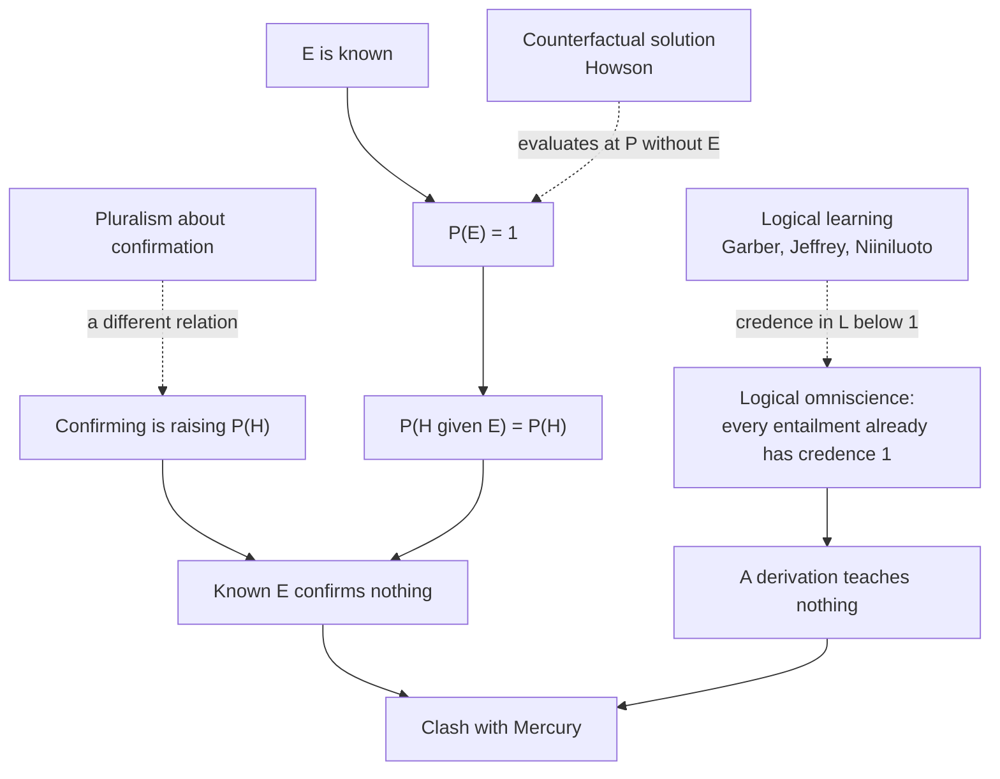

# Philosophy of Science · Lesson 1.5: The problem of old evidence

> ⏱ ~15 min · Module 1: Induction and confirmation · Builds on: [1.3](01-03-confirmation-as-probability-raising.md), [`epistemology` 5.3](../../epistemology/lessons/05-03-conditionalization.md) · Unlocks: [1.6](01-06-simplicity-and-curve-fitting.md)

## Why this matters

On 18 November 1915 Einstein told the Prussian Academy that his theory of gravitation accounted for the slow turning of Mercury's orbit, an excess Le Verrier had reported in 1859 and that Newcomb's later reductions put near 43 arc seconds per century (Einstein's *Relativity*, tr. Lawson, gives that figure; [`relativity` 6.2](../../relativity/lessons/06-02-orbits-precession-light-bending.md) has the calculation). Nobody had taken a new measurement. Abraham Pais's biography ranks the moment as perhaps the strongest emotional experience of Einstein's life. On the definition of confirmation from [1.3](01-03-confirmation-as-probability-raising.md), nothing evidential happened, because evidence you already have cannot raise anything. Either that definition needs repair or the most celebrated confirmation in modern physics was not one.

## The idea

Say you have known for years that your building's pipes knock at exactly two in the morning. A neighbour mentions that the boiler runs a purge cycle on a timer. You work out the timing and find it would produce that knock at that minute. Nothing new about the knock has come in, yet you are far more confident in the boiler theory. You learned something. Saying what is the whole problem.

[`epistemology` 5.3](../../epistemology/lessons/05-03-conditionalization.md) gave the standard picture: evidence is what you become certain of, you conditionalize on it once, and certainty is permanent. So the knock has no push left. Two repairs start from that thought. One scores the knock against a version of you who had not heard it. The other says what you learned was never the knock but the connection: the boiler theory entails the knock. A neighbouring trouble is that the boiler theory may not have been on your list at all, so there was no credence to update.

*Old* means old to the agent: known before she saw what the hypothesis said about it. A report gathering dust in an archive is new evidence the day she reads it.

## The math

$P$ is an ideal agent's credence function, what [`epistemology` 5.1](../../epistemology/lessons/05-01-credences-and-probabilism.md) writes $\mathrm{cr}$. $H$ is a hypothesis, $E$ evidence.

**1. Glymour's argument** (Clark Glymour, *Theory and Evidence*, 1980, the chapter "Why I Am Not a Bayesian").

**P1.** $E$ confirms $H$ for an agent at time $t$ iff $P_t(H \mid E) > P_t(H)$. *In words:* to confirm is to raise, the [incremental](../reference.md#incremental-confirmation) sense from 1.3.

**P2.** If the agent knows $E$ at $t$, then $P_t(E) = 1$. *In words:* what has been learned is certain.

**P3.** If $P(E) = 1$, then $P(H \mid E) = P(H)$. Proof: $P(H \wedge \neg E) \le P(\neg E) = 0$, so $P(H \wedge E) = P(H)$; divide by $P(E) = 1$. *In words:* supposing what you already take for granted moves nothing.

**P4.** Mercury's excess perihelion advance, known for more than fifty years, was strong evidence for general relativity when Einstein derived it. *In words:* this is a verdict any theory of confirmation must deliver.

**∴ C.** P1–P3 imply that known evidence confirms nothing, and P4 says this known evidence confirmed something, so at least one premise must go. *In words:* this is the [problem of old evidence](../reference.md#problem-of-old-evidence).

Every measure from 1.3 reads neutral at such an $E$. John Earman (*Bayes or Bust?*, 1992) aims the same case at the update rule: Einstein gathered no data, so conditionalization leaves his credence fixed, and yet it rose, rightly.

Behind both versions stands [logical omniscience](../reference.md#logical-omniscience): a probability function gives credence 1 to every logical truth (the normality axiom of `epistemology` 5.1). If $H$ with the background entails $E$, that is already priced in, and a derivation can teach nothing.

**2. The [counterfactual solution](../reference.md#counterfactual-solution)** (Colin Howson, "The 'Old Evidence' Problem", 1991). Let $P^{-E}$ be the credence function the agent would have had if she had not known $E$.

$$E \text{ confirms } H \iff P^{-E}(H \mid E) > P^{-E}(H).$$

*In words:* score the evidence against you-minus-the-evidence. Since $P^{-E}(E) < 1$, P3 no longer bites. The cost is defining the function: $E$ is entangled with the rest of what the agent believes, so subtracting it is no single operation, and nothing fixes which beliefs leave with it. Jan Sprenger (2015) keeps a counterfactual element in a combined solution; Howson himself later judged (2017) that subjective Bayesianism cannot solve the problem, and moved toward a non-subjective version.

**3. The [logical learning solution](../reference.md#logical-learning-solution)** (Daniel Garber, Richard Jeffrey, Ilkka Niiniluoto, all 1983). Keep $P(E) = 1$ and drop logical omniscience. Add sentences with credences of their own: $L$, "$H$ with the background entails $E$", and $R$, "$H$ with the background entails $\neg E$", subject to modus ponens:

$$P(E \mid H \wedge L) = 1, \qquad P(E \wedge H \wedge R) = 0.$$

*In words:* she need not know what follows from $H$, but she knows that what follows from a truth is true. With $P(E) = 1$, the second condition forces $P(H \wedge R) = 0$. The derivation delivered $L$, and the claim is $P(H \mid L) > P(H)$.

Garber showed such models can be written down, not that the rise is guaranteed. Jeffrey added $P(L \vee R) = 1$: she is sure $H$ settles $E$ one way or the other. Then $P(H) = P(H \wedge L)$, so

$$P(H \mid L) = \frac{P(H \wedge L)}{P(L)} = \frac{P(H)}{P(L)}.$$

*In words:* learning it came out the right way multiplies your credence by $1/P(L)$, so the less you expected the connection, the more it counts.

Earman objected that no one in 1915 had reason to be that sure. With $S = \neg L \wedge \neg R$ ("$H$ is silent on $E$"), he requires only

$$P(H \mid L) > P(H \mid S).$$

*In words:* entailing the fact is better news for $H$ than saying nothing about it. $P(H)$ is then an average of $P(H \mid L)$, $P(H \mid S)$ and zero, so it lies below $P(H \mid L)$.

The cost: what was learned is a logical fact, not the perihelion, which Earman presses as a change of subject (Glymour had anticipated and criticized this escape in 1980). And Bas van Fraassen (1988) argues that, under weak assumptions, a credence below 1 in a logical truth contradicts the probabilism the model assumes.

**4. The [problem of new theories](../reference.md#problem-of-new-theories).** Before general relativity was conceived it had no place in anyone's space of hypotheses. Its prior was missing, which differs from zero (a zero never recovers: [`epistemology` 5.4](../../epistemology/lessons/05-04-the-problem-of-priors.md)). Earman's physics student hears $L$ in her first class, forms a credence in the new theory on the spot, and lowers her credence in Newton. Conditionalization governs change, not formation, and it cannot license that drop, since she had no earlier credence in $L$ to move. One reply confines credence to the possibilities under consideration and preserves the ratios among those that remain (Shimony 1970; Salmon 1990; Wenmackers and Romeijn 2016).

**Where the argument is weakest.** The joint between P1 and P4. P1 defines what $E$ adds now; P4 may be a claim about a standing relation of support that $E$ bears to $H$ whether or not anyone still needs it. The strongest objection says so outright: evidence already in the background adds nothing further, the zero is correct, and P4 equivocates (James Joyce, *The Foundations of Causal Decision Theory*, 1999, counts several concepts of confirmation as equally legitimate). The strongest reply: then the definition has gone silent on the very relation the datum concerns, which is what a theory of confirmation was for. The objector concedes that standing support still needs an account; the reply concedes that the zero is right about what $E$ adds now. The repairs split the same way: logical learning targets the event of 1915, the counterfactual test the standing relation.

## Argument map

Each response leaves the arithmetic alone and cuts a premise that feeds it.

## Worked examples

**Example 1 (clean case: a Garber-style table).** Give an idealized physicist these credences before the derivation (invented, for the arithmetic only). $E$ is certain, so the cell $H \wedge R$ is empty.

| | $L$ | $R$ | $S$ | Total |
|---|---|---|---|---|
| $H$ | 4/20 | 0 | 2/20 | 6/20 |
| $\neg H$ | 3/20 | 5/20 | 6/20 | 14/20 |
| Total | 7/20 | 5/20 | 8/20 | 1 |

So $P(H) = 3/10$. The derivation delivers $L$:

$$P(H \mid L) = \frac{4/20}{7/20} = \frac47 \approx 0.571.$$

So the [difference measure](../reference.md#difference-measure) is $d = \frac47 - \frac{3}{10} = \frac{19}{70} \approx 0.271$ and the [log-ratio measure](../reference.md#log-ratio-measure) is $r = \ln\frac{40}{21} \approx 0.644$. Earman's condition holds, since $P(H \mid S) = \frac{2}{8} = \frac14$. The average checks: $\frac{7}{20}\cdot\frac47 + \frac{5}{20}\cdot 0 + \frac{8}{20}\cdot\frac14 = \frac{6}{20}$.

Impose Jeffrey's constraint by folding the silent column, $H$'s share into $L$ and $\neg H$'s into $R$. Now $P(L) = 9/20$ and $P(H \mid L) = \frac{3/10}{9/20} = \frac23$, the closed form. The empty cell is the only trace of the perihelion in the model. A defender says that is $E$ at work: without it, $R$ would keep some of $H$'s credence. A critic says the agent conditioned on a theorem.

**Example 2 (hard case: a curve built from the data).** An analyst has four measurements at distinct settings, each on a ten-level grid, so $N = 10{,}000$ data sets are possible. She finds $F$, the one polynomial of degree at most 3 through her four points ([1.6](01-06-simplicity-and-curve-fitting.md) takes up the [curve-fitting problem](../reference.md#curve-fitting-problem)), so $F$ entails $E$ by construction. Does $E$ confirm $F$?

Run the counterfactual test with invented credences. Without $E$: credence $\frac12$ on a published law $G$ that also predicts these data, and $\frac12$ spread evenly over the $N$ cubics, one per possible data set. Then $P^{-E}(F) = \frac{1}{20{,}000}$, $P^{-E}(E) = \frac{10{,}001}{20{,}000}$, and

$$P^{-E}(F \mid E) = \frac{1}{10{,}001}, \qquad P^{-E}(G \mid E) = \frac{10{,}000}{10{,}001}.$$

Both rise by the factor $\frac{20{,}000}{10{,}001}$, so $r \approx 0.693$ for each: anything entailing $E$ has $r = -\ln P(E)$, the reason [tacking](../reference.md#tacking-problem) costs nothing on $r$. On $d$, $F$ gains about $0.00005$ and $G$ about $0.4999$.

So the test says $E$ confirms the fitted curve. The [use-novelty](../reference.md#use-novelty) tradition (Elie Zahar, John Worrall, after Lakatos) says it does not: data used to build a hypothesis could not have counted against it, so they tested nothing. Howson ("Fitting Your Theory to the Facts", 1990) answers that no such rule is needed: the prior already discounts $F$, which ends at $\frac{1}{10{,}001}$, and [confirmation is not acceptance](../reference.md#confirmation-and-acceptance).

The account stops giving a verdict one step earlier. Without $E$ she would never have written $F$ down, so $P^{-E}(F)$ does not exist; the $\frac{1}{20{,}000}$ was stipulated. The test needs exactly the prior that the problem of new theories says is missing. The use-novelist takes that as a sign the right question was whether the test could have failed. The Bayesian replies that every model stipulates its space of hypotheses, and that the stipulation is open to argument.

## Watch out

- **You might think the problem vanishes if $P(E)$ is 0.999 instead of 1, but actually** $P(H \mid E) \le P(H)/P(E)$, so $E$ can multiply a credence by at most about 1.001. Softening certainty shrinks the effect without delivering Mercury, and Jeffrey conditionalization ([`epistemology` 5.3](../../epistemology/lessons/05-03-conditionalization.md)) needs a new experience that never came.
- **You might think logical learning says Mercury's data confirmed general relativity, but actually** the model's confirmer is $L$, a logical fact; $E$ appears only as the reason one cell is empty. Whether that counts as the data confirming the theory is the dispute.
- **You might think the problem of new theories is old evidence under another name, but actually** old evidence concerns a certain $E$ and a hypothesis already in the space, while the new-theory problem concerns a hypothesis with no credence at all. Real cases often have both, which is why Example 2 strains.

## One-liner

> A fact you already have cannot raise anything on the standard account, so one repair scores it against who you were without it, the other says what you learned was the connection, and neither supplies a prior for a theory no one had conceived.

## Problems

**P1 (🟢) *(Formal (a)–(c))*** A geologist is certain of an old field measurement $E$, so $P(E) = 1$, and has not yet worked out what her hypothesis $H$ says about it. Read $L$, $R$, $S$ as in the lesson, exactly one of them holding. Her credences:

| | $L$ | $R$ | $S$ |
|---|---|---|---|
| $H$ | 3/20 | ? | 1/20 |
| $\neg H$ | 5/20 | 5/20 | 6/20 |

(a) What is the missing cell? One line.

(b) Find $P(H)$, $P(L)$ and $P(H \mid L)$ as exact fractions.

(c) With $L$ as the evidence, give $d$ exactly and $r$ to three decimals, and say whether Earman's condition holds. One line for the condition.

**P2 (🟡) *(Exegetical (a)–(b))*** Three situations, invented, written for this problem.

> (i) A palaeontologist has held a hypothesis about a fossil bed for some months. Last week she found a 1950s field report, unread in a county archive, recording what the hypothesis says should be there. Her credence rises.
>
> (ii) A climatologist has long known the size of an ice-core anomaly and has held a volcanic-forcing model at middling confidence for months. Last night she worked out for the first time that her model entails exactly that size. Her credence rises.
>
> (iii) A chemist has credences in the two mechanisms she knows for a reaction. A colleague describes a third she had never considered. She gives it a sizeable credence and lowers the other two. Nobody has yet derived what the third mechanism says about the reaction.

(a) Classify each as old evidence, the problem of new theories, or neither. One line each.

(b) For the old-evidence case, state the proposition logical learning says she learned. For the new-theory case, name the credence change conditionalization cannot license. One sentence each.

**P3 (🔴) *(Evaluative)*** Howson's proposal says Mercury confirmed general relativity because, on the credences Einstein would have had without the perihelion data, the data raise the theory. Is the counterfactual solution a solution to the problem of old evidence? Any verdict, if you say what must be true of $P^{-E}$ for the proposal to deliver a result, state the strongest objection and name the premise it attacks, and state the strongest reply and what it costs. 150 words or fewer.

Solutions

**P1** *(Formal (a)–(c))*

(a) Zero. $H \wedge R$ entails $\neg E$, so $P(H \wedge R) \le P(\neg E) = 0$.

(b) $P(H) = \frac{3}{20} + 0 + \frac{1}{20} = \frac15$. $P(L) = \frac{3}{20} + \frac{5}{20} = \frac25$. So

$$P(H \mid L) = \frac{3/20}{8/20} = \frac38.$$

(c) $d = \frac38 - \frac15 = \frac{7}{40}$, and $r = \ln\frac{3/8}{1/5} = \ln\frac{15}{8} \approx 0.629$. Earman's condition holds: $P(H \mid S) = \frac{1/20}{7/20} = \frac17 < \frac38$. Check: $\frac25 \cdot \frac38 + \frac{7}{20} \cdot \frac17 = \frac{3}{20} + \frac{1}{20} = \frac15$.

**Wrong turns:** leaving the missing cell free and normalizing the table some other way; using the closed form $P(H)/P(L) = \frac12$, which needs an empty silent column, and this one is not; taking $P(H \mid S)$ over the whole table instead of the $S$ column.

---

**P2** *(Exegetical (a)–(b))*

**Must hit, strict (a):**

- (i) Neither. The report was unknown to her, so $P(E) < 1$ until she read it, and the rise is ordinary conditionalization. Old on the calendar, new to her.
- (ii) Old evidence. She was already certain of the anomaly, the model was already in her space of hypotheses, and her credence moved on a derivation with no new data.
- (iii) The problem of new theories. The third mechanism had no prior, and nothing was conditioned on.

**Must hit, strict (b):**

- The proposition is $L$: the volcanic-forcing model, with its background assumptions, entails the anomaly's size.
- The drop in her credence in the two old mechanisms: no proposition was learned to conditionalize on, and forming the new credence is formation rather than change.

**Wrong turns:** calling (i) old evidence because the report is decades old; calling (iii) old evidence because no data arrived; naming the anomaly itself in (b), which is $E$ and not $L$.

**Model answer:** (i) Neither: the report was new to her, so she conditionalized in the ordinary way. (ii) Old evidence: the anomaly was certain, the model already held, and no data arrived. (iii) New theories: a hypothesis with no prior entered and the other two lost credence with nothing learned. In (b), she learned that the model, with its background, entails the anomaly's size, and the credence change conditionalization cannot license is the drop in the two known mechanisms.

---

**P3** *(Evaluative)*

**Must hit, any verdict:**

- State the proposal: confirmation is evaluated at $P^{-E}$, not the current $P$, and it escapes the zero because $P^{-E}(E) < 1$.
- Say what it requires: a determinate $P^{-E}$, or at least a determinate ordering of $P^{-E}(H \mid E)$ against $P^{-E}(H)$.
- Name the premise the objection attacks (that $E$ can be subtracted from the agent's beliefs and leave a definite state, or that a counterfactual credence is the relation P4 is about) and give the objection at strength.
- State the best reply and what it costs.

**Wrong turns:** treating the proposal as lowering $P(E)$ in the actual credal state, which is the softening the lesson's bound rules out; conflating it with logical learning, where the thing conditioned on is $L$; grading "yes" or "no" as the answer.

**Model answer, one of several:** Howson scores Mercury against $P^{-E}$, Einstein's credences had he not known the perihelion data; there $P^{-E}(E) < 1$, so $E$ can raise the theory. It delivers a result only if that state is determinate. That premise is the target: the data are entangled with what he knew (orbital elements, decades of failed fixes, the suspicion that Newton needed correcting), so nothing says which beliefs leave with $E$, or whether he would have reached the theory at all. The reply: confirmation judgments need only an ordering, and scientists routinely estimate how surprising a known result would be. The cost: these are no longer anyone's actual credences, so the account loosens the tie to belief that made it Bayesian. I count it a partial solution: it explains standing support, at that price.

## Flashback

**From Lesson [1.3](01-03-confirmation-as-probability-raising.md) (Confirmation as probability raising):** *(Formal (a)–(b) · Exegetical (c).)* A gearbox failed from exactly one of three causes (credences invented, written for this problem). $E$ is a vibration signature.

| Cause | Prior | $P(E \mid \text{cause})$ |
|---|---|---|
| $H_1$: cracked tooth | 1/5 | 3/5 |
| $H_2$: worn bearing | 2/5 | 1/2 |
| $H_3$: bent shaft | 2/5 | 1/10 |

(a) Compute $P(E)$, then $d$, $r$ and $l$ for $H_1$ and for $H_2$, with exact fractions inside the logs. Which measures rank $H_1$ above $H_2$?

(b) Keep $H_1$'s prior and all three likelihoods, and let the priors of $H_2$ and $H_3$ be 1/5 and 3/5. Recompute $\mathrm{LR}$ against $\neg H_1$ and the ratio $P(E \mid H_1)/P(E \mid H_2)$. Which one moved? One line.

(c) A report says "$E$ supports a cracked tooth more than a worn bearing". What must it add before that claim has a definite verdict, and what do a monist and a pluralist about the measures each say of the split in (a)? Two sentences.

Solution

(a) $P(E) = \tfrac15\cdot\tfrac35 + \tfrac25\cdot\tfrac12 + \tfrac25\cdot\tfrac{1}{10} = \tfrac{9}{25}$, so $P(H_1 \mid E) = \frac{3/25}{9/25} = \tfrac13$ and $P(H_2 \mid E) = \frac{5/25}{9/25} = \tfrac59$. Also $P(E \mid \neg H_1) = \frac{6/25}{4/5} = \tfrac{3}{10}$ and $P(E \mid \neg H_2) = \frac{4/25}{3/5} = \tfrac{4}{15}$.

| | $d$ | $r$ | $\mathrm{LR}$ against negation | $l$ |
|---|---|---|---|---|
| $H_1$ | $\tfrac13 - \tfrac15 = \tfrac{2}{15} \approx 0.133$ | $\ln\tfrac53 \approx 0.511$ | $2$ | $\ln 2 \approx 0.693$ |
| $H_2$ | $\tfrac59 - \tfrac25 = \tfrac{7}{45} \approx 0.156$ | $\ln\tfrac{25}{18} \approx 0.329$ | $\tfrac{15}{8}$ | $\ln\tfrac{15}{8} \approx 0.629$ |

Odds check: $H_1$ goes from $1:4$ to $1:2$, a factor of 2; $H_2$ goes from $2:3$ to $5:4$, a factor of $\tfrac{15}{8}$. So $r$ and $l$ rank $H_1$ above $H_2$, and $d$ ranks $H_2$ above $H_1$. With $E$ fixed, $r$ simply orders hypotheses by $P(E \mid H)$.

(b) $P(E \mid \neg H_1) = \frac{\frac15\cdot\frac12 + \frac35\cdot\frac{1}{10}}{4/5} = \frac{4/25}{4/5} = \tfrac15$, so $\mathrm{LR}$ against $\neg H_1$ is $\frac{3/5}{1/5} = 3$, up from 2. The ratio against the named rival stays $\frac{3/5}{1/2} = \tfrac65$. Only the first moved, because $P(E \mid \neg H_1)$ is an average of the rivals' likelihoods weighted by their priors.

**Must hit, strict (c):**

- It must name a measure: only the sign is measure-free, and here $d$ parts from $r$ and $l$.
- The monist says one verdict is wrong, and that the choice of measure can be argued, principle against principle.
- The pluralist says the measures may capture different, compatible notions of support, so the comparative has no truth value until a measure is named.

**Wrong turns:** averaging the rivals' likelihoods unweighted, which agrees in (a) only because the two priors are equal, and misses the move in (b). Reading $H_1$'s higher $r$ as making it the most probable cause, when its posterior is $\tfrac13$ to $H_2$'s $\tfrac59$. Treating the split as a dispute over whether $E$ confirms either: all three measures are positive for both.

**Model answer (c):** It must say which [measure](../reference.md#measure-sensitivity) it means, since only the sign is common property and $d$ here dissents from $r$ and $l$. A monist holds that one measure's defining principle can be argued right, which makes one verdict wrong; a pluralist holds that the measures may track different compatible notions, so the comparative has no truth value until a measure is named.

## Connections

- **Backward:** [1.3](01-03-confirmation-as-probability-raising.md) defined confirmation as raising, and P1 is that definition; the zero is what it says about certain evidence. [`epistemology` 5.3](../../epistemology/lessons/05-03-conditionalization.md) supplied conditionalization and the permanence of certainty, and the normality axiom of [`epistemology` 5.1](../../epistemology/lessons/05-01-credences-and-probabilism.md) is logical omniscience by another name.
- **Forward:** [1.6](01-06-simplicity-and-curve-fitting.md) takes Example 2's fitted curve on its own terms. [2.5](02-05-lakatos-and-feyerabend.md) turns [novel prediction](../reference.md#novel-prediction) into a criterion of progress, the home of use-novelty. Boss 1(c) returns to this lesson's zero and its repairs.
- **Sideways:** [`philosophy-of-religion` 3.3](../../philosophy-of-religion/lessons/03-03-moral-arguments.md) is the theism case of a likelihood ratio of 1: if moral truths are necessary, every hypothesis gives them probability 1, and the reply there (credences of agents not logically omniscient) is logical learning applied to a necessary truth. Cross-validation in [`machine-learning` 4.1](../../machine-learning/lessons/04-01-model-selection-and-cross-validation.md) is use-novelty as working practice: held-out data must not have been used in the fit.
