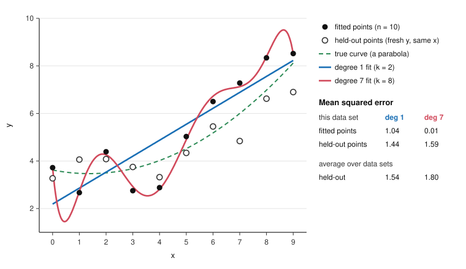

# Philosophy of Science · Lesson 1.6: Simplicity and curve-fitting

> ⏱ ~15 min · Module 1: Induction and confirmation · Builds on: [1.2](01-02-the-new-riddle-of-induction.md), [1.5](01-05-the-problem-of-old-evidence.md), [`statistical-learning` 1.3](../../statistical-learning/lessons/01-03-overfitting-and-train-validation-test.md), [`statistical-learning` 2.5](../../statistical-learning/lessons/02-05-regularization-as-a-bayesian-prior.md) · Unlocks: [2.1](02-01-popper-conjectures-and-refutations.md), [3.2](03-02-the-likelihood-principle.md)

## Why this matters

You fit two regressions. The one with more terms has the higher $R^2$, as it must. You report the other one anyway, because AIC told you to. Every time you do that you take a side in an argument older than statistics: why should a worse fit be a better bet? "Simpler is better" might be a fact about the world, a fact about estimation, or a bias nobody has defended.

## The idea

**The razor first.** [`ancient-medieval-philosophy` 8.4](../../ancient-medieval-philosophy/lessons/08-04-ockham-nominalism-and-the-razor.md) found Ockham saying something modest: do not posit a thing without a reason from self-evidence, experience or authority. That governs what you may assert; it does not say the simplest theory is true. "Simple" also names several things. [Ontological parsimony](../reference.md#ontological-parsimony-and-economy) counts entities or kinds, economy counts assumptions, and they come apart, as when [`apologetics-foundations` 2.2](../../apologetics-foundations/lessons/02-02-answering-the-atheist-philosophers.md) has Oppy counting kinds of commitment and the theist counting unexplained primitives. Statisticians count a third thing, adjustable parameters: a circular orbit is "simpler" than an ellipse without positing fewer planets.

Why would fewer knobs help? Two stories.

*The tailor.* Cut a suit to every wrinkle you had at the fitting and it fits worse next week, when the wrinkles have moved. A curve with many knobs memorizes its data's noise ([overfitting](../reference.md#overfitting), taught in [`statistical-learning` 1.3](../../statistical-learning/lessons/01-03-overfitting-and-train-validation-test.md) and [`machine-learning` 1.2](../../machine-learning/lessons/01-02-generalization-and-the-bias-variance-tradeoff.md)). A simpler family is a steadier instrument, and nothing is claimed about the world.

*The forecasters.* Both say rain. One said "11 to 12 mm", the other "somewhere from 0 to 100". It rains 11.5. Both were right, but the first earned more, having staked herself on a narrow range. A flexible family is the second forecaster: it could have accommodated almost anything, so what happens counts for little in its favour.

The tailor is about prediction, the forecasters about probability. They usually agree; this lesson is about where they don't.

## Source

Newton, *Principia*, Book III, Rule I (tr. Andrew Motte, London, 1729, vol. II):

> We are to admit no more causes of natural things, than such as are both true and sufficient to explain their appearances. To this purpose the philosophers say, that Nature do's nothing in vain, and more is in vain, when less will serve; For Nature is pleas'd with simplicity, and affects not the pomp of superfluous causes.

"True and sufficient" is [the razor](../reference.md#occams-razor) as a methodological rule: it caps causes at what the phenomena require, and says nothing about taking a worse fit for a simpler form. The warrant offered is a claim about *Nature*. The accounts below try to earn the preference without it.

## The math

$P(\cdot)$ is an ideal agent's credence (`epistemology`'s $\mathrm{cr}$). For a family of curves, $k$ is its number of adjustable parameters and $\hat L$ its largest likelihood on $n$ data points. Logs are natural. LIN is $y = a + bx$ plus noise; PAR is $y = a + bx + cx^2$ plus noise.

**1. The [curve-fitting problem](../reference.md#curve-fitting-problem).** Any $n$ points with distinct $x$-values lie exactly on a polynomial of degree $n-1$ ([1.5](01-05-the-problem-of-old-evidence.md)'s cubic through four points), and among nested families $\hat L$ can only rise with $k$.

*In words:* fit alone always votes for the wiggliest candidate, so any preference for a smoother one comes from elsewhere.

**2. [Predictive accuracy](../reference.md#predictive-accuracy)** (Hirotugu Akaike, 1973; for philosophers, Malcolm Forster and Elliott Sober, "How to Tell When Simpler, More Unified, or Less Ad Hoc Theories Will Provide More Accurate Predictions", *BJPS*, 1994). Fit family $F$ to a data set $D_1$, getting best member $\hat\theta(D_1)$; score that curve on a fresh $D_2$ from the same source:

$$A(F) = \frac{1}{n}\,\mathbb{E}_{D_1,D_2}\Big[\ln P\big(D_2 ; \hat\theta(D_1)\big)\Big].$$

*In words:* how well does this family, once fitted, predict data it has not seen?

**3. [Akaike's criterion](../reference.md#akaike-information-criterion).** Under regularity conditions, for large $n$, $(\ln\hat L - k)/n$ is an unbiased estimate of $A(F)$. Equivalently,

$$\mathrm{AIC} = 2k - 2\ln\hat L, \qquad \text{lower wins}.$$

*In words:* the fit flatters itself by about $k$ in log-likelihood, so subtract $k$. Forster and Sober write the first form, a quantity to maximize; $\mathrm{AIC}$ is $-2n$ times it.

Why $k$? The estimate was chosen on the data that score it, inflating $\ln\hat L$ by about $k/2$, and it falls short on fresh data by another $k/2$. With Gaussian errors and known $\sigma$ this is [`statistical-learning` 2.1](../../statistical-learning/lessons/02-01-linear-regression-as-learning.md)'s optimism identity $2p\sigma^2/n$ in likelihood units, and $\mathbb{E}[\mathrm{AIC}]$ equals expected held-out deviance exactly, even for a false family.

$k$ counts only because there is error: in least-squares form the score is residual sum of squares (RSS) $+\,2k\sigma^2$, and at $\sigma = 0$ only fit is left. Nature is not assumed simple; Forster and Sober call simplicity an "epistemic epiphenomenon" (§8). But their Appendix A does assume a "uniformity of nature": one curve generates old data and new. Hume and [grue](../reference.md#grue) are still in the room.

**4. The [marginal likelihood](../reference.md#marginal-likelihood) and the [Occam factor](../reference.md#bayesian-occam-factor).** A family with a prior over its parameters predicts data, so it can be scored as one hypothesis:

$$P(D\mid M) = \int P(D\mid\theta,M)\,P(\theta\mid M)\,d\theta \;\approx\; \hat L \times \frac{\sigma_{\text{post}}}{\sigma_{\text{prior}}}.$$

*In words:* average the family's fit over everything it might have said; for a sharp peak, that is the best fit times the fraction of prior range surviving the data, David MacKay's Occam factor (*Information Theory, Inference, and Learning Algorithms*, 2003, ch. 28; $\sigma$s are characteristic widths). A flexible family spreads its prior over many data sets and pays for the ones that did not occur. Each parameter's posterior width shrinks like $n^{-1/2}$, which yields [Gideon Schwarz's criterion](../reference.md#bayesian-information-criterion) (1978):

$$\mathrm{BIC} = k\ln n - 2\ln\hat L, \qquad \ln P(D\mid M) \approx \ln\hat L - \tfrac{k}{2}\ln n.$$

*In words:* BIC is $-2$ times an approximate log marginal likelihood. Its penalty comes from an integral's shrinking width and estimates no optimism, so it is not the optimism correction of `statistical-learning` 2.1, as AIC is.

**5. Where they part.** Let the simpler of two nested families be true, with one spurious parameter. AIC keeps it with probability $P(\chi^2_1 > 2) = 0.157$ however large $n$ gets. BIC keeps it with probability $P(\chi^2_1 > \ln n)$: 0.032 at $n = 100$, 0.0024 at $n = 10{,}000$. So BIC is consistent for the true family, if it is among the candidates, and AIC is not. Forster and Sober reply that AIC never set out to estimate the dimension. AIC's strength is prediction when no candidate is exactly right (Shibata, 1981). Forster and Sober read such splits as differences of aim.

**6. The [nested-family problem](../reference.md#nested-family-problem).** Every line is a parabola with $c = 0$, so LIN entails PAR, and for any evidence $D$,

$$P(\mathrm{LIN}\mid D) \le P(\mathrm{PAR}\mid D).$$

*In words:* the simpler family can never be the more probable of the two. Popper (*The Logic of Scientific Discovery*, 1959) turned this against Harold Jeffreys's "simplicity postulate"; Forster and Sober (§7) press it on Bayesians generally. Two Bayesian replies. Compare LIN with PAR minus LIN ($c \ne 0$), a disjoint rival a prior may rank freely; but a continuous prior on $c$ gives $c = 0$ probability zero, so LIN needs a point mass. Or leave priors alone: $P(D\mid\mathrm{LIN})$ may exceed $P(D\mid\mathrm{PAR})$, because entailment constrains probabilities, not likelihoods. Forster and Sober answer the first: it changes the question and leaves the ranking unjustified.

**7. [Simplicity as a prior](../reference.md#simplicity-as-a-prior).** [`statistical-learning` 2.5](../../statistical-learning/lessons/02-05-regularization-as-a-bayesian-prior.md) showed a penalty is a negative log-prior, without saying "simplicity"; the step is this: a penalty shrinking coefficients toward zero is a prior crediting smooth curves before any data. That bet inherits [the problem of priors](../../epistemology/lessons/05-04-the-problem-of-priors.md), and since MAP estimates are not reparameterization-invariant, "simplest" depends on coordinates: the language-relativity entrenchment met in [1.2](01-02-the-new-riddle-of-induction.md). Richard Swinburne (*Epistemic Justification*, 2001) accepts the cost: simplicity is a fundamental a priori guide to truth.

**Where the argument is weakest.** Both accounts lean on one premise: that counting adjustable parameters measures simplicity. The strongest objection is the [sub-family problem](../reference.md#sub-family-problem) (Forster and Sober, §6, who say it threatens any parameter count): freeze a parameter at its best-fit value and $\hat L$ stands while $k$ falls, so AIC rates the frozen family higher, down to a single curve with $k = 0$. Their reply: that estimate is unbiased across data sets but known to be too high for a family built from these data, so distrust such families, whoever built them and whenever. The Bayesian mirror image is that the Occam factor is a ratio of widths, and a width is chosen. The Akaikean concedes $k$ alone cannot decide; the Bayesian concedes the prior, not simplicity, does the work.

## The picture

Degree 7 wins on its own points and loses on the held-out ones, though it contains the true parabola and the line does not.

## Worked examples

**Example 1 (clean case: the figure's data).** Here $\sigma = 1$ is known, so $-2\ln\hat L$ is RSS plus a constant all families share, dropped; $\ln 10 = 2.303$. The last column is held-out mean squared error averaged over data sets, $1 + k/n + B^2$, with $B^2$ the mean squared distance from the truth to the family's nearest member.

| Degree | $k$ | RSS | AIC $=$ RSS $+\,2k$ | BIC $=$ RSS $+\,k\ln 10$ | Average held-out |
|---|---|---|---|---|---|
| 1 | 2 | 10.40 | 14.40 | 15.00 | 1.54 |
| 2 | 3 | 5.89 | 11.89 | 12.79 | 1.30 |
| 3 | 4 | 4.18 | 12.18 | 13.39 | 1.40 |
| 7 | 8 | 0.15 | 16.15 | 18.57 | 1.80 |

Both criteria pick degree 2, the true form. Degree 7 has the best fit and the worst scores. The false line still beats degree 7, which contains the truth: its bias $B^2 = 0.338$ costs less than six extra parameters' variance. ([`biophysics` 4.6](../../biophysics/lessons/04-06-single-molecule-inference.md) works a case where the two criteria split.)

**Example 2 (hard case: is this coin fair?).** 59 heads in 100 tosses. $M_0$: $\theta = \tfrac12$, $k = 0$. $M_1$: $\theta$ free with a uniform prior, $k = 1$. For this sequence,

$$\frac{\hat L_1}{P(D\mid M_0)} = \frac{0.59^{59}\,0.41^{41}}{2^{-100}} = 5.098, \qquad P(D\mid M_1) = \int_0^1 \theta^{59}(1-\theta)^{41}\,d\theta = \frac{59!\,41!}{101!}.$$

The exact Occam factor is $P(D\mid M_1)/\hat L_1 = 0.1224$ (the peak approximation gives $\sqrt{2\pi(0.59)(0.41)/100} = 0.123$). So $M_1$ has $5.098 \times 0.1224 = 0.624$ of $M_0$'s marginal likelihood, a [Bayes factor](../reference.md#bayes-factor) of 1.60 for the fair coin. AIC differs: $\mathrm{AIC}_1 - \mathrm{AIC}_0 = 2 - 2(1.629) = -1.26$, favouring $M_1$. BIC: $\ln 100 - 3.258 = +1.35$, favouring $M_0$.

Now change only the prior inside $M_1$. Under $\mathrm{Beta}(5,5)$, concentrated near $\tfrac12$, the Bayes factor for the fair coin is 0.76: the verdict flips. Under $\mathrm{Beta}(\tfrac12,\tfrac12)$, flat in a different coordinate, it is 2.46. Here the account stops: "one extra parameter" does not fix the Occam penalty; the prior does. The Bayesian says a family with no prior predicts nothing, so choosing one is part of stating the hypothesis. Forster and Sober reply that without a principled weighting a family has no well-defined likelihood. The Akaikean needs no prior but can say only that $M_1$ looks the better predictor, nothing about whether this coin is fair. Letting $n$ grow with the $p$-value held fixed is [3.2](03-02-the-likelihood-principle.md)'s Lindley paradox.

## Watch out

- **You might think AIC assumes nature is simple, but actually** its penalty exists because data are noisy, and a false family can have the higher predictive accuracy, as the line does against degree 7.
- **You might think the AIC winner is the family most likely to be true, but actually** AIC ranks estimated predictive accuracy, so a win licenses using the family, not believing it.
- **You might think BIC always penalizes harder than AIC, but actually** it charges $\ln n$ per parameter against AIC's 2, so it is the lighter penalty for $n \le 7$.
- **You might think the Occam factor is a prior favouring simple families, but actually** it lives in the likelihood $P(D\mid M)$, works at equal prior odds, and changes with the prior's width.

## One-liner

> A simpler family can predict better because it has fewer knobs to chase noise, and can earn more credit because it bets on fewer possible data sets, and those reasons answer different questions.

## Problems

**P1 (🟢) *(Formal (a)–(b) · Exegetical (c))*** Two regression families are fitted to the same $n = 60$ observations. Family $A$ has $k = 2$ and $\ln\hat L = -104.3$. Family $B$ adds one parameter to $A$: $k = 3$ and $\ln\hat L = -102.9$.

(a) Compute both AIC values. Which family wins, and by how much?

(b) Compute Forster and Sober's estimate $(\ln\hat L - k)/n$ for each family, and check that AIC is $-2n$ times it.

(c) One sentence: why could the gain in $\ln\hat L$ not have been negative, and why is that gain alone no reason to prefer $B$?

**P2 (🟡) *(Formal (a)–(b) · Exegetical (c))*** Family $S$ has $k = 3$ and $\ln\hat L = -212.4$. Family $C$ contains $S$ and has $k = 5$ and $\ln\hat L = -208.9$. Treat both log-likelihoods as the same at every sample size $n$, to isolate the penalties.

(a) Which family does AIC choose, by how much, and does $n$ matter?

(b) Which family does BIC choose at $n = 20$? At $n = 200$? Find the smallest $n$ at which AIC and BIC disagree.

(c) Two sentences: when they disagree, must one of them be mistaken? Say what each is estimating.

**P3 (🔴) *(Exegetical (a) · Evaluative (b))*** Steelman and reply.

(a) State the nested-family objection to "simpler is more probable", for LIN and PAR, in numbered premises (P1, P2, … ∴ C).

(b) Answer it from one side: defend "simpler is more probable" as a Bayesian, or accept the objection and say what simplicity is then good for. Say what your answer costs. Any verdict; 150 words or fewer.

Solutions

**P1** *(Formal (a)–(b) · Exegetical (c))*

(a) $\mathrm{AIC}_A = 2(2) - 2(-104.3) = 212.6$ and $\mathrm{AIC}_B = 2(3) - 2(-102.9) = 211.8$. Lower wins, so $B$, by $0.8$. (The gain of 1.4 in $\ln\hat L$ exceeds the 1 it costs.)

(b) $A$: $(-104.3 - 2)/60 = -1.7717$. $B$: $(-102.9 - 3)/60 = -1.7650$. Higher wins, so $B$ again. Check: $-2(60)(-1.7717) = 212.6$ and $-2(60)(-1.7650) = 211.8$.

**Must hit, strict (c):**

- $A$ is a special case of $B$, so $B$'s maximum is taken over a larger set and cannot be lower.
- The rise is guaranteed even if the added parameter is spurious, so by itself it cannot show that $B$ predicts better.

**Wrong turns:** reading the higher $\ln\hat L$ as settling the matter; comparing the two forms' signs without noticing one is maximized and the other minimized.

---

**P2** *(Formal (a)–(b) · Exegetical (c))*

(a) $\mathrm{AIC}_S = 6 + 424.8 = 430.8$ and $\mathrm{AIC}_C = 10 + 417.8 = 427.8$. $C$ wins by $3.0$. AIC contains no $n$, so with the log-likelihoods fixed $n$ does not matter.

(b) $\mathrm{BIC}_C - \mathrm{BIC}_S = (5-3)\ln n - 2(3.5) = 2\ln n - 7$.

At $n = 20$: $2(2.996) - 7 = -1.01$, so $C$. At $n = 200$: $2(5.298) - 7 = +3.60$, so $S$.

AIC always chooses $C$, so they disagree exactly when $2\ln n - 7 > 0$, that is $n > e^{3.5} = 33.12$. At $n = 33$ the difference is $-0.007$, still $C$; at $n = 34$ it is $+0.053$, so $S$. The smallest $n$ is **34**.

**Must hit, strict (c):**

- AIC estimates the predictive accuracy of the fitted family; BIC approximates its log marginal likelihood, which bears on how probable the family is.
- So disagreement need not mean error: they can answer different questions (the Forster and Sober reading). Accept the answer that they conflict only if it says both are being read as answers to one question, such as "which family is true?".

**Wrong turns:** rounding $33.12$ down to 33, where BIC still chooses $C$; charging one $\ln n$ instead of two; treating BIC as a corrected AIC.

---

**P3** *(Exegetical (a) · Evaluative (b))*

**Must hit, strict (a):**

- P1: every line is a parabola with $c = 0$, so LIN entails PAR.
- P2: if $X$ entails $Y$, then $P(X\mid D) \le P(Y\mid D)$ for any evidence $D$.
- ∴ C: no coherent probability function ranks LIN above PAR on any evidence, so "the simpler family is the more probable" cannot be true of this pair.

**Must hit, any verdict (b):**

- Say which step your side resists, or that it accepts the conclusion.
- If defending: state the reply exactly (LIN against the disjoint PAR minus LIN, with a point mass at $c = 0$ because a continuous prior gives it probability zero; or the effect relocated to likelihoods) and name what it costs.
- If accepting: say what simplicity is for instead (predictive accuracy, or falsifiability) and what is given up (any warrant for believing the simpler family).

**Wrong turns:** answering that PAR is less probable because it is more complicated, which is the position attacked; treating $P(D\mid\mathrm{LIN}) > P(D\mid\mathrm{PAR})$ as a violation of the entailment premise, when that premise constrains probabilities of hypotheses and not likelihoods; concluding that simplicity is worthless, when the objection hits one formulation.

**Model answer (b), one of several:** The objection is valid against the sentence as worded, but no Bayesian need mean that. When a scientist asks whether a law is linear, the rival is "curved", $c \neq 0$. LIN and PAR minus LIN are disjoint, so a prior may rank them coherently. The first cost: a continuous prior on $c$ gives exactly $c = 0$ probability zero, so I must place a point mass on one exact value, and I owe a reason for it. The second cost: the ranking needs a ground, and I have only a track record or a Swinburne-style a priori claim. Forster and Sober will say I changed the question. I reply that I changed it to the one scientists ask, while conceding I have not shown why the simpler disjunct deserves the larger share.

## Flashback

**From Lesson [1.4](01-04-the-ravens-paradox.md) (The ravens paradox):** *(Formal (a), (c) · Exegetical (b).)* An orchard register (invented, written for this problem) fixes two totals whichever hypothesis below is true: of 1,000 trees, 600 are grafted and 100 are diseased. $H$: every grafted tree is healthy. The rival: exactly 40 grafted trees are diseased. One tree is drawn uniformly from the whole orchard, at even prior odds.

(a) Give the likelihood ratio for $H$ against the rival, and $H$'s posterior, for (i) a healthy grafted tree and (ii) a diseased ungrafted tree. Check each against 1.4's $1/P(B \mid R)$ or $1/P(\neg R \mid \neg B)$, reading grafted as $R$ and healthy as $B$.

(b) Which of A1–A3 fails here, and what does 1.4's inequality then say? Two sentences.

(c) Drop the register's diseased total: the rival now leaves every ungrafted tree as it is under $H$. Recompute (ii), and say in one sentence what the change shows.

Solution

The register fixes both margins, so the two worlds are:

| | healthy | diseased |
|---|---|---|
| $H$: grafted | 600 | 0 |
| $H$: ungrafted | 300 | 100 |
| Rival: grafted | 560 | 40 |
| Rival: ungrafted | 340 | 60 |

(a) (i) $\mathrm{LR} = 600/560 = 15/14 \approx 1.071$, so the posterior is $\frac{15/14}{29/14} = 15/29 \approx 0.517$.

(ii) $\mathrm{LR} = 100/60 = 5/3 \approx 1.667$, so the posterior is $\frac{5/3}{8/3} = 5/8 = 0.625$.

Checks: $P(B \mid R) = \tfrac12 \cdot 1 + \tfrac12 \cdot \tfrac{560}{600} = \tfrac{29}{30}$, and $\tfrac{30}{29} = \frac{15/29}{1/2}$. $P(\neg R \mid \neg B) = \tfrac12 \cdot 1 + \tfrac12 \cdot \tfrac{60}{100} = \tfrac45$, and $\tfrac54 = \frac{5/8}{1/2}$. Measured by $\ln\mathrm{LR}$, the diseased ungrafted tree is worth about 7.4 healthy grafted ones.

**Must hit, strict (b):**

- A3 fails, in reverse: $P(\neg B) = 0.1$ is below $P(R) = 0.6$. A1 and A2 hold, because the register fixes both totals.
- The black-raven ratio exceeds the white-shoe ratio exactly when $P(\neg B) > P(R)$, so here the shoe's counterpart is worth more.

(c) The ungrafted rows now match, with 100 diseased ungrafted trees in each world (and 140 diseased trees in all under the rival), so $\mathrm{LR} = \frac{100/1000}{100/1000} = 1$. Tree (i) stays at $15/14$. The tree's value in (a) came from the assumption of frozen margins: freeze the non-ravens instead and the same count is neutral.

**Wrong turns:** in (b), blaming A1 or A2, which the register secures. Taking (a) to refute the standard solution, when its own formula gives this ranking once A3 is dropped. In (c), keeping the rival's 60, which is the frozen-margins world of (a).

**Model answer (b):** A3 fails in reverse, since $P(\neg B) = 0.1$ is below $P(R) = 0.6$, while the register secures A1 and A2. 1.4's inequality says the black raven beats the shoe exactly when $P(\neg B) > P(R)$, so here the diseased ungrafted tree is the better evidence.

## Connections

- **Backward:** [1.3](01-03-confirmation-as-probability-raising.md)'s likelihoods reappear here with a family in place of a hypothesis, averaged over its parameters. [1.5](01-05-the-problem-of-old-evidence.md)'s cubic through four points is the curve-fitting problem in miniature: spread a family's credence over every possible data set and each member gets a sliver of it, the Occam factor at its most extreme. [1.2](01-02-the-new-riddle-of-induction.md) placed grue in the prior, and simplicity is the prior's other tenant. [`epistemology` 5.4](../../epistemology/lessons/05-04-the-problem-of-priors.md) is the problem this lesson inherits.
- **Forward:** [2.1](02-01-popper-conjectures-and-refutations.md) has Popper's rival moral, simpler as more falsifiable. [2.4](02-04-kuhn-incommensurability-and-theory-choice.md) makes simplicity one of Kuhn's five values. [3.2](03-02-the-likelihood-principle.md) defines Bayes factors in general. [5.1](05-01-realism-and-the-no-miracles-argument.md) asks whether virtues like simplicity track truth at all.
- **Sideways:** simplicity ↔ regularization as a prior in [`statistical-learning` 2.5](../../statistical-learning/lessons/02-05-regularization-as-a-bayesian-prior.md) ↔ model selection in [`machine-learning` 4.1](../../machine-learning/lessons/04-01-model-selection-and-cross-validation.md), whose cross-validation estimates AIC's target by brute force. Simplicity in the best-system account of laws, relative to a vocabulary, is [`metaphysics` 4.3](../../metaphysics/lessons/04-03-powers-dispositions-and-laws.md); simplicity as an explanatory virtue is [`philosophical-method` 2.1](../../philosophical-method/lessons/02-01-inference-to-the-best-explanation.md).
