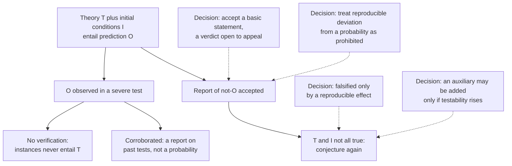

# Philosophy of Science · Lesson 2.1: Popper: conjectures and refutations

> ⏱ ~15 min · Module 2: Falsification, paradigms, and research programmes · Builds on: [1.1](01-01-from-hume-to-a-logic-of-confirmation.md), [`epistemology` 4.3](../../epistemology/lessons/04-03-answering-hume.md) · Unlocks: [2.2](02-02-duhem-quine-and-underdetermination.md), [2.5](02-05-lakatos-and-feyerabend.md), [2.6](02-06-demarcation-after-popper.md)

## Why this matters

You have spent two courses saying "fail to reject" and never "accept". That habit has a philosophical cousin. In Vienna in 1919 a seventeen-year-old noticed that the theories his friends admired most could explain whatever happened, and decided that this was what was wrong with them. From that thought Karl Popper built an account of science with no induction in it, a line between science and everything else, and a rule for when rescuing a theory is cheating. This lesson states the account at full strength, then asks what it owes someone who must act on what survives.

## The idea

For Popper, a theory earns its keep by what it forbids. "All copper conducts electricity" rules out something you could go and find. "Everything happens for a reason" rules out nothing you could ever point at.

[`epistemology` 4.2](../../epistemology/lessons/04-02-humes-problem-of-induction.md) and [4.3](../../epistemology/lessons/04-03-answering-hume.md) gave Hume's argument that past instances cannot support the next case, and four answers to it. Popper's is a fifth: he accepted the argument and denied that science ever needed the inference. A billion conducting wires cannot prove that all copper conducts. One reproducible non-conducting sample refutes it, by [modus tollens](../../philosophical-method/lessons/01-04-argument-forms-and-formal-fallacies.md). So guess boldly, deduce what the guess forbids, and go looking for it. That is [falsificationism](../reference.md#falsificationism).

*Conjectures and Refutations* (1963), chapter 1, tells how the contrast struck him in Vienna. There are three cases, and they differ.

- **Einstein.** General relativity said starlight passing the Sun would bend by a calculable amount. Eclipse plates showing no such shift would refute it. It took a risk.
- **Freud and Adler.** Take two men: one pushes a child into the water to drown it, the other dies trying to save a child. A Freudian explains the first by repression and the second by sublimation. An Adlerian explains both by feelings of inferiority. Popper could think of no behaviour either theory forbade, so the stream of confirmations its admirers cited counted for nothing.
- **Marx.** A different charge. Popper held that early Marxist predictions *were* testable and *were* falsified, and that followers then reinterpreted theory and evidence until they agreed, saving the theory by making it irrefutable. [`social-theory` 2.3](../../social-theory/lessons/02-03-capitalism-and-the-test-of-history.md) reports the charge and leaves its assessment to this course.

Both verdicts are disputed. Adolf Grünbaum (1984) argued that Freud stated refutable claims, and that the theory's real weakness is clinical evidence contaminated by the analyst's suggestion. Maurice Cornforth (1968) rejected Popper's picture of Marxism as dogma. The distinction between explaining everything and predicting something survives either way.

## The argument

**The logic.** Popper's reply to Hume, from *Logik der Forschung* (Vienna, autumn 1934, imprint 1935; in English as *The Logic of Scientific Discovery*, 1959, here *LSD*).

1. **P1.** No finite set of observation reports entails a [strictly universal statement](../reference.md#strictly-universal-and-existential-statements). *In words:* Hume is right about this.
2. **P2.** If a theory $T$ and initial conditions $I$ together entail a prediction $O$, then an accepted report of $\neg O$ entails $\neg(T \wedge I)$. *In words:* the step from a failed prediction is deductively valid, so it needs no defence against Hume. This is the [asymmetry](../reference.md#modus-tollens-asymmetry).
3. **P3.** Natural laws have the form of strictly universal statements, which are prohibitions. *In words:* energy conservation says there is no perpetual motion machine.
4. **P4.** Conjecture, deduction and the elimination of what fails are enough for science to learn from experience. *In words:* nothing inductive has to be added.

∴ **C.** Science needs no inductive inference. *In words:* conjecture and attempted refutation are all there is.

**The criterion.** A theory is [falsifiable](../reference.md#falsifiability) if it divides all possible [basic statements](../reference.md#basic-statement) (singular reports of the form "there is an X at place and time Y") into two non-empty classes: those it permits, and those it rules out, its [potential falsifiers](../reference.md#potential-falsifiers) (*LSD* §21). *In words:* a theory is empirical if some conceivable report would contradict it. This [demarcation](../reference.md#demarcation-problem) criterion sorts science from non-science; it is no criterion of meaning. The asymmetry also has a limit he stated himself (*LSD* §15): "there are white ravens" cannot be falsified, since no finite search contradicts it, and one find verifies it. Universal and existential statements are logical mirror images, and laws sit on the universal side.

**Boldness.** That every planetary orbit is a circle entails that each is an ellipse, not conversely (*LSD* §36), so it forbids more. For any probability function $P$, if $T_1$ entails $T_2$ then $P(T_1) \le P(T_2)$. *In words:* the more a theory says, the less likely it can be, so, Popper concludes, a science aiming at probability would aim at saying nothing. Hence the [bold conjecture](../reference.md#bold-conjecture). Popper even equates simplicity with degree of falsifiability (*LSD* §43), a rival moral to [1.6](01-06-simplicity-and-curve-fitting.md).

**Corroboration.** A theory that survives a severe test, a serious attempt to refute it, is [corroborated](../reference.md#corroboration). Popper insists this is not a probability, and (in his 1974 "Autobiography") that it is a report on past performance which cannot predict future performance. *In words:* it says how the theory has done, and nothing about how it will do.

**Where logic stops, decisions start.** Popper knew P2 alone refutes nothing in a laboratory, and he added rules he called decisions.

- **Basic statements are accepted by decision** (*LSD* ch. V). Testing must stop somewhere. A community accepts a report as a jury reaches a verdict, open to appeal. Experience can motivate the decision but does not justify it.
- **Stray reports do not falsify** (*LSD* §22). A theory counts as falsified only once a reproducible effect contradicting it is established.
- **Auxiliaries must add testability; [conventionalist stratagems](../reference.md#conventionalist-stratagem) are banned** (*LSD* §§19–20). A threatened theory can always be saved: by an [ad hoc](../reference.md#ad-hoc-hypothesis) hypothesis, by redefining a term, by doubting the experimenter or the theorist. Popper's rule: an [auxiliary hypothesis](../reference.md#auxiliary-hypotheses) is acceptable only if it raises the system's testability. Pauli's exclusion principle passes. His own example of a failure, the FitzGerald–Lorentz contraction, he withdrew in a footnote after Grünbaum showed it had testable consequences. (Recent writers say "immunizing strategies". [`philosophical-method` 2.1](../../philosophical-method/lessons/02-01-inference-to-the-best-explanation.md) calls a patch ad hoc when it has no independent *support*; Popper's test is whether it adds *testable content*.)
- **[Probabilistic hypotheses](../reference.md#problem-of-probabilistic-hypotheses) need their own rule** (*LSD* §§65, 68). "This coin is fair" rules out no finite sequence: 1,000 heads running has probability $2^{-1000}$, about $10^{-301}$, tiny and not zero. So Popper grants that probability statements are strictly unfalsifiable, and adds a decision: a repeatable regularity may not be put down to a pile-up of chance. In effect, the sufficiently improbable is treated as prohibited.

**Where the argument is weakest.** P4, at the moment someone has to act. Wesley Salmon ("Rational Prediction", 1981) starts from what Popper grants. Elimination leaves infinitely many unrefuted theories with incompatible predictions, and a prediction needs one as its premise. Popper says to prefer the best corroborated. But corroboration reports only the past. If it bears on the future, induction is back. If it does not, [no reason has been given](../reference.md#salmons-objection-to-corroboration) to prefer that theory for predicting. Salmon disclaims any demand for certainty; he wants some rational basis. J. W. N. Watkins (1968) answered that an agent who must choose has nothing else to go on. Salmon replied that a coin is something else. Popper's own answer ("Replies to My Critics", 1974) separates relying from preferring: rely on no theory, but since you must choose, prefer the best tested, because a proposal that ignores those theories will not survive criticism, and nothing is more rational than critical discussion. That concedes that the preference carries no claim about success. Salmon concedes that refutation is deductive, and he is left owing the justification of induction that [`epistemology` 4.3](../../epistemology/lessons/04-03-answering-hume.md) left open. Lakatos asked Popper for a "whiff of 'inductivism'" (1974) to connect the method to its aim; accepting it would give up P4.

## The picture

Solid arrows are logic; each dashed arrow is a decision Popper added and named as one.

## Worked examples

**Example 1 (clean case: the 1919 eclipse).** The theory and initial conditions: general relativity, the Sun's mass $M$ and radius $R$, and star positions near the Sun on 29 May 1919. The deduction ([`relativity` 6.2](../../relativity/lessons/06-02-orbits-precession-light-bending.md)) gives a deflection at the Sun's edge of $\delta = 4GM/(c^2 R) \approx 1.75$ arc-seconds, where $G$ is the gravitational constant and $c$ the speed of light. Run the criterion.

- *Potential falsifiers:* any report, comparing eclipse and night plates, of a deflection outside the error band around 1.75. That includes no shift at all, and half the value, about 0.875, which Popper's own footnote concedes can be had classically if light is treated as particles. The class is not empty, so the theory is falsifiable.
- *Result:* the findings of the Sobral and Príncipe expeditions, announced on 6 November 1919, favoured the full value. A measurement that could have gone against the theory did not, so it is corroborated: neither proved nor made probable.
- *Decisions:* one Sobral telescope gave blurred images and values nearer the half deflection, and was set aside for that stated reason. A 1979 re-measurement supported the call. The picture marks that kind of decision.

**Example 2 (hard case: Popper on Darwinism).** In his 1974 autobiography (*Unended Quest*, 1976) Popper said Darwinism was not a testable theory but a metaphysical research programme, because "survivors survive" comes close to tautology. He meant no insult: he valued it as a framework for testable theories. In a 1977 lecture at Darwin College (*Dialectica*, 1978) he said he had changed his mind about its testability and logical status: natural selection is testable, though severe tests are scarce. Run the criterion on three formulations.

- "The fittest survive", with fitness read off survival. Nothing is forbidden.
- "Dark peppered moths rise in frequency where soot darkens the trees and birds take the pale form." A falsifiable, tested claim.
- "Natural selection is the main cause of adaptation across life." Darwin named a test: his theory "would absolutely break down" if a complex organ "could not possibly have been formed by numerous, successive, slight modifications" (*Origin*, 6th ed., 1872, ch. VI). But "could not possibly" is no singular report, and a failed selective story can be replaced by another.

The criterion stops at the third line. It sorts statements, and it cannot say which statement *is* the theory. A schema that generates models forbids little, and its instances forbid a lot. Read this way, Popper's reversal changed the formulation he fed the criterion, not the criterion. A Popperian says: test the instances and count the schema as metaphysics that guides inquiry, which is no disgrace. Michael Ruse (1977) and evolutionary biologists reply that selection theory as practised has yielded predictions that survived field and laboratory tests, so "metaphysical" misdescribes it.

## Watch out

- **You might think Popper held that one contrary observation kills a theory, but actually** he required an accepted basic statement, a reproducible effect and a judgment about auxiliaries. "Naive falsificationism" is [Lakatos's label](../reference.md#naive-and-sophisticated-falsificationism), not Popper's description of himself.
- **You might think "falsifiable" means false or already tested, but actually** it is a property of logical form. A theory can be falsifiable and true, falsifiable and never tested, or falsified and still empirical.
- **You might think "unfalsifiable" means worthless or meaningless, but actually** Popper says non-testable ideas can be important and can become testable. His charge is narrower: such ideas cannot claim empirical backing in the scientific sense.
- **You might think corroboration is confirmation renamed, but actually** Popper surrendered the word "confirmation" because it had come to imply probability. He seeks well-corroborated theories, not highly probable ones.

## One-liner

> Popper accepted Hume and removed the inference: science conjectures, deduces what its guess forbids, and looks for it, with openly named decisions where logic runs out, and an unsettled bill when someone must act on what survived.

## Problems

**P1 (🟢) *(Exegetical, strict.)*** For each sentence, say whether it is falsifiable as stated on Popper's criterion. If it is, give one basic statement that would contradict it. If it is not, say what blocks it. One line each.

(i) No metal is liquid at 20 °C.

(ii) Somewhere, at some time, a stable atom of element 126 exists.

(iii) Anyone who recovers after this tonic was helped by it; anyone who does not was, at a deeper level, resisting it.

(iv) Each atom of this isotope has probability one half of decaying within ten minutes.

**P2 (🟡) *(Exegetical · Diagnose.)*** Invented, written for this problem: from a column by Salome Tolliver in *The Harbury Courier*.

> "The tide-clock theory of eel migration is now proved. For thirty years, research teams have tried to catch silver eels leaving the estuary on a rising tide, and every attempt has failed; science can ask for nothing more. Its rival, the salinity-gradient theory, is unfalsifiable. It rests on chemical differences too faint for any instrument we now own, and its supporters have had thirty years to run the decisive tank experiment and have not. It says precisely which eels should leave in which water, and nobody has checked."

(a) What has the tide-clock theory actually earned, in Popper's vocabulary, and why not "proved"? Rewrite the first sentence so that he could sign it. Two sentences.

(b) Tolliver gives two grounds for "unfalsifiable". Say why neither is a ground on Popper's criterion, and which sentence of her own column tells against her. Two sentences.

(c) What would she have to show for the charge to stick, and what can she honestly say instead? One sentence each.

**P3 (🔴) *(Evaluative · Steelman and reply.)*** An engineer must certify a turbine blade for a temperature regime no test has reached. Two creep models fit every test so far. Model A has passed twenty attempts to break it, including tests designed to make it fail. Model B was written last month to fit the same results, and it says the blade will fail early in the new regime. Neither is refuted. Her rule is "use A, because it is better corroborated."

In 150 words or fewer, state Salmon's objection to that rule in its strongest form on this case, give the best Popperian reply, and say what the reply costs. Any verdict.

Solutions

**P1** *(Exegetical, strict)*

**Accept:** any basic statement for (i) that reports a metal liquid at 20 °C. For (iii), a reader may add that the sentence would become falsifiable if "resisting" had a test of its own; that is correct and goes beyond "as stated".

**Must hit, strict:**

- (i) Falsifiable, and already falsified: "This flask, at 20 °C, holds liquid mercury." A false statement can be perfectly empirical.
- (ii) Not falsifiable: it is purely existential, unrestricted in place and time, so no finite set of reports contradicts it. One find would verify it (*LSD* §15).
- (iii) Not falsifiable: recovery and non-recovery are both permitted, so the class of potential falsifiers is empty. "Resisting" is read off the failure to recover.
- (iv) Not strictly falsifiable: a probability forbids no finite sequence. It becomes falsifiable in practice only through Popper's methodological rule, under which a reproducible deviation (a repeatable half-life far from ten minutes) counts against it.

**Wrong turns:** calling (i) unscientific because it is false, which confuses falsified with unfalsifiable. Calling (ii) falsifiable because "we could look", when looking can only verify it. Saying (iv) is falsified outright by a long skewed run, or calling it metaphysical without mentioning the rule.

**Model answer:** (i) Falsifiable and false: "This flask at 20 °C holds liquid mercury." (ii) Not falsifiable: no finite search contradicts "somewhere, at some time", though one find would verify it. (iii) Not falsifiable: every outcome is permitted, because resistance is identified only by the failure to recover. (iv) Not strictly falsifiable: no finite sequence contradicts a probability; under Popper's rule a reproducible half-life far from ten minutes would count as falsifying it.

---

**P2** *(Exegetical · Diagnose)*

**Must hit, strict (a):**

- The theory is corroborated: it has survived serious attempts to refute it.
- It is not proved, because no finite record entails a universal statement (P1), and corroboration is a report on past tests.
- An acceptable rewrite says "is well corroborated" or "has so far survived every attempt to refute it".

**Must hit, strict (b):**

- Falsifiability concerns possible basic statements, not ones we can now obtain, so instruments too weak to detect the gradients do not remove the theory's potential falsifiers. Popper says of Einstein's theory that the instruments of the time might not settle the matter while refutation remained clearly possible.
- Untested is not untestable. An experiment not yet run shows nothing about whether its possible results would contradict the theory.
- Her last sentence tells against her: a theory that says precisely which eels should leave in which water forbids a great deal.

**Must hit, strict (c):**

- For the charge to stick, she must show that no possible report about eels and water would contradict the theory, or that its defenders absorb every contrary result by conventionalist stratagem.
- What she can honestly say is that the rival is uncorroborated: it has earned nothing yet.

**Wrong turns:** calling the rival ad hoc, since the column reports no rescue from a failed test. Saying the rival is unscientific because its chemical differences are unobserved: unobserved entities are no bar if the theory forbids reports about behaviour. Saying thirty years of failure make the tide-clock theory probable, which Popper does not say.

**Model answer:** (a) It has earned corroboration, which reports survival of tests; since no record entails a universal statement, it cannot be proved. "The tide-clock theory is well corroborated: thirty years of serious attempts to catch eels leaving on a rising tide have failed." (b) Falsifiability asks whether some possible report would contradict the theory, so faint chemistry and an unrun experiment are beside the point. Her own last sentence shows the theory forbids specific outcomes. (c) She would have to show that no possible report about eels and water contradicts it, or that its defenders absorb every contrary result. She can honestly say that it is, so far, uncorroborated.

---

**P3** *(Evaluative · Steelman and reply)*

**Must hit, any verdict:**

- State the objection at strength: both models are unrefuted and each yields a prediction for the new regime, so a choice of premise is needed. Popper holds that corroboration reports past performance and cannot predict. So either "better corroborated" bears on the new regime, and induction is back, or it does not, and no reason for preferring A has been given. It is not a demand for certainty.
- Give a Popperian reply that does not claim A is more probable or more likely to succeed. For example: rely on neither, but a certification must survive criticism; A has withstood attempts to break it and B has faced none, so preferring A is what surviving critical discussion amounts to.
- Name the cost: the reason offered concerns critical standing, not expected success; or, if the reply adds a link from survival to future performance, it has accepted an inductive premise and given up P4.

**Wrong turns:** saying A is more probable, which is the claim Popper rejects. Saying B is refuted or unfalsifiable; it is neither, and it makes a sharp prediction. Treating Salmon as demanding a guarantee. Answering "the engineer has nothing else to go on" without meeting Salmon's reply that a coin is something else.

**Model answer, one of several:** A and B are both unrefuted, and each gives a prediction for the new regime, so she needs a reason to choose A as her premise. Popper says corroboration reports only past performance. Then "better corroborated" either tells her something about the new regime, and induction is back, or tells her nothing, and preferring A is no better grounded than a coin. The Popperian replies by separating relying from preferring. She relies on neither model. But a certification must survive criticism, and A has survived attempts to break it while B has faced none, so B's forecast carries an unanswered criticism. The cost is plain: this reason concerns A's critical standing, not its likely success. To get more she must accept an inductive link, which Popper refuses. Salmon, in turn, still owes a justification of that link.

## Flashback

**From Lesson [1.5](01-05-the-problem-of-old-evidence.md) (The problem of old evidence):** *(Formal (a)–(b) · Exegetical (c).)* Invented, written for this problem. Hyun, a hydrologist, has long known that a spring stopped for nine days in 1987 ($E$), allowing a slight chance of a copying error: today $P(E) = \frac{49}{50}$, and her credence in a fault-rupture account $H$ is $P(H) = \frac{49}{150}$. Had she never known $E$, her credences would be $\frac{1}{10}$ in $H$, $\frac{3}{10}$ in a drought account $G$, and $\frac35$ in everything else, $N$. These are exclusive and exhaustive, and give $E$ probability $1$, $\frac12$ and $\frac{1}{12}$.

(a) Find the largest value today's $P(H \mid E)$ can take, as a fraction.

(b) Using the [counterfactual solution](../reference.md#counterfactual-solution)'s $P^{-E}$, find $P^{-E}(E)$ and $P^{-E}(H \mid E)$, then the [difference measure](../reference.md#difference-measure) $d$ exactly and the [log-ratio measure](../reference.md#log-ratio-measure) $r$ to three decimals.

(c) A colleague says (a) and (b) are one repair, since each puts $P(E)$ below 1. What is wrong with that? Two sentences.

Solution

(a) $P(H \wedge E) \le P(H)$, so

$$P(H \mid E) \le \frac{P(H)}{P(E)} = \frac{49/150}{49/50} = \frac13,$$

a rise of at most $\frac13 - \frac{49}{150} = \frac{1}{150}$, a factor of $\frac{50}{49}$.

(b) By total probability,

$$P^{-E}(E) = \frac{1}{10}\cdot 1 + \frac{3}{10}\cdot\frac12 + \frac35\cdot\frac{1}{12} = \frac{2}{20} + \frac{3}{20} + \frac{1}{20} = \frac{3}{10},$$

$$P^{-E}(H \mid E) = \frac{1/10}{3/10} = \frac13.$$

So $d = \frac13 - \frac{1}{10} = \frac{7}{30}$ and $r = \ln\frac{1/3}{1/10} = \ln\frac{10}{3} \approx 1.204$. Check: $H$ gives $E$ probability 1, so $r = -\ln P^{-E}(E) = \ln\frac{10}{3}$.

**Must hit, strict (c):**

- (a) is softening: it lowers $P(E)$ in her actual credal state, and $P(H)/P(E)$ caps the gain at the factor $\frac{50}{49}$.
- (b) leaves her actual credences alone and scores $H$ at a different function, the state she would have been in without $E$. Both end at $\frac13$; they differ in the baseline, $\frac{49}{150}$ against $\frac{1}{10}$, and the second is only as good as the stipulated $P^{-E}$.

**Wrong turns:** in (a), answering 1, which is true of any probability and ignores $P(E)$; in (b), averaging the three likelihoods without weighting them by the credences; taking today's $\frac{49}{150}$ as the baseline for $d$; in (c), calling (b) logical learning, where the thing conditioned on is $L$.

**Model answer (c):** (a) lowers $P(E)$ in the credences she actually has, so the bound holds the gain to a factor of $\frac{50}{49}$. (b) leaves those credences alone and evaluates $H$ at the state she would have had without $E$, where the baseline is $\frac{1}{10}$, so the large rise rests on a function someone had to stipulate.

## Connections

- **Backward:** Hume's problem is [`epistemology` 4.2](../../epistemology/lessons/04-02-humes-problem-of-induction.md), and Popper is the reply [4.3](../../epistemology/lessons/04-03-answering-hume.md) does not list, denying the inference instead of defending it. Hypothetico-deductivism in [1.1](01-01-from-hume-to-a-logic-of-confirmation.md) deduces a prediction too, but counts a success as confirmation, which Popper refuses unless the test was severe, and then calls it corroboration. [1.3](01-03-confirmation-as-probability-raising.md) makes confirmation a rise in probability, which his content argument treats as the wrong target.
- **Forward:** [2.2](02-02-duhem-quine-and-underdetermination.md) presses that P2 hits only the conjunction $T \wedge I$, and asks which conjunct to blame. [2.5](02-05-lakatos-and-feyerabend.md) replaces the single theory with the research programme. [2.6](02-06-demarcation-after-popper.md) asks whether any line can be drawn. [3.3](03-03-replication-error-statistics-and-severe-testing.md) takes up severe testing, Deborah Mayo's descendant of Popper's idea, and a significance threshold is the same kind of decision as the rule for probabilistic hypotheses.
- **Sideways:** [`prob-stat-refresher` 4.3](../../prob-stat-refresher/lessons/04-03-hypothesis-testing.md) is the "fail to reject" of the opening. [`geophysics` 3.4](../../geophysics/lessons/03-04-magnetic-anomalies-reversals.md) has a risky prediction of the Einstein kind, seafloor stripes that had to match reversals dated on land. [`evolution-ecology` 4.1](../../evolution-ecology/lessons/04-01-competition-and-the-niche.md) has a claim that is unfalsifiable as usually deployed, and the null model that repairs it. [`apologetics-catholic-claims` 6.6](../../apologetics-catholic-claims/lessons/06-06-development-or-corruption.md) and [7.1](../../apologetics-catholic-claims/lessons/07-01-the-inquisition-and-the-galileo-affair.md) turn the falsifiability question and the ad hoc charge on doctrine, and [`philosophy-of-religion` 1.1](../../philosophy-of-religion/lessons/01-01-which-god-and-what-an-argument-must-do.md) cites Flew's "Theology and Falsification". [`history-of-political-thought` 1.1](../../history-of-political-thought/lessons/01-01-platos-republic-justice-in-city-and-soul.md) is the other Popper: *The Open Society* on Plato, a different book with a different target.
