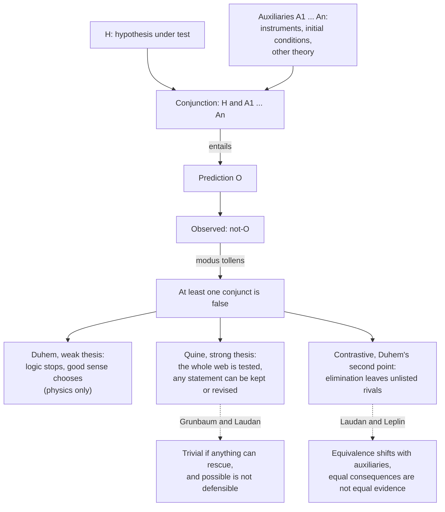

# Philosophy of Science · Lesson 2.2: Duhem, Quine, and underdetermination

> ⏱ ~15 min · Module 2: Falsification, paradigms, and research programmes · Builds on: [2.1](02-01-popper-conjectures-and-refutations.md), [`epistemology` 4.1](../../epistemology/lessons/04-01-a-priori-knowledge.md) · Unlocks: [2.3](02-03-kuhn-normal-science-and-revolutions.md), [2.5](02-05-lakatos-and-feyerabend.md), [5.2](05-02-the-pessimistic-induction-and-selective-realism.md)

## Why this matters

A regression you trust returns the wrong sign. Before you touch the theory you check the merge, the functional form and the instrument's exclusion restriction. [2.1](02-01-popper-conjectures-and-refutations.md) said a failed prediction refutes. This lesson asks *what* it refutes. The answer, from a French physicist in 1906, is a package, and the argument over how much that concedes runs through the rest of this module.

## The idea

A hypothesis alone predicts almost nothing. To get from Newton's law to a place in the sky you also need [auxiliary hypotheses](../reference.md#auxiliary-hypotheses): the planets' masses and positions, how the telescope bends light, that nothing else is pulling. So when the prediction fails, [modus tollens](../reference.md#modus-tollens-asymmetry) convicts the package, and the package has many members.

Which member matters. Uranus strayed from its Newtonian path; Le Verrier blamed the auxiliary that no further planet existed, and Neptune was found in 1846. Mercury's perihelion strayed too; the same move produced Vulcan (1859), which was never found, and the discrepancy waited for general relativity (1915). Same logic, opposite fates.

Pierre Duhem (1861–1916) drew two morals. Experiment cannot name the guilty member. And experiment cannot prove the surviving rival, because nobody can list all the rivals. W. V. O. Quine widened the package to everything we believe, logic included. His web is taught in [`epistemology` 4.1](../../epistemology/lessons/04-01-a-priori-knowledge.md), and [`metaphysics` 1.2](../../metaphysics/lessons/01-02-abstract-objects.md) uses the resulting [confirmational holism](../reference.md#confirmational-holism) as a premise. This lesson owns holism about testing.

So "underdetermination" names two worries. [Holist underdetermination](../reference.md#holist-underdetermination): start from a failed test, and more than one revision restores fit. [Contrastive underdetermination](../reference.md#contrastive-underdetermination): start from the evidence, and more than one theory fits it. The sceptic's premise in [`epistemology` 3.1](../../epistemology/lessons/03-01-the-closure-argument.md), that your evidence does not favour your belief over a deceiver hypothesis, is a third use with a different target.

## Source

Duhem, *La Théorie physique: son objet et sa structure* (Paris: Chevalier & Rivière, 1906), Part II, ch. VI (lesson's translation):

> In sum, the physicist can never submit an isolated hypothesis to the check of experiment, but only a whole set of hypotheses; when experiment disagrees with his predictions, it teaches him that at least one of the hypotheses making up this set is unacceptable and must be modified; but it does not point out to him which one must be changed. (§II, p. 307)
>
> Experimental contradiction does not have, as the reduction to absurdity used by geometers does, the power to turn a physical hypothesis into an incontestable truth; to give it that power one would have to enumerate completely the various hypotheses to which a given group of phenomena can give rise; now, the physicist is never sure of having exhausted all imaginable suppositions; the truth of a physical theory is not decided by heads or tails. (§III, p. 312)

Two claims, and the words that separate them. The first closes on *elle ne lui désigne pas celle qui doit être changée*: experiment does not **point out** the culprit. That limits experiment. It does not make every choice as good, and *doit être modifiée* says something must go. The second turns on *énumérer complètement*: proof by elimination needs a complete list. It is a separate argument: §III grants for the moment that only one hypothesis in each system is in doubt and presses on anyway. The closing *à croix ou pile* ("heads or tails") may pun on the cross of the *experimentum crucis*.

## The argument

**The weak thesis (Duhem 1906).**

- **P1.** A physical hypothesis $H$ entails an observable result $O$ only together with auxiliaries $A_1, \dots, A_n$: $(H \wedge A_1 \wedge \dots \wedge A_n) \vDash O$, where $\vDash$ means "entails". *In words:* no prediction comes from the hypothesis alone.
- **P2.** $\neg O$ is observed.
- **∴ C1.** $\neg(H \wedge A_1 \wedge \dots \wedge A_n)$: at least one conjunct is false, and logic does not say which. *In words:* the test convicts the package.

**Against the crucial experiment.**

- **P3.** A [crucial experiment](../reference.md#crucial-experiment) would turn refutation into proof: of two rivals, eliminate one and the other is established. *In words:* it copies the geometer's reductio.
- **P4.** That needs a list of rivals known to be complete, and no physicist can know that. *In words:* the geometer has two contradictories, the physicist has two candidates.
- **∴ C2.** No experiment proves a physical hypothesis by elimination. *In words:* refuting one rival never crowns the other.

Duhem's case is Foucault's 1850 result that light travels slower in water. It condemned the emission *system*, not the bare idea of light as projectiles, and it did not establish waves in an ether, since Maxwell had supplied a third option.

His scope is physics. He contrasts physiology, where theory can wait outside the laboratory (pp. 296–99), though the physiologist reading a thermometer has trusted a physicist (p. 300). Beyond the logic he appeals to [good sense](../reference.md#good-sense) (*bon sens*, §X): some choices contradict nothing and are still unreasonable. He grants that such reasons are vague and do not reach all minds at once.

**The strong thesis (Quine, "Two Dogmas of Empiricism", 1951).**

- **P5.** Statements face experience only as a body: the unit of test is the whole [web of belief](../reference.md#web-of-belief), logic and mathematics included. *In words:* Duhem's package has no outer edge.
- **P6.** A recalcitrant experience requires some adjustment and no particular one. *In words:* the web has slack.
- **∴ C3.** Any statement can be held true "come what may" given drastic enough adjustments elsewhere, and none is immune to revision. *In words:* nothing is forced in or forced out.

| Term | Claim | Starts from | Whose |
|---|---|---|---|
| Weak thesis | A failed test refutes only a conjunction | A failed test | Duhem, for physics |
| Strong thesis | Any statement can be kept, any revised | A failed test | Quine |
| Contrastive underdetermination | The same evidence supports more than one theory | A body of evidence | Duhem's second point; van Fraassen |

The [Duhem–Quine thesis](../reference.md#duhem-quine-thesis) is a later label fusing the first two rows. The 1951 paper did not cite Duhem; a footnote in the 1953 reprint did. Duhem never asserted C3 and refused to carry his analysis past physics. Imre Lakatos (1970) used "strong" for something more: that no rational rule selects among revisions. Quine does not assert that either.

The contrastive extreme is [empirically equivalent theories](../reference.md#empirically-equivalent-theories): rivals with the same observational consequences. Larry Laudan and Jarrett Leplin ("Empirical Equivalence and Underdetermination", *Journal of Philosophy*, 1991) make [two objections](../reference.md#laudan-leplin-objections). First, the observable shifts with instruments and predictions need auxiliaries that get replaced, so equivalence holds only relative to a state of science. Second, equal consequences are not equal evidence. A theory can be supported by a result it does not entail, and a result it does entail may support it not at all (their case: boys assigned scripture reading reach puberty).

**Where the argument is weakest.** P6, and the slide from it to C3. Adolf Grünbaum ("The Duhemian Argument", 1960) posed a dilemma. If the rescuing auxiliary may be anything (the observed result itself will do), C3 is a triviality. If it must be substantive, nothing general guarantees that one exists. Laudan (1990) adds that logically possible is not rationally defensible, so C3 alone yields no parity among revisions. The Quinean grants that most rescues are absurd and that simplicity and conservatism guide revision, but holds that those standards sit inside the web, so they cannot be a court outside it. The Quinean thereby concedes that C3, read as logic, is idle and that pragmatic standards do the work. The critic concedes that those standards are not certified from outside practice, so "irrational" means "by our present lights".

## Argument map

Above the fork is logic; below it is a dispute about what logic leaves undecided, and who may decide it.

## Worked examples

**Example 1 (clean case): the OPERA neutrinos.** $H$: neutrinos do not outrun light. Auxiliaries: the 730 km baseline, the GPS time transfer, the cable delays, the proton-timing chain. In September 2011 the collaboration reported arrivals 60.7 nanoseconds early, $(v-c)/c \approx 2.5 \times 10^{-5}$, and invited outside scrutiny. By C1 the conjunction is refuted, nothing more. In February 2012 the team named two suspects, a fibre-optic connection at the GPS link and a clock oscillator, and the connector proved not fully screwed in. A separate detector, ICARUS, measured no early arrival, and OPERA's corrected 6.5 ns, with larger uncertainties, is consistent with zero. The auxiliary went, and it could be tested on its own, though that test had auxiliaries too.

Jon Dorling (1979) gave a Bayesian treatment of such allocation. Illustrative numbers: let $P(\cdot)$ be an ideal agent's credence, $A$ the whole timing chain, $P(H) = 0.99$ and $P(A) = 0.9$, independent, with the anomaly $E$ impossible given $H \wedge A$ and equally likely in each of the other three cases. Then

$$P(H \mid E) = \frac{P(H)\,(1 - P(A))}{1 - P(H)P(A)} = \frac{0.099}{0.109} = \frac{99}{109} \approx 0.91,$$

$$P(A \mid E) = \frac{(1 - P(H))\,P(A)}{1 - P(H)P(A)} = \frac{0.009}{0.109} = \frac{9}{109} \approx 0.08.$$

Blame lands hardest on the less credible conjunct. A friend of good sense calls this its vindication. A critic says the priors *are* the good sense, with decimals ([`epistemology` 5.4](../../epistemology/lessons/05-04-the-problem-of-priors.md)).

**Example 2 (hard case): Newton with and without absolute velocity.** Newton took the centre of the system of the world to be "immoveable" (*Principia* Book III, Hypothesis I, Motte 1729). Let $T_v$ be his mechanics and gravitation plus the claim that the centre moves at constant velocity $v$ through absolute space. Newton's laws cannot detect uniform motion of the whole, so every $T_v$ has the same observable consequences: Bas van Fraassen's infinite family of equivalent rivals (*The Scientific Image*, 1980).

Does it stay equivalent? Add the nineteenth-century auxiliary that light travels in an ether at rest in absolute space. Now $T_0$ and $T_v$ predict different interferometer fringes, which is the kind of motion Michelson and Morley sought in 1887 ([`relativity` 1.1](../../relativity/lessons/01-01-postulates-simultaneity.md)). On Laudan and Leplin's view that is the point: equivalence broke when an auxiliary changed. The defender replies that the null result was absorbed by adding a contraction, so an equivalent reappeared; there need only be some equivalent at each time. Kyle Stanford replies differently: $T_v$ tacks on a quantity the theory itself says is undetectable, so delete it.

Here the accounts stop. Whether $T_0$ and $T_v$ are rival theories or one theory with an idle variable is what the dispute needs settled, and neither good sense nor indirect evidence settles it, since no independent result bears on $v$.

## Watch out

- **You might think the Duhem–Quine thesis is one claim the two men shared, but actually** Duhem claimed C1 for physics and Quine claimed C3 for everything. The label fuses them.
- **You might think the weak thesis refutes Popper, but actually** a conjunction really is falsified, and Popper's method already permits auxiliaries that add testable content and bans those that do not ([2.1](02-01-popper-conjectures-and-refutations.md)). "Naive" falsificationism is [Lakatos's label](../reference.md#naive-and-sophisticated-falsificationism), not Popper's description of himself.
- **You might think underdetermination makes theory choice arbitrary, but actually** neither Duhem nor Quine says so. Duhem has good sense; Quine has simplicity and conservatism. Arbitrariness needs a premise neither states: that all logically open revisions are equally defensible.
- **You might think holist and contrastive underdetermination are one problem, but actually** they come apart. Knowing which conjunct to blame would not tell you how many rivals the evidence supports, and the reverse holds too.

## One-liner

> A failed test convicts a conjunction, not a conjunct (Duhem); that anything can survive come what may is Quine's further claim; whether either touches rational choice depends on whether the standards ranking revisions can be trusted from inside the web.

## Problems

**P1 (🟢) *(Close reading. Exegetical.)*** Duhem, *La Théorie physique* (1906), Part II, ch. VI, §II, p. 308, on physics as an organism (lesson's translation, with the French below it):

> If some hindrance, some malaise shows itself in its working, it is by the effect produced on the whole system that the physicist will have to guess the organ that needs to be set right or changed, without its being possible for him to isolate that organ and examine it apart. The watchmaker handed a watch that does not run takes all its wheels apart and examines them one by one until he finds the one that is bent or broken; the doctor presented with a patient cannot dissect him to make his diagnosis; he must guess the seat and cause of the illness solely by inspecting the disorders that affect the whole body; it is the latter, not the former, whom the physicist charged with setting right a lame theory resembles.

> *si quelque gêne, quelque malaise se révèle dans son fonctionnement, c'est par l'effet produit sur le système tout entier que le physicien devra deviner l'organe qui a besoin d'être redressé ou modifié, sans qu'il lui soit possible d'isoler cet organe et de l'examiner à part. L'horloger auquel on donne une montre qui ne marche pas en sépare tous les rouages et les examine un à un jusqu'à ce qu'il ait trouvé celui qui est faussé ou brisé ; le médecin auquel on présente un malade ne peut le disséquer pour établir son diagnostic ; il doit deviner le siège et la cause du mal par la seule inspection des désordres qui affectent le corps entier ; c'est à celui-ci, non à celui-là, que ressemble le physicien chargé de redresser une théorie boiteuse.*

(a) What can the watchmaker do that the doctor cannot, and whom does the physicist resemble? Name the French words that decide each. One sentence.

(b) A reader concludes: "So nothing tells the physicist where the fault lies, and one choice is as good as another." Which verb, used twice, tells against this, and what does the passage say the physicist does instead? Two sentences.

(c) What does *l'organe qui a besoin d'être redressé* presuppose that the strong thesis does not assert? One sentence.

**P2 (🟡) *(Apply to a hard case. Exegetical.)*** In the mid-1870s John Tyndall showed that boiled infusions stayed sterile in dust-free air. In 1876 the procedure began to fail, and boiled infusions rotted. Take:

- $H$: microbes arise only from pre-existing microbes.
- $A_1$: boiling for the set time kills everything alive in the flask.
- $A_2$: the dust-free air and sealed glassware admit no germs afterwards.
- $O$: the infusion stays sterile.

Four responses to the failure of $O$:

(i) Give up $H$: life arose in the flask (the view of defenders of spontaneous generation such as H. C. Bastian).

(ii) Give up $A_1$: some germs survive boiling (Tyndall's move, citing Ferdinand Cohn, after tracing the failures to spores from hay).

(iii) Keep $H$, $A_1$ and $A_2$, and declare the rot a hallucination of the observers.

(iv) Keep $H$, $A_1$, $A_2$ and the observation, and give up modus tollens for this case.

(a) State what the failure of $O$ establishes by logic alone. One line.

(b) For each of (i)–(iv), say whether the weak thesis leaves the move logically open, and whether the strong thesis does. One line each.

(c) Duhem reports a rule for the physiologist (§I, p. 298): a result contrary to prediction may not be put down to some secondary cause unless a special experiment has brought that cause to light. Apply it to (ii). One sentence.

**P3 (🔴) *(Find the crux. Exegetical (a) · Evaluative (b).)*** Two positions on whether empirically equivalent rivals threaten rational choice, in paraphrase:

> **The Quinean.** Two webs that fit all experience are tied so far as experience goes. What breaks the tie (simplicity, conservatism) is pragmatic, and those standards sit in the web, open to revision like anything else.
>
> **Laudan and Leplin.** Grant the equivalence. It still does not follow that the two theories are equally supported, because support is not exhausted by a theory's empirical consequences: a theory can draw support from results it does not entail.

(a) Name the single premise the first must affirm and the second must deny about the standards of evidential support. Two sentences.

(b) What evidence or argument would move that premise, in either direction? Any verdict. 150 words or fewer.

Solutions

**P1** *(Exegetical, strict)*

**Must hit, strict:**

- (a) The watchmaker can take the mechanism apart and test each part alone (*en sépare tous les rouages … les examine un à un*); the doctor cannot (*ne peut le disséquer*). The physicist resembles the doctor (*c'est à celui-ci, non à celui-là*).
- (b) *Deviner*, used of the physicist (*devra deviner*) and of the doctor (*doit deviner*). The physicist works out the faulty organ from its effect on the whole system (*par l'effet produit sur le système tout entier*), as a doctor reads symptoms. The passage bars isolating the part; it does not make the choice arbitrary.
- (c) It presupposes that some organ in fact needs repair, so there is something to find. The strong thesis says only that any statement could be kept given enough adjustment elsewhere.

**Wrong turns:** reading *deviner* as guessing at random, when its model is a doctor's diagnosis. Reading the doctor as guaranteed to find the seat of the illness: the passage says he must infer it and promises no success. Taking the watchmaker as Duhem's picture of physics, when *non à celui-là* excludes him.

**Model answer:** (a) The watchmaker can separate the wheels and examine them singly (*en sépare tous les rouages*), the doctor cannot dissect (*ne peut le disséquer*), and the physicist is the doctor (*c'est à celui-ci, non à celui-là*). (b) *Deviner*, used of both, says the physicist must infer the faulty organ from the state of the whole system, as a doctor infers from symptoms. That is fallible diagnosis, which is a long way from one choice being as good as another. (c) It presupposes a fact about which organ is at fault, whereas the strong thesis says only that any statement can be retained.

---

**P2** *(Exegetical, strict)*

**Must hit, strict:**

(a) At least one of $H$, $A_1$, $A_2$, or the claims used to establish that $O$ failed, is false. Logic does not say which.

(b)

| Move | Weak thesis | Strong thesis |
|---|---|---|
| (i) drop $H$ | open | open |
| (ii) drop $A_1$ | open | open |
| (iii) hallucination | open by logic alone, since Duhem counts the propositions used to establish that the effect failed; he would call it unreasonable, not illogical | open (Quine's own example of how far one can go) |
| (iv) give up modus tollens | not open: logic produced "at least one is false" and is not a member of the set | open: no statement is immune, logic included |

(c) The rule bars (ii) until a special experiment has shown that some germs survive boiling; Cohn's and Tyndall's work on heat-resistant spores is that experiment, so afterwards the move is licensed.

**Wrong turns:** treating "open" as "recommended": neither thesis ranks the moves, and that is good sense's job or the pragmatic standards' job. Saying the weak thesis forbids (iii) because it is silly. Saying the strong thesis endorses (iii) or (iv); it says only that they are available. In (c), reading the rule as Duhem's rule for physics: he reports it for physiology, and §I contrasts physics, where the auxiliary cannot be brought out so simply.

**Model answer:** (a) Something among $H$, $A_1$, $A_2$ and the claims used to read the flask is false. (b) (i) and (ii): open on both. (iii) Open on both, though good sense would reject it; Duhem would call it unreasonable and Quine would cite conservatism. (iv) Closed on the weak thesis, since the argument relies on logic, and open on the strong thesis. (c) Tyndall may blame the boiling only once a special experiment has demonstrated surviving germs, which the work on spores supplied.

---

**P3** *(Exegetical (a) · Evaluative (b))*

**Must hit, strict (a):** The premise concerns the standards of support: that they sit inside the web, so they cannot constrain the choice from a position not itself under revision in that choice. The Quinean must affirm it: such standards are revisable in the same way as anything else. Laudan and Leplin must deny it, or at least hold that present standards count as real constraints on support (Laudan 1990 states the general point: ampliative rules, not logic alone, rank revisions).

**Must hit, any verdict (b):**

- Say what would count on each side: a standard that has survived every revision and is argued for independently, or a case where a standard of evidence was itself changed by what was found.
- Face the regress: whatever judged that change was itself a standard, so the case can be read either way until someone says what stands outside it.
- Say what follows for "threatens rational choice": if the standards are revisable, whether a tie is rationally broken depends on standards a rival web could lack; if they are fixed, the tie is broken but the fixing needs defending.

**Wrong turns:** naming "whether equivalent rivals exist" as the crux. Laudan and Leplin also deny that, but the stem grants it, so the crux survives. Saying Quine holds theory choice irrational: he holds it is guided by pragmatic standards. Treating the indirect support that Laudan and Leplin cite as settling the matter, when the Quinean can reply that what counts as indirect support is itself fixed by the web.

**Model answer (b), one of several:** Two things would move it. Blinding in clinical trials looks like a standard learned from experience, since unblinded trials turned out biased. That favours the Quinean: an evidential norm was revised because of evidence. But the revision was judged by something, namely a prior commitment to reliable discrimination between treatments, and the critic will say that commitment stayed fixed. So the case moves the premise only if nothing survives every such revision. The other direction would be an independent argument that a standard tracks truth, for instance that a method using it converges where rivals do not. The cost on that side is that the convergence result assumes standards of its own. Either way, "rational" ends up meaning rational by some standards held fixed for now, and the dispute is over whether that is enough.

## Flashback

**From Lesson [1.6](01-06-simplicity-and-curve-fitting.md) (Simplicity and curve-fitting):** *(Formal (a)–(c) · Exegetical (d).)* Let family $S$ be true, and let family $B$ contain it with two spurious parameters. Write $\Lambda = 2(\ln\hat L_B - \ln\hat L_S)$, where $\hat L$ is a family's largest likelihood on $n$ data points, and take the large-sample result as exact: $\Lambda$ has a $\chi^2_2$ distribution, so $P(\Lambda > x) = e^{-x/2}$ for $x \ge 0$.

(a) For which $\Lambda$ does AIC choose $B$? With what probability, exactly and to three decimals?

(b) The same for BIC, as a function of $n$. Evaluate at $n = 50$ and $n = 5{,}000$.

(c) After the fit, an analyst freezes $B$'s two extra parameters at their best-fit values and calls the result $F$: $S$'s parameter count, $B$'s $\ln\hat L$. Write $\mathrm{AIC}_F$ in terms of $\mathrm{AIC}_B$, then in terms of $\mathrm{AIC}_S$ and $\Lambda$.

(d) What premise does $F$ threaten, and what is Forster and Sober's reply? Two sentences.

Solution

(a) $\mathrm{AIC}_B - \mathrm{AIC}_S = 2(2) - \Lambda = 4 - \Lambda$, so AIC chooses $B$ exactly when $\Lambda > 4$, with probability $e^{-2} \approx 0.135$, the same at every $n$.

(b) $\mathrm{BIC}_B - \mathrm{BIC}_S = 2\ln n - \Lambda$, so BIC chooses $B$ exactly when $\Lambda > 2\ln n$, with probability $e^{-\ln n} = \frac1n$: $0.02$ at $n = 50$ and $0.0002$ at $n = 5{,}000$. This falls to zero as $n$ grows; AIC's probability does not.

(c) With $k$ the parameter count of $S$, $\mathrm{AIC}_F = 2k - 2\ln\hat L_B$, while $\mathrm{AIC}_B = 2(k+2) - 2\ln\hat L_B$ and $\mathrm{AIC}_S = 2k - 2\ln\hat L_S$. So

$$\mathrm{AIC}_F = \mathrm{AIC}_B - 4, \qquad \mathrm{AIC}_F = \mathrm{AIC}_S - \Lambda.$$

Since $S$ is nested in $B$, $\Lambda \ge 0$: $F$ beats $B$ by exactly 4 on every data set and never loses to $S$.

**Must hit, strict (d):**

- This is the [sub-family problem](../reference.md#sub-family-problem), which threatens the premise that counting adjustable parameters measures simplicity.
- Their reply: the estimate $(\ln\hat L - k)/n$ is unbiased across data sets but known to be too high for a family built from these data, so distrust such families, whoever built them and whenever.

**Wrong turns:** in (a), reusing the lesson's one-parameter threshold of 2, which gives $e^{-1} \approx 0.368$; in (b), charging one $\ln n$ for two parameters, which gives $1/\sqrt n$; in (c), giving $F$ the parameter count of $B$ because it came from $B$, when the frozen values adjust nothing; in (d), saying AIC punishes $F$ for overfitting, when AIC sees only $k$ and $\hat L$.

**Model answer (d):** The frozen family keeps $B$'s fit and sheds $B$'s parameter count, so it threatens the premise that counting adjustable parameters measures simplicity. Forster and Sober reply that the estimate, though unbiased across data sets, is known to be too high for a family built from these very data, so such a family is to be distrusted whoever built it.

## Connections

- **Backward:** [2.1](02-01-popper-conjectures-and-refutations.md) built falsificationism on modus tollens, and this lesson asks what the conclusion of that inference is. [1.1](01-01-from-hume-to-a-logic-of-confirmation.md)'s hypothetico-deductivism already needed auxiliaries to get a prediction out of a hypothesis. [`philosophical-method` 2.1](../../philosophical-method/lessons/02-01-inference-to-the-best-explanation.md) named the ungenerated rival, which Duhem's P4 makes a limit on elimination.
- **Forward:** [2.3](02-03-kuhn-normal-science-and-revolutions.md) describes what scientists do with anomalies in practice. [2.5](02-05-lakatos-and-feyerabend.md) gives the auxiliaries a name, the protective belt, and tries to state when protecting them stops being rational. [3.5](03-05-objectivity.md) meets the argument that underdetermination makes room for values. [5.2](05-02-the-pessimistic-induction-and-selective-realism.md) turns P4 into Stanford's [unconceived alternatives](../reference.md#unconceived-alternatives).
- **Sideways:** Quine's web and the a priori are [`epistemology` 4.1](../../epistemology/lessons/04-01-a-priori-knowledge.md); indispensability is [`metaphysics` 1.2](../../metaphysics/lessons/01-02-abstract-objects.md); analyticity goes to [`philosophy-of-language-and-logic`](../../philosophy-of-language-and-logic/syllabus.md), and [`philosophy-of-physics`](../../philosophy-of-physics/syllabus.md) uses these definitions. Mercury's numbers are [`relativity` 6.2](../../relativity/lessons/06-02-orbits-precession-light-bending.md). [`thomistic-synthesis` 3.1](../../thomistic-synthesis/lessons/03-01-demonstrating-that-god-exists.md) reads an unseen perturber as a *quia* demonstration. [`ancient-medieval-philosophy` 7.1](../../ancient-medieval-philosophy/lessons/07-01-faith-reason-and-the-paris-crisis.md) uses "Duhem's thesis" for a different claim, about 1277.
