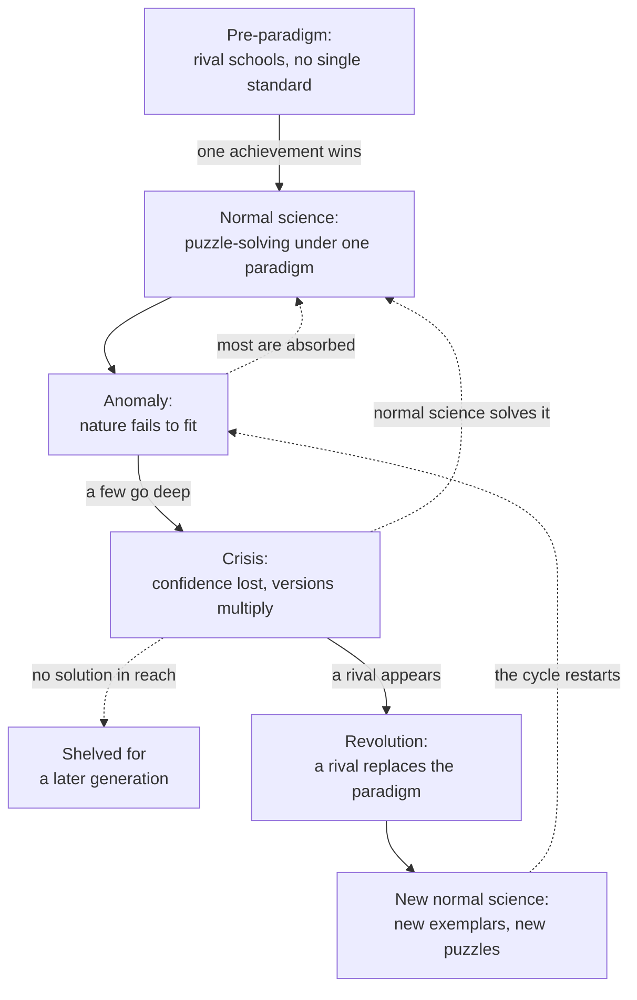

# Philosophy of Science · Lesson 2.3: Kuhn: normal science and revolutions

> ⏱ ~15 min · Module 2: Falsification, paradigms, and research programmes · Builds on: [2.1](02-01-popper-conjectures-and-refutations.md), [2.2](02-02-duhem-quine-and-underdetermination.md) · Unlocks: [2.4](02-04-kuhn-incommensurability-and-theory-choice.md)

## Why this matters

You regress quantity on price, the demand curve slopes up, and you do not announce that the law of demand is false: you check the merge, suspect [simultaneity](../../econometrics/lessons/03-05-measurement-error-and-simultaneity.md), and go looking for an instrument. [Falsificationism](../reference.md#falsificationism) ([2.1](02-01-popper-conjectures-and-refutations.md)) prizes the readiness to give a theory up, and the [Duhem–Quine thesis](../reference.md#duhem-quine-thesis) ([2.2](02-02-duhem-quine-and-underdetermination.md)) says logic lets you blame something else. Thomas Kuhn (1922–96; not the Harold Kuhn of Kuhn–Tucker), a physicist turned historian, asked what scientists actually do with a failed prediction. *The Structure of Scientific Revolutions* (1962; Postscript 1969) answers that protecting the framework is most of the job, and the reason the job works.

## The idea

A crossword solver whose answer will not fit blames herself. She assumes the grid is sound and a solution exists, and that assumption lets her stay on one hard clue. Kuhn's claim is that most scientists, most of the time, stand in that relation to their field's foundations. He calls the work [normal science](../reference.md#normal-science): puzzle-solving, which means fixing the facts the theory says matter, matching theory to fact, and extending theory to new cases. A failed puzzle reflects on the solver, not on the rules.

What sets the puzzles is a [paradigm](../reference.md#paradigm). The 1962 book used the word loosely: Margaret Masterman (1970) counted "not less than twenty-one" senses, and the Postscript, citing her, reports twenty-two. Kuhn then split it in two.

- A [disciplinary matrix](../reference.md#disciplinary-matrix) is what a community shares: symbolic generalizations ($f = ma$, force equals mass times acceleration), models (gas molecules as tiny elastic billiard balls), values, and exemplars.
- An [exemplar](../reference.md#exemplar) is a concrete solved problem met in training, and Kuhn later called this sense the book's most original and least understood idea. Nobody learns $f = ma$ as a rule. You learn to see free fall and the pendulum as versions of it, just as you learned [difference-in-differences](../../econometrics/lessons/04-03-difference-in-differences.md) from worked cases and now see a new policy study as that shape of problem.

Before a field has one paradigm it has rival schools, the [pre-paradigm period](../reference.md#pre-paradigm-period): electricity before Franklin had almost as many views as experimenters. (The Postscript corrects the label: each school had a paradigm, and what was missing was a single one.) Once one achievement wins, normal science starts.

Sometimes nature refuses to fit: an [anomaly](../reference.md#anomaly-and-crisis). Most get absorbed. For about sixty years after Newton, the predicted motion of the Moon's perigee was half the observed value. Proposals to amend the inverse-square law went nowhere, and around 1750 Clairaut showed that the fault lay in the mathematics. A few anomalies go deep enough to shake confidence in the practice itself. That is crisis, and its symptom is a multiplying of versions of the theory. A crisis closes in one of three ways: normal science solves the problem after all, the problem is shelved for a later generation, or a rival arrives. Only the third is a [scientific revolution](../reference.md#scientific-revolution), and Kuhn holds that a paradigm is never dropped without a replacement. He denies that revolutions are purely cumulative: some explanatory power can be lost, which later writers named [Kuhn loss](../reference.md#kuhn-loss).

## The argument

What is this description for? Paul Feyerabend ("Consolations for the Specialist", 1970) complained that he could not tell whether Kuhn was prescribing or describing, and suspected the ambiguity was deliberate: history lending authority to an unargued value judgment. Kuhn ("Reflections on My Critics", 1970) answered that it should be read both ways at once, by a route that can be set out.

1. **P1 (behaviour).** Members of a mature field work for long stretches inside one paradigm, charge a failed puzzle to the solver or to a fixable detail, and give the paradigm up only in crisis and only for a rival. *In words:* this is what scientists do, whatever the methodology books say.
2. **P2 (function).** That conduct does three jobs. It frees effort for expensive precision work no one would undertake while foundations were in dispute. It yields expectations sharp enough that a violation stands out. And its resistance keeps the field from being lightly distracted, so whatever forces change has gone to the core. *In words:* commitment buys depth, sensitivity and a filter.
3. **P3 (no substitute).** No other way of organizing research would do those jobs. *In words:* you cannot have the benefits without the commitment.
4. ∴ **C (conditional norm).** If the aim is to improve scientific knowledge, scientists should behave essentially as they do, resistance included. *In words:* the "ought" is conditional, and it inherits whatever is wrong with P1–P3.

The Postscript admits a circle, since the behaviour supports the theory and the theory recommends the behaviour. It denies the circle is vicious, because the theory keeps reaching past the observations it started from.

**Kuhn adds that a paradigm shapes what gets seen.** In Bruner and Postman's 1949 experiment, subjects shown trick cards, such as a red six of spades, at first named them as normal cards without hesitation, then sensed something wrong, then mostly saw it, sometimes suddenly. N. R. Hanson (*Patterns of Discovery*, 1958, ch. I) asked whether Tycho and Kepler, watching the dawn, see the same thing, and argued that seeing is more than having a retinal image. This is the [theory-ladenness of observation](../reference.md#theory-ladenness-of-observation), and later writers separate three claims under that label: theory can affect what observers perceive, what they attend to, and what their reports mean. Kuhn extends it with the duck-rabbit, likening the change after a revolution to a [gestalt switch](../reference.md#gestalt-switch), and then limits the metaphor himself. A gestalt subject can flip back and forth and knows the lines on the page never changed. A card subject has an experimenter to say what was there all along. A scientist has neither, and does not see a thing *as* something else, he says, but simply sees it.

**Where the argument is weakest.** P3, because P1 and P2 can be granted while it fails. Feyerabend's objection at full strength: growth comes from the interplay of tenacity and [proliferation](../reference.md#tenacity-and-proliferation), several tenaciously held rivals running at once and exposing troubles the others hide, so monopoly is not required and Kuhn's separation of quiet periods from proliferating ones collapses. Karl Popper ("Normal Science and Its Dangers", 1970) grants that normal science exists, disputes that it is typical, and calls the dogmatically trained normal scientist a danger to science. The strongest reply open to Kuhn points to the record before consensus, where foundations were argued endlessly and little accumulated, and loosens the monopoly: the communities that hold paradigms are small, around a hundred people and sometimes under twenty-five, so one field can house many. Each side concedes something. Kuhn's "ought" holds only in the absence of an alternative, a condition he states himself. Feyerabend keeps tenacity, so some resistance is functional on his account too.

## The cycle

Solid arrows trace the route the book is named for; the dashed arrows are the commoner outcomes, which is why most anomalies never make the history books.

## Worked examples

**Example 1 (clean case: oxygen).** Kuhn's own, stage by stage.

- *Normal science.* Phlogiston theory says bodies burn because they are rich in phlogiston, and metals resemble each other because each is an earth combined with it.
- *Anomaly.* Burning should release something, yet bodies can gain weight. The fact sat at the edge of chemists' attention for years, until gas chemistry and routine weighing brought it forward.
- *Crisis.* By the early 1770s there were almost as many versions of the theory as chemists working on gases. Some gave phlogiston negative weight. None proposed replacing it, but it was getting harder to say what it was.
- *Revolution.* In a sealed note lodged with the French Academy in 1772, Antoine Lavoisier recorded that burning bodies absorb part of the atmosphere. Joseph Priestley collected a gas from heated red oxide of mercury in 1774 and by 1775 took it for air with less than its usual phlogiston. By 1777 Lavoisier had concluded it was a distinct constituent of the atmosphere, which Priestley never accepted.
- *New normal science.* Lavoisier's *Traité élémentaire de chimie* (1789) supplies new exemplars built on the balance. Phlogiston's account of why metals are alike is lost, a Kuhn loss.

P2 is visible here: the weight gain became a sharp anomaly only once exact weighing made the expectation exact.

**Example 2 (hard case: continental drift).** [`geology` 2.1](../../geology/lessons/02-01-evidence-for-drift.md) has the history: Alfred Wegener's case (1912–15), its rejection, and the seafloor data that won by about 1968. Parts fit. Land bridges absorbed the fossil matches as a normal repair, conversion was fast once it came, and Harold Jeffreys held out until his death in 1989, as Priestley had. Three things strain.

- *Whose paradigm?* Naomi Oreskes (*The Rejection of Continental Drift*, 1999) documents European geologists receptive long before Americans, which suggests no field-wide matrix to overthrow. Kuhn can answer that paradigms belong to communities, but then there was no single revolution.
- *What crisis?* The decisive anomalies came from new post-war ocean surveys, not from failing puzzles. The Postscript allows this, making crisis the usual prelude and not a prerequisite, at the price of turning the cycle into a tendency.
- *Was the resistance reasonable?* Here the account stops giving a verdict. [`geology` 2.1](../../geology/lessons/02-01-evidence-for-drift.md) says yes, because Jeffreys's physics ruled out the only mechanism on offer. Oreskes denies that the mechanism was the reason: Arthur Holmes's mantle convection was in print by 1931, and the American rejection turned on drift's conflict with American standards of practice. Kuhn predicts resistance to any challenge, sound or unsound, so his description cannot sort these. A Kuhnian says that is not its job, since P2 defends a policy and not each instance. A critic replies that a norm which cannot separate good resistance from bad gives a working scientist no guidance.

## Watch out

- **You might think Kuhn said science is irrational, but actually** he denied that a rule compels the choice between paradigms, which is a different claim. Whether reasons without a rule are enough is [2.4](02-04-kuhn-incommensurability-and-theory-choice.md).
- **You might think a paradigm is just a widely held theory, but actually** that is the loose sense, as in [`geology` 2.1](../../geology/lessons/02-01-evidence-for-drift.md)'s "working paradigm". Kuhn's core sense is the shared solved problem, and replacing one changes what counts as a problem and as a solution.
- **You might think normal science tests nothing, but actually** proposed puzzle-solutions are tested and can fail. What is not on trial is the paradigm they work within.
- **You might think theory-ladenness means you see whatever your theory predicts, but actually** Bruner and Postman's subjects mostly did come to see the trick card, and Priestley and Lavoisier, holding rival theories, reported closely similar measurements. Expectation shapes observation, and observation can still defeat it.

## One-liner

> For Kuhn, science advances because its practitioners usually decline to question their framework: commitment to a paradigm produces the precise puzzle-solving that makes a deep anomaly visible, and it usually takes a crisis with a rival on hand to replace it.

## Problems

**P1 (🟢) *(Exegetical, strict.)*** Classify each episode as pre-paradigm, normal science, anomaly without crisis, crisis, or revolution, and give the words that decide it. One line each.

(i) From antiquity to the late seventeenth century, rival schools offer Epicurean, Aristotelian and Platonic variants on what light is, and each treats a different cluster of optical phenomena as the ones that matter.

(ii) In July 2012 the ATLAS and CMS experiments at CERN report a new particle consistent with the Higgs boson, postulated in 1964 and required by the Standard Model. The machine had been built in part to look for it. Headlines call the result a revolution.

(iii) From the late 1960s the Homestake chlorine detector counts about a third of the solar neutrinos the standard solar model predicts. For years physicists suspect the experiment or the model of the Sun, and particle physics carries on with its ordinary work.

(iv) In 1925, with the rules of the old quantum theory visibly failing and months before matrix mechanics offers a way forward, Wolfgang Pauli writes to a friend that physics is confused again and that he wishes he had been a film comedian.

**P2 (🟡) *(Exegetical (a)–(b).)*** Diagnose this press release, invented, written for this problem.

> "Tavistow Labs today announced a paradigm shift in energy storage: a cell that stores more energy per kilogram than any on the market. 'We ran the same electrochemical models everyone in the industry runs, on a better cathode coating, and the cell behaved as those models predicted,' said chief executive Emre Vasse. 'Independent labs will verify it with the standard cycling protocol. Anyone who doubts our numbers is simply stuck in the old paradigm, and history shows such people are always wrong.'"

(a) Name three features of the release that mark what it describes as normal science, and say what a revolution would need that is absent. Four lines at most.

(b) Does Kuhn's account of resistance support Vasse's last sentence? Two sentences.

**P3 (🔴) *(Evaluative.)*** Two receptions. In 1983 reviewers for the Gastroenterological Society of Australia turn down Barry Marshall and Robin Warren's work linking a stomach bacterium to ulcers, in a field that blamed stress and acid and doubted bacteria could live in the stomach. In 1989 leading physicists dismiss Martin Fleischmann and Stanley Pons's claim of room-temperature fusion within months, since the expected neutrons were missing and replications failed. Treat both as a community resisting a reported anomaly. Is resistance to anomalies a virtue in scientists, or only a useful habit of communities? Any verdict, 150 words or fewer.

Solutions

**P1** *(Exegetical, strict)*

**Must hit, strict:**

- (i) **Pre-paradigm**: "rival schools", each with its own "cluster of optical phenomena". There is no single standard of what needs explaining. (This is Kuhn's own case. Saying that each school had its own paradigm but the field had no single one is the Postscript's refinement, and earns full credit.)

- (ii) **Normal science**: "required by the Standard Model" and "built in part to look for it". This is matching fact to theory, like the giant scintillation counter Kuhn cites, built to demonstrate the neutrino. The headlines do not change the stage.

- (iii) **Anomaly without crisis**: "suspect the experiment or the model" and "carries on with its ordinary work". The failure is charged to fixable details and normal practice is intact.

- (iv) **Crisis**: "visibly failing", "confused again", and no replacement yet ("months before"). Confidence in the practice is shaken and no rival has arrived.

**Wrong turns:** calling (ii) a revolution because it is famous or expensive; nothing in the matrix changed. Calling (iii) a crisis because it lasted decades; duration is not the test, as the Moon's perigee shows. Calling (iv) a revolution because quantum mechanics followed; the stem stops before any rival exists.

**Model answer:** (i) pre-paradigm: rival schools with no shared set of phenomena. (ii) normal science: a predicted entity found with apparatus built to find it. (iii) anomaly without crisis: blame falls on the experiment or the solar model and work continues. (iv) crisis: the rules are failing, a leading practitioner is in despair, and no rival exists yet.

---

**P2** *(Exegetical (a)–(b))*

**Accept:** any three of the four features below, each tied to its words.

**Must hit, strict (a):**

- Unchanged models: "the same electrochemical models everyone in the industry runs".

- No anomaly: the cell "behaved as those models predicted", so a puzzle was solved.

- Unchanged standards: "the standard cycling protocol" fixes what counts as a good result.

- Measured on the existing scale: "more energy per kilogram" is an improvement by the current criterion, not a new criterion.

And what is absent: an anomaly the old practice could not absorb, usually a crisis, and a rival that changes the models, the exemplars and what counts as a problem or solution.

**Must hit, strict (b):** No. On Kuhn's account resistance meets any challenge, sound or unsound, so being doubted is no evidence of being right, and most anomalies are absorbed with the old paradigm intact (a crisis can also close that way). Doubting a reported result is what normal science does to a proposed puzzle-solution, and by the release's own description the doubters share Tavistow's paradigm.

**Wrong turns:** saying the cell is no paradigm shift because the gain is small; the criterion is what changes, not how much. Reading (b) as "Kuhn says resisters are irrational", or as "Kuhn says resisters are always right"; he says neither.

**Model answer:** (a) Tavistow used the industry's own models, got the result they predicted, and will be judged by the standard protocol on the standard measure, so a puzzle was solved inside the paradigm. A revolution would need an anomaly the old practice could not absorb and a rival that changed the models and what counts as a solution. (b) No: resistance greets every challenge, and most challenges fail, so being doubted is no credential. The doubters are also inside the same paradigm, testing a puzzle-solution, which is what normal science is supposed to do.

---

**P3** *(Evaluative)*

**Must hit, any verdict:**

- State Kuhn's claim precisely: resistance is functional (depth, sensitivity, filter), and the "ought" is conditional on there being no substitute.

- Say who bears the alleged virtue. A habit can serve a community without being a good trait in every member, and a community may need only some of its members to resist.

- Use both cases. A defender of resistance must accept the ulcer delay as a cost of the policy. A critic must say what else would have kept claims like cold fusion from absorbing a field's effort.

- Press P3 with a named alternative (Feyerabend's tenacity plus proliferation, or Popper's critical attitude) and say what that alternative costs.

**Wrong turns:** grading each reception by how it turned out; the question is about a disposition across cases. Treating "functional" as if it meant "justified", which skips P3. Saying that Popper forbids all tenacity; he permits auxiliaries that increase testability ([2.1](02-01-popper-conjectures-and-refutations.md)).

**Model answer, one of several:** Resistance is a virtue of communities and only derivatively of individuals. Kuhn's claim is functional: commitment buys precision and makes a deep anomaly stand out, and resistance filters distraction. Both receptions come from one disposition, so a defender must accept the ulcer delay as the policy's price, and a critic must say what else would have kept cold fusion from consuming a field's effort. The critic's best candidate is Feyerabend's tenacity plus proliferation, with some dissenters funded to pursue rivals. That attacks P3, not P2: the filter needs enough resisters, not everyone. It costs something, since proliferation draws on the budget precision work needs. So I call resistance a virtue in a community whose dissenters can still be heard, and neither virtue nor vice in any given member.

## Flashback

**From Lesson [2.1](02-01-popper-conjectures-and-refutations.md) (Popper: conjectures and refutations):** *(Exegetical, strict · Apply to a hard case.)* Invented, written for this problem. Theory $T$: every sample of a certain ceramic at standard composition superconducts below 90 K. A technician reports one sample that did not; no one repeats it. Later, three laboratories reproduce the failure on one supplier's samples. Defenders reply:

(i) "A sample that fails below 90 K is, by that fact, not at standard composition."

(ii) "That supplier's firing drives out oxygen, so its samples are off standard: annealing them in oxygen should restore the effect, and depleting others' samples should destroy it." Nobody has yet measured the oxygen.

(iii) "An undetectable influence was at work in those samples."

(a) Why does the technician's report not falsify $T$ for Popper? One sentence.

(b) Apply his ban on [conventionalist stratagems](../reference.md#conventionalist-stratagem) and his rule for [auxiliaries](../reference.md#auxiliary-hypotheses) to (i)–(iii). One line each.

(c) A critic calls (ii) ad hoc because nothing yet supports it. Is that Popper's test? Two sentences.

Solution

**Must hit, strict (a):**

- A stray report does not falsify (*LSD* §22): $T$ counts as falsified only once a reproducible effect contradicting it is established.

**Must hit, strict (b):**

- (i) Banned, a conventionalist stratagem. It redefines "standard composition" so that no failure could count against $T$, which leaves $T$ with no potential falsifiers.
- (ii) Passes. It raises the system's testability: annealed samples that still fail, or depleted samples that still superconduct, would contradict it.
- (iii) Fails. It forbids nothing, since no report could contradict an undetectable influence, so testability does not rise.

**Must hit, strict (c):**

- No. Popper asks whether an auxiliary raises testability, and (ii) does, whether or not it turns out true.
- "No independent support" is the test in [`philosophical-method` 2.1](../../philosophical-method/lessons/02-01-inference-to-the-best-explanation.md), a different one. On Popper's account (ii) has simply earned no corroboration yet.

**Wrong turns:** reading (a) as a doubt about the technician's competence, when the issue is reproducibility; passing (i) because it adds a clause to $T$, when the clause removes what $T$ forbids; failing (ii) for lack of evidence, or calling it corroborated before any test; calling (iii) meaningless, when falsifiability is a criterion of demarcation and not of meaning.

**Model answer:** (a) It is a stray report, and Popper counts a theory falsified only once a reproducible contrary effect is established. (b) (i) Banned: the redefinition lets nothing count against $T$. (ii) Passes: annealed samples that still fail would contradict it. (iii) Fails: no report could contradict it. (c) No: his test is added testable content, which (ii) has. Lacking independent support, it is merely uncorroborated so far.

## Connections

- **Backward:** [2.1](02-01-popper-conjectures-and-refutations.md) made readiness to abandon a theory the mark of science, and Kuhn reports that scientists rarely show it and argues that they should not. [2.2](02-02-duhem-quine-and-underdetermination.md) showed that a failed test leaves the blame open as a matter of logic; Kuhn says where working scientists actually put it. [`philosophical-method` 3.4](../../philosophical-method/lessons/03-04-intuitions-and-reflective-equilibrium.md) uses theory-laden observation as a premise in defending intuitions as evidence, and this lesson is where that premise is examined.
- **Forward:** [2.4](02-04-kuhn-incommensurability-and-theory-choice.md) asks whether the choice at a revolution can be rational. [2.5](02-05-lakatos-and-feyerabend.md) gives Lakatos's rival unit of appraisal, competing research programmes, and Feyerabend's full challenge. [5.2](05-02-the-pessimistic-induction-and-selective-realism.md) takes up what discarded theories imply about belief in current ones, and Kuhn loss is one reason the question is hard.
- **Sideways:** [`geology` 2.1](../../geology/lessons/02-01-evidence-for-drift.md) and [`geophysics` 3.4](../../geophysics/lessons/03-04-magnetic-anomalies-reversals.md) hold the drift history that Example 2 tests the cycle against. [`nuclear-particle-physics` 5.4](../../nuclear-particle-physics/lessons/05-04-neutrinos-oscillations.md) gives the physics of the Homestake deficit. Social scientists took up *Structure* as a route to scientific standing, while Kuhn doubted that most such fields could sustain normal science, a tension to carry into [`social-theory`](../../social-theory/syllabus.md).
