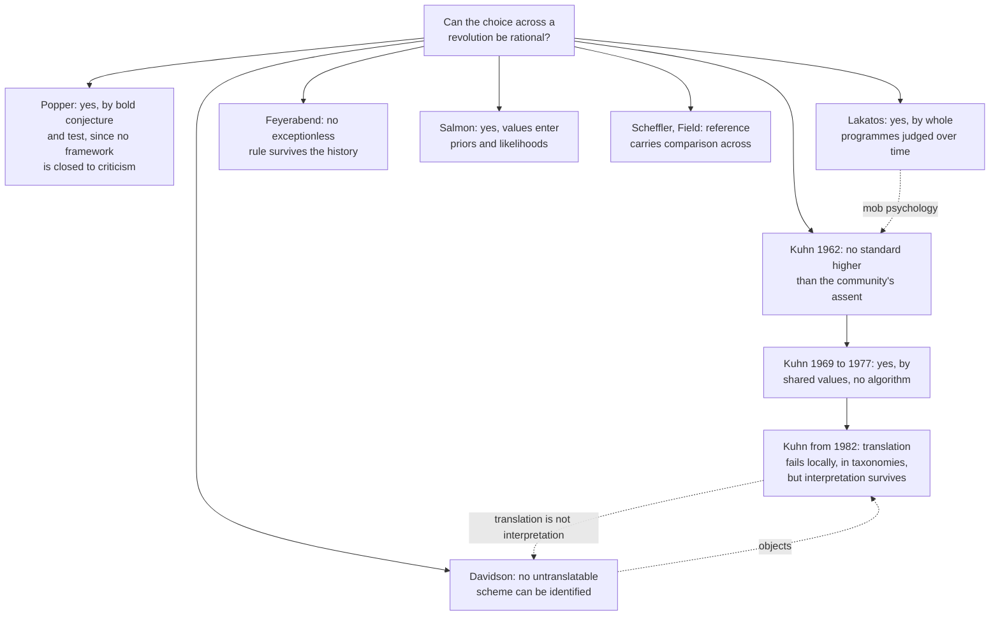

# Philosophy of Science · Lesson 2.4: Kuhn: incommensurability and theory choice

> ⏱ ~15 min · Module 2: Falsification, paradigms, and research programmes · Builds on: [2.3](02-03-kuhn-normal-science-and-revolutions.md), [2.2](02-02-duhem-quine-and-underdetermination.md), [`philosophical-method` 2.1](../../philosophical-method/lessons/02-01-inference-to-the-best-explanation.md) · Unlocks: [2.5](02-05-lakatos-and-feyerabend.md), [3.4](03-04-values-and-inductive-risk.md)

## Why this matters

Run AIC and BIC on the same regression and they can pick different models ([1.6](01-06-simplicity-and-curve-fitting.md)), with neither analyst making a mistake. Thomas Kuhn's most contested claim is that the great decisions of science have that shape: shared data, shared standards, and no procedure that returns one answer. [2.3](02-03-kuhn-normal-science-and-revolutions.md) described revolutions. This lesson asks whether choosing across one can be rational, and what Kuhn said when his critics told him it could not.

## The idea

The side and diagonal of a square have no common measure: no unit fits a whole number of times into both. You can still say which is longer. That is the metaphor. [Incommensurable](../reference.md#incommensurability) means *no common measure*, and Kuhn insisted it does not mean *incomparable*. (In [`ethics` 4.5](../../ethics/lessons/04-05-the-new-natural-law-theory.md) and [`philosophy-of-economics` 3.4](../../philosophy-of-economics/lessons/03-04-cbas-critics-and-defenders.md) the word applies to goods with no common scale. Here it relates theories.)

*The Structure of Scientific Revolutions* (1962) bundled three breakdowns of the common measure.

- **Standards.** Rivals disagree about which problems a theory must solve and what counts as solving them. Many seventeenth-century readers found Newton's gravitation defective because it named no mechanism. Once it was the [paradigm](../reference.md#paradigm), lacking a mechanism stopped being an objection, and Coulomb's law gained from resembling it. This is [methodological incommensurability](../reference.md#methodological-incommensurability).
- **Concepts.** The same word does different work. Kuhn's case is mass: Newton's is conserved, Einstein's can be converted into energy, and measurements of the two coincide only at low relative speeds. This is [semantic incommensurability](../reference.md#semantic-incommensurability).
- **Perception.** Kuhn wrote that proponents of rival paradigms work in "different worlds", and prefaced it by saying he could not explain the sense any further. He denied that scientists literally remake nature. ([2.3](02-03-kuhn-normal-science-and-revolutions.md) has the [gestalt switch](../reference.md#gestalt-switch).)

Critics drew the obvious conclusion: if standards, meanings and observation all shift, nothing is left to adjudicate. That is the [charge of relativism](../reference.md#charge-of-relativism), and of irrationalism. Dudley Shapere's 1964 review stressed the relativist implications. Israel Scheffler (*Science and Subjectivity*, 1967) defended objectivity against a picture on which paradigm change escapes deliberation. Imre Lakatos (1970) called Kuhn's account "mob psychology".

Kuhn answered on two fronts. He narrowed the semantic thesis, and he said what theory choice runs on: five values every scientist shares and nobody can rank mechanically. Picture a hiring committee that agrees on what makes a candidate good and still splits, each member giving reasons. Nobody looks irrational, and no scoring rule would settle it. Whether that picture earns the word "rational" is the question of this lesson.

## The argument

**A. The semantic thesis and its replies.**

1. **P1.** A theoretical term gets its meaning from the laws it figures in. *In words:* you learn "mass" and "force" together, by using them in laws.
2. **P2.** A revolution changes those laws.

∴ **C1.** Key terms of rival theories cannot be translated into each other without loss, so no neutral language allows point-by-point comparison. *In words:* the two theories cannot be laid side by side, sentence for sentence.

Three replies attack this from different sides. **Reference:** Scheffler argued that sense can shift while reference holds, and comparing theories for truth needs only reference. **[Partial denotation](../reference.md#partial-denotation):** Hartry Field ("Theory Change and the Indeterminacy of Reference", 1973) argued that Newton's "mass" determinately denoted neither relativistic mass nor proper mass, and partially denoted both. **No scheme:** Donald Davidson ("On the Very Idea of a Conceptual Scheme", 1974) argued that a language we could not translate at all is one we could not recognize as a language, and that interpreting anyone means assuming they mostly speak truly by our lights. We then have no principled way to tell a difference of scheme from an ordinary disagreement in belief.

**Kuhn's narrowing.** In "Commensurability, Comparability, Communicability" (given in 1982, printed 1983) he restricted the failure to a small cluster of interdefined terms: [local incommensurability](../reference.md#local-and-taxonomic-incommensurability). Later essays (collected in *The Road Since Structure*, 2000) made it taxonomic. A revolution re-sorts kinds: Ptolemy's "planet" included the Sun and not the Earth, Copernicus's the reverse. His no-overlap principle says that categories cross-classifying the same objects cannot be merged into one taxonomy. His reply to critics like Davidson is that translation and interpretation differ. You cannot render the old lexicon word for word, but you can learn it, as a bilingual does.

**B. The values** ("Objectivity, Value Judgment, and Theory Choice", in *The Essential Tension*, 1977).

3. **P3.** Scientists share [five values](../reference.md#five-values-of-theory-choice): accuracy, consistency (internal and with other accepted theories), scope, simplicity, fruitfulness. *In words:* the list is common ground, and defines what doing science is.
4. **P4.** Each value is imprecise. *In words:* two people can apply the same value and get different results.
5. **P5.** The values conflict, and nothing assigns their weights. *In words:* accuracy can favour one theory while scope favours its rival.

∴ **C2.** They influence choice without determining it: there is "no neutral algorithm" ([choice without an algorithm](../reference.md#choice-without-an-algorithm); 1969 Postscript). *In words:* the values narrow the field and hand the rest to judgment.

6. **P6.** A choice is rational if it rests on reasons drawn from public, shared standards and stays open to argument, whether or not an algorithm produced it. *In words:* judgment can be discussed and defended, as matters of taste cannot.

∴ **C3.** Theory choice can be rational without compelling one answer. *In words:* in Kuhn's phrase, the slack permits "rational men to disagree".

Kuhn adds a function: that slack spreads across a community the risk of backing something new. Three of the five match the virtues in [`philosophical-method` 2.1](../../philosophical-method/lessons/02-01-inference-to-the-best-explanation.md). Its "fit with background" is external consistency, and accuracy sits in its P2. Explanatory coherence ([`epistemology` 2.3](../../epistemology/lessons/02-03-coherentism.md)) is a natural sixth candidate. Kuhn rejected the extreme form of the relativism charge: later theories are better [puzzle-solvers](../reference.md#normal-science), so science progresses. He denied that this makes them nearer the truth.

**Salmon's bridge.** Wesley Salmon ("Rationality and Objectivity in Science, or Tom Kuhn Meets Tom Bayes", 1990) compared rival theories $T_1, T_2$ on evidence $E$ by ratios, with $P$ a credence:

$$\frac{P(T_1\mid E)}{P(T_2\mid E)} = \frac{P(T_1)\,P(E\mid T_1)}{P(T_2)\,P(E\mid T_2)}.$$

*In words:* fit with the evidence lives in the likelihoods, and plausibility judgments (simplicity, symmetry, analogy) set the priors. Salmon did not think scientists run this as an algorithm. It says where disagreement lives.

**Where the argument is weakest.** P6. The objection at full strength: a standard that licenses opposite verdicts on the same evidence is no standard, and since Kuhn himself lets biography and personality shape the weights, what decides is not a reason. The reply: demanding an algorithm would condemn every judgment-based practice ([`philosophical-method` 3.4](../../philosophical-method/lessons/03-04-intuitions-and-reflective-equilibrium.md) finds none for reflective equilibrium either), and weights are trained and argued over. Salmon's priors can wash out, but only given shared likelihoods and a theory already in the probability space ([`epistemology` 5.4](../../epistemology/lessons/05-04-the-problem-of-priors.md), [new theories](../reference.md#problem-of-new-theories)). The defender concedes that individual rationality underdetermines the choice. The critic concedes that nobody has produced the algorithm. Whether the values track truth or only convenience is further still: Kuhn calls them constitutive of science, many realists treat them as evidential ([5.1](05-01-realism-and-the-no-miracles-argument.md)), and van Fraassen disputes that ([5.4](05-04-constructive-empiricism-and-entity-realism.md)).

## Map of positions

The positions differ less over whether scientists have reasons than over whether reasons must add up to a rule.

## Worked examples

**Example 1 (clean case: Copernicus versus Ptolemy, Kuhn's own).** Score them as of 1543, when *De revolutionibus* appeared. Kuhn works accuracy, consistency and simplicity; scope and fruitfulness are this lesson's extension.

| Value | Verdict | Why |
|---|---|---|
| Accuracy | Tie | Copernicus's system did not beat Ptolemy's until Kepler reworked it, over sixty years after Copernicus died |
| Consistency | Ptolemy | Both are internally consistent, but a stationary central Earth was built into the received physics of falling bodies |
| Scope | Copernicus, arguably | One arrangement ties each planet's order to its period; Ptolemy offers no such unified system |
| Simplicity | Depends | Computing a planet's position: about equal. Explaining gross features such as retrograde motion: one circle per planet against two |
| Fruitfulness | Unknown in 1543 | Only Kepler's revision could show it |

Accuracy is silent, consistency says Ptolemy, and simplicity says Copernicus only in a sense that working astronomers had no special reason to prefer, though it mattered to Kepler and Galileo. On Kuhn's scoring, an astronomer who stayed with Ptolemy broke no shared standard, and neither did Kepler. The values still did work, he says: they fixed what the two sides had to argue about.

**Example 2 (hard case: wave versus emission, 1818).** Fresnel deposited his diffraction memoir with the Paris Academy on 29 July 1818; it was crowned on 15 March 1819.

- *Accuracy* splits by domain. Fresnel fits diffraction in mathematical detail. Polarization belonged to the emission side: Malus judged it beyond wave theory and gave light corpuscles poles. The transverse-wave account came only in the early 1820s.
- *Consistency* favours emission, which sat inside Newtonian mechanics. Waves needed a medium nobody had detected.
- *Fruitfulness* favours waves. Poisson, a judge and a Newtonian, derived from Fresnel's equations a bright spot at the centre of a circular shadow, as an absurdity. Arago looked and found it.
- *Scope* and *simplicity* are arguable. Each theory reached phenomena the other could not, and what counts as simple depends, as it did for Copernicus, on what you count.

Here the account stops. No value says whether fit with diffraction outweighs fit with polarization, or whether a startling success outweighs coherence with mechanics. On Kuhn's account both camps are reasonable and the split is useful. Dominique Pestre (2009) reports that Poisson admired Fresnel's mathematics without being persuaded to give up Newtonian optics; emission partisans stayed active for years afterward. A rationalist replies that the dispute closed on accuracy and scope once waves took polarization, so the slack was temporary. Kuhn can grant the closure and deny that any rule forced it at any given date. Salmon's ratio would set the spot's likelihood against a prior shaped by trust in mechanics, which locates the trade without pricing it.

## Watch out

- **You might think Kuhn said science is irrational, but actually** he denied it repeatedly. The 1969 Postscript says that denying an algorithm leaves good reasons standing. His reply is that the charge reads "no rule" as "no reason"; whether reasons without a rule are enough is the live question.
- **You might think incommensurable means incomparable, but actually** comparison goes on. What fails is point-by-point comparison in one neutral language.
- **You might think "different worlds" means scientists change nature, but actually** Kuhn hedged the phrase and denied the constructivist reading. Paul Hoyningen-Huene reads it as a change in the phenomenal world, with the world-in-itself untouched.
- **You might think the late taxonomic view restores convergence on truth, but actually** it narrows what fails to translate. Kuhn went on denying that later theories are nearer the truth, so the realist's question stays open ([5.1](05-01-realism-and-the-no-miracles-argument.md)).

## One-liner

> Five shared values constrain theory choice and nothing weighs them, so Kuhn calls it rational without a rule; whether a standard that permits opposite verdicts is still a standard is what he and his critics dispute.

## Problems

**P1 (🟢) *(Exegetical.)*** Kuhn's own case from the 1977 essay, on the episode of [2.3](02-03-kuhn-normal-science-and-revolutions.md). The oxygen theory accounted for the weight relations in chemical reactions, which the phlogiston theory had barely attempted. The phlogiston theory could say why metals resemble one another far more than their ores do, which the oxygen theory could not. One line each.

(a) Which of the five values do both facts fall under, and what overall verdict does that value give?

(b) What must a chemist decide before that value can give a verdict, and do the five values supply a rule for deciding it?

(c) Two chemists accept both facts and all five values, and choose opposite theories. On Kuhn's 1977 view, what follows about their rationality?

**P2 (🟡) *(Exegetical.)*** Find the crux. Both positions are paraphrased for this problem.

> **Scheffler** (*Science and Subjectivity*, 1967, and his 1972 reply): science is objective because claims answer to standards and evidence that do not depend on the theorist's commitments. If paradigms set their own standards, meanings and observations, paradigm change escapes deliberation and assessment.

> **Kuhn** (1977): the five values are shared across paradigms. A choice guided by them is judgment, which can be defended and argued over, unlike taste. That they do not fix one answer does not make the choice subjective.

(a) Name the single premise in dispute, and say which side must deny it. Two sentences.

(b) Say what evidence or argument would move each side off its position on that premise. Two sentences.

**P3 (🔴) *(Evaluative.)*** Take this objection: a rationality that lets two scientists reach opposite verdicts from the same evidence and the same standards does no work. Does a list of shared but differently weighted values make theory choice rational? Say what you take "rational" to require, say what the values rule out, engage the objection, and name what your answer costs. Any verdict. 150 words or fewer.

Solutions

**P1** *(Exegetical)*

**Must hit, strict:**

- (a) Accuracy, for both facts. It favours oxygen in one area and phlogiston in another, so it gives no overall verdict.
- (b) Which area of agreement with experience matters more. The five values supply no rule for this: nothing assigns weights, and here the weighing happens inside a single value.
- (c) Neither is shown to be irrational. The values influence choice without determining it, so this is a disagreement between people who each have reasons from shared standards.

**Wrong turns:** saying accuracy favours oxygen because oxygen won, which reads the outcome back into the comparison. Filing the phlogiston fact under scope: both facts are about agreement with experience in a given area, while scope concerns consequences beyond what a theory was built to explain. Answering (c) with "at least one of them must have weighted wrongly", which assumes the rule Kuhn denies.

**Model answer:** (a) Accuracy; it splits by area and gives no overall verdict. (b) Which area matters more; the values give no rule for that. (c) Neither is irrational, since both choose on reasons from shared values that do not determine one answer.

---

**P2** *(Exegetical)*

**Accept:** any wording of the premise that puts the question at the gap between constraining a choice and settling it. A formulation in terms of "independence from the paradigm" is fine if it says the weighing is where the independence is in doubt.

**Must hit, strict (a):**

- The premise: a standard secures objectivity only if it binds at the point of decision, independently of the chooser's paradigm and of how the chooser weights it.
- Kuhn (1977) must deny it: shared values that constrain the options and keep the dispute arguable are enough, and judgment is not taste. Scheffler's side needs it or something near it, or else the five values pass his own test.

**Must hit, strict (b):**

- Moves the Scheffler side: cases where choices no rule determined still responded reliably to evidence that both parties could assess, which would show binding at the point of decision is not needed.
- Moves Kuhn: evidence that the weights are explained by what has no evidential bearing (biography, interest), or that paradigms reshape the values so far that the shared list is shared in name only.

**Wrong turns:** naming "is science irrational?" as the crux, since both deny it. Naming "is there an algorithm?", since the dispute is over what follows if there is none. Naming the theory-ladenness of observation, which feeds Scheffler's worry but is not what the 1977 reply turns on.

**Not graded:** Scheffler (1967) answers *Structure*, not the 1977 essay, and his 1972 reply is reported to narrow the gap between them. The stem's paraphrases are what is being read here.

**Model answer:** (a) The crux is whether objectivity requires standards that bind at the point of decision, whatever paradigm the chooser works in and however she weights them. Kuhn must deny this, holding that shared, arguable values suffice; Scheffler's side needs it, or the five values already meet his demand. (b) Scheffler's side would move on cases where undetermined choices still tracked evidence both parties could assess. Kuhn would move on evidence that the weights answer to biography or interest and not to evidence, or that the shared list is shared only verbally.

---

**P3** *(Evaluative)*

**Must hit, any verdict:**

- State what "rational" is taken to require: for example, following a rule that fixes one verdict, or responding to reasons others can assess, or being accountable to evidence over time.
- State what the values exclude and what they leave open, so the answer says how much work they do.
- Engage the objection by naming the premise under attack (that reason-giving without determination is enough, P6 in the lesson).
- Name a cost. A yes must say what keeps the weights from being arbitrary. A no must say what would count as rational in a case with no rule, and whether the standard also condemns other judgment-based practice. A Bayesian repair must say what fixes the priors.

**Wrong turns:** reading "no algorithm" as "no reasons". Reporting who won historically, since the question is about the choice at the time. Treating a verdict as what is graded: any verdict passes with the moves made.

**Model answer, one of several:** Yes, if "rational" means answering to reasons others can assess, not following a rule that yields one output. The values do real work: they exclude theories that fit worse, contradict accepted results, or explain less, and they fix what each side must answer. The objection attacks P6, the claim that this is enough without determination. My reply is that the same demand would condemn diagnosis and appellate judgment, which we do not call irrational. The cost is that I cannot say why one weighting is better than another at the moment of choice, only that the community's later convergence shows which paid off, and that is hindsight the chooser did not have.

## Flashback

**From Lesson [2.2](02-02-duhem-quine-and-underdetermination.md) (Duhem, Quine, and underdetermination):** *(Exegetical, strict · Close reading.)* Duhem, on two physicists, one saving the fundamentals by corrections, the other changing a fundamental supposition, neither entitled to call the other illogical (*La Théorie physique*, 1906, Part II, ch. VI, §X, pp. 356–57, lesson's translation):

> That does not mean one cannot quite rightly prefer the work of the one to the work of the other; pure logic is not the only rule of our judgments; certain opinions, which do not fall foul of the principle of contradiction, are nonetheless perfectly unreasonable.

(a) What does *ne tombent point sous le coup du principe de contradiction* settle about those opinions, and what does *parfaitement déraisonnables* add? One sentence.

(b) A reader calls this the strong thesis in French. Give one point for and one against. Two sentences.

(c) Which objection to the strong thesis does the last clause anticipate, and how does the Quinean reply? Two sentences.

Solution

**Accept:** in (b), either point against.

**Must hit, strict (a):**

- *Ne tombent point sous le coup du principe de contradiction*: logic does not condemn them, since they contradict nothing.
- *Parfaitement déraisonnables*: they can still be condemned, by a standard other than logic, which §X goes on to call [good sense](../reference.md#good-sense) (*bon sens*).

**Must hit, strict (b):**

- For: logic leaves both physicists' moves standing, so it forces no particular revision.
- Against: *la pure logique* stands here as a fixed rule, whereas the strong thesis puts logic itself inside the web and open to revision. Or: Duhem's subject is physicists choosing among physical hypotheses, whereas the strong thesis covers every statement.

**Must hit, strict (c):**

- Laudan (1990): logically possible is not rationally defensible, so the strong thesis alone yields no parity among revisions.
- The Quinean grants that most rescues are absurd, and replies that the standards ranking them sit inside the web, so they cannot be a court outside it.

**Wrong turns:** offering "some opinions are unreasonable" as the point against Quine, who also grants that most rescues are absurd; reading *déraisonnables* as "illogical", the charge Duhem has just withheld; naming Grünbaum's dilemma in (c), which asks whether a substantive rescue exists and not whether one is defensible.

**Model answer:** (a) Logic does not condemn those opinions, since they contradict nothing, but they can still be condemned by another standard, good sense. (b) For: logic leaves both physicists standing. Against: *la pure logique* is a fixed rule here, whereas the strong thesis makes logic itself revisable. (c) Laudan's point that logically possible is not rationally defensible, so the strong thesis yields no parity among revisions. The Quinean grants that most rescues are absurd and puts the standards for saying so inside the web.

## Connections

- **Backward:** [2.3](02-03-kuhn-normal-science-and-revolutions.md) gave paradigms, crisis and the gestalt switch; this lesson asks whether what it described can be rational. [2.2](02-02-duhem-quine-and-underdetermination.md) left choosing among auxiliaries to Duhem's [good sense](../reference.md#good-sense), and the five values are the fullest attempt to say what such judgment appeals to. The virtues of [`philosophical-method` 2.1](../../philosophical-method/lessons/02-01-inference-to-the-best-explanation.md) are this list in everyday argument, and that lesson hands this course the question whether they track truth or only convenience.
- **Forward:** [2.5](02-05-lakatos-and-feyerabend.md) gives Lakatos's attempt to replace that judgment with the appraisal of whole programmes, and Feyerabend's challenge to any such standard. [3.4](03-04-values-and-inductive-risk.md) separates epistemic from non-epistemic values, and these five are the epistemic ones. [5.1](05-01-realism-and-the-no-miracles-argument.md) and [5.4](05-04-constructive-empiricism-and-entity-realism.md) take up whether the values indicate truth.
- **Sideways:** explanatory coherence as a guide to theory choice was promised by [`epistemology` 2.3](../../epistemology/lessons/02-03-coherentism.md), and the same weighting problem appears there. Samir Okasha ("Theory Choice and Social Choice: Kuhn versus Arrow", *Mind*, 2011) treats the five values as voters ranking theories and imports [Arrow's theorem](../../grad-game-theory/lessons/05-01-social-choice-impossibility.md) ([`social-choice` 1.3](../../social-choice/lessons/01-03-arrow-as-a-map.md)), a sharper form of "no algorithm". Rational disagreement among peers on shared evidence is [`epistemology` 4.5](../../epistemology/lessons/04-05-peer-disagreement.md), which asks what each should then do. Global relativism's self-refutation is [`ancient-medieval-philosophy` 1.3](../../ancient-medieval-philosophy/lessons/01-03-the-sophists-and-socrates.md), cited in [`epistemology` 3.4](../../epistemology/lessons/03-04-contextualism-and-its-rivals.md). Whether geologists reasonably rejected drift ([`geology` 2.1](../../geology/lessons/02-01-evidence-for-drift.md), contested in [2.3](02-03-kuhn-normal-science-and-revolutions.md)) is this lesson's question on another case. Reference and meaning change in general belong to [`philosophy-of-language-and-logic`](../../philosophy-of-language-and-logic/syllabus.md).
