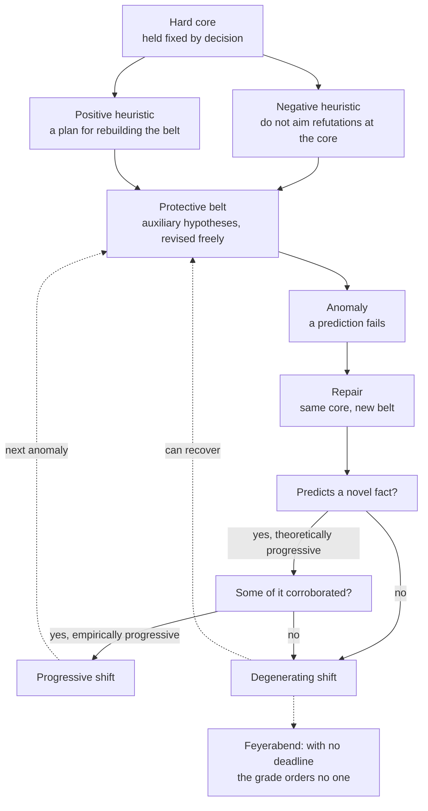

# Philosophy of Science · Lesson 2.5: Lakatos and Feyerabend

> ⏱ ~15 min · Module 2: Falsification, paradigms, and research programmes · Builds on: [2.1](02-01-popper-conjectures-and-refutations.md), [2.2](02-02-duhem-quine-and-underdetermination.md), [2.4](02-04-kuhn-incommensurability-and-theory-choice.md) · Unlocks: [2.6](02-06-demarcation-after-popper.md)

## Why this matters

Your coefficient comes out with the wrong sign, you add a control, and it flips. Sometimes that is discovery and sometimes rescue, and nothing in the output says which. Popper banned rescues that do not raise testability ([2.1](02-01-popper-conjectures-and-refutations.md)), [2.2](02-02-duhem-quine-and-underdetermination.md) showed that logic cannot tell a rescue from a repair, and Kuhn left the call to a community's judgment ([2.4](02-04-kuhn-incommensurability-and-theory-choice.md)). Imre Lakatos offered a test that asks what the repair goes on to predict, and his friend Paul Feyerabend answered that no such test survives the history of the best science.

## The idea

Stop judging a theory and judge a line of theories. Picture two firms that have both missed their numbers. One firm's new plan says what went wrong and names a market nobody had checked, and the market turns out to be there. The other firm's new plan explains last quarter's loss and promises nothing checkable. Results "refuted" both plans. Judged this way, only one firm is learning anything.

Lakatos's name for the line of theories is a [research programme](../reference.md#methodology-of-research-programmes). Its members share a [hard core](../reference.md#hard-core) that its workers decide not to touch, surrounded by a [protective belt](../reference.md#protective-belt) of [auxiliary hypotheses](../reference.md#auxiliary-hypotheses) that take the blame when a prediction fails. This is the machinery behind the two labels [`social-theory` 2.3](../../social-theory/lessons/02-03-capitalism-and-the-test-of-history.md) applied to Marxism: a programme is [progressive](../reference.md#progressive-problem-shift) when its repairs predict new facts and some of those facts arrive, and [degenerating](../reference.md#degenerating-problem-shift) when they only absorb old failures.

Feyerabend's reply is a history lesson with a sting. Take any rule of method and you can find great science that broke it, and advanced by breaking it. One such rule-breaker is [counterinduction](../reference.md#counterinduction): developing hypotheses that contradict well-established theories or results. (This is not the "infer the reverse of the observed frequency" rule that Salmon set against induction in [`epistemology` 4.3](../../epistemology/lessons/04-03-answering-hume.md).)

## The argument

**Lakatos's methodology** ("Falsification and the Methodology of Scientific Research Programmes", in Lakatos and Musgrave, eds., *Criticism and the Growth of Knowledge*, 1970).

**P1.** A failed prediction refutes only the conjunction of core and auxiliaries. *In words:* this is [2.2](02-02-duhem-quine-and-underdetermination.md)'s point; logic does not say what to change.

**P2.** So the unit of appraisal is a series of theories $T_1, T_2, \dots$ sharing a hard core. The [negative heuristic](../reference.md#positive-and-negative-heuristic) forbids aiming the refutation at the core. The positive heuristic is a partly articulated plan for rebuilding the belt. *In words:* the core is off limits by decision, and a good programme knows its next moves before the anomalies arrive.

**P3.** A shift $T_n \to T_{n+1}$ is **theoretically progressive** if $T_{n+1}$ predicts some [novel fact](../reference.md#novel-prediction), and **empirically progressive** if some of that excess content is corroborated. It is progressive if both hold and degenerating otherwise. *In words:* a repair earns its keep by what it goes on to predict and how that turns out.

**P4.** One programme supersedes another by a comparison of records, and a stalled programme can recover. *In words:* Lakatos denies "instant rationality"; a programme may take decades to get off the ground.

**∴ C.** Rational theory change is a comparison of programmes' records over time, not obedience to one refutation. *In words:* the question is not "was this theory refuted?" but "which programme is going somewhere?"

This is the third of three [falsificationisms](../reference.md#naive-and-sophisticated-falsificationism) Lakatos distinguished. *Dogmatic*: experience can conclusively disprove a theory. *Naive methodological*: test statements are accepted by decision, then one clash eliminates a theory. *Sophisticated*: a theory is eliminated only by a rival that keeps its successes and adds corroborated content. Novelty began as temporal: a fact not yet known and unexpected on rivals. Elie Zahar (1973), then Lakatos and Zahar (1975), relaxed it: a known fact counts if the programme's core was not built to fit it. On that reading Mercury's long-known perihelion counts for general relativity.

**Feyerabend's challenge** (*Against Method*, 1975; third edition 1993; dedicated to Lakatos, "Friend and Fellow-Anarchist").

**F1.** For any rule of method, some episode widely counted as great science broke it, and advanced by breaking it.

**F2.** A rule that would have blocked such an episode inhibits progress.

**∴ FC.** A rule that never inhibits progress must be empty: the only one left is ["anything goes"](../reference.md#methodological-anarchism). *In words:* a reductio on the demand for a universal method. A preface dated 1987 says the phrase is no principle he holds; it is a rationalist's "terrified exclamation" on looking closely at history.

His exhibit is the [tower argument](../reference.md#tower-argument). A stone dropped from a tower lands at its foot. If the earth turned, the foot would move away during the fall and the stone would land far from it, so the earth stands still. Galileo, in the *Dialogue* of 1632, accepted what is seen and disputed what it shows. Feyerabend's diagnosis: the report "the stone falls straight down" carries a [natural interpretation](../reference.md#natural-interpretations), an idea so fused with seeing that it takes effort to notice. Here it is that all motion is "operative", meaning it has perceptible effects. Galileo replaced it with the relativity of motion (motion shared by stone, tower and observer shows nothing) and a principle of circular inertia, which keeps the stone with the tower. Feyerabend stresses that no new observation was involved, that neither principle had independent support at the time, and that Galileo presented them as things his readers already knew ("anamnesis"). The moral: a natural interpretation can be exposed only from outside, by provisionally keeping a theory the facts contradict. That is counterinduction. (The events are [`church-history` 7.3](../../church-history/lessons/07-03-the-galileo-affair.md); the affair as a test case is [`apologetics-catholic-claims` 7.1](../../apologetics-catholic-claims/lessons/07-01-the-inquisition-and-the-galileo-affair.md) and [`apologetics-foundations` 4.1](../../apologetics-foundations/lessons/04-01-the-conflict-thesis-tested-in-both-directions.md).)

Against Lakatos he poses a dilemma (1975, ch. 16). Either the standards carry a deadline or they do not. With one, they condemn programmes that would have recovered, the fault Lakatos found in Popper. Without one, they forbid nothing, and "degenerating" orders no one to do anything: anarchism in disguise.

**Where the argument is weakest.** The step from P3 and P4 to anything a scientist should do. P3 grades a record and P4 says the record never closes, which is the opening for Feyerabend's dilemma. The best reply separates [appraisal from advice](../reference.md#appraisal-and-advice): methodology grades, a scientist may rationally stay with a degenerating programme if she says honestly that it is one, and (in "History of Science and Its Rational Reconstructions", 1971) editors may refuse to publish it. The reply concedes that the grades are retrospective, and institutional refusal brings the deadline back. Lakatos died in 1974, and his surviving letters to Feyerabend contain no counterargument; Musgrave (1976) tried one on his behalf. Feyerabend concedes in turn that F1 needs the rationalist's own list of great science, so it refutes a demand and supplies no method, and his Galileo is itself disputed (Machamer 1973; Chalmers 1986).

## Anatomy of a programme

Every arrow out of the two questions is a grade on a record, and the dashed arrow from the degenerating box to Feyerabend is where his dilemma presses.

## Worked examples

**Example 1 (clean case: Prout, Lakatos's own).** William Prout (1815) proposed that atomic weights are whole-number multiples of hydrogen's, the elements being built from it. That is the core. By the 1840s chlorine was measured near 35.5, and in 1860 Jean Stas, after twenty years of purification, called the law contradicted by experiment. Stas's refutation needed an auxiliary: that chemically purified chlorine is one kind of thing.

Grade the record at two dates. In 1860 the obvious repair, that the chlorine must still be impure, absorbs the anomaly and predicts nothing anyone can check, so the shift is degenerating. Frederick Soddy's isotopes (1913) gave the repair content: an element can be a mixture of atoms of different mass. Aston's mass spectrograph split neon in 1919 and chlorine in 1920, into masses near 35 and 37 in about a 3:1 ratio, and

$$\frac{3 \times 35 + 1 \times 37}{4} = 35.5.$$

A novel fact, corroborated: theoretically and empirically progressive. (Strictly, isotope masses are only near whole numbers and the neutron had to join hydrogen as a building block, so what survives is Prout's idea, not his formula.) On Lakatos's criteria neither grade was a mistake. Appraisal is indexed to a date, and a programme can come back.

**Example 2 (hard case: dark matter and MOND).** Galaxies rotate too fast for their visible mass. The standard programme holds gravity fixed and blames unseen matter. Mordehai Milgrom's MOND (1983) holds the matter fixed and changes dynamics below an acceleration $a_0 \approx 1.2 \times 10^{-10}\ \mathrm{m/s^2}$, so that a galaxy of visible mass $M$ has outer rotation speed $v$ with $v^4 = GMa_0$, where $G$ is Newton's constant.

Run P3. MOND was built to fit flat rotation curves, so those are novel on neither reading. Its mass-speed law and its success with low-surface-brightness galaxies (McGaugh and de Blok 1998) are corroborated predictions: progressive on galaxies. The standard model predicted the cosmic microwave background's power spectrum before it was measured: progressive on cosmology. Against each: direct searches for dark-matter particles have so far found none; MOND still needs unseen mass in clusters, and the 2017 gravitational-wave event GW170817 went against TeVeS, its leading relativistic extension.

Here the criteria stop. David Merritt (*A Philosophical Approach to MOND*, 2020) runs Lakatos's test and finds MOND progressive and the standard model unhealthy. Patrick Duerr and William Wolf (2023) run the same test and answer that the relativistic extensions were assembled by trial and error, with no real positive heuristic. Neither side misreads P3. The criteria supply no exchange rate between progress on galaxies and progress on the microwave background, no deadline after which null searches count, and, by Lakatos's own account, no verdict on a programme this young except long hindsight.

## Watch out

- **You might think "anything goes" is Feyerabend's rule of method, but actually** it is what remains if you insist on one rule for every case. Chapter 1 asserts it and the later preface disowns it as a principle; whether a positive view lies underneath is disputed.
- **You might think protecting the hard core is what makes a programme ad hoc, but actually** the negative heuristic requires that protection. The charge of [ad hocness](../reference.md#ad-hoc-hypothesis) attaches to belt repairs that predict nothing new.
- **You might think "degenerating" means "abandon it", but actually** it grades a record. A degenerating programme can recover, and Lakatos allowed that one may stay with it, honestly labelled.
- **You might think a repair that fits more data is progressive, but actually** Lakatos asks for a corroborated prediction the repair was not built from. Accommodation is not novelty.

## One-liner

> Lakatos grades a line of theories by whether its repairs predict new facts that arrive; Feyerabend answers that a grade with no deadline forbids nothing and one with a deadline would have condemned the best science.

## Problems

**P1 (🟢) *(Exegetical.)*** The Halvarsen programme (invented, written for this problem). Hard core: a temperate lake's summer algal bloom is set by the phosphorus load reaching it. Classify each move on Lakatos's criteria and name the condition that decides it. One line each.

(i) Lake Ostra blooms far below its load. Halvarsen adds that iron-rich sediment locks phosphorus away, and predicts that unsurveyed iron-rich lakes will bloom below their load. A survey of nine such lakes finds seven that do.

(ii) Lake Vik blooms far above its measured load. Halvarsen adds that rainfall washes extra phosphorus in from the catchment, so measured loads understate true ones, and predicts that blooms across the district will track rainfall year to year. Ten years of records show no such pattern.

(iii) Lake Holm's bloom collapses one summer with its load unchanged. Halvarsen says the phosphorus that year was "inactive", and defines inactive phosphorus as phosphorus that failed to produce a bloom.

(iv) A colleague proposes that in deep lakes the bloom is set by nitrogen and the phosphorus load does not matter.

**P2 (🟡) *(Exegetical (a)–(c).)*** Treat continental drift as a research programme, with hard core "the continents have moved laterally and were once joined". Take these facts as given.

*By 1930:* Wegener's reconstruction assembles correlations already on record (coastlines, fossils, mountain belts, ancient climates). His mechanism, continents ploughing through oceanic crust, has failed Harold Jeffreys's arithmetic. No new fact predicted by the programme has been found.

*By 1968:* Hess's seafloor spreading (1962) has replaced ploughing with ocean floor created at ridges and carried outward. Vine and Matthews (1963) used it, with magnetic reversals, to predict symmetric seafloor stripes whose widths track reversal durations. The Eltanin-19 profile (1966) showed that pattern.

(a) Give Lakatos's verdict at each date and name the condition met or failed each time. Two sentences per date.

(b) Which change between the two dates is a belt change, and why does the 1968 verdict not show that the 1930 verdict was wrong? Two sentences.

(c) A geologist in 1930 asks what the methodology tells her to do. Say what it tells her and where it stops telling her anything. Two sentences.

**P3 (🔴) *(Evaluative.)*** Steelman and reply. Using the years between Stas and Soddy in Prout's programme (Example 1) as your case, state Feyerabend's objection to Lakatos at the strength he would accept, give Lakatos's best reply, and name what the reply costs. Any verdict. 150 words or fewer.

Solutions

**P1** *(Exegetical, strict)*

**Must hit, strict:**

- (i) **Progressive.** The repair has excess content (a prediction about unsurveyed lakes), and some of it is corroborated (seven of nine): both conditions hold.
- (ii) **Theoretically progressive, not empirically progressive; degenerating on Lakatos's two-condition definition.** It predicts something new, and none of that is corroborated.
- (iii) **Degenerating.** There is no excess content: "inactive" is defined by the failure it is meant to explain, so the repair predicts nothing.
- (iv) **Not a shift inside the programme.** It aims the refutation at the hard core, which the negative heuristic forbids. It is a rival programme or an abandonment of this one.

**Wrong turns:** calling (ii) progressive because it was bold (boldness is the first condition only); calling (i) suspect because it protects the core (the negative heuristic requires that); calling (iv) degenerating (the grade applies to repairs within a programme).

**Model answer:** (i) Progressive: novel content, part of it corroborated. (ii) Theoretically progressive but not empirically, so degenerating by the definition. (iii) Degenerating: no excess content, since "inactive" just names the anomaly. (iv) Outside the programme: it attacks the hard core, against the negative heuristic.

---

**P2** *(Exegetical (a)–(c), strict)*

**Must hit, strict (a):**

- 1930: no novel fact predicted and found, since the correlations were on record and went into the reconstruction, and the mechanism auxiliary has failed. Neither condition is met, so the record is degenerating. (Accept "stalled" only if the answer says the two-condition definition classes that as degenerating.)
- 1968: a new belt (seafloor spreading) keeps the core and predicts a novel fact, the symmetric stripes matching reversal durations, and that fact is corroborated. Both conditions hold: progressive.

**Must hit, strict (b):**

- The belt change is the replacement of ploughing by seafloor spreading; the claim that the continents moved stays.
- Lakatos's grade is indexed to the record at a date, and a programme can recover, so the 1968 grade does not reach back and correct the 1930 grade.

**Must hit, strict (c):**

- It tells her what her programme's record is, and that she may stay with it if she says honestly how it stands.
- It does not tell her to stop or give her a date: no deadline, and no instruction to quit.

**Wrong turns:** counting the correlations as novel because Wegener was first to assemble them (they were known and used to build the reconstruction, so they fail on Zahar's reading too); treating plate tectonics as a new hard core; reading "degenerating" as a command to quit; using the 1968 success to conclude that the 1930 grade was an error.

**Model answer:** (a) By 1930 the programme had predicted no new fact that had been found, and its mechanism had failed Jeffreys's arithmetic, so its record was degenerating. By 1968 a new belt had predicted symmetric stripes matching reversal durations and the Eltanin-19 profile corroborated them, so it was theoretically and empirically progressive. (b) Ploughing gave way to seafloor spreading while the core stayed. Grades are indexed to dates and programmes can recover, so 1968 does not show that the 1930 grade was wrong. (c) It tells her what the record is and that she may continue if she says so honestly. It gives her neither an instruction to stop nor a date on which she must.

---

**P3** *(Evaluative, graded on moves, not verdict)*

**Must hit, any verdict:**

- Feyerabend's objection stated as a dilemma on the deadline: with one, the standard would have condemned Prout's programme in the decades after 1860, which then recovered; with none, "degenerating" forbids nothing and instructs no one.
- Lakatos's best reply: methodology appraises and does not advise, with the rule that one may persist if one reports the record honestly. (Adding that editors may refuse degenerating work earns credit, provided the next point is made.)
- The cost, named. If the grade instructs no one, methodology is retrospective and silent to the chemist in 1880, which is what the objection claimed. If institutions act on it, the deadline returns.

**Wrong turns:** treating "anything goes" as Feyerabend's own positive rule; supplying Lakatos with a deadline he did not state; arguing that Prout's programme was not really degenerating, as if that removed the objection (the point is general).

**Model answer, one of several:** Feyerabend: Lakatos's standard either has a deadline or it does not. Give it one, and it would have condemned Prout's programme in the decades after 1860, when "the chlorine must be impure" predicted nothing, though the programme recovered with isotopes. Give it none, and "degenerating" tells no chemist to do anything, so the standard is anarchism in disguise. Lakatos's best reply separates appraisal from advice: methodology grades a record, and a chemist may keep a degenerating programme provided she reports its record honestly, while journals may refuse to publish it. The cost is real either way. If the grade instructs no one, methodology is retrospective and silent to the chemist in 1880, which is Feyerabend's point. If editors act on the grade, the deadline returns and the Prout objection with it.

## Flashback

**From Lesson [2.3](02-03-kuhn-normal-science-and-revolutions.md) (Kuhn: normal science and revolutions):** *(Exegetical (a)–(b).)* Darwin, *On the Origin of Species* (6th edition, 1872), ch. XV:

> I by no means expect to convince experienced naturalists whose minds are stocked with a multitude of facts all viewed, during a long course of years, from a point of view directly opposite to mine. ... I look with confidence to the future, to young and rising naturalists, who will be able to view both sides of the question with impartiality.

(a) Which idea from 2.3 does "facts all viewed ... from a point of view" express, and which of its three strands does the wording support? Two sentences.

(b) What does Kuhn's limit on the gestalt metaphor imply about viewing "both sides"? On his account, are the unconvinced naturalists thereby poor scientists? Two sentences.

Solution

**Accept:** reading "impartiality" as mere freedom from long habit, or noting that a person can learn both vocabularies ([2.4](02-04-kuhn-incommensurability-and-theory-choice.md)), provided the answer says neither supplies the independent check a gestalt subject has.

**Must hit, strict (a):**

- The idea is the [theory-ladenness of observation](../reference.md#theory-ladenness-of-observation).

- The strand is what observers attend to or what their reports mean. Both sides hold "facts" and differ in "point of view"; nothing in the wording says they perceive different things.

**Must hit, strict (b):**

- A gestalt subject can flip between views and knows the lines on the page never changed. A scientist, Kuhn says, has neither, so an impartial view of "both sides" is what his limit withholds.

- No. Resistance is part of what commitment is for (2.3's P2, a filter against distraction), and Kuhn predicts it for any challenge, sound or unsound. So staying unconvinced marks no poor scientist, and failing to convince does not show Darwin right.

**Wrong turns:** treating "young and rising" as evidence for the theory, when Kuhn's description cannot sort good resistance from bad. Hearing "point of view" as a claim that the two sides perceive differently.

**Model answer:** (a) Theory-ladenness of observation, in the strand about attention or what reports mean, since both sides share the "facts". (b) Kuhn grants the gestalt subject a flip and a fixed page and denies the scientist both, so viewing "both sides" from outside is unavailable. Resistance is functional and greets every challenge, so the unconvinced are not thereby poor scientists, and Darwin is not thereby right.

## Connections

- **Backward:** [2.1](02-01-popper-conjectures-and-refutations.md) gave Popper's ban on ad hoc rescue, which sophisticated falsificationism keeps in spirit and moves from the single theory to the series. [2.2](02-02-duhem-quine-and-underdetermination.md) supplies P1. Lakatos offers [2.3](02-03-kuhn-normal-science-and-revolutions.md)'s and [2.4](02-04-kuhn-incommensurability-and-theory-choice.md)'s Kuhnian history with a logical test in place of a community's judgment.
- **Forward:** [2.6](02-06-demarcation-after-popper.md) asks what survives of demarcation once a programme can be scientific in one decade and not the next. Boss 2 ([syllabus](../syllabus.md)) runs Popper, Kuhn and Lakatos on Uranus and Mercury. [1.5](01-05-the-problem-of-old-evidence.md) is the Bayesian form of Zahar's question, and [3.3](03-03-replication-error-statistics-and-severe-testing.md) takes up severity, a different answer about what a test must risk.
- **Sideways:** Feyerabend on Galileo ↔ [`church-history` 7.3](../../church-history/lessons/07-03-the-galileo-affair.md). Vine and Matthews as a novel prediction ↔ [`geophysics` 3.4](../../geophysics/lessons/03-04-magnetic-anomalies-reversals.md) and [`geology` 2.1](../../geology/lessons/02-01-evidence-for-drift.md). Use-novelty ↔ held-out data: a fit is tested on points the model was not built from, as cross-validation does in [`machine-learning` 4.1](../../machine-learning/lessons/04-01-model-selection-and-cross-validation.md). Lakatos on Marxism ↔ [`social-theory` 2.3](../../social-theory/lessons/02-03-capitalism-and-the-test-of-history.md), whose Wright case and exercise stay there.
