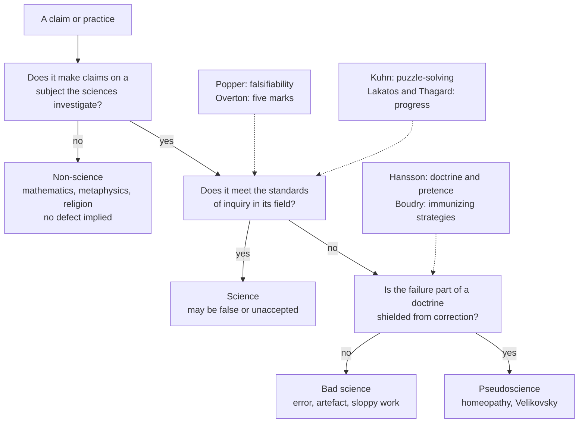

# Philosophy of Science · Lesson 2.6: Demarcation after Popper

> ⏱ ~15 min · Module 2: Falsification, paradigms, and research programmes · Builds on: [2.1](02-01-popper-conjectures-and-refutations.md), [2.3](02-03-kuhn-normal-science-and-revolutions.md), [2.5](02-05-lakatos-and-feyerabend.md) · Unlocks: [3.5](03-05-objectivity.md)

## Why this matters

In December 1981 a federal courtroom in Arkansas heard a philosopher of science, Michael Ruse, explain what makes something science. On 5 January 1982 Judge William Overton wrote five marks of science into his opinion. Within the year Larry Laudan, who had no quarrel with the result, called the reasoning bad, and he soon argued that the question itself was dead. School boards, funders, insurers and judges still have to sort claims, so you should know what sorting can and cannot do.

## The idea

You can spot a diploma mill without a definition of "education" that survives every counterexample. It is a fake because it poses as something it is not, and because nothing a student does could make it refuse a degree. Someone will reply: forget the diploma, and ask whether the surgeon's patients recover.

That is the dispute in miniature. [2.1](02-01-popper-conjectures-and-refutations.md) gave Popper's answer to the [demarcation problem](../reference.md#demarcation-problem): a theory is scientific only if some possible observation would contradict it ([falsifiability](../reference.md#falsifiability)). For Kuhn, a science is a tradition of puzzle-solving ([normal science](../reference.md#normal-science)). For Lakatos, a programme that only accommodates known facts is [degenerating](../reference.md#degenerating-problem-shift). After them, three camps remain. **Definers** want necessary and sufficient conditions. **Cluster theorists** give up the definition and keep the distinction. **Eliminativists**, following Laudan, drop the distinction and ask only whether a claim is well supported.

First, separate three things that all get called "not science" ([pseudoscience, bad science and non-science](../reference.md#pseudoscience-bad-science-and-non-science)), following Sven Ove Hansson (1996, 2013). **Non-science** aims elsewhere and implies no defect: mathematics, metaphysics, religion. **Bad science** is a real attempt that fails: an artefact, a sloppy study. **Pseudoscience** is both unscientific and part of a doctrine its leading advocates present as the best available knowledge of its subject. The doctrine clause separates the biochemist with one bad experiment from the one who spends a career producing sloppy experiments for a single unorthodox thesis.

## Source

[*McLean v. Arkansas Board of Education*](../reference.md#mclean-v-arkansas), 529 F. Supp. 1255, 1267 (E.D. Ark. 1982), opinion of Judge William R. Overton (a US court opinion, public domain):

> More precisely, the essential characteristics of science are: (1) It is guided by natural law; (2) It has to be explanatory by reference to natural law; (3) It is testable against the empirical world; (4) Its conclusions are tentative, i.e., are not necessarily the final word; and (5) It is falsifiable. (Ruse and other science witnesses). Creation science as described in Section 4(a) fails to meet these essential characteristics.

Two phrases decide the reading. "Essential" makes each mark necessary, so failing one is enough. "(Ruse and other science witnesses)" says what this is: a finding drawn from testimony. The list also mixes three kinds of thing. Marks 1 and 2 concern what an explanation appeals to, marks 3 and 5 its logical relation to evidence, and mark 4 how conclusions are held.

## The argument

**Laudan against the marks** ("Science at the Bar: Causes for Concern", 1982). Laudan agreed that creationism did not belong in biology class, and attacked the reasoning. Marks 3 to 5, he argued, are too weak: creationism's specific claims, such as a young earth, are testable, have been tested and are false, so the charge of untestability cannot sit beside the evidence that refutes them. Dogmatism describes advocates, not doctrines. Marks 1 and 2 are too strong: Newton's gravity and plate tectonics would fail, since science often establishes a phenomenon before anyone has the law behind it. Ruse replied ("Pro Judice", 1982) that the case required a verdict of non-science, because bad science is not unconstitutional, and that a geologist who lacks a law still seeks one, whereas a miracle is outside law by its nature.

**Laudan's general argument** ([the demise of the demarcation problem](../reference.md#demise-of-the-demarcation-problem), 1983), reconstructed:

1. **P1.** A demarcation criterion must give necessary and sufficient conditions for scientific status, and having that status must be a reason for belief. *In words:* a line worth drawing sorts every case and means something when it does.
2. **P2.** Since Aristotle, every candidate (certainty, method, verifiability, falsifiability) has failed one test or the other. *In words:* the record is a list of failures.
3. **P3.** What gets called science varies widely in how well supported it is ("epistemic heterogeneity"). *In words:* some is rock solid and some guesswork, so no single profile fits.
4. **P4.** What we need to know about any claim is how well supported it is, and we can ask that without mentioning science. *In words:* go to the evidence directly.

∴ **C.** No demarcation is worth having, and "pseudoscience" does only emotive work. *In words:* drop the label and assess the claim.

**The cluster reply** ([cluster accounts](../reference.md#cluster-accounts-of-science)). John Dupré (*The Disorder of Things*, 1993) proposed that science is a Wittgensteinian family: every science has some of a set of features, and none need have all. Massimo Pigliucci ("The Demarcation Problem: A (Belated) Response to Laudan", 2013) denies P1: concepts this complex are not definable by necessary and sufficient conditions, and they sort cases anyway. Paul Thagard's analysis of astrology (1978) supplied an influential two-part test before his later multi-criterion view (1988): a pseudoscience has failed to progress, and its practitioners make little effort to fix its problems, compare it with rivals, or weigh disconfirmations evenly. Maarten Boudry and Johan Braeckman (2011) name the conduct at issue: [immunizing strategies](../reference.md#immunizing-strategies) that shield a doctrine from criticism.

**Can a court settle it?** It can settle a case. *McLean* was decided under the Establishment Clause, and the finding that creation science was not science served that holding. [*Kitzmiller v. Dover*](../reference.md#kitzmiller-v-dover) (2005) cited *McLean* but gave three grounds of its own for finding intelligent design not science: it invokes supernatural causation, its irreducible-complexity argument repeats a "contrived dualism", and its attacks on evolution have been refuted. The court added that ID's arguments may be true, and took no position on that. ([`apologetics-foundations` 4.2](../../apologetics-foundations/lessons/04-02-evolution-design-and-the-human-person.md) owns ID.) Such rulings bind the parties and fix what "science" means for that legal purpose. Ruse's side says a court needs a line it can apply. Laudan's says a good result does not repair a bad premise. The law itself later moved: [*Daubert*](../reference.md#daubert-factors) (1993), on expert testimony, quotes Popper, then lists factors (testing, peer review, error rates, general acceptance) and refuses a definitive checklist.

**Can a science rule a cause in or out?** Take [methodological naturalism](../reference.md#methodological-naturalism) in the narrow sense of [`apologetics-foundations` 3.1](../../apologetics-foundations/lessons/03-01-naturalism-at-its-best.md), a working rule inside the natural sciences. Boudry, Blancke and Braeckman (2010) separate two grounds for it. On the *intrinsic* reading, science by its nature cannot deal with the supernatural, so it can rule such a cause neither in nor out, and its silence is not evidence. On the *provisory* reading, which they defend, the rule is an evidence-based and revocable commitment, so a supernatural claim predicting an observable difference can be tested and disconfirmed. On either reading, a cause said to make no observable difference, as [`apologetics-foundations` 4.2](../../apologetics-foundations/lessons/04-02-evolution-design-and-the-human-person.md) says of primary causation, is beyond experiment. Neither reading says whether there is such a cause.

**Where the argument is weakest.** P1. The strongest objection is the Wittgensteinian one: nobody can define "game" either, and we sort games without trouble, so the demand for necessary and sufficient conditions is an unearned holdover. The strongest reply keeps P1's second half. However fuzzy the category, it must be a reason for belief; if its features are just signs of poor support, "pseudoscience" adds nothing to "poorly supported", and if they are something else, why should they bear on belief? Cluster theorists answer that the features track something the evidence question misses: whether a community will correct itself. The cluster theorist concedes that there is no bright line and that the label never replaces checking the evidence. Laudan's side concedes that an honest error and a shielded doctrine, equally unsupported, get the same answer from P4.

## Map of positions

Each dashed box is a proposal for answering one question on the tree; Laudan would delete the tree and ask of every claim how well supported it is.

## Worked examples

**Example 1 (clean case).** Two verdicts nobody in this debate disputes: Barry Marshall and Robin Warren's claim, from 1982, that a bacterium causes peptic ulcers (Nobel Prize, 2005), and homeopathy.

| Mark | *H. pylori* and ulcers | Homeopathy |
|---|---|---|
| 1. Guided by natural law | Yes: infection and inflammation | Claims a law of similars, with no known mechanism |
| 2. Explanatory by natural law | Yes | Asserted, not supplied |
| 3. Testable | Yes: biopsy, eradication trials | Yes: randomized trials |
| 4. Tentative | Yes: it displaced the stress-and-lifestyle view on evidence | Advocates tend to set negative reviews aside |
| 5. Falsifiable | Yes: cure must track eradication | Yes, and tested: Australia's NHMRC (2015) found no condition with reliable evidence of benefit |

The ulcer work passes all five while contradicting the consensus of its day, so heterodoxy is not the mark. Homeopathy passes marks 3 and 5. The marks exclude it only through the missing law and the conduct of its advocates, the two places Laudan attacked. A cluster account reaches the same verdict: on the list Hansson gave in 1983, handpicked examples and disregard of refuting information are present in homeopathy and absent from the ulcer work. Laudan asks the plainer question and finds the claims unsupported. All three agree on the sorting. They disagree about what the sorting adds.

**Example 2 (hard case): string theory.** Marks 1, 2 and 4 are met. Marks 3 and 5 depend on whether "testable" means in principle or at reachable energies, and the relevant scale is far beyond any collider. George Ellis and Joe Silk ("Defend the integrity of physics", *Nature*, 2014) argue that exempting such theories from experimental test undermines science. Richard Dawid (*String Theory and the Scientific Method*, 2013) argues that when the space of possible theories is tightly constrained, the absence of alternatives and the track record of similar physics can confirm a theory without new data.

A cluster account returns a profile: high on mathematical integration with established physics and open self-criticism, low on empirical contact. It looks nothing like homeopathy, and it is not settled science. Here the sorting stops: no principled weighting exists, so the cluster cannot say how much rigour offsets missing data. Laudan's question does return an answer: direct empirical support is currently thin. The cluster theorist replies that unsupported is not the same as shielded. Laudan's side answers that the difference matters only if it changes what we should believe. Neither tells a funder what to do.

## Watch out

- **You might think the court ruled that religion and science conflict, but actually** it ruled that Act 590 violated the Establishment Clause. Bishops of several churches were among the plaintiffs, and the opinion says evolution does not presuppose the absence of a creator. Whether the two conflict is a question neither the court nor this lesson decides.
- **You might think "pseudoscience" means false or unorthodox, but actually** neither is the test. Marshall and Warren were unorthodox and right, and the *McLean* court said an unaccepted theory of comets seeding life on Earth met its marks.
- **You might think *McLean* adopted Popper's criterion, but actually** falsifiability is one mark of five. Popper himself held that a doctrine loses its standing when its defenders refuse to accept falsification.
- **You might think Laudan was a friend of creationism or a relativist, but actually** he agreed with the result and thought creationism's claims false. He wanted them rejected as unsupported rather than as unscientific.

## One-liner

> A line around science is either a definition (and, Laudan says, every one has failed), a cluster of warning signs (with no cut-off), or a distraction from how well a claim is supported, and the three disagree about what the verdict "pseudoscience" adds.

## Problems

**P1 (🟢) *(Exegetical.)*** In *Worlds in Collision* (1950), Immanuel Velikovsky claimed that Venus was ejected from Jupiter as a comet-like body, and that around the fifteenth century BC it passed close to the Earth and disturbed its rotation, with electromagnetic forces among the planets doing part of the work. Take the claim exactly as stated.

(a) For each of Overton's five marks, say whether the claim meets it, and give the deciding words. **One line each.**

(b) Philosophers widely class Velikovsky's catastrophism as pseudoscience. Which of Laudan's 1982 objections does your result in (a) illustrate? **Two sentences.**

**P2 (🟡) *(Exegetical (a) · Evaluative (b).)*** Diagnose. From a column by Thandi Marchand in *The Corvane Dispatch* (invented, written for this problem):

> "Macroeconomics is not a science, and we should stop treating it as one. A real science runs controlled experiments; nobody can rerun 2008 with a different interest rate. Because its theories cannot be tested, nothing can ever prove them wrong. And when they were tested, in 2008, they failed. Economists still argue among themselves, as no real scientists do. The central bank should stop consulting its models: what is not a science has nothing to tell us."

(a) Name: (i) the demarcation criterion doing the work in the second sentence, and one field other than economics it would also exclude; (ii) the two sentences that cannot both stand, and why; (iii) the sentence that counts a feature of science against the field. **One line each.**

(b) The last sentence moves from "not a science" to "nothing to tell us". Say what an eliminativist and a cluster theorist would each say about that step, and what the writer must show to keep the conclusion. Any verdict on macroeconomics. **120 words or fewer.**

**P3 (🔴) *(Exegetical (a) · Evaluative (b).)*** Find the crux between Laudan and a cluster theorist, as the lesson states them.

(a) The obvious crux is premise P1 of Laudan's argument, the demand for necessary and sufficient conditions. Say why an eliminativist could give up that demand and keep the conclusion. **Two sentences.**

(b) State the premise on which the two must still differ, and say what evidence or argument would move it. Any verdict. **150 words or fewer.**

Solutions

**P1** *(Exegetical)*

**Must hit, strict (a):**

- **Mark 1, met; mark 2, met.** "Electromagnetic forces": the claim appeals to natural forces, not supernatural action. Whether those forces can do that work is a question of truth, not of the mark.
- **Mark 3, met.** "Around the fifteenth century BC ... passed close to the Earth": a dated physical event leaves checkable traces.
- **Mark 4, cannot be read off the claim.** "Tentative" concerns how conclusions are held, and the stated content says nothing about that.
- **Mark 5, met.** The claim is inconsistent with possible observations, for instance a stable record of the Earth's rotation and planetary orbits across that period.

**Must hit, strict (b):**

- The objection that marks 3 to 5 are too weak: a doctrine can be testable and falsifiable, and be tested and fail, while still being what everyone calls pseudoscience.
- Credit for adding that mark 4 points at advocates rather than at the doctrine, which is Laudan's other complaint about that mark.

**Wrong turns:** saying marks 1 and 2 fail because electromagnetism does not move planets (that confuses appealing to a law with appealing to a correct one); saying mark 5 fails because Velikovsky would not give the claim up (mark 5 is a logical relation between claim and observation); answering (b) with the objection that marks 1 and 2 are too strong, which this case does not illustrate.

**Model answer:** (a) Marks 1 and 2 are met, since "electromagnetic forces" are natural forces. Mark 3 is met, since a dated passage leaves traces. Mark 4 cannot be read off the claim. Mark 5 is met, since records of a stable rotation would contradict it. (b) This is Laudan's objection that marks 3 to 5 are too weak: the claim is testable and falsifiable, so these marks cannot be what makes it pseudoscience. What marks it out, if anything does, is what its defenders did with the failed tests.

---

**P2** *(Exegetical (a) · Evaluative (b))*

**Must hit, strict (a):**

- (i) Controlled, repeatable experiment. It is not among Overton's five: mark 3 says testable against the empirical world, which observation can satisfy. It would also exclude astronomy, geology or evolutionary history (any one).
- (ii) Sentences 3 and 4: "cannot be tested" and "when they were tested ... they failed". A theory that a test refuted was testable.
- (iii) Sentence 5. Open disagreement among practitioners counts as a defect, though mark 4 (conclusions not the final word) and the cluster accounts treat mutual criticism as a feature of science.

**Must hit, any verdict (b):**

- The eliminativist: "not a science" is beside the point; ask how well supported each model's claims are, case by case.
- The cluster theorist: the field has a profile (little experiment, much data and criticism), and on Hansson's map even a true "non-science" verdict implies no defect, so "nothing to tell us" does not follow.
- What the writer must show: a comparative fact about warrant, that these models do no better than whatever the bank would otherwise use. That is a claim about support, not about status.

**Wrong turns:** defending macroeconomics by its prestige; reading the column as a pseudoscience charge (it never alleges pretence, so Hansson's doctrine clause is not in play); treating (a)(ii) as a mere rhetorical slip when it is the same inconsistency Laudan pressed against the court.

**Model answer (b), one of several:** Both reject the step, for different reasons. The eliminativist calls the label irrelevant: what matters is how well each model's claims are supported. The cluster theorist says the label is misapplied, since macroeconomics has data and open criticism if little experiment, and adds that non-science implies no defect anyway. To keep the conclusion the writer must show something comparative: that the models forecast no better than the judgment the bank would use without them. That is a claim about evidence, which the column never makes.

---

**P3** *(Exegetical (a) · Evaluative (b))*

**Accept:** any statement of the crux equivalent to the one below, and any verdict in (b).

**Must hit, strict (a):**

- Grant that a fuzzy concept can still sort. Laudan's premise P4 and the second half of his premise P1 remain: whatever its form, the category must give a reason for belief that the direct question of support does not already give.

**Must hit, any verdict (b):**

- The crux: whether "pseudoscience" marks anything not already contained in "poorly supported". Equivalently, whether features such as immunizing strategies carry information bearing on belief beyond a claim's direct evidence.
- One thing that would move it, with its direction. Evidence: shielding features predict across fields which claims later fail, better than the direct evidence available at the time. Argument: there are decisions (a school board, an insurer) that must classify before anyone can check the evidence.
- What each side pays: the cluster theorist accepts that the label's force scales with that predictive value; the eliminativist must say nothing is lost when honest error and shielded doctrine are treated alike.

**Wrong turns:** locating the crux in whether particular cases are pseudoscience (the two can agree on every case); saying Laudan denies any difference among claims (his premise P4 ranks them by support); treating the existence of many criteria as settling it for either side.

**Model answer (b), one of several:** They must differ over whether "pseudoscience" says anything that "poorly supported" does not. Laudan's heir says no: shielding a doctrine is a fact about its advocates, and what we should believe depends on its evidence. The cluster theorist says shielding is evidence, because a community that deflects criticism is one whose claims we have less reason to trust before checking. That is partly empirical. If immunizing conduct predicted later failure across fields better than the evidence then available, the cluster theorist would have shown the label does work. If it predicted nothing beyond that evidence, the label would be the heat Laudan said it was.

## Flashback

**From Lesson [2.4](02-04-kuhn-incommensurability-and-theory-choice.md) (Kuhn: incommensurability and theory choice):** *(Exegetical (a)–(c).)* Two lexicons, stipulated for this problem. In the older, *fish* means any animal living wholly in water (cod, whale). In the newer, *fish* means a gilled water-dweller (cod), and *mammal* an animal that suckles its young (whale, cow).

(a) Apply Kuhn's no-overlap principle to the older *fish* and the newer *mammal*. Two sentences.

(b) Scheffler replied that sense can shift while reference holds. Does that reply work for the word *fish* here? One sentence.

(c) A reader infers: "So a speaker of the newer lexicon cannot understand 'the whale is the largest fish', and the two naturalists cannot compare their theories." What would Kuhn from 1982 on say to each half? Two sentences.

Solution

**Must hit, strict (a):**

- The two categories cross-classify: they share the whale, and neither contains the other (the cod is only a fish, the cow only a mammal).

- So they cannot be merged into one taxonomy, and the older *fish* cannot simply be added to the newer lexicon as a further kind.

**Must hit, strict (b):**

- No. The reference of *fish* did not hold, since the whale dropped out of its extension, so the reply as stated does not carry this word. (Credit for adding that comparison can still run through terms whose reference did hold, such as *cod* and *whale*.)

**Must hit, strict (c):**

- Understanding: translation and interpretation differ. The older *fish* has no word-for-word rendering, but the newer speaker can learn it, as a bilingual does.

- Comparing: [incommensurable](../reference.md#incommensurability) does not mean incomparable. The failure is local to a small cluster of terms, and it rules out only point-by-point comparison in one neutral language.

**Wrong turns:** answering (c) with "*animal living wholly in water* translates it", since a descriptive phrase is not a kind term of the newer lexicon, which is what the principle concerns. Reading (a) as a verdict that the older lexicon was wrong.

**Model answer:** (a) The older *fish* and the newer *mammal* share the whale and neither contains the other, so they cross-classify and cannot be kinds in one taxonomy. (b) No: *fish* lost the whale, so its reference did not hold. (c) No word-for-word rendering exists, but the newer speaker can learn the older usage, as a bilingual does. And incommensurable does not mean incomparable: the failure is local, and it rules out only point-by-point comparison.

## Connections

- **Backward:** Popper's criterion is [2.1](02-01-popper-conjectures-and-refutations.md), and why a failed test cannot isolate one hypothesis is [2.2](02-02-duhem-quine-and-underdetermination.md). The puzzle-solving and progress criteria come from [2.3](02-03-kuhn-normal-science-and-revolutions.md) and [2.5](02-05-lakatos-and-feyerabend.md).
- **Forward:** [3.3](03-03-replication-error-statistics-and-severe-testing.md) asks how much bad science a working field can contain. [3.5](03-05-objectivity.md) treats criticism as a property of communities, which the cluster accounts' conduct features assume.
- **Sideways:** intelligent design is [`apologetics-foundations` 4.2](../../apologetics-foundations/lessons/04-02-evolution-design-and-the-human-person.md) and the two naturalisms are its [3.1](../../apologetics-foundations/lessons/03-01-naturalism-at-its-best.md). The Church's teaching on creation and evolution, which sends the question of ruling causes in or out here, is [`creation-grace-last-things` 1.4](../../creation-grace-last-things/lessons/01-04-creation-and-evolution-in-church-teaching.md). Husserl's ground of validity, which is not a criterion, is [`phenomenology-and-personalism` 1.4](../../phenomenology-and-personalism/lessons/01-04-the-lifeworld-and-the-crisis-of-the-sciences.md). The Establishment Clause tests are [`constitutional-law`](../../constitutional-law/syllabus.md) 7.1.
