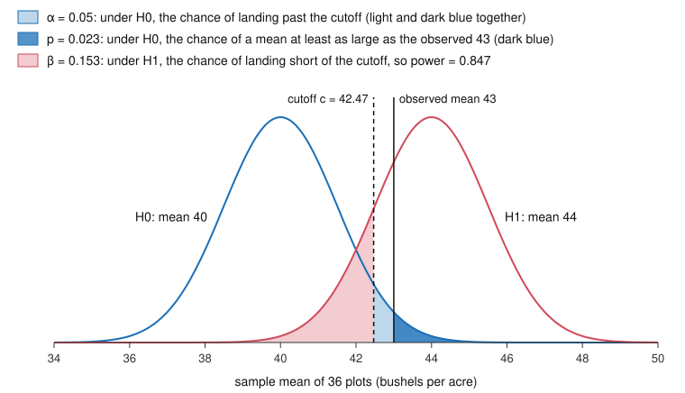

# Philosophy of Science · Lesson 3.1: Two schools of statistical inference

> ⏱ ~15 min · Module 3: Statistical evidence and the values of science · Builds on: [`prob-stat-refresher` 4.3](../../prob-stat-refresher/lessons/04-03-hypothesis-testing.md), [`econometrics` 2.3](../../econometrics/lessons/02-03-hypothesis-tests-confidence-intervals.md), [1.3](01-03-confirmation-as-probability-raising.md) · Unlocks: [3.2](03-02-the-likelihood-principle.md)

## Why this matters

Most results sections say something like "$p = 0.03$, significant at the 5 percent level." That phrase fuses two theories whose authors spent decades attacking each other; in 1955 one of them suggested that the other's logic belonged with five-year plans and the speeding of production. You know how to compute it. This lesson asks what it claims; the test you learned turns out to be a blend.

## The idea

A probability can report how often something happens in a long run of trials, a frequency, or how strongly to expect it, a degree of belief. A coin's one-half reads either way. "The probability that this hypothesis is true" reads only the second way, since a hypothesis is true or false once and for all and there is no series of trials to count. Keep to frequencies and you cannot put a probability on a hypothesis. You can only ask how the *data* would behave if it held.

Two schools built on that restriction differently: a detective and a smoke-alarm engineer.

- **Fisher is the detective.** A clue turns up, and the question is how strange it would be if nothing were going on. Strangeness comes in degrees, and only one suspect, "nothing is going on", has to be named.
- **Neyman and Pearson are the engineers.** They do not ask what any one beep means. They fix how often the alarm may sound with no fire, make it as sensitive to real fires as that allows, and promise something about every beep over the device's life.

The correct reading of a p-value belongs to [`prob-stat-refresher` 4.3](../../prob-stat-refresher/lessons/04-03-hypothesis-testing.md) and [`econometrics` 2.3](../../econometrics/lessons/02-03-hypothesis-tests-confidence-intervals.md), and the meaning of a confidence interval to [`prob-stat-refresher` 4.2](../../prob-stat-refresher/lessons/04-02-confidence-intervals.md). This lesson uses them.

## Source

R. A. Fisher, "The Arrangement of Field Experiments", *Journal of the Ministry of Agriculture* 33 (1926), p. 504:

> ... it is convenient to draw the line at about the level at which we can say: "Either there is something in the treatment, or a coincidence has occurred such as does not occur more than once in twenty trials." ... Personally, the writer prefers to set a low standard of significance at the 5 per cent. point, and ignore entirely all results which fail to reach this level. A scientific fact should be regarded as experimentally established only if a properly designed experiment rarely fails to give this level of significance.

The test ends in a disjunction ("Either ... or"), not in a probability of the hypothesis. The line is a preference ("convenient", "Personally"), as in *Statistical Methods for Research Workers* (1925, p. 47): "The value for which P = .05, or 1 in 20, is 1.96 or nearly 2 ; it is convenient to take this point as a limit in judging whether a deviation is to be considered significant or not." But "ignore entirely" is a real threshold, so the Fisher who only ever graded evidence is too tidy. By *Statistical Methods and Scientific Inference* (1956) he was writing that no working scientist keeps one fixed level for every case. And the last sentence says one significant result does not make a fact.

## The math

$P(x;\theta)$, with a semicolon, is the sampling probability of data $x$ under a fixed parameter value $\theta$. In this module it replaces the credence $P(\cdot)$ of [1.3](01-03-confirmation-as-probability-raising.md) (`epistemology`'s $\mathrm{cr}$), except in Bayesian passages.

**1. [Frequency and degree of belief](../reference.md#frequency-and-degree-of-belief).** On the frequency view (von Mises and others) a probability is a relative frequency in a long series of like events, so $P(H_0)$ has no meaning. On the degree-of-belief view ([`epistemology` 5.4](../../epistemology/lessons/05-04-the-problem-of-priors.md)) it does. The frequency view carries a standing debt, the [reference-class problem](../reference.md#reference-class-problem): one event belongs to many series with different frequencies, and the definition does not say which to use (Reichenbach 1949; Hájek 2007 argues that every interpretation owes it).

*In words:* both schools below start from probabilities of data under a fixed hypothesis, so both must say which series of data they mean.

**2. Fisher's [significance test](../reference.md#significance-test).** Given a null hypothesis $H_0$ and a statistic $T$ whose distribution under $H_0$ is known, the [p-value](../reference.md#p-value) for an observed value $t$ is

$$p = P(T \ge t;\, H_0).$$

*In words:* the probability, if $H_0$ were true, of a statistic at least this extreme. The lessons cited write $P(\cdot \mid H_0)$; that bar is notation, since to a frequentist $H_0$ is not an event.

No alternative is named, so power has no place. A small $p$ is graded evidence against $H_0$; a large $p$ does not establish it.

**3. [Neyman–Pearson tests](../reference.md#neyman-pearson-tests)** (Jerzy Neyman and Egon Pearson, "On the Problem of the Most Efficient Tests of Statistical Hypotheses", 1933). Two hypotheses, and a rejection region $R$ fixed before the data:

$$\alpha = P(X \in R;\, H_0), \qquad \beta = P(X \notin R;\, H_1), \qquad \text{power} = 1 - \beta.$$

Fix $\alpha$, then choose $R$ to maximize power. For two point hypotheses the Neyman–Pearson lemma says the best $R$ rejects for large values of $P(x;H_1)/P(x;H_0)$.

*In words:* decide how often you will tolerate a false alarm, then miss as little as that allows.

The output is a decision: reject, or accept, meaning act as if. The 1933 paper sets aside knowing whether any single hypothesis is true or false and seeks rules of conduct that keep one from being wrong too often in the long run. Neyman later named this [inductive behaviour](../reference.md#inductive-behaviour). Pearson, replying to Fisher in 1955, left that phrase to Neyman.

**4. The quarrel.** Fisher's "Statistical Methods and Scientific Induction" (*JRSS* B, 1955) charged that Neyman had recast the significance test as an acceptance procedure, the inspection of a supplier's consignments, where repeated sampling and two kinds of error make sense. A scientist, he said, has one body of data and reaches provisional conclusions. Neyman's "Note on an Article by Sir Ronald Fisher" (1956) answered that without alternatives and both error rates no purely probabilistic theory of tests is possible, and that power is what decides whether a failure to reject can count as confirmation.

**5. The [confidence level](../reference.md#confidence-level)** (Neyman, 1937). A 95 percent interval comes from a recipe that covers the fixed parameter in 95 percent of repetitions. Fisher held that substituting the observed numbers into that probability statement is plain logic (his fiducial argument). Neyman replied that a probability statement about random variables generally fails once they are replaced by their values.

*In words:* on Neyman's reading the 95 belongs to the recipe and not to the interval in hand. A credible interval is a different object, a posterior probability with the data held fixed, and it can cover poorly at a fixed truth ([`statistical-learning` 2.5](../../statistical-learning/lessons/02-05-regularization-as-a-bayesian-prior.md), Example 2: 2.8 percent).

**6. The [textbook hybrid](../reference.md#textbook-hybrid)** (Gerd Gigerenzer, "Mindless Statistics", 2004). Textbooks fused Fisher's single null with Neyman–Pearson's yes-or-no decision at a conventional 5 percent, what he calls the "null ritual". [`prob-stat-refresher` 4.3](../../prob-stat-refresher/lessons/04-03-hypothesis-testing.md) is this hybrid: "you disbelieve $H_0$" is Fisher, while its pre-set threshold and error table are Neyman–Pearson. [`econometrics` 2.3](../../econometrics/lessons/02-03-hypothesis-tests-confidence-intervals.md) leans to Neyman ("decision rule with a controlled error rate"). The algebra fits: for a tail $R$, $p \le \alpha$ exactly when the statistic lands in $R$. What the hybrid adds is a reading: $p$ as this rejection's error rate, and the verdict at $\alpha$ as a strength of evidence. Gigerenzer's charge is that both parties would have refused it; Fisher's 1926 line complicates that for him.

**Where the argument is weakest.** The premise under most pressure is the bridge from a property of a repeated procedure to the case in hand. Fisher's objection: a rule's long-run record says nothing about this result unless this result is a fair member of that run, and science has no factory of repeats. Neyman's reply: probability supplies nothing beyond the record, so the honest claim concerns the policy, as with any instrument trusted for its reliability. The reply concedes that the theory is silent on whether this hypothesis is true. The objection concedes that "evidence against $H_0$" with no rival leaves open what the evidence favours, which [3.2](03-02-the-likelihood-principle.md) takes up.

## The picture

The dashed cutoff, set before the data, fixes $\alpha$ and $\beta$; the solid line, set by the data, fixes $p$.

## Worked examples

**Example 1 (clean case: one trial read three ways).** A fertilizer is tried on 36 independent plots. Model: yields are normal with known standard deviation $\sigma = 9$ bushels per acre, so the sample mean has standard error $9/\sqrt{36} = 1.5$. The untreated mean is $\mu_0 = 40$; a gain worth acting on would make it $\mu_1 = 44$. The observed mean is $\bar x = 43$.

*Fisher.* $z = (43 - 40)/1.5 = 2$ and $p = 1 - \Phi(2) = 0.0228$, with $\Phi$ the standard normal CDF. Either the fertilizer does something or a coincidence of about 1 in 44 has occurred. He reports it and weighs it.

*Neyman–Pearson.* Before the data: $\alpha = 0.05$, one-sided, so the cutoff is $c = 40 + 1.645(1.5) = 42.4675$. Power at 44 is $\Phi\big((44 - c)/1.5\big) = \Phi(1.022) = 0.847$, so $\beta = 0.153$. Since $43 > 42.47$: reject, and act as if the fertilizer works. At $\bar x = 49$ ($p \approx 10^{-9}$) the output is identical; at $\bar x = 42.4$ ($p = 0.055$) it flips to "retain". Fisher's number registers all three differences; the decision registers one.

*The hybrid* says "$p = 0.023 < 0.05$, significant, so the effect is real".

**Example 2 (hard case: [Cox's two instruments](../reference.md#coxs-two-instruments)).** From D. R. Cox, "Some Problems Connected with Statistical Inference" (*Annals of Mathematical Statistics*, 1958); the numbers are chosen here. A fair coin picks an instrument and you record which. Instrument A reads $\mu$ plus normal noise with $\sigma_A = 1$; B has $\sigma_B = 10$. One reading $x$; $H_0: \mu = 0$ against $H_1: \mu = 10$.

Applied to the whole coin-then-reading experiment, the lemma gives the most powerful test of overall level 0.05: reject if $x > 5.08$ on A or $x > 12.82$ on B. Conditional on the instrument, its levels are about $2 \times 10^{-7}$ on A and $0.100$ on B, averaging 0.05. Its power is 0.695, against 0.630 for a plain 5 percent test on each.

Now $x = 13$ arrives from B. The rule rejects, and the unconditional p-value, averaged over the coin, is $\tfrac12(0 + 0.0968) = 0.0484$ to four places. On the instrument actually used, $p = 1 - \Phi(1.3) = 0.0968$.

Here the account stops. Which repetitions count: every coin-and-reading run, or only the runs on B? The definition of an error rate does not say; this is the reference-class problem inside one test. Cox held that the average over the instrument not used is irrelevant to interpreting this reading, and a Fisherian conditions too. Defenders of the unconditional rule reply that it suits cases where the long-run record is the point, such as acceptance sampling, that nothing in the theory forbids conditioning, and that against $\mu = 10$ a reading of 3 on A (conditional $p = 0.0013$) is $e^{20}$ times likelier under $H_0$, so retaining it is defensible. E. L. Lehmann (*JASA*, 1993) concluded that no universal answer exists and context must decide.

## Watch out

- **You might think $p = 0.0228$ is the error rate of this rejection, but actually** the error rate belongs to the rule: $\alpha$ was 0.05 before the data and stays 0.05 whatever $p$ comes out.
- **You might think a p-value is the probability that $H_0$ is true, but actually** on the frequency reading $H_0$ has no probability at all. A Bayesian can compute one, and it takes a prior.
- **You might think "accept $H_0$" means believing it, but actually** for Neyman it means acting as if it were true, at a known risk $\beta$. Fisher refused the word for a significance test.
- **You might think Fisher was the p-value purist and Neyman the 5 percent pedant, but actually** the 1926 Fisher ignored results short of 5 percent, and Neyman's $\alpha$ was to be set by weighing the two errors.

## One-liner

> A p-value grades one result against one hypothesis, an error rate certifies a rule over many uses, and the textbook test runs them together.

## Problems

**P1 (🟢) *(Formal (a)–(c))*** A trained dog is shown four canisters, one carrying the target scent, in each of 10 trials fixed in advance. Let $X$ be the number of correct picks, with independent trials and common success probability $\theta$, so $X \sim \mathrm{Bin}(10, \theta)$. $H_0: \theta = \tfrac14$ (guessing); $H_1: \theta = \tfrac12$. Consider rejection regions of the form $X \ge k$.

(a) Find the smallest $k$ with $\alpha \le 0.05$ and give that $\alpha$ as an exact fraction. One line: why does no such rule have $\alpha$ exactly 0.05?

(b) Find that rule's power against $H_1$, as an exact fraction.

(c) The dog scores 7. Give the exact p-value. One line: which of $\alpha$ and $p$ could have been written down before the trials?

**P2 (🟡) *(Exegetical (a)–(b))*** Read this press release (invented, written for this problem).

> Averholm Biotherapeutics today reported results from its randomized trial of a new migraine preventive. "The reduction in migraine days reached $p = 0.02$," said Dr. Anneke Roth, the company's chief scientific officer. "That means there is only a 2 percent probability that the drug does not work. The trial also measured sleep quality, where the result was $p = 0.31$, so we can now state that the drug has no effect on sleep."

(a) The release misreads a p-value in two distinct ways. Name each, and state what the reported number does say. Two sentences per misreading.

(b) Neyman–Pearson theory does have an "accept $H_0$" outcome. In two sentences, say what it would mean for sleep quality and what the release must report before it can be used. In one more, say what Fisher would allow the company to claim.

**P3 (🔴) *(Exegetical (a)–(b))*** A results section reads: "$p = 0.03$, so we reject the null hypothesis and the effect is real." Assume nothing else about the study.

(a) What in this sentence would Fisher keep, and what would he object to?

(b) What would Neyman keep, and what would he object to?

150 words or fewer in all.

Solutions

**P1** *(Formal (a)–(c))*

Write $q_k = P(X \ge k;\, \theta = \tfrac14) = \sum_{j=k}^{10} \binom{10}{j} 3^{10-j} / 4^{10}$, with $4^{10} = 1{,}048{,}576$. The terms $\binom{10}{j} 3^{10-j}$ for $j = 10, 9, 8, 7, 6, 5$ are $1,\ 30,\ 405,\ 3240,\ 17010,\ 61236$.

(a) Adding from the top: $q_7 = 3676/4^{10}$, $q_6 = 20686/4^{10}$, $q_5 = 81922/4^{10}$. So $q_5 \approx 0.0781 > 0.05$ and $q_6 \approx 0.0197 \le 0.05$, which gives $k = 6$ and

$$\alpha = \frac{20686}{1048576} = \frac{10343}{524288} \approx 0.0197.$$

$X$ is discrete, so only the values $q_k$ are attainable, and 0.05 falls strictly between $q_6$ and $q_5$.

(b) Under $\theta = \tfrac12$ every outcome sequence has probability $2^{-10}$, so

$$1 - \beta = \frac{\binom{10}{6} + \binom{10}{7} + \binom{10}{8} + \binom{10}{9} + \binom{10}{10}}{1024} = \frac{210 + 120 + 45 + 10 + 1}{1024} = \frac{386}{1024} = \frac{193}{512} \approx 0.377.$$

(c) $p = q_7 = \dfrac{3676}{1048576} = \dfrac{919}{262144} \approx 0.0035$. Only $\alpha$ could be written down in advance; $p$ depends on the outcome.

**Wrong turns:** taking $p = P(X = 7;\, \tfrac14) \approx 0.0031$, which omits the "at least this extreme" tail. Reporting $\alpha = 0.05$ for the rule, when its actual level is 0.0197. Calling 0.0035 the rule's error rate.

---

**P2** *(Exegetical (a)–(b))*

**Must hit, strict (a):**

- First misreading: taking $p = 0.02$ as the probability that the drug does not work, which reads $p$ as a probability of the hypothesis. It says that if the drug had no effect, a reduction at least this large would occur in about 2 percent of such trials.
- Second misreading: taking $p = 0.31$ as showing no effect, which treats a failure to reach significance as establishing the null. It says that with no effect a difference at least this large would be common, about 31 percent of trials, which is compatible with no effect and with an effect the trial was too small to detect.

**Must hit, strict (b):**

- "Accept" means acting as if the drug does not affect sleep, under a rule fixed in advance; it is a decision, not a belief or a finding.
- The release must report $\alpha$ and the power (equivalently $\beta$) against a named size of effect on sleep. Without it, the risk of the "accept" is unknown.
- Fisher: a test never establishes its null. At most the company may say the data give no strong reason to doubt it.

**Wrong turns:** "$p = 0.02$ means a 2 percent chance the result is due to chance" is the first misreading reworded, so it does not repair it. Calling the second misreading multiple testing: the release does not say that the sleep result was selected from many. Claiming that Neyman–Pearson theory forbids "accept": it has that outcome, with a different meaning.

**Model answer:** The first sentence treats $p = 0.02$ as the probability that the drug fails. In fact it is the probability, were the drug inert, of a reduction at least this large. The second treats $p = 0.31$ as proof of no effect. In fact a difference this large would be common if the drug did nothing to sleep, which says nothing about whether a real effect was too small for this trial to show. A Neyman–Pearson "accept" would mean acting as if sleep is unaffected, and to use it the release needs the test's power against a stated effect on sleep. Fisher would allow only that these data give no strong reason to doubt the null.

---

**P3** *(Exegetical (a)–(b))*

**Must hit, strict (a):**

- Keeps $p = 0.03$ as graded evidence against the null: either the null fails or something rare has occurred.
- Objects to "the effect is real": on his 1926 standard a fact is established only when a properly designed experiment rarely fails to reach significance, and one result does not show that.
- Objects to reading "reject" as an acceptance-procedure decision with a long-run error rate (1955). The word alone is not the issue: his 1956 sentence on working scientists speaks of rejecting hypotheses, and such conclusions are provisional.

**Must hit, strict (b):**

- Keeps "reject" only as the output of a rule fixed in advance, with $\alpha$ and an alternative chosen first. The sentence states neither, so the error guarantee cannot be read off it.
- Objects to treating 0.03 as the relevant quantity: the guarantee is $\alpha$, a property of the rule.
- Objects to "the effect is real": the theory gives a rule for being wrong rarely in the long run, not knowledge of this one hypothesis. To reject is to act as if the null were false.

**Wrong turns:** answering either part with "a p-value is not the probability of the null": the sentence does not say that it is. Giving Fisher the demand for a pre-set $\alpha$, or Neyman the demand for an exact $p$. Having Fisher reject the word "reject" outright.

**Model answer:** Fisher keeps $p = 0.03$ as evidence against the null: the null fails or something rare happened. He objects to "the effect is real", since a fact is established only by a properly designed experiment that rarely fails to reach significance, and to any reading of "reject" as a factory-style decision, since scientific conclusions stay provisional. Neyman keeps "reject" only if a rule with $\alpha$ and an alternative was fixed first, and the sentence shows neither; 0.03 is no error rate. He objects to "the effect is real" because tests yield a policy that errs rarely over many uses, not knowledge of this hypothesis. Rejecting means acting as if the null were false.

## Flashback

**From Lesson [2.5](02-05-lakatos-and-feyerabend.md) (Lakatos and Feyerabend):** *(Exegetical (a)–(b).)* Invented, written for this problem. Hard core of Marrable's programme: a steel's fatigue life is set by its grain size. Batch X fails early for its grain size. Marrable adds that trace sulphur at grain boundaries shortens life, a repair built from batch X alone. Its one further consequence: sulphur-rich steels of another family fail early by a stated proportion. A 1931 foundry table, long in print and never used in building the programme, shows exactly that.

(a) Reviewers split: degenerating, or progressive. Name the point at issue and each reading's grade, with the deciding words. Three sentences.

(b) A third reviewer: "We agreed to accept the batch X reports; they contradict the law; so the theory is out." Which of Lakatos's three falsificationisms is this, and what would the sophisticated version require first? Two sentences.

Solution

**Must hit, strict (a):**

- The point at issue is what counts as a [novel fact](../reference.md#novel-prediction): whether a fact already on record can be one.

- Temporal reading (a fact not yet known): "long in print" makes the pattern known, so the repair predicts nothing new and is degenerating.

- Zahar's reading (1973; Lakatos and Zahar 1975), on which a known fact counts if the programme's core was not built to fit it: "never used in building the programme" makes the pattern novel, and the table corroborates it, so the shift is theoretically and empirically progressive.

**Must hit, strict (b):**

- Naive methodological falsificationism: "we agreed" is a test statement accepted by decision, and then one clash eliminates.

- The sophisticated version eliminates a theory only by a rival that keeps its successes and adds corroborated content, and no rival is on offer here.

**Wrong turns:** calling the repair suspect because it protects the core, which the negative heuristic requires. Reading "known" as "known to Marrable". Calling (b) dogmatic, which has experience conclusively disprove a theory, with no decision to accept. Declaring one reading of novelty correct; the question asks what each yields.

**Model answer:** (a) They differ on whether a fact already on record can be novel. On the temporal reading "long in print" rules it out, so the repair predicts nothing new and is degenerating. On Zahar's reading "never used in building the programme" makes it novel, and the table corroborates it, so the repair is progressive. (b) This is naive methodological falsificationism: a report accepted by agreement, then one clash. The sophisticated version waits for a rival that keeps the theory's successes and adds corroborated content.

## Connections

- **Backward:** [`prob-stat-refresher` 4.2](../../prob-stat-refresher/lessons/04-02-confidence-intervals.md) and [4.3](../../prob-stat-refresher/lessons/04-03-hypothesis-testing.md) gave the machinery this lesson interprets, and [`econometrics` 2.7](../../econometrics/lessons/02-07-multiple-testing-specification-search.md) calls a p-value a promise about a procedure, which is Neyman's side of the quarrel. Fisher's null that is never established has the asymmetry of [2.1](02-01-popper-conjectures-and-refutations.md), and the p-value is one answer to the problem of probabilistic hypotheses raised there. The credences set aside here are [`epistemology` 5.4](../../epistemology/lessons/05-04-the-problem-of-priors.md)'s.
- **Forward:** [3.2](03-02-the-likelihood-principle.md) turns Cox's intuition into a conditionality principle and asks which school must care about the sample space. [3.3](03-03-replication-error-statistics-and-severe-testing.md) tests the hybrid against the replication crisis and takes up Mayo's attempt to give error rates an evidential reading. [3.4](03-04-values-and-inductive-risk.md) asks who should choose $\alpha$ and $\beta$.
- **Sideways:** [`decision-theory` 2.2](../../decision-theory/lessons/02-02-probability-from-preference.md) reads probability off preference, the degree-of-belief side of the root split; the $\alpha$ and $\beta$ trade-off is the payoff matrix [`prob-stat-refresher` 4.3](../../prob-stat-refresher/lessons/04-03-hypothesis-testing.md) mentions. [`statistical-learning` 2.5](../../statistical-learning/lessons/02-05-regularization-as-a-bayesian-prior.md) computes the gap between credible and confidence. Fisher's randomization test survives as the sharp-null inference of [`econometrics` 2.6](../../econometrics/lessons/02-06-bootstrap-and-few-clusters.md). Probability in physics belongs to [`philosophy-of-physics`](../../philosophy-of-physics/syllabus.md).
