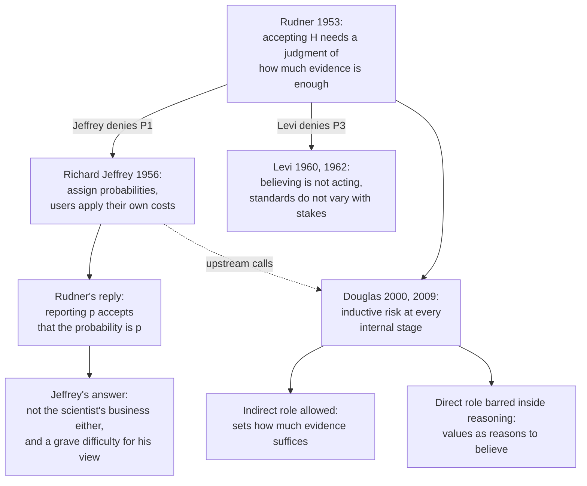

# Philosophy of Science · Lesson 3.4: Values and inductive risk

> ⏱ ~15 min · Module 3: Statistical evidence and the values of science · Builds on: [3.1](03-01-two-schools-of-statistical-inference.md), [`prob-stat-refresher` 4.3](../../prob-stat-refresher/lessons/04-03-hypothesis-testing.md), [`decision-theory` 1.2](../../decision-theory/lessons/01-02-from-expected-value-to-expected-utility.md) · Unlocks: [3.5](03-05-objectivity.md)

## Why this matters

Before the first atomic detonation, someone had to decide that the chance of an uncontrollable chain reaction was small enough. In 1953 Richard Rudner asked how high a probability the Manhattan Project scientists had demanded that no such reaction would occur, why that figure and not a higher one, and whether anyone had even posed the question. You have typed `alpha = 0.05` many times, and [`prob-stat-refresher` 4.3](../../prob-stat-refresher/lessons/04-03-hypothesis-testing.md) called that choice a payoff matrix over which mistake hurts more. This lesson asks whose payoffs those are, and whether a scientist can do the job without them.

## The idea

A criminal conviction needs proof beyond reasonable doubt. A civil judgment, in common-law systems, needs only the balance of probabilities ([`philosophical-method` 4.2](../../philosophical-method/lessons/04-02-steelmanning-and-the-burden-of-proof.md)). The evidence is the same kind of thing; the bar differs because the two mistakes cost differently. Rudner claims science has this structure too. You should want more evidence before saying a drug's toxic ingredient is below the lethal dose than before saying a lot of belt buckles is sound (his examples).

The target is the [value-free ideal](../reference.md#value-free-ideal). Moral, political and economic values may pick the question and decide what to do with the answer, but must stay out of the core of inquiry: gathering evidence and accepting hypotheses. The ideal rests on a line between [epistemic and non-epistemic values](../reference.md#epistemic-and-non-epistemic-values). Epistemic values, such as Kuhn's [five](../reference.md#five-values-of-theory-choice) from [2.4](02-04-kuhn-incommensurability-and-theory-choice.md), are meant to bear on whether a theory is true. Non-epistemic values (also called contextual) are the rest: safety, profit, justice.

Three positions:

- **Rudner:** accepting a hypothesis is a decision under risk of error, so it needs a view about which error is worse.
- **Richard Jeffrey:** then scientists should not accept hypotheses. They should report probabilities and let the users decide.
- **Heather Douglas:** values are unavoidable inside inquiry, but they have a permitted job and a forbidden one.

## The argument

**[The argument from inductive risk](../reference.md#argument-from-inductive-risk)** (Rudner, "The Scientist *qua* Scientist Makes Value Judgments", *Philosophy of Science*, 1953).

1. **P1.** The scientist as scientist accepts or rejects hypotheses. *In words:* a method that never commits to anything does not describe science.
2. **P2.** No hypothesis is ever completely verified, so accepting one requires deciding that the evidence is strong enough. *In words:* there is always a gap, and someone decides to cross it.
3. **P3.** How strong is strong enough depends on how serious a mistake would be, in what Rudner calls the "typically ethical sense". *In words:* the cost of being wrong sets the bar.

∴ **C.** The scientist as scientist makes value judgments. *In words:* the judgment sits inside the method, not before or after it.

In statistics, he says, the decision is the choice of a significance or confidence level. Carl Hempel ("Science and Human Values", 1960, reprinted in *Aspects of Scientific Explanation*, 1965) named the risk and drew the line later writers use. Values have no logical bearing on whether evidence supports a hypothesis. But a rule of acceptance has no clear meaning until the four outcomes (accepted or rejected, true or false) are assigned values. In pure research, he suggested, those are the aims of knowledge.

**[Jeffrey's reply](../reference.md#jeffreys-reply)** (Richard Jeffrey, "Valuation and Acceptance of Scientific Hypotheses", 1956; not Harold Jeffreys of the Bayes factor).

1. **J1.** The cost of wrongly accepting $H$ depends on what will be done if $H$ is accepted. *In words:* there is no cost of error without a use.
2. **J2.** Nothing in $H$ says what will be done. A finding that a vaccine lot is free of active virus might guide a physician with a child or a veterinarian with a pet monkey, and a lawlike hypothesis has endless uses. *In words:* Rudner's examples came from quality control, where context supplies the use.
3. **J3.** No single acceptance suits every use, and taking the strictest standard is wrong for all the others. *In words:* whatever you pick, someone is badly served.

∴ **JC.** Acceptance is not the scientist's business. The scientist should supply a probability, and each user should apply their own costs. *In words:* one number, many decisions.

**[Rudner's reply](../reference.md#rudners-reply-and-the-regress).** Rudner anticipated this. To determine that the degree of confirmation is $p$ just is to accept the hypothesis that it is $p$, and the objector has granted that acceptance takes a value decision. Jeffrey answered that accepting claims about probabilities is no more the scientist's business than accepting any others. Douglas later pressed this as a regress of probabilities of probabilities.

**[Levi's reply](../reference.md#levis-reply).** Isaac Levi ("Must the Scientist Make Value Judgments?", 1960; "On the Seriousness of Mistakes", 1962) keeps acceptance and denies P3 for it. Deciding what to believe in the search for truth differs from deciding how to act. The first answers to standards of inference a scientist takes on by joining the profession, and those do not shift with the practical cost of a particular error.

**[Douglas's two moves](../reference.md#direct-and-indirect-roles-for-values)** ("Inductive Risk and Values in Science", *Philosophy of Science*, 2000; *Science, Policy, and the Value-Free Ideal*, 2009).

- *Extension.* [Inductive risk arises at every internal stage](../reference.md#inductive-risk-throughout-inquiry): choosing a method, characterizing data, interpreting results. So judgments precede any reported probability, and those upstream calls never reach the user.
- *Restriction.* Values play a **direct** role when they are themselves a reason for a claim or an action. They play an **indirect** role when they only help settle how much evidence is enough, given uncertainty. A direct role is legitimate when choosing problems, when deciding what to do with results, and when limiting methods on ethical grounds (no experiments on people without consent). Inside the reasoning it is barred.

Her conclusion is limited: where error has no foreseeable non-epistemic consequences (she cites research on atom beams), such values need not enter.

**Where the argument is weakest.** P1: does the scientist accept at all? Gregor Betz ("In Defence of the Value Free Ideal", 2013) argues that scientists can largely avoid contextual value judgments by stating how uncertain their evidential claims are. Tobias Henschen ("How Strong Is the Argument from Inductive Risk?", 2021) reports that most writers think Jeffrey and Levi refuted, then argues otherwise: the chain of probabilities ends in practice. Rudner's side replies that any reported number rests on accepted models, data and categories, and Katie Steele ("The Scientist *qua* Policy Advisor Makes Value Judgments", 2012) adds that putting uncertainty into a report takes value judgments of its own. Defenders of P1 must grant Jeffrey that "accepted" is relative to a use. Its critics must grant that reports rest on upstream choices, and must say what remains of science if nothing is ever accepted: Jeffrey notes that textbooks state Maxwell's equations with no degree of confirmation attached.

## Argument map

Jeffrey and Levi attack different premises; Douglas accepts the conclusion and limits what follows from it.

## Worked examples

**Example 1 (clean): one batch, two uses.** A structural engineer load-tests $n=20$ bolts from a batch. $H$ says the batch is good, each bolt failing with probability $1/20$. Otherwise the batch is bad, each bolt failing with probability $1/4$. Failures are independent given the batch's quality, and the supplier's record gives $P(H)=9/10$, with $P(\cdot)$ an ideal agent's credence. After $k$ failures, Bayes' theorem gives $p_k = P(H \mid k)$:

| $k$ | 0 | 1 | 2 | 3 | 4 |
|---|---|---|---|---|---|
| $p_k$ | 0.9990 | 0.9938 | 0.9621 | 0.8002 | 0.3874 |

Let $L_A$ be the loss from accepting a bad batch and $L_R$ the loss from rejecting a good one (a loss is a [utility](../../decision-theory/lessons/01-02-from-expected-value-to-expected-utility.md) with its sign flipped). Accepting has expected loss $(1-p_k)L_A$ and rejecting has $p_k L_R$, so accept exactly when

$$p_k > t = \frac{L_A}{L_A + L_R}.$$

*In words:* the [bar](../reference.md#expected-loss-threshold) rises with the cost of wrongly accepting. Set $L_R = 1$.

- Garden fence, $L_A = 3$: $t = 0.75$, so she accepts up to $k=3$.
- Rail bridge, $L_A = 99$: $t = 0.99$, so she accepts up to $k=1$.

Take $k=2$, so $p_2 = 0.9621$ for both. For the fence, accepting costs $0.0379 \times 3 = 0.114$ in expectation against $0.962$ for rejecting: accept. For the bridge, accepting costs $0.0379 \times 99 = 3.75$ against $0.962$: reject. Same evidence, same probability, opposite decisions.

Now treat "good" as the null. The fence rule ($k \le 3$) has $\alpha = 0.016$ and $\beta = 0.225$. The bridge rule ($k \le 1$) has $\alpha = 0.264$ and $\beta = 0.024$. A test at 26% minimizes expected loss here, and no convention picked that level. Jeffrey says to publish $p_2$ and stop. Rudner's side says that $p_2$ already stands on an accepted model, prior and test rig.

**Example 2 (hard): the rat slides.** A 1978 study by Richard Kociba and colleagues at Dow Chemical became central to dioxin regulation. Its female rat liver slides were read at least three times: by the study's authors in 1978, by Robert Squire for the EPA in 1980, and in 1990 by seven pathologists assembled by a contractor at the paper industry's request. The slides were the same. At 10 ng/kg/day the count of tumorous livers out of 50 was 20, 27 and 9 (controls: 9, 16 and 2 of 86), so the excess over control was 0.30, 0.35 or 0.16. The 1990 team used a revised classification scheme and settled disagreements by majority vote, so these are not three applications of one standard. Douglas reports that its reading led Maine to relax a regulation.

Douglas's point (2000): a pathologist must call the borderline slides one way or the other, and each policy trades false negatives against false positives. The value enters in the data, before any probability exists. Blinding can shield individual calls from their consequences, but signs of acute toxicity at the higher doses identified those groups through the microscope.

Here the account stops. Calling borderline slides malignant because a missed cancer is worse is her indirect role. Calling them malignant because you want the chemical regulated is direct. The two can produce identical calls on every slide. Kevin Elliott ("Direct and Indirect Roles for Values in Science", 2011) doubts the line can be policed: is a conservative model caution, or reasoning to a foregone conclusion? Douglas's side answers that the reasons differ, and disclosure can audit them. A value-free defender would report the borderline count separately and leave it to the reader, Jeffrey's plan applied to data. Douglas replies that the categories themselves were chosen.

## Watch out

- **You might think Rudner licenses believing what suits you, but actually** for him the cost of error bears only on how much evidence is enough, never on what the evidence shows. Hempel and Douglas keep that line: wanting something true is no argument for it.
- **You might think Weber's value freedom is the value-free ideal, but actually** Weber's rule ([`social-theory` 1.3](../../social-theory/lessons/01-03-understanding-webers-interpretive-method.md)) forbids passing off a verdict on what is good as a finding about what happens. The ideal bans non-epistemic values from acceptance. You can keep Weber's rule and still have Rudner's problem.
- **You might think Jeffrey offers a finished, value-free science of probabilities, but actually** his paper is a reductio of acceptance. He says the probabilistic view is not fully satisfactory, and that its difficulties, Rudner's objection among them, may be fatal to it.
- **You might think "direct role" means "illegitimate", but actually** for Douglas it depends on the stage. A review board forbidding a harmful design uses values directly and legitimately; only inside the reasoning is the direct role barred.

## One-liner

> Accepting a hypothesis takes a judgment about how bad error would be (Rudner); scientists should report probabilities instead (Richard Jeffrey); a reported probability is itself accepted (Rudner); and the live question is what values may do inside inquiry (Douglas).

## Problems

**P1 (🟢) *(Exegetical.)*** A geologist is asked whether the hillside above a village is stable, and she answers "stable". Reconstruct Rudner's argument that she has made a value judgment, as numbered premises and a conclusion, each premise written for this case. Beside each premise, mark **Jeffrey** if Richard Jeffrey denies it, **Levi** if Isaac Levi denies it, or **neither**. One line per premise.

**P2 (🟡) *(Exegetical.)*** Three vignettes, invented, written for this problem. For each, say whether a non-epistemic value plays a **direct** or an **indirect** role in Douglas's sense, whether she permits it at that point, and which words decide it. One line each.

> (i) A hydrologist must label ambiguous river-gauge readings. "A missed flood kills people and a false alarm costs a day's work," she writes, "so ambiguous readings go down as flood."
>
> (ii) A review board forbids the most informative design for a new therapy, because it would withhold a proven treatment from patients who would die without it. The team runs a weaker design.
>
> (iii) A lab director reads the results of a trial of a cheap water filter. "The town has nothing else, so the filter has to work," he says. "Recode the failed samples as passes."

**P3 (🔴) *(Evaluative.)*** The engineer in Example 1 announces that she will stop writing "batch accepted" and publish only $p_k$. Give the strongest case that this answers Rudner, then the strongest reply on Rudner's side, and say what that reply costs. Any verdict; 150 words or fewer.

Solutions

**P1** *(Exegetical)*

**Must hit, strict:**

- P1: In answering "stable" she accepts a hypothesis as a geologist, not merely as a citizen. Mark **Jeffrey**: on his view her proper output is a probability for it.

- P2: No evidence completely verifies that the hillside is stable, so accepting it means deciding the evidence is strong enough. Mark **neither**.

- P3: How strong is strong enough depends on how serious a mistake would be, and a wrong "stable" endangers the village. Mark **Levi**: the standard for what to believe does not shift with the practical cost of an error.

- ∴ C: She has made a value judgment in her work as a geologist.

**Accept:** for Levi, a note that the argument equivocates between deciding what to believe (P2) and deciding how to act (P3), provided P3 is the premise marked.

**Wrong turns:** marking P2 for Jeffrey or Levi, since both grant that no hypothesis is completely verified. Marking P3 for Jeffrey *instead of* P1 (marking both is acceptable: he also says a cost of error is undefined without a use, but his stated target is that the scientist accepts at all). Stating the conclusion as "she let her values decide the answer", which is the direct role and not Rudner's claim.

**Model answer:** P1. By saying "stable", she accepts a hypothesis as a geologist (**Jeffrey**). P2. Nothing completely verifies it, so she must decide the evidence is strong enough (**neither**). P3. How strong is enough depends on how serious a mistake would be, and the village is underneath (**Levi**). ∴ C. She has made a value judgment as a geologist.

---

**P2** *(Exegetical)*

**Must hit, strict:**

- (i) **Indirect, permitted.** "Ambiguous" and "a missed flood kills people and a false alarm costs a day's work": the value weighs error under uncertainty about how to characterize the data.

- (ii) **Direct, permitted.** "Would withhold a proven treatment from patients who would die": the objection is to what the design does to people, not to a chance of error, and limiting methods on ethical grounds is one of the places Douglas allows a direct role.

- (iii) **Direct, not permitted.** "The town has nothing else, so the filter has to work" makes the value a reason for the claim, and "recode" overrides the data. There is no uncertainty being weighed.

**Wrong turns:** calling (ii) forbidden because it is direct. Calling (ii) indirect because it concerns a method: indirect means weighing the consequences of error. Calling (iii) indirect because the town's need sounds like stakes; stakes can raise the evidence required, but cannot supply the conclusion.

**Model answer:** (i) Indirect, permitted: the cost of a missed flood settles how ambiguous readings are called. (ii) Direct, permitted: an ethical limit on method, set by what the design does to patients. (iii) Direct, barred: the town's need is offered as the reason the filter works, and the data are changed to match.

---

**P3** *(Evaluative)*

**Must hit, any verdict:**

- Jeffrey's case in his own terms: there is no cost of error without a use. The fence and the bridge put different bars on the same $p_k$, so no single "accepted" serves both, and adopting the strictest standard is wrong for the other job. Each user applies her own costs.

- A reply on Rudner's side, stated precisely: publishing $p_k$ accepts that the probability is $p_k$, or (Douglas) the figure rests on accepted inputs: the binomial model, the 9/10 prior, the test rig, what counts as a failure.

- What the reply costs, named. For example: if every report is an acceptance, the argument can no longer separate high-stakes cases from idle ones and must say why a second-order acceptance needs a bar set by ethical cost; or, following Henschen, the chain of probabilities ends in practice, so the regress is not vicious.

**Wrong turns:** treating $p_k$ as value-free merely because it is a number, or as worthless because it has inputs. Attributing a regress to Rudner's own text: his reply is one step, and the regress is a later development of it (Douglas 2009, as reported by Henschen). Reading Rudner as allowing the engineer to choose $p_k$ to suit her.

**Model answer, one of several:** No acceptance suits every use. The fence and the bridge put different bars on one $p_k$, and taking the strictest bar scraps bolts the fence could use. So publish $p_k$ and let each user apply her own costs. Rudner replies that publishing $p_k$ is accepting that the probability is $p_k$, and Douglas adds that the figure stands on an accepted binomial model, a 9/10 prior and a test rig, so the judgment has moved upstream without going away. The reply has a price. If every report is an acceptance, the argument no longer separates grave cases from idle ones, and it must say why accepting a probability needs a bar set by ethical cost. Henschen adds that the chain of probabilities ends in practice. The engineer can grant all this and still say she has handed the decision to the people who bear the costs.

## Flashback

**From Lesson [3.2](03-02-the-likelihood-principle.md) (The likelihood principle):** *(Formal (a) · Exegetical (b).)* R. A. Fisher, *Statistical Methods for Research Workers*, 1st ed. (Edinburgh: Oliver and Boyd, 1925), ch. I, §2, pp. 10–11:

> ... the mathematical quantity which appears to be appropriate for measuring our order of preference among different possible populations does not in fact obey the laws of probability. To distinguish it from probability, I have used the term "Likelihood" to designate this quantity ...

(a) A trial's success probability is exactly one of $\theta = \tfrac14, \tfrac12, \tfrac34$. The record is three successes, then a failure. Compute each candidate's likelihood under design (i), 4 trials fixed, and design (ii), run until the first failure. Sum each design's values. Then give the posterior from equal priors.

(b) How much of the [law of likelihood](../reference.md#law-of-likelihood) does the passage assert, and does it assert the [likelihood principle](../reference.md#likelihood-principle)? Two sentences.

Solution

(a) Design (i) is binomial: $L(\theta) = \binom{4}{3}\theta^3(1-\theta) = 4\theta^3(1-\theta)$. Design (ii) is the waiting-time law with one failure: $L(\theta) = \binom{3}{0}\theta^3(1-\theta) = \theta^3(1-\theta)$.

| $\theta$ | $\tfrac14$ | $\tfrac12$ | $\tfrac34$ | sum |
|---|---|---|---|---|
| design (i) | $\tfrac{3}{64}$ | $\tfrac14$ | $\tfrac{27}{64}$ | $\tfrac{23}{32}$ |
| design (ii) | $\tfrac{3}{256}$ | $\tfrac{1}{16}$ | $\tfrac{27}{256}$ | $\tfrac{23}{128}$ |

The candidates are exclusive and exhaustive, yet neither sum is 1, and the sum changes with the design. The order and every ratio do not: $L(\tfrac34) : L(\tfrac12) = \tfrac{27}{16}$ under both. Renormalizing removes the constant, so under both designs the posterior is $\tfrac{3}{46},\ \tfrac{16}{46} = \tfrac{8}{23},\ \tfrac{27}{46}$.

**Must hit, strict (b):**

- The law: only its comparative core, and hedged ("appears to be appropriate"). Likelihood ranks candidate populations; the further claim that the ratio measures how much is not in these words.

- The principle: no. Nothing here says the likelihood function is all the data have to say. Fisher's p-values, defined over the sample space, violate it.

**Wrong turns:** reading "does not in fact obey the laws of probability" as denying that a likelihood is built from probabilities: each value is a sampling probability of the data, and additivity fails across the candidates. Treating $\tfrac{23}{32}$ as the probability of anything. Crediting Fisher with the principle because he named the quantity.

**Model answer (b):** The passage claims, with a hedge, that likelihood ranks candidate populations, the comparative core of the law, without the claim that the ratio measures how much. It does not assert the principle: it never says likelihood exhausts what the data say, and the p-values Fisher also used violate it.

## Connections

- **Backward:** [3.1](03-01-two-schools-of-statistical-inference.md) gave Neyman and Pearson's fixed $\alpha$ and the [decision reading of a test](../reference.md#neyman-pearson-tests). [`prob-stat-refresher` 4.3](../../prob-stat-refresher/lessons/04-03-hypothesis-testing.md) called $\alpha$ and $\beta$ a payoff matrix. Example 1 is expected utility from [`decision-theory` 1.2](../../decision-theory/lessons/01-02-from-expected-value-to-expected-utility.md) with the sign flipped. Rudner credits Wald among his sources, and Jeffrey runs acceptance through both the Bayes criterion and Wald's minimax, the rule of [`decision-theory` 3.3](../../decision-theory/lessons/03-03-decisions-under-ignorance.md).
- **Forward:** [3.5](03-05-objectivity.md) asks what objectivity can mean if Rudner is right, which is the question he closed his paper on: he located objectivity in being precise about which value judgments were made.
- **Sideways:** The pattern recurs one level down in [`epistemology` 3.4](../../epistemology/lessons/03-04-contextualism-and-its-rivals.md), where stakes bear on whether someone knows. William James's two duties, to believe truth and shun error, with no rule of the intellect to weigh them, are in [`philosophy-of-religion` 5.3](../../philosophy-of-religion/lessons/05-03-pragmatic-arguments-the-wager-and-the-will-to-believe.md). Richard Jeffrey's view that a Bayesian needs only credences is [`epistemology` 5.1](../../epistemology/lessons/05-01-credences-and-probabilism.md). The standard of proof as a separate dial is [`philosophical-method` 4.2](../../philosophical-method/lessons/04-02-steelmanning-and-the-burden-of-proof.md). Finding the value judgment inside a technique is the habit of [`philosophy-of-economics` 6.2](../../philosophy-of-economics/lessons/06-02-friedmans-as-if-and-its-critics.md).
