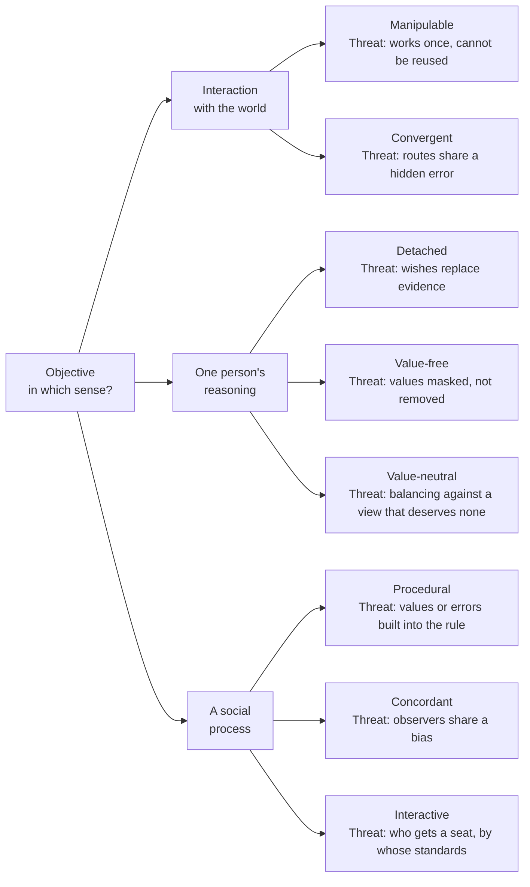

# Philosophy of Science · Lesson 3.5: Objectivity

> ⏱ ~15 min · Module 3: Statistical evidence and the values of science · Builds on: [3.4](03-04-values-and-inductive-risk.md), [2.2](02-02-duhem-quine-and-underdetermination.md) · Unlocks: [5.1](05-01-realism-and-the-no-miracles-argument.md)

## Why this matters

Pre-register a regression and run it exactly as filed, and you have one kind of objectivity. Find the same coefficient in another dataset with another identification strategy, and you have a second. Survive a hostile seminar, and you have a third. [3.4](03-04-values-and-inductive-risk.md) put the [value-free ideal](../reference.md#value-free-ideal) under pressure and ended on Rudner's own suggestion, that objectivity lies in being precise about which value judgments were made. This lesson asks what else the word can mean, and whether objectivity is something a careful person can have alone or something only a community can build.

## The idea

**Which "objective"?** The library already uses the word for other things: [objective chance and objective Bayesianism](../../epistemology/lessons/05-04-the-problem-of-priors.md), [Weber's 1904 essay](../../social-theory/lessons/01-03-understanding-webers-interpretive-method.md), [objective-list welfare](../../philosophy-of-economics/lessons/01-01-welfarism-and-preference-satisfaction.md). None of those is the topic. Here the word describes a *process of inquiry*, and says how far you may trust what comes out of it.

Heather Douglas ("The Irreducible Complexity of Objectivity", *Synthese*, 2004) separates eight [senses of objectivity](../reference.md#senses-of-objectivity) by where you look:

- **At an interaction with the world.** *Manipulable*: you can reliably use the result to do something else. *[Convergent](../reference.md#convergent-objectivity)*: independent routes reach the same result.
- **At one person's reasoning.** *[Detached](../reference.md#detached-objectivity)*: wishes do not stand in for evidence. *Value-free*: no values enter at all. *Value-neutral*: a balanced position across contested values.
- **At a social process.** *[Procedural](../reference.md#procedural-objectivity)*: the same outcome whoever runs it. *[Concordant](../reference.md#concordant-objectivity)*: competent observers, polled separately, agree. *[Interactive](../reference.md#interactive-objectivity)*: agreement reached by arguing it out.

She argues that none reduces to another, that each comes in degrees, and that one can be present while others are absent. The ideals also have a history. Lorraine Daston and Peter Galison (*Objectivity*, 2007) follow [mechanical objectivity](../reference.md#mechanical-objectivity), the effort to take the human hand out of the image, through nineteenth-century science. Theodore Porter (*Trust in Numbers*, 1995) reads rule-bound quantification as what institutions reach for when personal trust is unavailable.

Robert Merton (1942) had already described science's ethos as institutional norms: universalism, communism, disinterestedness, organized scepticism. That is a claim about a community, not about anyone's state of mind. Three later accounts press the shift. Helen Longino says objectivity is how far a community's criticism reaches. Standpoint theorists say where you stand changes what you can notice. Philip Kitcher says a community can be well organized for truth even when its members are not trying to find it.

## The argument

**Longino's [critical contextual empiricism](../reference.md#critical-contextual-empiricism)** (*Science as Social Knowledge*, 1990; *The Fate of Knowledge*, 2002) gives the interactive sense its conditions. Reconstructed:

1. **P1.** Data count as evidence for a hypothesis only given background assumptions. *In words:* in the sixteenth century, seeing no stellar parallax was evidence that the Earth stands still for geocentrists and evidence that the stars are very far away for heliocentrists. This is [holist underdetermination](../reference.md#holist-underdetermination) from [2.2](02-02-duhem-quine-and-underdetermination.md).
2. **P2.** Chains of justification end in assumptions for which no evidence is at hand. *In words:* ask what supports each bridge from data to hypothesis, and eventually you run out.
3. **P3.** No inquirer stands outside all such assumptions, so none can reliably judge the ones she herself holds. *In words:* you cannot audit the frame you audit with.
4. **P4.** People who do not share an assumption can bring it to light and test it. *In words:* it takes someone who assumes otherwise to see it as an assumption at all.
5. **P5.** So the only check on arbitrary preference at that point is critical interaction among people holding different assumptions. *In words:* nothing else reaches that far down.

∴ **C.** A method is objective to the degree that it permits what Longino calls "transformative criticism". *In words:* objectivity belongs first to a community's practice, and it comes in degrees.

[Her four norms](../reference.md#longinos-four-norms), named as in 2002, say what that practice needs: recognized **venues** for criticism; **uptake**, meaning beliefs actually shift in response; **public standards** by which criticism is judged; and **[tempered equality](../reference.md#tempered-equality)** of intellectual authority, on which any perspective starts with a capacity to contribute and can lose that standing by failing to engage or respond.

**[Standpoint epistemology](../reference.md#standpoint-epistemology)** pushes further. Nancy Hartsock ("The Feminist Standpoint", 1983) adapted a Marxist model; Sandra Harding (*Whose Science? Whose Knowledge?*, 1991) drew the methodological moral.

1. **S1.** What an inquirer can notice depends on her social position. *In words:* position shapes which questions occur to you.
2. **S2.** Those on the receiving end of an arrangement can have a contingent advantage in seeing what it hides, once that position has been critically worked out. *In words:* the view from below can show more, but it is earned by reflection and not issued with membership.

∴ **C.** Inquiry should start from those positions and scrutinize its own practices as rigorously as its objects. *In words:* this is what Harding calls "[strong objectivity](../reference.md#strong-objectivity)", and she counts neutrality as the weaker kind.

**[Kitcher's division of cognitive labour](../reference.md#division-of-cognitive-labour)** ("The Division of Cognitive Labor", *Journal of Philosophy*, 1990) needs no deliberation at all. Take ten scientists and two rival programmes, exactly one on the right track: A with probability $q_A = 7/10$, B with $q_B = 3/10$ (this lesson's numbers, not his). If $k$ people work on the right programme, it delivers with probability $1 - 2^{-k}$. So $p_A(k) = \tfrac{7}{10}(1 - 2^{-k})$ and $p_B(k) = \tfrac{3}{10}(1 - 2^{-k})$, and with $n$ on A the community's chance of success is

$$V(n) = p_A(n) + p_B(10 - n).$$

| Split (A/B) | Who produces it | $V$ |
|---|---|---|
| 10/0 | truth-seeking clones: each joins the likeliest programme | $\tfrac{7}{10}\cdot\tfrac{1023}{1024} \approx 0.699$ |
| 7/3 | credit-seekers: each maximizes expected credit $p(k)/k$, credit being split equally within the winning programme | $\tfrac{245}{256} \approx 0.957$ |
| 6/4 | community optimum, by enumeration | $\tfrac{621}{640} \approx 0.970$ |

At 7/3 no one gains by moving: a B member jumping to A would get $\tfrac{357}{4096} \approx 0.0872$ against her $\tfrac{7}{80} = 0.0875$, and an A member jumping to B would get $\tfrac{9}{128} \approx 0.0703$ against $\tfrac{127}{1280} \approx 0.0992$. *In words:* people who want only credit land within 0.013 of the best the community can do, and people who want only truth miss it by 0.27. Raise $q_A$ to $9/10$ and credit-seekers crowd onto A as well, so the result holds for some distributions of chance and not all. Kevin Zollman (2018) adds that a truth-seeker content for *anyone* to find the answer needs no credit to spread out.

**Where the argument is weakest.** P5, and the word "critical". Miriam Solomon (*Social Empiricism*, 2001) grants that rationality is a community matter but locates it in how the causes of belief are distributed across scientists, whether or not they ever talk, and Kitcher's table needs no seminar. Zollman's network models (2007) add that densely connected groups can lock onto the wrong answer. A Longinian replies that a distribution of effort says nothing about assumptions shared across every programme, and that interaction in her 2002 sense reaches into observation and reasoning, not only talk about finished results. The critic concedes that spreading effort cannot expose what everyone assumes. Longino concedes that a community meeting all four norms may still share a false assumption, since the norms make criticism possible and cannot make it occur.

## Map of senses

Each sense guards against a different failure, so passing one tells you little about the others.

## Worked examples

**Example 1 (clean case: lead in tap water).** An illustrative case. A lab measures lead in a water sample, and four questions get run together.

- *Would it matter who ran it?* The published method fixes digestion, calibration and blanks, so another analyst in another lab should get the same number within its stated limits. That is procedural objectivity, and [reproducibility](../../analytical-chemistry/lessons/04-05-sampling-method-validation.md) is how a chemist measures it.
- *Do different routes agree?* Plasma mass spectrometry and furnace absorption work on different physics. Agreement between them is convergent.
- *Do competent readers agree, unprompted?* Concordant.
- *Did it survive argument?* A sceptic asks how the sample bottles were washed, the labs argue it out, and the practice changes. Interactive.

Now let every bottle be contaminated the same way. Every analyst and both instruments report the same wrong number. Procedural objectivity is intact and the convergence is only apparent, because the routes share one cause of error, the failure Douglas warns about. Nothing in the procedure told anyone to ask about the bottles.

**Example 2 (hard case: field primatology before the mid-1970s).** The field had rival theories of primate society. It also had a common weakness: notes taken opportunistically over-recorded the dramatic, chiefly male conflict and mating, and missed how often and how long everything else occurred (Londa Schiebinger's 1999 summary). In 1974 Jeanne Altmann's "Observational Study of Behavior: Sampling Methods" (*Behaviour*) compared sampling methods and developed **focal-animal sampling**, which ties the record to a chosen individual and a fixed period, not to what catches the eye. Sarah Hrdy's work on female reproductive strategies (*The Langurs of Abu*, 1977) came as the proportion of women in the field rose, and Hrdy doubted the timing was chance.

Run the accounts. *Procedural:* weak before Altmann, strengthened by her. *Longino:* rival theories were not the diversity that mattered, since they shared an assumption about what was worth recording. *Standpoint:* Altmann worked as a woman, a mother and a mathematically trained scientist, and that position is part of why she saw the problem. *Individualist:* a biased sample is a biased sample, any careful statistician could have shown it, and who did is history.

Here the accounts stop. The norms come in degrees and say the field needed critics with different assumptions; they cannot say in advance which assumption is the hidden one, or how much diversity is enough. Nor does the case separate Longino from the individualist, since both predict uptake once the sampling argument is made.

## Watch out

- **You might think convergent objectivity is [merging of opinions](../../epistemology/lessons/05-04-the-problem-of-priors.md), but actually** merging is a theorem about reasoners conditionalizing on the *same* data, while convergence needs *different* routes and draws its force from their independence.
- **You might think "objective" means "value-free", but actually** value-free is one of Douglas's eight, and the one she rejects as an ideal. Detached objectivity, which only forbids wishes from replacing evidence, is the neighbouring sense she defends.
- **You might think standpoint theory says the oppressed are automatically right, but actually** Alison Wylie (2003) reports a consensus against automatic privilege: the advantage is contingent and achieved. The live objection, pressed by Longino (1993), is that no non-circular test says which standpoint is advantaged on which question.
- **You might think tempered equality means every opinion counts the same, but actually** standing starts open and is lost by refusing to engage, and criticism answers to public standards.

## One-liner

> On Douglas's map, "objective" names separate achievements: a result against the world, a reasoner against her wishes, a community against its own assumptions; the live dispute is whether the last can be had alone.

## Problems

**P1 (🟢) *(Exegetical.)*** Four sentences, invented for this problem. Name the sense of objectivity on Douglas's map that each one claims, and quote the words that decide it. One line each.

> (i) "Whichever technician loads the slide, the software's fixed threshold returns the same count."
>
> (ii) "Six radiologists, each reading the film alone, reported the same shadow."
>
> (iii) "Calorimetry and mass spectrometry, which share no step, gave the same value."
>
> (iv) "The figure we now report is the one left standing after two colleagues' objections to our coding were argued through at the group meeting."

**P2 (🟡) *(Exegetical (a) · Evaluative (b).)*** **The Kelderman Institute** (invented, written for this problem) publishes a nutrition journal and reviews its own submissions as follows.

> 1. Every manuscript goes to two reviewers, whose reports are posted on an open online forum where anyone may reply.
>
> 2. Authors need not answer the reports or the replies. The director alone decides, and no forum reply has ever changed a decision.
>
> 3. The scoring rubric is confidential, to prevent gaming.
>
> 4. Reviewers must hold a doctorate from one of three named universities.

(a) Say whether each of Longino's four norms is met, failed or partly met, naming the deciding feature. One line each.

(b) The director replies: "Item 4 is a competence requirement, and competence is the tempering Longino allows." Is that a good reply? Any verdict; 150 words or fewer.

**P3 (🔴) *(Exegetical (a) · Evaluative (b).)*** *Find the crux.* An individualist says that objectivity is achieved by a single reasoner who proportions belief to evidence and guards against her own wishes; colleagues help, but only with what she could in principle do alone. Longino says objectivity belongs to a community's practice of criticism.

(a) Using the lesson's reconstruction (P1–P5), name the single premise the individualist must deny, and say why she can keep P1 and P2. Two sentences.

(b) What evidence or argument would move her off that denial, and what would move Longino toward it? Any verdict; 150 words or fewer.

Solutions

**P1** *(Exegetical)*

**Must hit, strict:**

- (i) **Procedural**: "whichever technician … the same count". The outcome does not depend on who runs the process, and no individual judgment enters.
- (ii) **Concordant**: "each reading the film alone". Observers polled separately agree, with no discussion.
- (iii) **Convergent**: "which share no step". The agreement is between independent routes, not between people.
- (iv) **Interactive**: "objections … argued through". Agreement is reached through criticism among participants.

**Wrong turns:** calling (ii) convergent. Six people reading one film use one route, and the agreement is among observers. Calling (iii) concordant: no one is being polled. Calling (iv) concordant because the group ended in agreement: what matters is how it got there.

**Model answer:** (i) procedural; (ii) concordant; (iii) convergent; (iv) interactive.

---

**P2** *(Exegetical (a) · Evaluative (b))*

**Accept (a):** "partly met" for venues, if the reader notes that formal reviewing is closed while the forum is open.

**Must hit, strict (a):**

- **Venues:** met. Reports and an open forum are places where criticism can happen (item 1).
- **Uptake:** failed. Authors need not respond, the director decides alone, and no forum reply has ever changed anything (item 2). Uptake requires that belief or practice shift in response to criticism.
- **Public standards:** failed. The rubric is confidential (item 3), and the standards that regulate criticism must be publicly accessible.
- **Tempered equality:** failed. Authority is fixed by pedigree before anyone has engaged (item 4), whereas on this norm standing starts open and is lost by failing to engage or respond.

**Must hit, any verdict (b):**

- State what the tempering is in the 2002 norm as this lesson gives it: standing starts open and can be lost by failing to engage or respond to criticism.
- Say whether a credential bar can count as tempering, and what follows either way. If it can, say who chose the three names and by what standard (her 1990 condition, as the SEP reports it, is equality among qualified practitioners, so an answer may start there). If it cannot, say what bar Longino may still have, since public standards themselves exclude those who reject them.
- Engage the circularity: a community's own standards decide who counts as competent, so a bar can protect the very assumption criticism was meant to reach (Douglas's tension between shared standards and diversity).

**Wrong turns:** counting the forum as uptake because replies are possible; concluding that all competence requirements violate the norm, which leaves public standards with nothing to do; treating any exclusion at all as tempering.

**Model answer (b), one of several:** Not as it stands. Longino's tempering removes standing from those who will not engage or respond to criticism; it does not award standing by pedigree. Item 4 bars a dietitian before she has said anything, on a criterion unrelated to whether she engages. The director has a real point underneath: a community needs some competence bar, and public standards always exclude those who refuse them. But the bar should track what the criticism requires and be stated openly, and this one does neither. The cost of this answer is that someone must decide what competence requires, and that someone will be inside the community. That is the tension between shared standards and diversity, and no norm removes it.

---

**P3** *(Exegetical (a) · Evaluative (b))*

**Accept (a):** P5, if the reason given is that a lone reasoner can do the checking herself, since that is the denial of P3 by another name.

**Must hit, strict (a):**

- **P3**: that no inquirer can reliably judge the assumptions she herself holds.
- She can keep P1 and P2 because an individualist may agree that evidence is assumption-relative and that justification ends somewhere. What she denies is that those assumptions lie beyond the reach of her own scrutiny. (With P3 gone, P5's "only" loses its support; P4 she can keep, as a claim about useful help.)

**Must hit, any verdict (b):**

- One consideration against her denial that actually bears on P3. Examples: documented cases where careful reasoners tried and failed to detect an assumption later exposed by others; studies of how well people detect their own biases; the formal analogue in [`epistemology` 5.4](../../epistemology/lessons/05-04-the-problem-of-priors.md), where a hypothesis given credence zero can never be learned by conditionalizing.
- One consideration toward her denial that actually bears on P3. Examples: cases where a reasoner exposes a framing assumption of her own with no critic involved; evidence that once individual reasoning is careful, adding critics adds nothing.

**Wrong turns:** arguing for whichever view seems right, when the task is to locate the disagreement. Naming P1 or P2, which are common ground. Using Solomon's objection to P5: she keeps objectivity at the community level, so it is not the individualist's denial. Citing Kitcher's table, which concerns the spread of effort, not the detection of assumptions. Saying Example 2 settles it, when both sides predict uptake.

**Model answer:** (a) She must deny P3, that no inquirer can reliably judge the assumptions she holds. She can keep P1 and P2 because agreeing that evidence depends on assumptions, and that justification stops somewhere, leaves open whether she can scrutinize those assumptions herself. (b) She should move if careful reasoners who try to find their own framing assumptions systematically fail and outsiders systematically succeed. The formal case points the same way: a hypothesis at credence zero cannot be reached by conditionalizing from inside. Longino should move toward her if reasoners working without critics regularly expose their own framing assumptions, or if adding critics stops adding anything once individual care is high. Then criticism would be a useful aid to objectivity and no longer what it consists in.

## Flashback

**From Lesson [3.3](03-03-replication-error-statistics-and-severe-testing.md) (Replication, error statistics, and severe testing):** *(Formal (a) · Exegetical (b).)* A transit memo (invented, written for this problem) reports one pre-specified test of $H_0: \mu \le 0$ against $\mu > 0$, where $\mu$ is the mean minutes new signage saves per commute; $\bar X$ is normal, $\sigma = 20$ known, $n = 100$, $\bar x_{\text{obs}} = 1$. It concludes: "Not significant at 0.025. So the signage saves no time at all, and it does not save the 4 minutes a rollout would need."

(a) Give the standard error, $z$ and the one-sided $p$. Then apply the [severity requirement](../reference.md#severity-requirement) to the claim $\mu \le \mu_1$ after this non-rejection: write $\mathrm{SEV}(\mu \le \mu_1)$ and evaluate it at $\mu_1 = 0$ and $\mu_1 = 4$.

(b) One sentence per conclusion: is it warranted on Mayo's account (0.9 or above high, below 0.7 poor), and why?

Solution

(a) The standard error is $20/\sqrt{100} = 2$, so $z = 1/2 = 0.5$ and $p = 1 - \Phi(0.5) = 0.3085$. $H_0$ is not rejected.

The claim $\mu \le \mu_1$ is false when $\mu > \mu_1$, and a result agreeing less well with it is a larger mean. The worst case among values making it false is $\mu = \mu_1$, so

$$\mathrm{SEV}(\mu \le \mu_1) = P(\bar X > \bar x_{\text{obs}};\ \mu = \mu_1) = 1 - \Phi\!\left(\frac{\bar x_{\text{obs}} - \mu_1}{\sigma/\sqrt{n}}\right).$$

At $\mu_1 = 0$: $1 - \Phi(0.5) = 0.309$, which is $p$, mirroring $1 - p$ after a rejection. At $\mu_1 = 4$: $1 - \Phi(-1.5) = \Phi(1.5) = 0.933$.

**Must hit, strict (b):**

- "No time at all" ($\mu \le 0$): not warranted (0.309, poor). With $\mu$ just above 0, a mean above 1 would appear only about 31 percent of the time, so this result was to be expected even if the claim were false.

- "Does not save the 4 minutes" ($\mu \le 4$): warranted (0.933, high). Had $\mu$ been 4, a mean above 1 would have appeared about 93 percent of the time.

**Wrong turns:** reusing the rejection formula, $P(\bar X \le 1;\ \mu = 4) = \Phi(-1.5) = 0.067$, which makes the second conclusion look poor. Calling 0.933 the probability that the saving is under 4 minutes, when it is an error probability about the procedure. Letting "not significant" license either conclusion by itself.

**Model answer (b):** "No time at all" is not warranted: with even a slight saving, a mean above 1 would come up only 31 percent of the time, so this is what the test would probably have shown anyway. "Does not save the 4 minutes" is warranted: at a saving of 4, a mean above 1 would have come up 93 percent of the time, and it did not.

## Connections

- **Backward:** [3.4](03-04-values-and-inductive-risk.md) put the value-free ideal under pressure; Douglas's map says what would remain if it fell. [2.2](02-02-duhem-quine-and-underdetermination.md) supplies P1, and Longino turns underdetermination into a claim about communities. [2.4](02-04-kuhn-incommensurability-and-theory-choice.md)'s shared but differently weighted values are one candidate for what public standards could be. [3.3](03-03-replication-error-statistics-and-severe-testing.md)'s replication is convergence applied across a population of studies.
- **Forward:** [5.1](05-01-realism-and-the-no-miracles-argument.md) asks convergence to carry more weight, when Perrin's independent routes to Avogadro's number are offered as a reason to believe in atoms. Douglas's objectivity of the first kind is deliberately agnostic on that step.
- **Sideways:** repeatability and reproducibility in [`analytical-chemistry` 4.5](../../analytical-chemistry/lessons/04-05-sampling-method-validation.md) put a number on procedural objectivity. The [jury theorem](../../social-choice/lessons/05-01-the-condorcet-jury-theorem.md) needs independence as convergent objectivity does, and [`social-choice` 5.2](../../social-choice/lessons/05-02-when-the-jury-theorem-fails.md) formalizes the shared-error threat. [`epistemology` 5.5](../../epistemology/lessons/05-05-bayesian-disagreement-and-higher-order-evidence.md) asks how to pool credences once there is a group. Weber's sense, in [`social-theory` 1.3](../../social-theory/lessons/01-03-understanding-webers-interpretive-method.md), is validity for any inquirer once value-relevance has fixed the question.
