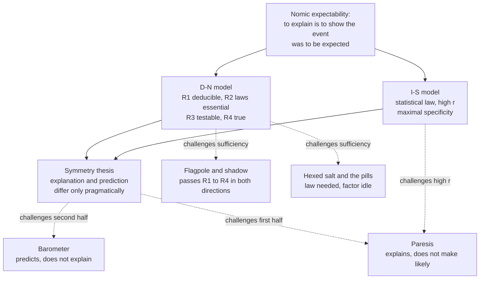

# Philosophy of Science · Lesson 4.1: The deductive-nomological model

> ⏱ ~15 min · Module 4: Explanation, laws, and reduction · Builds on: [1.2](01-02-the-new-riddle-of-induction.md), [`philosophical-method` 1.1](../../philosophical-method/lessons/01-01-what-an-argument-is.md), [`metaphysics` 4.1](../../metaphysics/lessons/04-01-humes-challenge-and-the-regularity-theory.md) · Unlocks: [4.2](04-02-causal-explanation.md), [4.3](04-03-unification-and-the-pragmatics-of-explanation.md), [4.4](04-04-laws-in-the-sciences.md)

## Why this matters

Every econometrics course warns that a variable can forecast an outcome without explaining it. In 1948 Carl Hempel and Paul Oppenheim argued close to the opposite: explanation and prediction have one logical form, and differ only in whether you already know the outcome. Wesley Salmon's history of the subject, *Four Decades of Scientific Explanation* (1989), starts the clock with their paper. The account is exact enough to be attacked exactly, and the attacks are the agenda for the rest of this module.

## The idea

A child asks why the oar looks bent where it enters the water. A good answer says how light behaves and how things stood: part of the oar under water, part above, the oar straight. Put those together and the bent look *follows*. Hempel and Oppenheim propose that this is what explaining is: showing that the event had to happen, given general laws and particular circumstances. An explanation, on this view, is an argument whose conclusion you already accept.

That can sound like a clash with [`philosophical-method` 1.1](../../philosophical-method/lessons/01-01-what-an-argument-is.md), which separates the two: an argument gives reasons for what you may not accept, an explanation accounts for what you already do. It isn't one. That lesson sorts by job, Hempel by logical form. An explanation does a different job from an argument and, he says, has an argument's shape.

Two consequences follow. If the form is the same, a prediction is an explanation stated before the event. And if the law is only statistical, the deduction weakens to a strong inductive argument: the event is made very likely rather than certain.

The trouble is that a valid argument from true laws can run where no one would call it explaining. From a flagpole's shadow and the sun's elevation you can deduce the pole's height. Nobody thinks the shadow is why the pole is that tall.

## The argument

Hempel and Oppenheim, "Studies in the Logic of Explanation" (*Philosophy of Science*, 1948), reprinted in Hempel's *Aspects of Scientific Explanation* (1965). The [deductive-nomological model](../reference.md#deductive-nomological-model), "nomological" meaning lawful, has this schema:

$$\begin{array}{ll} C_1, C_2, \ldots, C_k & \text{statements of antecedent conditions} \\ L_1, L_2, \ldots, L_r & \text{general laws} \\ \hline E & \text{description of the phenomenon to be explained} \end{array}$$

The $C$s and $L$s together are the [explanans](../reference.md#explanans-and-explanandum); $E$ is the explanandum. Four conditions:

- **R1.** $E$ follows deductively from the explanans.
- **R2.** The explanans includes general laws, and the derivation needs them.
- **R3.** The explanans is testable, at least in principle.
- **R4.** Every sentence of the explanans is **true**. High confirmation will not do, they argue, because an account would then be a correct explanation at one time and stop being one later. On their usage, an explanans later found false never explained.

The case for the model, reconstructed:

1. **P1. To understand why an event occurred is to see that it was to be expected.** *In words:* explanation removes surprise, given how things work. Salmon's later name is [nomic expectability](../reference.md#nomic-expectability).
2. **P2. What shows an event was to be expected is a sound argument from laws and conditions, meeting R1–R4.** *In words:* a valid deduction from true premises is the strongest possible ground for expecting something.
3. **P3. Only lawlike generalizations can serve.** Hempel's contrast: that every member of the Greensbury School Board for 1964 was bald is accidental, and explains no member's baldness; that gases expand when heated at constant pressure is a law, and explains an expansion. *In words:* a coincidence gives no reason to expect the next case. ([Lawlike versus accidental](../reference.md#lawlike-and-accidental-generalizations) is 1.2's question; Hempel conceded he had no satisfactory criterion.)
4. **P4. Causal talk adds no further ingredient.** To say conditions "cause" $E$ is, for Hempel and Oppenheim, to say regularities expressed by laws imply that whenever such conditions hold, an event of $E$'s kind follows. *In words:* "cause" is shorthand for "covered by a law", the regularity view of [`metaphysics` 4.1](../../metaphysics/lessons/04-01-humes-challenge-and-the-regularity-theory.md).

∴ **C. A scientific explanation of a particular event is a sound argument from laws and conditions, and explanation and prediction share its form.** *In words:* the same analysis covers both, and they say the difference is pragmatic: whether $E$ is known before or after the premises are given. This is the [symmetry thesis](../reference.md#explanation-prediction-symmetry). It has two halves: no account fully explains an event unless, had its premises been available in time, it could have predicted that event; and what could predict could explain.

**Statistical laws.** Hempel ("Deductive-Nomological vs. Statistical Explanation", 1962; *Aspects*, 1965) added the [inductive-statistical model](../reference.md#inductive-statistical-model):

$$\begin{array}{l} p(G \mid F) = r \\ Fb \\ \hline Gb \quad [r] \end{array}$$

Here $p$ is statistical probability, a long-run relative frequency in a class and not a credence; $F$ and $G$ are properties; $b$ is the individual; and $[r]$ marks inductive support rather than deduction. Two extra demands. $r$ must be high ([high-probability requirement](../reference.md#high-probability-requirement)), since that is the sense in which $Gb$ was to be expected. And the [requirement of maximal specificity](../reference.md#maximal-specificity): if everything accepted at the time puts $b$ in a narrower class $F_1 \subset F$, it must also supply a statistical law for $G$ in $F_1$ with the same value $r$, unless that law is a bare theorem of probability. *In words:* you may not cite a broad statistic when you know a narrower class $b$ falls into that says otherwise.

**The counterexamples.**

- [Flagpole and shadow](../reference.md#flagpole-and-shadow). Height, sun's elevation and the straight-line propagation of light entail the shadow's length: explanatory. The same laws entail the height from the shadow: not. R1–R4 hold both ways. Salmon in 1970 calls it Bromberger's example; Sylvain Bromberger pressed the asymmetry in "Why-Questions" (1966).
- [The barometer](../reference.md#barometer-case). Michael Scriven (*Science*, 1959): a sudden drop forecasts the storm and does not explain it. If "the barometer drops, a storm comes" is a law, prediction without explanation breaks the second half of symmetry. ([`metaphysics` 4.1](../../metaphysics/lessons/04-01-humes-challenge-and-the-regularity-theory.md) met it as the asymmetry problem for the regularity theory.)
- [Hexed salt](../reference.md#hexed-salt). Henry Kyburg (1965): all table salt with a dissolving spell cast on it dissolves. True, and the law is needed for the derivation; the hex is idle. (`metaphysics` 4.1 met it as irrelevance.)
- [John Jones's pills](../reference.md#birth-control-pills-case). Salmon, "Statistical Explanation" (1970, reprinted 1971): Jones took his wife's birth-control pills, and no man who regularly does so becomes pregnant, so Jones did not. Valid, true, law essential, and the pills make no difference: men never become pregnant, with or without them.
- [Paresis](../reference.md#paresis-case). Scriven (1959): paresis occurs only after untreated latent syphilis, yet most people with untreated latent syphilis never develop it. Medicine still cites the syphilis as the explanation. Scriven's point was explanation without predictability, against the first half of symmetry; the case became the standard objection to high probability.

The first four say meeting the conditions is not enough. The last says the I-S demand asks too much.

**Where the argument is weakest.** P1. The strongest objection is that expectability and explanation come apart in both directions: the flagpole and the pills give expectation without explanation, paresis explanation without expectation, and what is missing in each looks like causal relevance. The strongest reply is Hempel's own: these are pragmatic complaints. The model admits many useless explanations, and whether one is useful to a given asker is not something logical analysis can settle. And to say that the shadow does not cause the pole repeats the very word an empiricist wanted analysed, so the diagnosis is empty without an account of causation that does not take it as primitive. Each side concedes something. The critic owes that account ([4.2](04-02-causal-explanation.md); `metaphysics` 4.1–4.3). Hempel's side must accept that "explanation" in his sense includes the shadow explaining the pole, so that the model no longer tracks what a why-question asks. The Internet Encyclopedia of Philosophy's survey reports that his reply has not generally been thought adequate.

## Where each case bites

Three attacks say the schema is met and nothing is explained; paresis says something is explained and the schema is not met.

## Worked examples

**Example 1 (clean case: Hempel and Oppenheim's own oar).** An observer in a rowboat sees the submerged part of an oar bent upward.

- $L_1$: the law of refraction ([`waves-optics` 3.1](../../waves-optics/lessons/03-01-reflection-refraction-snell.md)).
- $L_2$: water is an optically denser medium than air.
- $C_1$: part of the oar is in the water, part in the air.
- $C_2$: the oar is, near enough, a straight piece of wood.
- $E$: to the observer, the submerged part appears bent upward.

Check the conditions. R1: with the eye locating a point along the ray that reaches it (a premise their "mainly" leaves tacit), $E$ follows. R2: drop $L_1$ and the derivation collapses, so the law is essential. R3: refraction can be measured in any tank. R4: granted. State the same premises before anyone looks and you have a prediction, which is the pragmatic difference in action. Now ask why light obeys the law of refraction. The model covers that too, deriving a law from more general laws, and R2 lets the explanans be all laws.

**Example 2 (hard case: Hempel's penicillin).** John Jones has a streptococcal infection, takes penicillin, and recovers quickly. Let $F$ be infection plus penicillin and $G$ quick recovery, with $p(G \mid F) = r$ near 1. Suppose $K$, everything accepted at the time, says nothing narrower about Jones. The explanation stands.

Now $K$ grows: Jones's strain is penicillin-resistant. That puts him in $F_1$, a subclass of $F$, where recovery is improbable. Then $p(G \mid F_1)$ differs from $r$ and the requirement fails: the explanation is withdrawn. Nothing about Jones changed, only what we know. Hempel says so outright: statistical explanation is relative to a knowledge situation. (Deductive explanation is not. If all $F$ are $G$, every subclass of $F$ is $G$ too.)

Here is where the account stops. Jones recovered anyway. The narrowest accepted class containing him makes recovery unlikely, so relative to $K$ the model offers no I-S explanation of it. It cannot say whether that means an undiscovered factor or plain chance. Hempel's position: relativity to $K$ is unavoidable, so the verdict can only be that no explanation is available relative to what we now know. Salmon's: relativizing to knowledge is the wrong shape, an explanation should turn on objectively homogeneous classes, and the requirement as stated does not even block his case of colds clearing up within a week after vitamin C, since no narrower class differs. [4.2](04-02-causal-explanation.md) takes that up.

## Watch out

- **You might think the flagpole shows that one of R1–R4 is false, but actually** it passes all four, which is the point. Hempel and Oppenheim called them necessary conditions. The flagpole attacks the further claim that meeting them is enough.
- **You might think R2 excludes the hexed salt, but actually** R2 asks only that the *law* be required for the derivation, and it is. No condition says every factor the law mentions must matter to the outcome. That silence is the gap.
- **You might think R4 means "well confirmed", but actually** Hempel and Oppenheim reject that wording. An explanation from a law later shown false was never correct. That is the premise behind the explanation paradox in [`philosophy-of-economics` 6.3](../../philosophy-of-economics/lessons/06-03-how-possibly-models-and-credible-worlds.md).
- **You might think Hempel requires scientists to write out deductions, but actually** Hempel and Oppenheim treat an account of a car overturning because a tyre blew out as an incomplete explanation, with the laws left tacit. The schema says what a full explanation would contain.

## One-liner

> For Hempel and Oppenheim, to explain is to show from true laws and conditions that the event was to be expected, and the flagpole, the pills and paresis are the standard cases pressed against that view.

## Problems

**P1 (🟢) *(Exegetical (a)–(b))*** John Stuart Mill, *A System of Logic*, 8th ed. (New York: Harper & Brothers, 1882), Book III, ch. XII, §1:

> An individual fact is said to be explained, by pointing out its cause, that is, by stating the law or laws of causation, of which its production is an instance. Thus, a conflagration is explained, when it is proved to have arisen from a spark falling into the midst of a heap of combustibles.

(a) Set the conflagration out in the D-N schema. Write $E$, $C$ and $L$, one line each, and mark which of them Mill's second sentence actually states.

(b) Taking that second sentence exactly as written, say which of R1–R4 it fails and why, and what Hempel and Oppenheim would call an account of this kind. Two sentences.

**P2 (🟡) *(Exegetical (a) · Evaluative (b))*** Build a new case, not one of the five in this lesson, that satisfies the D-N schema and is not an explanation of $E$.

(a) Write $L$, $C$ and $E$, then check R1–R4, one line each.

(b) Name the defect (asymmetry or irrelevance). Then give the best reply available to Hempel and say what it costs him. Any verdict; 100 words or fewer.

**P3 (🔴) *(Exegetical (a) · Evaluative (b))*** Hempel and Scriven disagree about paresis. They agree on the medical facts stated in this lesson.

(a) Give the verdict the I-S model returns on "she developed paresis because she had untreated latent syphilis", and name the single premise Scriven must deny and Hempel must keep. Two sentences.

(b) Say what evidence or argument would move that crux, and what each side must concede if it moves against them. Any verdict; 150 words or fewer.

Solutions

**P1** *(Exegetical (a)–(b))*

**Must hit, strict (a):**

- $E$: a conflagration occurred here.
- $C$: a spark fell into the midst of a heap of combustibles.
- $L$: whenever a spark falls into the midst of a heap of combustibles, a conflagration follows.
- Mill's second sentence states $E$ and $C$ only. $L$ has to be supplied. His first sentence demands a law; his example does not give one.

**Must hit, strict (b):**

- As written the explanans is one particular fact, so R1 fails ($E$ does not follow from $C$ alone) and R2 fails (it contains no law).
- Hempel and Oppenheim's term is an **incomplete** explanation, with part of the explanans suppressed, as in their tyre blow-out case. That is a verdict on this statement of the explanation, not on the model.

**Wrong turns:** reading Mill as doing without laws (his first sentence requires them); writing $L$ as "this spark caused this fire", which is singular and so cannot meet R2; saying R4 fails because the example is hypothetical, when the issue is what is stated at all.

**Model answer:** (a) as listed above. (b) The sentence gives only the spark, so the fire does not follow from it (R1) and no law appears (R2). Hempel and Oppenheim would class it as incomplete: the law is tacit, and once it is supplied it needs riders such as a dry heap and air, or it is false and fails R4.

---

**P2** *(Exegetical (a) · Evaluative (b))*

**Accept:** any case in any field, provided the generalization is true and lawlike as stated, the particular premises are true, the derivation is valid, and the generalization is essential to it.

**Must hit, strict (a):**

- All four conditions checked, separately.
- The R2 check must show the law is essential: delete it and the derivation fails.
- If the "law" is accidental or false, the case does not satisfy the schema and is no counterexample.

**Must hit, any verdict (b):**

- Say what is missing: the premises run from effect to cause (asymmetry), or a factor is cited that makes no difference (irrelevance).
- State a reply Hempel can actually make: deny the generalization is a law, or call the complaint pragmatic.
- Name the cost: the first needs the criterion of lawhood he admitted he lacked; the second gives up the claim that the model captures what a why-question asks.

**Wrong turns:** using a false folk generalization (then it is merely a bad explanation and shows nothing about sufficiency); offering a case that is a perfectly good explanation you happen to find unilluminating; checking R1 and forgetting that R2 requires the law to be essential.

**Model answer, one of several:** (a) $L$: every tree of this species and climate adds exactly one growth ring per year. $C$: this tree has $n$ rings. $E$: this tree is $n$ years old. R1: $E$ follows. R2: without $L$ it does not. R3: testable on cores from trees of known age. R4: granted as stipulated. (b) Asymmetry: the rings record the age and do not produce it; the tree is $n$ years old because it germinated $n$ years ago. Hempel can say the derivation is an explanation in his sense, merely useless to this asker. The cost is that "explanation" then no longer means what the asker wanted.

---

**P3** *(Exegetical (a) · Evaluative (b))*

**Must hit, strict (a):**

- The I-S model returns no explanation: the statistical law gives paresis low probability, so the high-probability requirement is unmet.
- The crux is Hempel's general condition: any acceptable explanation of a particular event must show it was to be expected, at least with reasonable probability. Scriven denies it; Hempel keeps it.

**Accept (b):** another consideration that bears on the condition, such as an argument about what explanation is for, in place of the first two points below, if the answer says how it moves the crux.

**Must hit, any verdict (b):**

- Say what bears on the crux: whether the low probability reflects ignorance (a further factor sorts who gets paresis) or is a feature of the case.
- If a further factor is found, the partial-explanation reading is open to Hempel. Say what happens in a case with no further factor to find: any irreducibly chancy event will do (Salmon's is a uranium-238 atom decaying in a given minute).
- State a concession on each side. Hempel: either deny that such events are explained at all or give up the condition. Scriven: say what makes a low-probability factor explanatory, since other necessary conditions (having been born) plainly do not explain.

**Wrong turns:** locating the crux in whether syphilis causes paresis, which both grant; saying Hempel denies the correlation; treating the low probability as something the model could tolerate if it were a little higher, which changes the case rather than answering it.

**Model answer (b), one of several:** The crux would move if we learned why the low probability is low. If a further factor sorted who develops paresis, Hempel could call the syphilis account a partial explanation awaiting completion, and Scriven's case would lose its force as a counterexample to the condition. But the same shape recurs where no further factor is expected: a uranium-238 atom's decay is improbable in any given minute, and citing its being uranium seems to explain something. There Hempel must either say the decay is not explained, keeping the condition at the price of odd verdicts, or relax it. Scriven's side owes a positive account: if improbability is no bar, what makes syphilis explanatory when being born, also necessary, is not? Its likely answer, causal or statistical relevance, is what the next lesson examines.

## Flashback

**From Lesson [3.4](03-04-values-and-inductive-risk.md) (Values and inductive risk):** *(Exegetical (a)–(b).)* A mycologist at a university herbarium (invented, written for this problem) has one specimen and one body of evidence. The same afternoon she must enter a species name in a research catalogue read only by taxonomists, and tell a poison-control line whether the specimen is the edible species or its deadly lookalike. She says: "I apply one standard of acceptance to both."

(a) State the verdict on her sentence of Rudner, Isaac Levi, Richard Jeffrey and Heather Douglas. One sentence each.

(b) She then learns that foragers' field guides copy the catalogue. Whose verdict on the catalogue entry changes: Levi's, Richard Jeffrey's or Douglas's? Two sentences.

Solution

**Must hit, strict (a):**

- Rudner: how much evidence is enough depends on how serious a mistake would be, and a wrong "edible" is far graver than a wrong catalogue line. So one standard is itself a judgment of how bad error is, made as a scientist.

- Levi: right about what she accepts. He denies Rudner's P3 for acceptance: standards for belief, taken on by joining the profession, do not shift with the practical cost of an error. What to tell the line is a separate decision about how to act.

- Richard Jeffrey: accept in neither place. No single acceptance suits every use, so she reports a probability and each user applies their own costs.

- Douglas: not one standard where consequences differ. At the line the cost of error may settle how much evidence is enough (the [indirect role](../reference.md#direct-and-indirect-roles-for-values)), but may not be a reason for the identification (the direct role). Where error has no foreseeable non-epistemic consequences, as in the catalogue, such values need not enter.

**Must hit, strict (b):**

- Douglas's changes: foreseeable non-epistemic consequences now attach to the entry, so the indirect role applies.

- Levi's and Richard Jeffrey's do not. For Levi the standard does not shift with practical cost; for Jeffrey she was never to accept, and a use nobody listed is what J2 expects.

**Wrong turns:** letting the danger decide which species it is, which is the direct role. Giving Levi Jeffrey's denial that scientists accept hypotheses. Saying Jeffrey's verdict changes because there are new users, when many users are his argument.

**Model answer (b):** Douglas's verdict changes, because field guides give a wrong entry foreseeable non-epistemic consequences. Levi's standard for belief does not move with practical cost, and Richard Jeffrey never wanted an acceptance, so a new use only illustrates his point.

## Connections

- **Backward:** Hempel's expectability account is the regularity theory of causation, [`metaphysics` 4.1](../../metaphysics/lessons/04-01-humes-challenge-and-the-regularity-theory.md), carried into explanation, and P3's law requirement borrows the lawlike/accidental split from [1.2](01-02-the-new-riddle-of-induction.md). Aristotle's demand that a demonstration give the cause, [`ancient-medieval-philosophy` 3.1](../../ancient-medieval-philosophy/lessons/03-01-predication-categories-and-the-syllogism.md), is the older form of the complaint against P1; the module's boss problem returns to it. Explanation-as-argument is the line drawn in [`philosophical-method` 1.1](../../philosophical-method/lessons/01-01-what-an-argument-is.md).
- **Forward:** [4.2](04-02-causal-explanation.md) runs statistical relevance, causal processes and interventions on exactly these cases, and [`metaphysics` 4.2](../../metaphysics/lessons/04-02-counterfactual-causation.md) has already introduced interventions. [4.3](04-03-unification-and-the-pragmatics-of-explanation.md) keeps explanation as argument and adds unification, then takes up the pragmatic reply through van Fraassen. [4.4](04-04-laws-in-the-sciences.md) asks what "law" can mean once P3 has to be cashed out in the special sciences.
- **Sideways:** R4 ↔ the explanation paradox in [`philosophy-of-economics` 6.3](../../philosophy-of-economics/lessons/06-03-how-possibly-models-and-credible-worlds.md), where false models are said to explain and the claim that only true accounts explain is one of three that might go. The symmetry thesis ↔ [`econometrics` 3.1](../../econometrics/lessons/03-01-potential-outcomes-identification.md): a good forecasting regressor is the barometer, and potential outcomes is one way of saying what forecasting leaves out.
