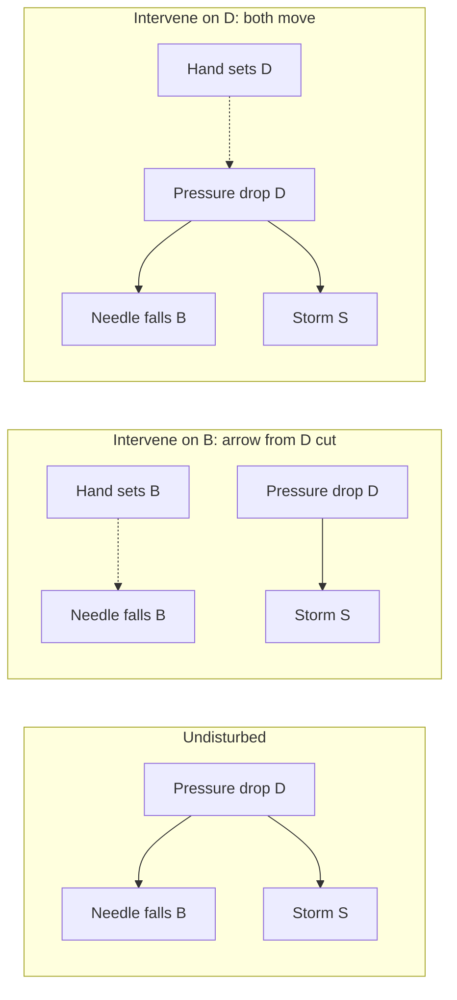

# Philosophy of Science · Lesson 4.2: Causal explanation

> ⏱ ~15 min · Module 4: Explanation, laws, and reduction · Builds on: [4.1](04-01-the-deductive-nomological-model.md), [`metaphysics` 4.2](../../metaphysics/lessons/04-02-counterfactual-causation.md), [`econometrics` 3.1](../../econometrics/lessons/03-01-potential-outcomes-identification.md) · Unlocks: [4.3](04-03-unification-and-the-pragmatics-of-explanation.md), [4.4](04-04-laws-in-the-sciences.md)

## Why this matters

The old Phillips curve fit the data well enough to be read as a menu: a little more inflation, a little less unemployment. Then people came to expect the inflation and the menu evaporated ([`grad-macro` 4.5](../../grad-macro/lessons/04-05-nk-phillips-curve.md)). The curve had predicted. It had not said what unemployment depends on in a form that survives being acted on. [4.1](04-01-the-deductive-nomological-model.md) pressed the same complaint against the [D-N model](../reference.md#deductive-nomological-model), and this lesson is about the accounts built to answer it.

## The idea

A dashboard oil lamp comes on, and an hour later the engine seizes. Three mechanics look into it.

The first checks the shop's records. Cars with the lamp lit seize far more often, but among cars with the same oil level the lamp adds nothing. The second traces connections. A wire runs from the oil sensor to the lamp, and nothing runs from the lamp to the bearings. The third asks what would happen if you acted. Unscrew the bulb and the engine still seizes. Top up the oil and it doesn't.

Those are this lesson's three ideas: what shifts the odds, what physically connects, and what would change if you intervened. Each tries to say what the D-N model missed: an explanation should name the **difference-makers** and leave out what made no difference.

[`metaphysics` 4.2](../../metaphysics/lessons/04-02-counterfactual-causation.md) already taught what an intervention is (it sets the variable, snaps the arrows into it, and touches nothing else except downstream) and that interventionist verdicts are model-relative and reduce nothing. This lesson uses all of that. It leaves aside what causation is and asks what a good explanation must supply, and what makes one better than another.

## The argument

This is the interventionist's case as its defenders would put it, running through the rivals it claims to improve on. Each rival is stated at its best, and the last paragraph and Example 2 say where it is pressed back.

**P1. An explanation must cite what the explanandum depends on and omit what it doesn't.** [Hexed salt](../reference.md#hexed-salt) and the [man on birth-control pills](../reference.md#birth-control-pills-case) pass the D-N conditions and fail this. *In words:* a valid derivation can be full of idle parts.

**P2. Statistical relevance is not yet dependence.** Wesley Salmon's [statistical-relevance model](../reference.md#statistical-relevance) ("Statistical Explanation", 1970, reprinted 1971) stops treating explanations as arguments. Let $P$ be relative frequency, $R$ a reference class, $O$ the outcome. Factor $F$ is relevant iff $P(O\mid R\wedge F)\neq P(O\mid R)$. An explanation partitions $R$ into cells differing in the probability of $O$, with no relevant split left, and locates the case in a cell, however low its probability. Against symptoms it uses [screening off](../reference.md#screening-off): $G$ screens off $F$ from $O$ iff $P(O\mid R\wedge F\wedge G)=P(O\mid R\wedge G)\neq P(O\mid R\wedge F)$. But different causal structures yield the same relevance relations, and by 1978 Salmon denied that relevant factors alone explain. *In words:* what shifts the odds may be a symptom, and the odds can't always say.

**P3. A physical connection is not yet dependence.** [Causal-mechanical explanation](../reference.md#causal-mechanical-explanation) (Salmon, *Scientific Explanation and the Causal Structure of the World*, 1984) traces the processes and interactions leading to an event, showing where it sits in the world's causal structure. A [causal process](../reference.md#causal-processes-and-mark-transmission) can carry a mark with no further help. Put a red filter at a rotating spotlight and the beam stays red out to the wall; put red cellophane on the wall and the moving spot is red only there, so the spot is a pseudo-process. Phil Dowe (1992; *Physical Causation*, 2000) replaced the capacity with possession of a conserved quantity, and Salmon adopted a modified version. Absences, where nothing is transmitted, are a standing difficulty. And Christopher Hitchcock (1995) objected that a cue ball carries momentum and a chalk mark alike, so the network cannot say which property matters. Salmon conceded in 1997 that processes and relevance relations are each indispensable. *In words:* a wire shows where influence can travel, not which property mattered.

**P4. Mechanisms add parts and organization, and still need a test of relevance.** [Mechanisms](../reference.md#mechanisms), for Machamer, Darden and Craver ("Thinking about Mechanisms", 2000), are "entities and activities" organized to produce regular change from set-up to termination. Following Anscombe, they name specific activities instead of analysing cause in general, and they need no laws, which suits the life sciences. Woodward (2002) objects that naming activities leaves relevance unsaid, and requires each part's behaviour to fall under a generalization invariant under interventions. (In [`social-theory` 1.4](../../social-theory/lessons/01-04-testing-a-social-explanation.md), "mechanism" is the looser chain of steps through what people do.) *In words:* say what the parts do and how they are arranged.

**P5. Dependence is what would change under an intervention.** [Interventionism](../reference.md#interventionism) (James Woodward, *Making Things Happen*, 2003): $X$ causes $Y$ iff some possible intervention on $X$ would change $Y$ or its probability distribution. The claim is contrastive: $X$'s being $x$ rather than $x'$ makes $Y$ differ. *In words:* wiggle it and watch.

**P6. A generalization explains only if [invariant](../reference.md#invariance) under some interventions, and explains more deeply the more it says about dependence.** Hooke's law holds until the spring deforms, gravitation over a far wider range, and neither needs to be an exceptionless law. Lucas's 1976 critique says relations like the Phillips curve lack it under changes of policy. [Explanatory depth](../reference.md#explanatory-depth) (Hitchcock and Woodward, 2003) counts answers to Woodward's "what-if-things-had-been-different" questions. Newton beats Galileo's $v=gt$ on a falling body because he says how the fall depends on Earth's mass and the distance. Scope alone adds nothing: Galileo's law conjoined with Boyle's says no more about what a gas's pressure depends on. *In words:* the best explanation tells you the most about what would have differed.

**∴ C. A causal explanation cites invariant relations showing how the explanandum would have differed had its difference-makers differed.** *In words:* to explain an outcome is to say what it would have done otherwise.

Each account presupposes an analysis of causation that `metaphysics` owns. Statistical relevance descends from the regularity theory ([4.1](../../metaphysics/lessons/04-01-humes-challenge-and-the-regularity-theory.md)). Process theories and non-reductive counterfactual accounts are the rivals of [4.2](../../metaphysics/lessons/04-02-counterfactual-causation.md). What makes a what-if true goes to laws and powers ([4.3](../../metaphysics/lessons/04-03-powers-dispositions-and-laws.md)).

**Where the argument is weakest.** P5, read as enough for explaining. A randomized trial can show that a drug makes a difference and say nothing of how; Craver ("When Mechanistic Models Explain", 2006) calls such input-output claims sketches. Bogen (2005) and Machamer (2004) add that what-ifs need something actual behind them. The interventionist replies that learning a mechanism is learning more dependencies, one per component, so the demand is for depth and not for a different kind of thing, and that what grounds a what-if is further science. The interventionist concedes that a bare effect explains shallowly. The mechanist concedes that interventions are how relevance among parts gets established, and owes a stopping rule for detail (Craver and Kaplan, 2020). Open: whether organization and actual production add anything a complete list of dependencies would omit.

## The picture

Setting the needle cuts only the arrow into the needle, while setting the pressure moves needle and storm together.

## Worked examples

**Example 1 (clean case: the [barometer](../reference.md#barometer-case), computed).** `metaphysics` 4.2 made the reading-versus-grabbing point in words; here is the arithmetic. Invented numbers: pressure drops ($D$) on a fifth of days; the needle falls ($B$) with probability 0.9 after a drop and 0.1 otherwise; a storm ($S$) follows with probability 0.7 after a drop and 0.1 otherwise; given $D$, needle and storm are independent.

*Relevance.* $P(S)=0.22$ and $P(S\mid B)=67/130\approx0.515$, so the needle is relevant. But $P(S\mid B\wedge D)=0.7=P(S\mid D)$ and $P(S\mid B\wedge\neg D)=0.1=P(S\mid\neg D)$, neither equal to 0.515. Pressure screens the needle off.

*The limit.* The chain $B\to D\to S$, with $P(B)=0.26$, $P(D\mid B)=9/13$, $P(D\mid\neg B)=1/37$ and the same storm probabilities, generates the identical joint distribution. The frequencies cannot choose.

*[Structural equations](../reference.md#structural-equations).* Woodward's machinery, shared with Pearl, writes one breakable line per mechanism, with each $U$ an unmodelled cause and each $f$ a function:

$$D=U_D,\qquad B=f_B(D,U_B),\qquad S=f_S(D,U_S).$$

Intervening replaces the line for $B$ with $B=b$, written $\mathrm{do}(B{=}b)$. Then

$$P(S\mid\mathrm{do}(B{=}1))=\sum_{d}P(S\mid B{=}1,D{=}d)\,P(D{=}d)=0.7(0.2)+0.1(0.8)=0.22.$$

The chain would give 0.515. One table, two graphs, two predictions. In statistics and epidemiology this sum is the working tool: given a graph, it says what to adjust for to estimate an effect from observational data (Spirtes, Glymour and Scheines, 1993; Pearl, 2000). It says what to compute, not what causation is.

*The bridge.* $Y_i(d)$ in [`econometrics` 3.1](../../econometrics/lessons/03-01-potential-outcomes-identification.md) is the value $Y_i$ takes under an intervention setting treatment to $d$, and randomization is the paradigm intervention. Treat the needle as treatment: the naive comparison is $P(S\mid B)-P(S\mid\neg B)=192/481\approx0.399$, the effect is 0, and all of it is selection term.

Given exceptionless generalizations, the D-N model admits all three claims below.

| Claim | Relevance | Process | Intervention |
|---|---|---|---|
| Needle explains storm | Out, once $D$ is in the partition | Out: no process from needle to storm | Out: set the needle, storm unmoved |
| Hexing explains dissolving | Out: shifts nothing | No verdict: salt is a causal process either way | Out: unhexed salt dissolves too |
| Pills explain his non-pregnancy | Out: shifts nothing for men | No verdict: he metabolizes them | Out: stop the pills, nothing changes |

**Example 2 (hard case: [functional explanation](../reference.md#functional-explanation)).** "Hearts are there to pump blood." Hempel ("The Logic of Functional Analysis", 1959) argued that inferring a trait from the need it meets affirms the consequent, since a functional equivalent might meet it. Nagel (*The Structure of Science*, 1961) read such claims as necessary conditions: no chlorophyll, no starch. Larry Wright ("Functions", 1973) changed the question: the [function](../reference.md#etiological-function) of X is Z iff X is there because it does Z, and Z is a consequence of X's being there. [Selected-effect](../reference.md#selected-effect-function) theories (Millikan, 1984; Neander, 1991) fill that "because" with selection. Robert Cummins ("Functional Analysis", 1975) replied that a [function statement](../reference.md#systemic-function) explains a system's capacity by decomposing it, not why the part is there, since traits arise by mutation.

Is this causal? On Wright's reading yes, through the history of earlier tokens. On Cummins's it is what Salmon (1984) called constitutive explanation, how parts make up a whole: the parts interact causally, but their relation to the whole is usually counted non-causal. The accounts stop here: a brand-new beneficial mutation has a Cummins function and no selected one, and a heart's thump gets one once someone picks a capacity it serves. Selection theorists say only history makes sense of a heart that fails at its job; Cummins rejects the demand.

Aristotle argued from "always or for the most part" that natural regularities are coincidences or for an end ([`ancient-medieval-philosophy` 3.2](../../ancient-medieval-philosophy/lessons/03-02-nature-and-the-four-causes.md)). Selected-effect function is the Darwinian successor: either the third option he left out, a regular result with nobody aiming, or what "for the sake of" turns out to mean. That is disputed.

## Watch out

- **You might think screening off identifies the cause, but actually** it locates a variable in a pattern of frequencies that a fork and a chain share. If the needle tracked pressure perfectly, neither would screen off the other.
- **You might think an intervention must be feasible, but actually** Woodward requires only a well-grounded theory of what would happen if it occurred.
- **You might think anything called an experiment is an intervention, but actually** the procedure must change $Y$ by no route except through $X$.
- **You might think invariant means exceptionless, but actually** for Woodward a generalization can hold over a narrow range and still explain within it.

## One-liner

> Relevance says what shifts the odds, processes and mechanisms say how influence travels, interventions say what would change if you acted, and the live dispute is which of these an explanation cannot do without.

## Problems

**P1 (🟢) *(Formal (a)–(b) · Exegetical (c).)*** Invented records, written for this problem, of 1,000 clinic patients. $H$: heavy smoker. $T$: tar-stained fingers. $L$: lung disease. Treat the counts as the population, with $P$ as relative frequency.

| Group | Patients | With $L$ |
|---|---|---|
| $H$, $T$ | 240 | 72 |
| $H$, $\neg T$ | 60 | 18 |
| $\neg H$, $T$ | 50 | 2 |
| $\neg H$, $\neg T$ | 650 | 26 |

(a) Compute $P(L)$, $P(L\mid T)$ and $P(L\mid\neg T)$. Is $T$ statistically relevant to $L$?

(b) Show that $H$ screens off $T$ from $L$ in both $H$ cells, and that $T$ does not screen off $H$.

(c) Give the partition Salmon's model uses and the cell of a stained-fingered heavy smoker with lung disease. Then name, in one line, a different causal structure with the same screening-off pattern.

**P2 (🟡) *(Exegetical; Apply to a hard case.)*** Run Woodward's test on each claim. Name the intervention on $X$ with respect to $Y$, say whether any procedure described is one, and give the verdict. Two sentences each. The vignettes are invented, written for this problem; the physics in (c) is standard.

(a) "More fire engines at a blaze cause more damage." Blazes attended by more engines do more damage. Dispatchers send engines according to the size of the fire, and engines put fires out.

(b) "The sleep app improves sleep." A clinic gives the app to a random half of its patients. Everyone in the app arm also gets a weekly nurse visit at which the nurse adjusts their sleep medication, and nobody else does. Sleep improves in the app arm.

(c) "The moon's gravitational pull causes the tides." No possible engineering could alter that pull without also disturbing the tides by other routes.

**P3 (🔴) *(Evaluative; Steelman and reply.)*** Given natural assumptions, stable planetary orbits are possible in three-dimensional space and not in spaces of more dimensions (the argument goes back to Paul Ehrenfest, 1917). Suppose this is offered as explaining why stable orbits are possible here. An invented colleague, written for this problem, says: "All scientific explanation is causal, so either this is no explanation or it is causal in disguise." Give the strongest case for the colleague and the strongest objection from this case, and say what each side must concede. **150 words or fewer.** Any verdict.

Solutions

**P1** *(Formal (a)–(b) · Exegetical (c))*

(a) Add the columns: $P(L)=118/1000=0.118$. Stained: $P(L\mid T)=(72+2)/(240+50)=74/290\approx0.255$. Unstained: $P(L\mid\neg T)=(18+26)/(60+650)=44/710\approx0.062$. Since $0.255\neq0.118$, $T$ is statistically relevant to $L$.

(b) Heavy smokers: $P(L\mid H\wedge T)=72/240=0.30$ and $P(L\mid H)=90/300=0.30$, and $0.30\neq P(L\mid T)\approx0.255$. Others: $P(L\mid\neg H\wedge T)=2/50=0.04$ and $P(L\mid\neg H)=28/700=0.04$, and $0.04\neq0.255$. So the equality and the inequality hold in both cells, and $H$ screens off $T$. For $T$ to screen off $H$ we would need $P(L\mid H\wedge T)=P(L\mid T)$, and $0.30\neq0.255$.

**Accept:** for the second clause of (c), any structure in which $H$ lies between $T$ and $L$ or causes both.

**Must hit, strict (c):**

- The partition is $\{H,\neg H\}$, with probabilities 0.30 and 0.04, and the case falls in cell $H$. $T$ does not appear.
- Same pattern: the chain $T\to H\to L$, stains causing heavy smoking. It is absurd on background knowledge, which is the point: the knowledge is not in the table.

**Wrong turns:** checking only the $H$ cell. Reading the equal cell rates as showing that smoking causes the disease: the table shows screening off, and the causal reading comes from elsewhere. Keeping $T$ in the partition because it is relevant overall.

**Model answer (c):** Cells $H$ (0.30) and $\neg H$ (0.04), with the case in $H$. The chain $T\to H\to L$ fits the same table.

---

**P2** *(Exegetical, strict)*

**Must hit, strict:**

- (a) Intervention: set the number of engines by a draw independent of the fire's size, cutting the arrow from size to engines. By the stem's stipulation, damage then falls as engines rise, so the claim as stated fails, and the correlation came from fire size as a common cause. The records are not an intervention, and the true effect has the opposite sign to the correlation.
- (b) The randomization is not an intervention on the app with respect to sleep, because it also changes sleep by a route not through the app (the nurse's medication changes). The test has not been run, so the improvement settles nothing about the app. Giving both arms the same visits would repair it.
- (c) The intervention sets the pull to another value with nothing else disturbed. It needn't be feasible, because Newtonian gravitation says what the tides would do if it occurred. The claim passes.

**Wrong turns:** in (a), concluding only "no effect", which misses the stipulation that engines put fires out. In (b), saying randomization guarantees an intervention: it cuts the arrows into treatment and does nothing about extra routes out of the assignment. In (b), concluding that the app doesn't work. In (c), calling the test silent. "No causation without manipulation" in statistics (Holland, Rubin) targets causes whose manipulation is conceptually unclear, not ones merely out of reach.

**Model answer:** (a) Assign engine counts by lottery, independent of fire size. Damage would fall as engines rise, so the claim fails and fire size was the common cause. (b) The assignment also changes sleep through the nurse's medication changes, so it is no intervention on the app. The test is unrun and the claim unsettled. (c) Set the pull to another value and leave everything else alone. Infeasible, but gravitational theory says the tides would change, so the claim passes.

---

**P3** *(Evaluative, any verdict)*

**Must hit, any verdict:**

- Fix the thesis's scope: causal explanation of why events occur, or all answers to why-questions, including why something is possible.
- Run the case on at least one account from the lesson: no process runs from dimensionality to orbits, and if dimensionality can't be intervened on, Woodward's test doesn't count it as a cause.
- The case for the colleague: restrict the thesis to occurrences, so the case falls outside it; or read the mathematics as representing constraints on causal processes (Strevens, 2018); or deny that a possibility claim explains.
- The objection: the case still answers what-if questions (how stability would differ with dimension), so explanatory dependence seems wider than causal dependence.
- What each concedes: the monist a narrowed thesis or a stretched "causal". The pluralist owes a criterion that separates explanatory non-causal dependence from mere derivation, the problem 4.1 began with.

**Wrong turns:** assuming Woodward holds that all explanation is causal. He allows non-causal explanation (2018). Treating the dimension as a cause because one can imagine it different, without saying what an intervention would be. Answering by disputing the physics.

**Model answer, one of several:** The best case for the colleague restricts the thesis: explaining why something occurred is giving its causes, and this argument explains a possibility, so it falls outside. Strevens would add that the mathematics represents constraints on actual orbits. The objection is that the case says how stability would differ with dimension, which is what explanations are praised for, yet nothing could intervene on dimension and no process runs from it. So dependence outruns causation. The monist concedes a narrower thesis or a stretched "causal" that excludes little. The pluralist concedes a debt: without causation to discipline it, something must separate explanatory dependence from mere derivation, which is where the D-N model failed. The narrowed thesis looks defensible, but it is not the claim the colleague made.

## Flashback

**From Lesson [3.5](03-05-objectivity.md) (Objectivity):** *(Formal (a) · Exegetical (b).)* Eight chemists and their lab head (invented, written for this problem). Two routes to a catalyst, exactly one workable: A with probability $\tfrac{3}{4}$, B with $\tfrac{1}{4}$. If $k$ people work on the workable route, it delivers with probability $1-2^{-k}$. So $p_A(k)=\tfrac{3}{4}(1-2^{-k})$, $p_B(k)=\tfrac{1}{4}(1-2^{-k})$, and with $n$ on A the community succeeds with probability $V(n)=p_A(n)+p_B(8-n)$.

(a) Compute $V$ for the splits 8/0 (all on the likeliest route), 7/1 and 5/3, the best split by enumeration. Then show that at 7/1 nobody maximizing expected credit $p(k)/k$, shared equally on the winning route, gains by moving.

(b) The lab head concludes: "So hunger for credit is what makes our science objective." What does Zollman (2018) add about spreading out, and what does a Longinian say [Kitcher's table](../reference.md#division-of-cognitive-labour) cannot reach? One sentence each.

Solution

(a) Substituting into $V(n)=p_A(n)+p_B(8-n)$:

$$V(8)=\tfrac{3}{4}\cdot\tfrac{255}{256}=\tfrac{765}{1024}\approx 0.747$$

$$V(7)=\tfrac{3}{4}\cdot\tfrac{127}{128}+\tfrac{1}{4}\cdot\tfrac{1}{2}=\tfrac{445}{512}\approx 0.869$$

$$V(5)=\tfrac{3}{4}\cdot\tfrac{31}{32}+\tfrac{1}{4}\cdot\tfrac{7}{8}=\tfrac{121}{128}\approx 0.945$$

At 7/1, an A member has $p_A(7)/7=\tfrac{381}{3584}\approx 0.1063$ and would get $p_B(2)/2=\tfrac{3}{32}\approx 0.0938$ on B. The B member has $p_B(1)/1=\tfrac{1}{8}=0.125$ and would get $p_A(8)/8=\tfrac{765}{8192}\approx 0.0934$ on A. Neither gains. So credit-seekers beat 8/0 by $\tfrac{125}{1024}\approx 0.122$ and still miss the best split by $\tfrac{39}{512}\approx 0.076$.

**Must hit, strict (b):**

- Zollman: a truth-seeker content for anyone to find the answer needs no credit to spread out, so credit is not required for the division of labour.

- Longinian: a distribution of effort says nothing about assumptions shared across every programme (here, that exactly one route works), and objectivity on her account is how far criticism reaches.

**Wrong turns:** forgetting to divide by $k$, which sends everyone to A. Checking only one of the two moves. Reading the 0.076 as refuting Kitcher, when the lesson says the result holds for some distributions of chance and not all. Taking the table to show that any chemist reasons in a detached way: it concerns the spread of effort, not anyone's reasoning.

**Model answer (b):** Zollman adds that a truth-seeker content for anyone to find the answer would spread out with no credit at all, so credit is not needed for the split. A Longinian adds that dividing effort cannot expose what both routes assume, so the table is silent on how far criticism reaches.

## Connections

- **Backward:** [4.1](04-01-the-deductive-nomological-model.md) supplied the counterexamples these accounts were built to handle. [`metaphysics` 4.1](../../metaphysics/lessons/04-01-humes-challenge-and-the-regularity-theory.md), [4.2](../../metaphysics/lessons/04-02-counterfactual-causation.md) and [4.3](../../metaphysics/lessons/04-03-powers-dispositions-and-laws.md) own the analyses of causation each account presupposes.
- **Forward:** [4.3](04-03-unification-and-the-pragmatics-of-explanation.md) asks what unification buys that causation doesn't, and turns "$x$ rather than $x'$" into a [contrast class](../reference.md#contrast-class). [4.4](04-04-laws-in-the-sciences.md) asks what laws do, given that invariance comes in degrees. Boss 4(c) runs the intervention test on the [flagpole](../reference.md#flagpole-and-shadow), which this lesson leaves for you.
- **Sideways:** Interventionist explanation ↔ potential outcomes in [`econometrics` 3.1](../../econometrics/lessons/03-01-potential-outcomes-identification.md). Functional explanation in social science, with Elster's loop, is [`social-theory` 1.2](../../social-theory/lessons/01-02-functional-explanation-and-its-critics.md). What difference-makers a false model identifies is [`philosophy-of-economics` 6.3](../../philosophy-of-economics/lessons/06-03-how-possibly-models-and-credible-worlds.md). Whether an agent's reasons are causes in this sense is [`philosophy-of-mind` 2.3](../../philosophy-of-mind/lessons/02-03-anomalous-monism-and-supervenience.md)'s question.
