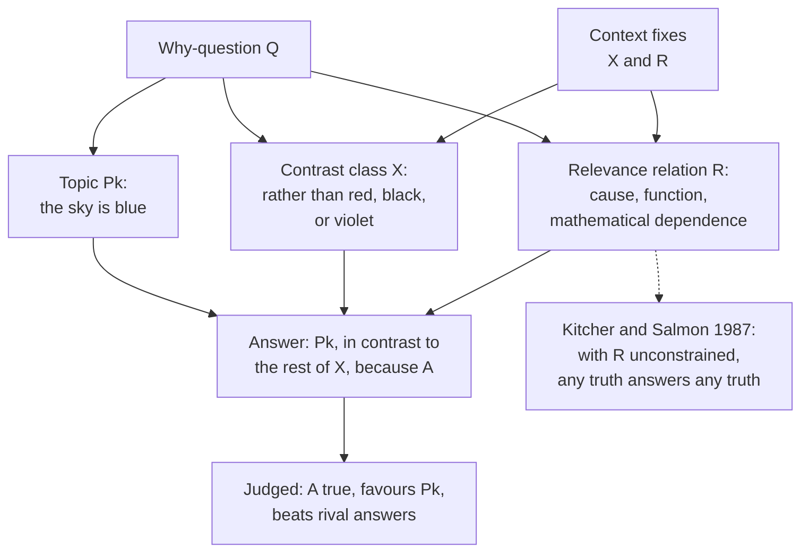

# Philosophy of Science · Lesson 4.3: Unification and the pragmatics of explanation

> ⏱ ~15 min · Module 4: Explanation, laws, and reduction · Builds on: [4.1](04-01-the-deductive-nomological-model.md), [4.2](04-02-causal-explanation.md) · Unlocks: [4.4](04-04-laws-in-the-sciences.md), [5.4](05-04-constructive-empiricism-and-entity-realism.md)

## Why this matters

Ask why Kepler's three laws hold and one reply offers no list of causes: Newton showed that three separately won facts were one. Ask why the sky is blue and the right answer changes with what you are comparing it to. The first thought says that explaining is finding the pattern behind many facts. The second says that explaining is answering a question somebody actually asked. Each has been built into a full account of explanation, and each has a bill to pay.

## The idea

You could memorize ten gas laws, or see that they are one story about molecules. You would know the same facts, but on this thought only the second way understands them. That is the [unification account](../reference.md#unification-account): to explain is to reduce what must be accepted as given. William Whewell named its evidential cousin in 1840, the [consilience of inductions](../reference.md#consilience-of-inductions). His showpiece is Newton: the inverse-square attraction inferred from Kepler's third law gave the first two as well, and gravitation inferred from perturbations also delivered the precession of the equinoxes. Darwin's Recapitulation runs one pattern, descent with modification, through geographical distribution, classification, homologies and rudimentary organs.

Michael Friedman ("Explanation and Scientific Understanding", 1974) made this a theory: understanding grows as the number of independently acceptable assumptions falls, which is what the kinetic theory does for the gas laws. His count broke down (Kitcher 1976; Salmon adds that nearly any law splits into separately supported halves). Philip Kitcher ("Explanatory Unification", 1981; "Explanatory Unification and the Causal Structure of the World", 1989) counted **patterns** of derivation instead. [`philosophical-method` 2.1](../../philosophical-method/lessons/02-01-inference-to-the-best-explanation.md) lists explanatory scope as one virtue of a hypothesis. The claim here is stronger: unification is what explaining *is*.

The second idea is the [pragmatic theory of explanation](../reference.md#pragmatic-theory-of-explanation). One sentence can carry several questions. Bas van Fraassen (*The Scientific Image*, 1980, ch. 5) holds that an explanation is an answer, so what counts depends on the question asked. [`ancient-medieval-philosophy` 3.2](../../ancient-medieval-philosophy/lessons/03-02-nature-and-the-four-causes.md) gave a thing as many causes as there are kinds of why-question. Here the list of kinds stays open.

## Source

Whewell, *The Philosophy of the Inductive Sciences* (London: Parker, 1840), vol. II, Book XI, ch. V, art. 11, p. 230:

> But the evidence in favour of our induction is of a much higher and more forcible character when it enables us to explain and determine cases of a kind different from those which were contemplated in the formation of our hypothesis. The instances in which this has occurred, indeed, impress us with a conviction that the truth of our hypothesis is certain. No accident could give rise to such an extraordinary coincidence. No false supposition could, after being adjusted to one class of phenomena, so exactly represent a different class, when the agreement was unforeseen and uncontemplated. That rules springing from remote and unconnected quarters should thus leap to the same point, can only arise from that being the point where truth resides.

Three phrases decide what this claims. "A kind different" rules out more instances of the same kind. "Adjusted to one class … unforeseen and uncontemplated" adds a timing condition: a hypothesis built to fit both classes earns nothing extra, an ancestor of [novel prediction](../reference.md#novel-prediction) in [2.5](02-05-lakatos-and-feyerabend.md). And "the point where truth resides" shows the kind of claim: a **test of truth**. Despite the word "explain", Whewell is not saying what an explanation is. Friedman and Kitcher keep the shape and change the claim: unification does not merely signal truth, it is what explaining consists in. (His next examples include Fresnel's undulations; [5.2](05-02-the-pessimistic-induction-and-selective-realism.md)'s pessimistic induction is the natural test of his word "certain".)

## The argument

**The unification account (Kitcher 1981, 1989).**

1. **P1.** Science advances understanding by reducing the number of facts we must accept as ultimate. *In words:* fewer loose ends, more understanding.
2. **P2.** It does so by deriving many conclusions with the same [argument patterns](../reference.md#argument-patterns): schematic arguments whose blanks are governed by filling instructions. *In words:* one form of derivation, used again and again.
3. **P3.** A pattern unifies only if it is **stringent**, restricting what may instantiate it. *In words:* "it had to be so", applied to anything, fits everything and unifies nothing, which is the worry about [spurious unification](../reference.md#spurious-unification).
4. **P4.** The [explanatory store](../reference.md#explanatory-store) $E(K)$ is the set of patterns that best unifies $K$, the beliefs accepted at a time: most conclusions, fewest patterns, greatest stringency. *In words:* the best systematization of what we accept.

∴ **C.** A derivation explains if and only if it instantiates a pattern in $E(K)$. *In words:* to explain is to derive a thing the way our best systematization derives things.

Kitcher's 1989 addition: no causal order stands behind this for explanations to answer to, because our causal judgments are downstream of the systematizing. The payoff is [the flagpole](../reference.md#flagpole-and-shadow) ([4.1](04-01-the-deductive-nomological-model.md)). An "origin and development" pattern traces any object's dimensions to how it arose and changed. Adding a shadow pattern adds a pattern and no conclusions; swapping it in loses every object without a suitable shadow. So height-from-shadow falls outside the store, with no primitive notion of cause. Beyond [4.2](04-02-causal-explanation.md)'s causal accounts, its defenders say, unification buys explanations of laws by laws, room for non-causal cases, and thrift about causation.

**The pragmatic theory (van Fraassen 1980, ch. 5).**

1. **P1.** An explanation is an answer to a why-question. *In words:* no question, no explanation.
2. **P2.** A [why-question](../reference.md#why-questions) is a triple $Q = \langle P_k, X, R \rangle$: the topic $P_k$; the [contrast class](../reference.md#contrast-class) $X$, the alternatives $P_k$ is set against; and the [relevance relation](../reference.md#relevance-relation) $R$, the kind of fact wanted in reply. *In words:* what you are asking about, rather than what, and what would count as an answer.
3. **P3.** A direct answer says "$P_k$, in contrast to the rest of $X$, because $A$", with $A$ bearing $R$ to $\langle P_k, X\rangle$. It is judged by whether $A$ is true, how far it favours $P_k$ over the rest of $X$, and how it fares against rival answers. *In words:* true, on point, and better than the alternatives.
4. **P4.** Context, not theory and fact alone, fixes $X$ and $R$. *In words:* the same words can ask two questions.

∴ **C.** Being an explanation is a three-term relation among theory, fact and context, and explanatory power is a pragmatic virtue, no further reason to believe a theory true ([5.4](05-04-constructive-empiricism-and-entity-realism.md)). *In words:* explaining is something we do with a theory, not an extra property the theory has.

His tower story turns the flagpole around: for a tower built to cast a shadow of a chosen length, the shadow explains the height.

**The objection.** Kitcher and Salmon ("Van Fraassen on Explanation", 1987): nothing in P2 restricts $R$. Define "astral influence" and the stars explain the hour of a death; for any true $A$ and $P$, some relation makes $A$ explain $P$. On the tower, they add that a desire for the shadow explains the height, not the shadow. The reply: context includes current science, which excludes astral influence. The rejoinder: then a scientific explanation is any that uses accepted science and an accepted relation, which gives no help when scientists dispute whether a true model explains. Van Fraassen's side answers that if no non-trivial constraint exists, lacking one is no fault.

[Explanatory pluralism](../reference.md#explanatory-pluralism) declines to pick. Salmon ("Scientific Explanation: Causation and Unification", 1990) treats exposing mechanisms and unifying as two complementary virtues. Others note that practice varies by field: biologists often seek mechanisms, physicists laws.

**Where the argument is weakest.** The pressure falls on Kitcher's addition, that causal judgments fall out of unification. Eric Barnes (*Philosophy of Science*, 1992) applies time-symmetric mechanics to a closed system. Deriving the planets' present state from their future state uses the same pattern and the same kind of premise as deriving the future from the present, so the two are equally unified, yet only one seems to explain. The strongest reply, open to a unificationist though not Kitcher's own, accepts that fundamental time-symmetric physics has no explanatory direction, so that the asymmetry we feel comes from elsewhere. That concedes that unification alone does not deliver every causal judgment. The critic concedes that direction is not written into those equations, and owes an account of where it comes from.

## Anatomy of a why-question

The dispute with Kitcher and Salmon is over the dashed arrow: whether anything but context limits $R$.

## Worked examples

**Example 1 (clean case: why is the sky blue?).** The physics is [`atmospheric-science` 3.4](../../atmospheric-science/lessons/03-04-scattering-rayleigh-mie-aerosols.md). Fix the topic and fix $R$ as physical cause. Vary $X$.

| Blue rather than… | Answer |
|---|---|
| red | Rayleigh scattering grows as $\lambda^{-4}$, where $\lambda$ is wavelength |
| black, as on the Moon | there is air to scatter sunlight |
| violet | not scattering, since by $\lambda^{-4}$ violet at 400 nm out-scatters blue at 450 nm by $(450/400)^4 \approx 1.60$; the Sun emits less violet and our eyes are weak there |

The complete answer to the first row points the wrong way on the third. Same topic, same theory, three questions, three answers.

**Example 2 (hard case: the honeycomb).** Why are comb cells hexagonal in cross-section, rather than square or triangular? A standard answer in the literature (Lyon and Colyvan 2008) combines two premises. Selection favoured cells using less wax. And by Thomas Hales's honeycomb theorem (2001), the regular hexagonal grid has the least perimeter of all ways to divide a plane into equal areas. At unit area the perimeters are 4.56 (triangle), 4 (square) and 3.72 (hexagon): 6.9 percent less wall than squares. Darwin had both halves: mathematicians say bees have "practically solved a recondite problem" (*Origin*, 6th ed., ch. VIII), and selection saves wax. So this is not a *purely* mathematical explanation: only one premise is [non-causal](../reference.md#non-causal-explanation).

- *Unification:* one stringent pattern, "a cost is selected down; a theorem says which form minimizes it", re-usable across traits. It explains, and the theorem needs no special pleading.
- *Causal:* the theorem causes nothing. You can intervene on wax cost, but the dependence of perimeter on shape is non-contingent (Woodward 2018). Michael Strevens (2018) replies that the mathematics only represents constraints on causal processes, so the explanation stays causal.

The accounts stop here. Counting patterns cannot say whether the theorem explains or merely book-keeps, and Kitcher offers no general formula for trading off the three criteria. The causal account says what selection did, but not why a theorem seems to be what answers "rather than squares". Van Fraassen says these are two questions: why hexagons rather than squares, and how this comb got its shape (still disputed since D'Arcy Thompson's packing idea). His critics reply that each question, once fixed, still has one correct answer.

## Watch out

- **You might think van Fraassen says anything explains anything, but actually** he requires a true answer that favours the topic and beats its rivals. "Anything" is Kitcher and Salmon's charge about the unconstrained $R$, and whether his conditions suffice is the dispute.
- **You might think contrast-sensitivity refutes Hempel and Salmon, but actually** a contrast class only says which explanandum is wanted, and they can accept that. The pragmatic thesis needs more: with the explanandum fully fixed, whether $A$ explains it still varies with interests.
- **You might think consilience and Kitcher's unification are one idea, but actually** Whewell's is a test of truth with a timing condition, and Kitcher's is an account of what explaining is, with no timing clause.

## One-liner

> Unification says to explain is to derive much from few stringent patterns; van Fraassen says an explanation is an answer whose contrast class and relevance relation context supplies; the first owes an account of causal direction, the second of what stops any truth from explaining any other.

## Problems

**P1 (🟢) *(Exegetical.)*** For each why-question, give the topic, the contrast class and the relevance relation that its setting fixes. Do not give the answer to the question. One line each.

(i) An epidemiologist reading Vienna's maternity records from the 1840s asks why the First Clinic lost so many more mothers to puerperal fever than the Second Clinic did.

(ii) A physiology student looks at the valves inside the leg veins and asks what they are there for: why is the vein built with them, rather than as a plain tube?

(iii) A mathematician asks why no walker has ever crossed each of Königsberg's seven bridges exactly once, rather than someone having managed it.

**P2 (🟡) *(Close reading: Exegetical (a)–(b).)*** Darwin, *On the Origin of Species*, 6th ed. (London: Murray, 1872), ch. XV:

> It can hardly be supposed that a false theory would explain, in so satisfactory a manner as does the theory of natural selection, the several large classes of facts above specified. It has recently been objected that this is an unsafe method of arguing; but it is a method used in judging of the common events of life, and has often been used by the greatest natural philosophers. The undulatory theory of light has thus been arrived at; and the belief in the revolution of the earth on its own axis was until lately supported by hardly any direct evidence.

(a) Set Darwin's first sentence beside Whewell's "No false supposition could…" in the Source. Which condition of Whewell's does it state, and which does it leave out? Name the words. Two sentences.

(b) What kind of defence does Darwin offer against the charge of "an unsafe method of arguing", and what would that defence still need in order to show the method safe? Two sentences.

**P3 (🔴) *(Find the crux: Exegetical (a)–(b) · Evaluative (c).)*** Wesley Salmon ("Scientific Explanation: Causation and Unification", 1990) describes a baby who can move a carriage with its brakes locked but barely moves it with the brakes off. One explanation traces the forces between baby and carriage and shows that they cancel. A second cites the conservation of linear momentum for an isolated system. Salmon holds that both are legitimate and that the two styles are complementary. Kitcher (1989) holds that our causal judgments derive from our best systematization, not the reverse.

(a) Why can both philosophers grant that each is an explanation of the carriage's behaviour? Two sentences.

(b) State the single premise on which they divide, and say who denies it. One sentence.

(c) Say what kind of case or argument would move that premise in each direction. Any verdict; 150 words or fewer.

Solutions

**P1** *(Exegetical)*

**Must hit, strict:**

- (i) Topic: the First Clinic's puerperal-fever mortality far exceeded the Second's. Contrast class: {the First Clinic had the higher mortality, the Second Clinic had it, the two had the same}. Relevance relation: causal, what differed between the clinics to produce the gap.
- (ii) Topic: the leg veins have valves. Contrast class: {with valves, plain tube}. Relevance relation: function, what the valves do for the circulation.
- (iii) Topic: no walk has crossed each bridge exactly once. Contrast class: {no such walk has occurred, such a walk has occurred}. Relevance relation: mathematical dependence, on the structure of the bridge graph rather than on any walker's history.

**Accept:** in (i), a two-member class, First higher or Second higher. In (ii), a contrast with arteries, if the answer says the setting's "rather than a plain tube" was read that way and keeps $R$ as function.

**Wrong turns:** writing the answer in the slot, such as $R$ = "cadaverous matter on the students' hands" or $R$ = "four vertices of odd degree" (that is $A$; the relation is the *kind* of fact sought); listing candidate causes as the contrast class; giving $R$ as causal in (ii), where the setting asks what the valves are for, or in (iii), where no cause of the walkers' failure is sought.

**Model answer:** (i) Topic: First Clinic's mortality far above the Second's; contrast: First higher, Second higher, equal; $R$: causal difference between the clinics. (ii) Topic: leg veins have valves; contrast: valves, plain tube; $R$: function. (iii) Topic: no walk crossed each bridge once; contrast: none, one; $R$: mathematical dependence on the graph.

---

**P2** *(Close reading: Exegetical (a)–(b))*

**Must hit, strict (a):**

- Stated: the plurality of different kinds of fact, "several large classes of facts" answering to Whewell's "a different class", and the same inference from explaining to not being false ("a false theory would explain"; "No false supposition could").
- Left out: Whewell's timing condition, "adjusted to one class", "unforeseen and uncontemplated". Darwin does not say that the classes were out of view when the theory was framed, so the sentence claims explanatory breadth, not consilience in Whewell's strict sense.

**Must hit, strict (b):**

- The defence is by precedent: the method is used "in judging of the common events of life" and "by the greatest natural philosophers", with two instances, the undulatory theory and the Earth's rotation.
- Precedent shows that the method is respectable and widely used. To show it *safe*, the reply would need a reason to think the method reliable, most directly a record of how often it has led to truth, including the cases where a false theory explained well.

**Wrong turns:** reading "several large classes" as Whewell's whole condition; saying Darwin claims the facts were predicted in advance (he says nothing of the kind here); treating the two precedents as new evidence for natural selection, when they are offered in support of the method.

**Model answer:** (a) Darwin keeps the many classes ("several large classes of facts") and the step from explaining to truth ("a false theory would explain"), but drops Whewell's "unforeseen and uncontemplated", so he claims breadth of explanation and not consilience strictly so called. (b) He defends the method by precedent, citing common life, "the greatest natural philosophers", the undulatory theory and the Earth's rotation. To show it safe he would need a track record of the method, counting the false theories that explained well, which is the question [5.2](05-02-the-pessimistic-induction-and-selective-realism.md) presses.

---

**P3** *(Find the crux: Exegetical (a)–(b) · Evaluative (c))*

**Must hit, strict (a):**

- Their agreement concerns which derivations count, not what makes them count.
- Salmon counts both as legitimate, with pragmatic considerations deciding which suits an occasion. Kitcher can count each as instantiating a pattern in the store, one summing forces and one applying a conservation law.

**Must hit, strict (b):** The premise: there is a causal structure of the world, fixed independently of our best systematization, that explanation must answer to. Kitcher denies it; Salmon affirms it (his "ontic" conception: to explain is to fit events into the world's mechanisms).

**Must hit, any verdict (c):**

- A consideration that would move the premise toward Kitcher: for example, a demonstration that the causal judgments we accept can be recovered from unification criteria alone, or an argument that we have no access to causal order except through systematization.
- A consideration that would move it toward Salmon: for example, a case where two systematizations score the same on unification and differ on what causes what, such as Barnes's retrodictions, or a difference found by intervention that no difference in patterns tracks.
- Say why the case bears on the premise, and not only on the carriage.

**Wrong turns:** locating the crux in whether laws explain (both allow it); saying Salmon denies that the momentum derivation explains (he asserts that it does); treating "complementary" as settling the crux, when it settles only that both styles are legitimate.

**Model answer (c), one of several:** Kitcher's denial would gain if every causal judgment we accept could be recovered from counts of patterns, conclusions and stringency, with no causal assumption slipped into the filling instructions. It would also gain from an empiricist argument that causal order is known only through systematizing, since an order nobody could detect cannot constrain explanation. Salmon's premise would gain from a tie: two systematizations equal on every criterion yet disagreeing about direction. Barnes's retrodictions look like one. So would an experiment that exposes a causal difference between two set-ups which the patterns treat alike. Either result bears on the premise itself, because it shows whether unification can fix causal order or has to borrow it.

## Flashback

**From Lesson [4.1](04-01-the-deductive-nomological-model.md) (The deductive-nomological model):** *(Exegetical (a)–(c).)* A fish hatchery's log (invented, written for this problem): "Tray 7 hatched because it had the salt bath; 95 percent of salt-bathed trays hatch."

(a) Set the entry out in the [I-S schema](../reference.md#inductive-statistical-model), naming $F$, $G$, $b$ and $r$. One line.

(b) What is accepted then grows: tray 7's eggs came from a parasitized brood, and of salt-bathed trays from such broods, 10 percent hatch. What does the [requirement of maximal specificity](../reference.md#maximal-specificity) do to the entry, and what has changed about tray 7? Two sentences.

(c) Suppose the log had said instead: "Every salt-bathed tray hatches." Could news of a narrower class withdraw that explanation the way (b) did? And if a salt-bathed tray is later found unhatched, which condition fails, and since when? Two sentences.

Solution

**Must hit, strict (a):** $F$: salt-bathed tray. $G$: hatches. $b$: tray 7. $r = 0.95$, high enough for the high-probability requirement. The schema is $p(G\mid F)=0.95$, $Fb$, therefore $Gb$ $[0.95]$, the bracket marking inductive support.

**Must hit, strict (b):**

- Tray 7 now falls in the narrower class $F_1$, salt-bathed trays from parasitized broods, and $p(G\mid F_1)=0.10$ differs from $r$. The requirement fails, so the explanation is withdrawn.

- Nothing about tray 7 changed, only what is accepted. Statistical explanation is relative to a knowledge situation.

**Must hit, strict (c):**

- No. If every $F$ is $G$, every subclass of $F$ is $G$ too, so no narrower class can carry a different value. Deductive explanation is not relative to knowledge.

- An unhatched salt-bathed tray makes the generalization false, so R4 fails. And not from the day it was found: an explanans later found false never explained.

**Wrong turns:** treating 10 percent as contradicting 95 percent, when one is the rate in the broad class and the other in a subclass. In (b), saying the old entry never explained, which is the deductive case's fate; relative to what was then accepted, it stood. In (c), "it stopped explaining when the tray turned up", which reads R4 as "well confirmed".

**Model answer (b)–(c):** (b) Tray 7 now sits in a narrower class where $r$ is 0.10 rather than 0.95, so the requirement fails and the explanation is withdrawn; nothing about the tray changed, only what is accepted. (c) No, since if every $F$ is $G$ then so is every subclass of $F$. An unhatched tray falsifies the generalization, so R4 fails, and on Hempel and Oppenheim's usage the explanans never explained.

## Connections

- **Backward:** [4.1](04-01-the-deductive-nomological-model.md) supplied the flagpole, and Kitcher's account keeps Hempel's idea of explanation as derivation. [4.2](04-02-causal-explanation.md) supplied the difference-makers that the causal side of Example 2 appeals to. Whewell's timing condition is an ancestor of Lakatos's [novel prediction](02-05-lakatos-and-feyerabend.md). [`ancient-medieval-philosophy` 3.2](../../ancient-medieval-philosophy/lessons/03-02-nature-and-the-four-causes.md) already treated why-questions as plural.
- **Forward:** [4.4](04-04-laws-in-the-sciences.md) asks what laws do, and Friedman's target was the explanation of laws. Darwin's "false theory" inference has the form that [5.1](05-01-realism-and-the-no-miracles-argument.md)'s no-miracles argument generalizes, and [5.2](05-02-the-pessimistic-induction-and-selective-realism.md)'s pessimistic induction is the direct challenge to Whewell's "certain". [5.4](05-04-constructive-empiricism-and-entity-realism.md) makes van Fraassen's account of explanation part of constructive empiricism. [`philosophy-of-physics`](../../philosophy-of-physics/syllabus.md) cites this module for explanation in physics.
- **Sideways:** [`philosophy-of-economics` 6.3](../../philosophy-of-economics/lessons/06-03-how-possibly-models-and-credible-worlds.md) asks whether false models explain, and unification accounts answer by asking how much a model brings under one pattern. [`metaphysics` 4.3](../../metaphysics/lessons/04-03-powers-dispositions-and-laws.md) records Armstrong's charge that Humean laws cannot explain their instances, a charge the unificationist must answer; van Fraassen appears there for a different reason, the inference problem. [`metaphysics` 2.4](../../metaphysics/lessons/02-04-essence-and-grounding.md) gives non-causal "because"s of a metaphysical kind.
