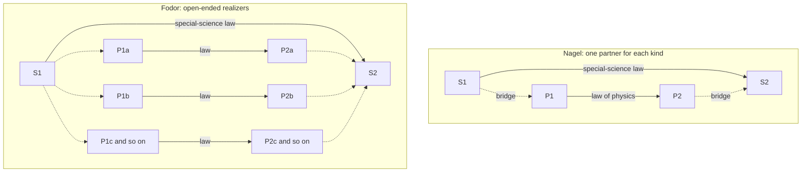

# Philosophy of Science · Lesson 4.5: Reduction and emergence

> ⏱ ~15 min · Module 4: Explanation, laws, and reduction · Builds on: [4.1](04-01-the-deductive-nomological-model.md), [4.4](04-04-laws-in-the-sciences.md), [`social-theory` 1.1](../../social-theory/lessons/01-01-individuals-and-social-facts.md) · Unlocks: [5.1](05-01-realism-and-the-no-miracles-argument.md), [`philosophy-of-mind`](../../philosophy-of-mind/syllabus.md), [`philosophy-of-physics`](../../philosophy-of-physics/syllabus.md)

## Why this matters

In [`stat-mech` 1.4](../../stat-mech/lessons/01-04-temperature-pressure-chemical-potential.md) you watched temperature become a derivative of a counting function, and nobody asked what had just been achieved. Was thermodynamics translated, derived, or replaced? Ask the same of genetics or psychology and a new obstacle appears: their kinds may have no single physical counterpart to be translated into. Whether that makes the sciences above physics permanent or merely provisional is this lesson's question.

## The idea

Ernest Nagel's recipe for [reduction](../reference.md#nagelian-reduction) has two steps, and you have run them without naming them: say what the old science's words come to in the new one's vocabulary, then show that the old laws follow as theorems. It is the D-N model of [4.1](04-01-the-deductive-nomological-model.md) aimed at a law instead of an event. The connecting statements are [bridge laws](../reference.md#bridge-laws).

Now take the sentence "this routine sorts its input." It is true of a run on a phone, on a mainframe, and by a room of clerks with index cards. Arguably, no physical description short of a list covers the three, and the list has no natural end. That is [multiple realizability](../reference.md#multiple-realizability): one higher-level kind, many physically unlike ways of being it. Jerry Fodor used it to argue for the [autonomy of the special sciences](../reference.md#autonomy-of-the-special-sciences) (every science but physics, in his usage): they have laws physics will never state.

"Is it more than its parts?" hides the two questions [`social-theory` 1.1](../../social-theory/lessons/01-01-individuals-and-social-facts.md) separated for societies: *what exists* and *what explains*. Almost everyone below says only physical things exist. The fight is over what explains. [Emergence](../reference.md#weak-and-strong-emergence) divides too. A pattern can be fixed by its parts and still surprise you (weak), or it can be a fact no knowledge of the parts could ever deliver (strong).

## The argument

**Nagel's model** (*The Structure of Science*, 1961, ch. 11). A secondary theory $T_S$ reduces to a primary theory $T_P$ when:

**N1. Connectability.** Each term of $T_S$ absent from $T_P$ is tied to terms of $T_P$ by an added assumption, a bridge law. *In words:* say what each old word comes to in the new vocabulary.

**N2. Derivability.** From $T_P$, the bridge laws and boundary conditions, the laws of $T_S$ follow deductively. *In words:* the old laws come out as theorems.

**N3. Non-formal conditions.** The premises are independently well supported, and $T_P$ suggests ways to extend or correct $T_S$. *In words:* a valid deduction from an arbitrary stipulation is no reduction.

If $T_S$ adds no new terms the reduction is *homogeneous* and needs no bridges. Nagel lists three things a bridge might be: a meaning connection, a convention, or a factual hypothesis. Kenneth Schaffner's model and Nagel's own 1970 paper let the derived law be a corrected approximation of the old one, answering Paul Feyerabend's 1962 charge that the model left no room for correction.

**Fodor's argument** ("Special Sciences", *Synthese*, 1974), extending Hilary Putnam's case against mind-brain identity. For a special-science law $S_1x \to S_2y$, Fodor's target demands

$$S_1x \leftrightarrow P_1x, \qquad S_2y \leftrightarrow P_2y, \qquad P_1x \to P_2y,$$

where each $S_i$ is a special-science kind, each $P_i$ a kind of physics, the biconditionals are bridge laws, and the last is a law of physics.

**P1.** Every event a special science describes is a physical event ([token physicalism](../reference.md#token-physicalism)). *In words:* nothing non-physical is being smuggled in.

**P2.** Reduction requires a bridge law pairing each special-science kind with a single natural kind of physics. *In words:* every special-science word needs one physical partner.

**P3.** Many special-science kinds are realized by physically heterogeneous kinds, open-endedly. *In words:* the partner, if any, is a long list that nobody can close.

**P4.** A disjunction of heterogeneous physical kinds is not a natural kind of physics and appears in no law of physics. *In words:* physics has no use for the list.

**∴ C.** Such laws do not reduce, though P1 stands. *In words:* physics describes every event and still misses the law.

His illustration is a monetary exchange, the sort of event Gresham's law covers ([`social-theory` 1.3](../../social-theory/lessons/01-03-understanding-webers-interpretive-method.md) states it). Putnam adds an explanatory arm ("Philosophy and Our Mental Life", 1975). A square peg fits a square hole and not a round one because of rigidity and geometry. A derivation from the peg's particles would be true of this peg alone and would bury what matters. Elliott Sober (1999) replies that higher levels buy breadth, lower levels depth, and no objective rule ranks them. In genetics, Philip Kitcher (1984) says chromosome behaviour at meiosis is the explanatory kind and molecular redescription fragments it, and Kenneth Waters (1990) replies that the molecular detail can explain better.

**Kim's reply** ("Multiple Realization and the Metaphysics of Reduction", 1992). Jade is two minerals, jadeite and nephrite. If every confirming sample of "jade is green" proved to be jadeite, nephrite would be untested. Add the [causal inheritance principle](../reference.md#causal-inheritance-principle): an instance of a realized kind has just the causal powers of its realizer on that occasion. Then a heterogeneously realized kind has heterogeneous powers and is not [projectible](../reference.md#projectibility). The honest laws are [local](../reference.md#local-reduction), one per type of realizer, and those can reduce. Fodor answered in 1997 that jade is a closed disjunction, while a functional kind's realizers are open-ended and its instances lawfully alike under the higher description. Lawrence Shapiro (2000) added a [test and a dilemma](../reference.md#shapiros-dilemma). Steel and aluminium corkscrews are not different realizations, since they differ in nothing that pulls corks. And if realizers share the job-relevant properties they are not multiple; if they differ in them, few laws hold of both.

**Emergence.** Mill's *System of Logic* (8th ed., 1882, III.vi) contrasts forces that add with chemistry: "Not a trace of the properties of hydrogen or of oxygen is observable in those of their compound, water." C. D. Broad (1925) built this into a doctrine, and quantum chemistry and molecular biology later eroded its examples.

**Strong emergence** (David Chalmers, "Strong and Weak Emergence", 2006). A phenomenon arises from a low-level domain, but truths about it are not deducible even in principle from low-level truths. *In words:* complete physics would leave the fact open, so further fundamental laws are needed. Chalmers counts consciousness as the one clear case. Brian McLaughlin (1992) finds no evidence of any such configurational forces.

**Weak emergence.** For Chalmers, truths about the phenomenon are deducible but unexpected. Mark Bedau ("Weak Emergence", 1997) is stricter: a macrostate is weakly emergent just when it can be derived from the microdynamics and external conditions, but only by simulation. *In words:* surprising, on one reading; no shortcut, on the other.

P. W. Anderson ("More Is Different", *Science*, 1972) accepts reduction and rejects its supposed converse, which he calls "constructionism": knowing the fundamental laws does not let you rebuild large aggregates from them. A crystal or a superconductor lacks the symmetry of its own laws, and sharp phase transitions are defined only as particle number goes to infinity.

**Where the argument is weakest.** P2. Robert Richardson (1979) argued that Nagel's derivability needs only one-way links, physical sufficient conditions for each higher predicate, so the derivation can run realizer by realizer. Sober and Jeremy Butterfield (2011) add that a disjunctive bridge blocks neither deduction nor explanation, though Butterfield reads Nagel himself as wanting the bridge's physical side to be a working term of the reducing theory. The strongest reply is that Fodor's worry was never validity. A deduction telling a different physical story for each case shows that the law holds without showing why it holds across cases. The Nagelian concedes that such a reduction is local and gets its unity from the higher kind. The Fodorian concedes that multiple realizability does not block derivation, so the conclusion has become a thesis about explanation.

## One bridge or many

Dashed arrows are bridges: on the left the derivation runs through one law of physics, and on the right it runs case by case, through a disjunction that P4 says physics does not recognize.

## Worked examples

**Example 1 (clean case: temperature as a bridge law).** Take the ideal gas law as the secondary theory and the mechanics of molecules as the primary one. $N$ molecules of mass $m$ bouncing elastically in volume $V$ exert pressure

$$p = \frac{1}{3}\frac{N}{V}\,m\langle v^2\rangle, \quad\text{so}\quad pV = \frac{2}{3}N\langle E_k\rangle,$$

where $\langle v^2\rangle$ is the mean squared speed and $\langle E_k\rangle = \tfrac12 m\langle v^2\rangle$ the mean kinetic energy. "Temperature" is not a word of mechanics, so N1 demands a bridge, $\langle E_k\rangle = \tfrac32 k_BT$, with $k_B$ Boltzmann's constant. Substituting gives $pV = Nk_BT$, which meets N2. It needed:

- **A factual bridge.** Thermometers fixed "temperature" long before anyone connected it to molecular motion, so the link could have been false.

- **A restricted one.** It holds for a dilute gas at equilibrium. Radiation and nuclear spins have temperatures with no such story, and the general link is $1/T = \partial S/\partial E$, for entropy $S$ and energy $E$. Lawrence Sklar and John Bickle press the moral: temperature, the showcase reduction, is itself multiply realized.

- **Extra premises.** The second law needs a probabilistic assumption mechanics does not supply, a matter for [`philosophy-of-physics`](../../philosophy-of-physics/syllabus.md).

So multiple realization alone does not stop a reduction. The Fodorian's reply is that here the realizers share a kind physics does recognize, a slope of entropy. Money has no such slope.

**Example 2 (hard case: Conway's Game of Life).** John Conway's 1970 automaton is a grid of cells, each alive or dead. A live cell survives with two or three live neighbours, a dead cell wakes with exactly three, and every other cell ends up dead.

- A **glider** has five cells and returns to its own shape every 4 generations, shifted one cell diagonally. So at generation $4k$ it has moved $(k,k)$, a macro-law that saves you the updates.

- The **R-pentomino**, also five cells, churns for 1,103 generations before its population settles at 116, with 6 gliders flying off. It is Bedau's paradigm: as far as anyone knows, you have to run it.

Run the definitions. Strong emergence: no, since every fact follows from the rule and the seed. Chalmers-weak: yes for both. Bedau-weak: yes for the R-pentomino, no for a lone glider, because four generations and an induction give every future position. The definitions split, and the glider is Chalmers's own example.

**Where it strains.** Bedau insists his modality is not about our ignorance: what matters is whether a shortcut derivation exists. Yet nobody has proved that none exists for the R-pentomino. What is proved is general: Life can embed a universal computer, so no algorithm decides stabilization for arbitrary seeds. And weak emergence does not settle autonomy. The reductionist says every fact is a cell fact and "glider" is a label that fails as soon as the glider hits something. The autonomist says a law that holds wherever the neighbourhood is empty, and supports counterfactuals, is what a [ceteris paribus law](../reference.md#ceteris-paribus-laws) looks like. No fact about the grid divides them.

## Watch out

- **You might think** reduction abolishes what it reduces, **but actually** Nagelian reduction keeps it: temperature is still real after kinetic theory. Phlogiston, which was dropped, is replacement.

- **You might think** multiple realizability alone refutes reduction, **but actually** it is one premise. Example 1 is multiply realized and is the textbook reduction. The argument also needs P2 and P4.

- **You might think** anti-reductionists deny that physics covers everything, **but actually** Fodor and Putnam grant token physicalism. Of the views here, only strong emergence says physics must be supplemented by further fundamental laws.

- **You might think** "More Is Different" rejects reductionism, or that weakly emergent means multiply realized, **but actually** Anderson accepts reduction and rejects construction, and the two terms answer different questions: is there a shortcut, and how many physical bases are there?

## One-liner

> A science reduces to another when its terms can be connected and its laws derived; the live fight is whether a derivation run case by case through unlike physics explains anything, and emergence asks whether the derivation exists at all and whether it has a shortcut.

## Problems

**P1 (🟢)** *(Exegetical.)* Consider this account of the reduction of geometrical optics to Maxwell's electromagnetism.

> (i) A light ray is the direction of energy flow of a high-frequency electromagnetic wave, and a medium's refractive index is $n = \sqrt{\varepsilon_r\mu_r}$, where $\varepsilon_r$ and $\mu_r$ are its relative permittivity and permeability.
>
> (ii) Maxwell's equations and the boundary conditions at an interface then yield Snell's law, $n_1\sin\theta_1 = n_2\sin\theta_2$.
>
> (iii) Maxwell's equations were independently confirmed, and the account opened new optical questions.

(a) Which of Nagel's conditions does each of (i), (ii) and (iii) address? One line each.

(b) Is the relation in (i) between $n$ and $\varepsilon_r\mu_r$ best read as a meaning connection, a convention, or a factual hypothesis? One sentence with the reason.

(c) For water, $\mu_r \approx 1$ and the permittivity measured with static fields is about 80, so (i) predicts $n \approx 9$. The measured optical index is 1.33. Does this refute the reduction, on Nagel's model? Two sentences.

**P2 (🟡)** *(Apply to a hard case: Exegetical (a)–(b) · Evaluative (c).)* Ohm's law says that at fixed temperature and modest field the current through a sample is proportional to the applied voltage. It holds for (1) a copper wire, where conduction electrons drift and scatter off the lattice; (2) a silver wire, by the same mechanism; and (3) the bulk of a dilute salt solution, where sodium and chloride ions are pulled through water against viscous drag. In each case the carriers settle at a drift speed proportional to the field. Heating raises the copper's resistance and lowers the solution's.

(a) By Shapiro's relevance test, which pair is a candidate for genuine multiple realization, copper and silver or copper and solution? Two sentences.

(b) Run Shapiro's dilemma on copper and solution. One sentence per horn.

(c) Does the case support the autonomy of Ohm's law? Say what the verdict depends on and what each side must accept. Any verdict; 100 words or fewer.

**P3 (🔴)** *(Find the crux: Exegetical (a)–(b) · Evaluative (c).)* John Bickle (2003) argues that the molecular pathway for consolidating long-term memory (cAMP, PKA, CREB) is conserved across sea slugs, fruit flies and mice. Fodor and Kim disagree about what multiple realizability does to laws.

(a) Beyond token physicalism, state two things Fodor and Kim agree on. One line each.

(b) Name the single premise one must affirm and the other deny, and state the crux as a conditional each would sign. Two sentences.

(c) Does Bickle's case bear on that crux? Say what finding would move each side. Any verdict; 150 words or fewer.

Solutions

**P1** *(Exegetical.)*

**Must hit, strict (a):**

- (i) connectability (N1): it ties "light ray" and "refractive index" to electromagnetic terms.

- (ii) derivability (N2): Snell's law follows from the primary theory plus the bridges and boundary conditions.

- (iii) the non-formal conditions (N3): independent support and fertility.

**Must hit, strict (b):** a factual hypothesis. It equates a quantity measured by bending light with quantities measured electrically, so it could have been false, and (c) shows that as stated it partly is.

**Must hit, strict (c):** no. The bridge as stated fails, because the permittivity relevant to light is the one at optical frequency, where $n^2 = 1.33^2 \approx 1.8$ rather than 80. The fix restricts the bridge and leaves the derivation of Snell's law standing, which is the kind of correction Nagel's 1970 paper and Schaffner's model allow.

**Wrong turns:** calling (iii) derivability because it mentions Maxwell's equations; treating the mismatch as refuting Snell's law, which is the law being derived and which holds; reading the bridge as a definition, which would make the water result impossible.

**Model answer:** (a) (i) connectability; (ii) derivability; (iii) non-formal conditions. (b) A factual hypothesis, since it links separately measured optical and electrical quantities and could have failed. (c) No: static and optical permittivities differ, so the bridge must be restricted to optical frequency, where $\varepsilon_r \approx 1.8$ for water. Snell's law is still derived, and the model allows a bridge to be corrected.

---

**P2** *(Exegetical (a)–(b) · Evaluative (c).)*

**Must hit, strict (a):** copper and solution. Copper and silver differ in composition but not in what makes them conduct, like Shapiro's steel and aluminium corkscrews, while copper and solution differ in the carriers and in what limits their drift, which are the properties that do the job.

**Must hit, strict (b):**

- First horn: if the relevant property is "carriers drifting at a speed proportional to the field", the two share it and are not different realizations.

- Second horn: if the relevant properties include what limits the drift (lattice scattering, viscous drag), they differ, and then little else holds of both, as the opposite temperature dependence shows.

**Must hit, any verdict (c):**

- Say that the verdict turns on which level fixes "relevant property".

- State what the autonomist must accept: the proportionality needs a reason, and it looks like a shared physical one.

- State what the reductionist must accept: the unifying description, linear drift, is itself higher-level and is realized by unlike mechanisms.

**Wrong turns:** counting copper and silver as multiply realizing because they are different elements; concluding that the different temperature dependence refutes Ohm's law, which is stated at fixed temperature; taking any verdict as following from the dilemma alone.

**Model answer (c), one of several:** The case gives autonomy less than it first appears to. Proportionality across unlike samples is explained by one thing, carriers that reach a steady drift, so the law reduces to the physics of drift, without Fodor's open list. But "steady drift" is not a term of metal physics or of hydrodynamics. It is a description both satisfy in unlike ways. So the reductionist has to accept a higher-level kind as the unifier, and the autonomist has to accept that the kind has a physical explanation. The verdict depends on whether that counts as reduction.

---

**P3** *(Exegetical (a)–(b) · Evaluative (c).)*

**Accept:** any phrasing of the crux that isolates whether physically heterogeneous systems can be lawfully alike under a higher description, including stating it through causal inheritance.

**Must hit, strict (a):** any two of: some special-science kinds have physically heterogeneous realizers (Kim grants this for the argument); jade supports no laws as such; a higher-level kind depends on its realizers on each occasion.

**Must hit, strict (b):**

- The premise: systems that are physically heterogeneous should not be expected to be reliably alike in their higher-level properties, so any likeness is accidental. Kim affirms it through causal inheritance. Fodor denies it: in 1997 he takes the existence of the special sciences to show that heterogeneous realizers do converge on stable higher-level regularities.

- A conditional each would sign: "If likeness across heterogeneous realizers is accidental unless the realizers share the relevant physical powers, then the kind does not project and the laws are local; if such realizers can be lawfully alike under the higher description, the kind projects and the law is not merely local."

**Must hit, any verdict (c):**

- Say what a conserved pathway does to the case: these realizers are not heterogeneous in the relevant respect. Then say whether that leaves the crux untested or counts for Kim, as he and Bickle read such successes.

- Name a finding for each side. Reliable projection to a learner lacking the pathway favours Fodor; failure of projection there favours Kim.

**Accept (c):** a further remark on what such a finding would not settle, namely why any convergence occurs, is welcome and not required. [`stat-mech` 5.4](../../stat-mech/lessons/05-04-critical-exponents-universality.md) shows one kind of answer, universality.

**Wrong turns:** naming the crux as whether physicalism is true, which both accept; saying Fodor rejects the jade verdict, when he grants that jade supports no laws; treating Bickle's conservation claim as refuting multiple realizability everywhere, when the case is one phenomenon.

**Model answer (c), one of several:** Only indirectly. If CREB really is conserved, these animals are one realizer in the respect that matters, so a law confirmed in flies and projected to mice is what Kim would predict, and Fodor need not dispute it. The crux needs a case with no shared pathway. Suppose a memory generalization, confirmed in these animals, were projected to an engineered learner that consolidates in some other way. Success would count for Fodor, since unlike realizers would be lawfully alike. Failure would count for Kim. Success would still leave open why the convergence occurs, and that is the explanation Fodor owes.

## Flashback

**From Lesson [4.3](04-03-unification-and-the-pragmatics-of-explanation.md) (Unification and the pragmatics of explanation):** *(Close reading: Exegetical (a)–(b).)* Mill, *A System of Logic*, 8th ed. (1882), Book III, ch. XII, §6:

> What is called explaining one law of nature by another, is but substituting one mystery for another … in science, those who speak of explaining any phenomenon mean (or should mean) pointing out not some more familiar, but merely some more general, phenomenon … Every such operation brings us a step nearer toward answering the question … what are the fewest assumptions, which being granted, the order of nature as it exists would be the result?

(a) Is this Whewell's kind of claim or Kitcher's? Name the deciding words. Two sentences.

(b) Which words share Kitcher's P1 on [unification](../reference.md#unification-account), and which pull against it? How would Friedman's count answer "one mystery for another"? Two sentences.

Solution

**Must hit, strict (a):**

- Kitcher's kind, an account of what explaining is: "those who speak of explaining any phenomenon mean (or should mean)".

- Not Whewell's. Nothing here is a test of truth, and there is no timing condition like his "unforeseen and uncontemplated".

**Must hit, strict (b):**

- Shares P1: "the fewest assumptions", the reduction of what must be accepted as ultimate. Pulls against it: "but substituting one mystery for another", since P1 calls that reduction an advance in understanding.

- Friedman counts: understanding grows as the number of independently acceptable assumptions falls, so one law replacing several is a gain even though the wider law has no further why.

**Wrong turns:** reading "more general" as Whewell's "a different class". Taking the first clause to reject scientific explanation: Mill says what the word should mean and calls each such operation "a step nearer". Reading Mill as a pure unificationist: the words dropped after the second "phenomenon" add another route, "some laws of causation which produce it". Making Friedman claim that the widest law gets explained: on his count it stays as given, and there are only fewer such.

**Model answer:** (a) Kitcher's kind: "those who speak of explaining any phenomenon mean (or should mean)" says what explaining is. There is no test of truth and no timing clause, so it is not Whewell's. (b) "The fewest assumptions" shares P1's reduction of what must be taken as ultimate, while "one mystery for another" denies that the reduction dispels anything. Friedman would count: one mystery in place of several is fewer mysteries, and that fall is the gain in understanding.

## Connections

- **Backward:** Nagel's model is the D-N schema of [4.1](04-01-the-deductive-nomological-model.md) applied to laws, so it inherits the charge that derivation is not explanation. [4.3](04-03-unification-and-the-pragmatics-of-explanation.md) supplies the rival standard, and the jade argument is the projectibility question of [1.2](01-02-the-new-riddle-of-induction.md) asked about a kind.

- **Forward:** [5.1](05-01-realism-and-the-no-miracles-argument.md) asks what to believe about the entities a reduction posits. [`philosophy-of-mind`](../../philosophy-of-mind/syllabus.md) 2.2 runs multiple realizability on the mental and 2.3 applies weak and strong emergence there. [`philosophy-of-physics`](../../philosophy-of-physics/syllabus.md) 6.4 takes up renormalization, which many read as explaining why unlike realizers behave alike.

- **Sideways:** In social science the same two questions are individualism and holism ([`social-theory` 1.1](../../social-theory/lessons/01-01-individuals-and-social-facts.md), which keeps Durkheim's ontology apart from his explanatory holism), and [1.2](../../social-theory/lessons/01-02-functional-explanation-and-its-critics.md) there demands a mechanism behind a functional claim. The universality of critical exponents in [`stat-mech` 5.4](../../stat-mech/lessons/05-04-critical-exponents-universality.md) is multiple realization in physics. Realization as a relation is one of the small-g relations in [`metaphysics` 2.4](../../metaphysics/lessons/02-04-essence-and-grounding.md), and [`apologetics-foundations` 3.1](../../apologetics-foundations/lessons/03-01-naturalism-at-its-best.md) has the Oppenheim-Putnam programme whose title Fodor's echoes.
