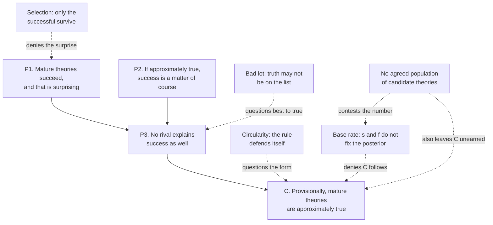

# Philosophy of Science · Lesson 5.1: Realism and the no-miracles argument

> ⏱ ~15 min · Module 5: Scientific realism · Builds on: [2.2](02-02-duhem-quine-and-underdetermination.md), [4.3](04-03-unification-and-the-pragmatics-of-explanation.md), [`philosophical-method` 2.1](../../philosophical-method/lessons/02-01-inference-to-the-best-explanation.md), [`philosophical-method` 2.4](../../philosophical-method/lessons/02-04-weighing-evidence-in-odds-form.md) · Unlocks: [5.2](05-02-the-pessimistic-induction-and-selective-realism.md)

## Why this matters

In 1908 Jean Perrin began counting microscopic grains at different heights in a suspension, and got a value for Avogadro's number. By about 1912 he could reach that number by thirteen different routes, among them Brownian motion, the blue of the sky and radioactivity, all in close agreement, and Wilhelm Ostwald, long an opponent of atoms, conceded. Nobody had seen an atom. Why should agreement persuade anyone of what nobody has seen, and does the same reasoning work for science as a whole? That is the question of [scientific realism](../reference.md#scientific-realism).

## The idea

Scientific realism bundles three claims. There is a world that does not depend on our minds. What our theories say about it means what it appears to mean: "electron" is about electrons, not shorthand for meter readings. And our best theories are roughly right about that world, including the parts nobody can see. You can keep the first two and reject the third, and much of the debate lives in that gap.

Why believe the third? Suppose a stranger's sketch map takes you through a dozen junctions of a city you have never visited, at night, and correctly warns you of a bridge closed this week. The simple account is that it is roughly right about the streets; a wrong map would need luck at every turn. Say that about physics instead of a map and you have the no-miracles argument. It is the pattern of [inference to the best explanation](../../philosophical-method/lessons/02-01-inference-to-the-best-explanation.md), run on science itself.

You have also met what can go wrong with it. A test with a high hit rate and a low false-alarm rate can still be wrong about most of the people it flags, if the condition is rare ([`prob-stat-refresher` 1.2](../../prob-stat-refresher/lessons/01-02-conditional-probability-bayes.md), and [`philosophical-method` 2.4](../../philosophical-method/lessons/02-04-weighing-evidence-in-odds-form.md) for the odds form used here). If success is the positive test, how rare was truth among the candidates? And what were the candidates?

## The argument

**The [three theses](../reference.md#three-theses-of-realism)** (Stathis Psillos, *Scientific Realism: How Science Tracks Truth*, 1999, Introduction).

- **Metaphysical.** The world science studies exists independently of minds. *In words:* it would be there if nobody theorized about it. Denied by idealism, and by neo-Kantian views that tie the studied world to our frameworks.
- **Semantic.** Theoretical claims are to be read literally, as true or false, including claims about unobservables. *In words:* "electron" talk means what it says. Denied by classical [instrumentalism](../reference.md#instrumentalism).
- **Epistemic.** Mature, predictively successful theories are approximately true, so what they posit, or something close to it, exists. *In words:* science gives knowledge of the unseen too. Denied by [constructive empiricism](../reference.md#constructive-empiricism) ([5.4](05-04-constructive-empiricism-and-entity-realism.md)), which keeps the semantic thesis.

Much turns on a working line between [observable and unobservable](../reference.md#observable-and-unobservable): what unaided human senses could perceive in favourable conditions, and what they could not. Realism gives the line no epistemic weight; its opponents do, and [5.4](05-04-constructive-empiricism-and-entity-realism.md) tests how firm it is. Wilfrid Sellars's contrast of the manifest and scientific images asks the same question at full scale: which picture says what exists ([`phenomenology-and-personalism` 1.4](../../phenomenology-and-personalism/lessons/01-04-the-lifeworld-and-the-crisis-of-the-sciences.md)).

**The [no-miracles argument](../reference.md#no-miracles-argument).** Hilary Putnam's claim (*Mathematics, Matter and Method*, 1975, p. 73) compared philosophies: realism alone does not make the success of science a miracle. He credited Richard Boyd, whose version ("The Current Status of Scientific Realism", 1984) starts from method: scientific methods lean on background theories, and their reliability is best explained by those theories being approximately true. In the schema of [`philosophical-method` 2.1](../../philosophical-method/lessons/02-01-inference-to-the-best-explanation.md):

**P1.** Mature theories are strikingly successful, above all in [novel prediction](../reference.md#novel-prediction), and that is surprising. *In words:* there is something to explain.

**P2.** If those theories were approximately true, their success would be a matter of course. *In words:* truth would make sense of it.

**P3.** No rival explains that success as well; a false theory's success would be a miracle. *In words:* nothing else does the job.

∴ **C.** Provisionally, mature theories are approximately true. *In words:* believe what they say, unobservables included, until something better turns up.

This is an inference to the best explanation, not an induction: it does not project the next case from past cases but infers what would account for a whole pattern. And it is meta-level: the hypothesis is about theories, the evidence is their record. Whewell had claimed that consilience never yet testified for a hypothesis "afterwards discovered to be false" (*The Philosophy of the Inductive Sciences*, 1840, vol. II), and Darwin that "a false theory" could hardly explain so much ([4.3](04-03-unification-and-the-pragmatics-of-explanation.md)). The argument says the same of science at large.

**[Selection](../reference.md#selection-reply-to-no-miracles).** Bas van Fraassen (*The Scientific Image*, 1980, p. 40) attacks P1. Theories compete and only the successful survive, so their success is no more surprising than that surviving organisms are adapted. The realist replies that selection explains why the survivors as a class are successful, not why this theory is.

**[Circularity](../reference.md#circularity-charge).** Larry Laudan (1981) and Arthur Fine ("The Natural Ontological Attitude", 1984) object that the argument uses inference to the best explanation to vindicate inference to the best explanation, the very step a doubter questions. Psillos (1999, ch. 4), after Braithwaite, answers that it is [rule-circular](../../epistemology/lessons/04-03-answering-hume.md), not premise-circular: no premise says the rule is reliable. Rule-circularity, he holds, is not vicious if using the rule does not guarantee a favourable result and there is no specific reason to doubt it. He grants the cost: the argument justifies the rule from inside and will not convert someone who has already rejected it.

**The [base-rate objection](../reference.md#base-rate-objection)** (Colin Howson, *Hume's Problem*, 2000, ch. 3; Peter Lipton, *Inference to the Best Explanation*, 2nd ed., 2004, pp. 196–198; P. D. Magnus and Craig Callender, "Realist Ennui and the Base Rate Fallacy", 2004). Read "miracle" as "very improbable". $P$ is a credence function, `epistemology`'s $\mathrm{cr}$. For a candidate theory, $T$ is "approximately true", $S$ is "empirically successful", $s = P(S \mid T)$, $f = P(S \mid \neg T)$ is the false-success rate, and $\pi = P(T)$ is the base rate among candidates. By Bayes' theorem,

$$P(T \mid S) = \frac{s\pi}{s\pi + f(1-\pi)}.$$

*In words:* three numbers fix the posterior, and the argument states two: P2 says $s$ is high, and the miracle talk says $f$ is low. Setting $P(T \mid S) \ge \tfrac12$ and solving gives

$$\pi \ge \frac{f}{s+f}.$$

*In words:* the argument needs one more premise, that truth was not rarer among the candidates than this threshold.

**Where the argument is weakest.** P3, at the step from "best" to "true". Do the explanatory virtues track truth, or only convenience? Van Fraassen's [bad lot](../reference.md#bad-lot-argument) (*Laws and Symmetry*, 1989, p. 143) says that ranking the theories on hand shows nothing unless the truth is likely to be among them, a privilege nobody has established; and he counts simplicity and explanatory power as reasons to use a theory, not to believe it. Lipton sharpens the worry: the [loveliest explanation](../reference.md#likeliest-and-loveliest), the one that would give most understanding if true, is not by definition the likeliest, and the inference needs the first to guide us to the second. The strongest reply demands that the winner be good enough as well as best (Alan Musgrave, 1988; Lipton, "Is the Best Good Enough?", 1993), so that winning a poor field earns nothing. The realist concedes that the inference is only as strong as the case that the field of rivals was adequate. The doubter concedes that the virtues have guided successful practice, and owes an account of why virtues that do not track truth would track empirical success so well.

## Argument map

Solid arrows are the argument; dashed arrows are attacks, and the bottom node cuts against the base-rate objection and the conclusion alike.

## Worked examples

**Example 1 (clean case: the base rate with numbers).** Invent $s = 0.9$, $f = 0.1$, $\pi = 0.02$. Of 1,000 candidate theories, 20 are approximately true and 18 of those succeed; 980 are not, and 98 of those succeed. So 18 of 116 successes are approximately true:

$$P(T \mid S) = \frac{0.9 \times 0.02}{0.9 \times 0.02 + 0.1 \times 0.98} = \frac{0.018}{0.116} = \frac{9}{58} \approx 0.155.$$

In odds: prior $1:49$, likelihood ratio $9$, posterior $9:49$. Success multiplied the odds ninefold and the theory is still probably not approximately true. The threshold is $\pi = 0.1/(0.9 + 0.1) = 0.1$: of 1,000, 100 true theories yield 90 successes and 900 others yield 90. The realist answers that $f$ is far smaller. At $f = 0.01$ with the same $\pi$, the posterior is $0.018/0.0278 = 90/139 \approx 0.647$, and the threshold falls to $1/91 \approx 0.011$. "Miracle" is a claim about $f$; the objection is about what $f$ alone can do.

**Example 2 (hard case: what are the candidates?).** Keep $s = 0.9$. The rest is invented, since nobody has these numbers.

| Population of candidates | $\pi$ | $f$ | $P(T \mid S)$ |
|---|---|---|---|
| Every theory consistent with the data so far | 0.001 | 0.1 | $1/112 \approx 0.009$ |
| Theories proposed in print | 0.02 | 0.1 | $9/58 \approx 0.155$ |
| Theories a field selects for serious testing | 0.2 | 0.1 | $9/13 \approx 0.692$ |
| The same, if selection also makes false theories succeed more | 0.2 | 0.3 | $3/7 \approx 0.429$ |

The formula gives a verdict once $\pi$ and $f$ are fixed. Nothing in it says which row is right, and that is where it stops. Psillos (*Knowing the Structure of Nature*, 2009) grants that the base rate cannot be measured, because "theory", "success" and "approximate truth" do not individuate a countable population, and he reads "miracle" as unexplained, not improbable, so that $\pi$ is no input to an explanatory argument. Howson ("Exhuming the No-Miracles Argument", 2013) answers that without a prior the argument delivers no high posterior. Leah Henderson (2017) denies that theories are sampled at random, and Richard Dawid and Stephan Hartmann (2018) show $P(T \mid S) > \tfrac12$ whenever $P(S) > 2f$, trading $\pi$ for the success rate of selected theories. Keith Dyck (2023) replies that selection raises $f$ too, which is the last row. Each side lacks the number; neither has shown it small or large. Magnus and Callender draw the moral that wholesale arguments about science at large are stuck, and that the arguments worth having are [retail](../reference.md#wholesale-and-retail-arguments), about particular theories on particular evidence. Perrin's thirteen routes, atom-realism's best case, are of that kind, though even they need a prior of their own.

## Watch out

- **You might think realism says our theories are true, but actually** the epistemic thesis says mature theories are approximately true, and many realists grant that most past theories, and perhaps our best ones strictly speaking, are false. The first two theses are not distinctive either: van Fraassen keeps the semantic one.
- **You might think the no-miracles argument is an induction over science's track record, but actually** it is an inference to the best explanation of that record. The pessimistic induction of [5.2](05-02-the-pessimistic-induction-and-selective-realism.md) is the induction.
- **You might think the base-rate objection shows successful theories are probably false, but actually** it shows that $s$ and $f$ do not fix the posterior. It gives no reason to think $\pi$ is small.
- **You might think observable means observed, but actually** a rock on the far side of the Moon is observable whether or not anyone has looked, and an electron is unobservable however many tracks it leaves.

## One-liner

> The no-miracles argument says approximate truth best explains success; the base-rate objection says success cannot tell you how likely truth is until you know how rare truth was among the candidates, and no one agrees what the candidates are.

## Problems

**P1 (🟢) *(Exegetical.)*** For each view, name the one thesis of the three that it denies. One line each.

(a) Percy Bridgman, *The Logic of Modern Physics* (1927): a concept means nothing more than a set of operations, and is synonymous with that set.

(b) Van Fraassen, *The Scientific Image* (1980): a theory's claims about unobservables are true or false, read literally, but accepting a theory involves believing only what it says about observables.

(c) George Berkeley ([`modern-philosophy` 3.4](../../modern-philosophy/lessons/03-04-berkeley-immaterialism.md)): nothing unthinking exists apart from being perceived.

(d) Which of these authors keeps exactly the thesis Bridgman denies, and what does keeping it amount to? One line.

**P2 (🟡) *(Formal (a)–(c) · Exegetical (d).)*** For a candidate theory, let $T$ be "approximately true" and $S$ "empirically successful". Take $P(S \mid T) = 0.8$, $P(S \mid \neg T) = 0.2$ and $P(T) = 0.04$, all invented.

(a) Compute $P(T \mid S)$ directly and in odds form.

(b) Holding $P(S \mid T)$ and $P(T)$ fixed, what is the largest value of $P(S \mid \neg T)$ at which $P(T \mid S)$ still reaches one half?

(c) Let $S_1, S_2, S_3$ be successes that are conditionally independent given $T$ and given $\neg T$, each with the probabilities above. Give the posterior after two and after three.

(d) Two sentences: what does "miracle" assert in terms of $P(S \mid \neg T)$, and what would (c)'s independence assumption require of Perrin's thirteen routes?

**P3 (🔴) *(Steelman and reply. Evaluative.)*** Fine's charge is that the no-miracles argument begs the question against anyone who doubts inference to the best explanation. In 150 words or fewer: state the charge at its strongest; give the rule-circularity defence; then say whether a community reasoning by "inference to the worst explanation" could run the same defence for its own rule, and what your answer costs the realist. Any verdict.

Solutions

**P1** *(Exegetical)*

**Must hit, strict:**

- (a) Semantic. A term's meaning is exhausted by operations, so a claim using it is not read at face value as describing something beyond them.
- (b) Epistemic. Literal truth-aptness is kept; belief stops at the observable.
- (c) Metaphysical. Nothing of the kind exists independently of minds.
- (d) Van Fraassen. Claims about unobservables are literally true or false; he withholds belief, he does not reinterpret them.

**Wrong turns:** calling (a) epistemic: Bridgman does not say the evidence falls short of what a concept describes, but that the concept means the operations. Reading (b) as saying unobservables do not exist: the view is agnostic. Reading (c) as a thesis about scientific language: Berkeley's denial is about what exists.

**Model answer:** (a) Semantic. (b) Epistemic. (c) Metaphysical. (d) Van Fraassen keeps the semantic thesis: "electron" sentences are true or false as they stand, and he simply does not commit to which.

---

**P2** *(Formal (a)–(c) · Exegetical (d))*

(a) Directly:

$$P(T \mid S) = \frac{0.8 \times 0.04}{0.8 \times 0.04 + 0.2 \times 0.96} = \frac{0.032}{0.032 + 0.192} = \frac{0.032}{0.224} = \frac17 \approx 0.143.$$

In odds: prior $0.04 : 0.96 = 1:24$, likelihood ratio $0.8/0.2 = 4$, posterior odds $4:24 = 1:6$, so $P(T \mid S) = \frac{1}{1+6} = \frac17$.

(b) $P(T \mid S) \ge \tfrac12$ iff $s\pi \ge f(1-\pi)$, so

$$f \le \frac{s\pi}{1-\pi} = \frac{0.8 \times 0.04}{0.96} = \frac{0.032}{0.96} = \frac{1}{30} \approx 0.033.$$

(c) With conditional independence, each success multiplies the odds by 4, so after $n$ successes the posterior odds are $\tfrac{1}{24} \times 4^n$.

- $n = 2$: odds $\tfrac{16}{24} = \tfrac23$, so $P = \tfrac{2}{2+3} = \tfrac25 = 0.4$.
- $n = 3$: odds $\tfrac{64}{24} = \tfrac83$, so $P = \tfrac{8}{8+3} = \tfrac{8}{11} \approx 0.727$.

**Must hit, strict (d):**

- "Miracle" says $P(S \mid \neg T)$ is very small: a theory that is not approximately true would very rarely succeed. Part (b) says how small it has to be at this base rate.
- Independence requires that, given the atomic hypothesis is true and given it is not, one route's success does not make another's likelier. The thirteen count as thirteen only so far as they share no assumption or bias that could make them agree anyway.

**Wrong turns:** reporting 0.8 or 0.2 as the posterior. In (b), solving for $\pi$ instead of $f$. In (c), adding the likelihood ratios, or assuming the successes are unconditionally independent: they are positively correlated overall, since each raises the probability of $T$.

---

**P3** *(Evaluative)*

**Must hit, any verdict:**

- State the charge so its target would accept it: the argument's conclusion concerns the reliability of explanatory inference and its form is explanatory inference, so a doubter of that rule has been given no reason.
- State the defence: premise-circularity against rule-circularity, that no premise asserts the rule is reliable, and a condition for non-viciousness (the rule's use does not guarantee a favourable result; no specific reason to doubt it).
- Apply the parity test to the worst-explanation rule and say what the answer costs: if the track record rules it out, the realist has appealed to something beyond the rule itself; if the defence is available to that community too, rule-circularity alone discriminates nothing.

**Wrong turns:** calling the argument premise-circular. Treating "rule-circular" as the end of the matter. Reading Fine as denying that science succeeds or that scientists explain. This parity point is the one [`epistemology` 4.3](../../epistemology/lessons/04-03-answering-hume.md) makes with Salmon's counterinductive rule.

**Model answer, one of several:** Fine's charge: the conclusion that explanatory inference is reliable is reached by explanatory inference, so whoever doubts the rule has been handed the rule. The realist reply is that no premise asserts reliability, so the argument is rule-circular only, and such circularity is harmless when the rule can deliver unfavourable results and nothing specific impugns it. A worst-explanation community can recite the same words. The realist must then say the rule's record distinguishes them: worst explanations have mostly led to failure. That appeal costs something. It uses a standard of success the doubter may accept only for observable outcomes, and it concedes that rule-circularity is not doing the discriminating. The defence shows the realist's position is coherent from inside; it does not show the doubter is wrong to stand outside.

## Flashback

**From Lesson [4.4](04-04-laws-in-the-sciences.md) (Laws in the sciences):** *(Exegetical. Apply to a hard case.)* Bergmann's rule, in its within-species form: populations of a warm-blooded species in colder places have larger bodies, since a larger body loses less heat per unit mass. Suppose (invented, written for this problem) that on one mountain the high, cold shrew populations are smaller, because winter food cannot sustain a large body.

(a) Give the rule a [ceteris paribus](../reference.md#ceteris-paribus-laws) clause with one comparative part and one exclusive part. One line each.

(b) How do a ceteris paribus reading and a [tendency](../reference.md#tendency-laws) reading each treat the mountain shrews? One sentence each.

(c) Even undisturbed, the rule faces Beatty's [evolutionary contingency thesis](../reference.md#evolutionary-contingency-thesis). State the complaint, weakly and strongly, and give Sober's way of keeping a law. Three sentences in all.

Solution

**Accept (a):** any comparative part holding other factors fixed, and any exclusive part requiring a named disturbing factor to be absent.

**Must hit, strict:**

- (a) Comparative: food and predation the same across the populations compared. Exclusive: no famine severe enough to cap body size.

- (b) Ceteris paribus: the scarcity is a disturbing factor, so the shrews are exempted and the rule says nothing about them. Tendency: the rule states what cold contributes in every case, so the push toward size operates in these shrews too and is outweighed.

- (c) The heat-loss geometry is physics; that populations respond by size is the distinctively biological part, and nothing necessitates it. Weakly, the conditions that made the pattern common can change. Strongly, the same cold could yield a functionally equivalent alternative, such as denser fur or torpor.

- (c) Sober: the law is the conditional "if historical conditions $I$ obtain, then thereafter if colder then larger", which need not be contingent.

**Wrong turns:** merging the two readings, which disagree about the shrews (exempted or outweighed). Offering the shrews as Beatty's point: an exception is the hedge's problem, and contingency concerns the rule where it holds. Writing the exclusive part as "unless something prevents it", which is the empty horn of the [dilemma](../reference.md#falsity-or-triviality-dilemma).

**Model answer:** (a) Same food and predation in the populations compared; no famine capping body size. (b) Ceteris paribus: the famine exempts the shrews. Tendency: cold still pushes toward size here and is outweighed. (c) Even undisturbed, the rule records what evolution produced: its conditions could change (weak), and fur or torpor could have met the same cold (strong). Sober keeps a law as the conditional from $I$ to "colder, then larger".

## Connections

- **Backward:** the schema and the discipline of generating rivals are [`philosophical-method` 2.1](../../philosophical-method/lessons/02-01-inference-to-the-best-explanation.md), which sent the question of whether the virtues track truth here; [1.6](01-06-simplicity-and-curve-fitting.md) is where simplicity got its two rival accounts. [4.3](04-03-unification-and-the-pragmatics-of-explanation.md) read Darwin's "false theory" inference, and [2.2](02-02-duhem-quine-and-underdetermination.md)'s [contrastive underdetermination](../reference.md#contrastive-underdetermination) is the threat this argument is meant to answer. Rule-circularity and Salmon's counterinductive rule are [`epistemology` 4.3](../../epistemology/lessons/04-03-answering-hume.md).
- **Forward:** [5.2](05-02-the-pessimistic-induction-and-selective-realism.md) turns the same record of success against realism, and the [pessimistic induction](../reference.md#pessimistic-induction) faces the matching base-rate complaint. [5.3](05-03-structural-realism.md) and [5.4](05-04-constructive-empiricism-and-entity-realism.md) cut the epistemic thesis back. Particular theories go to [`philosophy-of-physics`](../../philosophy-of-physics/syllabus.md).
- **Sideways:** [`apologetics-foundations` 2.2](../../apologetics-foundations/lessons/02-02-answering-the-atheist-philosophers.md) charges that "best explanation" smuggles in a prior, and this is the parallel case, a meta-level inference accused of hiding one. The naturalist's record in [`apologetics-foundations` 3.1](../../apologetics-foundations/lessons/03-01-naturalism-at-its-best.md) is the enumerative cousin: an induction where this is an explanation, and contested at the same joint, over which successes count. The same form runs for numbers in [`metaphysics` 1.2](../../metaphysics/lessons/01-02-abstract-objects.md)'s indispensability argument and, as a challenge, for moral facts in [`ethics` 6.1](../../ethics/lessons/06-01-moral-realism.md). Perrin is where atomism as a programme ends up after [`ancient-medieval-philosophy` 1.2](../../ancient-medieval-philosophy/lessons/01-02-zeno-and-the-atomists.md).
